# Android Camera 平台管线：HAL3、Buffer、ZSL 与显示

Camera 不是单 Producer 到单 Surface 的线性管线：同一 request 可以生成多个 buffer，由预览、拍照、分析或编码按各自的节奏接收。本文把 HAL3 request-result、逐 stream buffer 所有权、ZSL 重处理和预览显示放在一条责任链上讲；我们诊断时，沿 request、result、buffer、fence 与时间戳分别追踪。

<!-- gracker-diagram: ch13-10-01-three-responsibilities -->
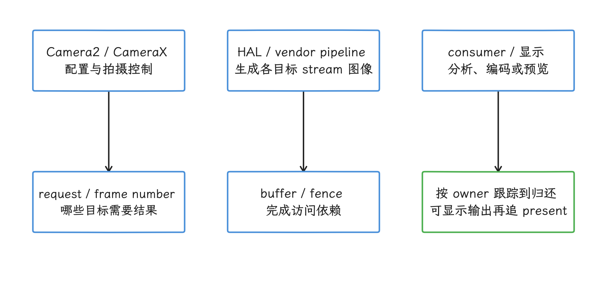

图：同一 session 的控制、逐流 buffer 与最终显示分别追踪。 只有进入显示链路的输出才有对应显示反馈。

> 源码基线：AOSP `android-17.0.0_r1`，Android 17 / API 37；内核 `android17-6.18-2026-06_r6`。

## Camera 管线和普通 UI 有什么不同

Camera 预览中的像素通常不经过宿主 View 的绘制逻辑。sensor 完成曝光后，ISP（Image Signal Processor，图像信号处理器）与 vendor pipeline（厂商算法处理链）处理图像，Camera HAL 再把结果写入多个输出 buffer。宿主 App 负责配置 Surface、下发拍摄控制、消费分析结果，并选择预览进入窗口系统的承载方式。

同一组 capture request 可以持续产生 preview、record、analysis 和 still capture 输出，每一路都有自己的格式、尺寸、buffer pool（可循环复用的一组 buffer）、consumer（读取并最终归还 buffer 的一方）和归还节奏。所以预览正常，还说明不了分析或录像也正常：某个 consumer 长时间占用 buffer，可能通过共享的 ISP stage、HAL pipeline 或内存预算影响其他输出。这种下游消费变慢、阻塞上游继续生产的现象就是 backpressure（反压）。

本文的结论来自平台源码、kernel 与设备实现的对照。AOSP 能说明的是 framework、cameraserver、HAL 接口和显示系统的公共部分；再往设备侧走，Camera provider / AIDL 或 HIDL HAL、ISP firmware、sensor driver、vendor tag 和 CameraX 版本都属于设备实现，曝光策略、ISP 算法、buffer 缓存和 vendor tracepoint（厂商自定义跟踪点）同样取决于设备，要在目标设备上验证。

<!-- gracker-diagram: ch13-10-03-request-targets -->
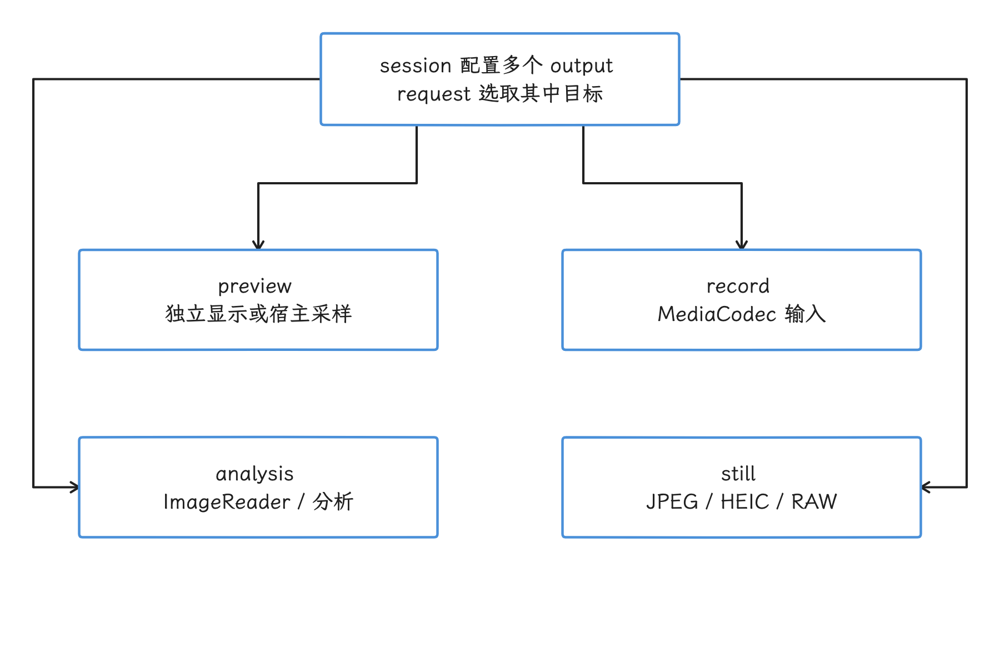

图：每笔 request 只为选中的 targets 提供结果。 多路为逻辑输出；不保证每帧同时选择全部四类。

## HAL3 的 request-result 与多消费者

Camera2 把相机建模成一条能同时处理多笔在途请求的流水线：`CaptureRequest` 带着一帧的控制参数和目标 Surface 进入，`CaptureResult` 返回曝光、对焦等 metadata，HAL 的 `StreamBuffer` 结构则携带图像 buffer 和同步信息。请求按 frame number 排序进入 HAL，但同一 frame 的 partial metadata（分批给出的阶段性结果）、final metadata 和各路输出 buffer 可以在不同时间返回。所以我们收到某一份 metadata 时，该帧的图像输出未必都已就绪。

下面的图把 preview、record、analysis 和 still capture 放在同一组 HAL3 输出里。

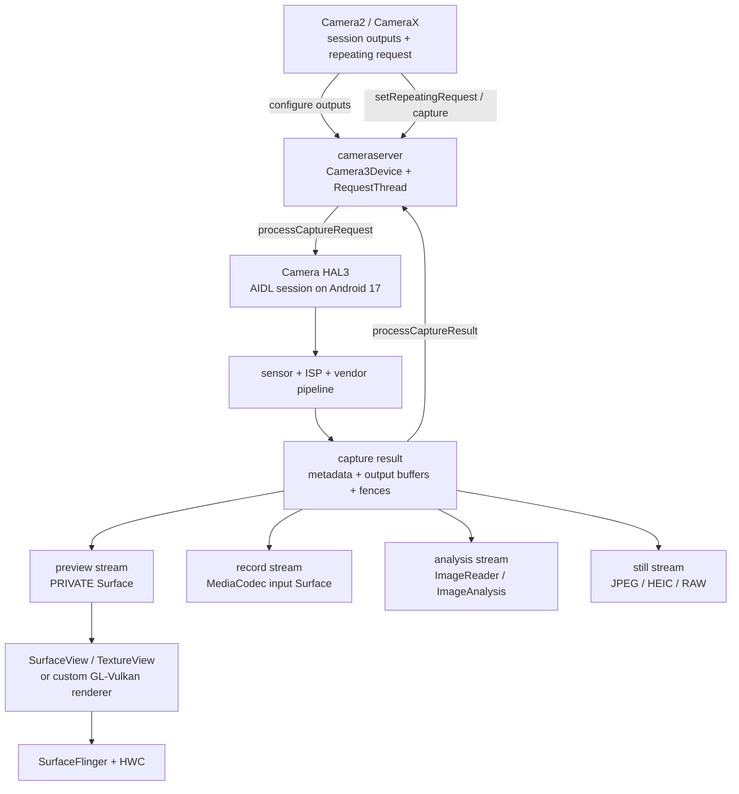

图中的多路输出通常各自使用一组 stream buffer，并不依赖同一块 GraphicBuffer 在多个 consumer 之间顺序传递。HAL 可以让同一次曝光和 ISP 中间结果服务多路输出，每个 consumer 仍须独立归还所属 stream 的 buffer。

### 配置阶段决定这组输出能不能成立

App 创建 `CameraCaptureSession` 时提供一组 `OutputConfiguration`。framework 将格式、尺寸、dataspace、usage、dynamic range、stream use case、timestamp base 等输出属性传给 `Camera3Device::configureStreamsLocked()`，再进入 Android 17 AIDL `ICameraDeviceSession.configureStreams()` 或 `configureStreamsV2()`。这里的 stream 指一条逻辑输出通道，它有固定的输出属性和确定的 consumer。

HAL 返回每个 stream 的 producer usage、override format 与 `maxBuffers`；判断配置是否成立时，我们要区分三层约束：

<!-- gracker-diagram: ch13-10-05-configuration-negotiation -->
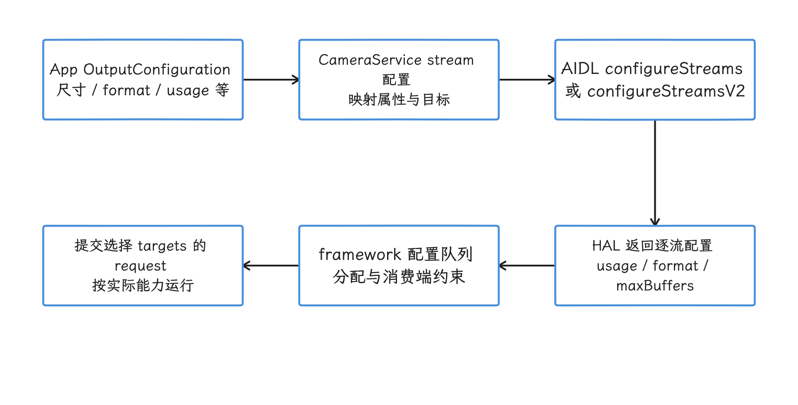

图：App 属性、framework 配置与 HAL 返回值共同决定流。 受支持尺寸不等于任意多流组合都支持。

1. Camera2 为不同 hardware level 和 capability 定义了 mandatory stream combinations，即符合条件的设备必须支持的输出组合；
2. “单个格式支持某尺寸”和“这组尺寸和格式可以同时开启”是两回事；
3. 即便组合受支持，实际 fps 仍受多个因素影响：`getOutputMinFrameDuration()` 给出连续输出两帧的最短间隔；stall duration 表示某类输出可能额外占用管线、延迟后续请求的时间；sensor mode、热限制与 vendor pipeline 也会改变可达帧率。

创建失败、首帧慢或运行中反复黑屏时，我们先确认 session 是否在反复重配；只检查 `CaptureRequest` 参数，很容易漏掉更早发生的 stream negotiation（输出组合协商）问题。

<!-- gracker-diagram: ch13-10-06-combination-throughput -->
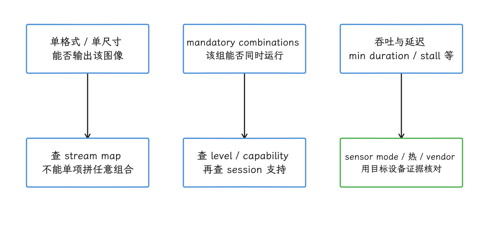

图：先检查组合约束，再衡量帧时长与设备状态。 声明支持不保证目标场景始终达到固定 fps。

#### `HalStream` 返回的格式、usage 与 buffer 约束

CameraService 会把宽高、格式、dataspace、旋转和消费方 usage（用途标志）等信息交给 HAL，Android 17 的 AIDL HAL 再通过 `HalStream` 返回几项关键结果：

- `overrideFormat`：`IMPLEMENTATION_DEFINED` 输出可由 HAL 选择实际格式；
- `producerUsage`：输出流上 HAL 需要的 gralloc 用途标志；
- `consumerUsage`：输入流上 HAL 需要的用途标志；
- `maxBuffers`：HAL 同时可能持有的最大缓冲区数量；
- `overrideDataSpace`：允许覆盖的色彩数据空间（dataspace）；
- `enableHalBufferManager`：会话级可配置模式下，决定该流是否由 HAL 按需请求缓冲区。

系统框架会合并生产方与消费方的用途标志，再交给图形内存分配器。对于 `IMPLEMENTATION_DEFINED` 格式，最终布局可能取决于相机写入端以及显示、GPU、编解码器等读取端的组合要求；仅凭公开像素格式，stride（步幅）、plane offset 或压缩方式都推不出来。

<!-- gracker-diagram: ch13-10-07-halstream-fields -->
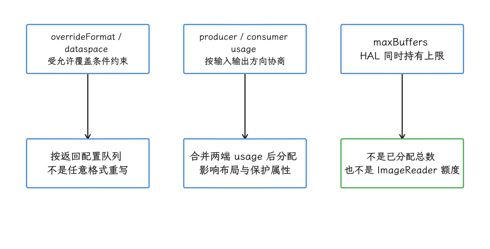

图：HAL 返回格式、用途和持有上限，allocator 决定实际布局。 IMPLEMENTATION_DEFINED 不能只靠公开 format 推出 stride。

#### 队列容量与 `maxBuffers` 的构成

`Camera3OutputStream::configureConsumerQueueLocked()` 会先通过 `NATIVE_WINDOW_MIN_UNDEQUEUED_BUFFERS` 查询消费方要求保留、生产方不可取用的最小缓冲区数（源码变量 `maxConsumerBuffers`），再计算基础队列容量：

```text
mTotalBufferCount =
    maxConsumerBuffers
    + camera_stream::max_buffers
```

这两项的来历不同：消费方要留下自己仍在读取或显示的缓冲区（对应 `maxConsumerBuffers`），HAL 也要有缓冲空间推进它的处理流水线（pipeline，对应 `camera_stream::max_buffers`）。算出的值描述该输出 `Surface` 的基础队列容量；预览显示同步或 `PreviewFrameSpacer` 路径还可能在此基础上追加额外缓冲或 framework 缓存。`Camera3Stream::getBuffer()` 还会检查 HAL 已取走的缓冲区数量，达到 `max_buffers` 时就等缓冲区返回，并把等待时间记进 `wait on max_buffers` 延迟直方图。

<!-- gracker-diagram: ch13-10-08-queue-capacity -->
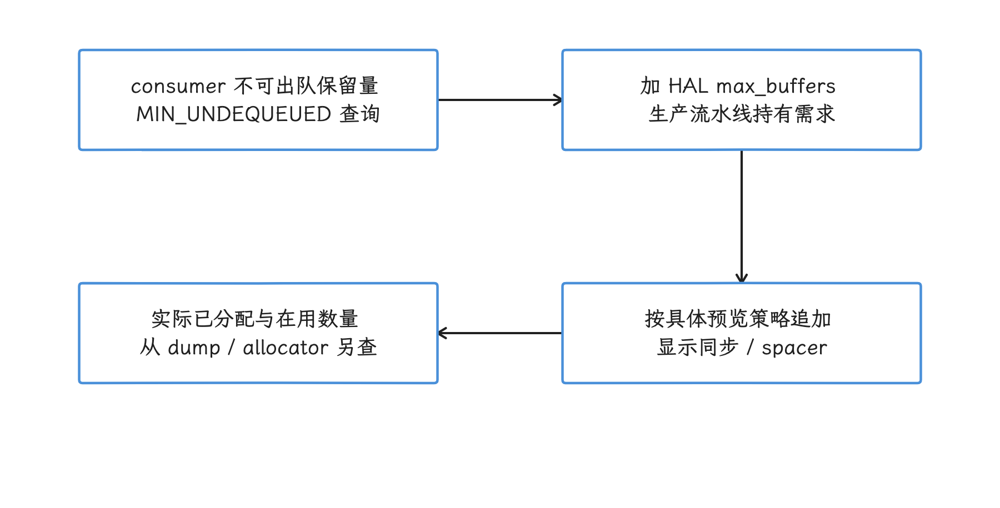

图：基础容量来自 consumer 保留量与 HAL max_buffers。 显示同步或 framework 暂存可再追加，容量不等于驻留。

想靠增大 `maxBuffers` 掩盖消费方处理缓慢是行不通的：增加它可能让处理流水线暂时不阻塞，也会增加该流中可同时驻留的图像内存；而且这个字段由 HAL 根据流水线需求声明，错误的数值还可能破坏系统框架与 HAL 的流量控制约定。

#### `Camera3BufferManager` 与 HAL buffer management

源码中还有一个 `Camera3BufferManager`。它属于 CameraService 内部，可以让兼容的流复用系统框架管理的 `GraphicBuffer`，再通过 `attachBuffer()` 接入具体的 BufferQueue。启用后，`Camera3OutputStream` 会禁止相应的 BufferQueue 自行分配缓冲区。

HAL 缓冲区管理 API 则由 HAL 通过 `requestStreamBuffers()` 向 CameraService 取得缓冲区。两套机制可以出现在同一条调用路径中，但调用方、接口和目标都不同：

| 名称 | 所在侧 | 主要作用 |
|---|---|---|
| `Camera3BufferManager` | CameraService 内部 | 在系统框架管理的兼容流之间调度 `GraphicBuffer` |
| HAL 缓冲区管理 | Camera HAL 与 CameraService 之间 | 把捕获请求提交与输出缓冲区获取分开 |

我们排查日志或源码时，先确认上下文所指的是哪一个 BufferManager。

<!-- gracker-diagram: ch13-10-09-two-buffer-managers -->
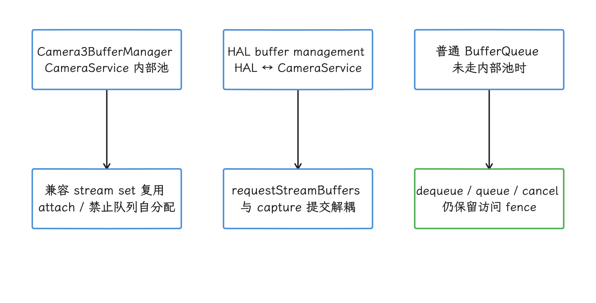

图：Camera3BufferManager 与 HAL 按需取 buffer 是两套机制。 可在同一调用链出现，不能仅凭名字判断内存池。

### API 37 的运行中 Surface 替换

Android 17 / API 37 新增 `CameraCaptureSession.updateOutputConfigurations(List)`，可为 deferred output 补上有效 Surface，也可在不关闭整个 session 的前提下替换既有输出 Surface。deferred output 指创建 session 时已经确定尺寸等属性、但尚未绑定实际 Surface 的输出。它适合在照片、录像等 use case 之间切换 Surface，但可变范围比重新配置整个 session 小：

<!-- gracker-diagram: ch13-10-11-dynamic-limits -->
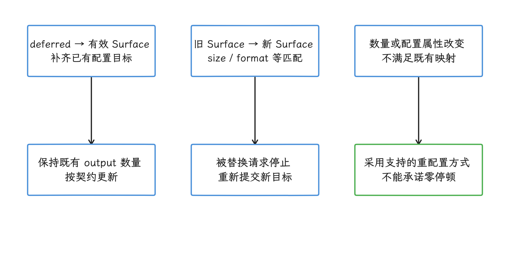

图：更新可以补 deferred Surface 或替换匹配属性的目标。 不支持借此任意新增删除 output 或改变尺寸格式。

- 新列表的 `OutputConfiguration` 数量必须与 session 当前 output 数量相同；
- 每个配置必须能按 size、format 等属性对应到创建 session 时的既有配置；
- 允许替换关联 Surface 或切回 deferred 状态，不允许通过该调用新增或删除 `OutputConfiguration`；
- 调用会停止仍以旧 Surface 为目标的 active request，应用随后需要提交指向新 Surface 的 request；
- framework 会继续跟踪旧 Surface，待在途 buffer 全部返回后才断开旧连接。

`CameraCaptureSessionImpl` 把调用交给 `CameraDeviceImpl.updateOutputConfigurations()`，后者先把新配置映射回现有 stream id，再通过 camera service 更新；被替换的旧 Surface 以弱引用保存在 `mReplacedOutputs`，framework 因此能在不延长 Surface 生命周期的情况下识别尚未归还的旧 buffer。这个 API 省去了整组 session 的关闭与重建；格式、尺寸和 output 数量约束照旧，HAL 的配置校验也照常生效。

<!-- gracker-diagram: ch13-10-10-dynamic-surface-swap -->
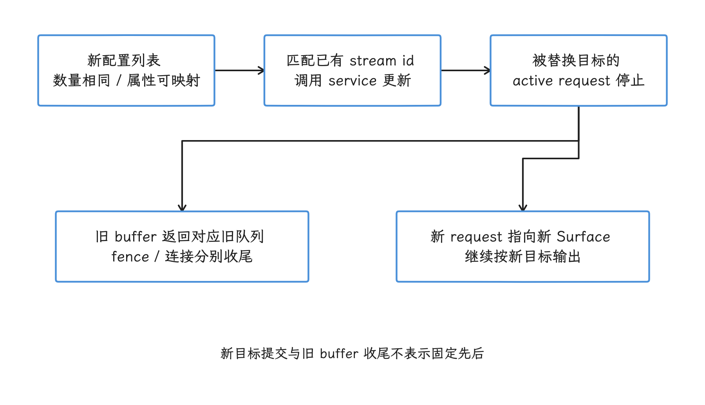

图：动态更新复用现有 stream 配置并分别回收旧目标。 Java 弱引用辅助识别，native 生命周期负责在途对象。

### Stream Use Case 与 capture intent

Android 13 / API 33 引入 `OutputConfiguration.setStreamUseCase()`，让 App 为单个 output 声明 preview、still capture、video record、preview-video-still、video call 或 cropped RAW 等长期用途，HAL 可以据此选择 sensor mode、厂商 tuning 配置和 image-processing pipeline。它是一项配置提示，帧率和延迟不在它的承诺范围里。

它与 `CONTROL_CAPTURE_INTENT` 的分工不同：

- stream use case 描述单个 output 的长期用途，必须在 session 创建前设置；
- capture intent 描述当前 request 的拍摄意图，主要帮助设备选择整笔请求的 3A（自动对焦、自动曝光、自动白平衡）与处理策略；
- 设备必须声明 `REQUEST_AVAILABLE_CAPABILITIES_STREAM_USE_CASE`，并公布可用 use case 与 mandatory combinations；
- 非 mandatory 组合中的 use case 可能因硬件约束被忽略，帧率或延迟也就无从保证。

所以别为 Stream Use Case 预先假定固定的延迟收益或切换帧数：流配置是否触发 sensor mode 切换、切换需要多久，取决于具体 HAL 与拍摄场景。

<!-- gracker-diagram: ch13-10-04-result-boundaries -->
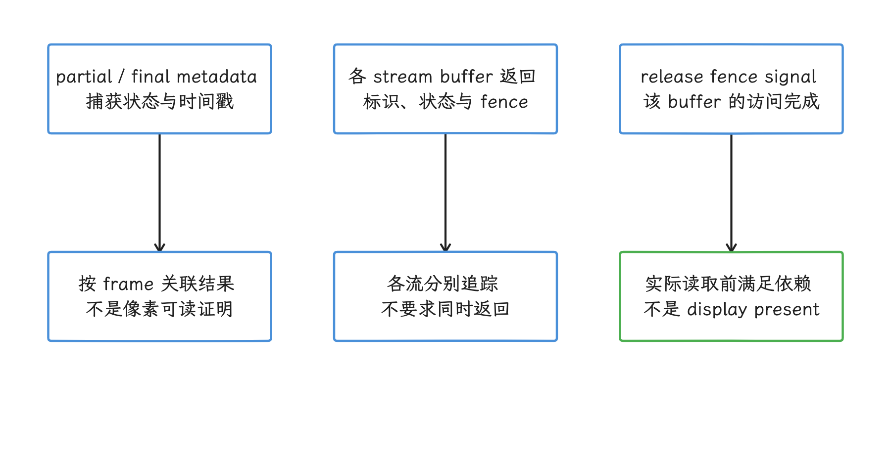

图：同帧 metadata 和不同 stream buffer 可以分批返回。 返回带 fence 的对象时，硬件可能仍在写入。

<!-- gracker-diagram: ch13-10-12-usecase-intent -->
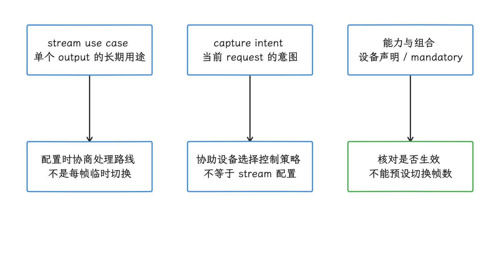

图：长期 output 用途与逐 request 拍摄意图分开设置。 use case 是协商提示，性能收益需在设备上测量。

## Request 与 buffer 的生命周期

我们理解 Camera 掉帧时，要先把 request 的执行进度和 buffer 的占用状态分开看。Camera pipeline 需要多笔 request 同时在途，但不必从 request 入队开始就为每笔请求持有全部 output buffer——Android 10 引入 HAL3 buffer management 之后，“请求进入 pipeline”和“HAL 取得输出 buffer”可以发生在不同时间。

### Framework-managed buffer：先借 buffer，再提交 request

某路输出未启用 HAL 缓冲区管理时，`RequestThread` 会在调用 HAL 前为该捕获请求取得输出缓冲区。

<!-- gracker-diagram: ch13-10-13-framework-buffers -->
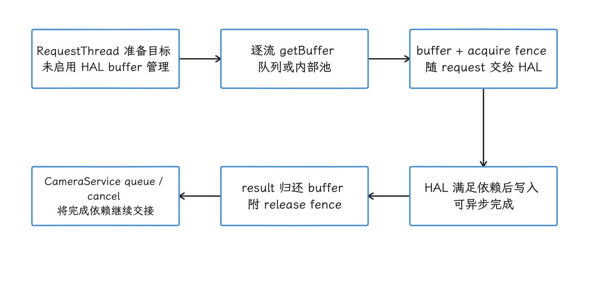

图：未启用 HAL 管理的输出在提交前取得 buffer。 拿到 slot 后仍可能需要等待此前 consumer 的 fence。

#### Surface 交出可写 buffer

`Camera3OutputStream::getBufferLockedCommon()` 最终会调用 `ANativeWindow::dequeueBuffer()`，调用成功后得到两样东西：

- 一个 `ANativeWindowBuffer`，它的 handle 指向 `GraphicBuffer`；
- 一个 fence fd，表示上一个消费方何时结束对该缓冲区的使用。

`Camera3OutputStream::getBufferLocked()` 把栅栏填进 `camera_stream_buffer.acquire_fence`，再把缓冲区交给 HAL；源码注释明确说明，此后这个 fence fd 由 HAL 持有。

<!-- gracker-diagram: ch13-10-14-dequeue-paths -->


图：普通 dequeue、共享池 attach 与批量预取是不同取得方式。 这些分支都不能省略 buffer 的同步依赖。

#### HAL 等待 acquire fence 后写入

HAL 在读写缓冲区前必须等待 acquire fence。对于输出流，这一步能避免 HAL 覆盖 GPU、SurfaceFlinger、视频编码器或应用仍在读取的旧内容。

如果 acquire fence 为空，表示无需等待。若 HAL 因错误没有等待该栅栏，AIDL `StreamBuffer` 约定要求 HAL 把原 acquire fence 作为 release fence 退回，让系统框架在复用缓冲区前仍能等待正确的完成时刻。

#### HAL 以 release fence 归还结果

HAL 通过 `processCaptureResult()` 返回以下内容：

- 流与缓冲区标识；
- `BufferStatus.OK` 或 `ERROR`；
- release fence，表示 HAL 何时停止访问该缓冲区。

release fence 为空，表示调用 `processCaptureResult()` 时 HAL 已经完成所有访问；若栅栏有效，HAL 可以先返回结果，再由下游异步等待。栅栏发出 signal 后，HAL 不得再次访问该缓冲区。

<!-- gracker-diagram: ch13-10-16-async-result-fence -->
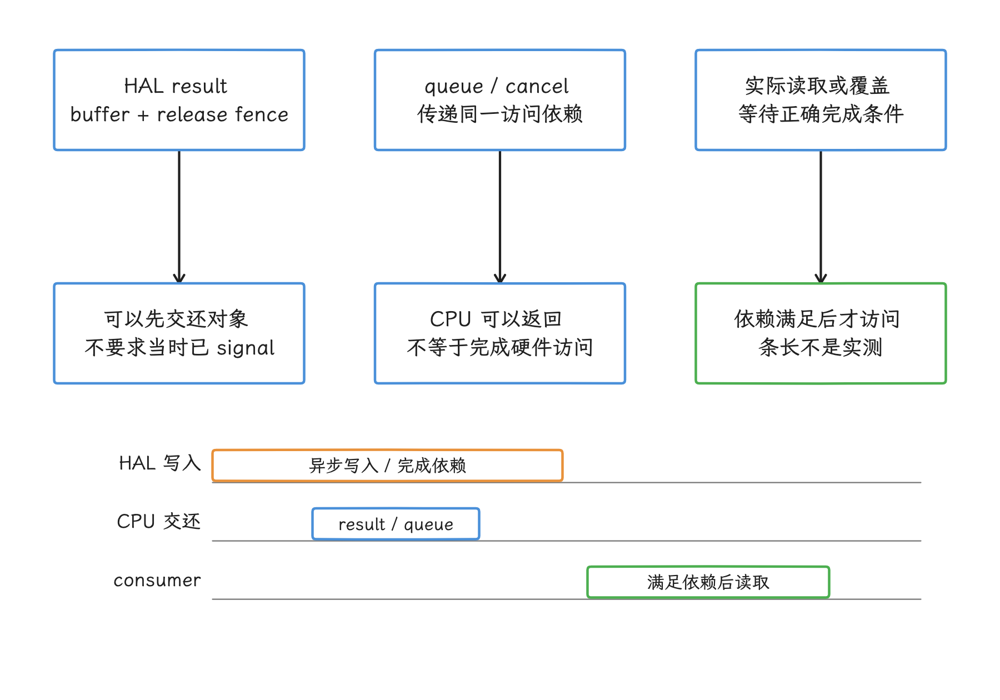

图：HAL 可以先返回带有效 fence 的 buffer，再完成硬件访问。 这是允许的依赖示例；result、queue 均不能代替 signal。

#### CameraService 决定 queue 或 cancel

`Camera3OutputStream::returnBufferCheckedLocked()` 总会接收 HAL 的 release fence，并根据结果选择以下路径：

<!-- gracker-diagram: ch13-10-17-queue-cancel -->


图：CameraService 按状态、丢帧标志与时间戳选择 queue 或 cancel。 两条路径都须保留 HAL release fence，读取不能越过依赖。

- 缓冲区正常且时间戳有效时，调用 `queueBuffer()` 交给 `Surface` 消费方；
- 缓冲区状态为错误、流正在丢帧或时间戳为 0 时，调用 `cancelBuffer()`；
- 两条路径都会携带 HAL release fence，保证下游或队列在 HAL 停止访问后再处理该缓冲区。

正常入队后，BufferQueue 中的这个栅栏从消费方视角又称为 acquire fence：消费方要等它发出信号后才能读取新图像。这是同一个同步对象跨越接口后发生的命名变化，并没有额外生成一条相机栅栏。

#### consumer 释放后才能再次出队

消费方用完缓冲区后，会把 release fence 交回 BufferQueue；下一轮生产方通过 `dequeueBuffer()` 取回该队列槽位时，同时拿到表示消费方完成时间的栅栏。CameraService 再把它放进 HAL 的 acquire fence 字段，缓冲区生命周期就此进入下一轮。

完整顺序可以写成：

```text
consumer release fence
        ↓
BufferQueue dequeueBuffer()
        ↓
HAL acquire fence → HAL wait/write
        ↓
HAL release fence
        ↓
BufferQueue queueBuffer()
        ↓
consumer acquire/wait/read
```

所以判断栅栏方向时，我们要同时写明“谁准备读或写”和“谁已经结束访问”；只记 `acquire`、`release` 两个名字，在 HAL 接口和 BufferQueue 接口之间很容易说反。

<!-- gracker-diagram: ch13-10-18-slot-vs-access -->
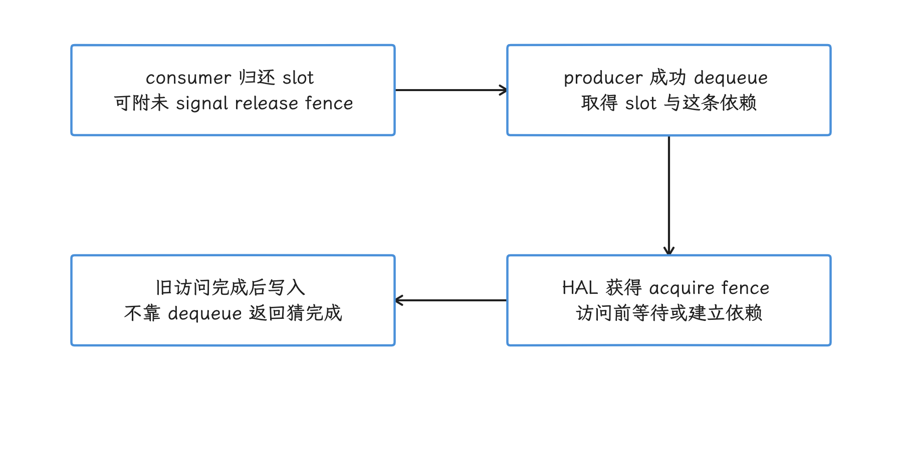

图：dequeue 成功与此前读取完成可以发生在不同时刻。 HAL 真正写入前必须满足收到的 acquire fence。

<!-- gracker-diagram: ch13-10-15-fence-perspectives -->
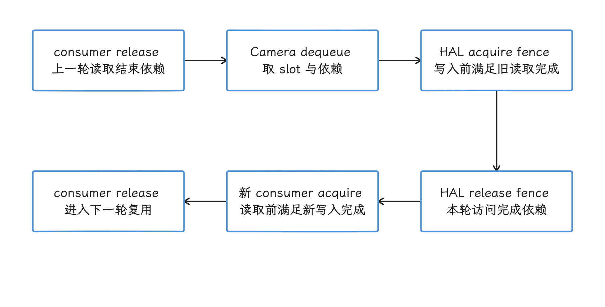

图：按当前写入方和读取方解释 acquire / release。 同名字段不等于同一阶段，更不能只按 fd 数字认对象。

### HAL buffer management：request 先走，buffer 按需借

Android 10 引入了可选的 HAL3 缓冲区管理 API：HAL 处理流水线可以同时排队 N 个捕获请求，但可能只在接近输出的阶段需要少量缓冲区；如果系统框架在请求进入 HAL 前就为所有输出取齐缓冲区，暂时用不到的图像内存也会长时间驻留。

两类行为同时存在：

<!-- gracker-diagram: ch13-10-19-hal-managed-decoupling -->
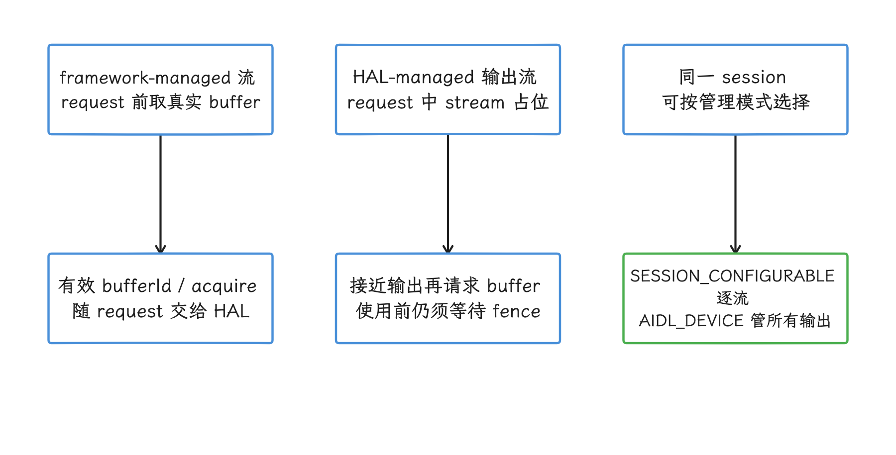

图：HAL-managed 输出先提交 stream 占位，再按需获取图像存储。 空 handle 也可能是缓存省略；占位要结合 bufferId=0。

- 未启用的流：系统框架仍随捕获请求提供真实的输出缓冲区；
- 已启用的流：捕获请求中只有流的占位信息，`buffer` 为空，HAL 稍后再调用 `requestStreamBuffers()`。

在 `SESSION_CONFIGURABLE` 模式下，HAL 可以通过 `HalStream.enableHalBufferManager` 逐流选择；在 AIDL 设备级模式下，系统框架会把全部输出流视为由 HAL 管理。

#### `requestStreamBuffers()` 不预先绑定 frame

Android 17 的 `AidlCamera3OutputUtils.cpp` 明确说明：一次 `requestStreamBuffers()` 返回的缓冲区不与某个 `CaptureRequest` 预先绑定。HAL 可以：

1. 为多条流批量请求若干缓冲区；
2. 选择其中一个用于某一帧；
3. 把已使用的缓冲区随该帧的 `processCaptureResult()` 返回；
4. 把多取但未使用的缓冲区经 `returnStreamBuffers()` 退回。

CameraService 会逐条流检查：

<!-- gracker-diagram: ch13-10-20-request-stream-buffers -->
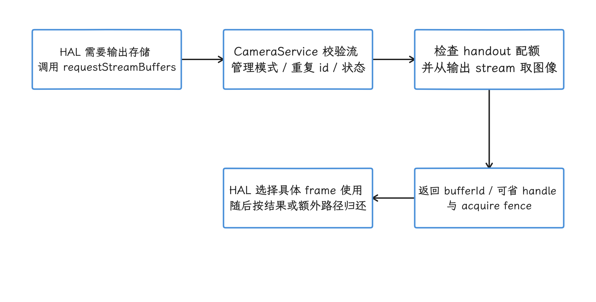

图：HAL 同步请求可跨多个 stream，返回后再关联具体 capture。 批量过大可能拉长调用，宜用专用线程并保留失败处理。

- 流是否存在且启用了 HAL 缓冲区管理；
- 是否重复请求同一个流 ID；
- `Surface` 是否已断开；
- “当前尚未归还数 + 本次请求数”是否超过 `maxBuffers`；
- 当前是否正在 `configureStreams()`。

可能的结果包括 `STREAM_DISCONNECTED`、`NO_BUFFER_AVAILABLE`、`MAX_BUFFER_EXCEEDED` 与 `FAILED_CONFIGURING`。`requestStreamBuffers()` 是同步调用，AIDL 注释建议 HAL 使用专用线程，并避免在延迟敏感的路径中一次请求大量缓冲区。

<!-- gracker-diagram: ch13-10-21-buffer-request-status -->
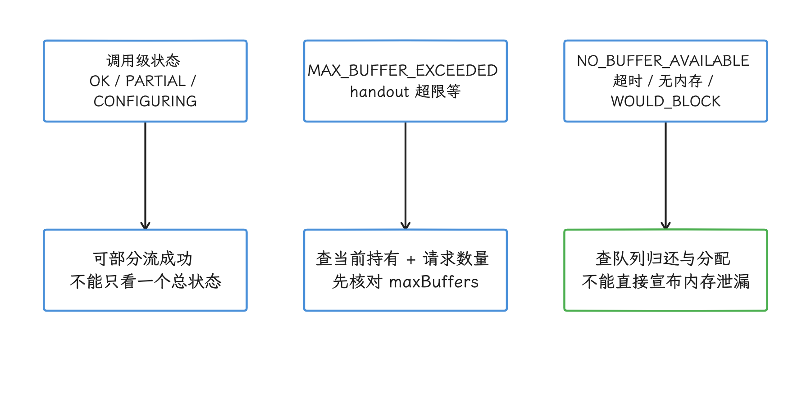

图：先看调用级 BufferRequestStatus，再看逐流错误。 MAX_BUFFER_EXCEEDED 与 NO_BUFFER_AVAILABLE 不能混作同一根因。

#### `bufferId`、handle 与 cache 生命周期

每帧都跨 Binder 重复传递 native handle 会增加开销，`StreamBuffer` 因此采用 `streamId + bufferId` 建立缓存约定：

- 某个缓冲区第一次交给 HAL 时，同时携带 `bufferId` 和原生句柄；
- HAL 记住两者的映射；
- 同一个缓冲区后续再次出现时，只传 `bufferId`，句柄为空；
- `CaptureResult` 返回时句柄也为空，系统框架根据帧、流和缓冲区记录找回原对象；
- `processCaptureRequest(..., cachesToRemove)` 要求 HAL 删除已经失效的缓存项。

流被移除、会话关闭或系统框架通知删除缓存项后，旧映射即告失效，HAL 不可继续使用；把 `bufferId` 当作跨会话稳定的句柄，可能造成对象释放后仍被使用、缓冲区错配或设备错误。

<!-- gracker-diagram: ch13-10-22-buffer-id-cache -->
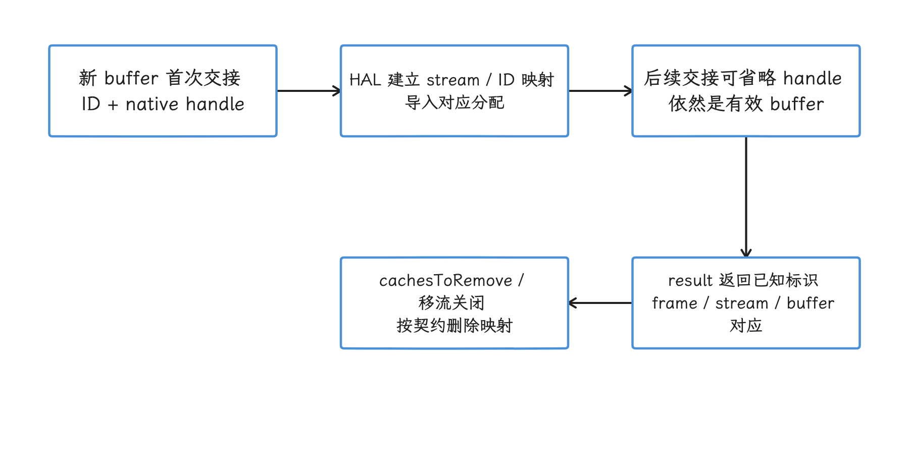

图：初次发送完整 handle，后续可用 streamId 与 bufferId 复用映射。 缓存删除、移流与关闭均须遵循有效期，不能跨会话套用。

<!-- gracker-diagram: ch13-10-23-extra-buffer-return -->


图：关联 capture 输出的图像走 result，额外图像走独立归还。 额外图像可能被内部使用过，返回仍要遵守 fence。

#### `returnStreamBuffers()` 只归还未使用 buffer

HAL 已把缓冲区用于某帧时，应随 `processCaptureResult()` 返回。只有多取或预取后未使用的缓冲区，才通过 `returnStreamBuffers()` 归还。CameraService 找回相应的处理中缓冲区后，会用错误状态和时间戳 0 将其交还输出流，最终调用 `cancelBuffer()`，不会把它作为有效图像送给消费方。

#### `signalStreamFlush()` 与 `flush()` 的责任差异

两个接口都会促使缓冲区返回，但语义不同：

<!-- gracker-diagram: ch13-10-24-flush-contracts -->
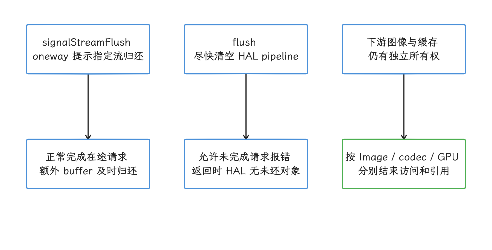

图：流重配置提示和整体快速清空遵循不同请求完成规则。 接口返回对象不代表所有下游 consumer 已释放图像。

| 接口 | 目的 | 待处理请求的处理 |
|---|---|---|
| `signalStreamFlush()` | 为流的重新配置回收 HAL 手中的缓冲区 | HAL 应正常完成已有请求，并及时归还指定流的缓冲区 |
| `flush()` | 尽快清空整个捕获流水线 | 允许把未完成缓冲区标为 `ERROR`，返回时不得再有尚未完成的请求或尚未归还的缓冲区 |

`signalStreamFlush()` 是异步提示，`streamConfigCounter` 用来判断它是否晚于相应的 `configureStreams()` 到达；HAL 只看 Binder 调用的到达顺序，是判断不出配置代次的。

<!-- gracker-diagram: ch13-10-25-configuration-generation -->


图：并发调用按配置代次判断，不能只看 Binder 到达顺序。 旧 counter 的 stream flush 提示可被识别为过期。

### `maxBuffers` 由 HAL 逐流返回

`camera_stream::max_buffers` 在 `Camera3Stream` 构造时为 0，HAL 在 configure 阶段按 stream 返回上限。outstanding buffer 指已经交给 HAL、尚未归还的 buffer，cached buffer 则已被系统框架记入缓存，后续请求可以复用它的 handle 信息。`Camera3Stream::getBuffer()` 会在 outstanding output buffer 达到 `max_buffers`，或 outstanding 与 cached buffer 达到相应总上限时等待归还；`returnBuffer()` 无论 queue 是否成功都会唤醒等待方。

input stream 也按 HAL 返回的 `max_buffers` 控制 handout（已交出但尚未收回）的数量。这里的 `maxBuffers` 属于 HAL stream 配置，`ImageReader.maxImages` 则限制应用可同时取得且尚未关闭的 `Image` 数量：二者会相互影响，却不是同一个参数。某台设备或某个 CameraX 版本里的观察值写成 HAL3 通用规则会出错，用固定 buffer 数直接估算所有设备的 ZSL 内存同样靠不住。

`Camera3Device::mInFlightMap` 以 frame number 记录 metadata 是否到达、还有多少 buffer 未归还、是否含 input、是否为 ZSL still 等状态。我们看到这个列表持续变长，就知道 result 或 buffer 没有及时完成；根因可能在 sensor / ISP、HAL、consumer 或 fence，要沿生产端和消费端继续追。

<!-- gracker-diagram: ch13-10-26-three-cache-meanings -->
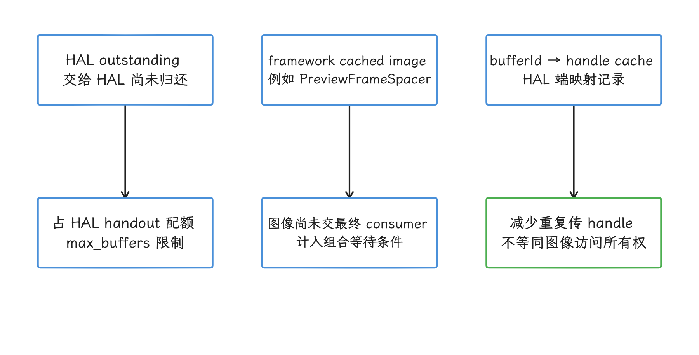

图：HAL outstanding、framework 暂存图像和 handle 映射不是一类缓存。 不能将 handle cache 项数直接当作 stream 中图像在用数。

<!-- gracker-diagram: ch13-10-27-inflight-boundary -->
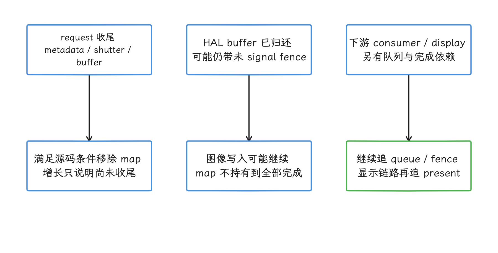

图：in-flight map 只跟踪 request 的结果与 buffer 归还收尾。 map 移除不能证明 fence signal、consumer release 或 present。

### 三类 fence 要分别看

| 同步对象 | 表示什么 | 常见等待方 |
| --- | --- | --- |
| framework 交给 HAL 的 acquire fence | output buffer 何时可以被 HAL 写入 | HAL / ISP / vendor GPU |
| HAL 随 result 返回的 release fence | 图像写入何时完成，consumer 何时可以读取 | BufferQueue、ImageReader、MediaCodec、App GPU |
| SF / HWC 对预览 layer 的 release fence | 显示 consumer 何时不再读取该预览 buffer | BufferQueue / 后续 producer |

acquire 与 release 的命名取决于 buffer 正在跨越哪一次所有权交接，只看 fence 名称，区分不出 Camera 端还是显示端。display present fence 描述一轮显示帧的 present 边界，代替不了 camera capture completion；analysis、record 和 still buffer 可能完全不进显示链路，也就没有对应的 display present fence。

<!-- gracker-diagram: ch13-10-28-three-fence-roles -->
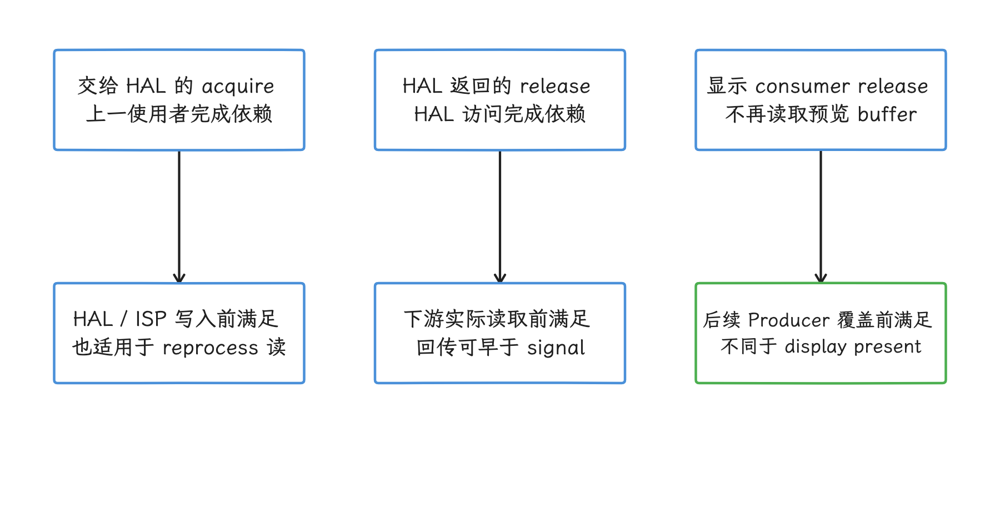

图：每条 fence 都写清哪一方完成了什么访问。 display present fence 不替代 Camera 或分析流的完成。

### 错误、重配置与关闭时的所有权

#### 错误 buffer 仍要保留 fence 语义

HAL 填充缓冲区失败时会把状态设为 `ERROR`；此时如果它从未等待系统框架给出的 acquire fence，就要把该栅栏原样作为 release fence 返回，如果已经等待完成，则可以返回空的 release fence。出错也跳不过同步这一步。

CameraService 收到错误状态的缓冲区后会调用 `cancelBuffer()`。这会把队列槽位还给 BufferQueue，但仍要携带有效栅栏，防止队列过早复用该缓冲区。

#### Surface 断开是逐 stream 错误

应用销毁 `Surface`、`ImageReader` 或编解码器后，`requestStreamBuffers()` 可能得到 `STREAM_DISCONNECTED`，普通 `dequeueBuffer()` 也可能返回 `NO_INIT` 或 `DEAD_OBJECT`。HAL 应对涉及该流的请求报错，再由 CameraService 决定是否重建会话；此后旧的缓冲区句柄对任何一方都不可再用。

<!-- gracker-diagram: ch13-10-29-disconnect-lifetime -->
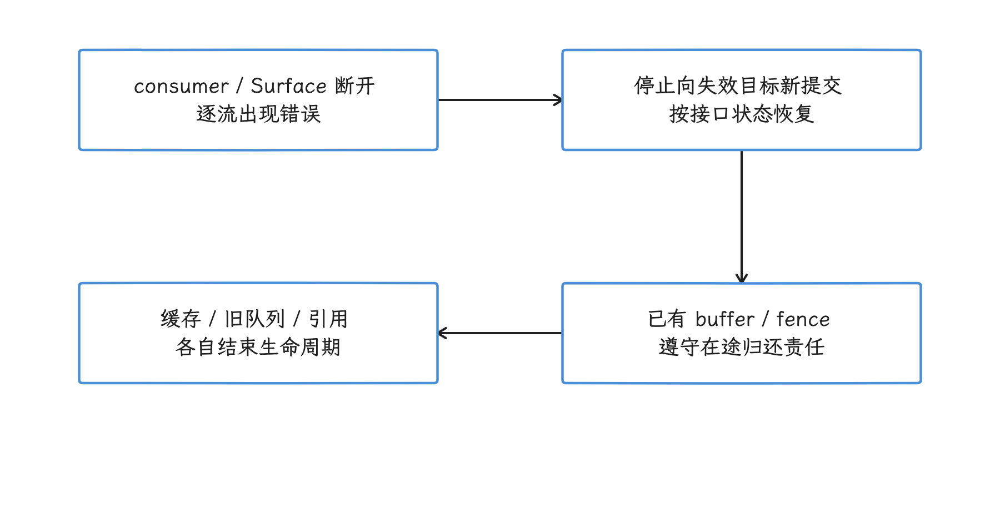

图：失效目标停止新提交，旧引用、在途 buffer 与 fence 分别回收。 断开不代表所有 handle 即时失效或硬件访问瞬间终止。

#### `flush()`、关闭与 cache 失效

AIDL `flush()` 约定返回时，HAL 中已经没有尚未完成的请求或尚未归还的缓冲区，此后系统框架才能安全地调用 `configureStreams()` 或提交新请求。关闭会话或移除流，还会终止 `bufferId` 缓存的有效期。

“相机已经关闭”应至少验证三件事：

- 重复请求已经停止，处理中的帧已经完成或报错；
- 所有输出和输入缓冲区都已返回；
- `Surface`、`Image`、编解码器与自研渲染器都没有继续持有旧对象。

<!-- gracker-diagram: ch13-10-30-close-resources -->
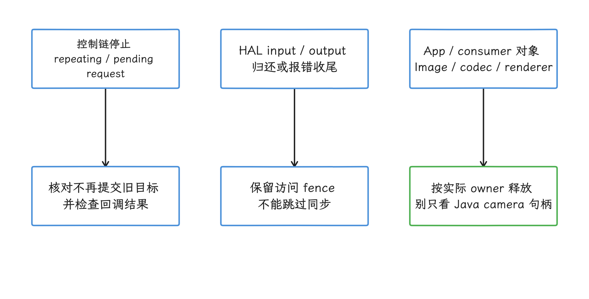

图：停止请求、HAL 收尾和 App 图像资源释放分别检查。 仅调用 CameraDevice.close 不能代表所有 Image / GPU 对象已释放。

## 三种主要消费路径

buffer 交给谁、按什么节奏归还，决定了一条流的内存驻留和吞吐。这一节我们先按 stream 估算内存驻留，再依次看预览、录像、分析三种消费路径：每一路的 consumer 不同，卡住时的现象和检查点也不同。

### 按 stream 估算驻留量与跨流反压

我们粗估相机图像内存时按流求和；下面的公式只用来估计缓冲区驻留量的数量级：

```text
session GraphicBuffer 驻留量
  ≈ Σ（该 stream 已分配 buffer 数 × allocator 返回的单 buffer 大小）
```

这只是排查起点。单个缓冲区的大小还受步幅、平面对齐、压缩元数据、保护属性、分块布局（tile layout）与厂商分配器影响；HAL、ISP 固件、GPU 和编解码器的内部工作缓冲区，也不一定出现在 CameraService 的流统计中。

常见格式的未压缩有效载荷（payload）可以用来检查数量级：

| 格式 | 可见像素数据的粗略量级 | 注意事项 |
|---|---:|---|
| RGBA_8888 | `width × height × 4` | 步幅与压缩会改变物理分配 |
| YUV 4:2:0 | `width × height × 1.5` | 平面步幅与切片高度不能省略 |
| RAW10 | `width × height × 1.25` | 行打包与对齐由实现决定 |
| RAW12 | `width × height × 1.5` | 同上 |
| RAW14 | `width × height × 1.75` | Android 17 能力仍要查询设备特性 |

`IMPLEMENTATION_DEFINED` 没有固定的每像素字节数可套用；BLOB 流则要遵守配置中的 `bufferSize` 限制——估 `GraphicBuffer` 的分配大小时按这个值来，JPEG 文件大小在这里帮不上忙。

各路输出虽然有独立队列，一次 capture request 仍可能同时要求多路结果。分析流积压、预览也跟着掉帧时，我们先把分析 consumer 列为候选，再用 frame number、各 stream result 返回时间和 buffer 归还记录，验证它是不是通过共享 ISP stage、缩放器、带宽或内部池拖慢了其他流。

<!-- gracker-diagram: ch13-10-31-unique-memory -->
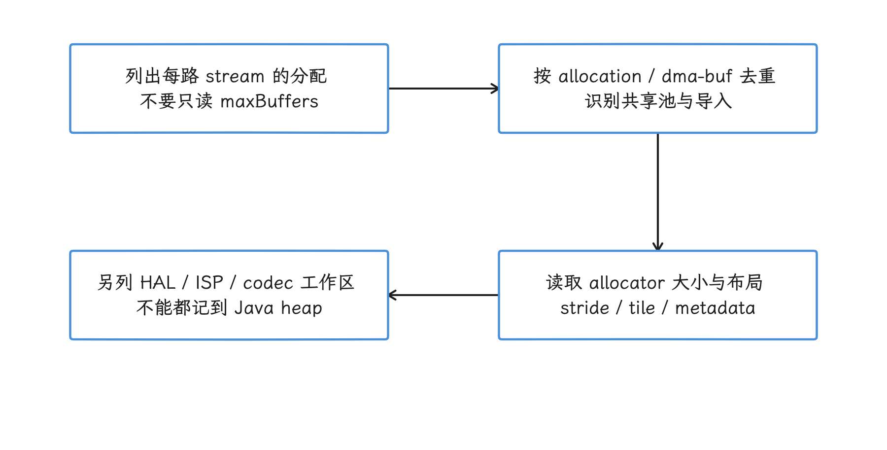

图：按唯一 allocation 的实际分配大小估算驻留。 队列容量、跨组件引用数与唯一图像分配数不同。

<!-- gracker-diagram: ch13-10-32-raw14-layout -->
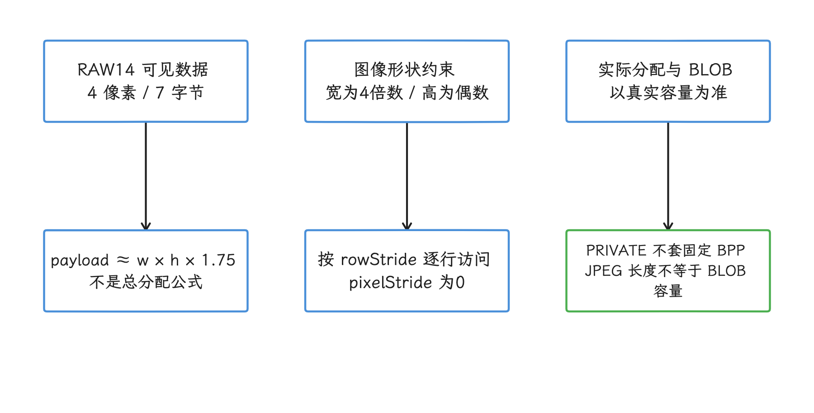

图：RAW14 每 4 像素紧密打包为 7 字节，行布局仍查 rowStride。 公开尺寸约束不等于 gralloc 物理分配没有额外对齐。

<!-- gracker-diagram: ch13-10-33-cross-stream-pressure -->
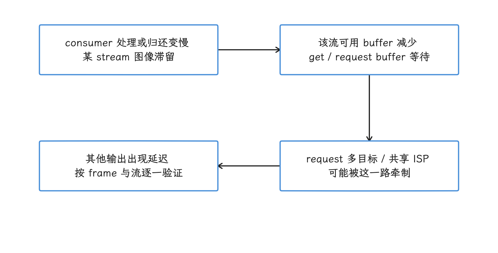

图：分析或编码端持有图像可经共享资源拖慢其他输出。 这是设备侧候选因果，必须用逐流归还和 frame 证据确认。

### Preview：SurfaceView、TextureView 与自研 renderer

预览 carrier（承载方式）决定相机 buffer 怎样进入最终 App 画面。

<!-- gracker-diagram: ch13-10-34-preview-carriers -->
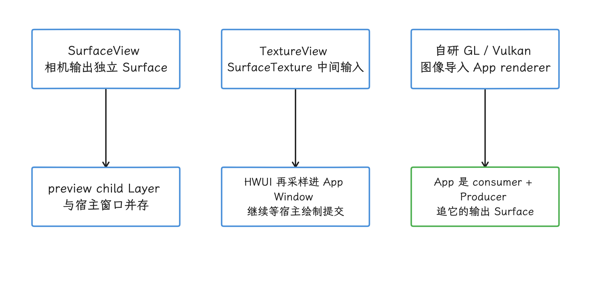

图：carrier 决定 Camera 输入直接显示还是经 App 再生产。 独立 Layer 不保证 HWC DEVICE，App GPU 也不是固定 CPU 拷贝。

| Carrier | Camera buffer 的 consumer | 最终 SF layer | 主要代价与证据 |
| --- | --- | --- | --- |
| `SurfaceView` | Surface / BufferQueue → SurfaceFlinger | preview child layer 与 host App Window 分开 | 少一次宿主纹理采样；查 preview layer buffer、geometry transaction 和 HWC composition type |
| `TextureView` | `SurfaceTexture` → 宿主 HWUI RenderThread | 通常只有 host App Window | 易做 matrix、clip、alpha；增加一次宿主纹理获取、采样与窗口提交 |
| 自研 GL / Vulkan | OES texture、AHardwareBuffer 或 ImageReader → App GPU | 取决于 renderer 的 output Surface | HAL 是第一生产者，App renderer 同时是中间 consumer 与第二生产者 |

`SurfaceView` 预览在现代 Android 上通过 SurfaceControl / BLAST 与宿主窗口协调位置和裁剪，但相机像素仍由独立 BufferQueue 提交。BLAST 是 Surface buffer 与 transaction 协调机制。preview layer 能否采用 HWC DEVICE composition，取决于整组 layer 的格式、缩放、alpha、crop、色彩空间和硬件 plane 资源；SurfaceView 本身只决定承载方式，硬件 overlay 要看这组条件是否凑齐。

<!-- gracker-diagram: ch13-10-35-surfaceview-preview -->


图：相机预览 buffer 经独立队列和 transaction 进入系统显示。 是否 DEVICE composition 要看该帧全部 Layer 的协商结果。

`TextureView` 涉及两条 BufferQueue：camera → SurfaceTexture 负责交付相机纹理，HWUI → App Window 负责提交合成后的应用窗口。所以 camera buffer 到达只说明纹理可供宿主获取，画面还要经过宿主 `Choreographer`、traversal（View 树遍历）、RenderThread 和 host window queue。

<!-- gracker-diagram: ch13-10-36-textureview-two-queues -->
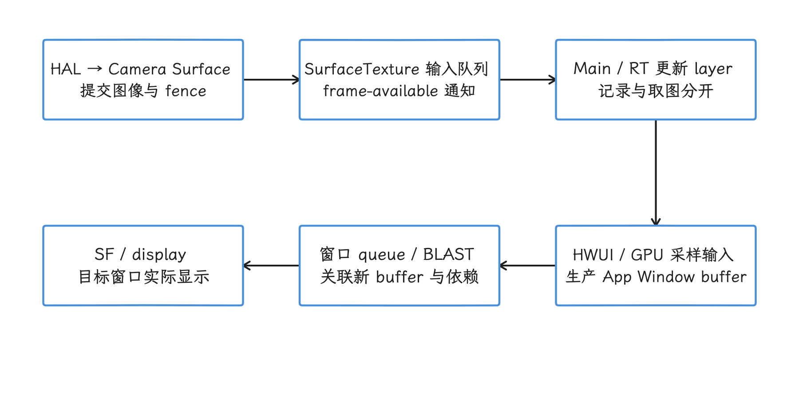

图：相机队列交付纹理，宿主窗口队列再交付合成后的 App 画面。 输入到达不等于宿主完成绘制或显示。

`TextureView` 收到 `SurfaceTexture.OnFrameAvailableListener` 回调后执行 `updateLayer()` 与 `invalidate()`；RenderThread 侧的 `DeferredLayerUpdater::apply()` 再通过 `ASurfaceTexture_dequeueBuffer()` 取得最新 `AHardwareBuffer`，并更新 HWUI layer。这条调用链可以解释一种常见现象：camera release fence 已完成，宿主窗口却因未及时 draw 或提交而继续显示上一帧。

自研滤镜、畸变矫正、分割或 AR 管线还会增加一个 App GPU pass，也就是由应用执行的额外渲染阶段。排查时我们分别测量 camera release fence、App GPU completion 与 output Surface present，免得把应用渲染阶段的延迟误判成 ISP 延迟。

<!-- gracker-diagram: ch13-10-37-texture-three-moments -->
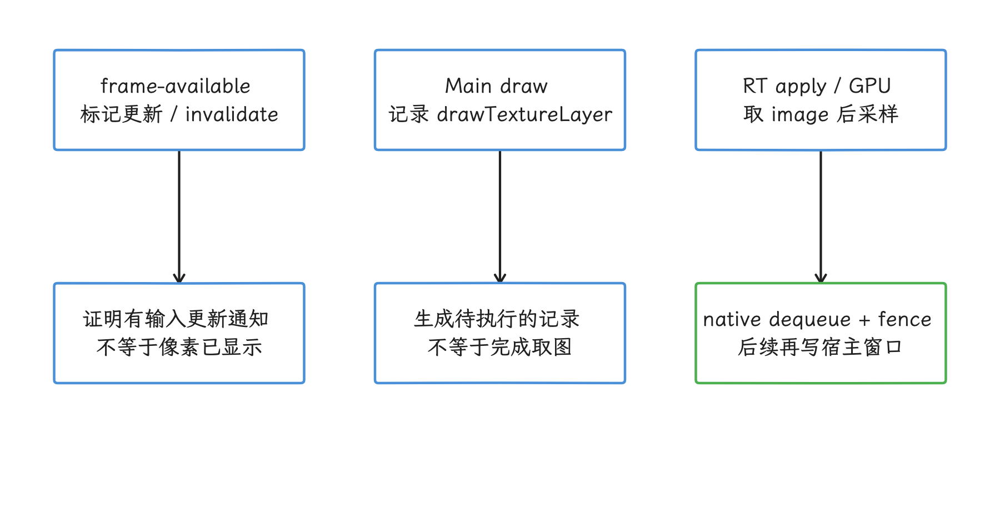

图：回调、Main 记录、RT 取图和 GPU 读取按各自边界取证。 Java 调用栈不必出现 updateTexImage，native 路径仍可取图。

<!-- gracker-diagram: ch13-10-38-app-gpu-reproducer -->
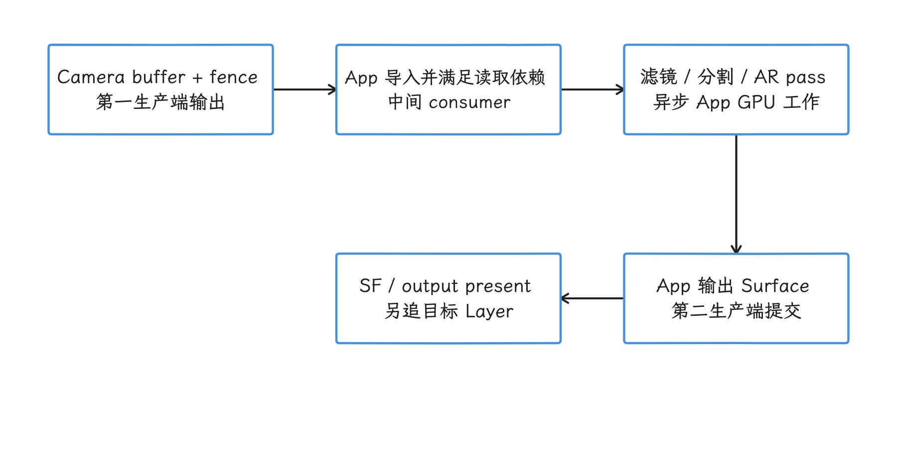

图：App GPU pass 把 Camera 输入转成另一个输出 Surface 的内容。 分别测 Camera 写入、App GPU 与最终输出，不能都算 ISP。

### Recording：MediaCodec 是独立 consumer

录像 stream 通常把 `MediaCodec` 或 `MediaRecorder` input Surface 作为 consumer：HAL 交付原始图像 buffer 之后，encoder 还要接收输入、执行颜色处理与编码，再输出码流。预览平滑而录像丢帧时，我们检查 encoder input queue、codec callback、码率 / 分辨率、thermal throttling（温控降频）与 storage writer，单看 SurfaceFlinger 是不够的。

<!-- gracker-diagram: ch13-10-39-recording-consumer -->


图：编码与存储是独立于预览显示的消费链路。 预览平滑不能证明 codec、muxer 或 storage 正常。

录制与预览可以来自同一组 repeating request，但二者持有不同 stream buffer。encoder 不及时消费会耗尽 recording stream 的可用 buffer；某些 HAL 能隔离该 stream，另一些 pipeline 会因为共享 ISP stage 或资源预算影响后续 request，结论要按设备 trace 判断。

### Analysis：归还速度就是吞吐上限

`ImageReader` / CameraX `ImageAnalysis` 把 YUV、PRIVATE 或其他格式交给 App。同步推理、YUV→RGB、逐帧数组分配、保存 bitmap 或忘记关闭 Image，都可能占满 `maxImages`——这个值表示 App 最多能同时持有多少个尚未 `close()` 的 Image，一旦达到上限，上游就交不出新图像了。

只关心最新结果时，下面的处理骨架展示了怎样缩短持有时间。

<!-- gracker-diagram: ch13-10-42-latest-margin -->
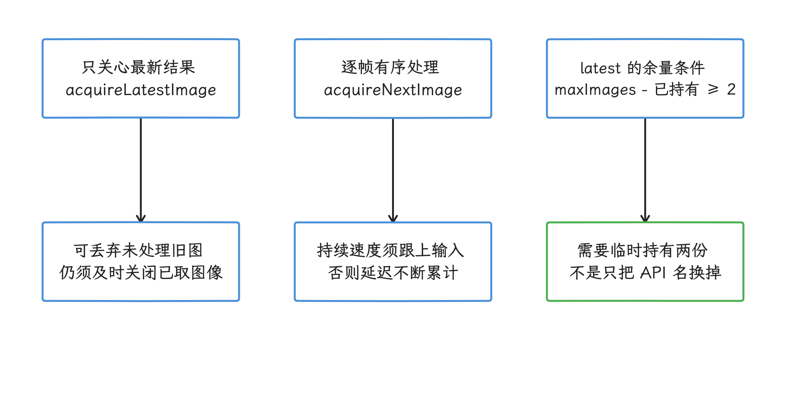

图：latest 丢弃旧图需要至少两份可 acquire 的余量。 maxImages=1 不会自动获得预期的 latest 丢帧行为。

```kotlin
imageReader.setOnImageAvailableListener({ reader ->
    val image = reader.acquireLatestImage() ?: return@setOnImageAvailableListener
    try {
        analyzer.consume(image)
    } finally {
        image.close()
    }
}, analysisHandler)
```

示例中的 `analyzer.consume()` 必须是耗时有界的同步调用。若把 Image 交给异步任务，该任务就成为 owner，必须在任务结束时 `close()`：提前关闭会让 `Image.Plane` 失效，无界排队则会把压力转移到线程池。`acquireLatestImage()` 适合扫码、姿态或预览辅助分析；要求逐帧不丢且保持顺序时，改用 `acquireNextImage()`，并保证 consumer 的持续处理速度不低于输入速度。增大 `maxImages` 换来的只是缓冲余量和内存占用，长期吞吐不足要回到 consumer 的处理速度上解决。CameraX 的 `ImageProxy` 同样必须 `close()`，这个调用会把底层 buffer 归还给相机管线。

<!-- gracker-diagram: ch13-10-40-analysis-acquire-limit -->
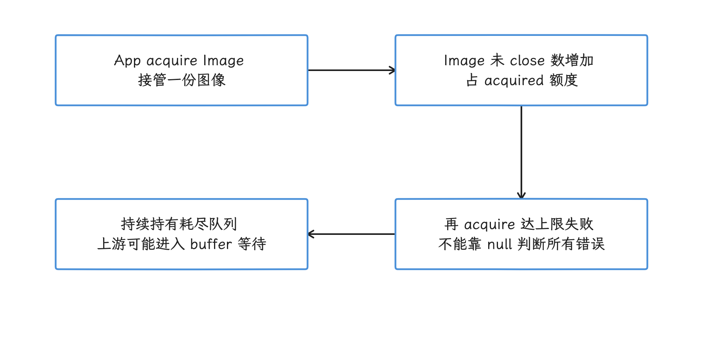

图：maxImages 限制已取得且未关闭的 Image 数。 达到上限后 acquire 抛异常，持续不归还再逐步耗尽队列。

<!-- gracker-diagram: ch13-10-41-analysis-ownership -->
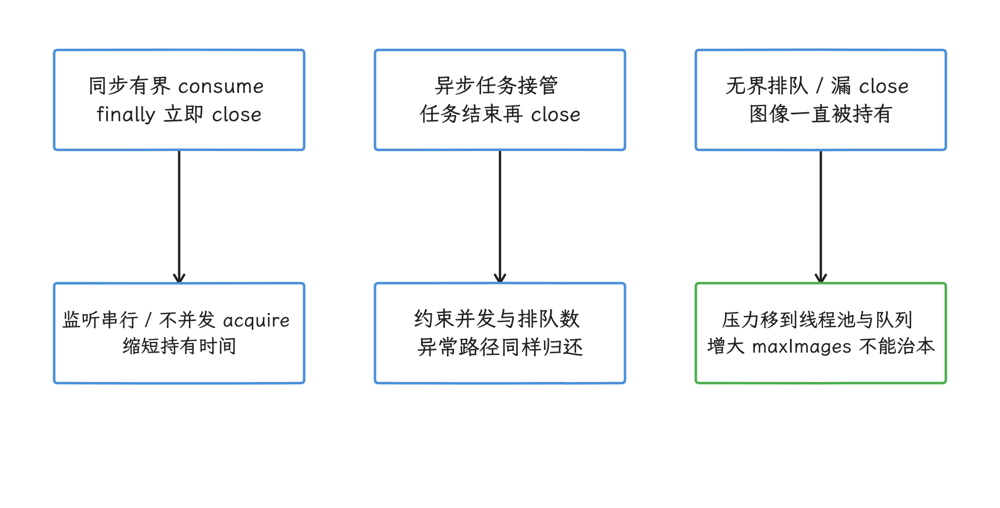

图：同步和异步分析都必须有唯一明确的关闭责任。 ImageProxy 走自身 close；不能提前关闭正在异步读取的图像。

## ZSL 的两种机制

“Zero Shutter Lag”（ZSL，零快门延迟）的做法，是尽量拿按下快门前后已经采集的候选帧缩短等待，名字本身并没有承诺端到端耗时为零。Camera2 与 CameraX 至少涉及两种控制机制，把它们看成一条固定处理链，很容易误判设备能力。

<!-- gracker-diagram: ch13-10-43-two-zsl-controls -->
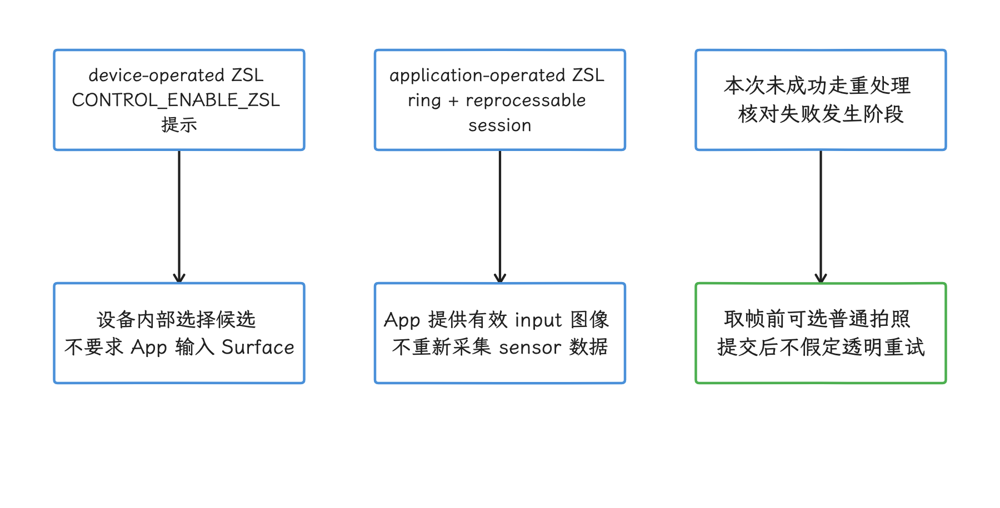

图：设备内部历史选帧与应用持有图像重处理是两种控制机制。 ZSL 不承诺端到端耗时为零，也不证明总会使用历史图像。

### ZSL 省掉了哪一段延迟

一次普通静态拍照可以简化为以下过程：

<!-- gracker-diagram: ch13-10-44-zsl-time-saving -->


图：复用已经存在的候选图像，可减少按键后等待源图像的时间。 重处理、编码和交付仍有成本，照片时刻也可能早于按键。

```text
按下快门
  → 提交 still capture request
  → 等待 sensor 曝光
  → ISP / 厂商算法处理
  → JPEG 输出
  → CameraX 回调
  → 应用写文件
```

<!-- gracker-diagram: ch13-10-47-zsl-submit-order -->
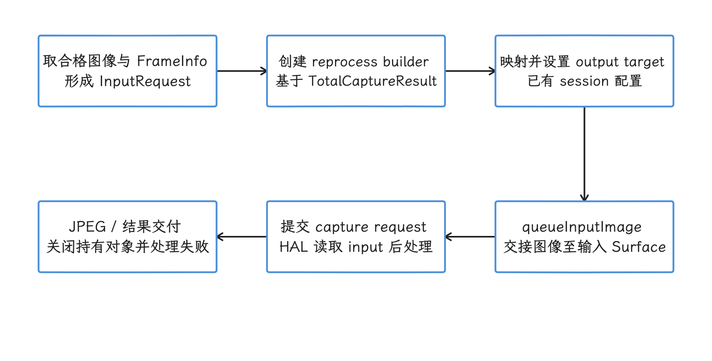

图：固定 CameraPipe 先创建 reprocess builder，再交接输入并提交请求。 输入交接后失败不能假定自动重试普通拍照。

这段流程只用于划分时间段：普通拍照的源帧通常产生于按键之后，曝光以及自动对焦、自动曝光、自动白平衡这三项状态的收敛，都可能增加用户感知到的延迟。

CameraX ZSL 的成功路径是：

```text
持续 repeating request
  → PRIVATE output + TotalCaptureResult
  → 按 timestamp 匹配图像和 metadata
  → 过滤 AF / AE / AWB 状态
  → 3 帧 ring

按下快门
  → 取出一帧及其 TotalCaptureResult
  → ImageWriter.queueInputImage()
  → CameraDevice.createReprocessCaptureRequest()
  → JPEG output
  → CameraX 回调
  → 应用写文件
```

这里省去了“按键后再取得一张传感器图像”这一步。重处理、JPEG 编码、回调和存储仍在按键之后执行。使用按键前的源帧也会带来取舍：照片记录的时刻可能早于用户触摸事件，运动主体的位置未必与按键瞬间一致。

<!-- gracker-diagram: ch13-10-45-zsl-preparation -->
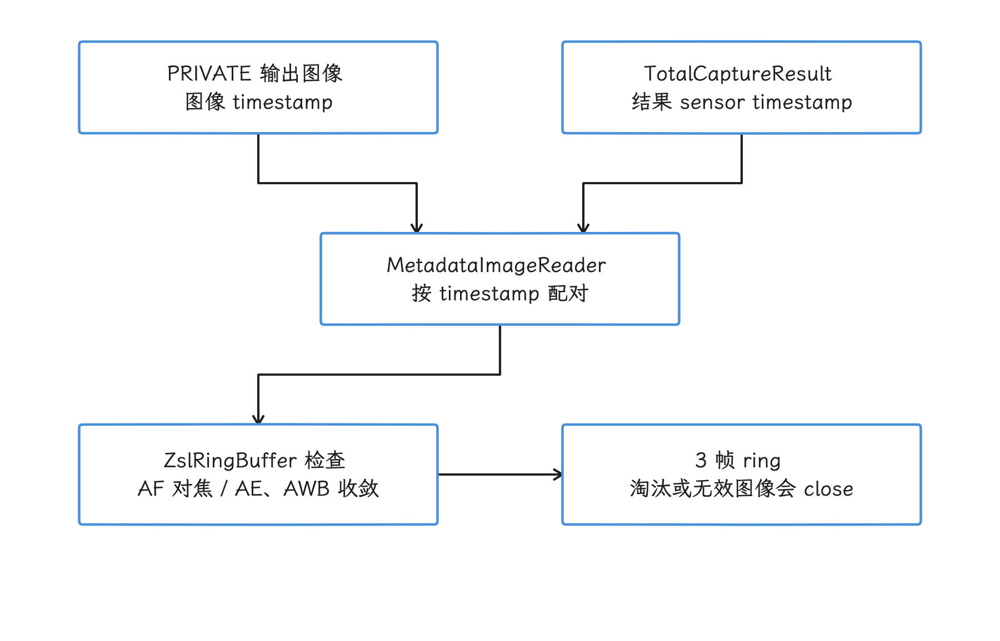

图：图像与 TotalCaptureResult 先按 timestamp 配对，再筛选进入 ring。 固定 CameraX 1.6.1 行为，HAL 并不知道应用的三帧策略。

### Device-operated ZSL：`CONTROL_ENABLE_ZSL`

`CaptureRequest.CONTROL_ENABLE_ZSL` 是可选的 request key，应用应先检查设备是否公布该 key。对 `CONTROL_CAPTURE_INTENT_STILL_CAPTURE` 的请求设为 `true` 后，camera device **可以**使用内部保留的历史图像生成结果，但 API 不保证每次都选中历史帧。

<!-- gracker-diagram: ch13-10-48-device-zsl-hint -->


图：key 可用且 STILL_CAPTURE 时，设备可以选择历史图像。 设为 true 并不保证选历史图，也不能证明 App reprocess。

这条机制由设备内部管理候选帧，不要求 App 创建 reprocessable session。它还会带来一个诊断特征：ZSL still 的图像内容与 result metadata 可能对应更早的 sensor 时刻，shutter / result 顺序也遵循专门规则。我们对齐时同时使用该 result 的 `SENSOR_TIMESTAMP` 和 frame number，只按 callback 到达顺序排列会出错。

### Application-operated ZSL：ring buffer + reprocess

应用自管 ZSL 会在预览期间把高分辨率候选帧保存在 ring buffer（循环缓冲区）中，用户按下快门时选择接近触发时刻的帧，再送回 reprocess pipeline 重新处理。该模式需要：

<!-- gracker-diagram: ch13-10-49-application-zsl-requirements -->
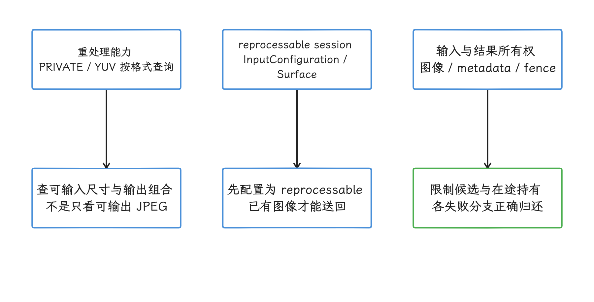

图：能力、session input 与持有归还共同构成 reprocess 路径。 PRIVATE 或 YUV 重处理按输入格式查询，不能只看模板名。

- 设备声明 `PRIVATE_REPROCESSING` 或 `YUV_REPROCESSING`，具体取决于 input format；
- 创建带 `InputConfiguration` 的 reprocessable capture session，使 session 能接收一帧已有图像作为 input；
- 用 `createReprocessCaptureRequest()` 构造重处理请求；
- 控制 input 与 output buffer 的持有、fence 和归还，避免候选帧长期占用管线容量。

CameraX 对这条路径的 1.6.1 实现、三帧 ring、禁用条件和 CameraPipe 调用链见[§22.18 CameraX：UseCase、Camera2 映射与性能](../../part5-app/ch22-rendering-practice/18-camerax-rendering.md)。

<!-- gracker-diagram: ch13-10-46-ring-and-quotas -->
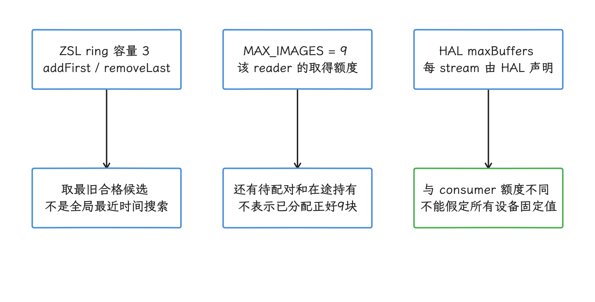

图：固定 1.6.1 ring 以 FIFO 取出最旧合格帧，层次上的额度不同。 ring 三帧、reader 九图与 HAL maxBuffers 均不等于总驻留。

#### HAL 以 `inputBuffer` 识别重处理请求

Camera2 请求进入 CameraService 后，`Camera3Device` 会根据请求元数据中的输入流 ID 找到 `mInputStream`。`RequestThread` 在提交 HAL 前从 `Camera3InputStream` 取得下一块输入缓冲区，并填入以下原生请求字段：

```text
camera_capture_request_t.input_buffer
camera_capture_request_t.input_width
camera_capture_request_t.input_height
```

如果请求没有输入流，`input_buffer` 为 `NULL`。这个分支决定请求是新的传感器采集，还是对已有图像进行重处理。

CameraService 的 AIDL 适配层再把原生请求转换为 `android.hardware.camera.device.CaptureRequest`：

- `inputBuffer.streamId` 标识输入流；
- `inputBuffer.bufferId` 标识该流中的缓冲区；
- 首次出现的缓冲区还会携带句柄，后续可以只使用 `bufferId`；
- `inputBuffer.acquireFence` 约束 HAL 何时可以读取输入缓冲区；
- `inputWidth` 与 `inputHeight` 描述实际输入尺寸；
- `outputBuffers[]` 至少包含一个待写入的目标缓冲区。

AIDL `CaptureRequest.aidl` 直接规定：

- 无有效 `inputBuffer`：从成像设备捕获新图像；
- 有有效 `inputBuffer`：重处理该图像；
- HAL 必须等待输入 acquire fence 后再读取；
- HAL 必须在后续 `CaptureResult` 中归还输入缓冲区；
- 输出缓冲区也有各自的 acquire fence、release fence 和所有权转换。

这就是 CameraX ZSL 到 Camera HAL3 的可靠映射：

<!-- gracker-diagram: ch13-10-50-input-mapping -->
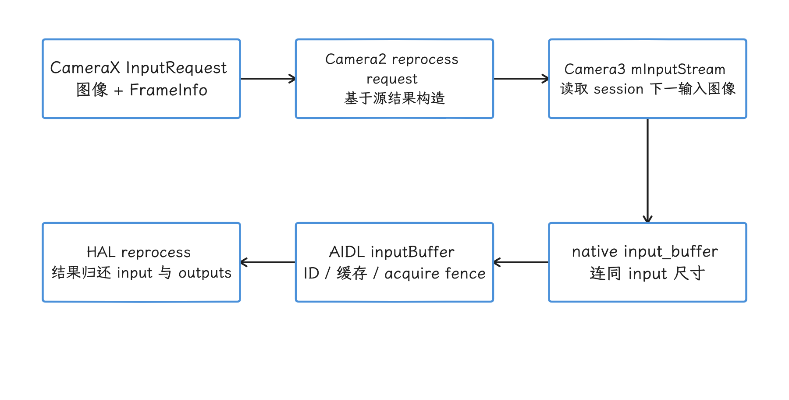

图：从应用候选一直对应到原生 input_buffer 与 AIDL 标识。 HAL 内部是否再次经过某 ISP 模块由实现决定。

```text
CameraX InputRequest
  → Camera2 reprocess CaptureRequest
  → Camera3Device::CaptureRequest.mInputStream
  → camera_capture_request_t.input_buffer
  → AIDL CaptureRequest.inputBuffer
  → HAL reprocessing
```

重处理在 HAL 内部会再次经过 ISP 的哪些处理模块、是否使用专用硬件、怎样执行降噪或 JPEG 编码，都属于设备实现；公共接口只约束输入缓冲区、元数据、输出缓冲区、栅栏、结果和错误行为，从接口名称推断不出厂商算法阶段。

<!-- gracker-diagram: ch13-10-51-cached-input-id -->
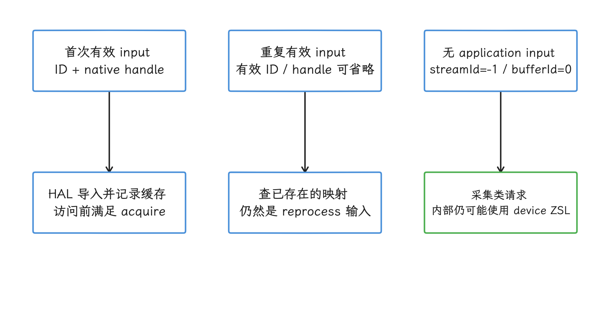

图：缓存图像可省略 handle，无 input 则使用明确无效标识。 结合原生 input_buffer、streamId / bufferId 和缓存映射判断。

#### 输入 buffer 的所有权与 sensor 边界

调用 `ImageWriter.queueInputImage()` 之后，输入 `Surface` 的消费方变为 CameraService 与 HAL 路径：HAL 读取前要等 acquire fence，完成访问后通过捕获结果和 release fence 归还缓冲区；release fence 发出信号之前，客户端复用该缓冲区是不安全的。

内核的 `dma-fence` 和 `sync_file` 只提供同步原语，CameraX 的三帧策略、AF、AE、AWB 过滤、降级条件和重处理元数据都在用户空间。所以我们分析 ZSL 失败时，先在用户空间找原因，别急着归因于内核。

`CameraDevice` 文档明确规定，重处理请求不会捕获新的图像数据。它从会话输入 `Surface` 取得下一块缓冲区，再为本次请求的输出 `Surface` 生成结果。

这也解释了两个常见现象：

<!-- gracker-diagram: ch13-10-53-reprocess-no-exposure -->
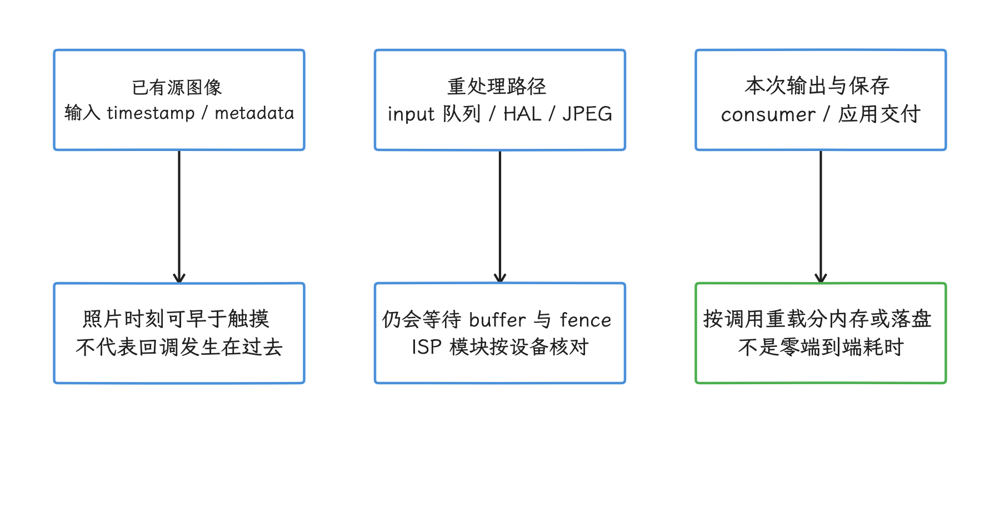

图：reprocess 使用已有 input，不为了该输出再采集新的 sensor 数据。 JPEG timestamp 可早于按键，源帧已存在不等于立即交付。

- 输出 JPEG 的 `SENSOR_TIMESTAMP` 可以早于按键时间；
- 重处理仍可能等待输入队列、HAL 流水线、JPEG 输出缓冲区或同步栅栏；源帧已经存在，回调却未必立即返回。

<!-- gracker-diagram: ch13-10-52-input-ownership -->
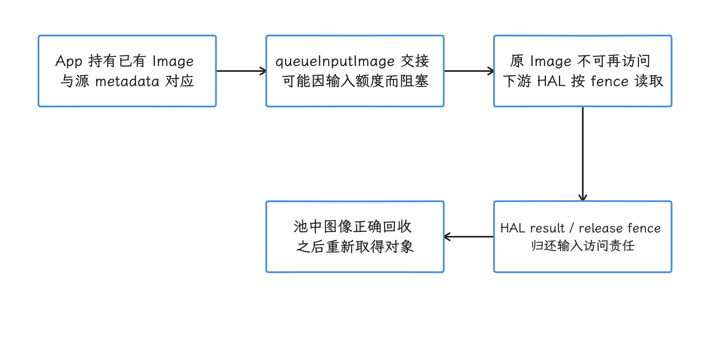

图：queueInputImage 后原 Image 不可继续访问，后续复用通过池完成。 fence signal 不会恢复原 Java Image 的有效性。

### 怎样判断 ZSL 卡在哪里

| 现象 | 优先检查 |
| --- | --- |
| `CONTROL_ENABLE_ZSL=true` 但照片仍来自当前帧 | 这是允许行为；核对 key 是否可用、capture intent、flash、HAL 策略与 result sensor timestamp |
| CameraX `isZslSupported()` 为 false | API level、PRIVATE reprocessing、flash、VideoCapture、Extensions、quirk 与库版本 |
| 快门快，但后台很久才出 JPEG | reprocess / ISP、offline processing、JPEG consumer 与 storage |
| 开启 ZSL 后内存与 buffer wait 上升 | input stream、ring buffer、in-flight request、output stream 与 Image close |
| ZSL still callback 看似“乱序” | 按 frame number 与 source sensor timestamp 重排，不按 callback 到达时刻猜测 |

<!-- gracker-diagram: ch13-10-54-zsl-support-enabled -->
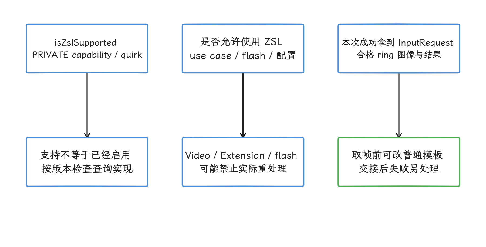

图：isZslSupported 查询、当前禁用条件与候选图像可用性分开判断。 固定 1.6.1 支持查询不直接检查 flash / VideoCapture 状态。

## 时间戳：先确认每一路的 time base

timestamp base 表示时间戳采用哪一套参考时钟；参考时钟不同，两个数值直接相减没有意义。Android 13 起 `OutputConfiguration` 可以选择 timestamp base，Android 17 的默认值按输出目标调整：

<!-- gracker-diagram: ch13-10-55-timestamp-defaults -->
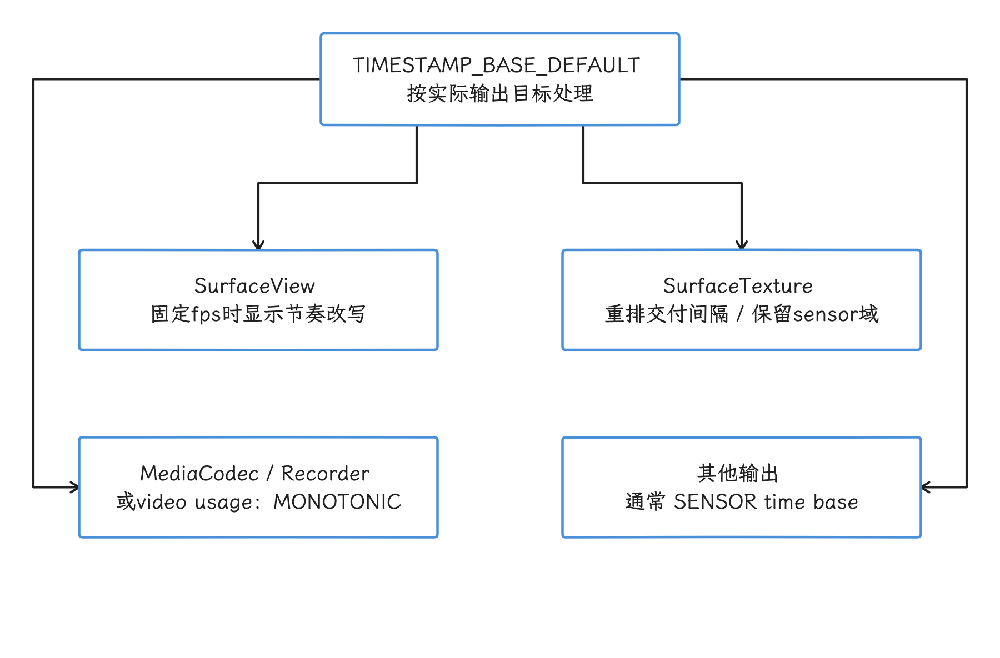

图：SurfaceView、SurfaceTexture、编码与其他输出采用不同时间戳策略。 策略选择不保证图像时间仍等于原曝光值。

- `SurfaceView` 在固定帧率下默认使用 `TIMESTAMP_BASE_CHOREOGRAPHER_SYNCED`，让时间戳贴近显示调度节奏；它和 sensor timestamp 分属两套时钟，比较前要先换算；
- `SurfaceTexture` 的交付节奏可按 readout interval（传感器读出间隔）调整，但 image timestamp 仍保留 sensor time base；
- MediaRecorder、MediaCodec 或带 video-encode usage 的 ImageReader 默认使用 MONOTONIC，即系统启动后的单调时钟，便于音视频同步；
- 其他输出通常使用 SENSOR time base。

`onCaptureStarted()` 给出曝光开始时间，支持 readout timestamp 的设备还可以使用 `onReadoutStarted()` 观察传感器开始读出的时刻。`onCaptureCompleted()` 只表示 final result metadata 已回到 framework；各 consumer 可能仍在等待或处理 buffer，预览也可能尚未 present。

<!-- gracker-diagram: ch13-10-57-exposure-result-present -->
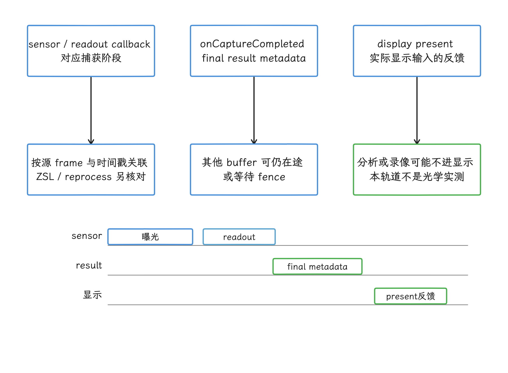

图：曝光与读出回调描述 sensor 阶段，final metadata 不能代替显示。 仅画普通成功预览的一次允许时序，不代表所有结果固定先后。

我们复原单帧时至少保留 frame number、request id、sensor / readout timestamp、output stream、buffer id、HAL result time、consumer acquire / release 和显示 frame token。timestamp base 不同的话，先完成时钟域转换，或改用共同的 frame number 与 trace flow 关联事件，原始数值没法直接比较。

<!-- gracker-diagram: ch13-10-56-clock-vs-rewrite -->
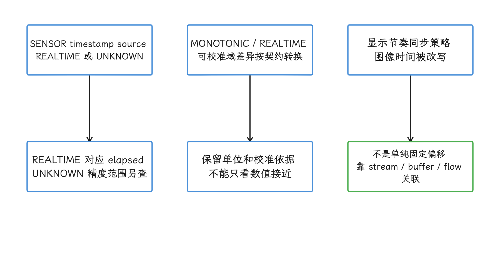

图：校准时钟偏移和关联被重写的图像时间是不同操作。 Camera frame number、队列帧号和显示 token 也不能直接相等。

## Secure Camera Path

`REQUEST_AVAILABLE_CAPABILITIES_SECURE_IMAGE_DATA` 表示 camera device 能把图像写入受保护内存：Android userspace 和普通 Android kernel 都访问不到，仅 TEE（Trusted Execution Environment，可信执行环境）等受信任组件可以使用。普通 App 在窗口上设置 `FLAG_SECURE` 主要限制截图和非安全显示，它不等同于 secure camera memory，普通 DRM video Surface 的处理方式也照搬不过来。

<!-- gracker-diagram: ch13-10-58-secure-camera -->
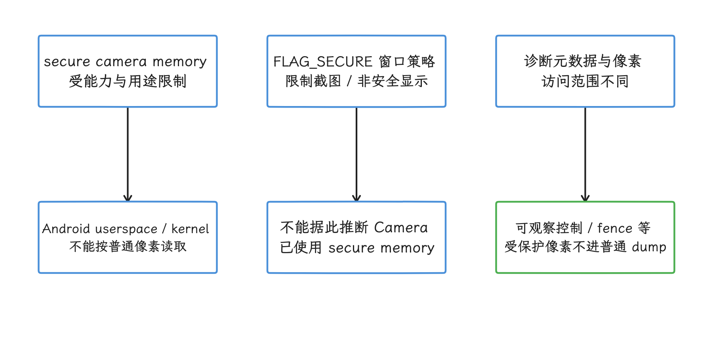

图：Secure Camera 的像素访问能力与窗口截图策略是不同边界。 固定能力定义的图像可只由 TEE 访问，具体产品路径另核对。

设备可以通过 `SCALER_DEFAULT_SECURE_IMAGE_SIZE` 公布 secure camera mode 保证支持的 PRIVATE / YUV 尺寸；其他格式或尺寸应调用 `isSessionConfigurationSupported()` 验证。进入 secure path 后，像素访问范围会受到额外限制：

- 标准 CPU `ImageReader` / `Image.Plane` 读取通常不属于允许的 consumer 路径；
- buffer 内容不得进入截图、dump 或普通内存分析；
- Perfetto 仍可观察 request、HAL callback、调度、fence 和显示 transaction，但看不到受保护像素；
- 具体 permission、TEE consumer、protected usage 与显示限制由产品和 vendor 实现决定。

排障文档应明确标记 secure session，避免把“mmap（映射到进程地址空间）失败、截图不可用”误记成普通 buffer 损坏。

<!-- gracker-diagram: ch13-10-59-secure-size -->


图：secure 默认尺寸 key 与 secure capability 应分别查询。 key 为空不能直接判断不支持 secure camera。

## Perfetto：从 request 追到 present

拿到一份相机卡顿的 trace，我们沿 request → HAL → consumer → display 这条链路读它：先固定采集环境，再按阶段找异常，最后拼出单帧的完整时间线。

### 采集前固定现场

每份 trace 至少记录以下环境与配置，保证不同采集结果可以比较：

- Android build、camera id、logical / physical camera 关系，以及用于描述内置、外接等设备类别的 `INFO_DEVICE_TYPE`；
- Camera provider 与 HAL transport（AIDL / HIDL）、vendor build；
- 所有 output 的 format、size、fps range、dynamic range、stream use case、timestamp base；
- CameraX 版本、PreviewView implementation mode 与最终 carrier；
- 是否启用 ZSL、Extensions、Low Light Boost、HDR、stabilization、secure path；
- thermal state、GPU / ISP / memory frequency 与复现时间。

`dumpsys media.camera` 可以查看客户端、stream 与 in-flight 概况，SurfaceFlinger layer tree 用来确认实际预览 carrier。厂商 HAL dump、camera event log 和 vendor trace 要与 Perfetto 对齐到同一时间基准，事件先后才关联得起来。

<!-- gracker-diagram: ch13-10-60-capture-environment -->


图：版本、配置、carrier 与设备状态一起保存，才可比较 trace。 dumpsys 和 Layer 名称提供对象线索，不自动证明 ISP 根因。

### 分五个阶段定位

| 阶段 | 观察点 | 典型异常 |
| --- | --- | --- |
| App / CameraX | session configure、repeating / single capture、callback executor | 反复重配、请求间隔异常、callback 被业务阻塞 |
| cameraserver | `Camera3Device` RequestThread、in-flight map、stream dequeue | request 排队、buffer limit wait、stream abandon |
| HAL / sensor / ISP | `processCaptureRequest`、SOF、vendor job、`processCaptureResult` | 曝光变化、ISP stall、算法或 HAL queue 堵塞 |
| consumer | Surface、codec、ImageReader、App GPU acquire / release | Image 未关、encoder 慢、纹理或 GPU pass 晚 |
| display | preview buffer、SF latch、composition type、present | acquire fence、geometry transaction、HWC / display 晚 |

Perfetto slice 是带起止时间的区间事件，可用来观察一次调用或任务占用了多久。线程名和 slice 前缀受 HAL transport 与厂商实现影响。Android 17 的 AIDL 设备可优先搜索 `ICameraDeviceSession`、`processCaptureRequest`、`requestStreamBuffers`、`processCaptureResult`；升级设备仍可能使用兼容的 HIDL HAL。没有 camera atrace slice 时，还可以通过 binder flow（跨进程调用关联）、BufferQueue、dma-buf、fence、thread state 和 SF layer 还原路径。

<!-- gracker-diagram: ch13-10-61-five-diagnostic-domains -->


图：从 App、CameraService、HAL 到 consumer 和显示逐段关联。 线程名与 slice 前缀取决于 transport、厂商和采集配置。

### 单帧复原顺序

把同一 frame 按以下顺序排列：

1. App 提交 request；
2. Camera3 RequestThread 交给 HAL；
3. sensor exposure / readout；
4. partial / final metadata 和各 output buffer 返回；
5. preview、record、analysis、still consumer 分别 acquire 与 release；
6. preview carrier queue；
7. SF latch、composition 与 display present。

不同 output 要分别记录：analysis callback 只能证明分析路径走到了相应回调，preview buffer ready 还得另行确认；capture callback 同样说明不了 JPEG / RAW Image 已经可读。

<!-- gracker-diagram: ch13-10-62-frame-dependencies -->


图：正常输出先交到队列，consumer 再获取并满足读取依赖。 分支可重叠；consumer release 不能统一放在 queue 之前。

<!-- gracker-diagram: ch13-10-63-trace-coverage -->


图：metadata、分析回调和宿主 timeline 均不能替代独立预览证据。 官方 FrameTimeline 页面注明 SurfaceView 不受支持，缺口用 buffer / TX / fence 补齐。

### CPU 工作、调度等待和 fence 等待

slice 很长时，要结合线程状态区分实际执行与等待：

- Running：线程正在 CPU 上执行，继续看 ISP control、YUV 转换、推理、codec 或 App GPU submission 的 CPU 栈；
- Runnable：线程具备运行条件但尚未获得 CPU，结合 CPU contention、优先级与 thermal 判断调度延迟；
- Sleeping / blocked：线程正在等待，检查 Binder、condition variable、buffer limit、fence 与 I/O；
- GPU / ISP queue 已提交但没完成：回到设备频率、带宽、driver job 和 fence。

只量 callback 的 wall time（从入口到出口的总耗时）的话，队列等待、CPU 计算和硬件执行会混进同一个数值。

<!-- gracker-diagram: ch13-10-64-cpu-and-device-waits -->


图：长 slice 先按线程状态和设备完成依赖拆解。 Running 不是纯业务计算，wait 也不等于硬件已完成。

### CameraService 直接证据与 ANR 边界

#### cameraserver 的源码与 dump 锚点

Android 17 CameraService 源码包含以下可核对点：

- `Camera3Device::RequestThread`：提交请求、按流取得缓冲区；
- `Camera3OutputStream::getBufferLockedCommon()`：`dequeueBuffer()` 或系统框架 BufferManager 路径；
- `Camera3Stream::getBuffer()`：等待 `max_buffers` 的时长；
- `Camera3OutputStream::returnBufferCheckedLocked()`：`queueBuffer()`、`cancelBuffer()` 与 HAL release fence；
- `AidlCamera3OutputUtils.cpp` 中的 `requestStreamBuffers()`：逐流校验 HAL 的缓冲区请求；
- 流的转储信息中，`DequeueBuffer latency histogram` 与 `wait on max_buffers` 两项统计。

设备系统跟踪中是否包含完整的相机、ISP、V4L2、IOMMU 或带宽轨道，由厂商实现决定。看不到厂商事件时，我们把问题定位到系统框架与 HAL 的接口边界为止；要断言某个 ISP 硬件模块的耗时，得先看到厂商事件。

<!-- gracker-diagram: ch13-10-65-camera-source-evidence -->


图：stream get、dequeue、归还和 in-flight 提供不同定位边界。 无 vendor 事件时只能确定公共接口边界，不能断言 ISP 模块耗时。

#### buffer 现象的下一步排查

| 现象 | 优先检查 | 不能直接下的结论 |
|---|---|---|
| `dequeueBuffer()` 长时间等待 | 消费方是否归还、`Surface` 是否断开、队列是否达到上限 | 一定是 gralloc 分配慢 |
| `requestStreamBuffers()` 返回 `NO_BUFFER_AVAILABLE` | 尚未归还的数量、`maxBuffers`、消费方持有时间 | HAL 发生内存泄漏 |
| `ImageReader` 延迟持续增长 | 图像的取得与关闭、`maxImages`、分析耗时 | 传感器帧率不稳 |
| `SurfaceView` 已入队但没有换帧 | HAL 栅栏、SurfaceFlinger 锁存、HWC 与呈现时间 | Camera HAL 没有产出 |
| `TextureView` 输入已到但屏幕显示晚 | `SurfaceTexture` 取得时间、应用主线程、`RenderThread`、GPU、宿主输出队列 | SurfaceFlinger 丢帧 |
| dma-buf 总量增长 | 各流数量、分配大小、HAL、ISP、编解码器内部缓冲区 | Java 堆内存泄漏 |

#### buffer wait 与 ANR 的关系

缓冲区不足可能让 CameraService 的 `RequestThread`、HAL 专用线程或应用的同步调用进入等待。Android ANR 仍要求应用主线程、广播、服务或输入事件等路径超过相应的超时阈值。要证明两者存在因果关系，必须找到主线程或关键 Binder 调用等待相机操作的调用栈，再对齐缓冲区与栅栏的阻塞时间。

<!-- gracker-diagram: ch13-10-66-anr-causality -->


图：相机等待必须连接到超时路径，才能解释 App ANR。 只看到 CameraService 线程等待不足以证明 App ANR 原因。

## 常见掉帧场景与修复方向

下面把前面的追踪方法落到几类常见场景，每一类先认症状，再看修复方向。

### Session 反复重配

尺寸、dynamic range、physical camera、Extensions 或 output 集合发生变化，都可能触发耗时较长的 configure。短时间内频繁 unbind / bind CameraX use case，或在预览期间重建 session，通常会伴随 request 中断、buffer drain（等待在途 buffer 归还）和重新等待首帧。

我们应尽量保持 output 组合稳定，动态 3A、zoom 和 exposure 优先通过 request 更新；必须重配时，分别测量停流、configure 和首个 result 的耗时，别只记一段总时间。

<!-- gracker-diagram: ch13-10-67-session-reconfiguration -->


图：保持输出组合稳定，把动态控制优先留在 request。 确需重配置时，分别量停流、configure 和首个结果。

API 37 上，如果切换只涉及属性可对应的 `OutputConfiguration` Surface，可评估 `updateOutputConfigurations()`。这里的“可对应”包括 size、format 等配置与原 output 一致。output 数量、format 或 size 发生变化时仍要重新创建 session；以旧 Surface 为目标的 active request 也要按接口契约停止，再提交到新目标。

### Analysis consumer 反压

症状包括 analysis 延迟持续增加、`maxImages` 被占满，以及 stream buffer request 变慢或超时。可以把推理移出回调线程、按需求使用 latest-only（只保留最新帧）策略、减少 YUV 内存拷贝，并保证所有正常和异常路径都会关闭 Image。异步处理仍须明确 Image 的 owner 与关闭时机；单纯增大队列只会延后拥塞并增加内存占用。

<!-- gracker-diagram: ch13-10-68-analysis-fix -->


图：限制图像持有和异步任务积压，按业务选择 latest 或 next。 增加队列只延后拥塞，不提高长期处理吞吐。

### Recording consumer 反压

症状是 preview 仍然稳定，但 record output 的 buffer 归还变慢或 encoder input 持续堆积。我们检查 codec surface、编码 profile、码率、分辨率、thermal，以及 muxer / storage 写入；把所有录像掉帧都归因于 Camera HAL，会漏掉这些环节。

### Sensor / ISP pipeline stall

长曝光、HDR、多帧降噪、night extension、remosaic（把 Quad Bayer 等排列重建为高分辨率 Bayer 数据）或多路高负载输出，都会增加 sensor / ISP 时间。我们结合 exposure、frame duration、SOF（Start of Frame，帧开始）/ readout、HAL result 和 vendor job，区分拍摄场景所需的处理时间与实现异常造成的 stall。

### Preview carrier 晚

SurfaceView preview buffer 已 ready 但迟迟没有 present 时，继续检查 release fence、SF latch、geometry transaction 与 HWC。TextureView camera buffer 已 ready 但画面仍晚时，继续检查宿主 Choreographer、RenderThread、texture acquire、GPU 和 App Window；两者的后半段路径不同。

<!-- gracker-diagram: ch13-10-69-late-preview-choice -->


图：预览后半段按真实 carrier 分开定位。 输入 ready 也不能直接归因 SF，先核对对应完成依赖。

### 内存、带宽与热限制

多流会增加 GraphicBuffer / dma-buf 占用以及 ISP、内存带宽压力，10-bit、RAW14、高 fps 和大尺寸输出尤其明显。我们诊断时结合 dma-buf 总量、page allocation、IOMMU map、PSI memory（内存压力指标）、direct reclaim（同步内存回收）、GPU / ISP / memory frequency 和 thermal throttling。固定 buffer 数乘以分辨率算不出真实占用：row stride（每行实际字节跨度）、format、HAL cache、中间 buffer 和 vendor algorithm 都会引入额外空间。

<!-- gracker-diagram: ch13-10-70-memory-thermal -->


图：内存、带宽和热压力可能同时影响相机多路输出。 这是一组诊断候选，不能用分辨率乘固定 buffer 数替代实测。

## Android 12—17 的版本演进

下面保留平台能力变化；每项能力都要以 `CameraCharacteristics`、session support query 和设备 HAL 为准。

- **Android 10 / API 29**：引入可选的 HAL3 buffer management，request 可以先进入 pipeline，HAL 再按需取得 output buffer。
- **Android 12 / API 31**：Camera2 vendor extensions 进入公开平台，Bokeh、HDR、Night 等模式可以通过 `CameraExtensionSession` 查询；maximum-resolution stream configuration 给出了超高分辨率 sensor 的公开配置范围。
- **Android 13 / API 33**：Camera HAL 的新能力转向 AIDL；Camera2 加入 10-bit HDR video、DynamicRangeProfiles、stream use case 与 output timestamp base。升级设备仍可继续使用兼容的 HIDL HAL。
- **Android 14 / API 34**：Ultra HDR still image 与记录亮度增益信息的 gainmap 进入公开链路，cropped RAW stream use case 可用于 in-sensor zoom。它们不会让普通 preview 自动切换到 HDR 或 RAW。
- **Android 15 / API 35**：Low Light Boost 为支持设备提供连续 preview / video 的低光 AE mode，它与合成多帧的 Night still capture 是两种能力。曝光时间和算法负载变化都会影响可达帧率。
- **Android 16 / API 36**：color temperature / tint、hybrid auto-exposure、night mode indicator、motion photo capture intent 等能力扩展了 request 与 metadata，但 Surface、HAL buffer 和 consumer 归还仍是数据流主线。
- **Android 17 / API 37**：`CameraCaptureSession.updateOutputConfigurations()` 支持在不关闭整个 session 的情况下替换既有、属性可对应的 output Surface；`ImageFormat.RAW14` 支持紧凑的 14-bit RAW，vendor-defined camera extensions 与 `INFO_DEVICE_TYPE` 扩展了能力发现。动态更新只替换属性可对应的配置、output 数量保持不变，RAW14 也只影响设备支持并由 App 显式配置的 RAW stream。

Android 17 平台继续使用 HAL3 request-result 与多 output Surface 模型。新增 metadata 或 extension 会改变配置和处理负载，但每路输出仍须遵守 buffer ownership、fence 与 consumer backpressure 约束。

<!-- gracker-diagram: ch13-10-71-platform-evolution -->


图：平台增量、CameraX 策略和 HAL 实现仍以 request / buffer 交接协作。 新 API 或新 RAW 格式不表示所有预览自动改变。

### 16 KB page size、DMA-BUF heaps 与 ION

#### 16 KB page size 与 Camera buffer 对齐

AOSP 从 Android 15 起支持 16 KB 页大小（page size），主要影响内核页粒度、`mmap()` 映射取整、ELF 文件对齐，以及依赖固定 `PAGE_SIZE` 的原生代码；Android 17 延续了这项兼容能力。

Camera AIDL、`GraphicBuffer` 和 BufferQueue 没有规定：

- 每个相机缓冲区的逻辑宽高必须按 16 KB 对齐；
- 图像有效载荷大小必须是 16 KB 的整数倍；
- 应用或 Camera HAL 应手工把 gralloc 分配结果补齐到 16 KB。

物理页、IOMMU 映射、平面步幅、内存堆粒度和硬件块对齐属于不同层次。内存分配器与驱动可能因为 16 KB 内核产生不同的物理占用，统一的 Camera HAL 缓冲区对齐公式却由此推不出来。排查时我们读取 mapper 返回的布局、dma-buf 大小和设备内存堆配置。

<!-- gracker-diagram: ch13-10-72-page-alignment -->


图：内核页、映射、图像 stride 和图形 allocator 属于不同层。 不能据 16 KB 内核推出统一相机宽高或 payload 对齐公式。

#### Android 17 的共享内存构成

Android 17 AOSP 发布说明要求删除厂商代码中的 ION 调用。Android 12 的 GKI 2.0（通用内核映像）已经用 DMA-BUF heaps（共享缓冲区堆）取代 ION；到 Android 17，所有支持 ION 的内核都已结束维护。

因此 camera 路径应按以下对象理解：

- gralloc 图形内存分配器决定 `GraphicBuffer` 的实现与布局；
- DMA-BUF heaps 或厂商分配器提供可共享的内存分配；
- dma-buf 文件描述符让 HAL、GPU、编解码器、HWC 等组件共享同一块分配；
- dma-fence 与 sync_file 文件描述符传递访问完成关系。

`ashmem` 也不是相机 `GraphicBuffer` 的可选“内存类型”。它用于普通共享内存，不提供 Camera HAL 图形流所需的 gralloc 元数据、用途标志协商和设备导入语义。

<!-- gracker-diagram: ch13-10-73-dmabuf-responsibilities -->


图：allocator、共享对象和完成依赖承担不同职责。 Android17发布说明要求移除ION；ashmem不替代图形流协商。

## Android 17 / kernel 6.18 源码入口

### Framework 与 cameraserver

- [`CameraCaptureSession.java`](https://android.googlesource.com/platform/frameworks/base/+/refs/tags/android-17.0.0_r1/core/java/android/hardware/camera2/CameraCaptureSession.java)、[`CameraCaptureSessionImpl.java`](https://android.googlesource.com/platform/frameworks/base/+/refs/tags/android-17.0.0_r1/core/java/android/hardware/camera2/impl/CameraCaptureSessionImpl.java)、[`CameraDeviceImpl.java`](https://android.googlesource.com/platform/frameworks/base/+/refs/tags/android-17.0.0_r1/core/java/android/hardware/camera2/impl/CameraDeviceImpl.java)：session、request、动态输出更新与 callback；
- [`OutputConfiguration.java`](https://android.googlesource.com/platform/frameworks/base/+/refs/tags/android-17.0.0_r1/core/java/android/hardware/camera2/params/OutputConfiguration.java)：stream use case、timestamp base、dynamic range 与 output 属性；
- [`CaptureRequest.java`](https://android.googlesource.com/platform/frameworks/base/+/refs/tags/android-17.0.0_r1/core/java/android/hardware/camera2/CaptureRequest.java)、[`CameraCharacteristics.java`](https://android.googlesource.com/platform/frameworks/base/+/refs/tags/android-17.0.0_r1/core/java/android/hardware/camera2/CameraCharacteristics.java)：ZSL、reprocessing、secure image、stream capability 与 device type；
- [`ImageFormat.java`](https://android.googlesource.com/platform/frameworks/base/+/refs/tags/android-17.0.0_r1/graphics/java/android/graphics/ImageFormat.java)：RAW14 与其他公开 image format；
- [`Camera3Device.cpp`](https://android.googlesource.com/platform/frameworks/av/+/refs/tags/android-17.0.0_r1/services/camera/libcameraservice/device3/Camera3Device.cpp)、[`Camera3Stream.cpp`](https://android.googlesource.com/platform/frameworks/av/+/refs/tags/android-17.0.0_r1/services/camera/libcameraservice/device3/Camera3Stream.cpp)、[`Camera3OutputStream.cpp`](https://android.googlesource.com/platform/frameworks/av/+/refs/tags/android-17.0.0_r1/services/camera/libcameraservice/device3/Camera3OutputStream.cpp)：configure、RequestThread、in-flight map、buffer limit、dequeue / queue 与 fence。

### Camera HAL AIDL

- [`ICameraDeviceSession.aidl`](https://android.googlesource.com/platform/hardware/interfaces/+/refs/tags/android-17.0.0_r1/camera/device/aidl/android/hardware/camera/device/ICameraDeviceSession.aidl)：configure、process request、flush 与 offline session；
- [`ICameraDeviceCallback.aidl`](https://android.googlesource.com/platform/hardware/interfaces/+/refs/tags/android-17.0.0_r1/camera/device/aidl/android/hardware/camera/device/ICameraDeviceCallback.aidl)、[`HalStream.aidl`](https://android.googlesource.com/platform/hardware/interfaces/+/refs/tags/android-17.0.0_r1/camera/device/aidl/android/hardware/camera/device/HalStream.aidl)：capture result、request / return stream buffers 与逐流 `maxBuffers`；
- [Camera HAL3 request / result](https://source.android.com/docs/core/camera/camera3_requests_hal)、[Camera HAL3 buffer management](https://source.android.com/docs/core/camera/buffer-management-api)：接口语义与版本演进。

### Consumer、显示与 kernel

- [Android 17 Camera 更新](https://developer.android.com/about/versions/17/release-notes)、[`CameraCaptureSession`](https://developer.android.com/reference/android/hardware/camera2/CameraCaptureSession)、[Camera2 多流](https://developer.android.com/media/camera/camera2/multiple-camera-streams-simultaneously)：API 37 动态输出更新与多流公开契约；
- [CameraX Preview](https://developer.android.com/media/camera/camerax/preview)、[CameraX Image Analysis](https://developer.android.com/media/camera/camerax/analyze)、[CameraX ZSL](https://developer.android.com/media/camera/camerax/take-photo/zsl)：公开 consumer 与库层约束；
- [`TextureView.java`](https://android.googlesource.com/platform/frameworks/base/+/refs/tags/android-17.0.0_r1/core/java/android/view/TextureView.java)、[`DeferredLayerUpdater.cpp`](https://android.googlesource.com/platform/frameworks/base/+/refs/tags/android-17.0.0_r1/libs/hwui/DeferredLayerUpdater.cpp)：TextureView frame available、宿主 invalidation 与最新 buffer 获取；
- [`SurfaceFlinger.cpp`](https://android.googlesource.com/platform/frameworks/native/+/refs/tags/android-17.0.0_r1/services/surfaceflinger/SurfaceFlinger.cpp)、[`HWComposer.cpp`](https://android.googlesource.com/platform/frameworks/native/+/refs/tags/android-17.0.0_r1/services/surfaceflinger/DisplayHardware/HWComposer.cpp)：预览 layer 的 latch、composition 与 present；
- kernel `android17-6.18-2026-06_r6` 的 [`dma-buf.c`](https://android.googlesource.com/kernel/common/+/refs/tags/android17-6.18-2026-06_r6/drivers/dma-buf/dma-buf.c)、[`dma-fence.c`](https://android.googlesource.com/kernel/common/+/refs/tags/android17-6.18-2026-06_r6/drivers/dma-buf/dma-fence.c)、[`sync_file.c`](https://android.googlesource.com/kernel/common/+/refs/tags/android17-6.18-2026-06_r6/drivers/dma-buf/sync_file.c)：buffer 共享、fence signal / wait 与 fence fd。

## 常见误判

| 误判 | 修正方法 |
| --- | --- |
| 同一 request 的多路输出共用同一块 buffer | 按 stream、buffer id、format 与 consumer 分别追踪 |
| `maxBuffers` 在 HAL3 中固定为 2 | 它由 HAL 在 configure 阶段逐流返回 |
| result metadata 到达表示所有 buffer 都 ready | partial / final metadata 与不同 stream buffer 可以分开返回 |
| `onCaptureCompleted()` 表示预览已经显示 | 继续追 preview queue、SF latch 与 display present |
| `CONTROL_ENABLE_ZSL` 必须配 reprocessable session | 它是 device-operated 提示；应用自管 ZSL 才需要 input stream 与 reprocess |
| ZSL callback 到达顺序就是照片的采集顺序 | 用 frame number 与 source sensor timestamp |
| `Image.close()` 只影响 Java 内存 | 它决定 analysis buffer 能否归池，可能反压 session |
| SurfaceView 一定使用 HWC overlay | 查看实际 composition type 与整组 layer 条件 |
| TextureView buffer 到达就已上屏 | 还要等宿主 traversal、RT、App Window 与 SF |
| 增大 `maxImages` 可以修复慢分析 | 它只增加缓冲与内存，长期吞吐仍由 consumer 决定 |
| API 37 动态更新可以任意增删 output | 只能替换既有同构配置的 Surface，output 数量不变 |
| RAW14 会改变 Android 17 的所有预览 | 只影响设备支持并显式配置的 RAW14 stream |
| `TEMPLATE_ZERO_SHUTTER_LAG` 能证明 HAL 收到历史图像 | 模板只表达上层意图；HAL 边界必须看到有效 `inputBuffer` |
| 重处理会重新曝光一次 | reprocess 从 session input Surface 读取已有图像，不采集新的 sensor 数据 |
| ZSL 失败总会透明重试普通拍照 | 取帧前可以降级；input 已提交后的失败不能假定会自动重试 |

## 与其他章节的关系

- [2.8 BufferQueue、Gralloc 与 Sync Fence](../../part1-fundamentals/ch02-rendering/08-bufferqueue-gralloc-sync-fence.md)：Camera buffer handle 与 fence 的内存模型；
- [15.14 Camera 性能分析工具：Perfetto、SQL 与 GFXReconstruct](../../part3-tools/ch15-other-tools/14-camera-performance-analysis.md)：Camera trace 配置、SQL 与案例；
- [13.3 SurfaceView 与 TextureView 渲染管线](03-surfaceview-textureview-pipelines.md)：预览 carrier 的窗口与显示路径；
- [13.6 SurfaceControl 与 HardwareBufferRenderer](06-surfacecontrol-hardwarebuffer-renderer.md)：SurfaceView preview layer 的 transaction 与 fence；
- [13.11 视频 Overlay、Media3 与专业编解码管线](11-video-overlay-media3-codec-pipeline.md)：录像与预览 layer 进入 HWC 后的 composition 决策；
- [22.18 CameraX：UseCase、Camera2 映射与性能](../../part5-app/ch22-rendering-practice/18-camerax-rendering.md)：CameraX 1.6.1 的 ZSL ring、CameraPipe 重处理、ImageCapture 与用例组合。

## 小结

Camera 诊断从 session outputs 与 HAL3 request-result 开始。preview、record、analysis 和 still capture 各有自己的 buffer 与 consumer，我们把每一路追到 buffer 归还，才能确定是哪一端在限制 session 吞吐。

承载方式上，标准 SurfaceView 预览形成独立 layer，TextureView 预览还要经过宿主 HWUI，自研 GL / Vulkan 预览则增加一段由 App 消费再生产的 GPU 路径。ZSL 要区分 device-operated 与 application-operated 两种机制；`maxBuffers` 要读取 HAL 配置，timestamp 也要先确认 time base。

把 request、frame number、sensor / readout timestamp、HAL result、consumer release、preview queue、SF latch 与 display present 对齐之后，我们就能分别判断 sensor / ISP 处理慢、buffer 不足、analysis / encoder 反压、宿主消费晚和显示端迟到。

<!-- gracker-diagram: ch13-10-02-version-coordinates -->


图：平台 API、实际 HAL、CameraX 与内核样本是独立坐标。 CameraX 1.6.1 minSdk23；Android5仅说明历史主线。

<!-- gracker-diagram: ch13-10-74-end-to-end-evidence -->


图：用 request、逐流图像和完成依赖连接到实际 consumer。 Camera 帧号、队列帧号与显示 token 必须经过证据关联。
