# Android 17 游戏引擎渲染链路

游戏的一帧要依次经过输入采样、模拟、渲染提交、Surface 队列和显示合成，把帧间隔做稳和把延迟压低，两个目标还可能互相牵制。这篇文章沿这条链路讲游戏渲染：线程按什么识别、每一环的等待和 fence 说明什么、Swappy 到 Game Mode 这些机制各自管到哪一段。识别线程时，我们以职责和依赖为准，引擎版本的线程名只作辅助。

> 本次核对：2026-10-24。平台固定为 AOSP `android-17.0.0_r1`；`android17-6.18-2026-06_r6` 只是通用内核研究样本，不代表全部 Android 17 设备。Unity、Unreal 和 Swappy 的公开文档用于解释角色与契约，具体线程、模式、扩展与 flag 仍须按实际引擎构建和设备核对；本文没有把源码审阅当作设备实测。

普通 Android View 页面通常由事件触发：输入、动画或数据变化引起 `invalidate()`，`Choreographer` 再在 VSync 节点驱动 ViewRootImpl 和 HWUI。游戏同样要处理 Activity 生命周期、窗口和输入事件，但画面通常由引擎自己的 game loop（持续执行的游戏主循环）主动生产。

<!-- gracker-diagram: ch13-12-02-event-vs-loop -->
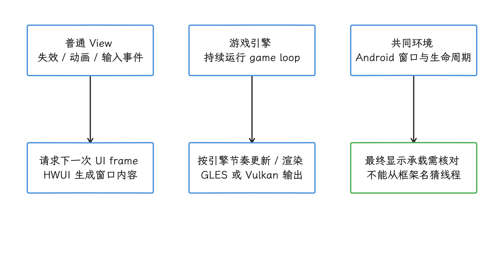

图：UI 和游戏可采用不同的生产调度入口。 两者仍受窗口生命周期、输入和显示系统约束。

这一区别决定了分析的起点。普通页面常从 UI Thread 的 `doFrame()` 向后追踪；游戏要先确定某一次输入被哪一轮 simulation（物理、玩法等世界状态更新）读取，我们再顺着 Render / RHI、GPU、swapchain、BufferQueue、SurfaceFlinger 一路追到显示 present。

<!-- gracker-diagram: ch13-12-01-input-to-display -->
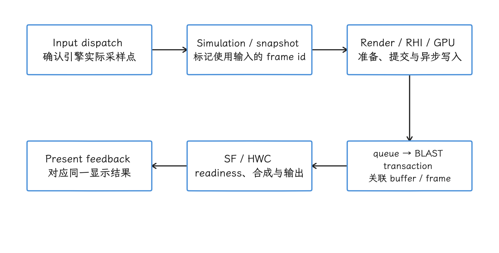

图：同一次输入要跟随实际使用它的游戏帧。 dispatch 到达不证明 simulation 已读取，帧号与时钟须关联。

Unity、Unreal、Cocos、自研引擎、Swappy 和 GPU driver 都有自己的版本变化；我们采集数据时，应同时记录引擎版本、graphics API、渲染后端、frame pacing 配置、Game Mode 和设备 build fingerprint。

## Game Loop 与事件驱动 UI 有什么不同

下面这段伪代码用来说明职责和节奏，各引擎都有自己的实现：

```text
while (running) {
    pollLifecycleAndInput();

    accumulator += elapsedTime();
    while (accumulator >= fixedStep) {
        simulatePhysicsAndGameplay(fixedStep);
        accumulator -= fixedStep;
    }

    buildRenderSnapshot(accumulator / fixedStep);
    recordAndSubmitGpuCommands();
    presentWithFramePacing();
}
```

很多引擎用固定时间步长更新物理，再用可变步长或插值生成 render snapshot（供渲染线程读取的一帧世界状态）；输入则可能在 game thread 开头、VSync 附近或更靠近提交时采样。所以只知道“游戏 60 FPS”，我们既推不出 simulation 每秒也运行 60 次，也推不出触控到显示只经历一帧。

<!-- gracker-diagram: ch13-12-03-fixed-step-loop -->
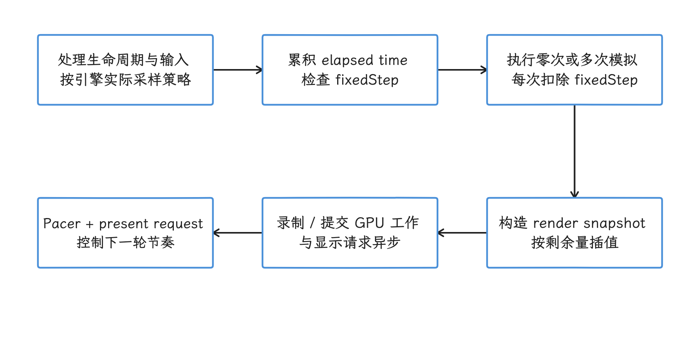

图：simulation、插值与渲染提交是不同节奏。 一次绘制可包含零次或多次 fixed update；示意不强制每引擎同一实现。

| 对比维度 | 普通 View 页面 | 游戏引擎 |
| --- | --- | --- |
| 主要驱动力 | View 失效、输入、动画、数据变化 | 自有 game loop 持续执行 |
| 逻辑更新 | UI Thread 上的回调与状态更新 | Game / Logic thread 的 simulation、脚本、物理、动画 |
| 渲染准备 | HWUI 在 UI Thread / RenderThread 协作 | Render / RHI thread、task workers、引擎 render graph |
| 提交接口 | HWUI 通过 Skia / RenderThread 输出 | GLES `eglSwapBuffers()` 或 Vulkan `vkQueuePresentKHR()` |
| 节奏控制 | Choreographer 与系统帧调度 | Swappy、自研 pacer、引擎 limiter、Frame Rate API |
| 重点延迟 | 输入到 App FrameTimeline | 输入采样到对应游戏帧 present 的完整链路 |

游戏仍然运行在 Android 窗口系统里：引擎自有 game loop，最终画面仍要经过 SurfaceFlinger 合成；把 swap/present 做成阻塞式，也代替不了完整的线程协作与 GPU 同步设计。

<!-- gracker-diagram: ch13-12-04-fps-simulation-latency -->
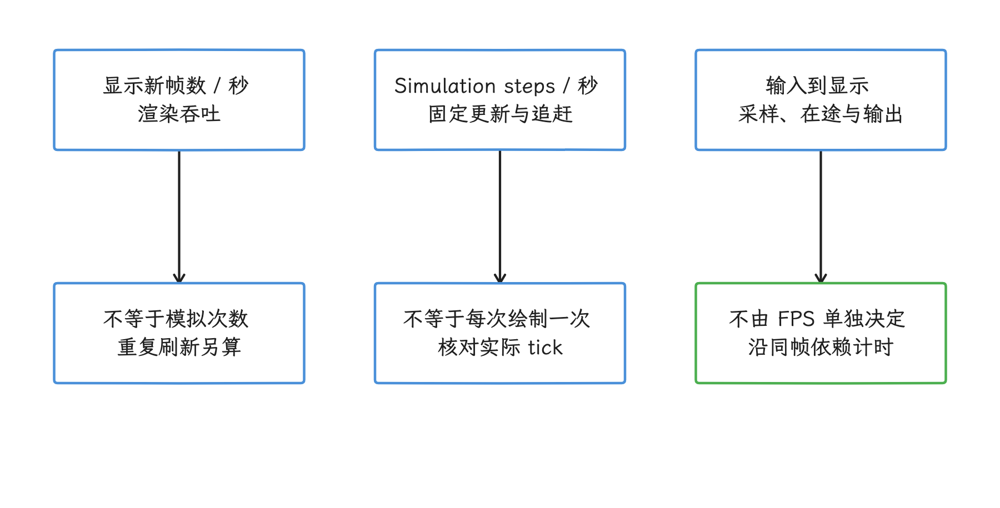

图：吞吐、模拟步频与单次输入延迟要分别记录。 阻塞 swap/present 不能代替完整同步与线程协作。

## 一帧的完整路径

下面的图展示常见独立 SurfaceView 游戏的依赖关系，省略错误、共享 present mode 和 presentOrValidate 快路径；它不是按比例的实测时间线。pacer 可以在一帧多处等待，图上只标记提交控制关系。

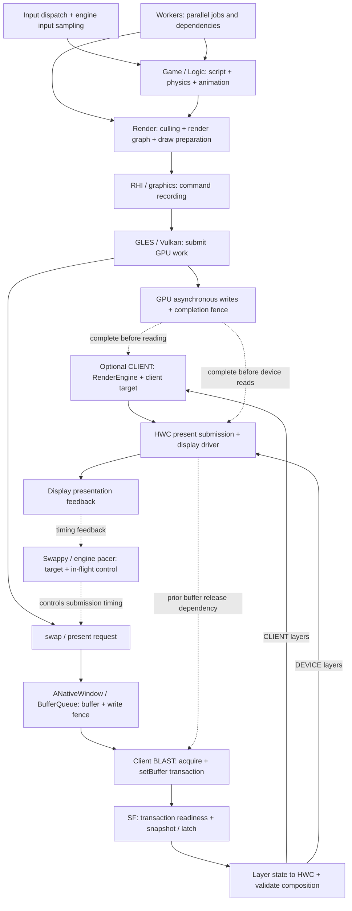

<!-- gracker-diagram: ch13-12-05-asynchronous-stages -->
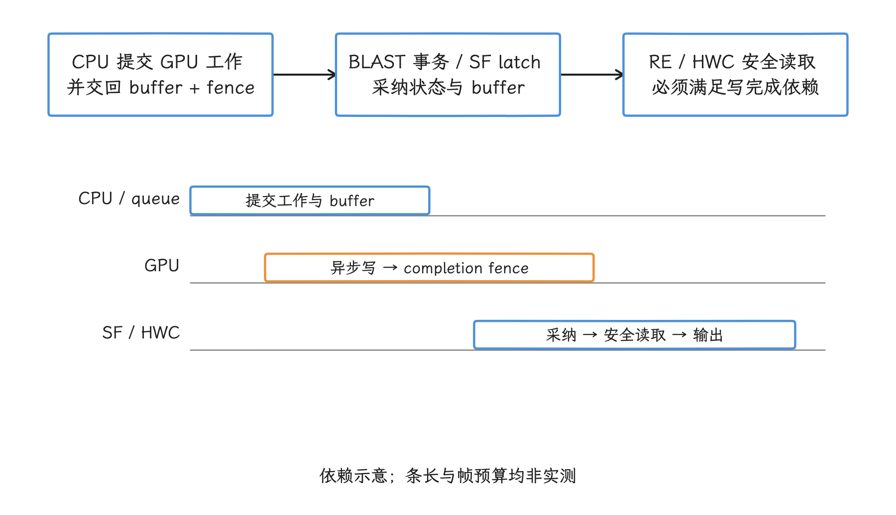

图：CPU 可先提交 buffer，读取端再遵守写完成 fence。 轨道仅表示依赖；SF latch 在受限策略下可早于 fence signal。

CPU 的提交调用返回时，GPU 往往还在异步执行，buffer 也可能已经携带未 signal 的写完成 fence 入队。BLAST 可以先取得 BufferItem 并发送事务；SF 在策略允许时也可能先 latch，真正的 RenderEngine/HWC 读取仍必须遵守 acquire 依赖。HWC 新一轮返回的 device-layer release fence 通常对应上一帧的旧 buffer，SF 还会按合成路径合并其他访问依赖；slot 归还与下一次可安全写入是两件事。present timing / present fence 则描述显示栈的呈现边界，三者要分别判读。

<!-- gracker-diagram: ch13-12-06-three-fences -->
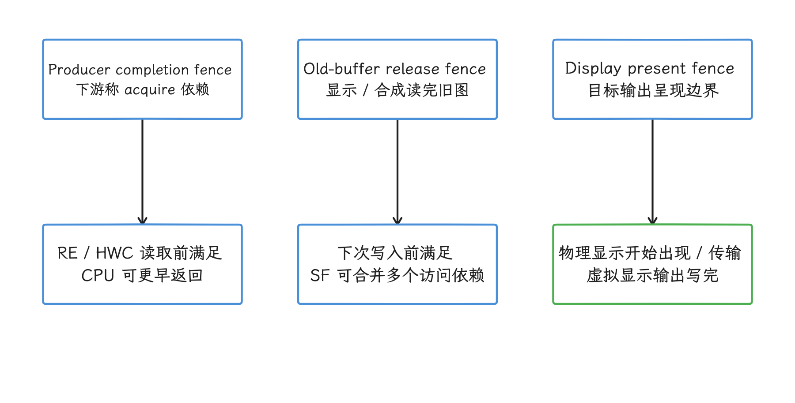

图：三个信号分别回答可读、可覆盖与显示反馈。 收到 fd 或 slot 归还均不证明 fence 已 signal。

### 五段职责

1. **Input 与 Game / Logic**：读取输入，更新脚本、AI、物理、动画和世界状态。
2. **Render preparation**：完成可见性裁剪、LOD（Level of Detail，细节层级）、render graph、draw item 与资源依赖准备。
3. **RHI / graphics submission**：RHI（Rendering Hardware Interface，渲染硬件抽象层）把引擎命令转换成 GLES/Vulkan 调用，录制并提交 GPU command buffer。
4. **GPU 与 swapchain**：应用提交 GPU 写入并请求 swap/present，把 image 与完成依赖交给 Android native window；CPU 提交返回不要求 GPU 已写完。普通 swapchain image 在渲染与显示间轮换，共享 present mode 等特殊模式需另查。
5. **Android display**：常见 SurfaceView 路径由 BufferQueue 的客户端 BLAST Consumer 组织 buffer 事务，再接 SurfaceFlinger readiness/latch、HWC/可选 RenderEngine、Composer HAL 与显示驱动。

这些阶段可以跨帧并行：Game thread 在准备 N+1 帧时，Render thread 可能正在处理 N 帧，GPU 还在执行 N-1 帧。这样的并行可以提高吞吐量，也可能让输入多等待一到两轮。已经进入 CPU/GPU/显示流水线、尚未完成 present 的帧，我们称为 in-flight frame；分析时要同时记录每秒完成帧数，以及同一输入跨越的在途帧数量。

<!-- gracker-diagram: ch13-12-07-cross-frame-overlap -->
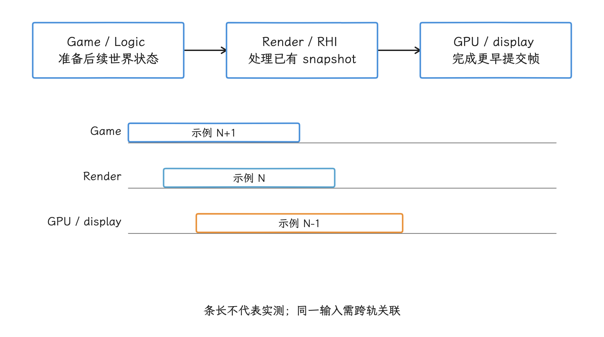

图：提高流水线吞吐时还要控制同一输入的在途等待。 N+1/N/N−1 只展示一种可能重叠，不是固定引擎帧差。

## 多线程架构：职责比线程名更可靠

引擎会随版本、graphics job、渲染后端和构建选项改变线程数量，所以我们先按职责识别线程，再用线程名辅助确认：

<!-- gracker-diagram: ch13-12-08-thread-roles -->
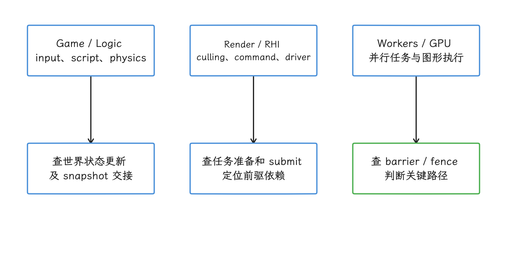

图：线程职责与依赖比线程名更能定位阶段。 Game、Render、RHI 可能合并或由 worker 分担。

| 角色 | 常见工作 | 过载或阻塞时的表现 |
| --- | --- | --- |
| Game / Logic thread | input、script、physics、animation、world tick | GPU 队列出现空洞，Render thread 等新命令 |
| Render thread | culling、draw preparation、render graph | Game thread 可能在帧边界等 Render thread |
| RHI / graphics thread | API command、driver 调用、queue submit | CPU submit 晚，GPU 开工也晚 |
| Worker threads | jobs、animation、visibility、streaming | 主线程在 barrier / future（等待并行任务完成的同步点）等待 worker |
| GPU queue | vertex、fragment、compute、copy | producer fence 晚，swapchain image 回收慢 |
| SurfaceFlinger / display | latch、composition、present | buffer 已 ready，仍错过目标 present |

### Unity 的典型结构与证据边界

Unity 的 main thread 运行 `PlayerLoop`，脚本 `Update` / `FixedUpdate` / `LateUpdate` 等阶段位于其下。启用多线程渲染后，render thread 处理图形命令，Job System worker 处理可并行任务。具体线程和 marker 会随 Unity 版本、渲染后端及 Player 设置变化。

Unity Profiler 中常用的 marker 包括：

<!-- gracker-diagram: ch13-12-09-unity-marker-location -->
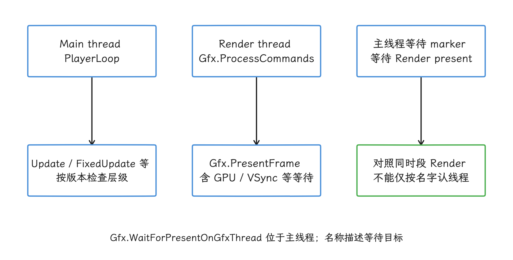

图：主线程等待与渲染线程 present 要分开看。 GfxThread 是等待目标名称，不代表该 marker 就在渲染线程。

- `PlayerLoop`：播放器主循环；
- `Gfx.ProcessCommands`：render thread 处理图形命令；
- `Gfx.WaitForCommands`：render thread 等 main thread 产生新命令；
- `Gfx.PresentFrame`：渲染线程上的 present/GPU/VSync 相关等待；`Gfx.WaitForPresentOnGfxThread` 则在主线程，表示主线程等渲染线程完成相应 present 等待。名字里的 GfxThread 不是该 marker 所在的线程；旧版名称与具体嵌套以对应 Unity 版本为准；
- Job worker 上的任务与 idle 区间。

这些名称属于 Unity Profiler 的 marker，Perfetto 默认并不保证显示它们；Perfetto 通常能看到的是进程、Linux 线程、调度状态、futex、binder、图形和 GPU/SurfaceFlinger 信息。要把 Unity 内部阶段与系统帧准确对应，我们应同时采集 Unity Profiler，或在关键阶段写入 `ATrace` / Perfetto TrackEvent，并携带统一 frame id。

<!-- gracker-diagram: ch13-12-10-unity-system-correlation -->
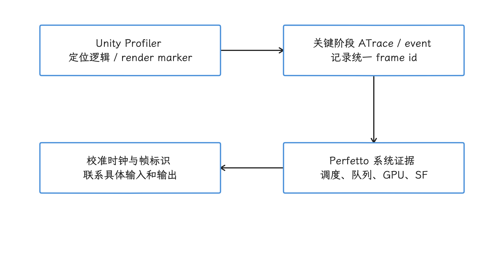

图：为引擎阶段补系统事件，并用同帧和时钟对齐。 Perfetto 默认采集不保证包含 Unity 内部 marker。

看到 `Gfx.WaitForPresentOnGfxThread` 变长，还不能就此判定 GPU bound：等待可能来自 VSync、frame pacer、swapchain back-pressure（下游未及时释放 image）或 GPU 本身，要结合 GPU 完成时间和 BufferQueue 深度一起判断。

<!-- gracker-diagram: ch13-12-11-wait-for-present-causes -->
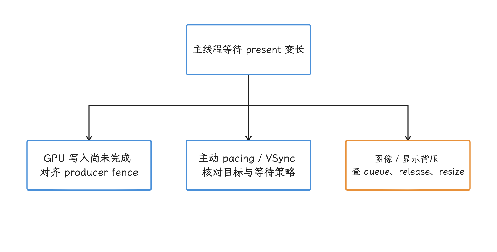

图：等待要沿前驱 fence、目标 interval 和队列状态解释。 一个 marker 变长不足以证明 GPU bound。

### Unreal 的典型结构与证据边界

Unreal 常见 Game Thread、Rendering Thread、可选 RHI Thread 与 Task Graph workers。Epic 的线程渲染文档说明 Rendering Thread 可能落后 Game Thread 一到两帧，Game Thread 会在帧边界限制自己的领先距离。

<!-- gracker-diagram: ch13-12-12-unreal-dependencies -->
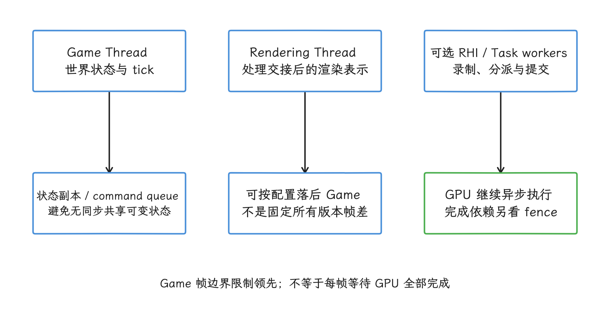

图：Game 状态经渲染表示和命令交接到图形后端。 可选 RHI、Task Graph 与帧差依配置变化；不能让两个线程无同步共享可变状态。

在 Perfetto 里，我们通常能按 OS 线程名找到 Game、Render、RHI 和 worker 轨道；名称会受引擎版本、平台封装和 Linux 线程名长度影响。`GameThread::Tick`、render pass、RHI command 这些细节属于 Unreal 的引擎 trace 语义，完整证据通常来自 Unreal Insights 的 `.utrace`。建议同时保留：

- Perfetto：系统调度、频率、GPU、BufferQueue、SurfaceFlinger 和 display；
- Unreal Insights：引擎 task、Game/Render/RHI dependency、asset loading 和自定义事件；
- 统一帧号：把同一 frame id 写入两边的自定义 marker。

### 线程等待怎样解读

我们看到等待，先别急着定性：Render thread 等 Game thread，可能说明逻辑慢；Game thread 等 Render thread，可能说明渲染准备积压；Swappy 或 acquire 上的短等待，也可能是在主动限制 in-flight 深度。判断时查看等待对象、前驱 fence、目标帧率，以及后续阶段有没有按预算启动。

<!-- gracker-diagram: ch13-12-13-interpret-thread-waits -->
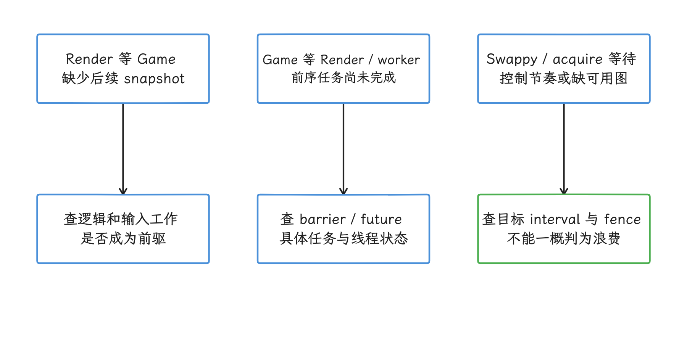

图：先确定谁在等谁，再检查后续是否按预算开工。 主动控制在途的短等待可以是正常行为。

## 游戏 Surface、SurfaceView 与 BLAST

大多数 Android 游戏把最终画面输出到独立 Surface。常见入口有：

<!-- gracker-diagram: ch13-12-14-native-window-entry -->
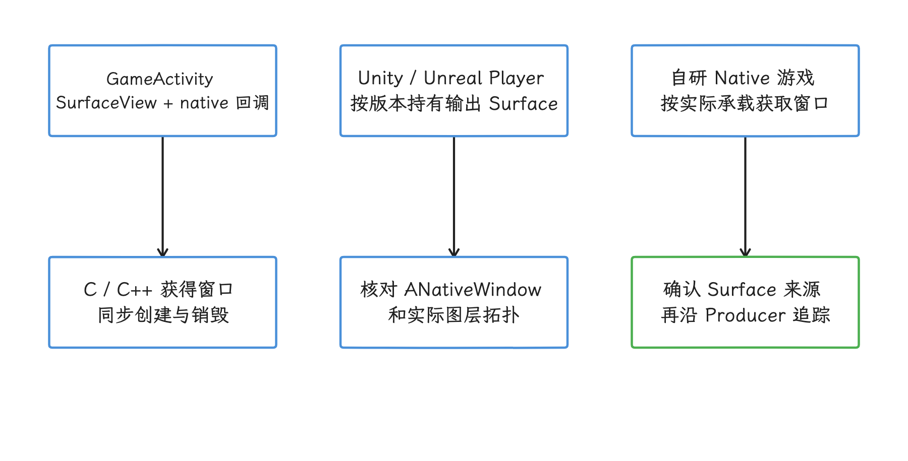

图：输出承载由实际 Activity 和引擎封装决定。 常见独立 Surface 不构成所有游戏的 API 保证。

- `GameActivity`：官方文档说明它渲染到 `SurfaceView`，并把 `ANativeWindow` 生命周期回调给 C/C++；
- Unity / Unreal 的 Android Player Activity：通常持有供引擎渲染的 Surface 或 native window，具体封装随版本变化；
- 自研 Native 游戏：从 `SurfaceView`、`NativeActivity` 或 `GameActivity` 获得 `ANativeWindow`。

“游戏普遍使用 SurfaceView + BLAST”说的是一种常见承载结构：现代 Android 的独立 `SurfaceView` 生产链，通常由 BLASTBufferQueue 配合 SurfaceControl transaction 协调 buffer 与几何更新。它描述的是常见承载方式，不是对所有引擎的 API 保证，也不表示引擎会直接调用 BLAST。

### Android 17 的 SurfaceView 路径

`android-17.0.0_r1` 的 `SurfaceView.java` 直接持有 `BLASTBufferQueue`、`mBlastSurfaceControl` 和 `SurfaceControl.Transaction`。Surface 的创建与 resize、destination frame（目标显示区域）、crop、z-order 和窗口同步都由这套 SurfaceControl/BLAST 路径处理；游戏像素本身仍由引擎生成。

<!-- gracker-diagram: ch13-12-15-blast-state-pixels -->
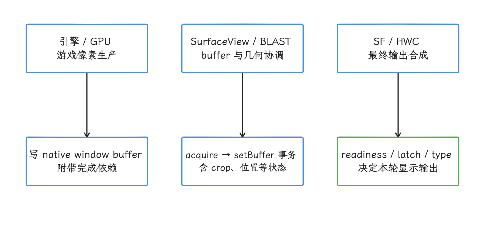

图：几何与 buffer 更新经 BLAST/SurfaceControl 协调。 引擎不必直接调用 BLAST，游戏像素仍由 GPU 生产。

稳态游戏帧仍由引擎通过 `ANativeWindow` 生产。以 Vulkan WSI（Window System Integration，窗口系统集成）为例，`vulkan/libvulkan/swapchain.cpp` 会：

- 用 native window 查询 `NATIVE_WINDOW_MIN_UNDEQUEUED_BUFFERS` 等能力；
- 按 swapchain 配置设置 buffer format、dimensions、dataspace 和 transform；
- 在 acquire 路径调用 `dequeueBuffer()`；
- 在 present 路径把 GPU release fence 随 `queueBuffer()` 交给 BufferQueue。

acquire 方向还要把 Android fence 接入 Vulkan 同步对象。普通非 shared swapchain 的 `vkAcquireNextImageKHR()` 对应实现从 `dequeueBuffer()` 取得 `ANativeWindowBuffer` 和 native fence fd（文件描述符），随后调用 driver 的 `AcquireImageANDROID()`，把该 fence 的复制 fd 导入应用提供的 Vulkan semaphore / fence；acquire 同步对象满足之后，应用才能安全改写这块 image。 shared present mode 使用另一分支，不会每帧重复 dequeue；拿到 image index 也不允许绕过 acquire semaphore/fence 就写 image。

<!-- gracker-diagram: ch13-12-16-vulkan-acquire -->
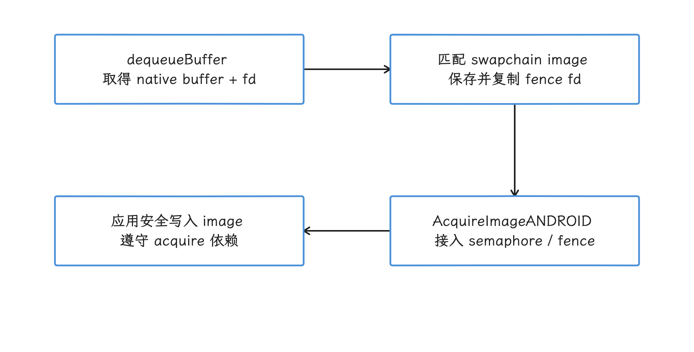

图：普通 swapchain 把 dequeue fence 导入 acquire 同步对象。 shared 模式不每帧 dequeue；拿到 image index 后仍须满足访问同步。

present 方向则把链路接回 BufferQueue：`vkQueuePresentKHR()` 或 `SwappyVk_queuePresent()` 最终进入 `PresentOneSwapchain()`，平台先调用 `QueueSignalReleaseImageANDROID()`，把 Vulkan wait semaphore 转换成代表 GPU 完成的 sync fd，再把 buffer 与该 fd 一起交给 `ANativeWindow::queueBuffer()`。Vulkan swapchain image 与 Android BufferQueue buffer 由此建立明确的映射。还要注意，present 调用走完这条路径时，该帧可能尚未被 SurfaceFlinger latch，后面仍有显示呈现和像素响应等阶段。 这里函数名中的 release image fence 对下游读取方起 acquire 依赖的作用，不能与显示端稍后释放旧 buffer 的 release fence 混淆。

<!-- gracker-diagram: ch13-12-17-vulkan-present -->
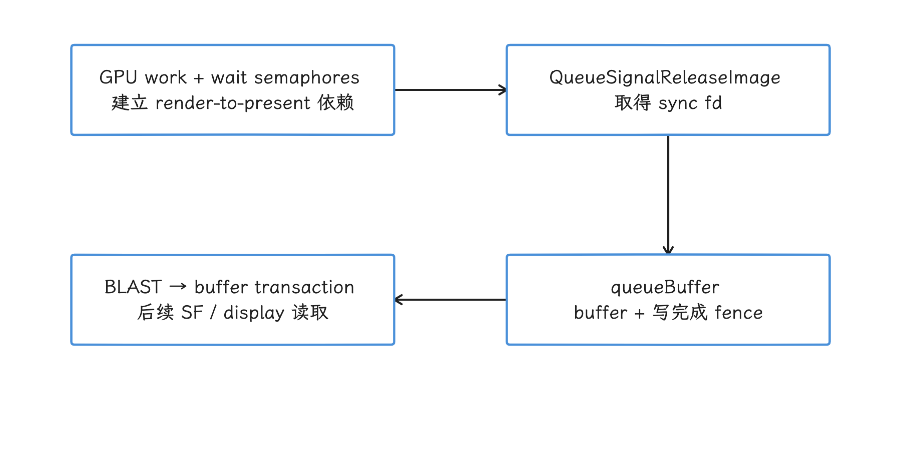

图：wait semaphores 被转换为 buffer 的下游读取依赖。 release-image fence 在这里表示生产完成，不是显示端释放旧图。

### 游戏 Layer 仍要经过 SurfaceFlinger

独立 Surface 可以避开 App 的 HWUI RenderThread，但下一站仍是 SurfaceFlinger：它为游戏建立 Layer snapshot，并与 HWC 协商 `CLIENT` / `DEVICE` composition。

即使游戏 Layer 被 HWC 判为 `DEVICE`，游戏场景本身也已经由 GLES/Vulkan 在 GPU 中渲染完成；`DEVICE` 说明的只是显示合成阶段无须 RenderEngine 再采样该 Layer，游戏自身的 GPU 渲染成本仍然存在。

<!-- gracker-diagram: ch13-12-18-device-vs-client -->
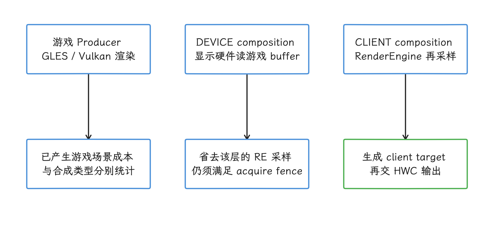

图：游戏渲染和显示合成是两段不同的 GPU 成本。 SurfaceView 不保证 DEVICE，CLIENT 还可能与游戏竞争 GPU。

显示尾链可以沿下面几组调用核对：

<!-- gracker-diagram: ch13-12-20-present-or-validate -->
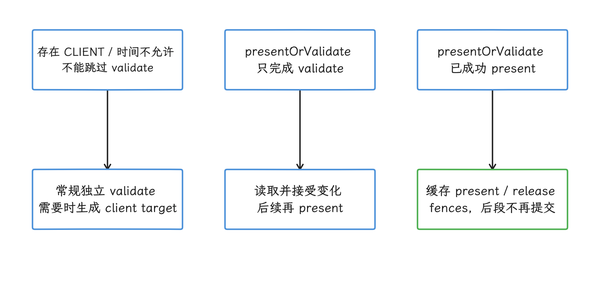

图：快路径成功后复用返回的 fences，不重复 present。 提交调用成功与 fence signal、面板发光仍是不同事件。

1. 常规路径先由 `Output::writeCompositionState()` / `OutputLayer::writeStateToHWC()` 写入 Layer buffer、acquire fence、几何和请求类型；C++ Layer 入口为 `HWC2::Layer::setBuffer()`，Composer3 命令入口为 `AidlComposer::setLayerBuffer()`。
2. 再由 `Display::chooseCompositionStrategy()` / `HWComposer::getDeviceCompositionChanges()` 协商类型与 display requests；无 CLIENT 且满足时间条件时，`presentOrValidate` 可直接成功提交并缓存 fences，后续不应重复 present。
3. 普通 validate 后仍需要 `CLIENT` 时，由 RenderEngine 生成 client target，`setClientTarget()` 连同写完成依赖交给 HWC；`DEVICE` Layer 直接由显示硬件读取。预测合成还可能与协商并行，不能把这份简化顺序当成全部调度实现。
4. `Display::presentFrame()` / `presentAndGetReleaseFences()` 取得或沿用 display present fence 和各 Layer release fence，SF 再按 buffer 使用关系安排归还。

<!-- gracker-diagram: ch13-12-19-hwc-ordinary-order -->
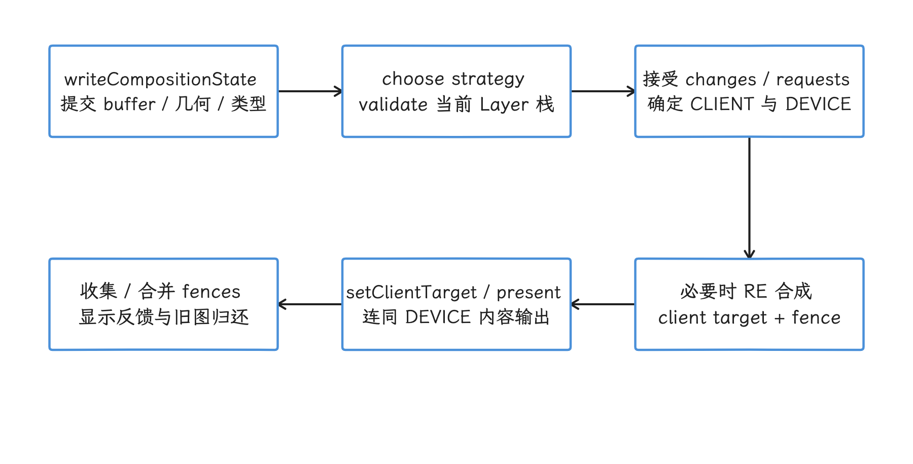

图：先写 Layer 状态，再协商并生成所需 client target。 预测合成可以并行；此图省略直接 present 成功的快路径。

函数返回时间不能当作 vblank 或 fence signal。物理显示的 present fence 契约通常指画面开始出现（video mode）或开始传入面板内存（command mode）的 VSync；虚拟显示则指输出写完。它不证明整个面板扫描或像素响应结束。HWC 的旧 buffer release 与 SF 合并的最终访问依赖满足后，下一次写入才安全；FREE slot 仍可携带尚未 signal 的 release fence。

<!-- gracker-diagram: ch13-12-21-presentation-vs-reuse -->
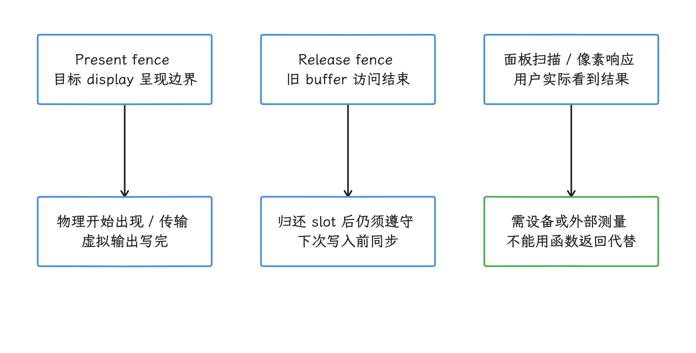

图：显示反馈、旧图释放和光学响应各有边界。 FREE 不等于可立即覆盖；软件时间戳不能代替独立光学测量。

### 生命周期和 resize

GameActivity 的 `onNativeWindowDestroyed` 契约要求：回调返回前，其他渲染线程必须停止访问该 window。旋转、分屏、折叠、自由窗口或 Surface 重建时，应按引擎规范停止提交，等待必要的 GPU 使用结束，销毁或重建 EGLSurface/Vulkan swapchain，再开始使用新 window。

<!-- gracker-diagram: ch13-12-22-window-lifecycle -->
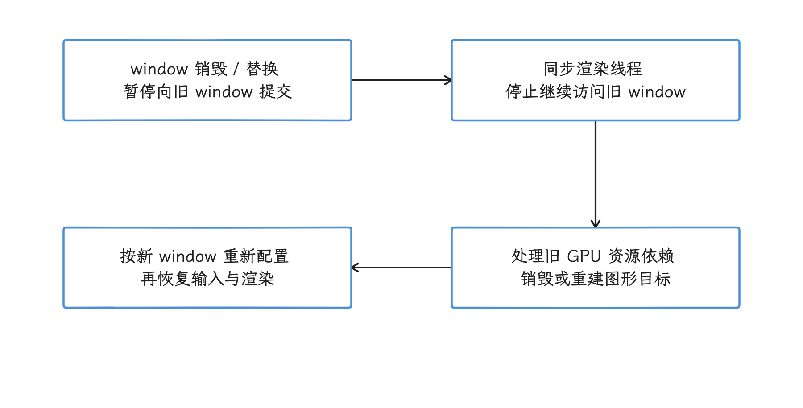

图：销毁回调返回前，其他线程必须停止访问该 window。 GPU 使用与资源释放按 API 和引擎依赖处理，错误名本身不证明全部根因。

如果旧 swapchain 继续向已经销毁的 window 提交，就可能出现 `VK_ERROR_OUT_OF_DATE_KHR`、`VK_ERROR_SURFACE_LOST_KHR`、黑帧或 native crash。这些现象首先应核查 Surface/swapchain 生命周期、返回码和旧资源依赖；仅凭黑帧或某个错误名，不能排除其他渲染、资源或驱动问题。

## Frame pacing：稳定间隔与低延迟要一起看

先看一个典型场景：游戏在 60 Hz 屏幕上只能产出约 40 FPS，提交节奏又未经控制。于是某些帧只显示一个刷新周期，另一些帧显示两个刷新周期，形成明显的 16.7 ms / 33.3 ms 交替；即使平均 FPS 接近目标，present-to-present（相邻两次显示提交之间）的间隔仍不均匀，玩家的顿挫感就来自这里。

<!-- gracker-diagram: ch13-12-23-40fps-60hz-cadence -->
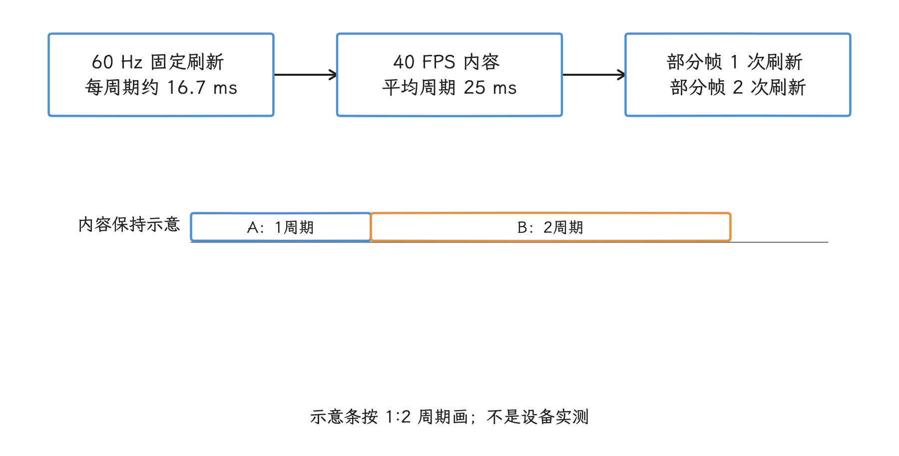

图：60 Hz 固定刷新下，40 个均匀内容帧也无法全按整数相同周期保持。 16.7/33.3 ms 是理想量化示意，真实抖动还需测 requested/actual timing。

### Queue-stuffing 为什么会增加延迟

游戏持续以最快速度 present，display pipeline 里的 buffer 会逐渐占满，这种状态称为 queue-stuffing。队列没有空位之后，render thread 会在 acquire、swap 或 present 附近阻塞，看起来像系统在自动限速；而输入可能早在前面的逻辑帧中就完成了采样，玩家看到结果之前，还要先等队列里的旧帧走完，输入延迟随之增加。

<!-- gracker-diagram: ch13-12-24-queue-stuffing -->
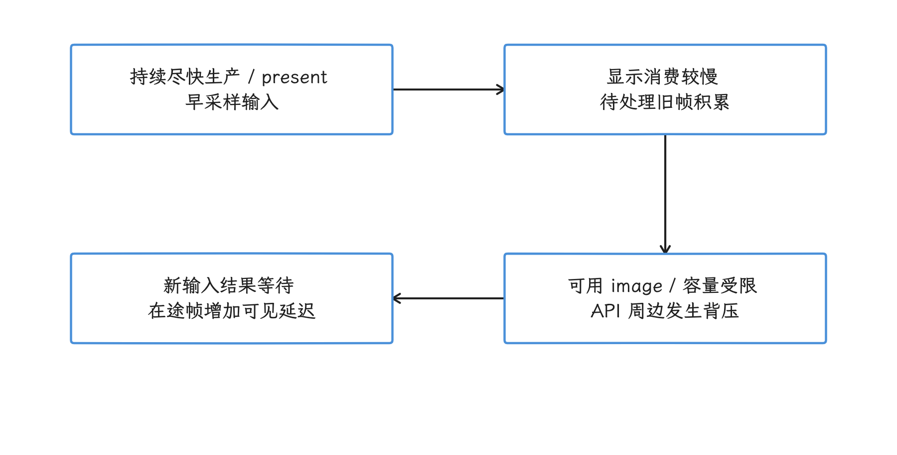

图：生产过早会积累旧帧，并把等待留给后续 acquire/present。 积压与丢帧策略依实际模式；应追同一输入，而不是只看阻塞时间。

swap 调用阻塞时，GPU 慢只是候选原因之一，下面这些因素同样常见：

<!-- gracker-diagram: ch13-12-25-blocking-candidates -->
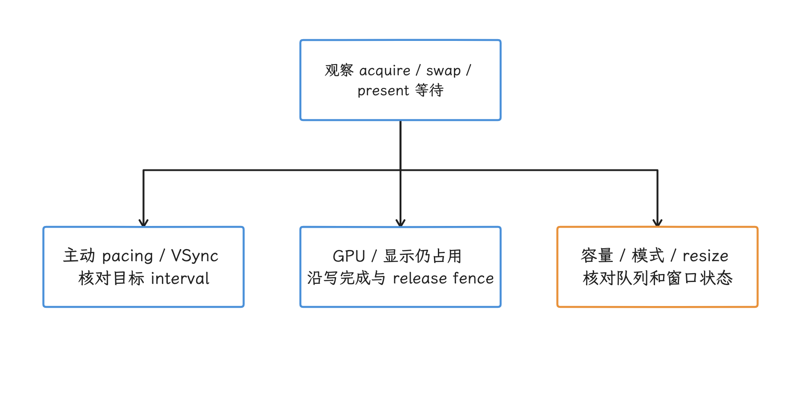

图：先把主动控制、图像依赖和状态变化分开。 不能由调用耗时单独判 GPU 慢或 driver 差。

- Swappy 或引擎 pacer 主动等待目标时刻；
- swapchain image 仍被显示端使用；
- BufferQueue 已满；
- GPU producer fence 还未完成；
- resize / display mode change；
- Vulkan present mode 与 driver 行为。

### Swappy 做了什么

Swappy 是 AGDK 提供的 Frame Pacing library，用于安排帧提交时机和限制队列深度：

- GLES 使用 `SwappyGL_swap()` 包装 `eglSwapBuffers()`；
- Vulkan 使用 `SwappyVk_queuePresent()`，它会代为调用 `vkQueuePresentKHR()`；
- 库利用 Choreographer、presentation timestamp 和 sync fence 控制 swap interval（提交间隔）与 pipeline mode；
- GLES 侧可使用 `EGL_ANDROID_presentation_time`，Vulkan 侧可使用 `VK_GOOGLE_display_timing` 等能力；
- 目标是避免帧过早 present 和 queue-stuffing，同时兼顾不同刷新率。

Swappy 里的 wait 可能就是主动 pacing，是库在正常工作。我们分析这段等待时，要检查目标 interval 是否正确、队列里有几帧、输入到 present 的延迟有没有缩短；如果只想着消除 wait slice，队列可能再次进入 queue-stuffing。

<!-- gracker-diagram: ch13-12-26-swappy-feedback -->
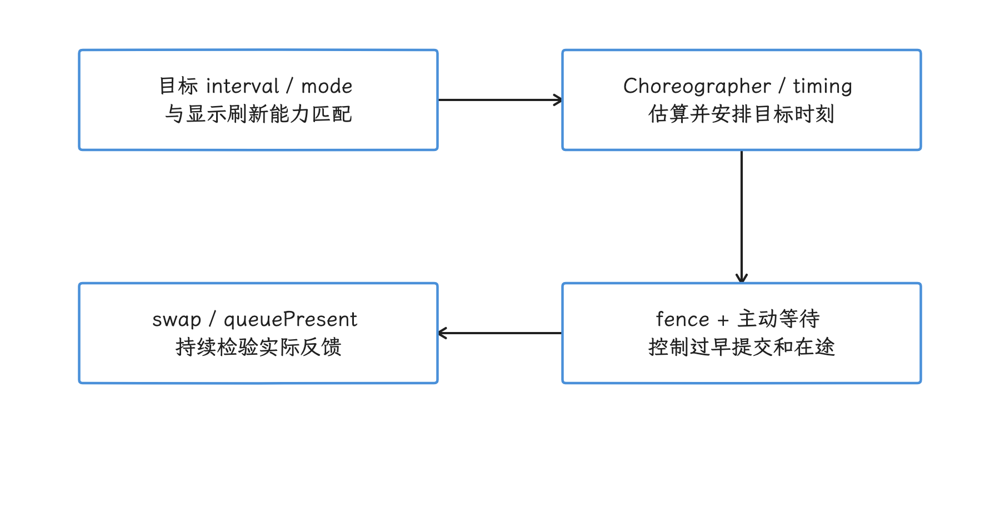

图：pacer 把显示反馈用于安排后续提交，避免盲目填满队列。 主动 wait 可能改善延迟；实际 interval 和模式仍须记录。

### Pipeline 与 non-pipeline

Pipeline mode 允许 CPU 和 GPU 跨 VSync 并行，通常能稳住吞吐，代价是可能多出一轮 in-flight latency；Non-pipeline mode 适合 CPU 与 GPU 工作总量能在一个 interval 内完成的轻负载场景，可缩短输入到显示的等待。Swappy 的 auto pipeline mode 会根据工作量调整。我们评价模式选择时，要把帧间隔和输入延迟放在一起看，平均 FPS 只能作参考。

<!-- gracker-diagram: ch13-12-27-pipeline-mode-choice -->
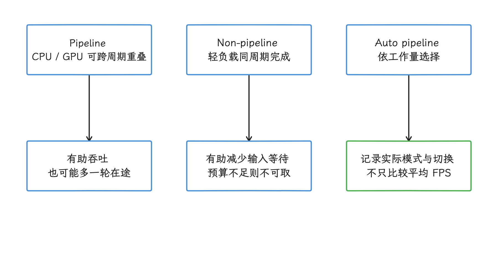

图：模式选择应共同评价吞吐和输入延迟。 CPU 与 GPU 总工作足够短才可能在同一 interval 内完成。

### Choreographer 与 Swappy 的分工

游戏可以直接用 Choreographer 对齐显示节拍，只是回调偏移会随设备变化，长帧之下也可能继续 queue-stuffing；Swappy 在 Choreographer 之外，还结合 presentation timestamp 与 fence 一起控制提交。

Perfetto 默认不保证存在名为 `Swappy` 的 track；想看到 `preWait`、`postWait`、`preSwapBuffers` 这些库内阶段，需要通过 Swappy tracer 回调写入 ATrace/TrackEvent。未加自定义埋点的系统 trace，则更适合观察 present 调用点、FrameTimeline、BufferQueue、GPU 和 SurfaceFlinger。

<!-- gracker-diagram: ch13-12-28-swappy-tracer -->
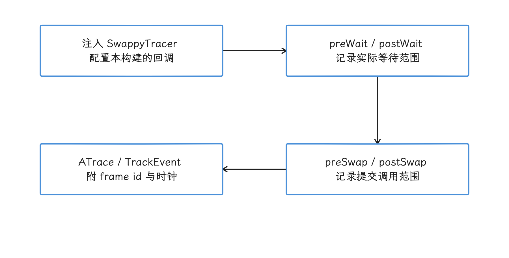

图：tracer 回调可把库内等待和提交阶段接入系统 trace。 默认 OS 轨道不能凭名称还原全部 Swappy 逻辑。

## Android 17 的 present timing 与 producer throttling

### `VK_EXT_present_timing`

Android 17 支持 `VK_EXT_present_timing`，自研 Vulkan pacer 可以请求 target present time，并查询多个 present stage：queue operations end 表示相关队列操作结束，request dequeued 表示显示请求从队列取出，first pixel out / visible 则描述显示输出和可见阶段。该扩展依赖 `VK_KHR_present_id2`；应用还须在创建 device 和 swapchain 前枚举 extension、feature 与相关 flag。

<!-- gracker-diagram: ch13-12-29-timing-capabilities -->
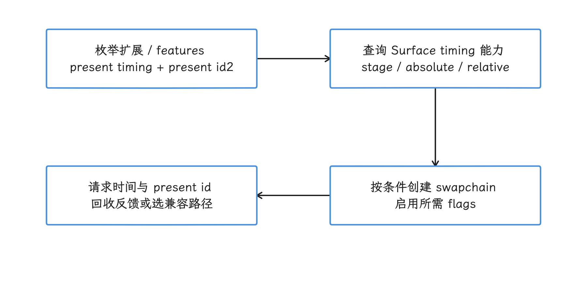

图：设备、Surface、feature 和 swapchain 条件必须同时满足。 Android 版本与头文件不证明目标设备可用。

平台侧，`swapchain.cpp` 已解析 `VkPresentTimingsInfoEXT` 和 `VkPresentId2KHR`，并从 native window timestamp 填充 past presentation timing。系统版本达到 Android 17，仍要逐设备检查驱动和 swapchain 的能力；扩展不可用时，可退回 `VK_GOOGLE_display_timing` 或 Swappy。 固定 r1 的 surface capabilities 分支在 `present_timing_ext` flag 下声明支持绝对时间、不支持相对时间，因此不要照抄文档的 relative-time 示例；需查询本 Surface 的 timing capabilities。该实现把 queue-operations-end 映射为 render-complete、request-dequeued 映射为 composition-latch，两个 first-pixel stage 都取同一个 actual-present 时间；无有效时间时可返回 0。它们不是两路独立光学传感器结果。

<!-- gracker-diagram: ch13-12-30-timing-stage-mapping -->
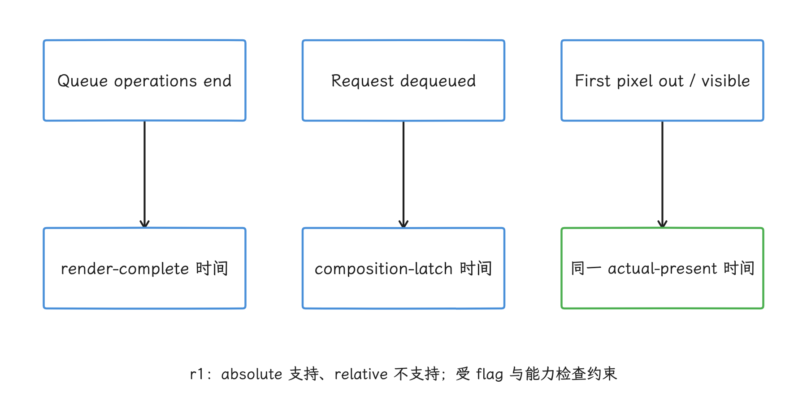

图：四个 stage 名称在该实现中落到三种时间来源。 两个 first-pixel stage 共用 actual-present；无有效时间可返回 0。

### `Surface.setProducerThrottlingEnabled()`

API 37 新增的 `Surface.setProducerThrottlingEnabled(boolean)` 默认开启：Vulkan/EGL producer 正在 queue 新 buffer、consumer 还在处理上一帧时，系统会对 producer 施加 CPU back-pressure（隐式 queue 侧等待），阻塞可能出现在 `eglSwapBuffers()` 或 Vulkan present 附近。这个 API 对 asynchronous mode 无效，该模式下 throttling 总是开启。 这项控制与队列容量等待、GPU 显式同步是不同层次；源码还有平台 flag 边界。

Android 17 的 API 文档建议 Vulkan 应用关闭这类隐式 throttling，改用正确的显式同步。关闭之后，如果生产速度超过 GPU 或显示消费速度，等待通常会转移到 `vkAcquireNextImageKHR()` / dequeue 一侧。接入现成引擎时，我们先确认引擎版本已适配该 API，并具备完整的 semaphore、fence、in-flight frame 上限和 frame pacer 设计，避免绕过引擎直接修改 Surface。

<!-- gracker-diagram: ch13-12-31-throttle-control -->
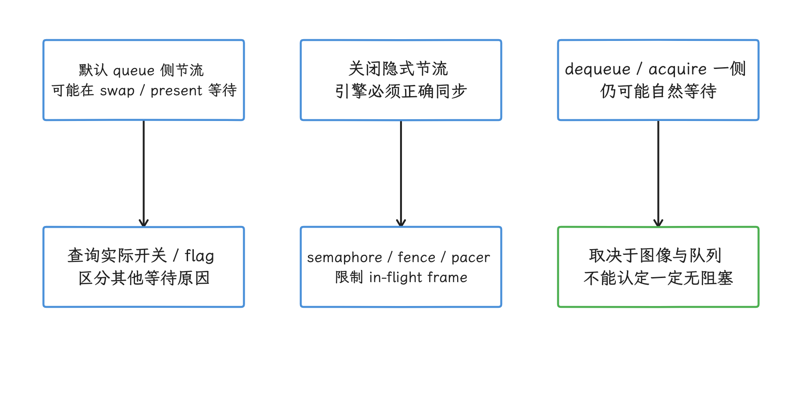

图：关闭隐式 queue throttling 后仍要控制资源和在途帧。 异步模式设置无效；关闭不会消除容量、fence 或设备约束。

### BufferQueue 计数、分辨率切换与显存预算

`android-17.0.0_r1` 的 `BufferQueueCore` 构造函数把 `mMaxAcquiredBufferCount` 和 `mMaxDequeuedBufferCount` 都初始化为 1，再用 `getMaxBufferCountLocked()` 按 acquired + dequeued + async / non-blocking 额外项计算当前队列上限，结果受 `mMaxBufferCount` 限制；构造函数据此把起始 free slot 放入 `mFreeSlots`。这组默认值描述的是新建 BufferQueue 的锁内约束，平台并没有给过“所有游戏 swapchain 最终固定两张图像”的 API 保证。[来源: DeepResearch/2026-07-17-game-engine-resolution-memory-allocation.md; 已验证: android-17.0.0_r1 `frameworks/native/libs/gui/BufferQueueCore.cpp`:120-149, 238-266]

`Surface::setBufferCount(N)` 在 N>0 时先查询 `NATIVE_WINDOW_MIN_UNDEQUEUED_BUFFERS`，再把参数转换成 `setMaxDequeuedBufferCount(N - minUndequeued)`；N=0 是把 max-dequeued 恢复为 1 的分支。`BufferQueueProducer::setMaxDequeuedBufferCount()` 会检查当前已 dequeued 的 buffer 数、最小 slot 数和总上限，不满足就返回 `BAD_VALUE`。所以在 resize、折叠/分屏切换或 Surface 重建期间，如果旧 image 仍被 producer / GPU / HWC 使用，直接反复改队列深度，可能只是在制造新的拒绝路径和额外重建工作。[来源: DeepResearch/2026-07-17-game-engine-resolution-memory-allocation.md; 已验证: android-17.0.0_r1 `frameworks/native/libs/gui/Surface.cpp`:2601-2624, `frameworks/native/libs/gui/BufferQueueProducer.cpp`:183-271]

<!-- gracker-diagram: ch13-12-32-queue-count-negotiation -->
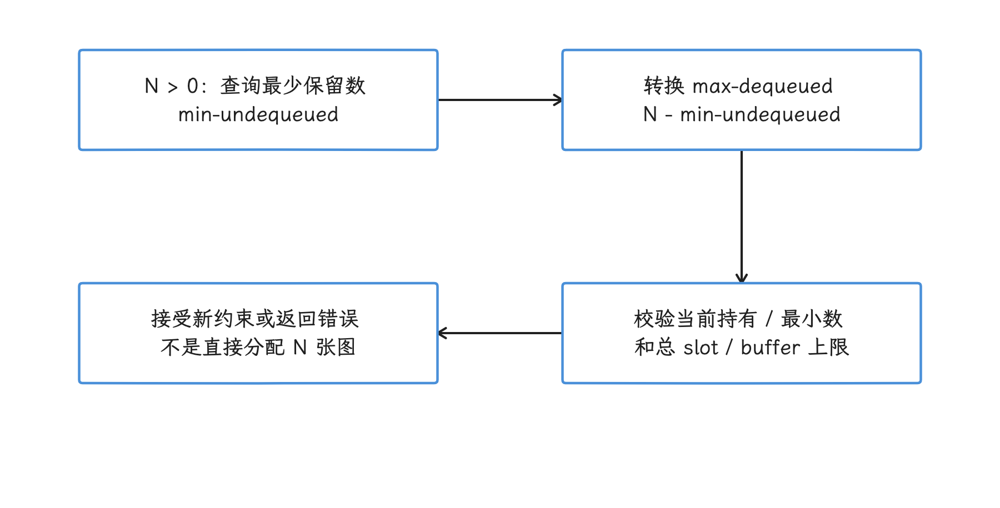

图：隐藏 buffer count 调用也受 min-undequeued 和活动 slot 校验。 N=0 是恢复 max-dequeued=1 的特殊分支，不是通式。

分辨率调整先区分内部 render scale 与输出 Surface/swapchain 尺寸。只改变离屏渲染区域时，不必随之销毁 native window 或减少 swapchain image count；Unity 6.0 的公开动态分辨率实现甚至继续保留完整尺寸 render target、只使用其中一部分，因此不能把降低 render scale 当作已释放显存。实际呈现尺寸或 image count 需要改变时，再交给引擎处理旧资源依赖，按 WSI/EGL 协议调整或按需重建目标。[来源：Unity 动态分辨率](https://docs.unity3d.com/6000.0/Documentation/Manual/DynamicResolution-introduction.html)、[Android Vulkan WSI](https://android.googlesource.com/platform/frameworks/native/+/refs/tags/android-17.0.0_r1/vulkan/libvulkan/swapchain.cpp)。

以 1080p RGBA8 为例，单张 color buffer 的裸像素是 1920×1080×4 = 8,294,400 bytes（约 7.91 MiB）；真实分配还含 gralloc 对齐、metadata、depth/MSAA attachment 和实现开销，并需按真实 allocation 去重。要不要减少一张 image，须同时用 allocator 统计、queue/事务、fence 和显示节奏验证，不能只按像素尺寸推断内存收益。[来源：Surface 数量协商](https://android.googlesource.com/platform/frameworks/native/+/refs/tags/android-17.0.0_r1/libs/gui/Surface.cpp)、[WSI image count](https://android.googlesource.com/platform/frameworks/native/+/refs/tags/android-17.0.0_r1/vulkan/libvulkan/swapchain.cpp)。

<!-- gracker-diagram: ch13-12-33-resize-memory-budget -->
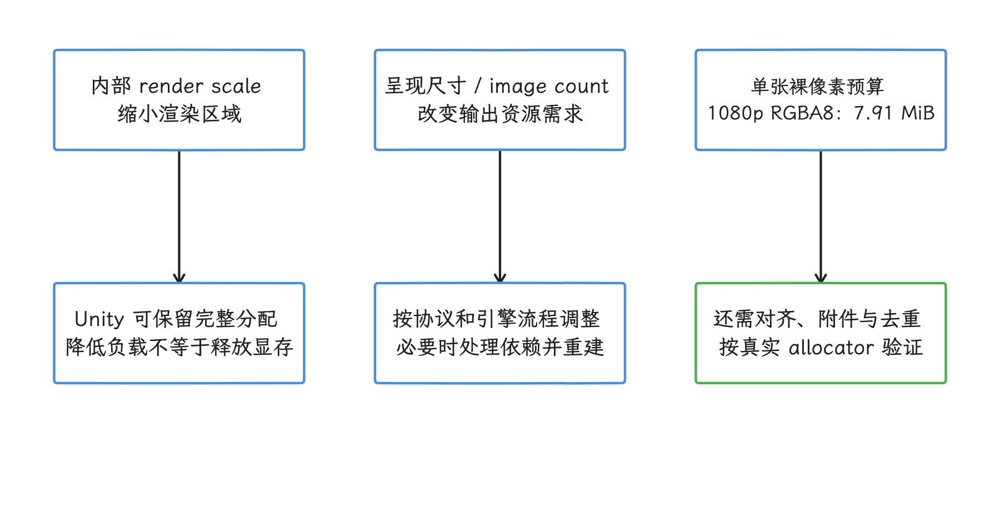

图：内部渲染区域、呈现资源和实际分配应分别核对。 降低 render scale 不保证释放显存；是否重建窗口或 swapchain 取决于实际改动。

### slot 上限与实际 image 数量

`BufferQueueDefs::NUM_BUFFER_SLOTS` 的默认值 64 与初始 `mMaxBufferCount` 描述默认 slot 配置，不能当作已分配 image 数。固定 r1 另有 Consumer 在连接前启用 `allowUnlimitedSlots()`、Producer 再执行 `extendSlotCount()` 的受控扩展路径，不能把 64 称为所有队列不可突破的绝对上限。普通游戏还必须遵守自己的 WSI capabilities；实际在途数量与可 dequeue 数、consumer 保留数、present mode、引擎 frame 上限和设备实现有关。

<!-- gracker-diagram: ch13-12-34-default-slots-extension -->
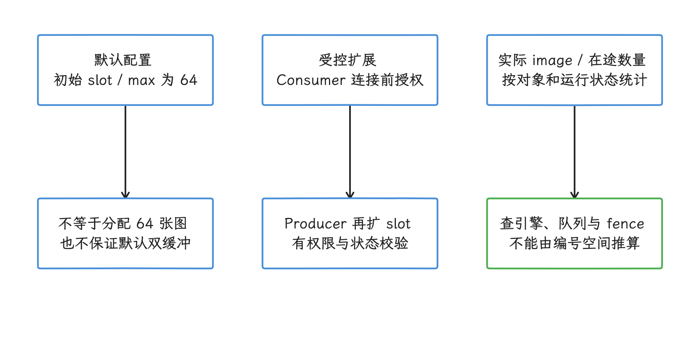

图：默认 slot、扩展授权和实际图像数是三个不同对象。 普通游戏仍受 Vulkan WSI capabilities，不能自行套用扩展内部接口。

普通应用同样不应该通过隐藏的 `Surface::setBufferCount()` 强制修改活动队列：Vulkan 按 `VkSurfaceCapabilitiesKHR` 协商 swapchain image count，GLES 遵循 EGL/ANativeWindow 协议与引擎管理。低内存、resize 或模式切换需要减少 image count 时，走引擎的 swapchain 重建流程，并确认旧 image 和 fence 已经退出使用。

## 几组系统调优机制各管什么

Swappy、Frame Rate、ADPF、Game Mode 和 Game State 这几个名字经常一起出现，容易看起来像一套东西；我们先把它们各自表达的信息和控制范围分开，再逐个展开：

<!-- gracker-diagram: ch13-12-35-three-control-scopes -->
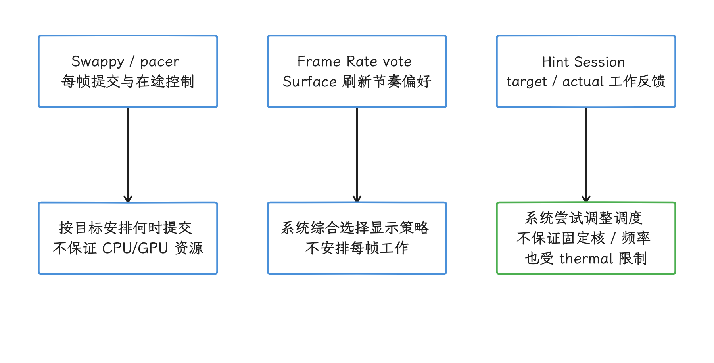

图：提交节奏、刷新偏好与资源提示分别负责一层。 机制配合需要应用协调，各自不提供其他层的强制保证。

| 机制 | 表达的内容 | 不负责什么 |
| --- | --- | --- |
| Swappy / engine pacer | 每帧何时提交、swap interval、in-flight 深度 | 不保证 CPU/GPU 资源，也不决定用户画质偏好 |
| Frame Rate API | Surface 希望显示系统采用什么刷新节奏 | 不是强制刷新率，也不安排每一帧的 CPU/GPU 工作 |
| Performance Hint Session | 一组周期性线程的 target / actual work duration（目标与实际工作时长） | 不能锁核、锁频或绕过 thermal |
| Game Mode | 用户选择 PERFORMANCE / BATTERY / STANDARD 等目标 | 不规定各 OEM 必须使用同一套 intervention |
| Game State | 当前是否 loading、是否 gameplay 及业务标签 | 不等同于 Game Mode |

### ADPF Performance Hint Session

`PerformanceHintManager` 从 API 31 开始提供 Hint Session，思路是用周期性的工作时长反馈，帮助系统安排 CPU 资源。使用时要满足以下契约：

<!-- gracker-diagram: ch13-12-36-hint-session-loop -->
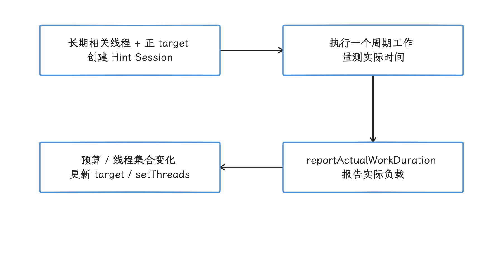

图：为长期关联线程建立 session，再按周期报告工作。 null、不合法参数、线程变化和 session 生命周期都要处理。

- session 关联同一进程中一组长期存在、工作相关的线程；
- 创建时给出正数 target duration；
- 每个周期调用 `reportActualWorkDuration()`，报告这组线程完成上一轮工作的实际时长；
- 目标 FPS 或工作预算改变时调用 `updateTargetWorkDuration()`；
- API 34 可用 `setThreads()` 替换线程集合；
- API 35 可用 `WorkDuration` 报告 CPU/GPU 分量，并可用 `setPreferPowerEfficiency()` 表示这些线程可偏向能效调度；
- session 不受支持时，`createHintSession()` 可以返回 `null`。

这类 hint 影响的是系统的线程放置和 CPU 频率决策，至于是否用到大核、固定频率或某个 GPU 档位，决定权在系统和 thermal 策略。target、线程集合或 actual duration 要认真填：填错了，系统收到的负载反馈就会失真。 Session 的 Java 方法会修改内部状态，调用方应负责线程安全；`WorkDuration` 的 start 与 total 必须大于 0，CPU/GPU 分量各自非负且不能同时为 0，时间域按 `uptimeNanos()` 契约。CPU/GPU 可以重叠，不能简单相加后冒充 total wall time。

<!-- gracker-diagram: ch13-12-37-work-duration-fields -->
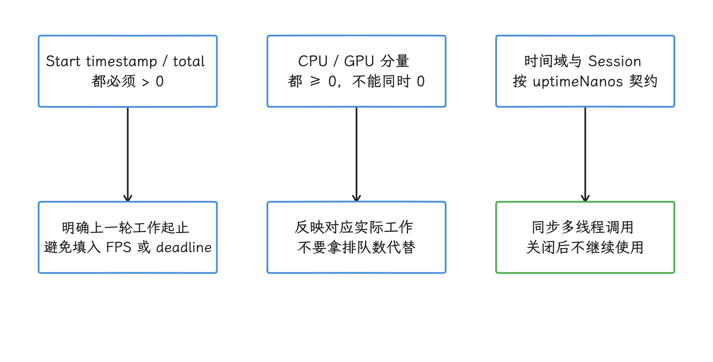

图：start、total 和 CPU/GPU 分量按各自契约报告。 CPU/GPU 可重叠；total wall time 不能简单相加，Session 调用需自保线程安全。

持续性能还要结合 Thermal API。画质调节应分别评估 render scale、阴影、后处理、粒子、LOD 和目标 FPS，并加入滞回区间与最短保持时间。滞回指升档和降档使用不同阈值，可避免热状态在边界附近反复切换，进而触发资源重建和 frame-time 尖峰。

<!-- gracker-diagram: ch13-12-38-thermal-quality-loop -->
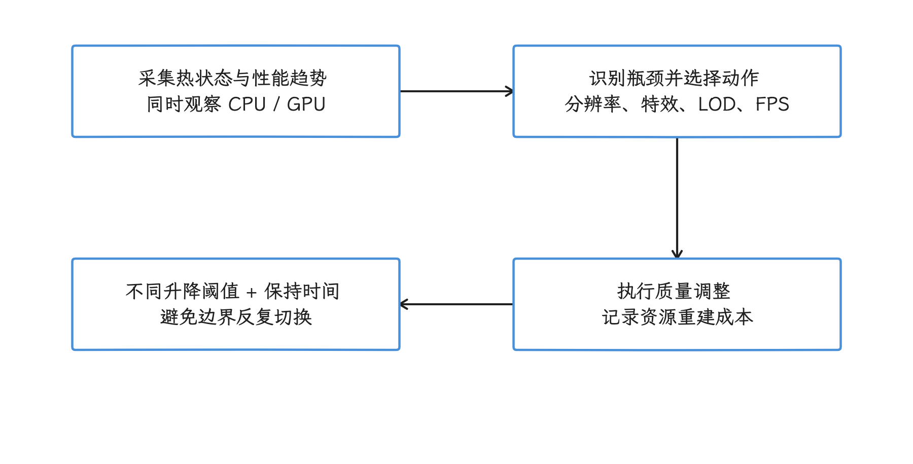

图：质量控制应允许降档更快、升档更谨慎。 阈值与最短保持时间由产品和实测设定，图不伪造平台默认值。

### Frame Rate API

Android 11 / API 30 起，Java 侧可调用 `Surface.setFrameRate()`，Native 侧可调用 `ANativeWindow_setFrameRate()`，API 31 又增加了 change strategy。游戏内容应使用 `FRAME_RATE_COMPATIBILITY_DEFAULT`；`FIXED_SOURCE` 面向固定帧率视频，`AT_LEAST` 明确不适合游戏，这两个值都不要传。

⚠️ 文档矛盾（本次核对仍存在）：游戏专用的“Optimize refresh rates”页面示例传入 `FIXED_SOURCE`，而 `Surface` API 契约和通用 Frame Rate 指南明确把 `FIXED_SOURCE` 限定给视频，游戏应传 `DEFAULT`。实现时以公开 API 契约和通用指南为准，那个示例不宜直接照抄。

<!-- gracker-diagram: ch13-12-39-frame-rate-compatibility -->
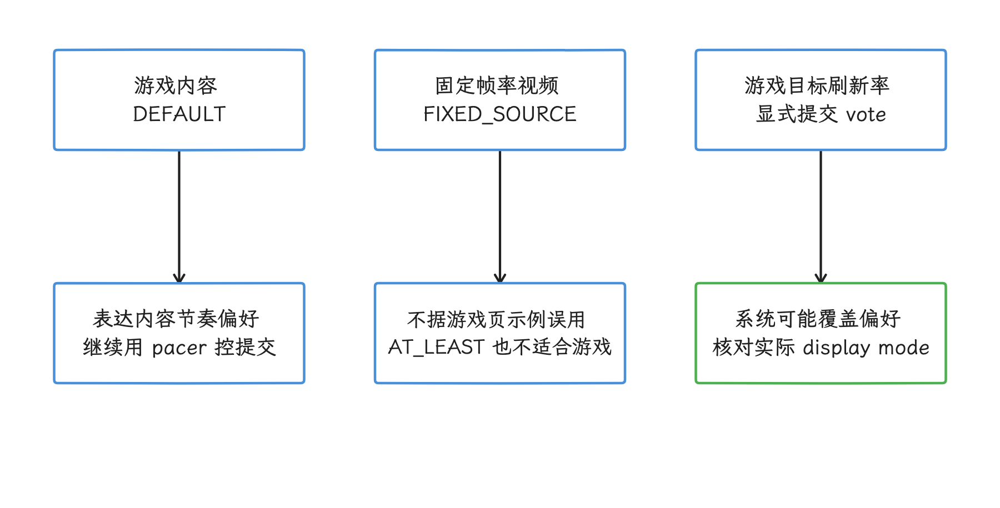

图：实现应按 Surface 公共契约选择游戏 DEFAULT。 游戏优化页的 FIXED_SOURCE 示例与通用契约冲突，不能直接照抄。

还要清楚 Frame Rate API 提交的是刷新率偏好，系统最终可能因 thermal、battery、其他可见 Surface 或 display mode 能力选择不同刷新率。Android 15 起，游戏默认刷新率策略更偏向 60 Hz，希望使用 90/120 Hz 的游戏要显式申请，并继续通过 Swappy 或自研 pacer 控制提交节奏。

目标帧率改变时需要同时更新：

- display frame-rate vote；
- Swappy swap interval 或引擎 pacer；
- Performance Hint Session target duration；
- render scale / quality budget。

只更新其中一项，常会出现“屏幕 120 Hz、游戏仍按 60 FPS 提交”，或“pacer 已降到 45 FPS、ADPF 还按 120 FPS 预算申请资源”这样的矛盾配置。

<!-- gracker-diagram: ch13-12-40-target-change-coordination -->
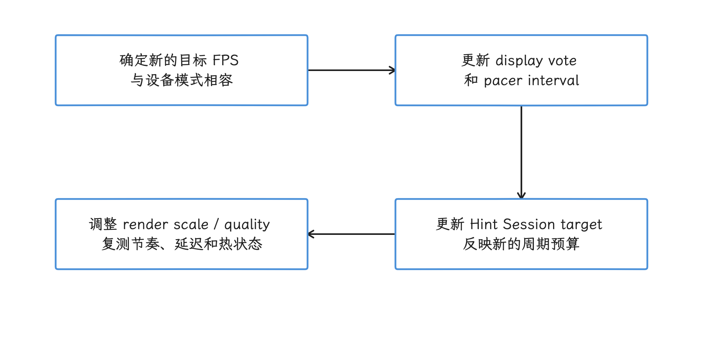

图：显示偏好、pacer、hint target 与画质预算要协调更新。 这是应用配置一致性要求，不是四个 API 自动联动。

### Game Mode 与 Game State

`GameManager.getGameMode()` 从 API 31 提供 `STANDARD`、`PERFORMANCE`、`BATTERY` 和 `UNSUPPORTED`；API 34 增加 `CUSTOM`。官方要求游戏在每次 `onResume()` 重新查询，因为用户可能在暂停期间改变模式。

<!-- gracker-diagram: ch13-12-41-game-mode-resume -->
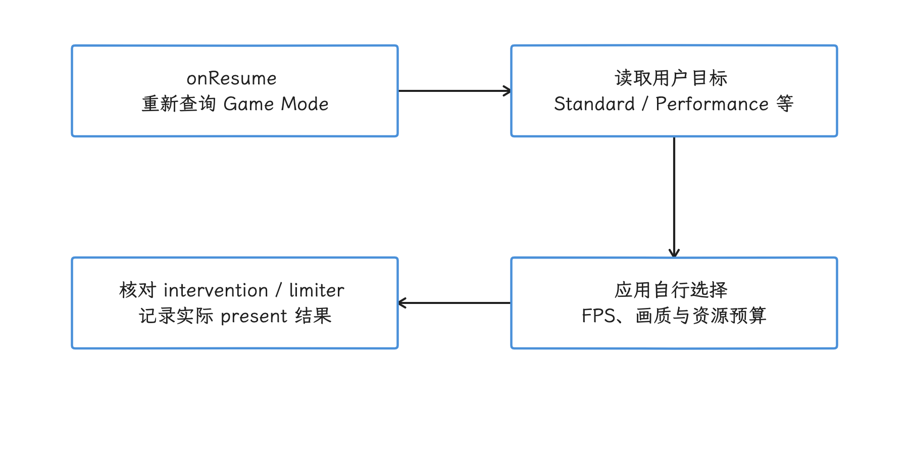

图：用户在暂停期间可能改模式，恢复时重新建立应用策略。 Performance / Battery 是偏好，不能保证固定 FPS 或 OEM 相同动作。

`PERFORMANCE` 表达的是用户的高性能偏好，游戏要自己决定怎么兑现：为了保持高帧率稳定，可能需要适当降低高成本特效；`BATTERY` 则可以降低帧率、刷新率或分辨率。OEM 还可能为未主动适配的游戏配置 Game Mode intervention（系统侧干预规则）。Android 13+ 的 FPS throttling intervention 只能限制帧率，把 60 FPS 提升到 120 FPS 超出它的作用范围。

API 33 的 `GameManager.setGameState(GameState)` 用于报告 loading、`MODE_GAMEPLAY_INTERRUPTIBLE`、`MODE_GAMEPLAY_UNINTERRUPTIBLE`、`MODE_CONTENT` 等状态。`isLoading` 与 mode 是两个独立维度，仍在 gameplay 时也可能并行加载资源；这里的后台加载不等于应用已进入操作系统后台。系统如何使用这些信号取决于 OEM 实现。

<!-- gracker-diagram: ch13-12-42-game-state-dimensions -->
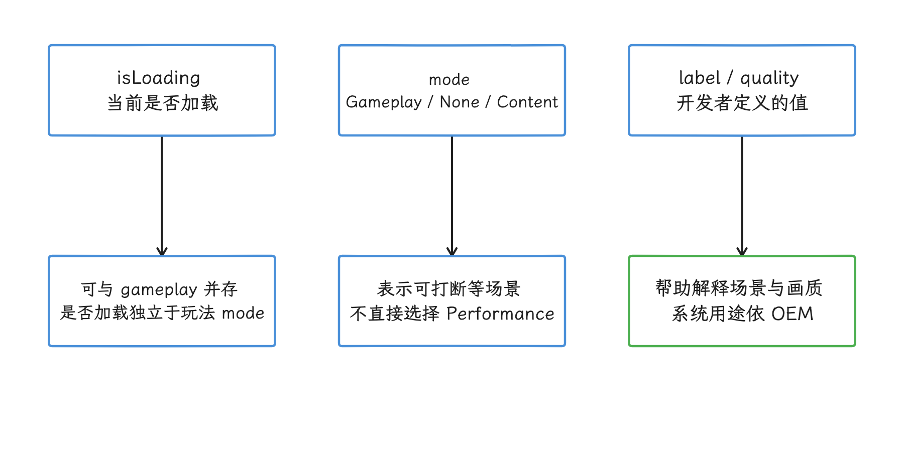

图：loading、玩法状态和标签描述当前业务场景。 isLoading 可与 gameplay 并存，不等同用户选择的 Game Mode。

Power HAL mode 还要与面向用户的 Game Mode 分开。Android 13 的 `GameState.isLoading` 可经系统服务触发 `GAME_LOADING`，Android 14 起前台游戏可触发 `GAME`；Android 17 的 `Mode.aidl` 同时保留这两个枚举。它们只向 Power HAL 描述场景，具体 boost、持续时间、CPU/GPU 策略和 thermal 约束由 OEM 实现。

<!-- gracker-diagram: ch13-12-43-game-vs-power-mode -->
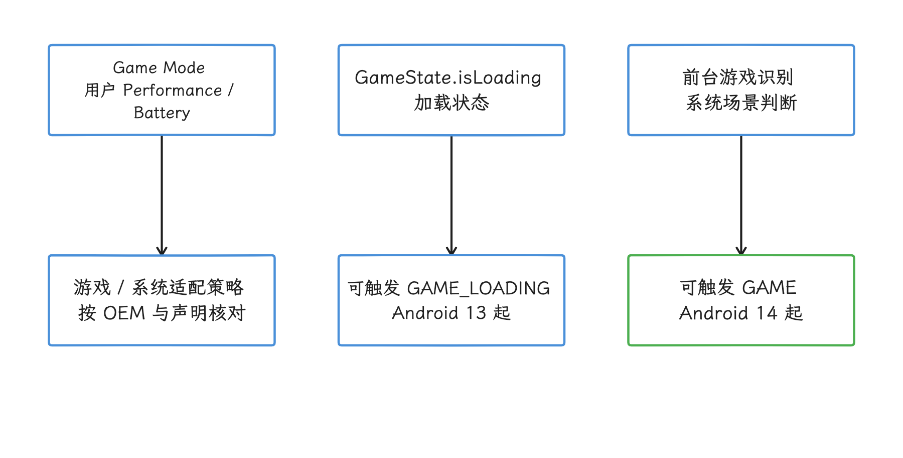

图：用户目标、加载信号和前台游戏信号分属不同入口。 HAL 枚举不承诺固定 boost、持续时间或资源档位。

排查时看到稳定的 30、40、45、60 或 90 FPS 上限，我们先查询 Game Mode、intervention 和 frame-rate vote，再检查引擎 limiter，不要一上来就归因于 GPU。

### CPU/GPU headroom 进入低频控制回路

Android 16 / API 36 起，支持设备可以通过 `SystemHealthManager.getCpuHeadroom()` 和 `getGpuHeadroom()` 返回 0～100 的余量估计；暂时算不出来时可能返回 `NaN`，不支持时可能抛出 `UnsupportedOperationException`。这次查询至少要走一次同步 Binder，渲染关键线程上不适合直接等待：应用应读取平台给出的最小查询间隔，在独立执行器里低频采样并缓存结果。 有效值 0 表示没有更多可授予的相应资源；NaN 是暂不可用，不应当作 0。最小间隔内重复调用可能只拿到缓存值，也不应据此每帧轮询。

<!-- gracker-diagram: ch13-12-44-headroom-control -->
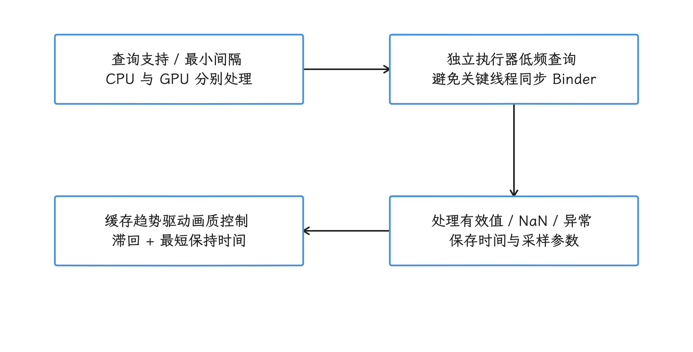

图：后台按最小间隔采样，渲染线程读取缓存趋势。 0 是无更多余量，NaN 是暂不可用；thermal headroom 要独立解释。

headroom 适合让画质控制器判断一段时间内的资源余量趋势，单次采样只作参考。动态分辨率、阴影、后处理、simulation rate 和目标 FPS 都要设置滞回区间与最短保持时间；thermal headroom 描述的是热趋势，与当前 CPU/GPU 可用余量是两回事，要单独采集。

### 把用户模式、系统 intervention 与 OEM 面板拆开实验

同一场景我们至少测四组条件：游戏自身的 Standard 基线、只切换 Game Mode、只修改 `game_overlay` intervention、最后再打开 OEM 游戏面板。每轮固定温度、亮度、刷新率、电源、场景和输入脚本，并记录游戏内部 target FPS / render scale、实际 present interval、频率、thermal 与 headroom。

<!-- gracker-diagram: ch13-12-45-intervention-experiment -->
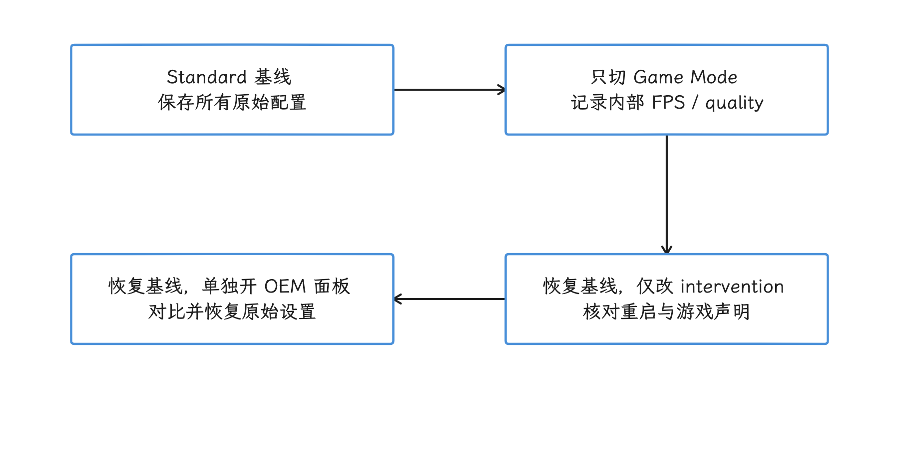

图：单变量实验才能判断哪一层改变了帧率和画质。 固定场景、电源与热条件；保存原值并记录重启和游戏声明。

`cmd game mode` 只改变用户模式；`device_config` 里的 `game_overlay` 可能改变 downscale 或 FPS throttling，通常还需要重启进程。实验前保存原值，结束后恢复。若游戏已经声明自行处理某种模式，系统可能跳过相应 intervention；测试构建要把这项声明记录下来，免得把预期的“不生效”误判为设备缺陷。

## Draw call、Batching 与 GPU 成本

每个 draw call（一次绘制命令）都带着 CPU 侧的命令准备、状态检查和 driver 成本；我们把数量降下来，GPU 未必更快，还要看用的是哪种手段：

<!-- gracker-diagram: ch13-12-46-draw-optimization-targets -->
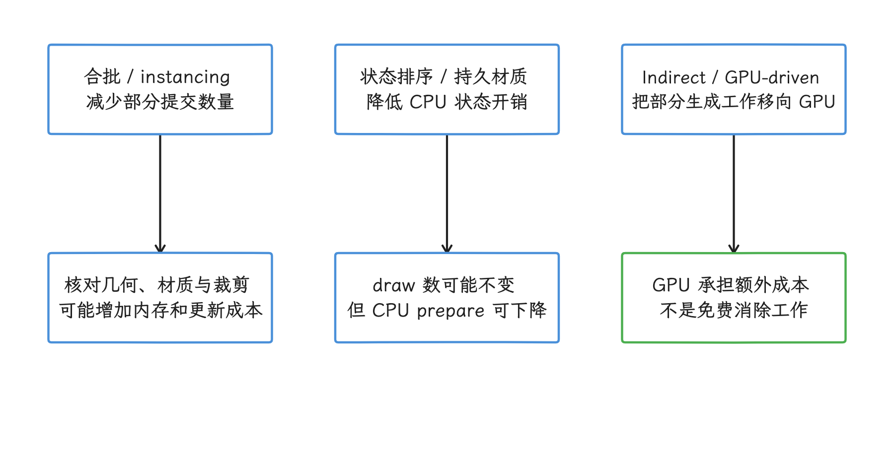

图：draw 数量、状态设置和 GPU 工作量不能混为一项。 收益取决于场景、兼容条件与实际 CPU/GPU 瓶颈。

- **Mesh batching**：把可合并几何放入较少的提交，减少 draw call，代价是更新、内存和 culling（可见性裁剪）粒度可能变粗；
- **GPU instancing**：用一次或少量 draw 描述多个共享网格与材质的实例；
- **状态排序**：减少 pipeline、descriptor、texture 和 render target 切换；
- **Indirect / GPU-driven draw**：让 GPU 根据缓冲区中的参数发起绘制，把部分可见性判断与提交工作移向 GPU；
- **缓存 render state**：减少 CPU 重建成本，不一定减少 draw call 数。

Unity SRP Batcher 的主要作用是降低使用同一 shader variant 的兼容材质的 CPU 状态设置成本，把它概括成“把 Mesh 合成一次 DrawCall”就偏了；Unreal Mesh Draw Commands 还包含缓存、排序和可能的 dynamic instancing，与传统静态合批是两种不同的机制。 这两项应分别查对应引擎版本的兼容规则；不能由启用开关就推断某一帧减少了多少 draw。

<!-- gracker-diagram: ch13-12-47-engine-batching -->
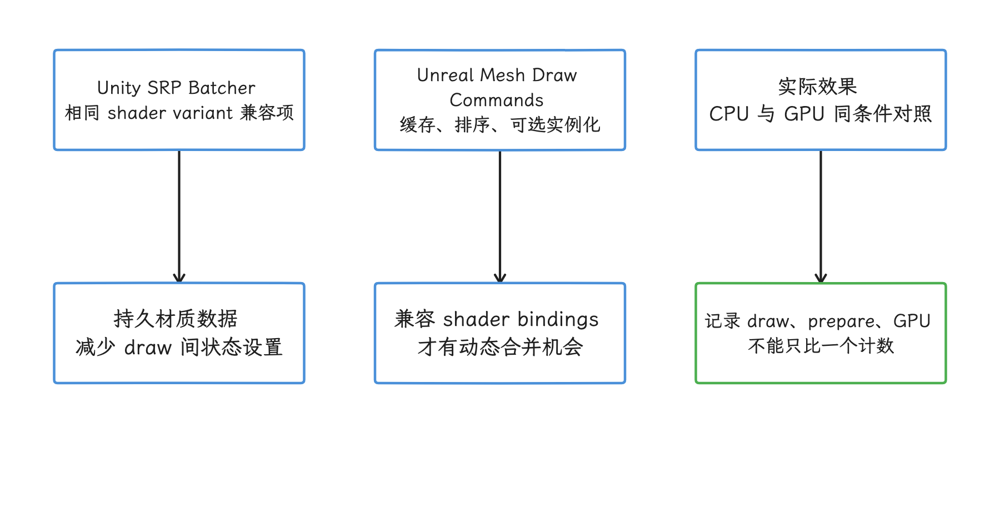

图：两种引擎机制分别核对兼容、缓存和实例化条件。 开关启用不能直接证明本帧减少 draw 数。

“每帧超过 1000 draw call 就有问题”这类阈值没有跨设备意义，判断要看下面这组证据：

- Render / RHI thread 花在 draw preparation 和 driver 的时间；
- pipeline / shader 是否在游戏过程中同步创建；
- GPU vertex、fragment、compute、texture、tile memory 和带宽；
- pass 数、阴影级联、透明 overdraw、分辨率和 MSAA；
- 降低 draw call 后 CPU、GPU 与画面质量是否得到预期变化。

这两类瓶颈在 trace 里的样子正好相反：CPU draw-call bound 通常是 Render/RHI 提交晚、GPU 队列出现空闲区间；fragment 或带宽 bound 则常表现为 CPU 已较早提交、GPU producer fence 仍然很晚。前者优先减少 CPU 提交成本，后者去查像素处理、overdraw 与内存带宽。

<!-- gracker-diagram: ch13-12-48-draw-bound-evidence -->
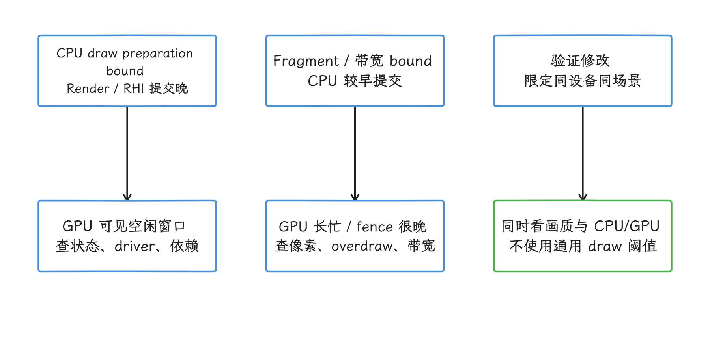

图：submit 时间与 GPU fence 共同区分前后段。 降低 draw 或分辨率只是验证手段，效果受实际瓶颈影响。

## Perfetto：建立逐帧证据

### 采集前记录配置

至少记录这些变量：

- 引擎及版本、GLES/Vulkan、renderer / RHI、Swappy 或自研 pacer；
- SurfaceView / GameActivity / native window 结构；
- display refresh rate、游戏目标 FPS、frame-rate vote；
- Game Mode、intervention、充电状态、亮度和温度；
- render scale、HDR、画质档、最大 in-flight frame 数；
- 场景、相机路径、网络状态和输入脚本。

缺了这些信息，同一台设备的两份 trace 也可能没法比较。

<!-- gracker-diagram: ch13-12-49-capture-settings -->
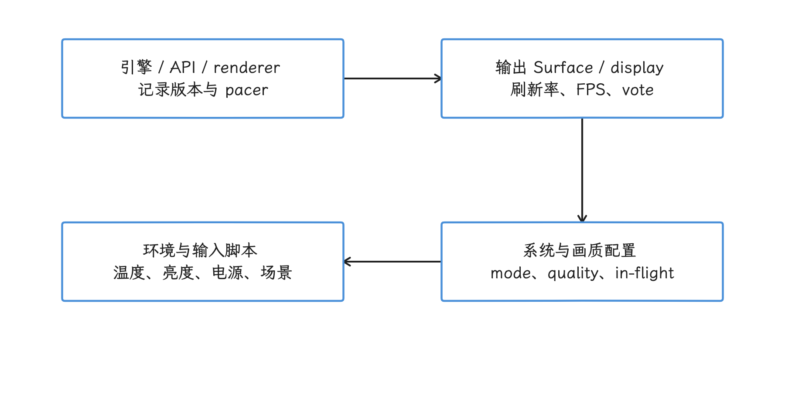

图：可比数据需要固定引擎、输出、调度目标和环境。 build、driver、场景或 thermal 不同可能改变相同代码的表现。

### 一次基础系统 trace

下面的命令用于采集图形、调度、频率、窗口和输入相关的基础数据：

```bash
adb shell perfetto \
  -o /data/misc/perfetto-traces/game.perfetto-trace \
  -t 20s -b 256mb \
  gfx view sched freq idle am wm input binder_driver
adb pull /data/misc/perfetto-traces/game.perfetto-trace
```

命令先把 20 秒 trace 写进设备，再通过 `adb pull` 取回本机。GPU stage、counter 和 Vulkan API 细节取决于设备数据源和权限；Perfetto 数据不足时，用 AGI、GPU 厂商 profiler、Unity Profiler 或 Unreal Insights 补充。单个含义模糊的 `GPU completion` slice，代表不了全部 GPU 阶段。 这个简化命令也不自动保证 `android.surfaceflinger.layers` 或游戏独立 Surface 的完整 App FrameTimeline 已启用。先验证目标 Layer 的覆盖，再选择 queue/事务、fence 与引擎 marker 补证。

<!-- gracker-diagram: ch13-12-50-trace-coverage -->


图：先确认实际采集的数据源，再解释缺失的轨道。 gfx 不自动保证 Layer snapshots、GPU counters 或独立 Surface App 时间线。

### 连续三到五帧要标什么

| 节点 | 要找的证据 | 常见误读 |
| --- | --- | --- |
| Input | event time、dispatch、游戏采样点 | dispatch 到达就代表本帧已经使用该输入 |
| Game | tick start/end、physics、script、worker dependency | 把主线程全部 Running 时间都算作有效游戏工作 |
| Render/RHI | draw preparation、command recording、submit | draw call 多就一定是瓶颈 |
| GPU | queue submit、job、producer fence | `vkQueueSubmit()` 返回就代表 GPU 完成 |
| Swapchain | acquire、swap/present、queueBuffer、in-flight depth | 所有 wait 都来自 GPU 慢 |
| SurfaceFlinger | latch、FrameTimeline、composition type | SF 沿用旧帧就代表 SF 计算慢 |
| Display | requested/actual present、present fence | fence 一定对应精确的首像素可见时刻 |

我们给同一输入和同一游戏帧分配稳定 ID，把 ID 写进 Game、Render、submit 和 present marker；这样某次触控最终对应哪一帧就有据可查，省得只凭几条相似的周期曲线猜关联。 关联 Unity/Insights 与系统 trace 时还要记录时钟域，并用共同时间锚或同步事件校准；统一 ID 不能单独消除不同工具时间基准的偏移。

<!-- gracker-diagram: ch13-12-51-frame-evidence -->


图：同一输入、游戏帧、buffer 与显示结果应明确对应。 跨工具还须校准时钟；统一 ID 本身不能消除时间偏移。

### Unity 与 Unreal 的 trace 组合

| 引擎 | Perfetto 默认侧重 | 引擎工具侧重 | 推荐关联方式 |
| --- | --- | --- | --- |
| Unity | OS 线程、调度、GPU/显示、SurfaceFlinger | `PlayerLoop`、script、render marker、Job System | 自定义 frame id + Unity Profiler timestamp |
| Unreal | OS 线程、调度、GPU/显示、SurfaceFlinger | Game/Render/RHI task、asset loading、render events | 自定义 frame id + `.utrace` |

Perfetto 里没有 `PlayerLoop`，并不代表 Unity main thread 没在工作；名为 `RenderThread` 的线程，也未必属于 Unreal。我们同时核对进程包名、线程周期、调用栈、引擎 marker 和 frame id，再下判断。

<!-- gracker-diagram: ch13-12-52-profilers-clock -->


图：引擎语义、OS 证据和时钟锚联合识别执行角色。 线程名和相似周期不能代替调用栈与同帧关联。

## 常见瓶颈怎样区分

### CPU bound

CPU bound 指 Game、Render 或 RHI 等 CPU 阶段超过帧预算，常伴随 GPU 队列出现空闲区间。原因包括 script、physics、animation、draw preparation、同步 shader/pipeline creation、资源上传、JNI、锁和 worker barrier。

降低分辨率对纯 CPU draw-call bound 帮助有限；降低对象数、pass、状态切换或并行任务依赖更有针对性。

### GPU bound

GPU bound 指 CPU 已较早完成提交，但 GPU 持续忙碌且 producer fence 很晚。需要用 GPU stage/counter 区分 vertex、fragment、compute、texture、overdraw、tile memory、带宽、同步 bubble（依赖造成的 GPU 空闲间隙）和频率限制。

动态分辨率主要缓解像素与带宽成本；如果瓶颈是 vertex、compute 或同步，降低 render scale 可能几乎没有改善。

### Queue / pacing bound

Queue / pacing bound 表现为 acquire、swap、present 或 Swappy wait 周期性变长，下一步检查 pending buffer、release fence、目标 interval、pipeline mode 和 producer throttling。主动 pacing wait 可以保持较低的队列深度，表现为 CPU idle 正是它的正常工作状态，不要一概删除。

<!-- gracker-diagram: ch13-12-53-cpu-gpu-pacing -->


图：CPU 超预算、GPU 长忙和主动限速要分别判定。 等待长不等于 GPU bound，CPU idle 也可能是正常 pacing。

### Display bound

Display bound 指游戏 buffer 已 ready，SurfaceFlinger 却错过目标 latch，或显示端 present 变晚。应检查 desired present、FrameTimeline、HWC `CLIENT` composition、display mode change 和 Composer / driver fence。游戏 Layer 自身 GPU 负载很高时，额外的 RenderEngine client composition 还会与游戏竞争 GPU 和带宽。

### 稳态 thermal bound

稳态 thermal bound 常表现为首分钟正常，运行十分钟后 CPU/GPU 频率、内存带宽或可用功耗预算下降，frame time 持续恶化。测试需要覆盖足够长的会话，并同时记录 thermal status / headroom、频率、亮度、充电状态和环境温度。

<!-- gracker-diagram: ch13-12-54-display-thermal -->


图：当 buffer 已 ready 或长会话变慢，应转查相应后段。 更晚的 fence 仍需同帧依赖证明，短时与稳态不能混用。

平均 FPS 会掩盖连续长帧，我们至少还要统计 frame-time 分布、P90/P99、1% low（需声明采用最慢 1% 帧平均时长的倒数，还是其他工具算法；不能直接与 P99 倒数混用）、present-to-present 间隔和输入到显示延迟。

<!-- gracker-diagram: ch13-12-55-measurement-metrics -->


图：节奏分布、最慢帧与单次输入链分别验收。 1% low 要写算法；P99 的倒数不能自动当同一指标。

## Android 12 到 Android 17 的关键演进

| 版本 | 与游戏渲染直接相关的变化 |
| --- | --- |
| Android 12 / API 31 | Game Mode 与 Performance Hint Manager 公布；三参数 `setFrameRate()` 可带 change strategy；FrameTimeline 成为系统分析基线 |
| Android 13 / API 33 | `GameState` / `setGameState()` 与 Power HAL `GAME_LOADING` 公布；FPS throttling intervention 可在平台侧限制游戏帧率 |
| Android 14 / API 34 | `GAME_MODE_CUSTOM`、Hint Session `setThreads()` 与 Power HAL `GAME`；SurfaceView alpha 能力扩展，但 z-order 语义仍需区分 |
| Android 15 / API 35 | `WorkDuration` 和 `setPreferPowerEfficiency()`；游戏需要显式请求高于默认策略的刷新率 |
| Android 16 / API 36 | 支持设备可提供更丰富的 ARR / headroom 能力，游戏仍需按设备检查并做反馈控制 |
| Android 17 / API 37 | `VK_EXT_present_timing` 与 `Surface.setProducerThrottlingEnabled()` 提供更细的 present 反馈和 producer back-pressure 控制 |

平台版本升级并不会统一引擎和 GPU driver 的线程模型；落到具体设备上，我们仍要记录 Unity / Unreal 版本、Swappy 版本、Vulkan extension 和设备 driver。

<!-- gracker-diagram: ch13-12-56-version-boundaries -->


图：平台演进不会统一引擎线程模型或 GPU driver。 公开 API 首引版本与当前源码 flag、设备能力分别核对。

## 小游戏、云游戏、AR 与 XR 的边界

这些场景只能在本地 game loop 与显示阶段复用本节方法，端到端的责任划分各不相同：

- **小游戏**：还要区分 JS/runtime、bridge（脚本运行时与原生宿主之间的调用层）及宿主 `SurfaceView`/`TextureView`。
- **云游戏**：要把云端排队、渲染、编码和网络遥测关联到本地解码与 present。
- **手机 AR**：要统一 Camera、IMU/pose、render target 与 present 的时钟。
- **头显 XR**：由 OpenXR runtime/compositor 负责 predicted display（预测显示时间）、reprojection（依据最新姿态修正已渲染画面）与最终显示交接，不保证经过普通 App `queueBuffer()`。

四套场景的完整链路不在本节展开：TextureView 的消费语义见 [13.3 SurfaceView 与 TextureView 渲染管线](03-surfaceview-textureview-pipelines.md)，云游戏本地视频与 sideband 见 [13.11 视频 Overlay、Media3 与专业编解码管线](11-video-overlay-media3-codec-pipeline.md)，XR runtime/compositor 见 [13.13 Android 17 / Android XR 空间 UI 与环境资产渲染性能](13-android-xr-spatial-ui-rendering.md)。进入对应专题前，我们先确认最终 buffer Producer、输出 carrier（承载方式）、时钟域和 present 责任方。

<!-- gracker-diagram: ch13-12-57-scenario-boundaries -->


图：先确认最终 Producer、carrier、时钟和 present 责任方。 四个框是独立场景；XR 不保证经过普通应用 queueBuffer。

## 内核和驱动侧

Android 通用内核提供 dma-buf、dma-fence 和 sync_file：dma-buf 用于跨设备共享 buffer，dma-fence 表示异步硬件任务的完成依赖，sync_file 则把 fence 封装成可跨进程传递的 fd。GPU scheduler、devfreq、thermal、IOMMU fault、memory reclaim 和 display driver tracepoint 多由设备实现提供。

<!-- gracker-diagram: ch13-12-58-kernel-sharing-sync -->


图：共享存储、异步完成依赖与可传递 fd 分别负责一层。 通用接口不证明设备 GPU、DPU 或 vendor trace 的具体行为。

在 `android17-6.18-2026-06_r6` 中可从以下入口核对通用语义：

- `drivers/dma-buf/dma-buf.c`：buffer attachment 与跨设备共享；
- `drivers/dma-buf/dma-fence.c`、`include/linux/dma-fence.h`：GPU / HWC 等异步任务的 fence signal、callback、wait 与公共同步接口；
- `drivers/dma-buf/sync_file.c`：把 fence 封装成跨进程 fd。

vendor GPU job 变长、GPU 频率低和 producer fence 晚，我们要在同一帧内关联起来看；仅凭 Render / RHI 线程处于睡眠状态，还判断不了 GPU scheduler 是否异常。

<!-- gracker-diagram: ch13-12-59-vendor-causality -->


图：把 job、频率和写完成 fence 放到同一帧内验证。 Render/RHI 睡眠只说明等待，不能独立证明 GPU scheduler 异常。

## 常见误判

### “FPS 高，输入延迟就低”

FPS 衡量吞吐量，不能直接代表单次输入的端到端延迟。队列中可能已有多帧，输入也可能在很早的阶段采样；应对齐 input、frame id、in-flight depth 与 display present。

### “`vkQueueSubmit()` 返回，GPU 已完成”

该调用只把工作提交到 GPU queue，执行是异步的。完成时间要看 GPU job 和 producer fence。

### “`vkQueuePresentKHR()` 慢，说明 Vulkan driver 差”

present 附近可能包含 Swappy 主动等待、BufferQueue back-pressure、GPU fence、resize 或 display mode change。需要沿等待对象和 fence 依赖继续追踪。

### “Unity/Unreal 的 marker 在 Perfetto 里默认都有”

引擎 profiler、Unreal Insights 与 Perfetto 是不同数据源。未显式写入系统 trace 时，Perfetto 可能只显示线程和系统事件。

### “Vulkan 一定比 GLES 快”

Vulkan 把更多调度和同步责任交给引擎，较低层级的控制并不会自动转化成更高性能。结果取决于 render graph、driver、pipeline、资源管理和 workload。

### “ADPF 可以锁大核或锁频”

Hint Session 提供 target / actual workload 信息，CPU 放置、频率等资源决策仍由系统与 thermal 策略完成。

### “Game Mode Performance 会自动提高 FPS”

OEM 策略、画质、thermal、frame-rate vote 与引擎上限都可能限制结果。Performance mode 也可能降低部分画质，以换取更稳定的帧率。

### “BufferQueue 有 64 个 slot，所以游戏要手工改成三缓冲”

64 是默认 slot 配置而非已分配数或当前在途数，受控扩展也不等于普通游戏可任意指定。swapchain image count 应通过 EGL / Vulkan 和 native window 协议协商，不应调用隐藏接口强制修改活动队列。

## 与其他章节的关系

- [2.3 VSync、Choreographer 与 SurfaceFlinger 调度](../../part1-fundamentals/ch02-rendering/03-vsync-choreographer-sf-scheduling.md)：VSync、回调与帧调度。
- [5.4 ADPF 自适应性能框架](../../part1-fundamentals/ch05-cpu-power/04-adpf.md)：Hint Session、Game Mode / State、headroom 与 thermal 反馈。
- [13.3 SurfaceView 与 TextureView 渲染管线](03-surfaceview-textureview-pipelines.md)：独立 Surface、BLAST 与生命周期。
- [13.4 OpenGL ES、EGL 与 ANGLE](04-opengl-egl-angle.md)：EGL window surface 和 GLES 提交。
- [13.5 Vulkan 原生管线与 HWUI 多队列](05-vulkan-hwui-multi-queue.md)：Android Vulkan swapchain 与显式同步。
- [13.11 视频 Overlay、Media3 与专业编解码管线](11-video-overlay-media3-codec-pipeline.md)：云游戏视频 carrier、CLIENT / DEVICE 与 tunneled sideband。
- [2.2 帧率、刷新率与显示模式选择](../../part1-fundamentals/ch02-rendering/02-framerate-refresh-display-mode.md)：frame-rate vote、ARR 和 display mode。
- [13.13 Android 17 / Android XR 空间 UI 与环境资产渲染性能](13-android-xr-spatial-ui-rendering.md)：OpenXR runtime、compositor 与显示边界。

## Android 17 源码核对清单

### 平台

- [`SurfaceView.java`](https://android.googlesource.com/platform/frameworks/base/+/refs/tags/android-17.0.0_r1/core/java/android/view/SurfaceView.java)、[`Surface.java`](https://android.googlesource.com/platform/frameworks/base/+/refs/tags/android-17.0.0_r1/core/java/android/view/Surface.java)：BLAST / SurfaceControl、Frame Rate API 与 API 37 producer throttling。
- [`PerformanceHintManager.java`](https://android.googlesource.com/platform/frameworks/base/+/refs/tags/android-17.0.0_r1/core/java/android/os/PerformanceHintManager.java)、[`SystemHealthManager.java`](https://android.googlesource.com/platform/frameworks/base/+/refs/tags/android-17.0.0_r1/core/java/android/os/health/SystemHealthManager.java)、[`GameManager.java`](https://android.googlesource.com/platform/frameworks/base/+/refs/tags/android-17.0.0_r1/core/java/android/app/GameManager.java)、[`GameState.java`](https://android.googlesource.com/platform/frameworks/base/+/refs/tags/android-17.0.0_r1/core/java/android/app/GameState.java)：Hint Session、CPU/GPU headroom、Game Mode 与 Game State。
- [`TextureView.java`](https://android.googlesource.com/platform/frameworks/base/+/refs/tags/android-17.0.0_r1/core/java/android/view/TextureView.java)、[`TextureLayer.java`](https://android.googlesource.com/platform/frameworks/base/+/refs/tags/android-17.0.0_r1/graphics/java/android/graphics/TextureLayer.java)、[`HardwareRenderer.java`](https://android.googlesource.com/platform/frameworks/base/+/refs/tags/android-17.0.0_r1/graphics/java/android/graphics/HardwareRenderer.java)：小游戏 TextureView 的 frame available、宿主 invalidation 与 pending layer update。
- [`DeferredLayerUpdater.cpp`](https://android.googlesource.com/platform/frameworks/base/+/refs/tags/android-17.0.0_r1/libs/hwui/DeferredLayerUpdater.cpp)、[`DrawFrameTask.cpp`](https://android.googlesource.com/platform/frameworks/base/+/refs/tags/android-17.0.0_r1/libs/hwui/renderthread/DrawFrameTask.cpp)：RenderThread 获取最新 SurfaceTexture buffer。
- [`swapchain.cpp`](https://android.googlesource.com/platform/frameworks/native/+/refs/tags/android-17.0.0_r1/vulkan/libvulkan/swapchain.cpp)、[`BufferQueueCore.cpp`](https://android.googlesource.com/platform/frameworks/native/+/refs/tags/android-17.0.0_r1/libs/gui/BufferQueueCore.cpp)、[`BufferQueueProducer.cpp`](https://android.googlesource.com/platform/frameworks/native/+/refs/tags/android-17.0.0_r1/libs/gui/BufferQueueProducer.cpp)、[`Surface.cpp`](https://android.googlesource.com/platform/frameworks/native/+/refs/tags/android-17.0.0_r1/libs/gui/Surface.cpp)：Vulkan WSI 到 ANativeWindow / BufferQueue、buffer count 校验、present timing 与 producer throttling。
- [`SurfaceFlinger.cpp`](https://android.googlesource.com/platform/frameworks/native/+/refs/tags/android-17.0.0_r1/services/surfaceflinger/SurfaceFlinger.cpp)、[`Display.cpp`](https://android.googlesource.com/platform/frameworks/native/+/refs/tags/android-17.0.0_r1/services/surfaceflinger/CompositionEngine/src/Display.cpp)、[`Output.cpp`](https://android.googlesource.com/platform/frameworks/native/+/refs/tags/android-17.0.0_r1/services/surfaceflinger/CompositionEngine/src/Output.cpp)：Layer snapshot、composition strategy、RenderEngine client target 与 present。
- [`OutputLayer.cpp`](https://android.googlesource.com/platform/frameworks/native/+/refs/tags/android-17.0.0_r1/services/surfaceflinger/CompositionEngine/src/OutputLayer.cpp)、[`HWComposer.cpp`](https://android.googlesource.com/platform/frameworks/native/+/refs/tags/android-17.0.0_r1/services/surfaceflinger/DisplayHardware/HWComposer.cpp)、[`AidlComposerHal.cpp`](https://android.googlesource.com/platform/frameworks/native/+/refs/tags/android-17.0.0_r1/services/surfaceflinger/DisplayHardware/AidlComposerHal.cpp)：Layer buffer、client target、Composer3 validate / present 与 fence。
- Power HAL [`Mode.aidl`](https://android.googlesource.com/platform/hardware/interfaces/+/refs/tags/android-17.0.0_r1/power/aidl/android/hardware/power/Mode.aidl)：`GAME` 与 `GAME_LOADING`。

### 通用内核

- [`dma-buf.c`](https://android.googlesource.com/kernel/common/+/refs/tags/android17-6.18-2026-06_r6/drivers/dma-buf/dma-buf.c)
- [`dma-fence.c`](https://android.googlesource.com/kernel/common/+/refs/tags/android17-6.18-2026-06_r6/drivers/dma-buf/dma-fence.c)
- [`dma-fence.h`](https://android.googlesource.com/kernel/common/+/refs/tags/android17-6.18-2026-06_r6/include/linux/dma-fence.h)
- [`sync_file.c`](https://android.googlesource.com/kernel/common/+/refs/tags/android17-6.18-2026-06_r6/drivers/dma-buf/sync_file.c)

### 本轮配图补充依据

- [BLASTBufferQueue.cpp](https://android.googlesource.com/platform/frameworks/native/+/refs/tags/android-17.0.0_r1/libs/gui/BLASTBufferQueue.cpp)、[HWC2 fence 契约](https://android.googlesource.com/platform/hardware/libhardware/+/refs/tags/android-17.0.0_r1/include_all/hardware/hwcomposer2.h)：客户端事务、安全读取、旧 buffer 释放与物理/虚拟 present。
- [BufferQueueConsumer.cpp](https://android.googlesource.com/platform/frameworks/native/+/refs/tags/android-17.0.0_r1/libs/gui/BufferQueueConsumer.cpp)、[BufferQueueCore.cpp](https://android.googlesource.com/platform/frameworks/native/+/refs/tags/android-17.0.0_r1/libs/gui/BufferQueueCore.cpp)、[BufferQueueProducer.cpp](https://android.googlesource.com/platform/frameworks/native/+/refs/tags/android-17.0.0_r1/libs/gui/BufferQueueProducer.cpp)：连接前扩展授权、slot 扩展与数量校验。
- [WorkDuration.java](https://android.googlesource.com/platform/frameworks/base/+/refs/tags/android-17.0.0_r1/core/java/android/os/WorkDuration.java)、[Hint Session 契约](https://developer.android.com/reference/android/os/PerformanceHintManager.Session)：参数校验、时间域与线程安全。
- [Vulkan timing surface capabilities](https://docs.vulkan.org/refpages/latest/refpages/source/VkPresentTimingSurfaceCapabilitiesEXT.html)、[固定 WSI 实现](https://android.googlesource.com/platform/frameworks/native/+/refs/tags/android-17.0.0_r1/vulkan/libvulkan/swapchain.cpp)：absolute/relative 能力与 stage 时间实际映射。
- [SwappyTracer](https://developer.android.com/games/sdk/reference/frame-pacing/struct/swappy-tracer)、[Unity SRP Batcher](https://docs.unity3d.com/6000.0/Documentation/Manual/SRPBatcher.html)、[Unreal mesh drawing](https://dev.epicgames.com/documentation/en-us/unreal-engine/mesh-drawing-pipeline-in-unreal-engine)：库内事件与两种引擎提交优化。
- [FrameTimeline 覆盖](https://perfetto.dev/docs/data-sources/frametimeline)、[Perfetto 时钟映射](https://perfetto.dev/docs/concepts/clock-sync)：独立 Surface 的采集缺口和跨工具时间校准。

### 官方文档

- [AGDK Frame Pacing / Swappy](https://developer.android.com/games/sdk/frame-pacing)
- [Swappy Vulkan API](https://developer.android.com/games/sdk/reference/frame-pacing/group/swappy-vk)
- [Vulkan frame pacing extensions](https://developer.android.com/games/develop/vulkan/frame-pacing-extensions)
- [Vulkan native engine support](https://developer.android.com/games/develop/vulkan/native-engine-support)
- [GameActivity](https://developer.android.com/games/agdk/game-activity)
- [Frame Rate API](https://developer.android.com/media/optimize/performance/frame-rate)
- [ADPF](https://developer.android.com/games/optimize/adpf)
- [PerformanceHintManager.Session](https://developer.android.com/reference/android/os/PerformanceHintManager.Session)
- [SystemHealthManager](https://developer.android.com/reference/android/os/health/SystemHealthManager)
- [Game Mode API](https://developer.android.com/games/optimize/adpf/gamemode/gamemode-api)
- [Game State API](https://developer.android.com/games/optimize/adpf/gamemode/gamestate-api)
- [Performance boost for games](https://source.android.com/docs/core/perf/boost)
- [Optimize refresh rates](https://developer.android.com/games/optimize/display-refresh-rate-change)
- [Unity Profiler markers](https://docs.unity3d.com/Manual/profiler-markers.html)
- [Unreal threaded rendering](https://dev.epicgames.com/documentation/en-us/unreal-engine/threaded-rendering-in-unreal-engine)
- [Unreal Insights](https://dev.epicgames.com/documentation/en-us/unreal-engine/unreal-insights-in-unreal-engine)
- [OpenXR 1.1 specification](https://registry.khronos.org/OpenXR/specs/1.1-khr/html/xrspec.html)

## 小结

- 游戏由自有 game loop 持续推进，性能分析要从输入采样追到对应帧 present。
- Game、Render、RHI、worker 和 GPU 可以跨帧并行；提高吞吐量的同时，也要限制在途帧带来的输入延迟。
- Unity Profiler、Unreal Insights 和 Perfetto 各自覆盖不同层级，统一 frame id 比猜线程名可靠。
- 游戏常使用独立 SurfaceView / GameActivity 路径；现代 SurfaceView 由 BLAST 和 SurfaceControl 协调，游戏 buffer 仍要经过 SurfaceFlinger。
- Vulkan WSI 把 acquire fence 接入 `AcquireImageANDROID`，并把 GPU release fence 随 `queueBuffer()` 送入 BufferQueue；display present fence 与 Layer release fence 需要分开判读。
- Swappy 控制提交节奏和队列深度，Frame Rate API 表达刷新率偏好，ADPF 报告 workload，Game Mode 表达用户选择。
- 小游戏 TextureView、云游戏视频 carrier、手机 AR 与 OpenXR runtime 各有不同的 producer、时钟域和 present 责任方。
- Android 17 新增 present timing 与 producer throttling 控制，但显式同步、extension 检查和设备验证仍由引擎负责。
- BufferQueue 默认 slot 配置、受控扩展和游戏 swapchain capabilities 要分别检查，不能把 slot 数当作当前分配数，也不应据此强制设置二缓冲或三缓冲。


<!-- gracker-diagram: ch13-12-60-review-complete-chain -->


图：从输入、异步生产到显示反馈，逐段连接准确证据。 平台源码、引擎配置和目标设备测试各有范围，不能相互代替。