# Android 17 / Android XR 空间 UI 与环境资产渲染性能

空间 UI 的性能预算在传统 2D 布局与绘制之外，还要加上姿态更新、双目显示、3D 资产和运行时合成。分析前先分清 Android XR 平台、Jetpack XR SDK 与设备运行时各自负责哪一段，再分别给资源加载和每帧更新建立预算。

## Android XR 渲染需要区分哪些边界

Android XR 覆盖多种运行形态。手机或大屏应用可以作为 compatible panel（兼容 2D 面板）运行。XR differentiated app 则可以增加 Subspace、空间面板、3D 模型、环境和感知能力。Unity/OpenXR 应用由引擎向 XR runtime 提交 swapchain image。display glasses 上的 Projected Activity 则运行在 companion host device（负责计算与连接的手机等伴随设备）。

<!-- gracker-diagram: ch13-13-01-content-forms -->
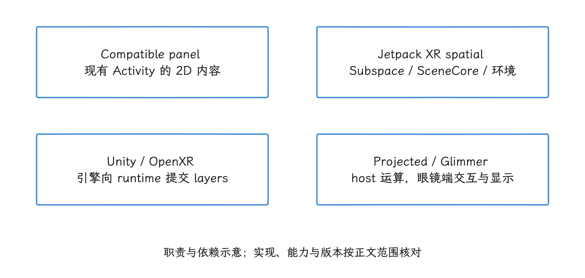

图：面板、空间场景、引擎与投射采用不同提交边界。 形态划分是责任坐标，不能用框架名推断最终显示进程。

这些形态都跑在 Android 进程里，共享 CPU、GPU、内存、I/O 和功耗约束，但显示终点不一样。普通 2D 内容的应用侧仍能观察 `Choreographer`、HWUI RenderThread 和 Surface buffer；到了 XR runtime，还要负责空间放置、视点与姿态、可能的 reprojection（依据更新后的姿态修正已渲染图像），最后向 XR 显示设备提交。Unity/OpenXR 用的是 runtime 管理的 frame loop 和 swapchain，不能直接套用普通 View 的 `doFrame → DrawFrame → queueBuffer`。

分析时先回答三个问题：

<!-- gracker-diagram: ch13-13-02-pipeline-identification -->
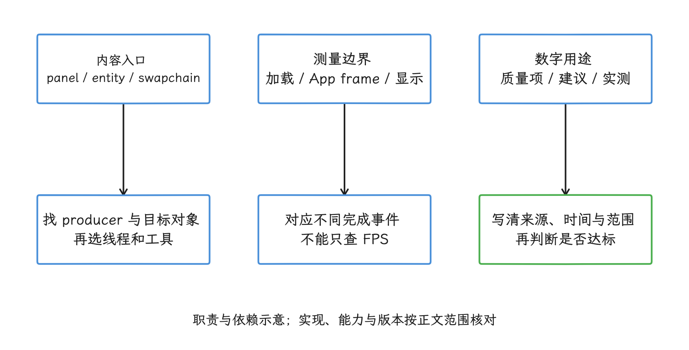

图：内容形态、观察阶段和数字用途应分别确认。 质量目标、制作建议和设备实测数据不互相替代。

1. 当前内容属于 compatible 2D panel、Jetpack XR 空间内容、Unity/OpenXR，或 Projected/Glimmer；
2. 帧时间、资源加载和显示延迟分别在哪里观测；
3. 哪些数字是 Android XR 质量目标，哪些只是资产制作建议或工具观测值。

### 当前版本与源码边界

本文的平台源码版本固定为 Android 17 / API 37 的 `android-17.0.0_r1`；`android17-6.18-2026-06_r6` 只是通用内核研究样本，不代表所有 XR 设备内核。Jetpack XR 独立于平台 tag 发布，下表按 2026-10-24 核对，不能把组件的 stable、beta、alpha 合并成一个版本阶段。本文未做目标设备性能实测。

| 组件 | 本文采用的公开版本 | 稳定性边界 |
| --- | --- | --- |
| Jetpack Compose for XR | `1.0.0-beta02` | beta；部分模型 API 仍 experimental；见下文 SceneCore 依赖修正 |
| Jetpack SceneCore | `1.0.0` stable | 另有 `1.1.0-alpha01`；不要混用新动画 API |
| ARCore for Jetpack XR | `1.0.0` stable | 另有 `1.1.0-alpha01`；姿态与 tracking 契约按采用版本核对 |
| Jetpack XR Runtime | `1.0.0` stable | 另有 `1.1.0-alpha02`；`Session.create` 是 suspend function |
| Jetpack XR Projected | `1.0.0-alpha14` | audio/display glasses 投射 API 仍是 alpha |
| Jetpack Compose Glimmer | `1.0.0-alpha22` | 透明 display glasses UI 仍是 alpha |
| SDK 文档入口 | 仍显示 Developer Preview 4 提示 | 这是文档入口状态；不否定上述库已分别发布 stable 或 beta |

<!-- gracker-diagram: ch13-13-03-release-channels -->
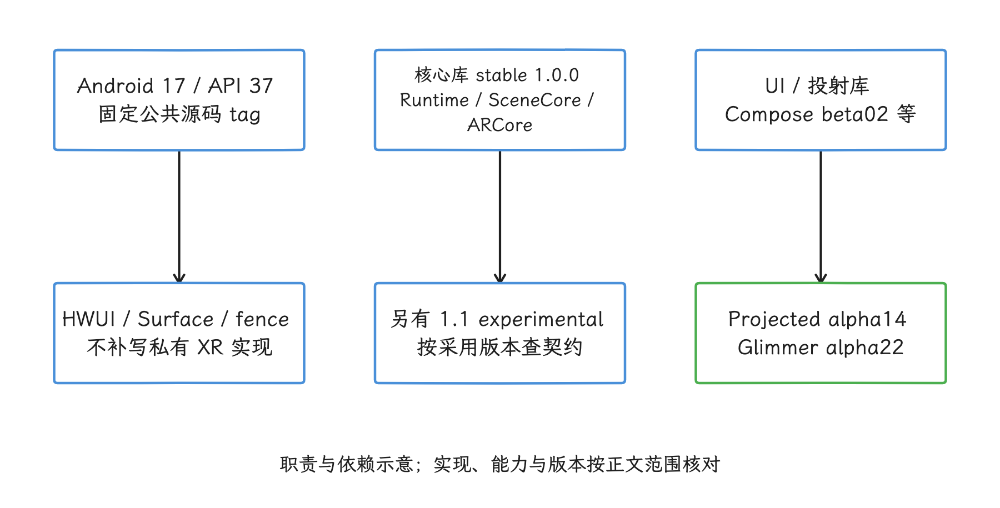

图：平台版本、stable 核心库与预发布 UI 库分别锁定。 2026-10-24 核对；DP4 文档提示不等于每个组件仍在 alpha。

Compose for XR beta02 的 release notes 要求 Kotlin 2.2；实际 POM 使用 Kotlin stdlib 2.2.20，并依赖 Runtime / SceneCore `1.0.0-rc01`。官方同时指出该 SceneCore rc01 有已知内存泄漏，可显式覆盖到已修复的 SceneCore `1.0.0`。这项依赖修正应先于资源常驻量测试，避免把已知库问题当成业务资产预算。

<!-- gracker-diagram: ch13-13-04-known-dependency -->
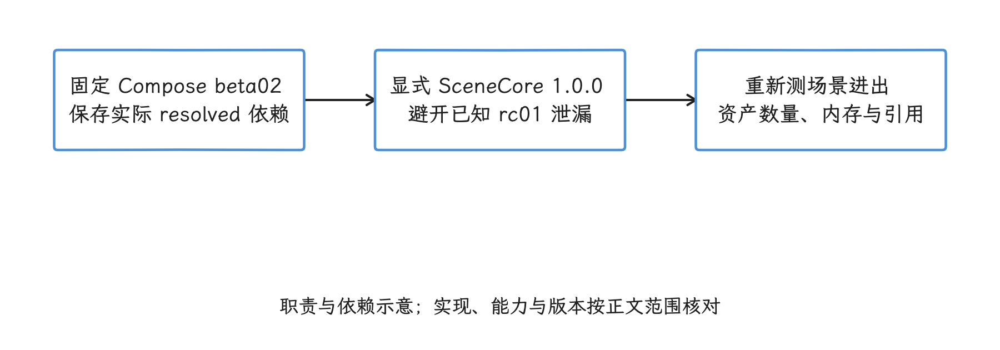

图：beta02 的 SceneCore rc01 依赖有官方已知泄漏说明。 按 release notes 显式采用 SceneCore 1.0.0，再测业务资源常驻量。

构建条件也要按实际 artifact 核对：alpha14 release notes 中的 compileSdk 37 / AGP 9.2.0 是历史变更记录；本次解包 beta02 AAR，其 metadata 声明 `minCompileSdk=36`、`minAndroidGradlePluginVersion=8.9.1`，manifest 为 `minSdk=24`。这些是该 AAR 声明的最低条件，不等于其生产时 compileSdk，也不能替代全部传递依赖的要求。安装范围、编译要求、设备 XR runtime 与 capability 是不同条件；不能从 minSdk 24 推断普通手机可运行所有空间功能。本文的设备分析基线仍固定 Android 17。

<!-- gracker-diagram: ch13-13-05-build-runtime-capability -->
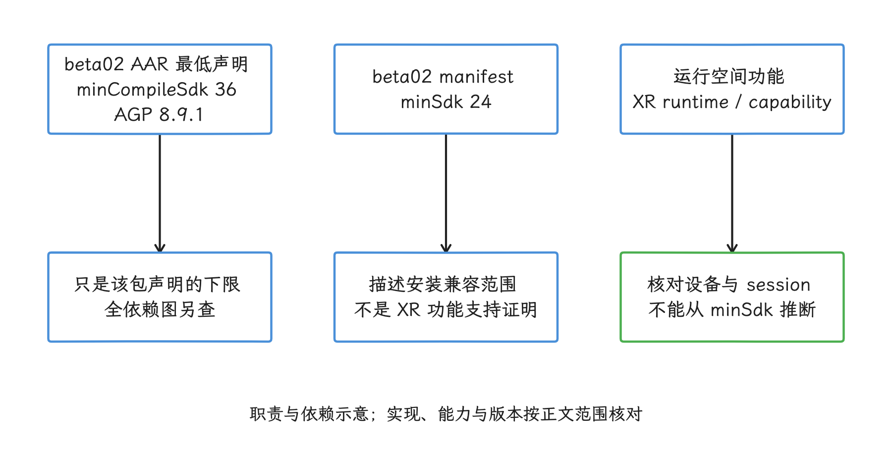

图：artifact 最低要求、可安装范围和 XR 能力是独立检查。 一个 AAR 的 metadata 不代表整个传递依赖图；本文设备分析固定 API 37。

公开 AOSP tag 可以验证 Android 的 HWUI、Surface、BufferQueue、fence 和调度公共层，但不能据此补写未公开的 XR compositor 内部调用链。本文对 XR runtime 的描述只覆盖 Jetpack、Unity/OpenXR 与质量文档公开的协议和责任边界。

<!-- gracker-diagram: ch13-13-06-public-source-boundary -->
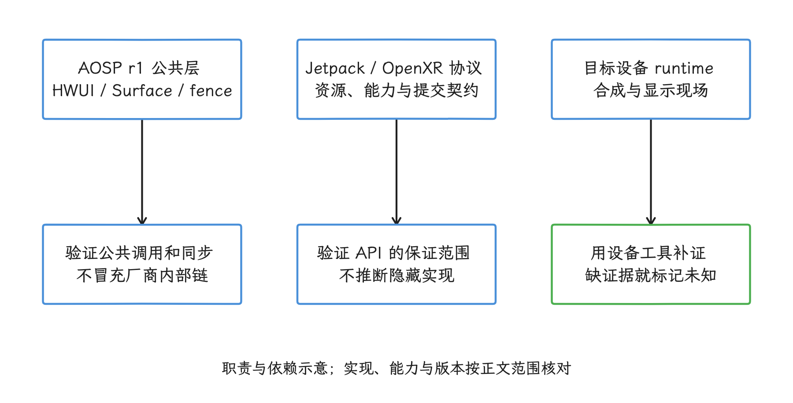

图：公共源码用于验证应用生产与同步，XR 内部按公开协议取证。 没有公开或现场证据时，不命名固定 compositor 线程和 latch slice。

## Android XR 在渲染体系中的位置

当前质量指南把 immersive（XR headset / wired XR glasses）与 augmented（audio/display glasses）分开。immersive 的三档为 compatible mobile、compatible adaptive 和 differentiated；原来的 large screen 档称呼应更新为 compatible adaptive。工程分析还应单列 Unity/OpenXR 与 Projected/Glimmer，因为等级划分不等于渲染管线划分。

<!-- gracker-diagram: ch13-13-07-quality-not-pipeline -->
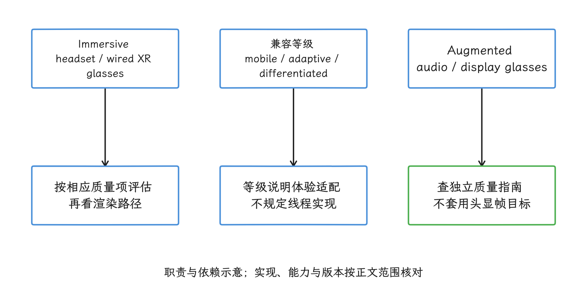

图：immersive 与 augmented 先分形态，再确定实际管线。 质量档不能替代 panel、SceneCore 或 OpenXR 对象识别。

| 应用形态 | 内容如何进入 XR | 优先观察点 |
| --- | --- | --- |
| compatible mobile app | 现有 Activity 作为 2D 面板运行 | App 主线程、HWUI、SurfaceFrame、输入、启动与 resize |
| compatible adaptive app | 自适应 Activity 作为可调整面板运行；对应适用的 adaptive Tier 2 / Tier 1 | 2D 路径，加窗口尺寸、外设输入、多任务和状态恢复 |
| Jetpack XR differentiated app | Subspace、SpatialPanel、SceneCore entity、环境等进入 XR scene | 2D 面板 Buffer、Subspace layout、模型/纹理、scene attach、XR runtime |
| Unity / OpenXR | 引擎渲染 runtime swapchain image，经 `xrEndFrame` 等边界交给 runtime | simulation、render thread、GPU、swapchain wait/release、spacewarp/late latching |
| Projected / Compose Glimmer | Activity 在 host phone 运行，体验投射到 audio/display glasses | host CPU/GPU、projected display 状态、连接、眼镜输入与远端 present |

compatible panel 仍沿用 2D 应用生产路径，不会自动变成 3D 引擎应用。但应用 buffer 生成完成也不代表 XR 显示完成。Android App FrameTimeline 可以定位应用侧 SurfaceFrame；XR runtime 的姿态更新、空间合成、reprojection 与光学显示还需要 runtime、引擎或设备专用证据。 但 FrameTimeline 是否覆盖目标 Surface 必须先验证，尤其是独立 Surface/外部媒体；缺少 App slice 不等于该内容没有生产帧。

下面的概念图只划分责任，不表示公开 API 承诺固定进程、线程或 compositor 名称：

```text
2D compatible / SpatialPanel
App UI → HWUI/Surface Buffer → XR scene/runtime → XR compositor/display

Jetpack XR 3D
App state → Subspace/SceneCore entity → model/material resources
          → XR scene/runtime → XR compositor/display

Unity/OpenXR
Simulation → RenderThread/GPU → OpenXR swapchain image
           → xrEndFrame → XR runtime/reprojection → display

Projected glasses
Host Activity/Compose → projected session/transport → glasses display/input
```

<!-- gracker-diagram: ch13-13-08-four-render-paths -->
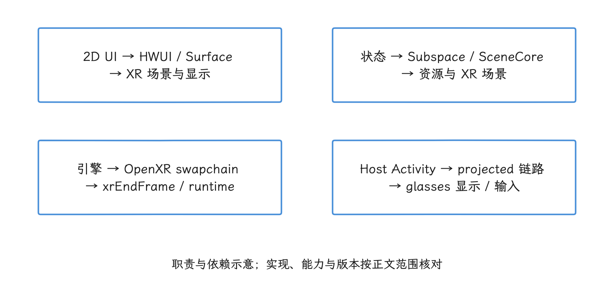

图：从输出对象识别 runtime 接收内容的边界。 保留原概念文本；图是职责示意，未承诺固定进程或 GPU 完成顺序。

这四条路径可能共享 GPU 和显示资源，也可能由不同 runtime 实现。trace 分析应从本帧的 producer、提交目标 surface/swapchain、姿态责任方和最终 present 责任方开始，不能只按框架名寻找最长 slice。

对 compatible panel 与 `SpatialPanel`，可以复用普通 Android 窗口的证据链，追到 `Choreographer`、HWUI、dequeue/queue、应用 Surface buffer 和 transaction。证据到达 XR scene/runtime 接收边界后，就不要再套用标准手机链路；公开文档没有给出固定的 XR compositor 进程、latch slice 或最终 present fence 名称。

<!-- gracker-diagram: ch13-13-09-panel-evidence -->
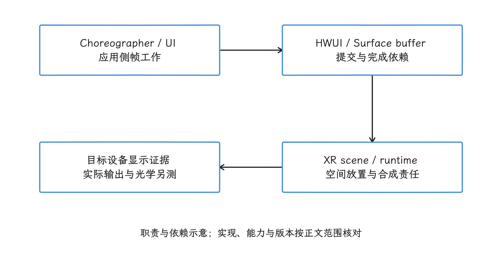

图：普通面板可复用应用侧证据，再补 XR runtime 的接收与输出。 FrameTimeline 覆盖先确认；公共 SurfaceFrame 不是最终光学显示。

`SpatialExternalSurface`、SceneCore `SurfaceEntity`、视频和 Camera 内容应按独立 producer/Surface 记录。它们可能与 2D panel 共享 GPU、带宽和 runtime 合成预算，但 panel 的 FrameTimeline 不能覆盖独立 Surface 的完整生产节奏。该 Surface 是否对应可见的 SurfaceFlinger Layer，也要通过设备 trace 或 Layer 树确认，不能只凭 API 类名推断。

<!-- gracker-diagram: ch13-13-10-producer-separation -->
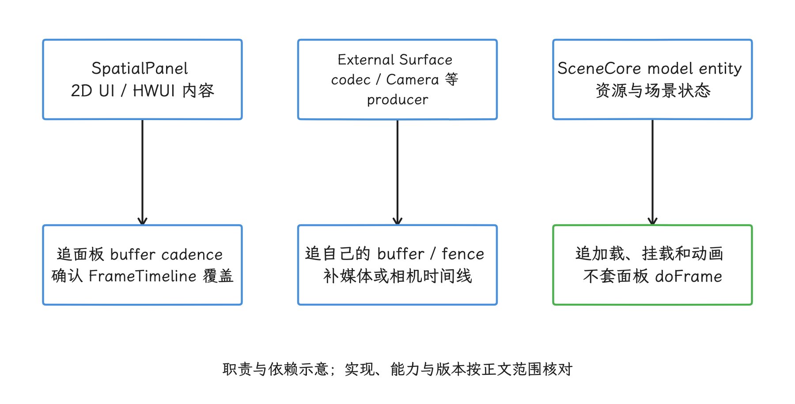

图：外部媒体和模型都有自己的生产对象，不能并入面板帧统计。 共享 GPU 不等于同一 producer；Surface 是否对应 SF Layer 需现场确认。

## Jetpack XR SDK 的 UI 栈边界

Jetpack XR SDK 是一组覆盖 UI、scene、感知和 projected device 的库，不是单一渲染器：

| 内容类型 | 主要 API / 库 | 性能观察点 |
| --- | --- | --- |
| 2D View / Compose | 普通 Activity 内容、View interoperability、`SpatialPanel` | UI thread、recomposition/layout、HWUI、面板 Buffer cadence |
| Subspace layout / 附属 UI | `Subspace`、`SpatialRow`、`SpatialColumn`；`Orbiter` 提供附属 2D UI | 空间布局的 measure/layout、实体更新；Orbiter 内容的 2D 生产成本另计 |
| 3D 模型 | `SpatialGltfModel`、`GltfModel.create()`、`GltfModelEntity` / `SceneCoreEntity` | I/O、解析、纹理转码/上传、首次可见、动画与材质成本 |
| 外部媒体 Surface | `SpatialExternalSurface`、SceneCore `SurfaceEntity` | codec/Camera Producer、surface size、stereo shape、Buffer/fence |
| 空间环境 | `SpatialEnvironment`、glTF geometry、skybox、IBL ZIP | 环境切换、资产常驻、纹理带宽、Full Space；IBL 是 Image-Based Lighting（基于图像的光照） |
| 感知 | ARCore for Jetpack XR、`ArDevice`、`RenderViewpoint`、anchors/planes/depth | tracking state、数据新鲜度、感知 CPU、业务更新频率 |
| Display glasses | Compose Glimmer、Jetpack Projected | host Activity、projected display capability、输入与连接 |

`Subspace` 是 Compose for XR 中容纳空间布局的区域，只在 spatialization enabled 时渲染；在 Home Space 或非 XR 设备上，其中代码会被忽略；应用应提供适用的 2D 内容。`SpatialPanel` 把 2D 内容放进空间布局，`SceneCoreEntity` 把 SceneCore 实体接入 Compose for XR，`SpatialExternalSurface` 则承载媒体或其他 Surface producer。三者的 producer、布局和消费路径不同，不能只按“空间组件”合并统计。

<!-- gracker-diagram: ch13-13-11-spatialization-gate -->
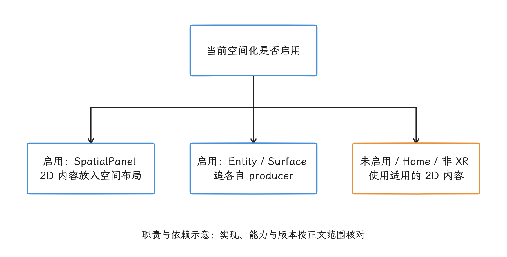

图：先确认 spatialization，再分别核算面板、实体和外部 Surface。 Home Space / 非 XR 忽略 Subspace 代码；需要适用的 2D 内容。

Compose beta02 中 `SpatialGltfModel` / `SpatialGltfModelState` 仍标记 `ExperimentalSpatialGltfModelApi`，其源码暂未重新加入模型动画 API；不要沿用旧 alpha 动画示例。SceneCore stable 1.0.0 的 `getAnimations()` 仍需 `ExperimentalGltfAnimationApi` opt-in，1.1.0-alpha01 才将相关动画 API 转正并新增 `stopAllAnimations()`。stable 1.0.0 的公开 `GltfModelEntity.create()` 仍默认 `parent = null`。

<!-- gracker-diagram: ch13-13-12-animation-version -->
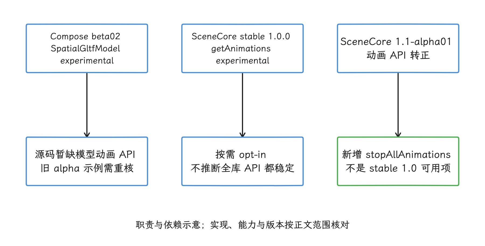

图：Compose 模型 API 与 SceneCore 动画的成熟度并不一致。 不要用最新参考页中的 1.1 API 替代 stable 1.0.0 契约。

scene graph（用父子关系组织空间实体的场景树）只有挂入可见根节点的实体才会参与对应场景；若要显示模型，应在创建时传入 `session.scene.activitySpace` 等 parent，或随后设置 `entity.parent`。entity 创建成功只能证明对象存在，不能证明资源已经挂入可见 scene graph。 同时核对 entity 及祖先 enabled、空间 capability、视野和实际可见结果；挂到根只是必要条件之一。

<!-- gracker-diagram: ch13-13-13-entity-visible -->
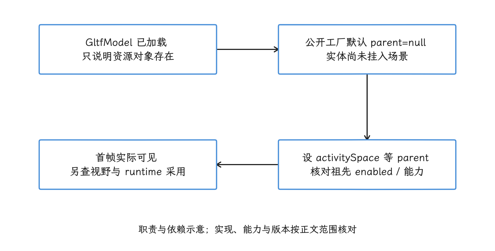

图：模型对象、可见场景树与最终可见结果要分开检查。 parent 非 null 仍须核对祖先 enabled、capability、视野与实际输出。

资源生命周期要按所有者处理：`rememberSpatialGltfModelState()` 由 Compose 的 remember 生命周期持有并调用 `close()`；手工构造 state 的调用方按契约负责关闭。⚠️ beta02 源码中的 state `close()` 仍是 reserved-for-future 的空实现，因此不能把它画成确定的 GPU 资源释放点。SceneCore `GltfModel` / `ImageBasedLightingAsset` 则各自提供主线程 `close()` 并有 GC 清理后备，宜明确唯一所有者，在全部使用结束后关闭，避免重复关闭与关闭后继续使用。`entity.parent = null` 只是移出场景树，清理强引用和关闭资产是另一层工作；stable 1.0.0 的 `Entity.dispose()` 为 library-group 限制且已废弃，不建议业务照旧示例调用。任何这些操作返回都不能单凭 CPU 事件证明 GPU 常驻内存立即归零。

<!-- gracker-diagram: ch13-13-14-asset-owner -->
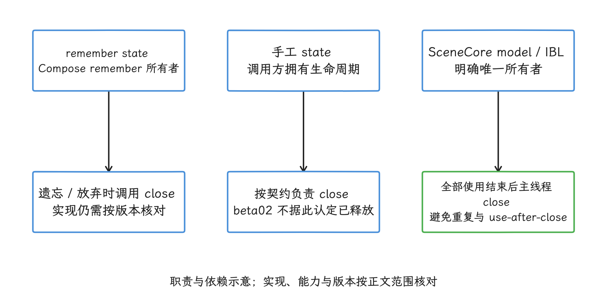

图：remember state、手工 state 与 SceneCore 资产按各自契约管理。 beta02 state close 是空实现；CPU 清理调用不能证明显存即时归零。

业务代码必须锁定具体依赖版本，诊断记录里也应写明 `xr.compose`、`xr.runtime`、`xr.scenecore`、`xr.arcore`、`xr.projected` 与 `xr.glimmer` 的完整版本。

## 空间环境资产的成本构成

`SpatialEnvironment` 管理应用的空间环境偏好。按 SceneCore stable 1.0.0 的模型，`SpatialEnvironmentPreference` 接收一个 `ImageBasedLightingAsset` 和一个 glTF geometry，每份偏好最多提供一份 lighting asset 和一份 geometry。用户直接看到的 skybox texture（包围场景的远景纹理）放在 geometry 资产中，独立 IBL ZIP 用于 lighting、reflection 与 specular（镜面反射高光）计算。

<!-- gracker-diagram: ch13-13-15-environment-two-assets -->
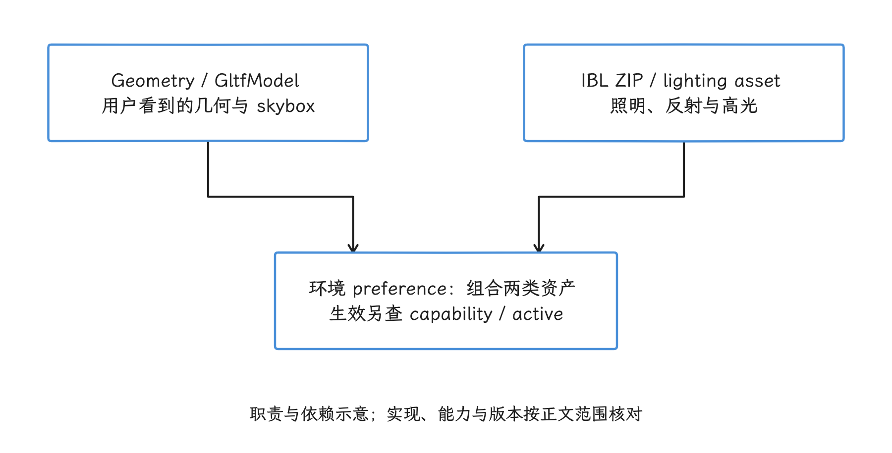

图：geometry 中的可见 skybox 与独立 IBL 用于不同工作。 一份偏好最多一份 geometry 和一份 lighting asset；不是两份可见背景。

环境只在 Full Space 可见。设置 preference 表达期望，是否立即生效还取决于 `SPATIAL_CAPABILITY_APP_ENVIRONMENT` 和当前 active 状态。preference 本身为 `null` 表示系统环境；非 null preference 的 `geometry = null` 则是黑色空环境，`imageBasedLightingAsset = null` 表示没有相应 IBL。passthrough 是相机画面构成的现实世界视图，full opacity 会完全遮住 geometry，其控制还要单独核对 passthrough capability。

<!-- gracker-diagram: ch13-13-16-environment-apply -->
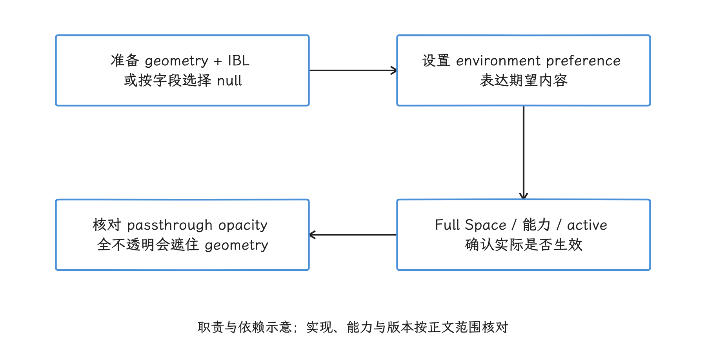

图：配置偏好不等于已经显示，还要核对空间能力、active 与 passthrough。 null preference 与空 geometry 含义不同；passthrough 能力另查。

从 Jetpack XR alpha04 起，官方建议把可见环境与 IBL 数据拆开：

| 资产 | 用途 | 官方建议的边界 |
| --- | --- | --- |
| `.glb` / `.gltf` | 环境 geometry 与用户看到的 skybox texture | geometry 文件建议控制在 80 MB 或更小；近处 mesh 更密、远处更稀；每个 geometry patch 不超过 10,000 vertices |
| IBL ZIP | lighting、reflection、specular 计算 | 由 HDR EXR 经 `cmgen` 预处理；输入要求 2:1 且尺寸为 2 的幂，示例 1024 × 512 |
| black PNG | IBL 生成流程中的优化纹理 | 要求 2:1；100 × 50 是示例，用户不会直接看到 |

<!-- gracker-diagram: ch13-13-17-environment-numbers -->
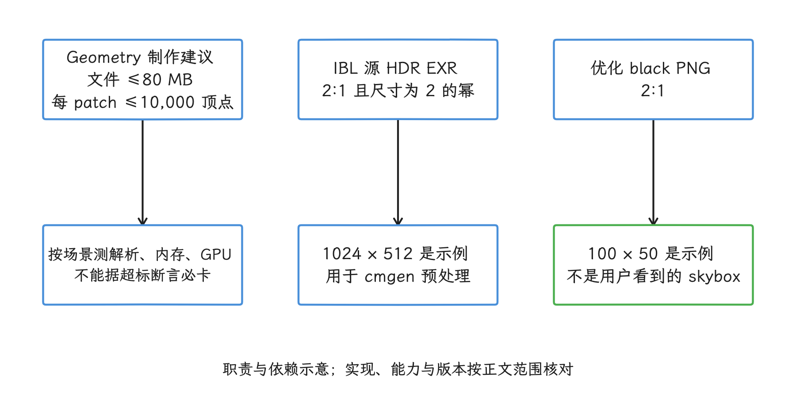

图：文件大小与 patch 顶点数是制作预算，输入图像格式条件另列。 80 MB / 10,000 vertices 不是运行时拒绝阈值；示例尺寸不是唯一尺寸。

80 MB 与 10,000 vertices 是内容制作建议，不是 runtime parser 的拒绝阈值。超过建议值可能增加解析、内存、GPU 和功耗成本，但不能仅凭文件大小判定某帧一定卡顿。

拆分可见 skybox 与 lighting map 后，两者可以独立选择分辨率，避免为了光照计算读取过大的可见纹理，从而降低纹理带宽和功耗。自定义环境含 3D 对象时，缺少匹配 IBL 可能导致过亮、过暗，或反射方向与环境不一致。

<!-- gracker-diagram: ch13-13-18-ibl-generation -->
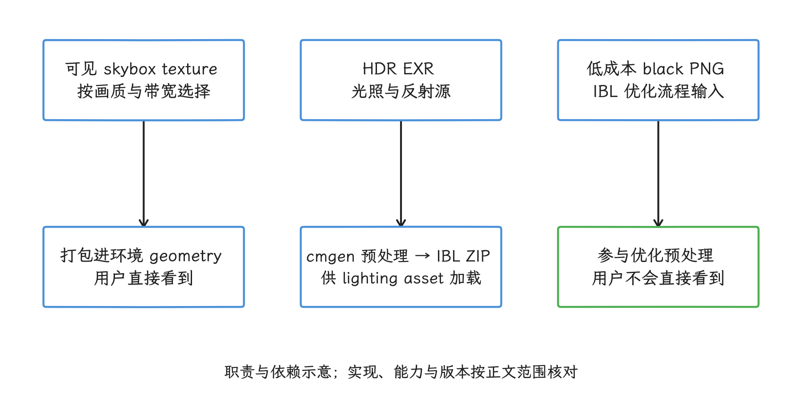

图：可见纹理进入 geometry，光照源经过预处理生成 ZIP。 生成流程示意；没有执行 cmgen，也不把旧指南 EXR 说法当现行 loader 契约。

⚠️ 文档表述有出入：添加环境指南仍有 EXR 作为 skybox 的旧表述，而当前环境优化指南与 `SpatialEnvironmentPreference.geometry` API 明确把用户可见 skybox 放进 geometry，把预处理 IBL ZIP 用于光照。本文按后两者及 stable 1.0.0 源码区分，避免让用户加载一个 EXR 就期待同时完成可见环境与 IBL。

官方将环境 view distance 写为距用户 200 m，并建议把用户放在约 1.5 m 高的位置。200 m 是环境制作与渲染的可见距离指导，不代表感知传感器量程；1.5 m 用于减少较大 UI 与地面穿插，也不是平台 API 上限。

<!-- gracker-diagram: ch13-13-19-environment-distance -->
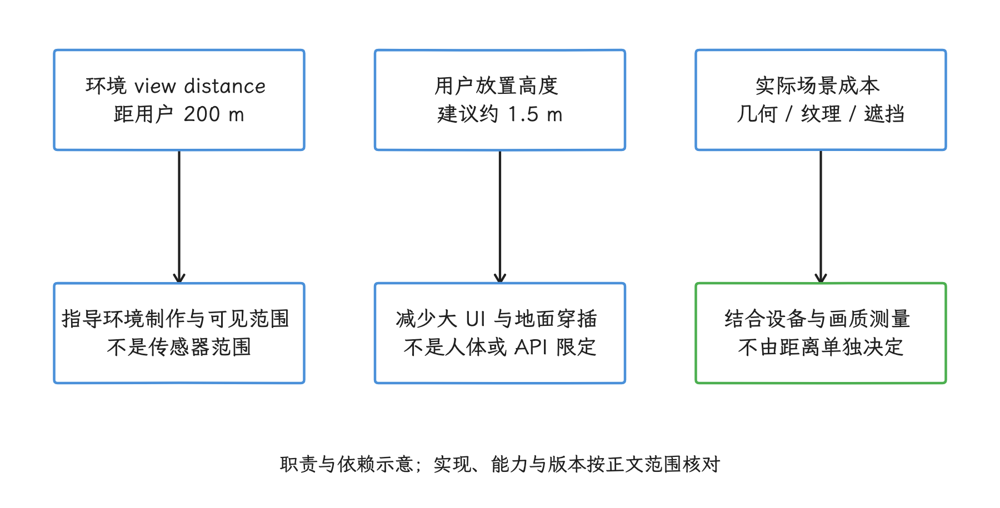

图：200 m 与约 1.5 m 分别是环境可见距离和用户放置指导。 两者均不是平台 API 数值上限，也不能据此推断感知量程。

## 3D 模型与纹理资源的加载预算

Jetpack XR 的内容规范支持 glTF 2.0，作者工具常输出 `.gltf` 或 `.glb`；SceneCore stable 1.0.0 的 `GltfModel.create()` API 文档同时注明，当前 loader 只支持 binary glTF（`.glb`）。Compose for XR 可使用 `SpatialGltfModel`；SceneCore 路径先通过 `GltfModel.create()` 加载，再用 `GltfModelEntity.create(..., parent = session.scene.activitySpace)` 或后续设置 parent 接入 scene graph。 `GltfModel.create()` 是 `@MainThread` suspend API，挂起不等于可以在任意 worker 线程直接调用；路径与 URI 重载还需遵守对应的 assets / URI 契约。

<!-- gracker-diagram: ch13-13-20-gltf-loader -->
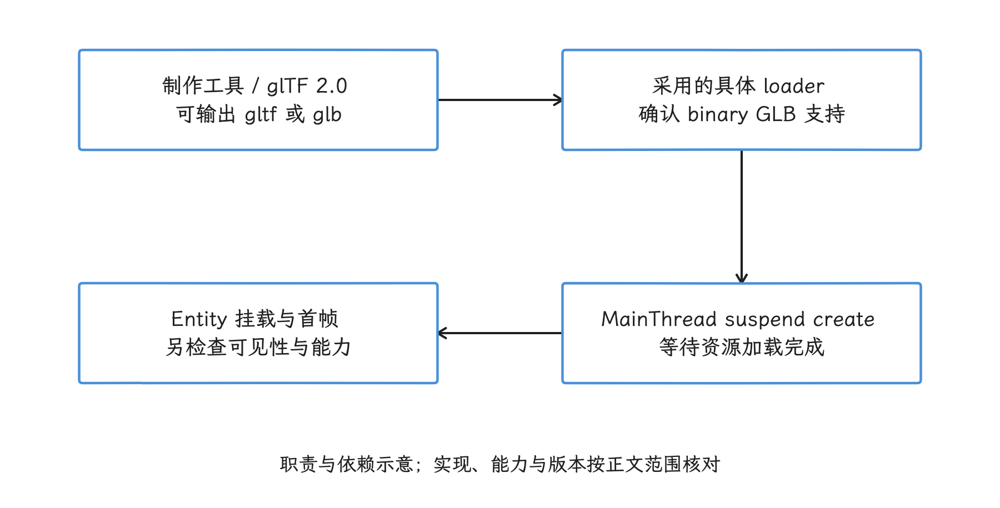

图：内容规范与实际 loader 支持范围要分开核对。 stable 1.0.0 GltfModel 当前只加载 binary GLB；suspend 仍受 MainThread 契约约束。

3D 内容的可用性应以当前 `SpatialCapability.SPATIAL_3D_CONTENT` 为准，并随空间模式变化处理；不要仅凭对象加载成功就假设当前可以显示。Full Space 是相关空间能力的常见使用场景，仍需核对设备与 session 的实际 capability。

<!-- gracker-diagram: ch13-13-21-capability -->
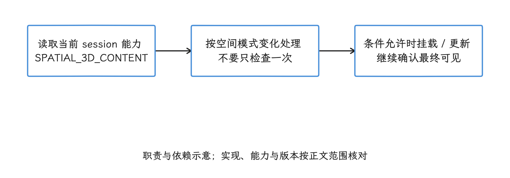

图：空间内容先检查实际 capability，再更新场景。 Full Space 标签和对象创建成功都不是所有显示条件的充分证明。

加载预算可以按四类成本建立观测点；它们可能重叠或由 runtime 内部完成，并不是公开 API 保证的四个严格串行区间：

| 阶段 | 常见成本 | 排查入口 |
| --- | --- | --- |
| 文件读取与交付 | APK/asset/URI、压缩、Play Asset Delivery、冷缓存 | I/O trace、下载/解包时间、资源命中 |
| 解析与对象创建 | glTF chunk、node、mesh、material、animation、对象分配 | CPU、allocation、GC、加载 coroutine |
| 纹理转码与 GPU 上传 | KTX2/Basis 压缩纹理、mipmap（按距离选用的多级纹理）、纹理尺寸、材质与 sampler | GPU memory/counter、upload、带宽、首次 shader |
| scene attach 与首帧 | Entity 创建、Subspace measure/layout、Full Space capability | 首次可见时间、layout、runtime submit |

<!-- gracker-diagram: ch13-13-22-loading-observation -->
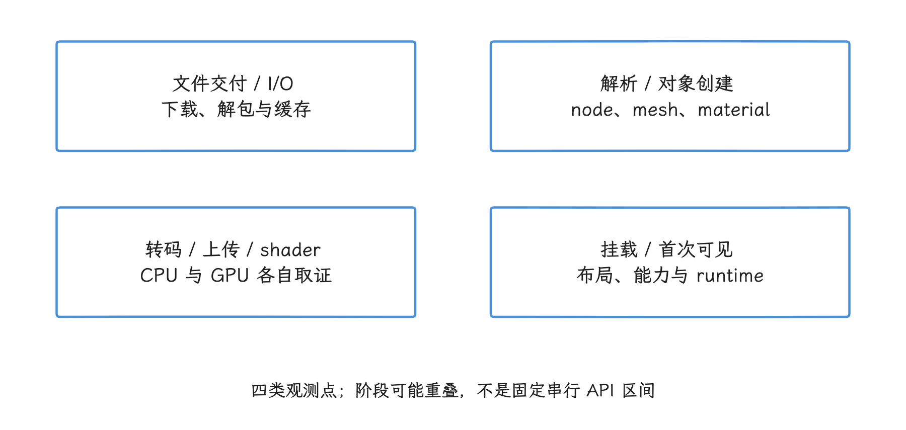

图：I/O、解析、纹理工作与首次可见分别打点。 这是观测分类；内部阶段可重叠，不是四个固定串行 API 区间。

压缩后的 `.glb` 或 KTX2 文件大小不等于 GPU resident size（解压、转码后实际常驻 GPU 内存的大小）。运行时转码格式、mip chain、每眼目标、材质数量和 runtime 缓存都会改变内存占用。官方建议环境 glb 使用 mipmaps 与 KTX2，主要收益涉及纹理采样、远近层级、内存带宽和包体；仍需在目标 GPU 上确认最终格式与常驻量。

<!-- gracker-diagram: ch13-13-23-resident-memory -->
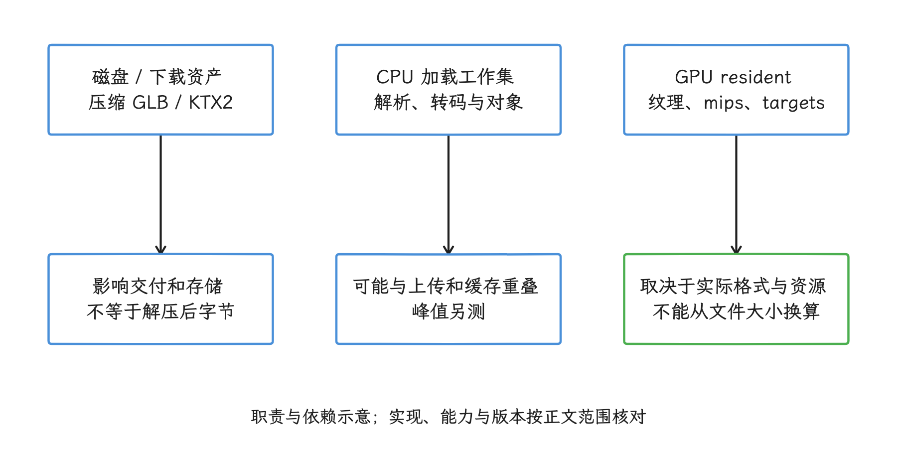

图：压缩资产大小不能直接当运行时 GPU 常驻量。 需记录最终转码格式、mips、render targets、材质与缓存，并在目标 GPU 测量。

大模型宜异步预取，但在启动初期一次性加载全部资源，会把启动、峰值内存与热压力前移。工程上应按可见优先级加载：

1. 首个可交互面板与必要模型；
2. 用户视野内近期会出现的纹理和动画；
3. 远处环境或低概率内容；
4. 离开场景后可以释放或降级的缓存。

<!-- gracker-diagram: ch13-13-24-load-priority -->
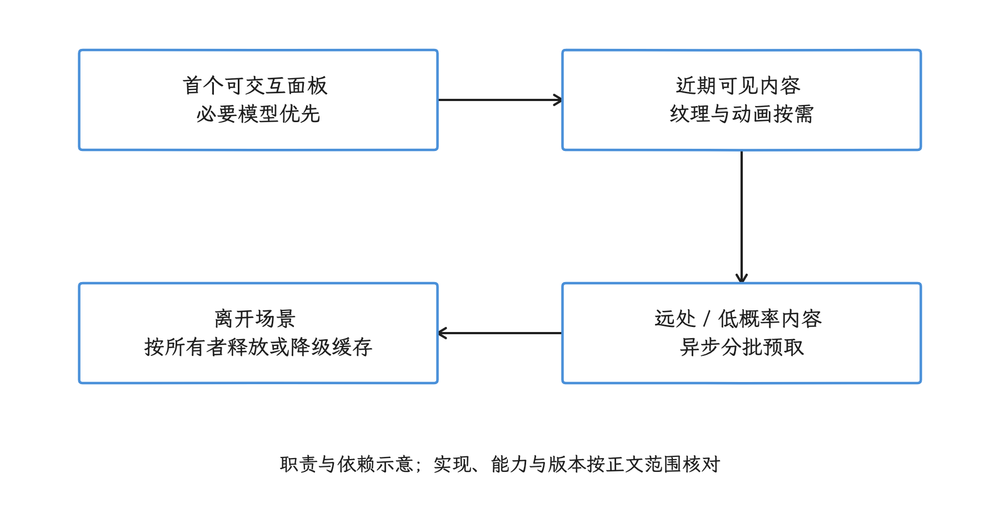

图：先保证交互和近期可见内容，再安排远处内容与缓存。 预取策略需同时观察启动、峰值内存与热压力，不能一次加载全部。

资源加载、scene attach 与首帧 present 要分别打点。`GltfModel.create()` 返回只说明该加载 API 已完成；不能预设所有 GPU upload 都在返回之后，也不能由返回推出首次 shader 已准备好或本帧已经被 runtime 采用。应结合 CPU/GPU 和首次可见证据查明实际加载重叠、延后工作及缓存。解除 parent 只改变挂载关系；资产关闭则按上一节的所有者、线程和版本契约执行。

<!-- gracker-diagram: ch13-13-25-load-first-visible -->
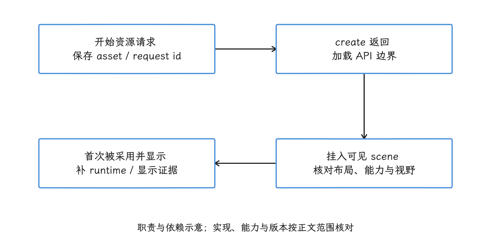

图：资源 API 完成与首次被 runtime 采用是不同事件。 不预设所有 GPU 上传都在 create 返回之后；要用实际 CPU/GPU 证据定位。

## 视点、姿态与显示配置对帧时间的影响

XR 需要同时观察四条时间线：

| 时间线 | 要回答的问题 |
| --- | --- |
| simulation / UI | 本帧状态、输入和动画是否及时更新 |
| App GPU | 当前 eye buffer 或 panel buffer 是否在 deadline 前完成 |
| XR runtime | pose 更新、spacewarp/reprojection、空间合成是否采用了 App 本帧 |
| display | runtime 提交后何时扫描与显示；光学响应是否另有延迟 |

<!-- gracker-diagram: ch13-13-26-four-timelines -->
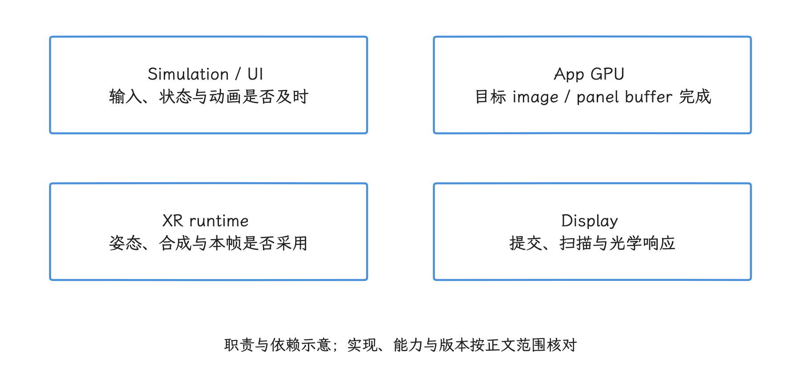

图：应用更新、应用 GPU、runtime 与显示各自回答不同问题。 这些阶段可跨帧重叠；应用 buffer 完成不是光学显示完成。

应用完成一帧，不代表用户已经看到与该姿态对应的画面。reprojection 可以按更新姿态修正已有图像；Application Spacewarp 还使用 motion vector 与 depth 合成中间帧，不能把两者的输入要求合并成同一契约，因此显示可以继续刷新，而 App 无须为每个 display refresh 生产全新 render frame。引擎 FPS、App FrameTimeline、runtime synthesized cadence 与 display refresh rate 需要分开记录。

<!-- gracker-diagram: ch13-13-27-cadence -->
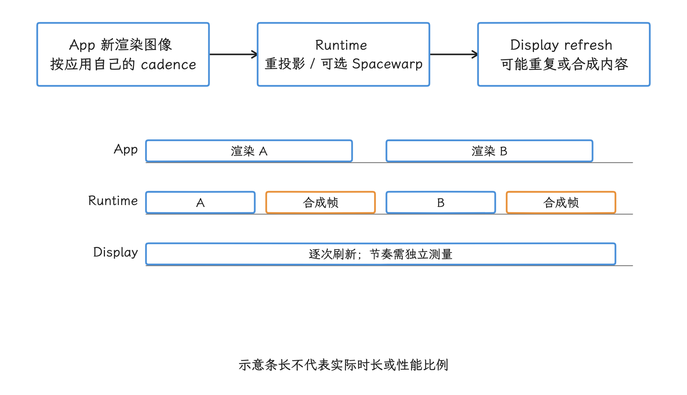

图：重投影可复用已有图像，Spacewarp 另用 motion vector / depth。 轨道只示意一种交替合成情况；不规定刷新率、占空比或通用 reprojection 输入。

ARCore 1.0.0 的 `ArDevice` state 提供 `devicePose` 与 `trackingState`；`RenderViewpoint.left(session)` / `right(session)` 仅适用于 STEREO，`mono(session)` 在 MONO 时是单视图、在 STEREO 时位于双眼显示中心。其 state 的 `pose` 是 perception space 中的视点位姿，`localPose` 是相对设备中心 tracking point 的局部偏移，`fieldOfView` 以弧度表示。tracking mode 为 DISABLED 时，设备 pose 不再跟随运动，可能保留原点或切换前的最后状态；读取到数值不等于追踪正在更新。

<!-- gracker-diagram: ch13-13-28-viewpoint-space -->
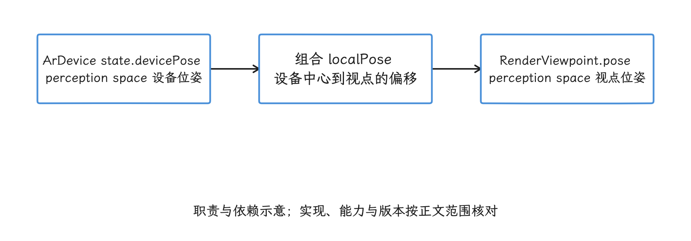

图：viewpoint pose 由设备 perception-space pose 与局部视点偏移合成。 组合的是位姿变换，不能逐分量相加；禁用 tracking 时数值可能冻结。

这些数据为渲染提供输入，却不说明 runtime 何时 latch（锁定并采用）这份 pose，也不给出最终 motion-to-photon（头部运动到对应光子进入眼睛）的延迟。读取频率、坐标空间和使用该 pose 的 render frame 必须在应用侧对齐；没有公开时间戳时，不能声称得到了精确的跨层 pose age。

<!-- gracker-diagram: ch13-13-29-pose-latch-boundary -->
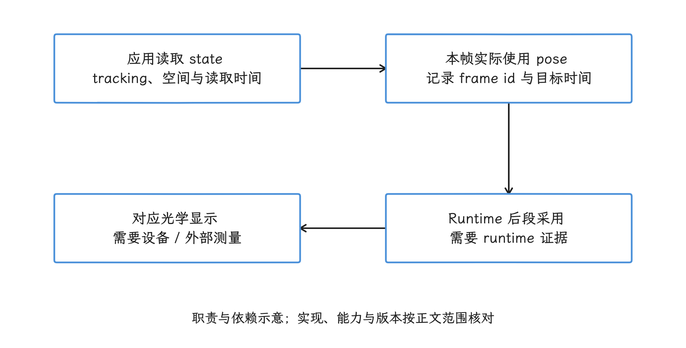

图：应用读取 pose、渲染使用 pose 与 runtime latch 必须分别取证。 没有公开时间戳和时钟映射，就不能声称精确跨层 pose age 或 MTP。

Unity Android XR Extensions 提供三类不同优化：

| 能力 | 作用 | 不能省略的验证 |
| --- | --- | --- |
| Application Spacewarp | 使用 motion vector（像素运动方向与幅度）和 depth 合成交替帧，降低 App GPU 渲染频率 | motion vector/depth 正确性、合成伪影、App 与 display cadence |
| Vulkan subsampling | 借助 Fragment Density Map（区域采样密度图）让不同区域以不同密度渲染/采样 | 目标设备支持、画质、GPU/带宽收益 |
| late latching | 在帧生成后段更新 head pose，减少渲染使用的姿态与显示时姿态之间的时间差；官方描述收益可接近一个 frame time | 标记节点正确、runtime 支持、MTP 或可替代指标 |

<!-- gracker-diagram: ch13-13-30-unity-optimizations -->
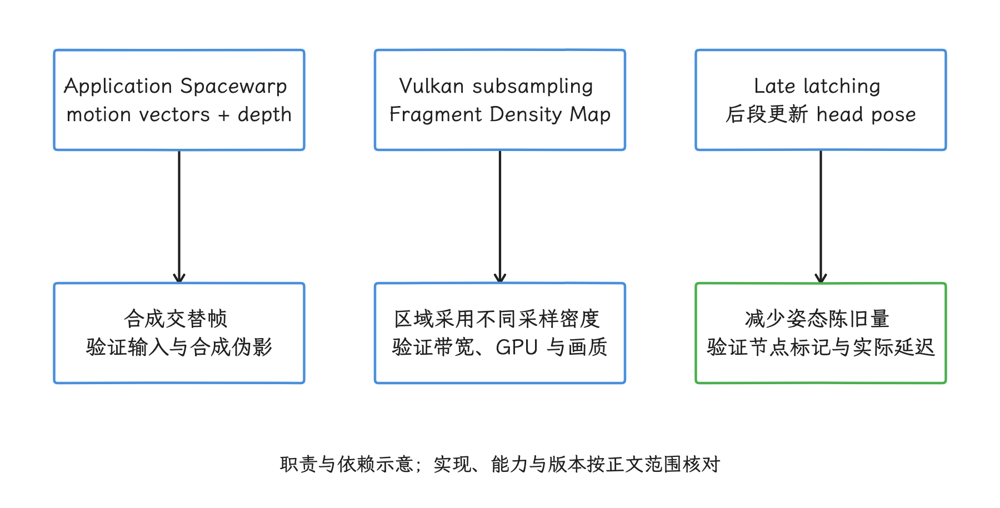

图：Spacewarp、subsampling 与 late latching 有不同输入和作用点。 这些是引擎路径能力；支持条件、画质和收益需目标设备验证，不能相加成固定延迟。

这些能力属于 Unity/OpenXR 引擎路径，不是普通 Compose panel 的开关。各项优化可能作用于同一段时序或改变彼此前提，理论收益不能简单相加成固定延迟数值。

## Android XR 质量分级的性能检查项

下表只摘取当前 immersive 指南的 differentiated 性能项，适用于 XR headset / wired XR glasses 的相应体验。audio/display glasses 应查 augmented 指南，不能套用头显的刷新率与渲染分辨率要求。

| 检查项 | compatible mobile / adaptive | immersive XR-differentiated |
| --- | --- | --- |
| 布局 | 核心任务可完成；adaptive app 遵守适用的 Tier 2 / Tier 1 指南 | Subspace、面板、环境和 3D 内容适配 Full/Home Space |
| 输入 | Android 常规输入与必要的外设路径 | natural hand input、raycast/gesture 等适用能力 |
| 渲染 | 2D App 自身 deadline、resize 和输入响应 | 每帧 `<11.1 ms @ 90 Hz`、`<13.8 ms @ 72 Hz` |
| 分辨率 | 由兼容面板与设备策略决定 | OpenXR / 引擎查询 `XR_ANDROID_recommended_resolution` 获取理想渲染目标 |
| 启动 | 记录 cold/warm 与 first interaction | mean cold `<2 s`、mean warm `<1 s` |
| 稳定性 | crash、ANR、恢复 | 长会话、tracking/runtime 异常、内存与 thermal |

<!-- gracker-diagram: ch13-13-31-immersive-performance -->
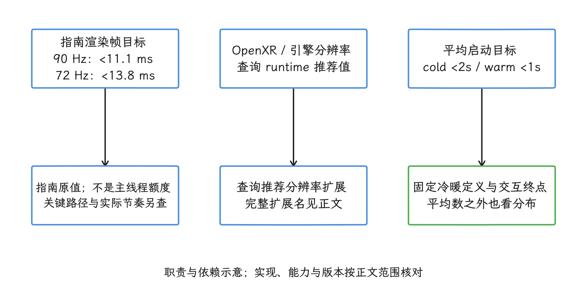

图：当前 immersive 质量项包含帧目标、推荐分辨率和启动目标。 只摘取相应 differentiated 性能项，不套用 audio/display glasses。

11.1 ms 与 13.8 ms 是指南给出的 App 帧目标，不是主线程独占额度，也不是 CPU 与 GPU 时长的简单求和：流水线可能重叠，等待和提交需沿真实关键路径分析。这里沿用指南的 13.8 ms 表述，严格的 `1000/72` 算术约为 13.89 ms。运行时合成、实际显示和空间感知仍需各自证据。

<!-- gracker-diagram: ch13-13-32-critical-path -->
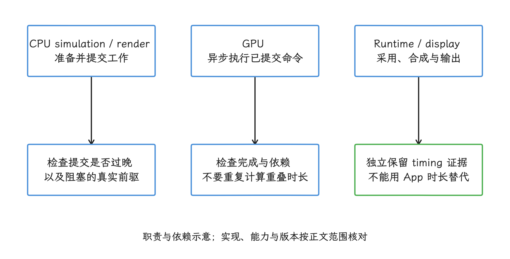

图：应用预算按实际依赖与重叠的关键路径解释。 13.8ms 沿用指南；1000/72 的算术周期约 13.89ms，两者口径要写明。

分辨率由当前设备与 runtime 推荐值确定，不应再写死“每眼至少 1856 × 2160”。每眼目标也不能直接换算成两次完整 render pass：multiview（一次提交处理双眼视图）、foveation（中心区域高质量、外围降低质量）、subsampling 与 spacewarp 都会改变实际着色和提交工作。用目标设备支持的 AGI、引擎 frame debugger 或 GPU counter 验证实际 pass、纹理与像素成本。

<!-- gracker-diagram: ch13-13-33-resolution-work -->
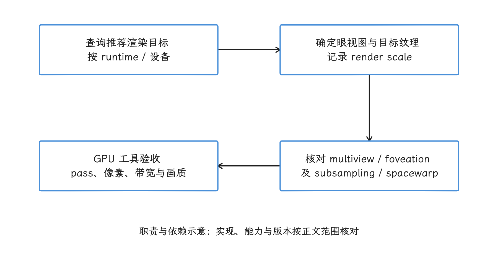

图：获取 runtime 推荐目标后，还需核对实际渲染配置与 GPU 工作。 双眼目标不自动意味着两次完整 pass；实际支持和画质需设备测量。

## 工具与验证入口

单个工具无法覆盖从 App 到光学显示的完整路径。每次复盘都应明确工具能看到的阶段和无法证明的阶段。

| 工具 | 适合确认的问题 | 不适合直接判断的事项 |
| --- | --- | --- |
| Android Studio + XR Emulator | capability、布局、Home/Full Space、输入与功能验证 | 真实 GPU、传感器、thermal、光学与 MTP |
| Perfetto / FrameTimeline | Android 线程、调度、I/O、HWUI panel、部分 GPU/SF 证据 | 未公开的 XR compositor 全时序与 panel 光学响应 |
| AGI / GPU counter | 支持设备的 render pass、shader、纹理、带宽与 GPU 时间 | 无目标驱动支持时无法观测；GPU 时间也不等于 MTP |
| Unity Profiler / Frame Debugger | simulation、render thread、URP、资源、spacewarp 输入 | Android 调度、系统 I/O、host thermal 的完整原因 |
| OpenXR/厂商 runtime 工具 | swapchain、runtime timing、reprojection、pose | 普通 View/Compose 内部重组与业务调用栈 |
| Winscope / SurfaceFlinger dump | Android Window/Layer、resize、可见性、panel Buffer | SceneCore entity graph 与 XR runtime 最终合成 |

<!-- gracker-diagram: ch13-13-34-tool-coverage -->
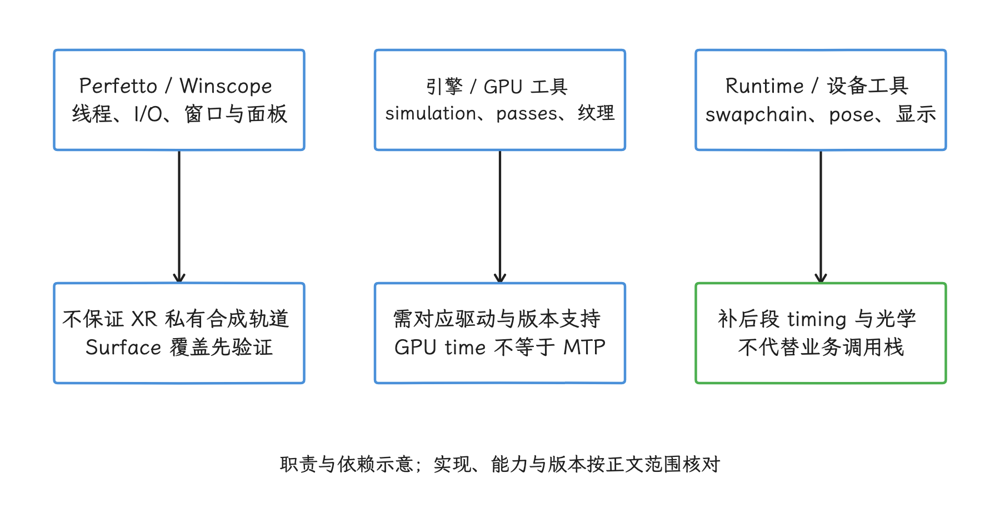

图：系统、引擎与 runtime/设备工具提供不同阶段证据。 先确认驱动与数据源支持；模拟器不能替代真机热状态和光学测量。

### 推荐的单帧检查顺序

1. 记录设备形态、系统版本、显示 refresh rate、Home/Full Space、passthrough；
2. 记录 Jetpack XR 或 Unity/OpenXR 的准确 package 版本与开关；
3. 识别目标内容属于 Android panel、external surface、SceneCore entity 或 OpenXR swapchain；
4. 对齐 App CPU、render thread、GPU submit 与 Buffer/swapchain 边界；
5. 查 runtime 是否采用当前帧，是否使用 spacewarp/reprojection；
6. 查 display cadence、thermal、CPU/GPU frequency 和长会话趋势；
7. 分别记录 App render miss、runtime miss、tracking stale（姿态或感知数据过旧）和显示延迟。

<!-- gracker-diagram: ch13-13-35-single-frame-check -->
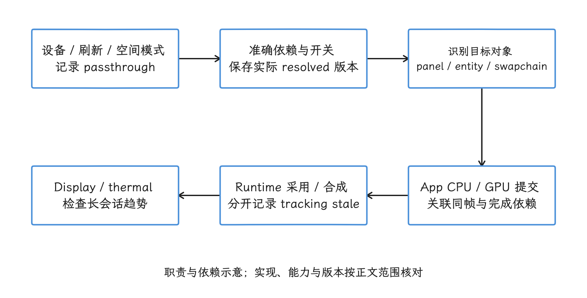

图：从设备、版本、对象到提交、采用和显示建立同帧检查。 GPU、runtime 与 tracking 可能各自 miss，不能只用一个 FPS 归因。

公开文档没有承诺统一的 Android XR Perfetto slice 名。在 trace 中按 `XR` 关键字搜索不到事件，不能证明 runtime 没有工作；应从目标线程、surface/swapchain、GPU 和设备工具逐层建立证据。

<!-- gracker-diagram: ch13-13-36-trace-missing -->
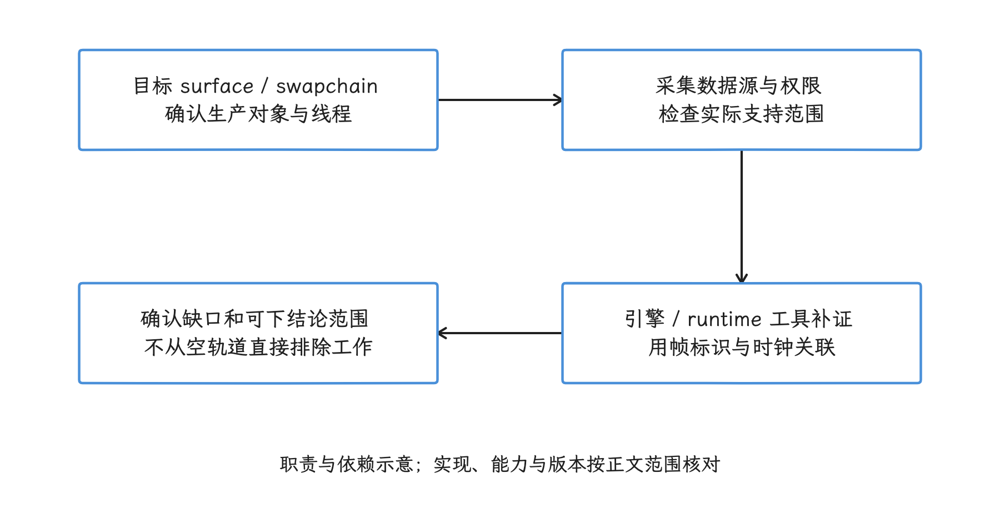

图：先核对目标对象、采集支持与权限，再解释缺失事件。 没有 XR slice 不能证明 runtime 没有工作，未知阶段应明确保留。

每份报告至少保留设备类型、系统 build、Jetpack XR/Unity package、refresh mode、空间模式、passthrough、模型/环境版本、纹理上限、采集工具版本与复现动作。

## XR 与游戏 / Vulkan 渲染路径的交叉

Unity for Android XR 建立在 OpenXR 之上，Android XR Extensions 进一步提供 spacewarp、Vulkan subsampling 和 late latching 等能力。引擎路径仍需检查 13.5、13.6、13.12 的公共问题：simulation 是否按时，GPU queue 是否积压，swapchain image 是否及时 acquire/release，fence 是否延后，frame pacing 是否匹配 runtime 节奏。

常见单线程示例可写成 `xrWaitFrame → xrBeginFrame → acquire / wait swapchain image → 提交渲染 → release image → xrEndFrame`，但这不是所有引擎唯一的 CPU 串行调度。`xrWaitFrame` 返回 predicted display time / period 与 `shouldRender`，可由独立线程调用，但其调用必须外部同步；同一应用帧各阶段应传递一致的目标 display time。只有成功等到 image 可用后才能提交写该 image 的命令，release 也要求先成功 wait。GPU 同步还要遵守所用 graphics binding 的规则；release 或 `xrEndFrame` 的 CPU 返回都不是最终光学显示完成。

<!-- gracker-diagram: ch13-13-37-openxr-loop -->
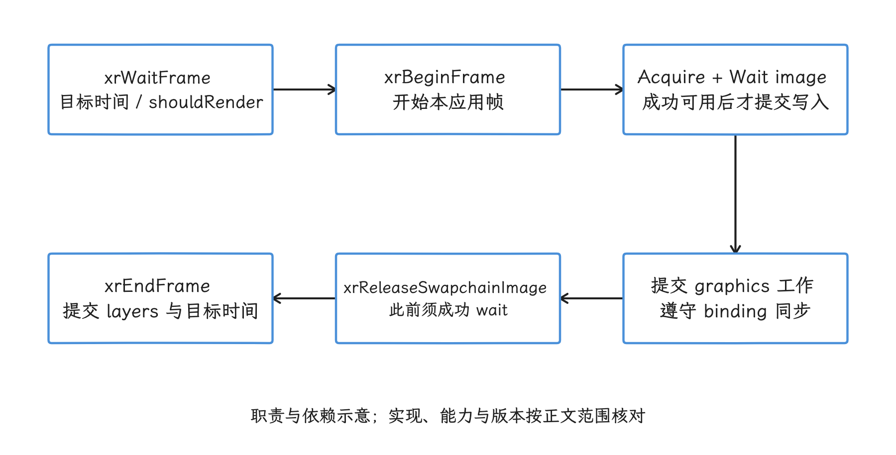

图：示例帧先取得调度信息，成功等待 image，再提交内容与 layers。 可有多线程流水线；图不是所有引擎唯一调度，也不是 GPU 完成或光学时间线。

当 `shouldRender=false` 时应避免不必要的重 GPU 工作，可省略相应 layers；session 仍在 running 时应继续帧循环，包含必要的 begin/end，并可提交空 layers。runtime 的 predicted display period 也不保证等于硬件刷新周期。OpenXR swapchain 是 runtime 协议对象，不是 Android BufferQueue；两者出现 acquire / wait / release 等同名动作时，必须按各自对象和同步契约解释。

<!-- gracker-diagram: ch13-13-38-should-render -->
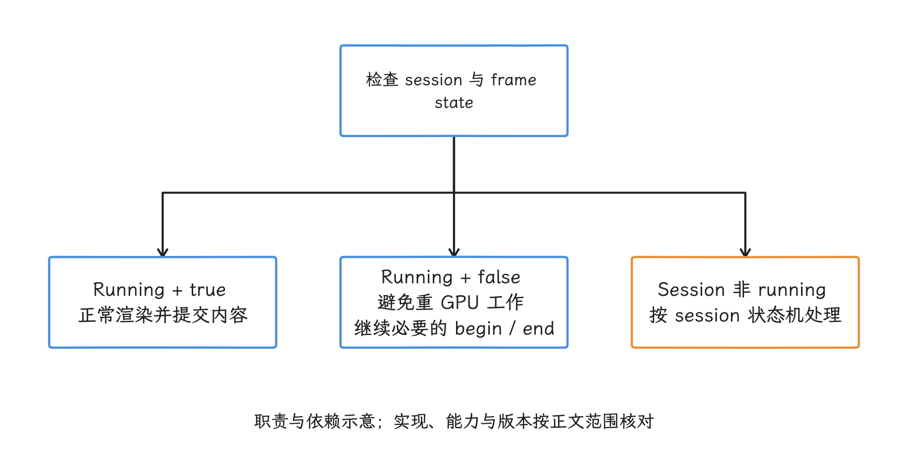

图：session running 时继续帧循环，按 shouldRender 决定重渲染与 layers。 预测 display period 不保证等于面板刷新周期；停止 session 是另一个状态条件。

XR 还增加姿态新鲜度和用户舒适度约束。Unity Profiler 的平均 FPS 只能说明引擎吞吐的一部分；还要结合 slow frame 分布、spacewarp 状态、runtime cadence、tracking 与 Android 系统调度。

<!-- gracker-diagram: ch13-13-39-object-sync-contract -->
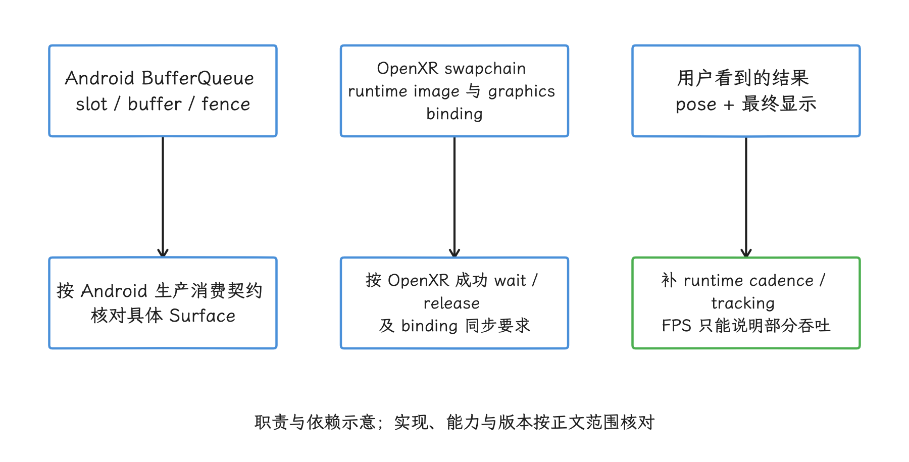

图：Android buffer 同步与 OpenXR swapchain 协议不能互套。 CPU 调用返回、写完成和最终显示是三个层次；姿态新鲜度也需另查。

## 眼镜形态下 host device 的功耗边界

设备类型需要分开记录：

- XR headset / wired XR glasses：Compose for XR、SceneCore、Unity/OpenXR 文档覆盖的空间/沉浸路径；
- audio/display glasses：Jetpack Projected 让应用运行在 companion host（如 Android phone），Compose Glimmer 为透明 display glasses 提供 UI；
- audio glasses 没有可视 display 时，应用应按 capability 降级为音频或其他交互。

Projected 场景要同时记录 host 与 glasses 两端：

| host device | glasses / projected device |
| --- | --- |
| Activity 生命周期、Compose、CPU/GPU、相机/编解码、网络、thermal | display on/off、输入、camera/sensor、连接、显示 cadence、设备功耗 |

<!-- gracker-diagram: ch13-13-40-host-glasses -->
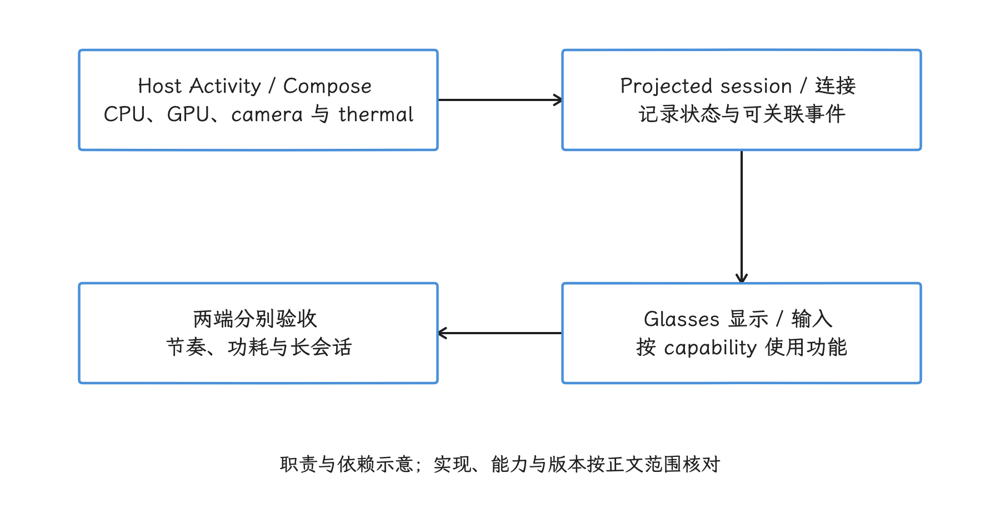

图：Projected Activity 在 host 执行，显示与输入还经过连接到眼镜。 host 帧按时不证明远端 present 按时；两端功耗按各自设备归因。

host 上按时生成帧，不能证明传输和 glasses present 也按时；眼镜发热也不能直接归因于 host GPU。两端时钟若没有同步，应使用可关联的 event id 与往返测量，避免直接拿不同设备的原始 timestamp 相减。 往返测量仍不能自动拆出单向传输时延；跨端精确分段还需有误差界限的时钟映射。augmented 场景另需检查后台功耗、相机帧率与分辨率，按当前 capability 选择功能。

<!-- gracker-diagram: ch13-13-41-cross-device-clock -->
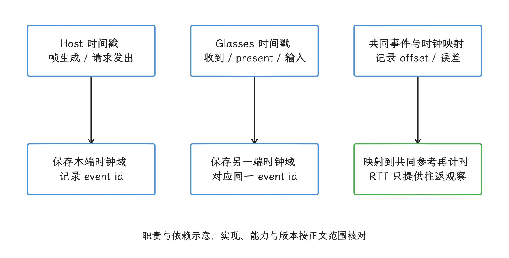

图：共同事件用于关联，精确分段还需要有误差界限的时钟映射。 不能直接相减未同步 timestamp，RTT 本身也不能拆出单向时延。

## 复核清单

- [ ] 平台版本不高于 Android 17，平台源码锚点为 `android-17.0.0_r1`；
- [ ] Jetpack XR / Unity / OpenXR package 使用完整版本号；
- [ ] compatible panel、Subspace、external surface、OpenXR 与 Projected 路径已区分；
- [ ] App SurfaceFrame 没有被当作最终 XR present；
- [ ] App render rate、runtime/display refresh 与 spacewarp cadence 已区分；
- [ ] 90/72 Hz 与启动目标按 immersive differentiated 指南解释；OpenXR / 引擎查询推荐分辨率，augmented 另查；
- [ ] glb 80 MB、10,000 vertices 与 1.5 m 明确标为制作指导，200 m 标为环境 view distance；
- [ ] I/O、解析、纹理转码/上传、scene attach、首次 present 分别打点；
- [ ] entity parent、enabled 与 capability 已核对；模型/state/IBL 按所有者、线程与版本契约管理，不把 state close 当显存即时释放；
- [ ] `RenderViewpoint` 数据没有被误写成 runtime pose latch 保证；
- [ ] emulator 数据没有替代真机 GPU、thermal、tracking 或光学延迟；
- [ ] host phone 与 projected glasses 的性能和功耗分开记录。

## 小结

Android XR 把 2D panel、空间内容、姿态预测、runtime 合成和头显或眼镜显示组织成多条责任不同的路径，不是在传统 View 管线末端再多挂一个显示设备。分析前先确定内容形态、swapchain 或 Surface 的所有者以及最终 present 的责任方，再分别测量资源准备、应用渲染、runtime cadence、tracking 和设备端显示。只有这些边界明确，资产预算、spacewarp、帧率与功耗数据才具备可比性。

## 本轮配图核对依据

- [Immersive 质量指南](https://developer.android.com/docs/quality-guidelines/android-xr/immersive)、[Augmented 质量指南](https://developer.android.com/docs/quality-guidelines/android-xr/augmented)：适用形态、adaptive 档、当前渲染/启动目标与推荐分辨率。
- [Compose beta02 sources](https://dl.google.com/dl/android/maven2/androidx/xr/compose/compose/1.0.0-beta02/compose-1.0.0-beta02-sources.jar)、[POM](https://dl.google.com/dl/android/maven2/androidx/xr/compose/compose/1.0.0-beta02/compose-1.0.0-beta02.pom)、[AAR](https://dl.google.com/dl/android/maven2/androidx/xr/compose/compose/1.0.0-beta02/compose-1.0.0-beta02.aar)：记忆状态生命周期、实验 API、实际依赖与构建 metadata。
- [SceneCore stable 1.0.0 sources](https://dl.google.com/dl/android/maven2/androidx/xr/scenecore/scenecore/1.0.0/scenecore-1.0.0-sources.jar)、[ARCore stable 1.0.0 sources](https://dl.google.com/dl/android/maven2/androidx/xr/arcore/arcore/1.0.0/arcore-1.0.0-sources.jar)：公开工厂的 parent、资源 close、受限 entity dispose、位姿合成与视点约束。
- [环境偏好](https://developer.android.com/reference/kotlin/androidx/xr/scenecore/SpatialEnvironment.SpatialEnvironmentPreference)、[RenderViewpoint.State](https://developer.android.com/reference/kotlin/androidx/xr/arcore/RenderViewpoint.State)、[ArDevice.State](https://developer.android.com/reference/kotlin/androidx/xr/arcore/ArDevice.State)：null 语义、坐标空间、FOV 与追踪状态。
- [FrameTimeline](https://perfetto.dev/docs/data-sources/frametimeline)、[时钟映射](https://perfetto.dev/docs/concepts/clock-sync)：目标 Surface 覆盖与跨工具/跨端时钟边界。

## 参考资料

- [Develop with the Jetpack XR SDK](https://developer.android.com/develop/xr/jetpack-xr-sdk)
- [Android XR SDK Developer Preview 4](https://developer.android.com/blog/posts/updates-to-the-android-xr-sdk-introducing-developer-preview-4)
- [Android XR app quality guidelines](https://developer.android.com/docs/quality-guidelines/android-xr)
- [Jetpack Compose for XR release notes](https://developer.android.com/jetpack/androidx/releases/xr-compose)
- [Jetpack XR Runtime release notes](https://developer.android.com/jetpack/androidx/releases/xr-runtime)
- [Jetpack SceneCore release notes](https://developer.android.com/jetpack/androidx/releases/xr-scenecore)
- [ARCore for Jetpack XR release notes](https://developer.android.com/jetpack/androidx/releases/xr-arcore)
- [Jetpack XR Projected release notes](https://developer.android.com/jetpack/androidx/releases/xr-projected)
- [Jetpack Compose Glimmer release notes](https://developer.android.com/jetpack/androidx/releases/xr-glimmer)
- [Develop spatial UI with Compose for XR](https://developer.android.com/develop/xr/jetpack-xr-sdk/ui-compose)
- [Add a Subspace](https://developer.android.com/develop/xr/jetpack-xr-sdk/add-subspace)
- [Add 3D models](https://developer.android.com/develop/xr/jetpack-xr-sdk/add-3d-models)
- [Add spatial environments](https://developer.android.com/develop/xr/jetpack-xr-sdk/add-environments)
- [Optimize environment assets](https://developer.android.com/develop/xr/jetpack-xr-sdk/optimize-environment-assets)
- [Android XR Extensions performance settings for Unity](https://developer.android.com/develop/xr/unity/performance/androidxr-extension-settings)
- [Projected Activity for audio and display glasses](https://developer.android.com/develop/xr/jetpack-xr-sdk/glasses/first-activity)
- [OpenXR specification](https://registry.khronos.org/OpenXR/specs/1.1/html/xrspec.html)
- AOSP Android 17, [`Choreographer.java`](https://android.googlesource.com/platform/frameworks/base/+/refs/tags/android-17.0.0_r1/core/java/android/view/Choreographer.java)、[`DrawFrameTask.cpp`](https://android.googlesource.com/platform/frameworks/base/+/refs/tags/android-17.0.0_r1/libs/hwui/renderthread/DrawFrameTask.cpp)、[`BufferQueueProducer.cpp`](https://android.googlesource.com/platform/frameworks/native/+/refs/tags/android-17.0.0_r1/libs/gui/BufferQueueProducer.cpp) 与 [`Fence.cpp`](https://android.googlesource.com/platform/frameworks/native/+/refs/tags/android-17.0.0_r1/libs/ui/Fence.cpp)
- Kernel common `android17-6.18-2026-06_r6`, [`dma-fence.c`](https://android.googlesource.com/kernel/common/+/refs/tags/android17-6.18-2026-06_r6/drivers/dma-buf/dma-fence.c) 与 [`sched/core.c`](https://android.googlesource.com/kernel/common/+/refs/tags/android17-6.18-2026-06_r6/kernel/sched/core.c)
