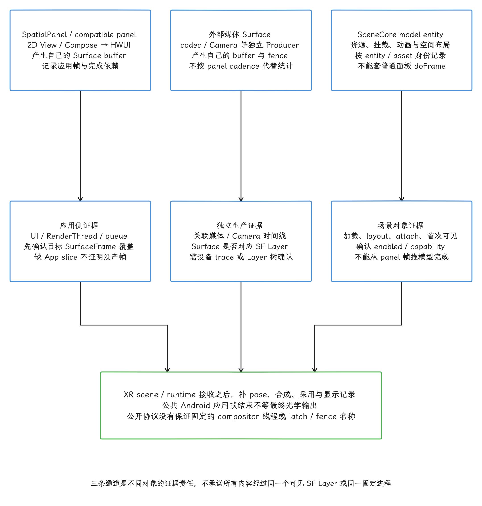
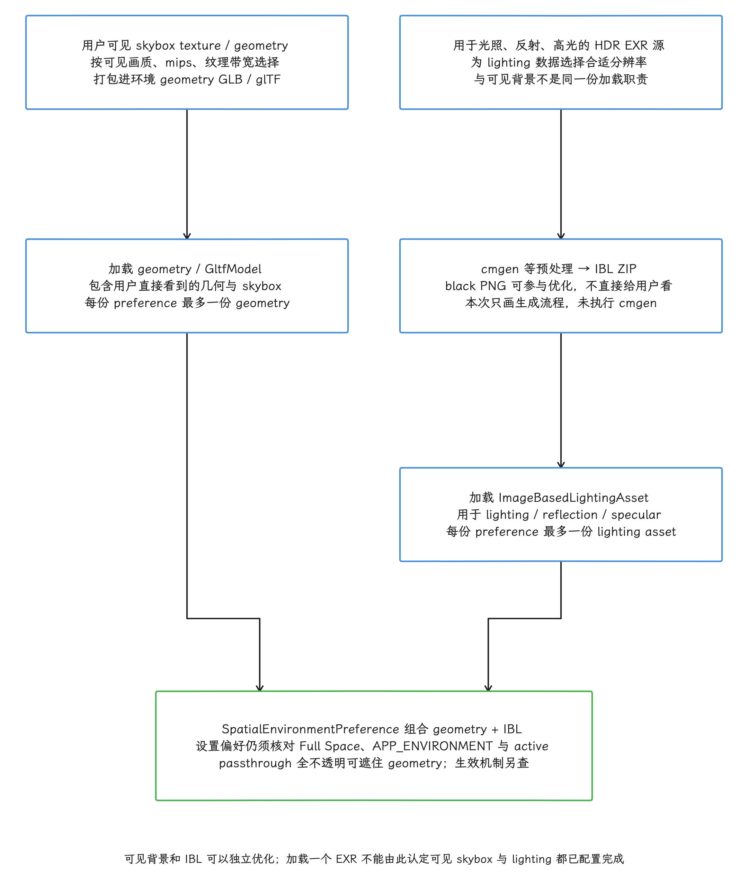
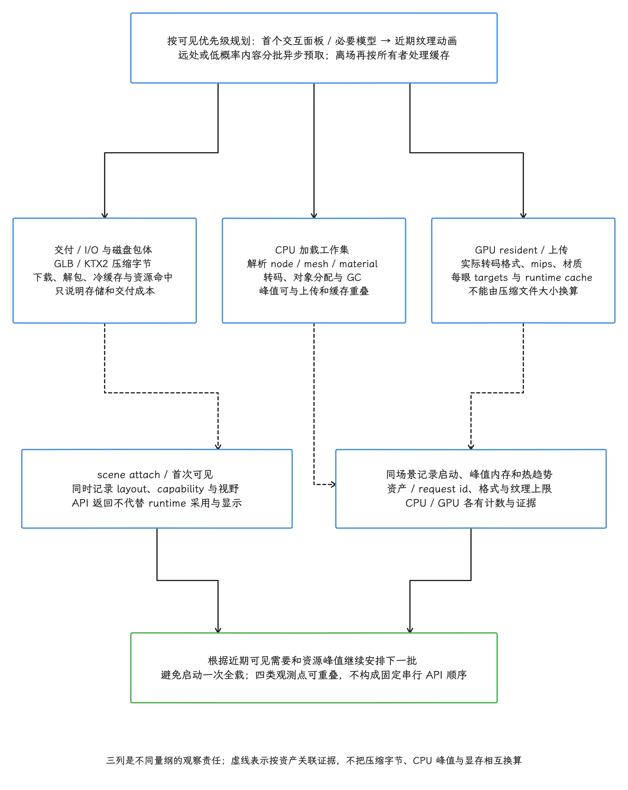
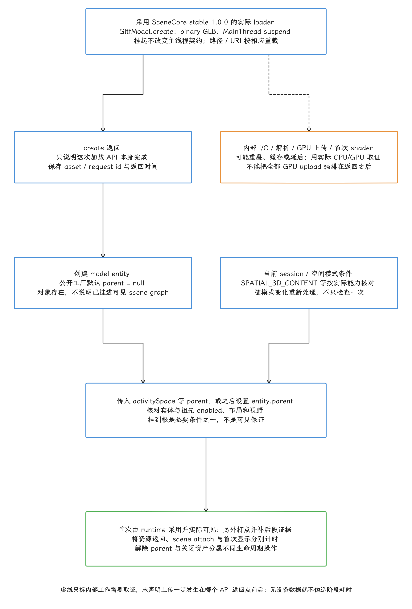
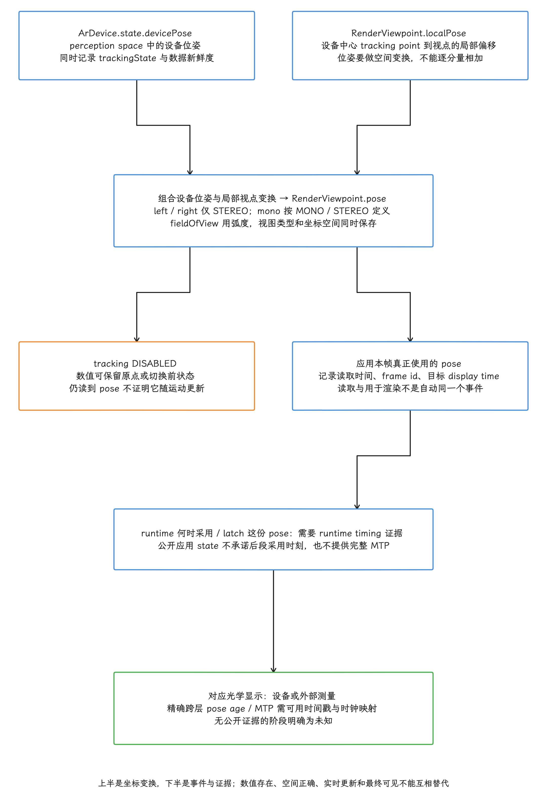
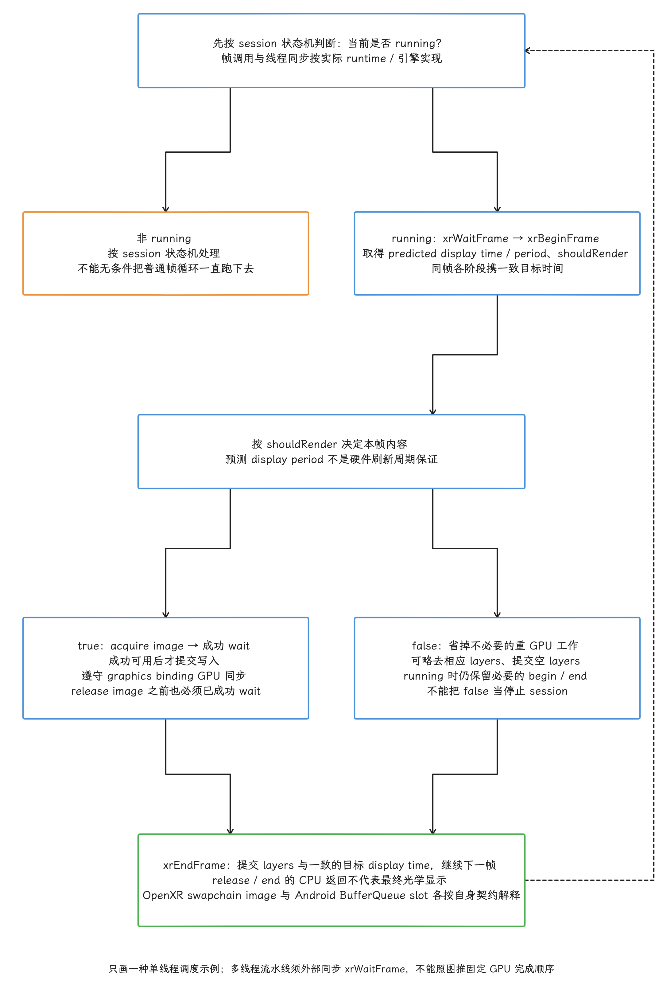
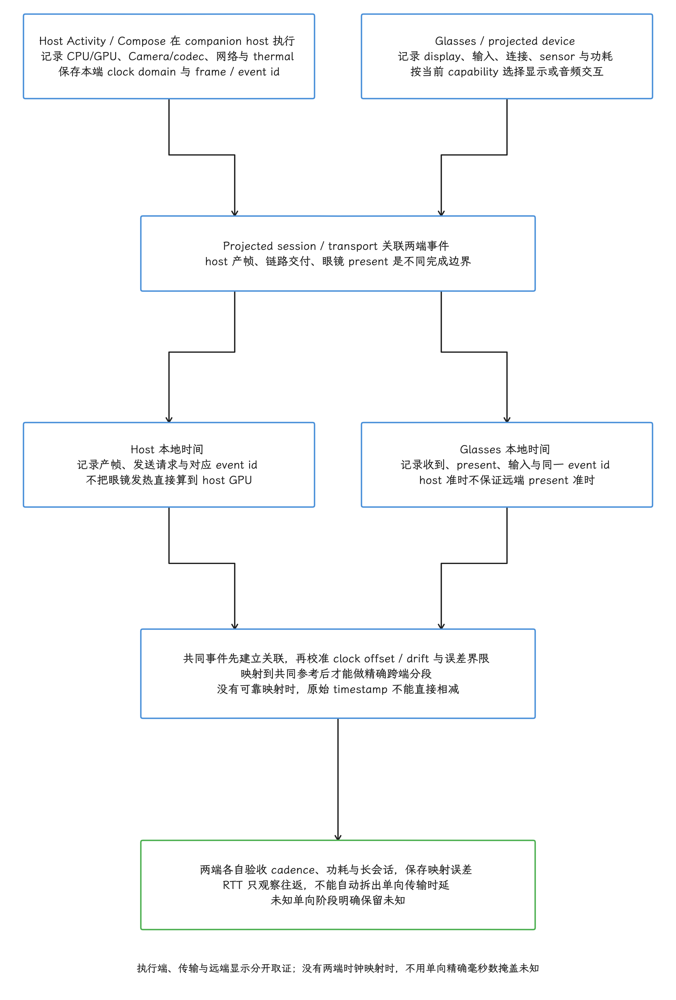

# Android 17 / Android XR 空间 UI 与环境资产渲染性能

空间 UI 的性能预算，是在传统 2D 布局与绘制之外，再加上姿态更新、双目显示、3D 资产和运行时合成。动手分析之前，我们先分清 Android XR 平台、Jetpack XR SDK 与设备运行时各自负责哪一段，然后分别给资源加载和每帧更新建立预算。

## Android XR 渲染需要区分哪些边界

Android XR 覆盖多种运行形态，我们先把它们摆清楚：手机或大屏应用可以作为 compatible panel（兼容 2D 面板）运行；XR differentiated app 则可以在此之上增加 Subspace、空间面板、3D 模型、环境和感知能力；Unity/OpenXR 应用由引擎向 XR runtime 提交 swapchain image；display glasses 上的 Projected Activity 则运行在 companion host device（负责计算与连接的手机等伴随设备）上。


这些形态都跑在 Android 进程里，共享 CPU、GPU、内存、I/O 和功耗约束，但显示终点各不相同。普通 2D 内容，我们在应用侧仍能观察 `Choreographer`、HWUI RenderThread 和 Surface buffer；再往下游，XR runtime 接手空间放置、视点与姿态、可能的 reprojection（依据更新后的姿态修正已渲染图像），最后向 XR 显示设备提交。Unity/OpenXR 走的是 runtime 管理的 frame loop 和 swapchain，与普通 View 的 `doFrame → DrawFrame → queueBuffer` 分属两套机制，直接套用会看错对象。

动手分析时，我们先回答三个问题：


1. 当前内容属于 compatible 2D panel、Jetpack XR 空间内容、Unity/OpenXR，或 Projected/Glimmer；
2. 帧时间、资源加载和显示延迟分别在哪里观测；
3. 哪些数字是 Android XR 质量目标，哪些只是资产制作建议或工具观测值。

### 当前版本与源码边界

> 源码基线：AOSP `android-17.0.0_r1`，Android 17 / API 37；内核研究样本 `android17-6.18-2026-06_r6`，XR 设备可能使用其他内核分支。

Jetpack XR 独立于平台 tag 发布，下表按 2026-10-24 核对，每个组件的 stable、beta、alpha 要分别看待；本文未做目标设备性能实测。

| 组件 | 本文采用的公开版本 | 稳定性边界 |
| --- | --- | --- |
| Jetpack Compose for XR | `1.0.0-beta02` | beta；部分模型 API 仍 experimental；见下文 SceneCore 依赖修正 |
| Jetpack SceneCore | `1.0.0` stable | 另有 `1.1.0-alpha01`；不要混用新动画 API |
| ARCore for Jetpack XR | `1.0.0` stable | 另有 `1.1.0-alpha01`；姿态与 tracking 契约按采用版本核对 |
| Jetpack XR Runtime | `1.0.0` stable | 另有 `1.1.0-alpha02`；`Session.create` 是 suspend function |
| Jetpack XR Projected | `1.0.0-alpha14` | audio/display glasses 投射 API 仍是 alpha |
| Jetpack Compose Glimmer | `1.0.0-alpha22` | 透明 display glasses UI 仍是 alpha |
| SDK 文档入口 | 仍显示 Developer Preview 4 提示 | 这是文档入口状态；不否定上述库已分别发布 stable 或 beta |


Compose for XR beta02 的 release notes 要求 Kotlin 2.2，实际 POM 使用 Kotlin stdlib 2.2.20，并依赖 Runtime / SceneCore `1.0.0-rc01`。官方同时指出这个 SceneCore rc01 有已知内存泄漏，可以显式覆盖到已修复的 SceneCore `1.0.0`。这项依赖修正要放在资源常驻量测试之前，免得把已知库问题算进业务资产预算。

<!-- gracker-diagram: ch13-13-04-known-dependency -->


图：beta02 的 SceneCore rc01 依赖有官方已知泄漏说明。 按 release notes 显式采用 SceneCore 1.0.0，再测业务资源常驻量。

构建条件同样按实际 artifact 核对：alpha14 release notes 中的 compileSdk 37 / AGP 9.2.0 是历史变更记录；本次解包 beta02 AAR，其 metadata 声明 `minCompileSdk=36`、`minAndroidGradlePluginVersion=8.9.1`，manifest 为 `minSdk=24`。这组数字是该 AAR 声明的最低条件，说明的是编译与安装下限：生产时用的 compileSdk、其余传递依赖的要求，都还要另行核对。安装范围、编译要求、设备 XR runtime 与 capability 是各自独立的条件；从 minSdk 24 推不出“普通手机可运行所有空间功能”这样的结论。


公开 AOSP tag 可以验证 Android 的 HWUI、Surface、BufferQueue、fence 和调度公共层；未公开的 XR compositor 内部调用链没有可核对的源码，我们对 XR runtime 的描述，也就只覆盖 Jetpack、Unity/OpenXR 与质量文档公开的协议和责任划分。


## Android XR 在渲染体系中的位置

当前质量指南把 immersive（XR headset / wired XR glasses）与 augmented（audio/display glasses）分成两条线。immersive 分三档：compatible mobile、compatible adaptive 和 differentiated；原来的 large screen 档，现在应改称 compatible adaptive。质量档描述适配程度，渲染管线是另一件事，所以工程分析里我们还要单列 Unity/OpenXR 与 Projected/Glimmer。


| 应用形态 | 内容如何进入 XR | 优先观察点 |
| --- | --- | --- |
| compatible mobile app | 现有 Activity 作为 2D 面板运行 | App 主线程、HWUI、SurfaceFrame、输入、启动与 resize |
| compatible adaptive app | 自适应 Activity 作为可调整面板运行；对应适用的 adaptive Tier 2 / Tier 1 | 2D 路径，加窗口尺寸、外设输入、多任务和状态恢复 |
| Jetpack XR differentiated app | Subspace、SpatialPanel、SceneCore entity、环境等进入 XR scene | 2D 面板 Buffer、Subspace layout、模型/纹理、scene attach、XR runtime |
| Unity / OpenXR | 引擎渲染 runtime swapchain image，经 `xrEndFrame` 等边界交给 runtime | simulation、render thread、GPU、swapchain wait/release、spacewarp/late latching |
| Projected / Compose Glimmer | Activity 在 host phone 运行，体验投射到 audio/display glasses | host CPU/GPU、projected display 状态、连接、眼镜输入与远端 present |

compatible panel 仍沿用 2D 应用生产路径，不会自动变成 3D 引擎应用；更要紧的是，应用 buffer 生成完成，离 XR 显示完成还有一段。Android App FrameTimeline 可以定位应用侧 SurfaceFrame；XR runtime 的姿态更新、空间合成、reprojection 与光学显示，要靠 runtime、引擎或设备侧的专用记录来说明。用 FrameTimeline 之前先验证它覆盖了目标 Surface，独立 Surface 和外部媒体尤其如此：缺 App slice，说明不了该内容没有在生产帧。

下面的概念图只画责任交接；具体进程、线程或 compositor 名称，公开 API 未作固定承诺：

```text
2D compatible / SpatialPanel
App UI → HWUI/Surface Buffer → XR scene/runtime → XR compositor/display

Jetpack XR 3D
App state → Subspace/SceneCore entity → model/material resources
          → XR scene/runtime → XR compositor/display

Unity/OpenXR
Simulation → RenderThread/GPU → OpenXR swapchain image
           → xrEndFrame → XR runtime/reprojection → display

Projected glasses
Host Activity/Compose → projected session/transport → glasses display/input
```


这四条路径可能共享 GPU 和显示资源，也可能由不同 runtime 实现。做 trace 分析时，我们从本帧的 producer、提交目标 surface/swapchain、姿态责任方和最终 present 责任方入手，顺着对象找最长的 slice；只按框架名去找，容易找错段。

对 compatible panel 与 `SpatialPanel`，可以复用普通 Android 窗口的证据链，一路追到 `Choreographer`、HWUI、dequeue/queue、应用 Surface buffer 和 transaction。追到 XR scene/runtime 接收这一段，标准手机链路就到此为止：公开文档没有给出固定的 XR compositor 进程、latch slice 或最终 present fence 名称。


`SpatialExternalSurface`、SceneCore `SurfaceEntity`、视频和 Camera 内容，按独立 producer/Surface 分别记录。它们可能与 2D panel 共享 GPU、带宽和 runtime 合成预算，但 panel 的 FrameTimeline 盖不住独立 Surface 的完整生产节奏；该 Surface 是否对应可见的 SurfaceFlinger Layer，也要通过设备 trace 或 Layer 树确认，单凭 API 类名推不出来。

<!-- gracker-diagram: ed13-13-producers-and-xr-evidence -->


图：compatible/SpatialPanel由UI/HWUI生产Surfacebuffer，按覆盖记录Choreographer/RenderThread/queue/fence；external Surface由codec/Camera等生产，独立追媒体/相机buffer与fence，API类名不保证对应SF Layer。SceneCore model为资源/entity/layout/animation，不套doFrame。三者可共享GPU/带宽/runtime预算，进入XR scene后的pose、合成、reprojection、显示需runtime/设备证据；公开API不固定compositor进程/线程/latch/fence名，AppSurfaceFrame不等最终光学显示。

## Jetpack XR SDK 的 UI 栈边界

Jetpack XR SDK 由一组覆盖 UI、scene、感知和 projected device 的库组成，各部分的生产路径不同，我们按内容类型分别看观察点：

| 内容类型 | 主要 API / 库 | 性能观察点 |
| --- | --- | --- |
| 2D View / Compose | 普通 Activity 内容、View interoperability、`SpatialPanel` | UI thread、recomposition/layout、HWUI、面板 Buffer cadence |
| Subspace layout / 附属 UI | `Subspace`、`SpatialRow`、`SpatialColumn`；`Orbiter` 提供附属 2D UI | 空间布局的 measure/layout、实体更新；Orbiter 内容的 2D 生产成本另计 |
| 3D 模型 | `SpatialGltfModel`、`GltfModel.create()`、`GltfModelEntity` / `SceneCoreEntity` | I/O、解析、纹理转码/上传、首次可见、动画与材质成本 |
| 外部媒体 Surface | `SpatialExternalSurface`、SceneCore `SurfaceEntity` | codec/Camera Producer、surface size、stereo shape、Buffer/fence |
| 空间环境 | `SpatialEnvironment`、glTF geometry、skybox、IBL ZIP | 环境切换、资产常驻、纹理带宽、Full Space；IBL 是 Image-Based Lighting（基于图像的光照） |
| 感知 | ARCore for Jetpack XR、`ArDevice`、`RenderViewpoint`、anchors/planes/depth | tracking state、数据新鲜度、感知 CPU、业务更新频率 |
| Display glasses | Compose Glimmer、Jetpack Projected | host Activity、projected display capability、输入与连接 |

`Subspace` 是 Compose for XR 中容纳空间布局的区域，只在 spatialization enabled 时渲染；在 Home Space 或非 XR 设备上，其中代码会被忽略，所以应用要准备适用的 2D 内容。`SpatialPanel` 把 2D 内容放进空间布局，`SceneCoreEntity` 把 SceneCore 实体接入 Compose for XR，`SpatialExternalSurface` 则承载媒体或其他 Surface producer。这三件东西的 producer、布局和消费路径各走各的，统计时分开算，“空间组件”这个标签盖不住差别。

<!-- gracker-diagram: ch13-13-11-spatialization-gate -->


图：先确认 spatialization，再分别核算面板、实体和外部 Surface。 Home Space / 非 XR 会忽略 Subspace 代码，适用的 2D 内容要先备好。

Compose beta02 里 `SpatialGltfModel` / `SpatialGltfModelState` 仍标记 `ExperimentalSpatialGltfModelApi`，源码暂未重新加入模型动画 API，旧 alpha 的动画示例就此作废。动画要走 SceneCore 这条线：stable 1.0.0 的 `getAnimations()` 仍需 `ExperimentalGltfAnimationApi` opt-in，到 1.1.0-alpha01 相关动画 API 才转正，并新增 `stopAllAnimations()`。stable 1.0.0 的公开 `GltfModelEntity.create()` 仍默认 `parent = null`。


scene graph（用父子关系组织空间实体的场景树）里，只有挂入可见根节点的实体才会参与对应场景；要显示模型，就在创建时传入 `session.scene.activitySpace` 等 parent，或随后设置 `entity.parent`。entity 创建成功，说明的是对象存在，资源是否已挂入可见 scene graph 还要另看。我们同时核对 entity 及祖先 enabled、空间 capability、视野和实际可见结果；挂到根只是必要条件之一。


资源生命周期按所有者处理：`rememberSpatialGltfModelState()` 由 Compose 的 remember 生命周期持有并调用 `close()`；手工构造 state 的调用方按契约自己负责关闭。⚠️ beta02 源码里的 state `close()` 还是 reserved-for-future 的空实现，图上先别把它画成确定的 GPU 资源释放点。SceneCore `GltfModel` / `ImageBasedLightingAsset` 则各自提供主线程 `close()` 并有 GC 清理后备，宜明确唯一所有者，在全部使用结束后关闭，避免重复关闭与关闭后继续使用。

`entity.parent = null` 只是把实体移出场景树，清理强引用和关闭资产是另一层工作；stable 1.0.0 的 `Entity.dispose()` 为 library-group 限制且已废弃，业务代码别照旧示例调用。这些操作的返回只代表调用完成；GPU 常驻内存是否随之归零，单凭 CPU 事件看不出来。

<!-- gracker-diagram: ch13-13-14-asset-owner -->


图：remember state、手工 state 与 SceneCore 资产按各自契约管理。 beta02 的 state close 是空实现；显存是否即时归零，CPU 清理调用说了不算。

业务代码要锁定具体依赖版本；写诊断记录时，我们把 `xr.compose`、`xr.runtime`、`xr.scenecore`、`xr.arcore`、`xr.projected` 与 `xr.glimmer` 的完整版本一并写明。

## 空间环境资产的成本构成

`SpatialEnvironment` 管理应用的空间环境偏好。按 SceneCore stable 1.0.0 的模型，`SpatialEnvironmentPreference` 接收一个 `ImageBasedLightingAsset` 和一个 glTF geometry，每份偏好最多提供一份 lighting asset 和一份 geometry。用户直接看到的 skybox texture（包围场景的远景纹理）放在 geometry 资产中，独立 IBL ZIP 用于 lighting、reflection 与 specular（镜面反射高光）计算。


环境只在 Full Space 可见。设置 preference 表达的是期望，是否立即生效还取决于 `SPATIAL_CAPABILITY_APP_ENVIRONMENT` 和当前 active 状态。preference 本身为 `null` 表示系统环境；非 null preference 的 `geometry = null` 是黑色空环境，`imageBasedLightingAsset = null` 表示没有相应 IBL。

passthrough 是相机画面构成的现实世界视图，开到 full opacity 时会完全遮住 geometry，所以它的控制还要单独核对 passthrough capability。

<!-- gracker-diagram: ch13-13-16-environment-apply -->


图：配置偏好离实际显示还有几步，空间能力、active 与 passthrough 都要核对。 null preference 与空 geometry 是两种含义；passthrough 能力另查。

从 Jetpack XR alpha04 起，官方建议把可见环境与 IBL 数据拆开：

| 资产 | 用途 | 官方建议的边界 |
| --- | --- | --- |
| `.glb` / `.gltf` | 环境 geometry 与用户看到的 skybox texture | geometry 文件建议控制在 80 MB 或更小；近处 mesh 更密、远处更稀；每个 geometry patch 不超过 10,000 vertices |
| IBL ZIP | lighting、reflection、specular 计算 | 由 HDR EXR 经 `cmgen` 预处理；输入要求 2:1 且尺寸为 2 的幂，示例 1024 × 512 |
| black PNG | IBL 生成流程中的优化纹理 | 要求 2:1；100 × 50 是示例，用户不会直接看到 |


80 MB 与 10,000 vertices 是内容制作建议，runtime parser 并没有设这道拒绝线。超出建议值，解析、内存、GPU 和功耗成本都可能上升；某帧会不会卡顿，文件大小说了不算，要看实际帧数据。

拆分可见 skybox 与 lighting map 后，两者可以独立选择分辨率，避免为了光照计算读取过大的可见纹理，从而降低纹理带宽和功耗。自定义环境含 3D 对象时，缺少匹配 IBL 可能导致过亮、过暗，或反射方向与环境不一致。

<!-- gracker-diagram: ed13-13-visible-environment-and-ibl-build -->


图：SceneCore stable1.0一份environmentPreference最多一份geometry和一份lightingasset；用户看到的skybox在geometry，独立IBLZIP用于lighting/reflection/specular。可见纹理与lighting分辨率可独立选择；HDR EXR经cmgen预处理成IBLZIP，blackPNG参与优化预处理用户不可见；示例cmgen未执行，旧指南EXR说法不能替代现行loader契约。preference只表达期望，FullSpace/APP_ENVIRONMENT/active与passthrough另核，缺IBL可使自定义对象光照不匹配。

⚠️ 这里文档表述有出入：添加环境指南仍保留 EXR 作 skybox 的旧说法，当前环境优化指南与 `SpatialEnvironmentPreference.geometry` API 则明确把用户可见 skybox 放进 geometry、把预处理 IBL ZIP 用于光照。我们按后两者及 stable 1.0.0 源码来区分，免得加载一个 EXR 就以为可见环境与 IBL 一次到位。

官方把环境 view distance 写为距用户 200 m，并建议把用户放在约 1.5 m 高的位置。这两个数的身份要摆正：200 m 是环境制作与渲染的可见距离指导，感知传感器量程是另一回事；1.5 m 用来减少较大 UI 与地面穿插，同样只是建议，平台 API 并没有设这样的上限。


## 3D 模型与纹理资源的加载预算

Jetpack XR 的内容规范支持 glTF 2.0，作者工具常输出 `.gltf` 或 `.glb`；SceneCore stable 1.0.0 的 `GltfModel.create()` API 文档同时注明，当前 loader 只支持 binary glTF（`.glb`）。Compose for XR 这边用 `SpatialGltfModel`；SceneCore 路径先通过 `GltfModel.create()` 加载，再用 `GltfModelEntity.create(..., parent = session.scene.activitySpace)` 或后续设置 parent 接入 scene graph。注意 `GltfModel.create()` 是 `@MainThread` suspend API，挂起归挂起，调用仍要落在主线程；路径与 URI 重载还要遵守对应的 assets / URI 契约。


3D 内容是否可用，以当前 `SpatialCapability.SPATIAL_3D_CONTENT` 为准，并随空间模式变化处理；对象加载成功只说明资源就位，显示条件还要另行确认。Full Space 是相关空间能力的常见使用场景，设备与 session 的实际 capability 仍要核对。


我们可以按四类成本给加载预算建立观测点；这些阶段可能重叠，也可能由 runtime 内部完成，公开 API 并没有承诺四个严格串行的区间：

| 阶段 | 常见成本 | 排查入口 |
| --- | --- | --- |
| 文件读取与交付 | APK/asset/URI、压缩、Play Asset Delivery、冷缓存 | I/O trace、下载/解包时间、资源命中 |
| 解析与对象创建 | glTF chunk、node、mesh、material、animation、对象分配 | CPU、allocation、GC、加载 coroutine |
| 纹理转码与 GPU 上传 | KTX2/Basis 压缩纹理、mipmap（按距离选用的多级纹理）、纹理尺寸、材质与 sampler | GPU memory/counter、upload、带宽、首次 shader |
| scene attach 与首帧 | Entity 创建、Subspace measure/layout、Full Space capability | 首次可见时间、layout、runtime submit |


压缩后的 `.glb` 或 KTX2 文件大小，与 GPU resident size（解压、转码后实际常驻 GPU 内存的大小）是两个数：运行时转码格式、mip chain、每眼目标、材质数量和 runtime 缓存都会改变内存占用。官方建议环境 glb 使用 mipmaps 与 KTX2，主要收益在纹理采样、远近层级、内存带宽和包体；最终格式与常驻量仍要在目标 GPU 上确认。


大模型宜异步预取；启动初期一次性加载全部资源，等于把启动、峰值内存与热压力都压到最前面。工程上我们按可见优先级排加载顺序：

1. 首个可交互面板与必要模型；
2. 用户视野内近期会出现的纹理和动画；
3. 远处环境或低概率内容；
4. 离开场景后可以释放或降级的缓存。

<!-- gracker-diagram: ed13-13-loading-priority-and-residency -->


图：可见优先级先交互面板必要模型、再近期纹理动画、远处低概率内容分批异步预取，离场按所有者释放/降级cache。四类成本I/O、解析对象、纹理转码上传、attach首次可见是观测分类，可重叠或由runtime内部完成，不是四个串行区间。压缩GLB/KTX2文件大小不等CPU工作集或GPU resident，实际GPU转码格式、mips、双眼targets、材质与cache改变常驻；同时测启动、峰值内存、首次可见和热，不从包体换算显存。

资源加载、scene attach 与首帧 present 要分别打点。`GltfModel.create()` 返回，只说明这个加载 API 本身完成了；GPU upload 是否都在返回之后、首次 shader 是否就绪、本帧是否已被 runtime 采用，都要另行确认。我们结合 CPU/GPU 和首次可见的证据，去查实际的重叠加载、延后工作和缓存。解除 parent 只改变挂载关系；资产关闭按上一节的所有者、线程和版本契约执行。

<!-- gracker-diagram: ed13-13-glb-load-attach-and-visibility -->


图：固定SceneCore stable1.0 GltfModel.create只支持binaryGLB，@MainThread suspend仍在主线程调用并遵守path/URI契约。create返回只说明加载API完成，不能预设GPUupload全在返回后或shader全部ready。GltfModelEntity.create默认parentnull，须设activitySpace等可见parent；挂入还需entity与祖先enabled、SPATIAL_3D_CONTENT等当前capability及视野/runtime采用。capability随空间模式变，非一次检查即永久有效；detach/close依版本所有者另管，CPU返回不证明GPU内存归零。

## 视点、姿态与显示配置对帧时间的影响

XR 需要同时观察四条时间线：

| 时间线 | 要回答的问题 |
| --- | --- |
| simulation / UI | 本帧状态、输入和动画是否及时更新 |
| App GPU | 当前 eye buffer 或 panel buffer 是否在 deadline 前完成 |
| XR runtime | pose 更新、spacewarp/reprojection、空间合成是否采用了 App 本帧 |
| display | runtime 提交后何时扫描与显示；光学响应是否另有延迟 |


应用完成一帧，用户看到的未必就是与该姿态对应的画面：reprojection 可以按更新姿态修正已有图像；Application Spacewarp 进一步用 motion vector 与 depth 合成中间帧，两者的输入要求是两套契约，要分开对待。正因如此，显示可以继续刷新，App 无须为每个 display refresh 生产全新 render frame。引擎 FPS、App FrameTimeline、runtime synthesized cadence 与 display refresh rate，我们分开记录。

<!-- gracker-diagram: ch13-13-27-cadence -->


图：重投影可复用已有图像，Spacewarp 另用 motion vector / depth。 轨道只示意一种交替合成情况；刷新率、占空比或通用 reprojection 输入都不在其规定之内。

ARCore 1.0.0 的 `ArDevice` state 提供 `devicePose` 与 `trackingState`；`RenderViewpoint.left(session)` / `right(session)` 仅适用于 STEREO，`mono(session)` 在 MONO 时是单视图、在 STEREO 时位于双眼显示中心。其 state 的 `pose` 是 perception space 中的视点位姿，`localPose` 是相对设备中心 tracking point 的局部偏移，`fieldOfView` 以弧度表示。

tracking mode 为 DISABLED 时，设备 pose 不再跟随运动，可能保留原点或切换前的最后状态；这时仍能读到数值，但数值本身说明不了追踪仍在更新。


这些数据为渲染提供输入，但 runtime 何时 latch（锁定并采用）这份 pose、最终 motion-to-photon（头部运动到对应光子进入眼睛）延迟是多少，它们都给不出答案。读取频率、坐标空间和使用该 pose 的 render frame，要在应用侧保持一致；没有公开时间戳，跨层 pose age 的精确值就无从谈起。

<!-- gracker-diagram: ed13-13-viewpoint-transform-and-pose-age -->


图：ARCore stable1.0 ArDevice.devicePose为perception-space设备位姿，RenderViewpoint.localPose为设备中心trackingpoint到视点偏移，变换组合得到viewpoint.pose，不能逐分量相加。left/right仅STEREO，mono在MONO单视图或STEREO双眼中心，FOV为弧度。DISABLEDtracking数值可冻结原点/旧状态，存在数值非仍更新。应用读取、render实际使用、runtime后段latch与光学输出分别取证；精确poseage/MTP需公开时间戳和有误差界限的clock映射，不由平均FPS或read数值推断。

Unity Android XR Extensions 提供三类不同优化：

| 能力 | 作用 | 不能省略的验证 |
| --- | --- | --- |
| Application Spacewarp | 使用 motion vector（像素运动方向与幅度）和 depth 合成交替帧，降低 App GPU 渲染频率 | motion vector/depth 正确性、合成伪影、App 与 display cadence |
| Vulkan subsampling | 借助 Fragment Density Map（区域采样密度图）让不同区域以不同密度渲染/采样 | 目标设备支持、画质、GPU/带宽收益 |
| late latching | 在帧生成后段更新 head pose，减少渲染使用的姿态与显示时姿态之间的时间差；官方描述收益可接近一个 frame time | 标记节点正确、runtime 支持、MTP 或可替代指标 |


这些能力属于 Unity/OpenXR 引擎路径，普通 Compose panel 里没有对应开关。各项优化可能作用于同一段时序，或改变彼此的前提，理论收益要按实际配置评估，简单相加得不出固定延迟数值。

## Android XR 质量分级的性能检查项

下表只摘取当前 immersive 指南的 differentiated 性能项，适用于 XR headset / wired XR glasses 的相应体验。audio/display glasses 要另查 augmented 指南，头显的刷新率与渲染分辨率要求对它们并不适用。

| 检查项 | compatible mobile / adaptive | immersive XR-differentiated |
| --- | --- | --- |
| 布局 | 核心任务可完成；adaptive app 遵守适用的 Tier 2 / Tier 1 指南 | Subspace、面板、环境和 3D 内容适配 Full/Home Space |
| 输入 | Android 常规输入与必要的外设路径 | natural hand input、raycast/gesture 等适用能力 |
| 渲染 | 2D App 自身 deadline、resize 和输入响应 | 每帧 `<11.1 ms @ 90 Hz`、`<13.8 ms @ 72 Hz` |
| 分辨率 | 由兼容面板与设备策略决定 | OpenXR / 引擎查询 `XR_ANDROID_recommended_resolution` 获取理想渲染目标 |
| 启动 | 记录 cold/warm 与 first interaction | mean cold `<2 s`、mean warm `<1 s` |
| 稳定性 | crash、ANR、恢复 | 长会话、tracking/runtime 异常、内存与 thermal |


11.1 ms 与 13.8 ms 是指南给出的 App 帧目标。这个目标既非主线程独占额度，也不是 CPU 与 GPU 时长的简单求和：流水线可能重叠，等待和提交要沿真实关键路径分析。表述上我们沿用指南的 13.8 ms，严格的 `1000/72` 算术约为 13.89 ms。运行时合成、实际显示和空间感知，还要各自的依据。


分辨率以当前设备与 runtime 的推荐值为准，不再写死“每眼至少 1856 × 2160”。每眼目标也换算不出两次完整 render pass：multiview（一次提交处理双眼视图）、foveation（中心区域高质量、外围降低质量）、subsampling 与 spacewarp 都会改变实际着色和提交工作。实际 pass、纹理与像素成本，用目标设备支持的 AGI、引擎 frame debugger 或 GPU counter 来验证。

<!-- gracker-diagram: ch13-13-33-resolution-work -->


图：获取 runtime 推荐目标后，还需核对实际渲染配置与 GPU 工作。 双眼目标并不自动折算成两次完整 pass；实际支持和画质需设备测量。

## 工具与验证入口

从 App 到光学显示的完整路径，没有哪个单个工具能全程覆盖。每次复盘，我们都写清楚两件事：这个工具能看到哪些阶段，哪些阶段它证明不了。

| 工具 | 适合确认的问题 | 不适合直接判断的事项 |
| --- | --- | --- |
| Android Studio + XR Emulator | capability、布局、Home/Full Space、输入与功能验证 | 真实 GPU、传感器、thermal、光学与 MTP |
| Perfetto / FrameTimeline | Android 线程、调度、I/O、HWUI panel、部分 GPU/SF 证据 | 未公开的 XR compositor 全时序与 panel 光学响应 |
| AGI / GPU counter | 支持设备的 render pass、shader、纹理、带宽与 GPU 时间 | 无目标驱动支持时无法观测；GPU 时间也不等于 MTP |
| Unity Profiler / Frame Debugger | simulation、render thread、URP、资源、spacewarp 输入 | Android 调度、系统 I/O、host thermal 的完整原因 |
| OpenXR/厂商 runtime 工具 | swapchain、runtime timing、reprojection、pose | 普通 View/Compose 内部重组与业务调用栈 |
| Winscope / SurfaceFlinger dump | Android Window/Layer、resize、可见性、panel Buffer | SceneCore entity graph 与 XR runtime 最终合成 |


### 推荐的单帧检查顺序

1. 记录设备形态、系统版本、显示 refresh rate、Home/Full Space、passthrough；
2. 记录 Jetpack XR 或 Unity/OpenXR 的准确 package 版本与开关；
3. 识别目标内容属于 Android panel、external surface、SceneCore entity 或 OpenXR swapchain；
4. 把 App CPU、render thread、GPU submit 与 Buffer/swapchain 边界一一对上；
5. 查 runtime 是否采用当前帧，是否使用 spacewarp/reprojection；
6. 查 display cadence、thermal、CPU/GPU frequency 和长会话趋势；
7. 分别记录 App render miss、runtime miss、tracking stale（姿态或感知数据过旧）和显示延迟。


公开文档没有承诺统一的 Android XR Perfetto slice 名。trace 里按 `XR` 关键字搜不到事件，说明不了 runtime 没在工作；我们从目标线程、surface/swapchain、GPU 和设备工具逐层把证据建起来。

<!-- gracker-diagram: ch13-13-36-trace-missing -->


图：先核对目标对象、采集支持与权限，再解释缺失事件。 XR slice 缺席说明不了 runtime 没在工作；未知阶段就明确标成未知。

每份报告至少保留设备类型、系统 build、Jetpack XR/Unity package、refresh mode、空间模式、passthrough、模型/环境版本、纹理上限、采集工具版本与复现动作。

## XR 与游戏 / Vulkan 渲染路径的交叉

Unity for Android XR 建立在 OpenXR 之上，Android XR Extensions 又提供 spacewarp、Vulkan subsampling 和 late latching 等能力。走引擎路径时，13.5、13.6、13.12 讲过的公共问题照样要检查：simulation 是否按时，GPU queue 是否积压，swapchain image 是否及时 acquire/release，fence 是否延后，frame pacing 是否匹配 runtime 节奏。

常见的单线程示例可以写成 `xrWaitFrame → xrBeginFrame → acquire / wait swapchain image → 提交渲染 → release image → xrEndFrame`；多线程流水线同样常见，引擎各有各的 CPU 调度。`xrWaitFrame` 返回 predicted display time / period 与 `shouldRender`，可由独立线程调用，但调用必须外部同步；同一应用帧的各阶段，要传递一致的目标 display time。

写 image 的命令，要等成功 wait 到 image 可用后才能提交，release 同样要求先成功 wait。GPU 同步还要遵守所用 graphics binding 的规则；release 或 `xrEndFrame` 的 CPU 返回，离最终光学显示完成还有距离。


当 `shouldRender=false` 时，我们省掉不必要的重 GPU 工作，可略去相应 layers；session 仍在 running 时应继续帧循环，包含必要的 begin/end，并可提交空 layers。runtime 的 predicted display period 只是预测值，未必等于硬件刷新周期。OpenXR swapchain 是 runtime 协议对象，与 Android BufferQueue 分属两套体系；两者出现 acquire / wait / release 等同名动作时，必须按各自对象和同步契约解释。


XR 还带来姿态新鲜度和用户舒适度上的约束。Unity Profiler 的平均 FPS 只覆盖引擎吞吐的一部分，完整判断还要结合 slow frame 分布、spacewarp 状态、runtime cadence、tracking 与 Android 系统调度。

<!-- gracker-diagram: ed13-13-openxr-running-and-frame-loop -->


图：示例OpenXR frame loop在running时waitframe取得predictedtime/period/shouldRender，beginframe后按shouldRender决定重渲染。true路径acquire并成功wait后才能提交写image，release前也须成功wait并遵守graphicsbindingGPU同步，再endframe提交layers；false可避重GPU并提交空layers，但running仍继续必要begin/end。xrWaitFrame可独立线程但外部同步，多线程同帧目标displaytime一致；predicted period非硬件刷新保证。OpenXR image协议非AndroidBQslot，release/endCPU返回不代表GPU或光学完成。

## 眼镜形态下 host device 的功耗边界

设备类型需要分开记录：

- XR headset / wired XR glasses：Compose for XR、SceneCore、Unity/OpenXR 文档覆盖的空间/沉浸路径；
- audio/display glasses：Jetpack Projected 让应用运行在 companion host（如 Android phone），Compose Glimmer 为透明 display glasses 提供 UI；
- audio glasses 没有可视 display 时，应用应按 capability 降级为音频或其他交互。

Projected 场景要同时记录 host 与 glasses 两端：

| host device | glasses / projected device |
| --- | --- |
| Activity 生命周期、Compose、CPU/GPU、相机/编解码、网络、thermal | display on/off、输入、camera/sensor、连接、显示 cadence、设备功耗 |


host 上按时生成帧，只说明第一段顺利；传输和 glasses present 是否也按时，要另拿记录确认，眼镜发热同样不宜直接记到 host GPU 头上。两端时钟没有同步时，我们改用可关联的 event id 与往返测量，避免直接拿不同设备的原始 timestamp 相减。

往返测量没法自动拆出单向传输时延；要做跨端精确分段，还得先建立有误差界限的时钟映射。augmented 场景另需检查后台功耗、相机帧率与分辨率，并按当前 capability 选择功能。

<!-- gracker-diagram: ed13-13-projected-devices-and-clock-mapping -->


图：ProjectedActivity在companionhost运行，Glimmer提供透明displayglassesUI；host记录Activity/Compose/CPU/GPU/codec/camera/network/thermal，glasses记录连接/display/input/sensor/power/cadence，按capability选择功能，audio无display可降级。host产帧准时不证明transport和remote present准时，两端功耗分别归因。两端事件id只关联，精确跨端分段需要有误差界限clockmapping；未同步rawtimestamp不可直接相减，RTT观察不能自动拆单向时延，无法映射时用共同事件/往返而非伪造精确oneway。

## 复核清单

- [ ] 平台版本不高于 Android 17，平台源码锚点为 `android-17.0.0_r1`；
- [ ] Jetpack XR / Unity / OpenXR package 使用完整版本号；
- [ ] compatible panel、Subspace、external surface、OpenXR 与 Projected 路径已区分；
- [ ] App SurfaceFrame 没有被当作最终 XR present；
- [ ] App render rate、runtime/display refresh 与 spacewarp cadence 已区分；
- [ ] 90/72 Hz 与启动目标按 immersive differentiated 指南解释；OpenXR / 引擎查询推荐分辨率，augmented 另查；
- [ ] glb 80 MB、10,000 vertices 与 1.5 m 明确标为制作指导，200 m 标为环境 view distance；
- [ ] I/O、解析、纹理转码/上传、scene attach、首次 present 分别打点；
- [ ] entity parent、enabled 与 capability 已核对；模型/state/IBL 按所有者、线程与版本契约管理，不把 state close 当显存即时释放；
- [ ] `RenderViewpoint` 数据没有被误写成 runtime pose latch 保证；
- [ ] emulator 数据没有替代真机 GPU、thermal、tracking 或光学延迟；
- [ ] host phone 与 projected glasses 的性能和功耗分开记录。

## 小结

Android XR 把 2D panel、空间内容、姿态预测、runtime 合成和头显或眼镜显示组织成多条责任不同的路径；把它理解成“在传统 View 管线末端再多挂一个显示设备”，会漏掉大半条链路。我们分析前先确定内容形态、swapchain 或 Surface 的所有者以及最终 present 的责任方，再分别测量资源准备、应用渲染、runtime cadence、tracking 和设备端显示。这些分界摆清楚之后，资产预算、spacewarp、帧率与功耗数据才有可比性。

## 本轮配图核对依据

- [Immersive 质量指南](https://developer.android.com/docs/quality-guidelines/android-xr/immersive)、[Augmented 质量指南](https://developer.android.com/docs/quality-guidelines/android-xr/augmented)：适用形态、adaptive 档、当前渲染/启动目标与推荐分辨率。
- [Compose beta02 sources](https://dl.google.com/dl/android/maven2/androidx/xr/compose/compose/1.0.0-beta02/compose-1.0.0-beta02-sources.jar)、[POM](https://dl.google.com/dl/android/maven2/androidx/xr/compose/compose/1.0.0-beta02/compose-1.0.0-beta02.pom)、[AAR](https://dl.google.com/dl/android/maven2/androidx/xr/compose/compose/1.0.0-beta02/compose-1.0.0-beta02.aar)：记忆状态生命周期、实验 API、实际依赖与构建 metadata。
- [SceneCore stable 1.0.0 sources](https://dl.google.com/dl/android/maven2/androidx/xr/scenecore/scenecore/1.0.0/scenecore-1.0.0-sources.jar)、[ARCore stable 1.0.0 sources](https://dl.google.com/dl/android/maven2/androidx/xr/arcore/arcore/1.0.0/arcore-1.0.0-sources.jar)：公开工厂的 parent、资源 close、受限 entity dispose、位姿合成与视点约束。
- [环境偏好](https://developer.android.com/reference/kotlin/androidx/xr/scenecore/SpatialEnvironment.SpatialEnvironmentPreference)、[RenderViewpoint.State](https://developer.android.com/reference/kotlin/androidx/xr/arcore/RenderViewpoint.State)、[ArDevice.State](https://developer.android.com/reference/kotlin/androidx/xr/arcore/ArDevice.State)：null 语义、坐标空间、FOV 与追踪状态。
- [FrameTimeline](https://perfetto.dev/docs/data-sources/frametimeline)、[时钟映射](https://perfetto.dev/docs/concepts/clock-sync)：目标 Surface 覆盖与跨工具/跨端时钟边界。

## 参考资料

- [Develop with the Jetpack XR SDK](https://developer.android.com/develop/xr/jetpack-xr-sdk)
- [Android XR SDK Developer Preview 4](https://developer.android.com/blog/posts/updates-to-the-android-xr-sdk-introducing-developer-preview-4)
- [Android XR app quality guidelines](https://developer.android.com/docs/quality-guidelines/android-xr)
- [Jetpack Compose for XR release notes](https://developer.android.com/jetpack/androidx/releases/xr-compose)
- [Jetpack XR Runtime release notes](https://developer.android.com/jetpack/androidx/releases/xr-runtime)
- [Jetpack SceneCore release notes](https://developer.android.com/jetpack/androidx/releases/xr-scenecore)
- [ARCore for Jetpack XR release notes](https://developer.android.com/jetpack/androidx/releases/xr-arcore)
- [Jetpack XR Projected release notes](https://developer.android.com/jetpack/androidx/releases/xr-projected)
- [Jetpack Compose Glimmer release notes](https://developer.android.com/jetpack/androidx/releases/xr-glimmer)
- [Develop spatial UI with Compose for XR](https://developer.android.com/develop/xr/jetpack-xr-sdk/ui-compose)
- [Add a Subspace](https://developer.android.com/develop/xr/jetpack-xr-sdk/add-subspace)
- [Add 3D models](https://developer.android.com/develop/xr/jetpack-xr-sdk/add-3d-models)
- [Add spatial environments](https://developer.android.com/develop/xr/jetpack-xr-sdk/add-environments)
- [Optimize environment assets](https://developer.android.com/develop/xr/jetpack-xr-sdk/optimize-environment-assets)
- [Android XR Extensions performance settings for Unity](https://developer.android.com/develop/xr/unity/performance/androidxr-extension-settings)
- [Projected Activity for audio and display glasses](https://developer.android.com/develop/xr/jetpack-xr-sdk/glasses/first-activity)
- [OpenXR specification](https://registry.khronos.org/OpenXR/specs/1.1/html/xrspec.html)
- AOSP Android 17, [`Choreographer.java`](https://android.googlesource.com/platform/frameworks/base/+/refs/tags/android-17.0.0_r1/core/java/android/view/Choreographer.java)、[`DrawFrameTask.cpp`](https://android.googlesource.com/platform/frameworks/base/+/refs/tags/android-17.0.0_r1/libs/hwui/renderthread/DrawFrameTask.cpp)、[`BufferQueueProducer.cpp`](https://android.googlesource.com/platform/frameworks/native/+/refs/tags/android-17.0.0_r1/libs/gui/BufferQueueProducer.cpp) 与 [`Fence.cpp`](https://android.googlesource.com/platform/frameworks/native/+/refs/tags/android-17.0.0_r1/libs/ui/Fence.cpp)
- Kernel common `android17-6.18-2026-06_r6`, [`dma-fence.c`](https://android.googlesource.com/kernel/common/+/refs/tags/android17-6.18-2026-06_r6/drivers/dma-buf/dma-fence.c) 与 [`sched/core.c`](https://android.googlesource.com/kernel/common/+/refs/tags/android17-6.18-2026-06_r6/kernel/sched/core.c)
