# Android 17 Jetpack WebGPU 渲染与计算管线

Jetpack WebGPU 把 WebGPU 对象模型带到 Kotlin。`GPUInstance` 是入口，`GPUAdapter` 表示选中的后端与设备能力，`GPUDevice` 管理逻辑设备及其资源，`GPUQueue` 接收命令提交。


对象模型之外是编码对象：pipeline 保存着色器与固定状态，bind group 组织 shader 可访问的资源，command encoder 把 render/compute 命令录成 command buffer。


AndroidX 在 AAR 中打包 Dawn 原生实现，再由 Dawn 选择 Vulkan 或 OpenGL ES 后端。

三条容易混在一起的路径需要分开，我们先摆出来：


- Jetpack WebGPU 是应用依赖，版本随 APK/AAB 发布，不随 Android 系统 OTA 更新；
- WebView 网页中的 WebGPU 由 Chromium/WebView 运行时提供，不复用 Jetpack WebGPU 的 instance、device 或 native handle（原生对象引用）；
- Android 平台仍负责 `Surface`、`ANativeWindow`、BufferQueue、SurfaceFlinger、HWC（Hardware Composer，硬件显示合成器）和内核同步，也不会把普通 HWUI 内容自动转换成 WebGPU 内容。

截至 2026-10-24 再核对，最新公开版本仍是 `androidx.webgpu:webgpu:1.0.0-alpha06`（2026-10-07 发布）。alpha06 最低 API 26，增加 HardwareBuffer、sync fence、Dawn toggles 与颜色空间扩展，部分接口带 `ExperimentalWebGpuApi`；helper 改用单线程 dispatcher，并提供以 16 ms delay 轮询事件的挂起函数。这项事件循环要由调用方在创建后启动，具体用法见线程一节。

本文后续代码级链路仍锁定 `1.0.0-alpha05`、AndroidX `c48b772dd76241af6af60bee13d3cad0e4520306` 与 Dawn `9d41fdf36977cca92361c6ae2769129bbaaafd9b`，适合阅读 alpha05 行为和 Android 显示链路。若项目采用 alpha06，需要重新核对对应 AAR、source JAR 与 Dawn SHA。两版产物本文都已解包核对，但固定提交里的 WSI 分析只适用于 alpha05，alpha06 的 Dawn SHA 要当作另一份实现单独验证；目标设备上的 benchmark 本文未执行。


WebGPU 仍处于 alpha 阶段，适合技术评估、原型和能够承担 API 变更成本的产品。选型时除 Android 版本外，还要检查 adapter、feature（可选能力）、limit（数值上限）、surface capability 与目标设备实测结果。

alpha06 的 HardwareBuffer 导入仍需匹配 feature、格式与 usage。`GPUHardwareBufferWrapper.beginAccess(fences)` 把外部写完成依赖传入 native，`endAccess()` 可返回供下一消费者等待的 fence；零拷贝导入同样要处理同步。`GPUSyncFence.await(timeoutMillis)` 是阻塞调用，调用线程会停在原地等结果，主线程关键路径上要避开它。导入资源、返回 fence 的 null / 错误分支以及关闭所有权，都应按采用版本单独处理。

<!-- gracker-diagram: ch13-14-05-external-memory -->
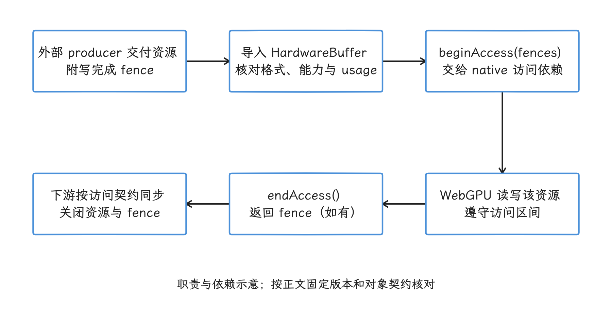

图：外部资源访问前传入完成依赖，交接时再输出下游需要的 fence。 alpha06 扩展需匹配 feature / usage；await 是阻塞调用，返回 null / 错误另查。

## 复核基线

| 层级 | 基线 | 负责内容 |
| --- | --- | --- |
| Jetpack WebGPU | 固定源码基线：`1.0.0-alpha05`（当前 release notes 已到 `1.0.0-alpha06`） | Kotlin API、JNI handle 包装、helper、随包发布的 Dawn |
| Dawn | `9d41fdf36977cca92361c6ae2769129bbaaafd9b` | WebGPU 验证、资源与命令管理、后端选择、shader 翻译 |
| Android 平台 | Android 17 / API 37 / `android-17.0.0_r1` | `Surface`、`ANativeWindow`、BufferQueue、SurfaceFlinger、HWC |
| Android 内核 | `android17-6.18-2026-06_r6` | CPU 调度、用于共享 buffer 的 dma-buf、表示同步完成状态的 dma-fence 与 sync_file；厂商 GPU/display 调度由具体驱动实现 |

alpha05 的 AAR 在 `assets/dawn_build_metadata.json` 中记录上述 Dawn SHA。下载到的 AAR SHA-256 为 `f977680085599a1cdfd4f8c5b0289d1fda905e33bcf4f5238042849bee74d1c0`，包含四个 ABI（Application Binary Interface，应用二进制接口）的 `libwebgpu_c_bundled.so`：解压后 arm64-v8a 约 5.8 MiB、armeabi-v7a 约 3.7 MiB、x86 约 6.5 MiB、x86_64 约 6.3 MiB。安装体积要按应用实际包含的 ABI、压缩方式和 App Bundle 拆分结果计算；四个解压尺寸相加得到的是 AAR 总体积，单台设备的安装增量要按实际下发内容另算。


alpha06 的 AAR SHA-256 为 `10aa7861c4c45796d58040fd2a94b55eae0ab1328daf46c01bf01701a269a02a`；其 `AndroidManifest.xml` 写明 `minSdkVersion="26"`，`assets/dawn_build_metadata.json` 写明 Dawn SHA 为 `4b959fbe989d529e1eee839c48cda465cc1195fe`。因此，API 24 结论只适用于本文的 alpha05 固定基线；换到 alpha06 当前 artifact，就按 API 26 重新核对。⚠️ 文档矛盾：本次入门页仍写最低 API 24，而 alpha06 release notes 与 manifest 均为 API 26；当前项目应按采用产物核对后再取配置。

Maven 的 alpha05 source JAR 与 AndroidX 提交 `c48b772dd76241af6af60bee13d3cad0e4520306` 中的 `Functions.kt`、`GPURequestAdapterOptions.kt`、`helper/WebGpu.kt` 逐文件一致，因此本文用该提交固定 Kotlin 层行为，不以持续变化的 `androidx-main` 分支代替发布版本。

<!-- gracker-diagram: ch13-14-06-artifact-provenance -->
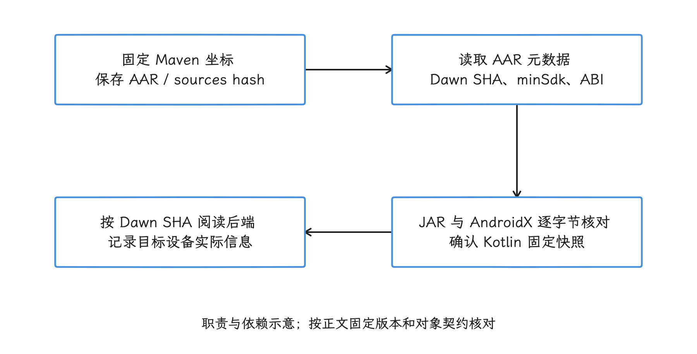

图：从 AAR 元数据和 source JAR 建立固定代码基线。 基线以发布版本为准，main 分支持续变化；源码审阅算静态核对，设备实测要另行执行。

Android 17 不要求 Jetpack WebGPU 使用 Vulkan 1.4。官方入门文档只把 Vulkan 1.1+ 列为首选后端，Compatibility feature level 还可覆盖 OpenGL ES 路径；Android 17 在本文中只是平台源码基线，不同 GPU、驱动与 Dawn 后端之间的能力差异，要靠 adapter 查询摸清。W3C 规范用于标准资源、命令、映射和 WGSL 语义；`GPUInstance`、Dawn `GPUSurface`、显式 `present()` 及 Android 扩展属于原生 binding，与网页 `GPUCanvasContext` 是两套接口，查文档时分开通用规范与原生扩展。


## 库架构与调用链

### Kotlin binding 与原生实现的边界

下面的图把渲染与纯计算的分叉位置标出来。


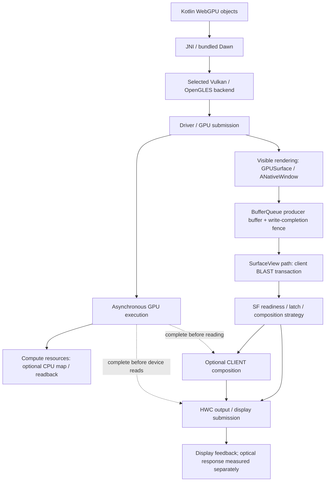

纯计算任务用不到 `Surface`，结果可以留在 GPU 资源里，CPU 需要时再读回。可见渲染则要 `GPUSurface` 接入 Android 显示路径；常见 `AndroidExternalSurface` / SurfaceView 路径由应用侧 BLAST Consumer 取得 buffer，再经事务交给 SF。图中省略了错误路径和显示快路径，画出的是依赖关系：提交 buffer 可以早于 GPU 写完，实际读取必须满足写完成 fence；它是一条依赖示意，按比例的实测时间线要另行采集。

Kotlin API 通过 JNI（Java Native Interface，JVM 与 C/C++ 代码之间的调用接口）进入原生实现。下面的声明来自 alpha05 的 `Functions.kt`，用于确认库加载后如何创建第一个 WebGPU 对象。

```kotlin
public object GPU {
    @JvmOverloads
    @FastNative
    public external fun createInstance(descriptor: GPUInstanceDescriptor? = null): GPUInstance
}
```

alpha05 源码中，创建资源、编码命令、提交队列和查询状态等 native 方法都通过 `external` 进入 JNI，绝大多数桥接方法带 `@FastNative`；`close()` 等少数引用释放入口没有该注解。`@FastNative` 减少的只是部分 JNI 桥接开销，Dawn 的参数验证、对象包装、shader/pipeline 创建和驱动调用仍然都在，整条调用链的成本与直接调用 NDK API 是两回事。

Kotlin 层还提供以下对象包装与适配逻辑：


- descriptor（创建或配置对象时传入的参数集合）、状态对象和 `IntDef` 类型；
- 实现 `AutoCloseable` 的 handle 包装，其中 handle 是 Kotlin 对象持有的原生对象引用；
- 把 callback 结果恢复到 Kotlin `suspend` 调用的适配层；
- 把 Android `Surface` 转成 `ANativeWindow` 原生指针的 helper；
- 负责初始化的 `createWebGpu()` helper，以及它启动的事件轮询任务。

库内 KDoc 明确提示部分文档由工具生成，可能存在错误。KDoc、入门示例和接口行为对不上时，我们以 alpha05 的公开 API、对应 Dawn SHA 和运行结果交叉确认，注释只作参考。

### 版本由应用控制

`System.loadLibrary("webgpu_c_bundled")` 加载的是应用包内的原生库。升级 `androidx.webgpu` 会同时改变 Kotlin API 和随 AAR 打包的 Dawn 二进制；系统 OTA 不会单独替换这份 `.so`。排查线上问题时至少记录：

- Android 版本和 build fingerprint（用于标识具体系统镜像的构建指纹）；
- `androidx.webgpu` 版本；
- AAR 内的 Dawn SHA；
- `GPUAdapterInfo.backendType`、vendor/device 信息；
- adapter features、limits 和 surface capabilities；
- 应用是否请求了 Core/Compatibility 或指定 backend。

使用 `createWebGpu()` helper 时，它会先加载原生库。若直接从 `GPU.createInstance()` 组织初始化，调用方要在首次调用 WebGPU API 前执行 `initLibrary()`，或自行调用等价的 `System.loadLibrary("webgpu_c_bundled")`。


直接初始化时，还要处理异步事件的推进。`instance.processEvents()` 显式驱动 Dawn 回调的事件泵；alpha05 helper 先完成 adapter 和 device 创建，之后才启动事件轮询。源码注释说明它服务于后续异步方法，所以这项轮询管不到前面的 `requestAdapter()` 和 `requestDevice()`。


不走 helper 时，应结合实际调用的异步 API、callback mode 和所绑定的 Dawn 版本安排事件泵；Kotlin `suspend` 只把 callback 包装成挂起调用，本身不会创建常驻事件循环。 `awaitGPURequest` 只在 continuation 仍 active 时转交结果；取消 Kotlin 协程后，底层原生请求可能仍在执行，其结果资源也未必回收，取消后的生命周期要由应用接手管理。

只记录“Android 17 + 某 SoC”还复现不了问题：同一平台版本上的厂商驱动、系统镜像和应用内 Dawn 都可能不同，上面的几项要一起记。

## Feature level、backend、feature、limit 是四个维度

### 能力档与后端是两组维度

`GPURequestAdapterOptions` 有两个容易混用的字段：


- `featureLevel`：请求 WebGPU 能力档，默认 `FeatureLevel.Core`；
- `backendType`：请求 Dawn 原生后端，默认 `BackendType.Undefined`，由实现选择。

Core 和 Compatibility 描述 WebGPU 的能力级别：Core 面向现代能力基线，Compatibility 允许实现覆盖 OpenGL ES 3.1、D3D11 等较老的图形 API。Vulkan 和 OpenGLES 描述 Dawn 最终选择的原生 backend（后端实现）。

前一组回答“应用可以依赖哪些 WebGPU 能力”，后一组回答“Dawn 通过哪套底层 API 执行”。两组各有各的取值，我们拿到 adapter 后要分别确认。

Android 上常见的组合是 Core + Vulkan；为了扩大设备覆盖范围，应用也可能请求 Compatibility 并命中 OpenGLES。实际选择仍要读取 adapter 信息确认。下面的代码展示诊断时应保留的两个值。

```kotlin
val options = GPURequestAdapterOptions(
    featureLevel = FeatureLevel.Core,
    backendType = BackendType.Undefined,
)
val adapter = instance.requestAdapter(options)
val info = adapter.getInfo()

Log.i(
    "WebGPU",
    "backend=${BackendType.toString(info.backendType)}, " +
        "vendor=${info.vendor}, device=${info.device}"
)
```

`backendType` 是运行时观测结果，要读出来才算数；GPU 商品名和 Android 大版本都推断不出它。benchmark 和错误报告都应记录这个值，静态 SoC 白名单覆盖不了驱动、系统镜像和 Dawn 版本的变化。


### 能力查询与请求的顺序

feature level 打不开“所有高级能力”的总开关：alpha05 把 subgroup（同一执行子组内线程的协作操作）、timestamp query（GPU 时间戳查询）、shader f16（着色器中的 16 位浮点类型）和压缩纹理等能力定义为独立 `FeatureName`，要用哪一项，就按下面的顺序处理：

1. 读取 `adapter.getFeatures()` / `adapter.hasFeature()`；
2. 读取 `adapter.getLimits()`；
3. 只把 workload 必需能力写入 `GPUDeviceDescriptor.requiredFeatures` 和 `requiredLimits`；
4. 处理 `requestDevice()` 失败，选择降级 workload 或其他实现。


例如，使用 subgroup 前既要检查 `FeatureName.Subgroups`，也要读取 adapter info 中的 `subgroupMinSize` / `subgroupMaxSize`。adapter 支持的 feature / limit 只是可请求范围，实际 workload 还要符合创建后 device 已启用的 feature / limit，所以查完 adapter，我们还要把必需能力写进 device 请求。

对 Compatibility 模式，storage 能力同样要落到字段上，一句话概括成“不支持 storage texture”或“不支持 compute”都会出错。storage buffer/texture 是着色器可读写的存储资源；alpha05 的 `GPUCompatibilityModeLimits` 只补充 vertex/fragment stage 的四个相关数量上限，具体可用性仍由 adapter feature 和 limit 决定。

<!-- gracker-diagram: ed13-14-capability-request-and-enabled-device -->
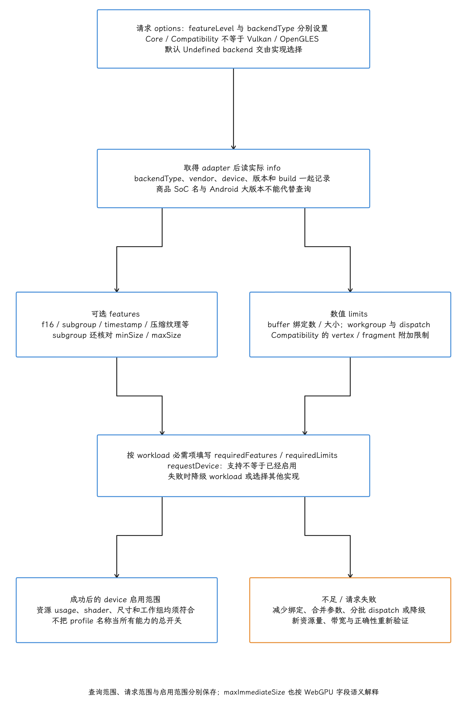

图：featureLevel与backendType是两组请求选项，不是Core=Vulkan或Compatibility=GLES；读取实际backend/vendor/device、features与limits。Adapter支持范围需按workload写requiredFeatures/requiredLimits，requestDevice可失败；执行以Device启用范围为准。Compatibility附加vertex/fragment storage数量不等compute全面禁用；compute检查buffer绑定/大小、workgroup storage/invocations/X-Y-Z/dispatch limits，f16/subgroup/timestamp独立请求，subgroup还查min/maxsize。maxImmediateSize不是Vulkanpushconstant别名。

`GPULimits.maxImmediateSize` 同样不该直接改名为“Vulkan push constant 支持”：WebGPU API 的公开语义按自身 feature/limit 解读，底层后端怎么映射寄存器、uniform buffer 或 push constant，属于 Dawn 和驱动的实现细节。

### Shader 的编译路径

应用输入 WGSL（WebGPU Shading Language，WebGPU 的着色器语言），Dawn 负责验证、转换并创建后端 pipeline。Vulkan 后端通常生成适合 Vulkan 的 shader 模块，OpenGLES 后端生成适合 GLES 的 shader；中间表示、优化阶段和驱动编译方式会随 Dawn commit 与 backend 改变。“WGSL → SPIR-V → GLSL ES 3.10”这类固定写法，是把某个版本的实现细节当成了 API 合约；我们与应用稳定对接的，是下面这几条。


对应用稳定的边界是：

- shader 源码使用 WGSL；
- pipeline 创建可能包含验证和编译成本；
- adapter/device 的 feature 与 limit 决定 WGSL 和资源能否使用；
- shader compilation info、error scope 与 uncaptured error callback 用于发现失败。

## 可见渲染：从 Compose Surface 到屏幕

### AndroidExternalSurface 提供独立 layer

要把 WebGPU 的输出送上屏幕，官方示例从 Compose `AndroidExternalSurface` 开始。它的 Android 实现会创建 `SurfaceView`，得到独立于宿主 App Window 的 `Surface` 和 SurfaceControl layer；默认 z-order 位于父窗口之后，SurfaceFlinger 可以分别 latch（锁定本轮要显示的 buffer）、合成并呈现这块 layer 与宿主 Compose layer。

WebGPU 的绘制结果不经宿主 HWUI 的 RenderNode/display list，宿主 Compose 画布也无法像处理普通绘制节点那样对它应用任意裁剪、变换或 effect。若需要 `Modifier.graphicsLayer {}` 一类视觉效果，可以评估 `AndroidEmbeddedExternalSurface` 的 TextureView 路径，但要重新测量中间纹理、合成和延迟成本。

`AndroidExternalSurface` 使用 SurfaceView 独立 layer；`AndroidEmbeddedExternalSurface` 的 TextureView 则把外部 SurfaceTexture 交给宿主 HWUI 采样。两者可以使用同一个 WebGPU renderer 作为 producer，关键差别在 consumer、合成拓扑和最终输出 buffer。独立 layer 并不自带 HWC overlay；TextureView 的纹理采样也未必经过 CPU 拷贝。

<!-- gracker-diagram: ch13-14-18-surface-topology -->
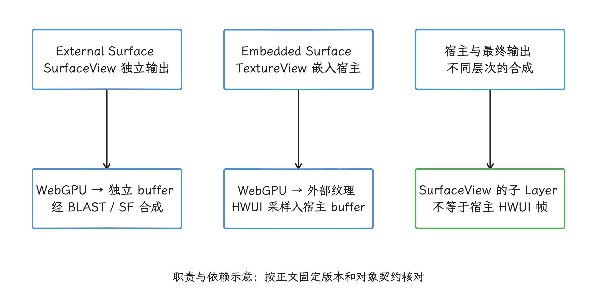

图：两种 Compose 承载可使用同一 WebGPU producer，但消费位置不同。 独立 layer 不自带 overlay；TextureView 采样未必走 CPU 拷贝。

`AndroidExternalSurface.onSurface`、`onChanged` 和 `onDestroyed` 的生命周期回调在主线程触发；拿到 `Surface` 后可以切到专用渲染线程。收到 Surface 销毁回调后，渲染线程要停掉 acquire、encode、submit 和 present——窗口目标已经失效，继续用只会出错。固定源码实际先调用 onDestroyed，再 cancel 创建协程；相邻 KDoc 的“先 cancel”说法与代码不一致，按实际实现处理。取消信号发出去只是第一步，还要等渲染 owner 确认停稳、不再碰旧窗口，这段交接由应用协调，同时避免主线程长时间阻塞。


### Surface 进入 Dawn 的位置

`createWebGpu(surface)` 最终调用 `windowFromSurface(surface)`，把 Java `Surface` 转为原生窗口指针，再用 `GPUSurfaceSourceAndroidNativeWindow` 创建 `GPUSurface`。此处的 `ANativeWindow` 是 Dawn 后端与 Android WSI（Window System Integration，GPU 后端对接窗口系统的接口）及 BufferQueue 的交界。


稳健的初始化顺序如下：

1. Surface 可用后创建 `GPUSurface`；
2. 请求 adapter 时把 `compatibleSurface` 传入选项；
3. 读取 `surface.getCapabilities(adapter)`，确认该 adapter 与 surface 组合的呈现能力；
4. 从返回的 `formats`、`presentModes`、`alphaModes` 中选择配置，并确认所需 texture usage 属于返回的 `usages`；
5. 创建 device 和长期复用的 shader module、pipeline、bind group；
6. 使用当前宽高调用 `surface.configure()`。


这套顺序适用于手动初始化。`compatibleSurface` 用来要求实现选择的 adapter 能在目标 surface 上呈现。alpha05 / alpha06 的 `createWebGpu(surface)` 虽然先创建 `GPUSurface`，随后却把调用方传入的 `GPURequestAdapterOptions` 原样交给 `requestAdapter()`，新建 surface 要由调用方自己写进 `compatibleSurface`。想让目标 surface 参与 adapter 筛选，就分别调用 `initLibrary()`、`createInstance()`、`createSurface()`、`requestAdapter()` 和 `requestDevice()`，再把手动创建的 `GPUSurface` 放进 adapter options。alpha06 helper 同样如此，升级版本后这一步核对照做。

<!-- gracker-diagram: ed13-14-window-compatible-adapter-and-configure -->
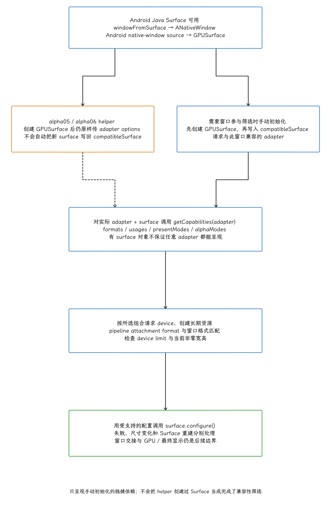

图：JavaSurface经windowFromSurface取ANativeWindow，再用AndroidNativeWindow source创建GPUSurface；此处是窗口交界。alpha05/06 helper虽先创建surface，仍原样传入调用方adapteroptions，不会自动回填compatibleSurface。需要目标窗口参与筛选时手动initLibrary/createInstance/createSurface/requestAdapter/requestDevice并显式设置该surface。getCapabilities(adapter)核对formats/usages/presentModes/alphaModes，device资源与pipelineattachment格式、非零尺寸和limit匹配后configure；不保证零拷贝或最终显示完成。

官方最小示例直接使用 `RGBA8Unorm`，便于演示；产品代码里，format、present mode 或 alpha mode 都要按 adapter/surface 组合确认后再用，同时核对当前非零尺寸、device limit 与 pipeline attachment format。最小示例离一套可恢复的渲染器还差得远。

固定 alpha05 的 WSI 成本也有后端差异。Vulkan 路径取得 image 后把 acquire semaphore 接到后续命令，必要时还在 CPU 等该 image 上一次保存的 acquire fence，以限制在途——`getCurrentTexture()` 是可能阻塞的调用。其呈现路径用 semaphore 串起写完成与 `vkQueuePresentKHR()`，特定配置可额外 blit。OpenGLES 路径则创建临时 surface texture，在 present 时反向 Y blit 到 EGL 默认 framebuffer，再 `eglSwapBuffers()`。独立 Surface 之下，Dawn 后端内部未必始终零拷贝。

<!-- gracker-diagram: ed13-14-alpha05-backend-wsi-work -->
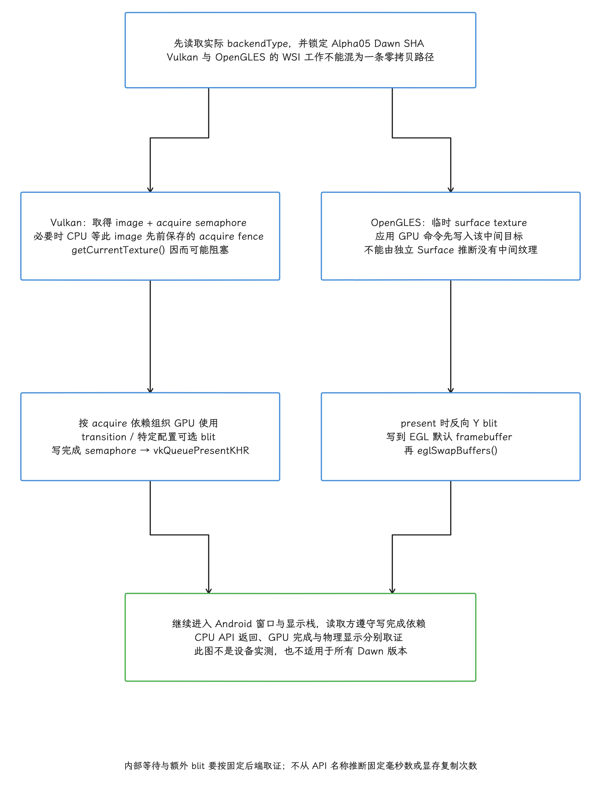

图：仅适用于Dawn9d41fdf与alpha05固定分析，不外推alpha06。Vulkan取得image后连接acquiresemaphore，必要时CPU等该image之前保存的acquirefence以限在途，getCurrentTexture可能阻塞；呈现可能transition/可选blit，以semaphore串写完成和vkQueuePresentKHR。GLES创建临时surfacetexture，present时反向Yblit到EGL默认framebuffer再eglSwapBuffers。两路都需Android窗口/下游同步，CPU present返回不是GPU/光学完成，独立Surface不保证内部零拷贝。

### 一帧的获取、编码、提交与呈现

下面的时序图用于区分 WebGPU 的 `present()` 与物理屏幕 present。


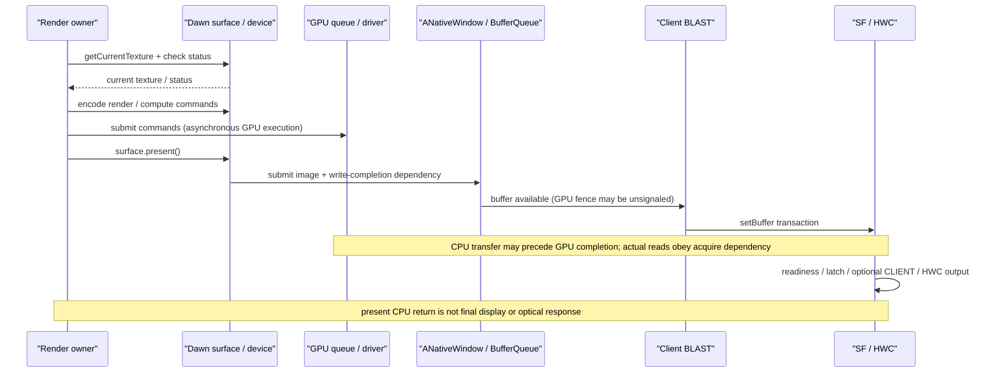

`surface.present()` 把当前 surface texture 交给后端呈现路径，可能包含 backend 提交与等待；它返回时，内容往往还在去屏幕的路上。BufferQueue / BLAST 交接和 SF latch 可以早于 GPU fence signal，而 RE/HWC 的安全读取必须遵守 acquire 依赖。HWC present fence 是显示栈反馈，物理显示通常对应开始出现或开始传入面板内存，整屏扫描及像素光学响应是否结束，它说明不了。


每次 `getCurrentTexture()` 都要先检查 `GPUSurfaceTexture.status`：

- `SuccessOptimal`：可正常编码和呈现；
- `SuccessSuboptimal`：本帧可用，但应准备按最新能力和尺寸重新配置；
- `Timeout`：跳过本次并控制重试节奏；
- `Outdated`：更新尺寸/配置后再取；
- `Lost`：重建与 Android `Surface` 关联的 `GPUSurface`；
- `Error`：检查是否尚未 configure、参数是否合法以及错误回调。


status 枚举是跨后端的结果分类，每个后端产生哪些结果、返回多快，都没有统一承诺；固定 Vulkan 路径使用无限 acquire timeout。device lost 还要单独监听：固定 Dawn 在 device 已 lost 时可能返回 SuccessOptimal 并附 error texture，device 健康与否，要看独立的 device-lost callback。

<!-- gracker-diagram: ed13-14-texture-status-and-device-health -->
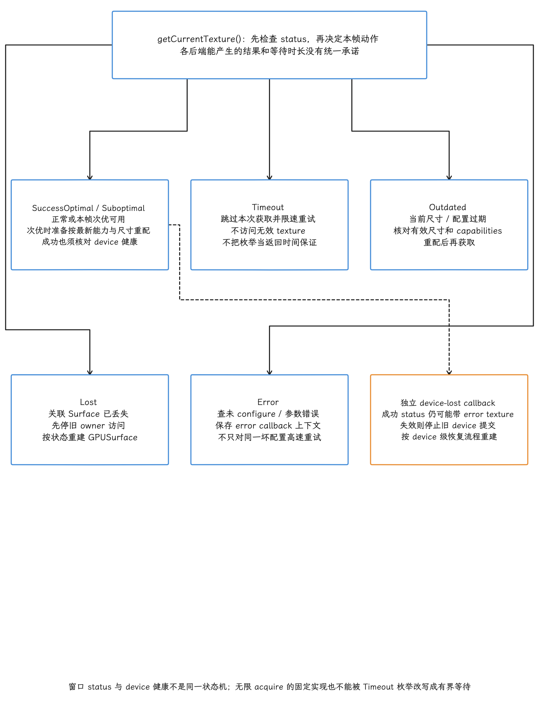

图：GPUSurfaceTexture状态是跨后端分类，固定Vulkan acquire用无限timeout不保证所有状态都会产生或限时返回。SuccessOptimal正常，Suboptimal本帧可用再按当前尺寸能力计划重配；Timeout跳过限速；Outdated重查尺寸配置；Lost重建关联GPUSurface；Error查configure/参数与错误回调。固定Dawn device已lost仍可能给SuccessOptimal+errortexture，必须独立监听device-lost并走device级重建，状态成功不保证健康。

尺寸变化时重新核对配置与 attachment 格式，并用有效宽高 `configure()`。Surface 销毁时先协调 render owner 停止使用旧窗口，再按状态执行 unconfigure / close；新窗口重新建立 GPUSurface。引用旧 surface texture 的 view、pass 与已录制命令，随旧 Surface 一起作废，新帧要用新目标重新录制；device 级 pipeline 和不依赖旧 image 的资源，在能力、格式与生命周期允许时可以复用，一次 resize 不必全部重建。

<!-- gracker-diagram: ed13-14-surface-owner-and-resource-generations -->
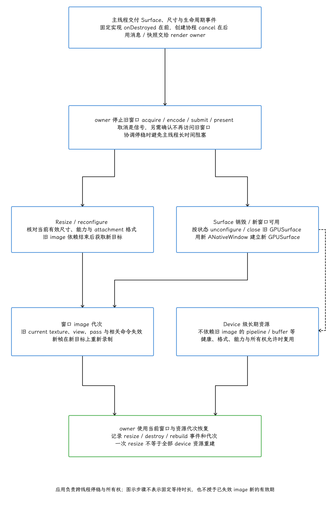

图：onSurface/onChanged/onDestroyed在主线程触发，应用可交给专用owner；固定实现先调用onDestroyed再cancel创建协程，取消信号不等owner停稳。停止acquire/encode/submit/present、确认不再访问旧窗口后按状态unconfigure/close；不要主线程长阻塞。resize重查尺寸/attachment配置并取新currenttexture，旧image相关view/pass/录制命令失效重录；Surface销毁需新GPUSurface。device级pipeline与不依赖旧image资源可在device健康、格式/能力兼容和所有权允许时复用。

### 独立 Surface 的 FrameTimeline 边界

在 trace 里找这块独立 layer 的时间线，先有个背景：普通 App Window 常有完整的 expected/actual FrameTimeline，用来关联一帧的预期时间与实际时间；`AndroidExternalSurface` 是独立 layer，WebGPU producer 是否为每个 buffer 传递标准 App FrameTimeline token 和 desired-present 信息，要看 Dawn backend、Android WSI 和具体版本实现。

trace 里看不到这块独立 layer 的 expected slice，也说明不了内容没有显示；这时要结合 layer 名称、BufferQueue frame number、BLAST transaction、acquire fence、SurfaceFlinger latch、HWC composition 和 present fence 还原时序，宿主 Compose App Window 的 vsync token 套不到 WebGPU layer 上。跨工具关联时还要记下时钟域与共同的时间参照；统一的 frame id 单独消除不了时间偏移。

<!-- gracker-diagram: ch13-14-29-layer-correlation -->
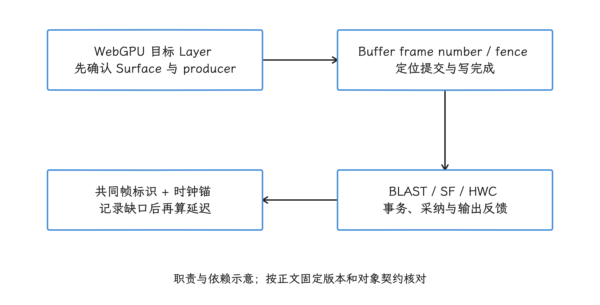

图：独立 producer 用自己的 buffer、事务和显示证据关联。 宿主 Compose token 不可直接套用；跨工具还需时钟映射。

## 纯计算管线

没有窗口的纯计算是 WebGPU 的另一半用途：instance、adapter、device、queue、buffer、texture 和 bind group 这一套原样复用，只是用不着 `GPUSurface`。storage buffer 供 shader 读写批量数据，uniform buffer 提供尺寸、系数等小型只读参数。典型路径如下：

1. 查询能力并创建满足需求的 device；
2. 按 usage 创建 storage、uniform、input/output buffer；
3. 创建 WGSL shader module、pipeline layout 和 compute pipeline；
4. 用 `queue.writeBuffer()` 写输入，或在合适的可映射暂存 buffer 上写入，结束 CPU 映射后再供 GPU 使用；
5. `beginComputePass()`、绑定 pipeline / bind group，以 `dispatchWorkgroups()` 启动所需数量的 workgroup；
6. 结束 pass，`finish()` 后 `queue.submit()`；只在 GPU 内继续使用结果时无需 CPU 等待；
7. CPU 要结果时，按 usage 拷到 readback buffer，等待该 buffer 的 map 完成，读取后 unmap。`onSubmittedWorkDone()` 可观察调用前已提交工作完成，但不会代替 map。


标准 WebGPU 的 `MAP_READ` 只可与 `COPY_DST` 组合，`MAP_WRITE` 只可与 `COPY_SRC` 组合，所以同一个 storage buffer 通常不直接拿来 CPU map，常见读回链是 storage output（含 COPY_SRC）→ readback（MAP_READ | COPY_DST）→ `mapAndAwait(READ, ...)` → 读取 mapped range → `unmap()`。映射的对齐、范围和使用期都要检查；旧 mapped ByteBuffer 在 unmap 或 destroy 之后就此失效。native 扩展若改变 usage 规则，要单独查询和启用，当作标准默认能力直接用会出错。


同一 device 上的 compute 与 render 可以共享 GPU buffer/texture，省掉不必要的 CPU 往返。它们在硬件上能否并行，取决于 Dawn 的提交方式、后端 queue 拓扑、资源依赖、GPU 引擎和驱动调度；一个 `GPUDevice` 暴露的是默认 `GPUQueue` 这一个提交入口，与应用可以直接控制的多条 Vulkan queue 属于不同层次的能力。共享要通过正确的 pass / usage 和资源依赖来组织，barrier、格式转换或排队成本也可能随之出现。

<!-- gracker-diagram: ed13-14-compute-gpu-reuse-or-readback -->
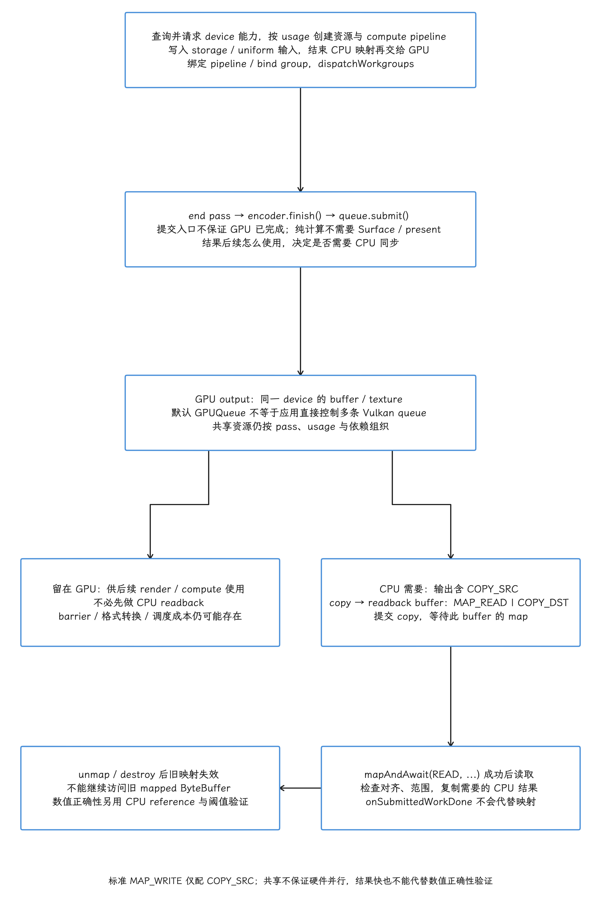

图：同一device按能力/usage建立storage/uniform/输入输出、WGSLpipeline和bindings，写入并结束CPUmap后dispatch/endpass/finish/submit。结果可直接供同device后续render按pass/usage/依赖读取，不保证多hardwarequeue或并行，也不免barrier。CPU读回常用storageoutput COPY_SRC→readback MAP_READ|COPY_DST，提交copy后等待该buffer成功map再读mappedrange，检查对齐范围；unmap/destroy后旧ByteBuffer失效。标准MAP_READ仅配COPY_DST，MAP_WRITE仅配COPY_SRC，native扩展需另查启用；onSubmittedWorkDone不能代替map。

### 计算 workload 的能力分层

模型跑不跑得动，按 feature level 或 SoC 名称去猜是不够的；计算任务至少检查下面这些字段：


- `maxStorageBuffersPerShaderStage`、`maxStorageBufferBindingSize`、`maxBufferSize`；
- workgroup storage、单个 workgroup 的 invocation 数、X/Y/Z size 与 dispatch dimension 上限；
- shader f16、subgroup、timestamp query 等可选 feature；
- buffer map、拷贝与 CPU readback（把结果从 GPU 取回 CPU）的数据量；
- Compatibility mode 的 vertex/fragment storage 附加限制。

需要大量 storage binding 时，可以减少同时绑定的资源、把小参数合并到结构化 buffer、分批 dispatch，或为能力不足的设备准备 CPU/其他 GPU API 路径。每种改法都会改变中间 buffer 数量、内存带宽和 dispatch 次数，应根据目标 workload 的测量结果选择。

### Device lost 与结果正确性

`GPUDeviceDescriptor` 的构造函数要求传入 device-lost 与 uncaptured-error 的 `Executor`，callback 参数本身允许为 null；工程代码仍应提供这两类回调。device lost 表示当前逻辑设备已经失效，由它创建的 queue、pipeline 和资源也随之失去有效提交的资格。恢复代码应能重新请求 adapter/device、重建资源，并从 CPU、磁盘或网络上的可恢复数据重新填充必要状态。

<!-- gracker-diagram: ch13-14-34-device-lost -->
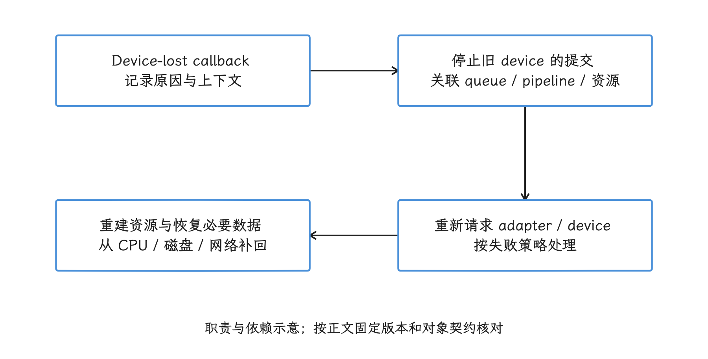

图：逻辑设备失效后停止有效提交，再重建其资源与数据。 失败原因不限于内存；保存 reason、message、backend 与系统构建。

“低内存设备更频繁 device lost”是没有依据的断言，device lost 也不该全部归因于内存：驱动 reset、GPU hang、后端错误、显式 destroy 以及进程生命周期都可能影响结果。诊断时记录 reason、message、backend、设备构建和前后 trace。

需要校验数值结果的 compute 任务还要考虑浮点精度、workgroup 划分、越界保护和不同 backend 的 shader 编译差异。吞吐量达标只说明跑得快，输出对不对要另外验证；关键 kernel 应保留小规模 CPU reference（用 CPU 实现的对照计算）和误差阈值测试。


## 线程、协程与事件轮询

### 回调、协程与执行线程

`GPUInstance.requestAdapter()`、`GPUAdapter.requestDevice()`、异步 pipeline 创建和 `GPUQueue.onSubmittedWorkDone()` 都提供 callback + `Executor` 版本。`Executor` 决定回调在哪个执行环境运行；对应的 `suspend` wrapper 使用 direct executor，让回调先在触发它的线程直接执行，再通过 continuation 恢复挂起协程。挂起协程恢复后落在哪个线程，还取决于它的 coroutine context / dispatcher；要弄清后续 render loop 的线程，我们顺着 dispatcher 查，direct executor 只管回调那一步。

<!-- gracker-diagram: ch13-14-36-callback-context -->
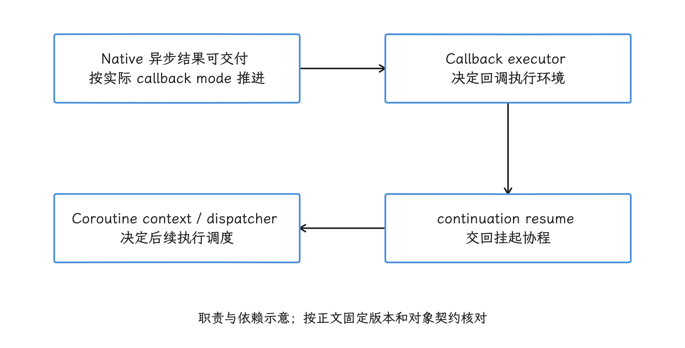

图：Executor 处理回调，continuation 再按协程上下文恢复。 Direct executor 不证明后续 render loop 固定在回调线程或主线程。

协程只是异步 API 的 Kotlin 适配，从这里推不出“WebGPU 默认在主线程提交”，也推不出所有 handle 都有未公开的创建线程绑定；线程组织由应用决定，库没有承诺的亲和规则不要自行添加。alpha05 的公开 Kotlin API 没有声明 `GPUQueue` 或 `GPUCommandEncoder` 必须回到创建线程。

工程上仍建议给 WebGPU 建立单一 render/compute owner，也就是由一个明确的线程或任务负责修改渲染状态：

- 由专用线程串行修改 encoder、pass encoder 和 surface 状态；
- UI 线程只转交输入、尺寸和生命周期事件；
- callback executor 明确命名并控制负载；
- Surface 销毁时发停止信号，等待 owner 停止使用 surface；
- 需要跨线程共享数据时，用不可变快照、消息队列或明确同步。

对 alpha05 手动 API，这套 owner 约束是应用架构策略；alpha06 helper 则把它变成硬性要求：所有相关 WebGPU 操作在其单线程 dispatcher 上串行执行，用 `webGpu.execute { ... }` 等方式进入该上下文——直接读取公开 `device` / `surface` 后调用方法，线程不会自动切换。这条 helper 契约只约束 alpha06 helper 本身，其他版本和原生 handle 的线程规则要分别查证。


### `createWebGpu()` helper 的 100 ms 主线程 poller

alpha05 的 `androidx.webgpu.helper.createWebGpu()` 为推进异步事件，在主线程 `Handler` 上每 100 ms 调用一次 `instance.processEvents()`。源码注释说明，这是等待 Dawn issue 修复前的临时轮询。

<!-- gracker-diagram: ed13-14-alpha05-initialization-and-event-pump -->
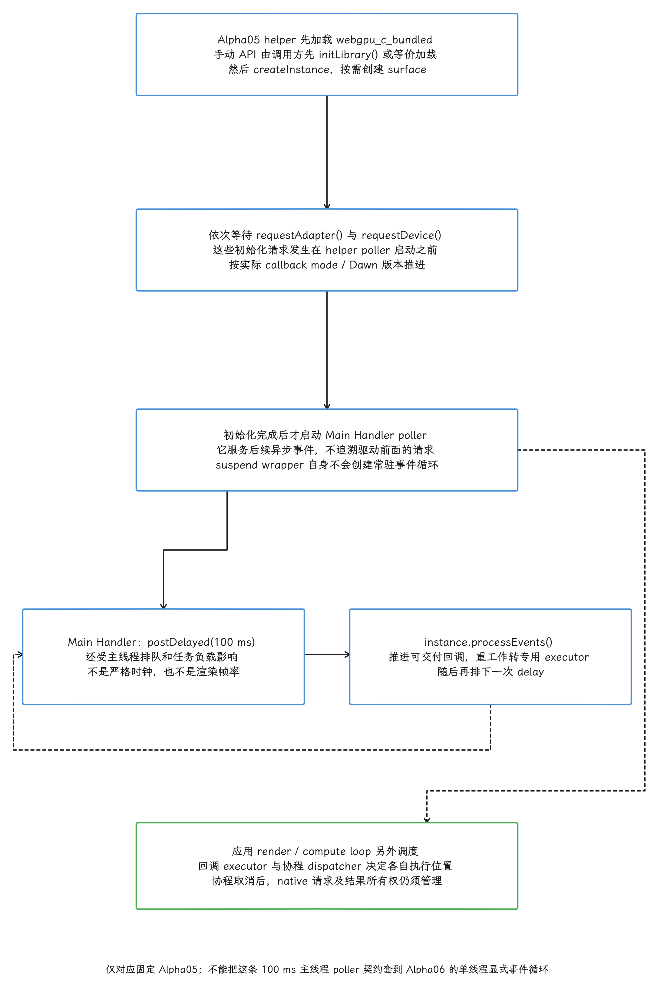

图：固定alpha05helper先加载webgpu_c_bundled/createinstance/可选surface/requestadapter/requestdevice，之后才在MainHandler每100ms排队processEvents推进后续异步回调，不能用后启动poller解释前置请求；手动API按callbackmode与Dawn版本管理事件泵。suspendwrapper不创建常驻循环，directcallback与协程dispatcher另查。100ms是排队delay不是FPS或延迟上限，render/compute由应用单独调度，callback重工作转适当executor；Kotlin取消不保证native请求取消/结果回收。

因此需要分清两件事：

- helper 的事件泵会周期性经过主线程；
- shader 编码、`queue.submit()` 和整个 render loop 不必放在主线程。

若 callback 工作量较大，应把后续处理转交专用 executor。测量主线程时，我们也要认得 `processEvents()` 的周期性任务，别把它误当成 Compose 重组或 Choreographer 回调。这项 poller 只推进事件，按帧驱动渲染的 render loop 另在渲染线程上。

### alpha06：显式启动事件循环

alpha06 的 `createWebGpu()` 在 dispatcher 上完成初始化，返回的对象提供 `processEventsLoop()`，但源码没有自动 launch 它。调用方需在受生命周期管理的协程中启动并取消该循环；render/compute 工作同样在 owner dispatcher 上组织并适时挂起让出线程。一个不挂起的长 while 或阻塞等待会饿死同一 dispatcher 上的事件泵。16 ms 是每次 processEvents 之后的 delay，不是严格 60 Hz 时钟，也不是渲染帧率保证。

<!-- gracker-diagram: ed13-14-alpha06-owner-and-cooperative-event-loop -->
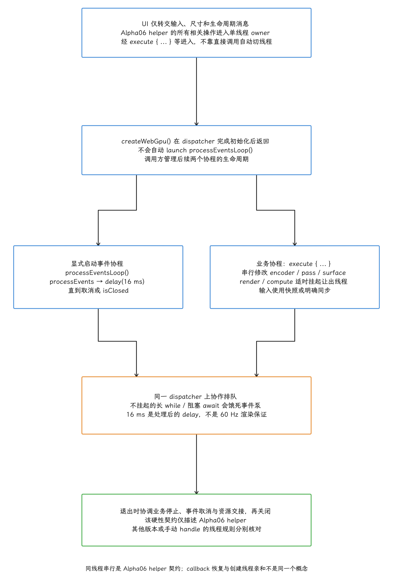

图：alpha06helper在单线程dispatcher初始化，所有相关WebGPU操作须经execute等在其上下文串行；直接读取device/surface调用不会自动切线程。createWebGpu返回后不自动launchprocessEventsLoop，调用方在受生命周期管理协程显式启动取消；processEvents后delay16ms直到cancel/isClosed，非固定60Hz。render/compute适时挂起让出同一dispatcher，长while/阻塞等待会饿死事件泵。该helper契约不倒推alpha05手动API存在创建线程亲和；UI交输入尺寸/生命周期，不争抢修改encoder/surface。

alpha06 `close()` 使用原子 isClosed 防止重复关闭；若从初始化线程之外调用，会用 `runBlocking(dispatcher)` 等待清理。不要让主线程等一个已经被长任务占满的 dispatcher；应先协调 owner 任务结束和资源交接，再完成关闭。默认创建的 dispatcher 由 helper 关闭，外部传入的 dispatcher 仍由调用方负责。


### handle 生命周期

大多数 WebGPU wrapper 实现 `AutoCloseable`，原生 handle 依赖显式 `close()` 降低引用计数。长期资源可以在 renderer 生命周期内持有；临时 view、encoder、pass 和 command buffer 则应按 API 所有权及实际使用期及时释放。`close()` 释放原生引用，buffer / texture 的 `destroy()` 销毁资源，两者语义不同；引用释放时，底层 GPU 内存未必当场归零。由 Surface 已呈现而失效的 current texture，也不会因为 Kotlin wrapper 还在手里就恢复可用。

<!-- gracker-diagram: ch13-14-41-handle-destroy -->
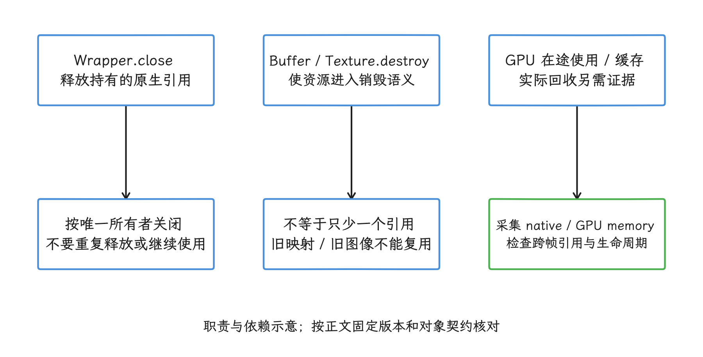

图：释放引用、销毁资源语义和 GPU 最后使用完成分别处理。 wrapper 还在手，current texture 未必有效；CPU close 后显存也未必立即归零。

alpha05 helper 的 `close()` 有一条明确的源码记录：`device.close()` 仍被注释，旁边记录了待修复 issue；helper 当前会关闭 surface、instance、adapter，并停止事件 poller，其余子资源的释放仍归应用。资源管理与版本升级测试要覆盖原生堆、GPU memory，以及重复进入和退出页面的场景。本次 alpha06 source JAR 中这条 device.close() TODO 仍然存在；升级 helper 后，别默认这块所有权已补齐。

<!-- gracker-diagram: ed13-14-helper-close-and-owned-resources -->
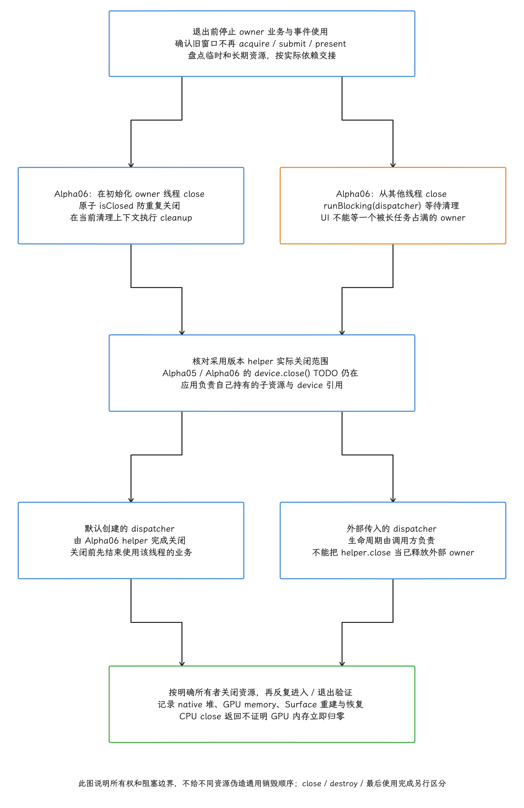

图：alpha06close用原子isClosed防重复；初始化线程直接cleanup，其他线程runBlocking(dispatcher)等清理，不要UI等被长任务占满的owner。默认创建dispatcher由helper关闭，外部dispatcher调用方管理。alpha05/06helper device.close仍TODO，应用长期/临时资源与device引用须明确所有者分别close，按实际API依赖和生命周期组织，不能GC代替。close降引用不等destroy或GPU驻留立即归零，重复进入退出采集nativeheap/GPUmemory并验证恢复。

## 性能成本与测量条件

谈 WebGPU 的性能之前，先把依据说清楚：本次查阅的官方资料没有给出可跨设备、跨 workload 使用的 WebGPU/Vulkan 固定性能比例，也没有提供“Dawn 加载固定需要 50—100 ms”的依据；设备、ABI、Dawn commit、backend、shader、pipeline 缓存、命令规模、分辨率和热状态都会改变结果。这一节给的是可核查的检查项，具体数字要用明确记录的测试条件去测。

### CPU 侧成本

与直接使用 Vulkan 相比，WebGPU 增加了 Kotlin/JNI 调用、Dawn 对象与状态管理、WebGPU 验证及后端转换；与 GLES 相比，它也可能借助更明确的 pipeline、bind group 和 command buffer，减少运行时的隐式状态处理。哪条路径更快，要看实际 workload，API 所处的层级说了不算。

应优先检查这些可操作项：


- pipeline、shader module、bind group layout 和长期 bind group 是否复用；
- 是否每帧创建大量只使用一次的 Kotlin/原生 wrapper；
- 是否把可合并的 draw/dispatch 拆成很多细小 JNI 调用；
- `queue.writeBuffer()` / `writeTexture()` 的次数、大小与分配；
- pipeline 创建和编译是否出现在首帧或动画关键路径；
- 是否每帧调用 `onSubmittedWorkDone()` 把异步 GPU 队列变成 CPU/GPU 串行；
- validation/error callback 是否持续报告问题。

`@FastNative` 只优化桥接的一部分。应优先测量能改变整体开销的操作，例如把命令批量录制到 command buffer、复用 pipeline/bind group，以及减少无效状态切换；单次桥接的微优化说明不了整帧性能，还要同时核对实际 JNI 调用数和 CPU/GPU 关键路径。

### GPU 侧成本

WebGPU 不会自动减少 shader 的算术量、采样数量、overdraw、render target 带宽或分辨率。Dawn 可能采用不同的资源转换、barrier（资源访问之间的同步与状态转换）、render pass 组织方式或 shader 变换，驱动也可能为同一份 WGSL 生成不同机器码。


渲染 workload 要看 vertex/fragment 时间、overdraw、attachment load/store、texture bandwidth 和 present 等待；计算 workload 要看 occupancy（GPU 执行单元的并发占用程度）、workgroup size、访存合并、缓存、带宽和 CPU readback。

遇到性能差异时，应在同一设备上对比 backend、命令规模和 GPU counter（硬件性能计数器），归因以这些对照数据为准；“WebGPU vs Vulkan”只是标签。

### 冷启动与持续运行

冷路径可能包含原生库加载、instance/adapter/device 创建、shader/pipeline 编译和 Surface 配置。给每一段加入自定义 trace，才能定位某台设备上的实际耗时。脱离设备、版本和测试条件的固定毫秒数没有可比性。


持续测试还要控制：


- 屏幕刷新率与分辨率；
- 前后台状态和 Surface 重建次数；
- CPU/GPU 频率、温度与功耗限制；
- pipeline warm-up（正式测量前的预创建或预编译）与磁盘/驱动缓存；
- Vulkan/Core、GLES/Compatibility 等实际组合；
- 相同输入、相同画质和相同同步点。

## 选型约束与替代方案

| 约束 | Jetpack WebGPU 的价值 | 需要提前验证或考虑的替代 |
| --- | --- | --- |
| Kotlin 中使用现代 GPU render/compute | API 比直接 Vulkan 更紧凑，WGSL 与 WebGPU 对象模型清晰 | alpha API 变更、Dawn 打包尺寸、目标设备覆盖 |
| Android 与 Web/桌面共享 shader 和算法结构 | WGSL 与 bind-group 思路可复用 | Kotlin 宿主代码不能原样跨平台；surface、输入、资源加载仍是平台代码 |
| 图像处理、可视化、仿真 | render 与 compute 可共享同一 device 资源 | 格式、storage、workgroup limit 和 readback 成本 |
| 低层平台扩展或外部内存互操作 | 标准 WebGPU 可减少厂商 API 依赖 | 若必须使用特定 Vulkan/Android extension，直接 Vulkan/NDK 更可控 |
| 大型游戏或既有引擎 | 可用于新 renderer 评估 | 成熟引擎、Vulkan、GLES 的工具、生态与生产经验可能更合适 |
| 端侧 ML 推理 | 自定义 GPU kernel 有发挥空间 | 优先比较 LiteRT、GPU/NPU delegate 与厂商运行时的算子覆盖、量化和运维成本；NNAPI 已在 Android 15 废弃，不宜作为 Android 17 新项目的默认方案 |
| WebView 网页内容 | 网页可按浏览器能力使用 `navigator.gpu` | 这是 Chromium/WebView 路径，不由 `androidx.webgpu` 依赖提供 |

“API 更少”推不出“代码量必然少一个数量级”，“Core 命中”也说明不了它适合替代所有 Vulkan compute。选型结论应附带目标设备覆盖率、正确性、稳定性、包体、功耗和持续性能数据。


## 调试与 trace

### WebGPU 层的错误收集

调试从把 WebGPU 层自己的错误收干净开始：为支持 label 的 surface、device、queue、buffer、texture、pipeline 和 pass 设置可读标签，便于把错误或抓帧对象映射回业务资源。alpha05 `GPUInstance` / `GPUInstanceDescriptor` 没有 label 字段或 setLabel，应通过应用 trace / context id 关联 instance。对可疑创建/编码区域使用 `pushErrorScope()` / `popErrorScope()`；它们只收集匹配过滤类型的错误，全局 uncaptured-error 和 device-lost callback 仍要保留。


下面的代码展示 validation scope 的边界；用途是把一段可疑创建逻辑的错误与其他异步错误分开。 这是 suspend 上下文内的 API 片段，省略 renderer 初始化和 pipeline 的完整所有权；生产代码还要处理 transport / device 错误并确保作用域正确配对。

```kotlin
device.pushErrorScope(ErrorFilter.Validation)
val pipeline = device.createComputePipeline(descriptor)

try {
    device.popErrorScope()
} catch (error: WebGpuRuntimeException) {
    Log.e("WebGPU", "compute pipeline validation failed", error)
}
```

alpha05 的 suspend `popErrorScope()` 捕获到非 `NoError` 类型时会以异常结束，所以调用方要处理异常；其他语言 binding 返回错误对象的那套写法，搬到 Kotlin API 上行不通。

<!-- gracker-diagram: ed13-14-error-scope-and-global-callbacks -->
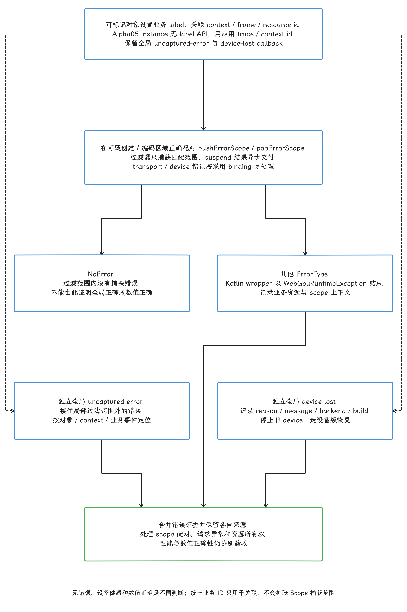

图：支持label的surface/device/queue/buffer/texture/pipeline/pass设置业务标签，alpha05instance无labelAPI用contextid/trace。push/pop匹配过滤类型并正确配对，suspendpopErrorScope返回NoError不证明整体正确，其他ErrorType由Kotlinwrapper抛WebGpuRuntimeException；生产代码另管transport/WebGpuException和device错误。uncaptured/device-lost全局回调始终保留，device-lost走设备恢复；数值结果CPUreference另验，不把别的语言返回错误对象写法套到Kotlin。

### Perfetto 看系统路径，应用 trace 补 WebGPU 语义

Perfetto 不保证自动显示每个 Kotlin WebGPU 调用、JNI 方法或 Vulkan/GLES API 名称。建议在应用中为以下区间添加自定义 trace：


- library/instance/adapter/device 初始化；
- shader 与 pipeline 创建；
- acquire current texture；
- command encoding；
- queue submit；
- surface present；
- `onSubmittedWorkDone()` 与 buffer map 等待；
- Surface resize、destroy 和重建。

设备提供 GPU render-stage 数据源时，可以继续查看 hardware queue、submission、stage 和 GPU duration；提供 GPU counter 时，再观察 busy、频率、带宽与缓存。最后把这些时间与 WebGPU layer 的 BufferQueue、SurfaceFlinger latch、composition 和 display present 对齐。

跨层判断可按下面的顺序进行：

| 现象 | 先查证据 | 不要直接归因 |
| --- | --- | --- |
| 首次显示慢 | `.so` 加载、adapter/device、shader/pipeline、Surface configure | 固定的 Dawn 启动耗时 |
| CPU render thread 忙 | JNI 次数、对象分配、encode slice、validation error | GPU 算力不足 |
| submit 后长时间无结果 | GPU stage、fence、readback/map wait、device lost | 协程调度 |
| WebGPU layer 晚 | acquire、submit、BufferQueue、SF latch、present | 宿主 Compose 重组 |
| Vulkan 与 GLES 差异大 | `backendType`、同画质命令、shader、driver counter | Core/Compatibility 名称 |
| 页面反复进入后内存增长 | handle close、helper 的 device close 缺口、Surface 重建、native/GPU memory | Kotlin GC 单一原因 |


### AGI、RenderDoc 与 backend

AGI、RenderDoc 或厂商 profiler 能否抓取，取决于实际 backend、设备驱动、应用是否 debuggable、图形层注入限制和工具版本。先记录 `GPUAdapterInfo.backendType`，再选择对应工具。使用 Vulkan backend 也不保证任意设备都能被某个版本的工具成功抓帧；OpenGLES backend 同样要按工具和设备逐项验证，“不支持”这类笼统结论先放一放。


AGI 主要分析 GPU command、pipeline、shader 和资源，Perfetto 主要观察线程、BufferQueue、SurfaceFlinger、FrameTimeline 与显示时间。两者提供的是互补证据。Vulkan 系统 trace 见 §13.6，GLES 与 ANGLE 的 GLES→Vulkan 边界见 §13.5。

## Jetpack WebGPU 与 WebView WebGPU 的边界

Jetpack WebGPU 在应用进程中加载 AndroidX AAR 内的 Dawn；WebView 是否向页面开放 `navigator.gpu` 则取决于实际 WebView/Chromium 构建、安全上下文、开关与设备支持，应以网页检测为准。⚠️ 进程边界纠正：这里要按 WebView 自己的架构理解，Chrome 独立 GPU process 的模型套过来会出错——Android WebView 的 browser 代码及 GPU service 运行在宿主 App 进程内，现代配置的 renderer 可在隔离进程中；按 WebView 架构和目标进程证据识别。


两套公开 API 都没有让下列对象直接互换的契约；代码即便跑在同一个宿主进程里，它们也分属各自的 device 或 Dawn 环境：


- `GPUInstance` / `GPUDevice`；
- native handle；
- command buffer；
- pipeline 缓存合约；
- Surface 生命周期；
- Dawn 版本假设。

应用同时包含 WebView 与 Jetpack WebGPU 时，要分别记录 AndroidX WebGPU 版本和 WebView package/version。网页端用 Web API feature detection，原生端查询 adapter feature、limit 和 capability；两侧的结果各管各的，一侧可用推不出另一侧也可用。两条路径可能竞争同一物理 GPU、内存和宿主线程资源，所以问题隔离要分别记录对象和版本，同时观察共享资源压力。

<!-- gracker-diagram: ed13-14-webview-processes-and-object-isolation -->
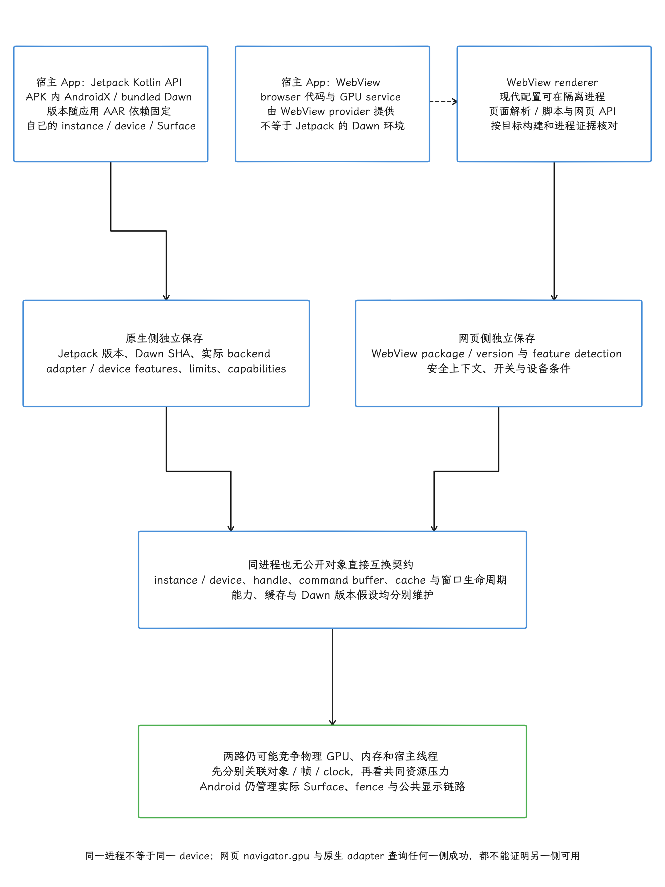

图：Jetpack在宿主App加载AARbundledDawn，随应用依赖发布；WebViewbrowser/GPUservice在宿主App内，现代renderer可隔离，按目标构建/进程确认，不照搬ChromeGPUchild模型。网页navigator.gpu依WebViewprovider/securitycontext/flags/device检测，原生adapter/devicefeatures/limits独立查询。一进程不赋予instance/device/nativehandle/commandbuffer/pipelinecache/surface/Dawn版本直接互换契约。仍共享物理GPU/内存/宿主线程压力，分别记版本对象帧和clock再关联公共Surface/fence/display证据。

## 常见误判

| 误判 | 修正 |
| --- | --- |
| Android 17 新设备必须 Vulkan 1.4，所以 WebGPU 一定走 Vulkan 1.4 | Jetpack 官方只把 Vulkan 1.1+ 列为首选；读取 backend 与 adapter 能力 |
| Core 就是 Vulkan，Compatibility 就是 GLES | feature level 与 backend 是两个字段 |
| Compatibility 不支持 compute、storage texture 或 subgroup | 分别查询 feature 与 limit；不能用一个 profile 名称代替能力表 |
| Kotlin API 全是空壳，行为全在 native | 主要 GPU 操作进 JNI，但 Kotlin 还有 descriptor、handle、callback/suspend 和 helper |
| `@FastNative` 让 JNI 与 NDK 调用等价 | 它只减少部分桥接成本，完整成本仍含 Dawn、验证和驱动 |
| 协程依赖说明 GPU 命令默认跑主线程 | coroutine 是 callback 适配；命令在哪个线程调用由应用决定 |
| `surface.present()` 返回即表示上屏 | 提交、GPU 写完成、安全读取、SF/HWC 反馈与光学响应分别取证 |
| SurfaceView 上的 WebGPU 也属于宿主 HWUI 帧 | `AndroidExternalSurface` 使用独立 layer，producer 和 timeline 要分开看 |
| WebView 支持 WebGPU 就等于原生库可用 | 两者由不同依赖、进程和能力检测控制 |
| WebGPU 固定达到 Vulkan 90%—95% | 没有跨设备、跨 workload 的官方固定比例 |
| alpha05 的 Dawn commit 无法追踪 | AAR 的 `dawn_build_metadata.json` 给出精确 SHA |

## 小结

回到这一章的主线：Jetpack WebGPU 的价值是用统一对象模型组织渲染与计算，同时保留对 adapter、feature、limit 和后端的显式查询；Dawn、驱动、Android Surface 和系统显示链路仍然都在链路上，一层也绕不过去。采用之前，把 API 稳定性、AAR 体积、资源生命周期和设备覆盖纳入选型，再用同设备、同画质、同同步点的 trace 与 GPU counter 验证性能。WebView WebGPU 是另一条由 Chromium 管理的运行时路径，能力与生命周期假设要和 AndroidX WebGPU 分开维护。

## 本轮配图补充依据

- [当前 alpha06 source JAR](https://dl.google.com/dl/android/maven2/androidx/webgpu/webgpu/1.0.0-alpha06/webgpu-1.0.0-alpha06-sources.jar)：显式启动 `processEventsLoop()`、单线程 `execute()`、16 ms delay、dispatcher 所有权与 close 的阻塞边界。
- [Dawn SwapChain.cpp](https://dawn.googlesource.com/dawn/+/9d41fdf36977cca92361c6ae2769129bbaaafd9b/src/dawn/native/SwapChain.cpp)、[Vulkan WSI](https://dawn.googlesource.com/dawn/+/9d41fdf36977cca92361c6ae2769129bbaaafd9b/src/dawn/native/vulkan/SwapChainVk.cpp)、[GLES WSI](https://dawn.googlesource.com/dawn/+/9d41fdf36977cca92361c6ae2769129bbaaafd9b/src/dawn/native/opengl/SwapChainEGL.cpp)：current texture 引用与失效、获取时的同步、可选 blit 和 GLES 呈现中间纹理。
- [BLAST](https://android.googlesource.com/platform/frameworks/native/+/refs/tags/android-17.0.0_r1/libs/gui/BLASTBufferQueue.cpp)、[CompositionEngine Output](https://android.googlesource.com/platform/frameworks/native/+/refs/tags/android-17.0.0_r1/services/surfaceflinger/CompositionEngine/src/Output.cpp)、[HWC2 fence 契约](https://android.googlesource.com/platform/hardware/libhardware/+/refs/tags/android-17.0.0_r1/include_all/hardware/hwcomposer2.h)：普通 SurfaceView 事务、异步安全读取与最终显示反馈。
- [WebGPU 标准](https://www.w3.org/TR/webgpu/)、[alpha05 GPUBuffer](https://android.googlesource.com/platform/frameworks/support/+/c48b772dd76241af6af60bee13d3cad0e4520306/webgpu/webgpu/src/main/java/androidx/webgpu/GPUBuffer.kt)、[GPURequestCallback](https://android.googlesource.com/platform/frameworks/support/+/c48b772dd76241af6af60bee13d3cad0e4520306/webgpu/webgpu/src/main/java/androidx/webgpu/GPURequestCallback.kt)：mapping/usage、队列完成与 CPU 可读、协程取消和结果交付边界。
- [WebView 架构](https://chromium.googlesource.com/chromium/src/+/main/android_webview/docs/architecture.md)、[Android WebView 内存指南](https://developer.android.com/topic/performance/memory/guide/webview-memory)、[Perfetto 时钟映射](https://perfetto.dev/docs/concepts/clock-sync)：GPU service 的宿主进程位置、对象隔离及跨工具时间对应。

## 源码与文档入口

- [Jetpack WebGPU release notes](https://developer.android.com/jetpack/androidx/releases/webgpu)：确认 alpha06 已发布、当前 artifact、alpha 状态、发布日期、minSdk 与 API 变化。
- [WebGPU for Android overview](https://developer.android.com/develop/ui/views/graphics/webgpu) 与 [Getting started](https://developer.android.com/develop/ui/views/graphics/webgpu/getting-started)：确认 WebGPU for Android 定位、Vulkan 1.1+ 首选、Compatibility 请求、Compose Surface 和基础渲染流程；入门页的 API 24 说明需与 alpha06 release notes / AAR manifest 一起核对。
- AndroidX alpha05 快照中的 [`Functions.kt`](https://android.googlesource.com/platform/frameworks/support/+/c48b772dd76241af6af60bee13d3cad0e4520306/webgpu/webgpu/src/main/java/androidx/webgpu/Functions.kt)、[`GPURequestAdapterOptions.kt`](https://android.googlesource.com/platform/frameworks/support/+/c48b772dd76241af6af60bee13d3cad0e4520306/webgpu/webgpu/src/main/java/androidx/webgpu/GPURequestAdapterOptions.kt)、[`GPUInstance.kt`](https://android.googlesource.com/platform/frameworks/support/+/c48b772dd76241af6af60bee13d3cad0e4520306/webgpu/webgpu/src/main/java/androidx/webgpu/GPUInstance.kt)、[`GPUDeviceDescriptor.kt`](https://android.googlesource.com/platform/frameworks/support/+/c48b772dd76241af6af60bee13d3cad0e4520306/webgpu/webgpu/src/main/java/androidx/webgpu/GPUDeviceDescriptor.kt) 与 [`GPURequestCallback.kt`](https://android.googlesource.com/platform/frameworks/support/+/c48b772dd76241af6af60bee13d3cad0e4520306/webgpu/webgpu/src/main/java/androidx/webgpu/GPURequestCallback.kt)：核对 native 入口、adapter 选项、device descriptor、Executor 与 suspend wrapper。
- AndroidX alpha05 快照中的 [`GPUSurface.kt`](https://android.googlesource.com/platform/frameworks/support/+/c48b772dd76241af6af60bee13d3cad0e4520306/webgpu/webgpu/src/main/java/androidx/webgpu/GPUSurface.kt)、[`GPUSurfaceConfiguration.kt`](https://android.googlesource.com/platform/frameworks/support/+/c48b772dd76241af6af60bee13d3cad0e4520306/webgpu/webgpu/src/main/java/androidx/webgpu/GPUSurfaceConfiguration.kt) 与 [`SurfaceGetCurrentTextureStatus.kt`](https://android.googlesource.com/platform/frameworks/support/+/c48b772dd76241af6af60bee13d3cad0e4520306/webgpu/webgpu/src/main/java/androidx/webgpu/SurfaceGetCurrentTextureStatus.kt)：核对 configure、acquire status 与 present。
- AndroidX alpha05 快照中的 [`helper/WebGpu.kt`](https://android.googlesource.com/platform/frameworks/support/+/c48b772dd76241af6af60bee13d3cad0e4520306/webgpu/webgpu/src/main/java/androidx/webgpu/helper/WebGpu.kt) 与 [`helper/Util.kt`](https://android.googlesource.com/platform/frameworks/support/+/c48b772dd76241af6af60bee13d3cad0e4520306/webgpu/webgpu/src/main/java/androidx/webgpu/helper/Util.kt)：核对 native library 名称、Surface 转换、100 ms event poller 和 helper close 边界。
- [`AndroidExternalSurface.android.kt`](https://android.googlesource.com/platform/frameworks/support/+/c48b772dd76241af6af60bee13d3cad0e4520306/compose/foundation/foundation/src/androidMain/kotlin/androidx/compose/foundation/AndroidExternalSurface.android.kt)：核对 SurfaceView/TextureView 承载、独立 layer、主线程生命周期回调与跨线程渲染约束。
- [alpha06 AAR](https://dl.google.com/dl/android/maven2/androidx/webgpu/webgpu/1.0.0-alpha06/webgpu-1.0.0-alpha06.aar) 与 [alpha06 source JAR](https://dl.google.com/dl/android/maven2/androidx/webgpu/webgpu/1.0.0-alpha06/webgpu-1.0.0-alpha06-sources.jar)：核对当前 artifact 的 `minSdkVersion=26`、`dawn_build_metadata.json` 中的 Dawn SHA，以及 helper 的单线程 dispatcher / 16 ms event loop 变化。
- [alpha05 AAR](https://dl.google.com/dl/android/maven2/androidx/webgpu/webgpu/1.0.0-alpha05/webgpu-1.0.0-alpha05.aar)、[source JAR](https://dl.google.com/dl/android/maven2/androidx/webgpu/webgpu/1.0.0-alpha05/webgpu-1.0.0-alpha05-sources.jar) 与 [对应 Dawn commit](https://dawn.googlesource.com/dawn/+/9d41fdf36977cca92361c6ae2769129bbaaafd9b/)：核对 minSdk、ABI 二进制、Kotlin 源码、`dawn_build_metadata.json` 和固定原生实现。
- Dawn 固定提交中的 [`Surface.cpp`](https://dawn.googlesource.com/dawn/+/9d41fdf36977cca92361c6ae2769129bbaaafd9b/src/dawn/native/Surface.cpp)、[`SwapChainVk.cpp`](https://dawn.googlesource.com/dawn/+/9d41fdf36977cca92361c6ae2769129bbaaafd9b/src/dawn/native/vulkan/SwapChainVk.cpp) 与 [`SwapChainEGL.cpp`](https://dawn.googlesource.com/dawn/+/9d41fdf36977cca92361c6ae2769129bbaaafd9b/src/dawn/native/opengl/SwapChainEGL.cpp)：核对 ANativeWindow、VkAndroidSurfaceKHR 与 EGL window surface 两条 WSI 路径。
- [W3C WebGPU Specification](https://www.w3.org/TR/webgpu/) 与 [WGSL Specification](https://www.w3.org/TR/WGSL/)：核对 API 与 shader 语言的标准语义。
- Android 17 的 [`native_window_jni.h`](https://android.googlesource.com/platform/frameworks/native/+/refs/tags/android-17.0.0_r1/include/android/native_window_jni.h)、[`Surface.cpp`](https://android.googlesource.com/platform/frameworks/native/+/refs/tags/android-17.0.0_r1/libs/gui/Surface.cpp)、[`BufferQueueProducer.cpp`](https://android.googlesource.com/platform/frameworks/native/+/refs/tags/android-17.0.0_r1/libs/gui/BufferQueueProducer.cpp) 与 [`SurfaceFlinger.cpp`](https://android.googlesource.com/platform/frameworks/native/+/refs/tags/android-17.0.0_r1/services/surfaceflinger/SurfaceFlinger.cpp)：核对 Java Surface、ANativeWindow、BufferQueue 与显示合成边界。
- kernel `android17-6.18-2026-06_r6` 的 [`dma-buf.c`](https://android.googlesource.com/kernel/common/+/refs/tags/android17-6.18-2026-06_r6/drivers/dma-buf/dma-buf.c)、[`dma-fence.c`](https://android.googlesource.com/kernel/common/+/refs/tags/android17-6.18-2026-06_r6/drivers/dma-buf/dma-fence.c) 与 [`sync_file.c`](https://android.googlesource.com/kernel/common/+/refs/tags/android17-6.18-2026-06_r6/drivers/dma-buf/sync_file.c)：核对共享 buffer 和 sync fence 的内核边界；Dawn 的 feature/profile 逻辑不在内核中。
- [Perfetto GPU data sources](https://perfetto.dev/docs/data-sources/gpu) 与 [FrameTimeline](https://perfetto.dev/docs/data-sources/frametimeline)：核对 GPU producer 能力、expected/actual frame 与系统显示观察口径。
- [NNAPI migration guide](https://developer.android.com/ndk/guides/neuralnetworks/migration-guide)：确认 NNAPI 自 Android 15 废弃，Android 17 新项目应另选默认 ML 路径。
