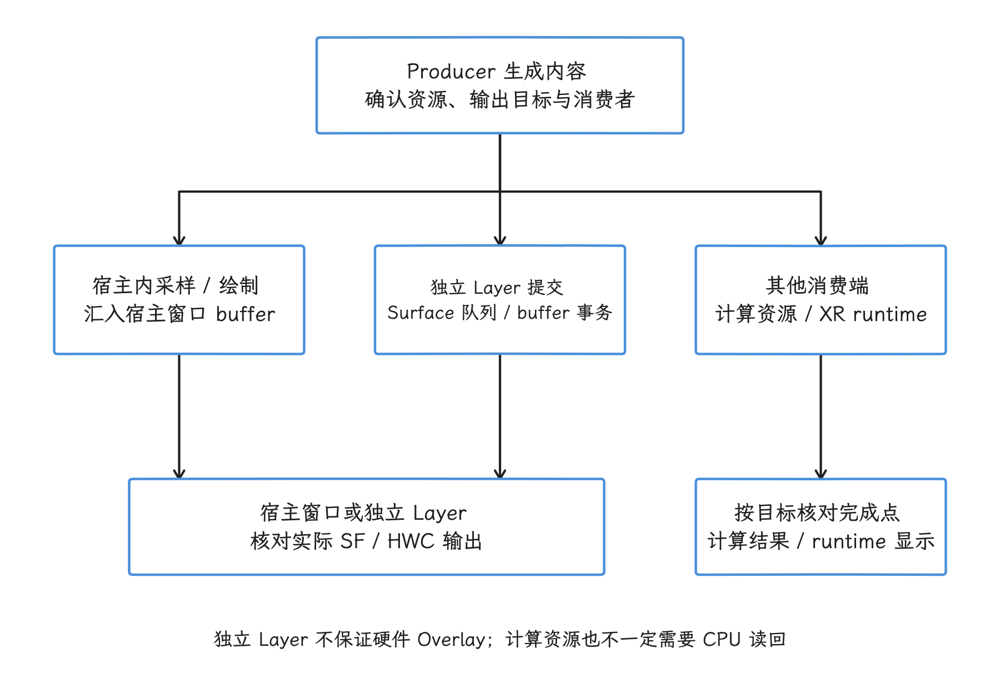
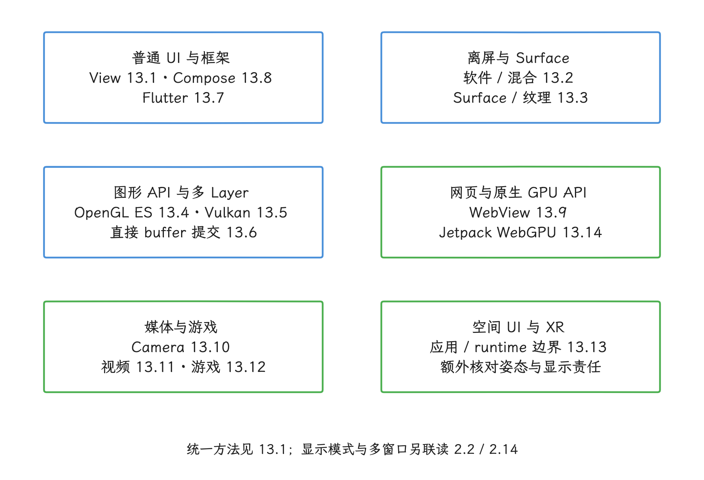
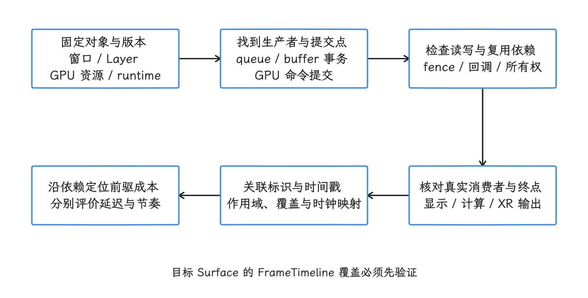

# 第 13 章：渲染管线专题

Android 渲染没有一条适用于所有场景的固定流水线。分析前，先确认内容由谁生产（Producer）、写入哪些 buffer 或 GPU 资源、交给哪个消费者；若目标是显示，再核对 layer（合成图层）的组织方式，以及合成发生在应用内部、SurfaceFlinger 的 GPU 路径、HWC 硬件路径还是 XR runtime。框架名、控件名或一段很长的 trace slice（追踪时间区间），都不能代替实际对象和调用路径。

⚠️ 边界修正：Surface 是生产者使用图像 buffer 的入口，不能理解为某一块固定 buffer；SurfaceControl 也能通过 buffer transaction 直接交付 HardwareBuffer。纯计算可以不使用 Surface，XR 输出则需核对 runtime 的责任，不能把本章各路径统一画成一条 BufferQueue 显示链。参见 [Surface API](https://developer.android.com/reference/android/view/Surface)、[buffer transaction API](https://developer.android.com/reference/android/view/SurfaceControl.Transaction)，以及 [13.6](06-surfacecontrol-hardwarebuffer-renderer.md)、[13.13](13-android-xr-spatial-ui-rendering.md) 和 [13.14](14-webgpu-android-pipeline.md)。

<!-- gracker-diagram: ch13-index-01-consumer-topology -->

图：先确认生产者、资源和消费位置，再判断进入哪条输出路径。 这是消费拓扑概览，省略 BLAST 等中间环节；XR runtime 的内部合成与显示需单独取证。

## 内容索引

- [13.1 Android View 渲染管线与分析方法](01-android-view-pipeline-analysis.md)
- [13.2 Android 软件、离屏与混合渲染路径](02-android-software-offscreen-mixed-rendering.md)
- [13.3 SurfaceView 与 TextureView 渲染管线](03-surfaceview-textureview-pipelines.md)
- [13.4 OpenGL ES、EGL 与 ANGLE](04-opengl-egl-angle.md)
- [13.5 Vulkan 原生管线与 HWUI 多队列](05-vulkan-hwui-multi-queue.md)
- [13.6 SurfaceControl 与 HardwareBufferRenderer](06-surfacecontrol-hardwarebuffer-renderer.md)
- [13.7 Flutter 渲染管线：Engine、Impeller 与 Surface](07-flutter-rendering-pipeline.md)
- [13.8 Jetpack Compose 渲染管线：Composition、Layout 与 RenderNode](08-compose-rendering-pipeline.md)
- [13.9 Android 17 WebView 渲染管线](09-webview-rendering.md)
- [13.10 Android Camera 平台管线：HAL3、Buffer、ZSL 与显示](10-camera-pipeline.md)
- [13.11 视频 Overlay、Media3 与专业编解码管线](11-video-overlay-media3-codec-pipeline.md)
- [13.12 Android 17 游戏引擎渲染链路](12-game-engine.md)
- [13.13 Android 17 / Android XR 空间 UI 与环境资产渲染性能](13-android-xr-spatial-ui-rendering.md)
- [13.14 Android 17 Jetpack WebGPU 渲染与计算管线](14-webgpu-android-pipeline.md)

## 阅读建议

- 普通 View 先读 [13.1 Android View 渲染管线与分析方法](01-android-view-pipeline-analysis.md)；Flutter 进入 [13.7](07-flutter-rendering-pipeline.md)，Compose 进入 [13.8](08-compose-rendering-pipeline.md)。
- Surface、图形 API 与多 layer：按 [13.2](02-android-software-offscreen-mixed-rendering.md) → [13.3](03-surfaceview-textureview-pipelines.md) → [13.4](04-opengl-egl-angle.md) / [13.5](05-vulkan-hwui-multi-queue.md) → [13.6](06-surfacecontrol-hardwarebuffer-renderer.md) 阅读。
- Camera、视频与游戏：分别从 [13.10 Android Camera 平台管线：HAL3、Buffer、ZSL 与显示](10-camera-pipeline.md)、[13.11 视频 Overlay、Media3 与专业编解码管线](11-video-overlay-media3-codec-pipeline.md)、[13.12 Android 17 游戏引擎渲染链路](12-game-engine.md) 切入；刷新率联动问题再补 [2.2 帧率、刷新率与显示模式选择](../../part1-fundamentals/ch02-rendering/02-framerate-refresh-display-mode.md)。
- WebView 从 [13.9](09-webview-rendering.md) 进入；Kotlin 原生 WebGPU 从 [13.14](14-webgpu-android-pipeline.md) 进入，分别记录 WebView provider 与 AndroidX / Dawn 的版本和对象边界。
- 空间 UI 先用 [13.13](13-android-xr-spatial-ui-rendering.md) 划清应用与 XR runtime 的显示责任。

PiP、Freeform 与多窗口场景还需结合 [2.14 多窗口、PiP 与桌面模式渲染管线](../../part1-fundamentals/ch02-rendering/14-multiwindow-desktop-rendering.md)，核对窗口几何、Surface 同步与显示模式。

<!-- gracker-diagram: ch13-index-02-reading-map -->

图：按 UI 框架、Surface / API、媒体、网页或 XR 选择专项。 这是阅读分组，各格不表示执行先后；具体承载和消费者仍按目标对象确认。

## 统一取证入口

任一性能问题都可以借用 [13.1 的统一分析方法](01-android-view-pipeline-analysis.md#统一分析方法)：先固定目标对象与版本，再找 Producer、提交点、读写及复用依赖，最后按实际消费者追踪结果。显示路径核对 buffer、transaction、layer、SurfaceFlinger / HWC 与 present；纯计算核对命令完成和实际需要的结果访问；XR 则继续向 runtime 侧取证。BufferQueue 和 fence（操作完成或资源可用的同步信号）只在该路径确实存在时纳入。

关联事件时，先核对 frame / buffer / layer 等标识及其作用域，再校准跨数据源的时钟；[FrameTimeline](https://perfetto.dev/docs/data-sources/frametimeline) 的使用须以目标 Surface 的实际覆盖为准。CPU API 返回、GPU 完成、显示反馈和用户可见结果是不同终点；物理显示的 present fence 也不能代替整屏扫描完成或光学响应测量。参见 [时钟同步](https://perfetto.dev/docs/concepts/clock-sync)、[HWC2 present fence 契约](https://android.googlesource.com/platform/hardware/libhardware/+/refs/tags/android-17.0.0_r1/include_all/hardware/hwcomposer2.h)；独立 Surface 的取证见 [13.1](01-android-view-pipeline-analysis.md)，XR 的额外终点见 [13.13](13-android-xr-spatial-ui-rendering.md)。

<!-- gracker-diagram: ch13-index-03-evidence-method -->

图：把对象身份、提交依赖、消费者和时间基准联系起来。 箭头表示取证步骤，非固定执行流水线；API 返回、GPU 完成与光学响应分别判断。