# Perfetto UI、状态轨道与版本边界

打开一份 trace，我们面对的是 track、slice、counter 和 flow 这些对象，它们把线程、进程或系统组件在某段时间内的离散状态直接摆上时间轴。同一个位置上的轨道，含义会随版本和数据源变化，所以读图先读语义，颜色只用来快速定位。

## 轨道、切片、计数器与因果连接

### 一轮分析的读图顺序

Perfetto UI 把多个 data source 的事件放在同一时间轴上，data source 指产生某类 trace 数据的采集组件。录制时缺了调度事件、FrameTimeline、Binder 或应用标记，UI 这边补不回来，因果关系还得我们自己顺着事件去查。所以读图时，先把“轨道上发生了什么”和“为什么发生”当成两个问题。

一轮可靠分析按下面的顺序推进：

1. 在 Info/Stats 中确认 trace 时间范围、目标进程和数据完整性；Stats 会列出解析错误和丢包等诊断信息。
2. 用 Area Selection 圈出复现动作对应的时间窗，避免在整份 trace 里无目标地浏览。
3. 用 FrameTimeline、启动标记、ANR、输入事件或业务 Slice 确定异常事件。
4. 回到相关线程，区分 Running、Runnable、Sleeping 和 Uninterruptible Sleep。
5. 沿 Binder、Flow、waker 或帧 token 检查跨线程、跨进程和显示下游。
6. 需要批量比较时，把 UI 观察写成 PerfettoSQL。


> 源码基线：平台结论固定到 Android 17 / API 37 / `android-17.0.0_r1`，内核 `android17-6.18-2026-06_r6`。交互说明按 2026-10-24 官方文档及上游 v58.2 源码核对；state track 的历史行为另按 v57.2 发布 SDK 和 v57.2/v58.2 主机分析器验证。网页 UI、主机工具和设备组件分别记录版本；这些主机核查不代表 Android 真机采集。

### 打开并整理 Trace

#### 加载方式与大文件

[Perfetto UI](https://ui.perfetto.dev/) 可以通过侧边栏的 “Open trace file” 或拖放加载本地 trace。一次选择多个文件时，当前 UI 会进入合并配置流程，把它们放到共享时间轴；合并前要确认各文件的时钟来源和对齐依据。

浏览器能否顺利处理大文件，取决于 trace 内容、主机内存、浏览器限制和查询复杂度，没有一个固定的体积门槛。加载或交互开始受限时，可以运行 `./trace_processor server http <trace>`，让本机原生 Trace Processor 作为 UI 后端，也可以直接用 `trace_processor_shell` 查询，具体流程见 §14.1。把二进制 trace 全量转成文本通常会扩大体积，还会失去 UI 的索引优势，大文件默认不走这条路。


#### 时间轴、选择与详情抽屉

当前 UI 的常用操作如下：

| 目的 | 操作 | 结果 |
| --- | --- | --- |
| 缩放与平移 | `W` / `S`、`A` / `D`；也可用 `Ctrl` + 滚轮和 `Shift` + 拖动 | 改变可见时间窗 |
| 聚焦事件 | 选中事件后按 `F` | 通过 Focus current selection 聚焦选区；具体缩放按该 UI 构建实现 |
| 相邻事件 | `,` / `.` | 在同一轨道切换前一个或后一个事件 |
| 时间选区 | 在时间轴或轨道区域拖动 | 创建 Area Selection，其中包含起止时间和被选轨道集合 |
| 事件转选区 | 选中事件后按 `R` | 用事件边界创建 Area Selection |
| 详情抽屉 | `Q` | 显示或隐藏 Tab Drawer（选中事件、查询结果等详情所在的底部面板） |
| 命令面板 | `Ctrl+Shift+P`；macOS 用 `Cmd+Shift+P` | 搜索并执行 UI 命令 |
| 当前快捷键 | `?` | 查看该 UI 构建实际注册的快捷键 |

Area Selection 除了起止时间，还包含所选轨道。修改 track shell（轨道左侧的名称和控制区域）上的勾选项会改变统计范围；分享截图或结论时，把选区范围和轨道集合一起写明，统计范围才说得清楚。


#### 找轨道、过滤和 Pin

长 trace 的效率来自减少同时可见的轨道：

- Track Finder 按名称模糊查找轨道。
- Timeline 工具栏的过滤器可按轨道名、进程或线程缩小显示范围；清除过滤后数据仍在。
- 轨道外壳的 Pin 按钮把轨道移到工作区顶部。

分析一帧时，常用组合是 App 主线程、RenderThread、FrameTimeline、`surfaceflinger` 主线程和相关 CPU。分析同步 Binder 时，把客户端线程与服务端 Binder 线程一起 Pin。Pin 只改变显示位置，不改变数据或时间对齐。


Omnibox 是页面顶部的统一搜索和命令输入框，输入 `:` 进入 SQL 模式。查询结果能否生成 Debug Track 取决于列的语义：Slice Track 至少要选名称、非空时间戳和 duration 列，Counter Track 至少要选时间戳和数值列；列名可以在创建界面里映射，写法无需固定为 `name`、`ts`、`dur` 或 `value`。复杂查询留到 §14.7，这里先把它当作“将查询结果放回时间轴”的入口。

<!-- gracker-diagram: ch14-02-05-sql-debug-tracks -->
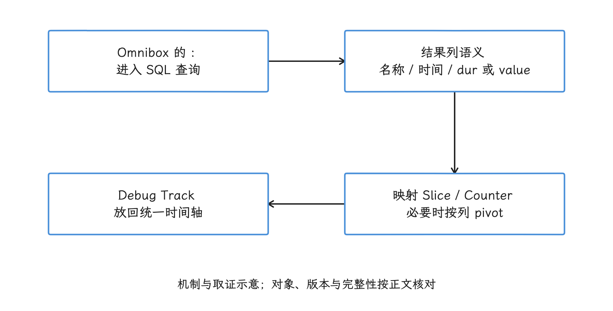

图：先让结果列具有明确语义，再映射成 Debug Track。 列名可以映射，纳秒时间戳与区间或数值语义必须正确。

### 轨道描述的是哪一层

#### CPU Scheduling、Frequency 与 Idle

CPU Scheduling 轨道来自内核调度事件。每个 Slice 表示某个线程在一颗 CPU 上运行的区间；详情中的 `priority`、线程身份和 `end_state` 可以帮助解释这次运行如何结束，`end_state` 就是线程被切出 CPU 后进入的调度状态。这条轨道回答“哪条线程在何时占用哪颗 CPU”；至于线程执行了哪一行代码，要靠应用 Slice、采样调用栈或方法跟踪。

CPU Frequency 轨道来自设备提供的频率事件，能看到记录到的频率变化，但频率值本身证明不了某段代码变慢：CPU 微架构、单核处理能力、热限制、空闲状态、调度放置和内存等待都会影响完成时间。判断线程迁移到另一颗 CPU 是否有害，还要结合 Runnable 延迟、各 CPU 的并发负载和设备拓扑；主线程也无需始终固定在某颗“大核”上。

CPU Idle 轨道描述 CPU 的空闲状态。线程处于 Sleeping 或 D 状态时本来就没有资格运行，此时看到部分 CPU idle 属于正常；只有线程已经 Runnable，并且在 affinity（线程允许运行的 CPU 集合）和 cpuset（系统为一组任务限定的 CPU 集合）等约束下有可用 CPU，却长期没有进入 Running，我们才需要继续查优先级、系统负载和调度策略。


#### 进程、线程、Slice 与线程状态

进程分组把同一进程的线程、Counter 和其他轨道放在一起。线程轨道上常同时出现两类数据：

- **Slice**：应用或平台标记的命名区间，例如 `Choreographer#doFrame`、`performTraversals`、`DrawFrame`。Slice 说明某个逻辑区间尚未结束，不保证线程全程占用 CPU。
- **Thread State**：Trace Processor 根据 `sched_switch`、`sched_waking` 等事件重建的调度状态。它说明线程在 CPU 上运行、等待 CPU，或等待某个唤醒条件。

App 主线程负责 Looper 消息、输入分发、生命周期和 View/Compose 工作；`Choreographer#doFrame` 是传统 View/HWUI 帧的重要入口。RenderThread 负责 HWUI 渲染工作的记录、准备与图形提交，其中可能包含 CPU 执行、GPU 工作排队和 fence（表示前序图形工作何时完成的同步对象）等待。名称相同的 Slice 在不同 Android 版本、渲染后端和厂商实现中可能覆盖不同子阶段，要结合子 Slice 与源码核对。


Binder 线程名能帮助定位服务端执行线程，但 Binder transaction 本身不保证包含 Java 方法名。方法名是否可见取决于平台或业务是否在服务端路径添加了 ATrace / Track Event 标记。

#### Counter Track

Counter 由一组“时间戳 + 数值”样本组成，例如频率、RSS（进程驻留在物理内存中的页量）、堆大小、BufferQueue 积压量或自定义队列深度。UI 会把离散样本画成折线或阶梯图；Counter 的来源、单位和采样间隔由数据源决定，图形上升本身还证明不了泄漏或性能退化。

内存 Counter 持续上升时，要区分采样区间、GC、缓存上限、映射文件、共享内存和进程生命周期。GPU Counter 是否存在、含义是什么，也受 GPU 数据源和厂商支持限制。报告中应记录 Counter 名称、单位、数据源和比较窗口。


### Slice 的三种时间

#### Wall Duration

`slice.dur` 是 Slice 起点到终点的墙上时长，对应时间轴上的宽度。线程在这段时间里可能运行、等待 CPU、休眠或阻塞，所以长 Slice 只说明命名区间长，还不足以判定 CPU 计算重。

#### Thread Duration / CPU 时间

`slice.thread_dur` 只有数据源记录了可用的线程时间时才有意义，例如 Track Event 的线程时间计数器，或 JSON Trace Event 中的 `tts` / `tdur`。它并不限于 Track Event；Android ATrace 的普通 Slice 往往没有该字段。缺失或仍未确定的线程时间不能按 0 处理。

需要计算某个线程 Slice 内的 on-CPU 时间时，我们把这个 Slice 的半开区间 `[ts, ts + dur)` 与 `thread_state.state = 'Running'` 求交；半开表示包含起点、不包含终点。只有调度数据覆盖完整时，墙上时间才能按 Running、Runnable、Sleeping、D 等互斥状态分解；trace 边界、丢包和未知区间要单独列出来。

<!-- gracker-diagram: ch14-02-09-running-intersection -->
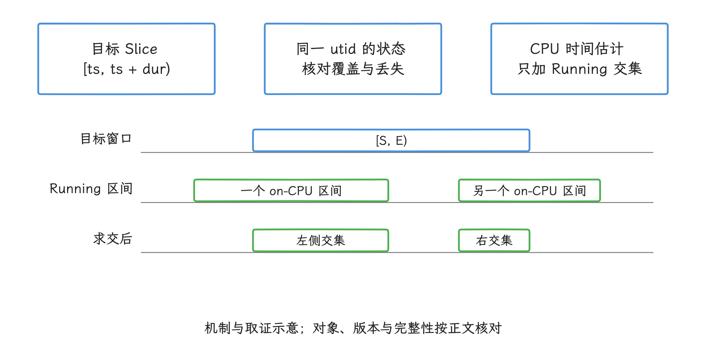

图：把目标 Slice 与同一线程的 Running 区间求交。 未知、丢失和边界不完整不能自动补成零或已知状态。 时序条长与间隔为示意，非设备测量。

#### Self Duration

Self Duration 是轨道嵌套概念：完整、正确嵌套的父 Slice 扣除直接子 Slice 的墙上时长。固定 Android 17 和 v57.2 的 `slices.self_dur` 实现直接计算 `slice.dur - SUM(直接子 Slice 的 dur)`，并不计算任意重叠区间的并集。开放、错误嵌套或丢失事件需要先检查；结果不是函数自身的 CPU 时间，也不会自动扣除其他线程上的异步工作。

<!-- gracker-diagram: ch14-02-10-three-durations -->
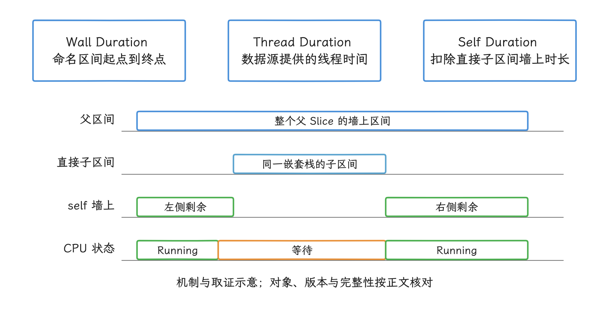

图：三种时长需要分别解释，不能相互替代。 self 库按父 dur 减直接子 dur 之和计算，要求完整且正确嵌套。 时序条长与间隔为示意，非设备测量。

下面的查询用于比较 `doFrame` 的墙上时长、自身墙上时长和可选线程时长。

```sql
INCLUDE PERFETTO MODULE slices.self_dur;

SELECT
  s.id,
  s.name,
  s.dur / 1e6 AS wall_ms,
  sd.self_dur / 1e6 AS self_wall_ms,
  CASE WHEN s.thread_dur >= 0 THEN s.thread_dur / 1e6 END AS thread_ms
FROM slice AS s
JOIN slice_self_dur AS sd USING (id)
WHERE s.name GLOB 'Choreographer#doFrame*'
  AND s.dur >= 0
  AND sd.self_dur BETWEEN 0 AND s.dur
ORDER BY s.dur DESC
LIMIT 20;
```

`thread_ms` 为 `NULL` 表示缺失或未确定的线程时间；CPU 消耗需要其他证据。该查询只保留完整父区间和数值在合理范围内的 self duration，这只是初筛，不能证明所有子事件完整；等待原因仍要查询 `thread_state`。

### 线程状态与颜色编码

#### 从内核状态到 UI 颜色

Android 17 Trace Processor 按内核 `prev_state` 解码调度状态，`android17-6.18-2026-06_r6/include/linux/sched.h` 定义了 `TASK_RUNNING`、`TASK_INTERRUPTIBLE`、`TASK_UNINTERRUPTIBLE` 等状态位。UI 颜色只是帮我们快速浏览，主题、轨道类型和 UI 版本都可能调整配色，所以结论里应写状态名或 SQL 值，“绿色段”“橙色段”这类说法留在口头浏览就好。

| UI / SQL 状态 | 内核或处理器含义 | 可以确认 | 仍需补证据 |
| --- | --- | --- | --- |
| `Running` | 线程正在某颗 CPU 上运行 | 该区间获得了 CPU | 执行哪段代码、是否受缓存或内存延迟影响 |
| `R` / Runnable | 已具备运行资格，等待调度 | 该区间没有获得 CPU | 是负载、优先级、affinity、cpuset 还是调度策略 |
| `R+` | Runnable，并由抢占结束上一段运行 | 线程被抢占后等待 | 抢占者、优先级和 CPU 负载 |
| `S` / Sleeping | 可中断睡眠，等待显式唤醒 | 线程不在运行队列 | Binder、futex（用户态锁进入内核等待时使用的机制）、条件变量、定时器或其他等待对象 |
| `D` / Uninterruptible Sleep | 不可中断睡眠 | 线程等待内核条件 | 是否为 I/O、具体 `blocked_function`、设备驱动或内存回收 |

当前稳定版 UI 通常用不同深浅的绿色区分 Running 与 Runnable，Sleeping/Idle 显示为低对比度色块，D 状态用暖色。具体色值随主题和 UI 实现变化，谈不上稳定的数据接口；FrameTimeline 的绿、浅绿、红、黄、蓝是另一套帧结果编码，套不到线程状态上。分析结论记录状态值和详情字段即可。


#### D 状态的常见来源

`TASK_UNINTERRUPTIBLE` 表示等待条件不会被普通信号打断，磁盘 I/O 只是常见来源之一。驱动等待、页回收、文件系统、块设备和其他内核等待都可能产生 D 状态。

采集了 `sched/sched_blocked_reason` 时，`thread_state` 可以提供 `blocked_function`，部分 trace 还会给出 `io_wait`。缺少这些字段时，我们能下的结论只有“Uninterruptible Sleep，原因未由本次 trace 识别”，磁盘瓶颈还定不下来。

<!-- gracker-diagram: ch14-02-12-d-state-evidence -->
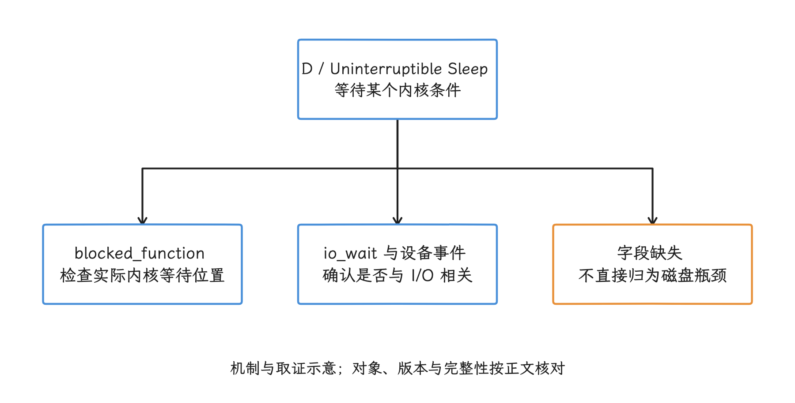

图：D 表示不可中断等待，具体条件需要本次 trace 的证据。 缺少 blocked_function 或 I/O 证据时保留原因未知。

#### 红色锁竞争标记的来源

`Lock contention on a monitor lock` 等红色 Slice 来自 ART/平台锁竞争埋点；monitor lock 是 Java 对象监视器对应的互斥锁。等待线程的内核状态在同一时间窗内通常是 Sleeping，也可能随实现变化。红色说明 trace 提供了更具体的锁证据，Linux `thread_state` 并没有因此新增一个 Blocked 状态。

详情面板若提供 owner、blocking thread 或关联跳转，应切到持锁线程检查：

<!-- gracker-diagram: ch14-02-13-lock-owner-chain -->
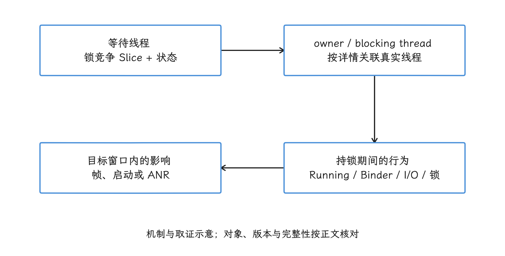

图：从等待者找到 owner，再核对 owner 的工作和依赖。 埋点提供锁证据，Linux 调度状态仍需独立检查。

1. 持锁线程是否在 Running。
2. 持锁线程是否又在等 Binder、I/O 或另一把锁。
3. 锁持有区间是否覆盖昂贵操作。
4. 这段等待是否位于当前帧、启动或 ANR 的时间窗内。

红色 Slice 本身还证明不了优先级反转。其核心依赖是高优先级任务等待低优先级任务持有的资源；中等优先级工作抢占低优先级持锁者，是把等待进一步拉长的典型路径。判断时要确认同一资源、等待者和持锁者的优先级、持锁范围及调度状态，再核对延迟来源，而不能把第三个抢占者当成所有反转场景都必须具备的条件。参见 [Android 避免优先级反转](https://source.android.com/docs/core/audio/avoiding_pi)。

<!-- gracker-diagram: ch14-02-14-priority-inversion -->
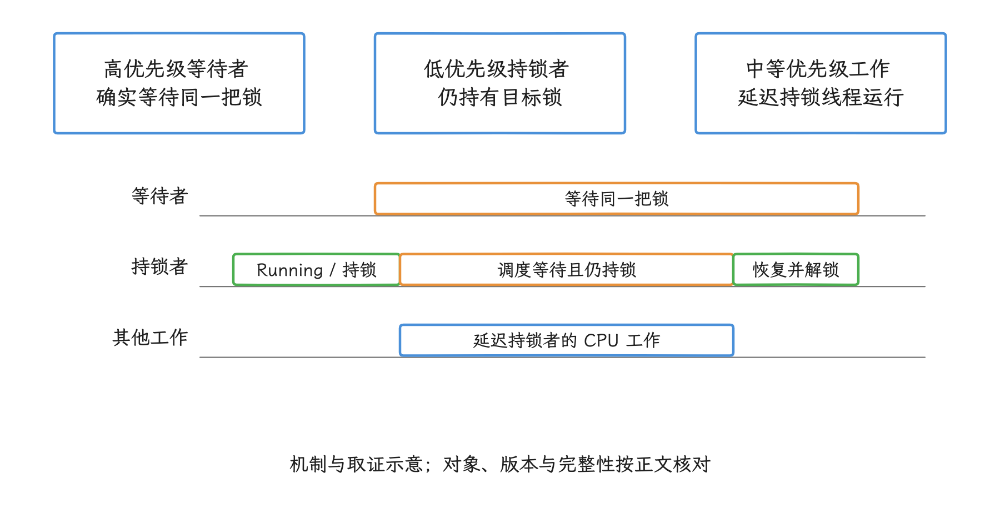

图：高优先级任务等待低优先级持锁者时，其他工作可能继续延迟持锁者。 这是典型放大路径；先核对同一资源、优先级和状态，不能凭颜色证明反转。 时序条长与间隔为示意，非设备测量。

#### Waker 与唤醒路径

采集 `sched_waking` 或相关 wakeup 事件后，线程状态详情可以关联 waker，也就是发起本次唤醒的线程。waker 未必是最初的业务事件源，被唤醒线程也不会因此立刻获得 CPU；要看唤醒后的调度等待，就看从 wakeup 到 Running 的区间。

跨 CPU 唤醒时，`sched_waking` 记录在发起唤醒的一侧，`sched_wakeup` 的记录位置受唤醒路径影响。普通延迟分析优先保证 `sched_waking` 存在；若要区分 IPI（Inter-Processor Interrupt，CPU 核之间发送的中断）和调度器唤醒路径的各段耗时，再同时检查更底层事件。

<!-- gracker-diagram: ch14-02-15-wake-to-running -->
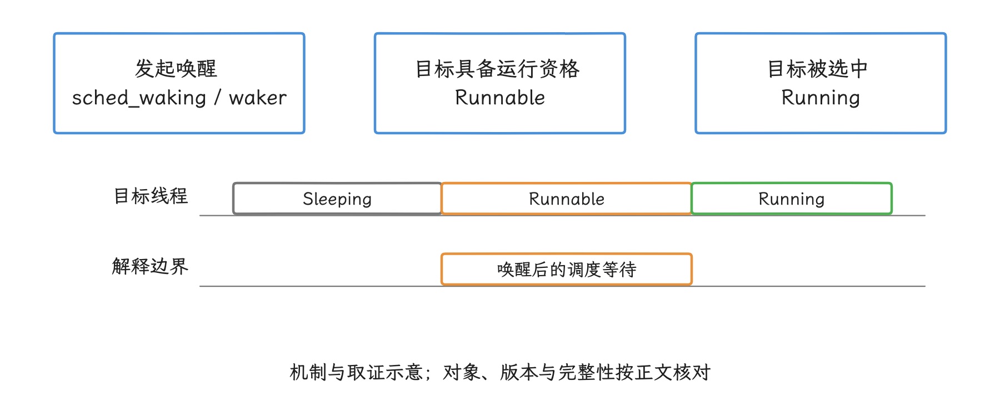

图：waker 触发可运行状态后，目标仍可能等待 CPU。 waker 不一定是最初业务源，跨 CPU 细分还需额外事件。 时序条长与间隔为示意，非设备测量。

### Flow Events 与跨进程关联

Flow 是 trace 显式记录的跨 track 关联关系，用箭头连接不同轨道上的相关事件。选中带 Flow 的事件后，UI 会突出相关箭头，未选中时可能为了可读性减少显示。箭头说的是“trace 数据声明两者相关”；至于同步阻塞还是单一因果，还得我们沿两侧事件核实。


#### Binder transaction

Binder 分析依赖相应的驱动 tracepoint 和 Trace Processor 解析。同步调用通常可以关联客户端 transaction、服务端 transaction 和 reply；oneway 是单向异步调用，没有同步 reply，客户端也不等待服务端完成。嵌套 Binder、回调和线程池排队会让路径分叉，第一条箭头之后往往还有更完整的调用树。

读一个同步 Binder 调用时，依次检查：

<!-- gracker-diagram: ch14-02-17-binder-roundtrip -->
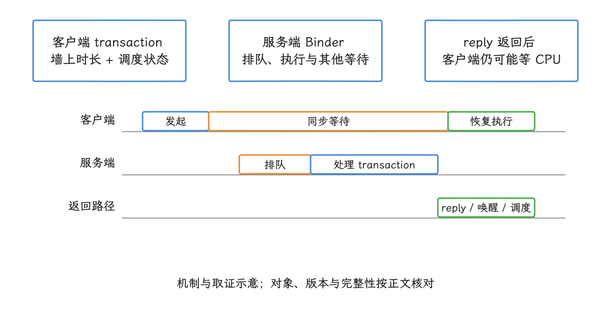

图：同步调用需要分别检查排队、服务端处理和客户端恢复。 oneway 没有同步 reply，嵌套调用也可能继续分叉。 时序条长与间隔为示意，非设备测量。

1. 客户端 transaction Slice 的墙上时长和线程状态。
2. 服务端 Binder 线程何时开始处理，transaction 到开始执行之间是否存在排队时间。
3. 服务端 Slice 内是 Running、锁等待、D 状态还是再次发起 Binder。
4. reply 何时返回，客户端从唤醒到 Running 又等了多久。

Android 17 的 `stdlib/android/binder.sql` 会把 Binder transaction 与 reply、线程和进程关联起来。UI 跳转适合看单个案例；批量统计时，用这个标准库或 §14.7 的查询模板更省事。

#### FrameTimeline Flow

选中 App 的 Actual Timeline Slice 时，Perfetto 可以通过 surface frame token（标识应用提交帧的关联键）找到对应的 SurfaceFlinger display frame；选中 display frame 时，也可以显示这次合成包含的多个应用 frame。这个 Flow 表达帧的消费关系，比只按时间重叠匹配更可靠。

Flow 与 BufferQueue frame number 是两套标识，替代不了 acquire、present 和 release fence 提供的同步信息。SurfaceView 这类独立 Surface 路径还受 FrameTimeline 覆盖范围的限制，具体范围见 §14.13 和 §15。


### FrameTimeline：从异常帧进入

FrameTimeline 从 Android 12 / API 31 起可用。Android 9-11 没有 Expected / Actual 主轨道，我们要从 `Choreographer#doFrame`、RenderThread、调度事件和 SurfaceFlinger 时间窗建立关联。

Expected Timeline 表示调度器为这一帧安排的预计时间窗。App Actual Timeline 从 `Choreographer#doFrame` 或 NDK Choreographer 回调开始，结束点取 GPU 完成时间与帧提交给 SurfaceFlinger 的 post time 中较晚的一个；SurfaceFlinger Actual Timeline 表达这套帧追踪定义中的合成与显示栈呈现结果，不能替代整屏扫描完成或光学响应测量。读 Actual Slice 的 `dur` 时要记住：它只是这套 FrameTimeline 定义下的墙上区间，既算不上主线程 CPU 时间，也概括不了所有显示路径的端到端延迟。

<!-- gracker-diagram: ch14-02-19-expected-actual -->
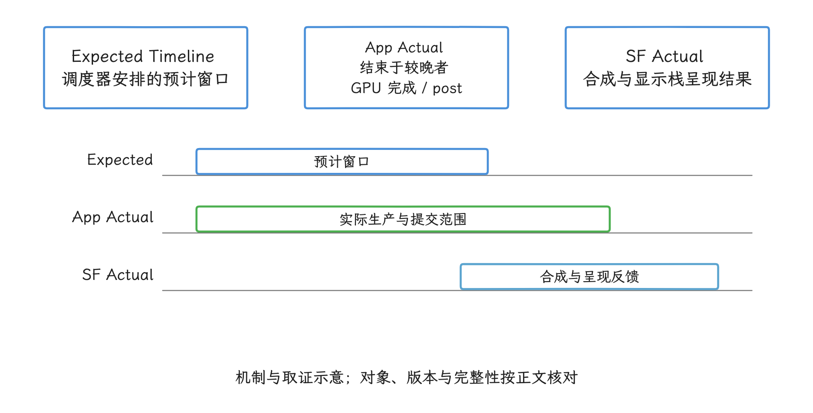

图：App Actual 终点取 GPU 完成与 post 中较晚者。 FrameTimeline 的定义不等于主线程 CPU 时长或光学响应。 时序条长与间隔为示意，非设备测量。

选中 Actual Slice 后，按下面的字段读：

- `Present Type`：Early、On-time 或 Late。
- `On time finish`：生产者是否在预计 deadline 前完成工作。
- `Jank Type`：平台分类，可包含 App、SurfaceFlinger、Display HAL（显示硬件抽象接口）、预测和调度原因。
- `Prediction Type`：预测是否有效或已经过期。
- `GPU Composition`：该帧是否使用 GPU 合成。
- `Layer Name`：区分同一进程更新的不同 Surface。
- `Is Buffer`：区分 buffer frame 与非 buffer 动画。

#### FrameTimeline 的颜色

官方 UI 为 FrameTimeline 定义了独立颜色语义：


| 颜色 | 含义 |
| --- | --- |
| 绿色 | 未观察到 jank 的帧 |
| 浅绿色 | 帧率可能平稳，但帧晚呈现并增加输入延迟 |
| 红色 | 该 Slice 所属进程被归因为 jank 来源 |
| 黄色 | App 帧发生 jank，但归因在 SurfaceFlinger |
| 蓝色 | Dropped frame |

颜色用于寻找候选帧，报告应记录 `present_type`、`on_time_finish`、`jank_type`、layer 和 token。`BufferStuffing` 表示应用在旧 buffer 尚未呈现时持续提交新 buffer，导致队列积压、延迟增加。Android 17 `FrameTimeline.cpp` 把 `BufferStuffing`、`SurfaceFlingerStuffing` 等状态与 deadline jank 分开计算；把它们合并成一句“App Deadline Missed”，就丢掉了这层区分。

<!-- gracker-diagram: ch14-02-21-stuffing-deadline -->
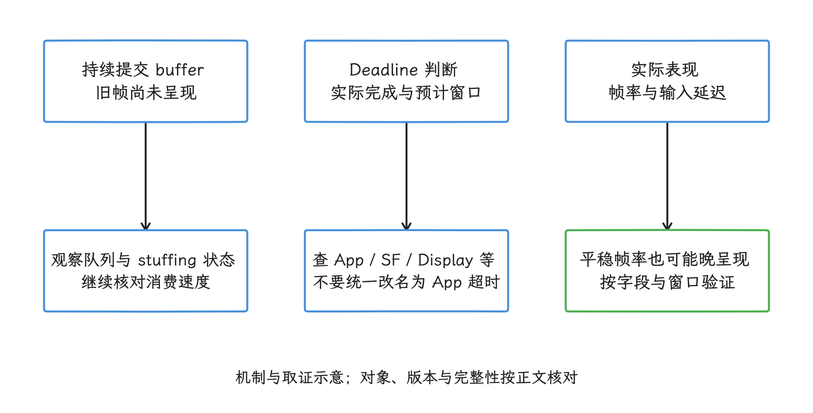

图：BufferStuffing 描述连续提交造成的积压与额外延迟。 Android 17 将 stuffing 与 deadline jank 分开处理，报告保留具体分类。

官方文档仍提示 SurfaceView 不在 FrameTimeline 的完整支持范围内。Camera、视频、游戏和跨进程嵌入常有独立的 Producer / Surface / layer，宿主窗口的帧 token 代替不了这些路径的逐帧信息。

<!-- gracker-diagram: ed14-02-frame-identities-and-independent-surfaces -->
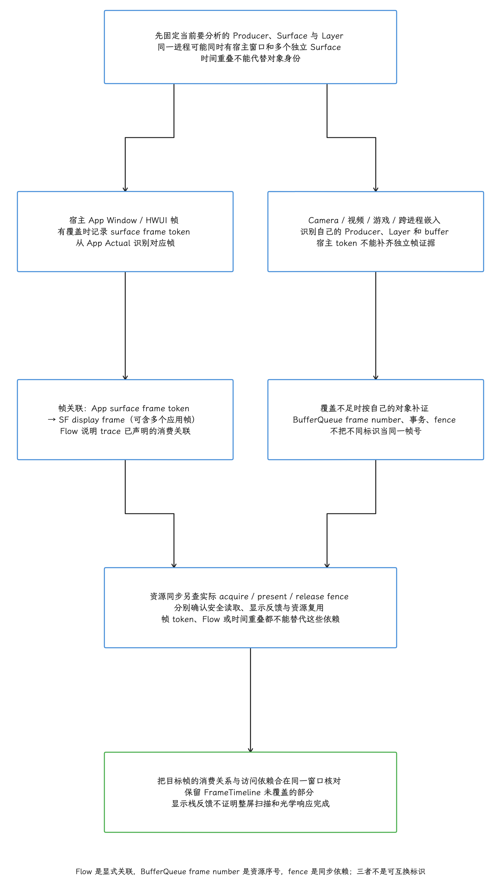

图：FrameTimeline按surfaceframe token关联AppActual与SFdisplayframe，displayframe可含多Appframe；它是消费关系不是同步信号，token非BQframenumber。独立SurfaceView/Camera/video/game/嵌入Producer需自己的Surface/layer/buffer/queue身份，官方FrameTimeline不完整覆盖下不能以宿主token代替。Flow只声明端点相关，不证明同步阻塞/唯一因果/完整链。acquire/present/release fences分别给可读/呈现/复用同步，API返回与显示光学另界。

### Android 17 SurfaceFlinger 轨道

Android 17 的主循环由 `Scheduler::onFrameSignal()` 组织。`Scheduler.cpp` 在同一帧信号中调用 `compositor.commit()` 处理事务、layer 状态和本帧准备工作；满足合成条件后，再调用 `compositor.composite()` 组织合成。对应实现位于 `SurfaceFlinger::commit()` 和 `SurfaceFlinger::composite()`。显示输出阶段继续进入 CompositionEngine 的 `Output::present()` 与 `presentFrameAndReleaseLayers()`。


旧 trace 的 Slice 名称因版本而异，对照下表：

| 平台 | SurfaceFlinger 观察入口 |
| --- | --- |
| Android 12 / 12L | 常见 `onMessageReceived`、`onMessageInvalidate`、`onMessageRefresh`、`REFRESH` |
| Android 13-17 | 按 `onFrameSignal`、`commit`、`composite` 以及可见的 present 子阶段阅读 |

Slice 名称受埋点和版本影响，不必指望每份 Android 17 trace 都出现一条字面为 `presentFrameAndReleaseLayers` 的 Slice；源码调用关系用来解释已经出现的阶段，trace 里没有的数据它变不出来。

`composite` 变长先别急着归为 GPU Client Composition：要同时找到 RenderEngine/`drawLayers` 等 GPU 合成痕迹、HWC（Hardware Composer，硬件显示合成器）的 composition type、layer 特征和 fence 时间。事务处理变重、latch（选定本轮要合成的 buffer）等待、HWC validate/present 或显示提交，都可能拉长 SurfaceFlinger 的一帧。

<!-- gracker-diagram: ed14-02-sf-frame-loop-and-composition-evidence -->
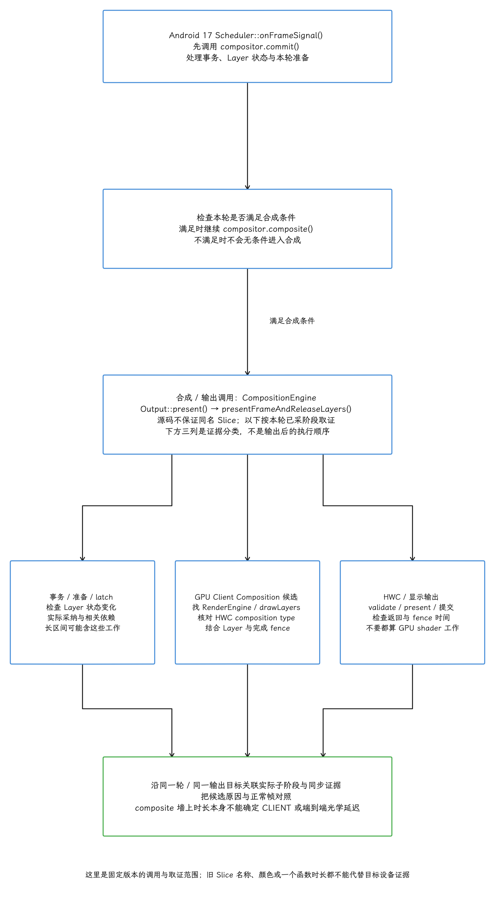

图：Android17ScheduleronFrameSignal先compositor.commit处理事务/layer准备，满足条件才composite，再CompositionEngineOutputpresent及presentFrameAndReleaseLayers。源码不保证每个函数有同名slice，12/12L旧onMessage入口不能机械套新版本。composite长可能事务/准备/latch、RenderEngineGPU、HWCvalidate/present或显示提交等；GPUClient需drawLayers/RE、compositiontype、layer特征及fence共同支持。条件不满足时不执行composite，不把长composite当自动CLIENT。

### 日志与原始事件

只有采集配置包含 Android log 数据源时，UI 才能显示抓取窗口内的日志；只有保留相应 ftrace event 时，原始事件表才有对应记录。看不到 Android Logs 或 Ftrace Events 时，先回查配置与数据完整性——“UI 没有轨道”和“系统没有发生事件”是两回事。

日志适合标记业务阶段和错误点，时间线用于验证线程、调度与依赖关系。日志时间戳、trace 时钟和跨文件合并可能使用不同时间基准；要先确认时钟转换和对齐误差，再做毫秒级因果判断。


### 与 Android Studio Profiler 的关系

Android Studio 的 System Trace 也是系统级视图，能够展示 CPU 核心、线程、显示、内存和部分功耗数据。把它描述成“只能看单个 App、看不到 SurfaceFlinger 或调度”已经不符合当前工具。

| 工具 | 适合的工作 |
| --- | --- |
| Android Studio System Trace | 在 IDE 内录制、围绕目标 App 查看线程和显示问题、结合工程工作流 |
| Perfetto UI | 打开多种 trace、完整时间轴导航、PerfettoSQL、Debug Track、宏和跨进程系统分析 |
| Android Studio Method / Function Trace | 查看方法或函数调用树、按调用栈随时间展开的 Flame Chart，以及从调用者或被调用者方向聚合的 Top Down/Bottom Up 视图 |
| Simpleperf / `linux.perf` | 调用栈采样、热点和 CPU profile |

Android Studio 的 System Trace 与 Java Method Trace 是不同的录制类型，一个 `.trace` 扩展名区分不了两者。复杂系统问题可以从 Android Studio 导出 System Trace，再放到 Perfetto UI 做 SQL 与跨进程分析。


### 一轮掉帧分析怎么走

拿到滑动卡顿的 trace 后，我们可以按这条主线走一遍：

1. 在 Info / Stats 确认复现窗口、目标进程、FrameTimeline 与调度数据存在，相关丢包不影响结论。
2. Android 12-17 从 App Actual Timeline 选择候选帧；Android 9-11 从 `doFrame`、RenderThread 与 SurfaceFlinger 的共同时间窗开始。
3. 记录 `Jank Type`、`Present Type`、`On time finish`、layer 与 token，不只记录颜色。
4. 回到主线程和 RenderThread，把长 Slice 与 Running、Runnable、S、D 状态求交。
5. Running 长时结合子 Slice 或调用栈找 CPU 工作；Runnable 长时检查全机 CPU、优先级和放置约束；S 状态沿 Binder、锁、条件变量或 waker；D 状态检查 `blocked_function` 与 `io_wait`。
6. 沿 FrameTimeline Flow 检查对应 display frame，再读 Android 17 的 `commit`（处理事务与帧准备）、`composite` 和显示输出阶段。
7. Binder 或锁跨进程时，把客户端、服务端、持锁线程和 reply 放进同一选区。
8. 用 SQL 复核同类帧是否重复出现，避免用一个案例代表整段运行。

这条主线用来判断手上的信息指向应用、调度、跨进程调用、合成还是显示末端；修复之后仍要回到对应代码、配置和设备上复现验证，FrameTimeline 的分类替代不了源码与 fence 这一层的核对。


### Android 17 源码核对点

| 结论 | Android 17 / kernel 锚点 | 代码能证明什么 |
| --- | --- | --- |
| 调度状态 | `external/perfetto/.../task_state.cc` + kernel `include/linux/sched.h` | Trace Processor 如何解码 `prev_state`，内核如何定义 Running / Interruptible / Uninterruptible 状态位 |
| Self Duration | `external/perfetto/.../slices/self_dur.sql` | `slice_self_dur` 用父 dur 减去直接子 Slice dur 之和；要求区间完整且正确嵌套 |
| Binder 关联 | `external/perfetto/.../android/binder.sql` | transaction、reply、线程与进程的标准库关联 |
| SurfaceFlinger 帧循环 | `Scheduler/Scheduler.cpp:411-506` | `onFrameSignal()` 组织 `commit()` 与 `composite()` |
| SurfaceFlinger 阶段 | `SurfaceFlinger.cpp:2996,3330` | Android 17 的 `commit()` 与 `composite()` 实现入口 |
| 显示输出 | `CompositionEngine/src/Output.cpp:450-517,1726` | `Output::present()` 与 `presentFrameAndReleaseLayers()` 的调用边界 |
| 帧分类 | `Scheduler/FrameTimeline.cpp` | Android 17 jank bit、non-jank 状态、Dropped 与 trace 字段转换 |

源码证明平台具备这些实现，不保证厂商设备采集了对应数据。每份 trace 仍要检查 data source、事件、权限和丢包。


## 状态轨道的语义与版本差异

通用 UI 对象熟悉之后，状态轨道还要继续核对三件事：状态枚举怎么定义、数据由哪个源产生、Perfetto 处在哪条版本线上。平台内置组件、Perfetto SDK 与开发机上的分析器各自升级，相同的视觉样式未必有相同的语义；“Android 17 支持 Perfetto v57”这样的一句话，概括不了三条版本线各自的进度。

### 三条版本线

`android-17.0.0_r1` 的 `external/perfetto/CHANGELOG` 顶部记录了一个尚未进入完整上游版本的 Android `aflags` 补丁；`aflags` 是 Android 的功能开关机制，让平台代码按 flag 启用或停用行为。紧接着的完整上游版本是 **v54.0**，发布于 2026-02-27；同一 Android 标签下的 `track_event.proto` 只定义到 `TYPE_COUNTER = 4`，还没有 `TYPE_STATE`。

Perfetto **v57.1** 于 2026 年 7 月 2 日发布，state track 从这一系列引入。**v57.2** 于 7 月 7 日发布；其历史修复针对内嵌 proto descriptor 的兼容性，state wire format 延续 v57.1。本文保留这组历史基线；截至本次复核，官方已发布 [v58.2](https://github.com/google/perfetto/releases/tag/v58.2)，不能再把 v57.2 称为当前最新版本。上游 SDK、Trace Processor 和 UI 更新，不会自动升级设备中的 `/system/bin/perfetto`、`traced`、`traced_probes` 或 Android Framework API。


| 对象 | 采用的版本 | 在哪里运行 | 能否直接提供 v57 状态轨道 |
|---|---|---|---|
| Android 平台 Perfetto | `android-17.0.0_r1`：v54.0 加平台补丁 | Android 17 设备 | 不能；平台 proto 没有 `TYPE_STATE` |
| Perfetto v57.2 C++ SDK / Trace Processor / UI | `v57.2` tag | 应用、测试工具或开发机 | C++ 生产与解析路径可用；C high-level 与 Java API 另有版本限制 |

这个拆分会影响方案选择：


- 只升级开发机分析器：可以读取新版 schema（trace 的字段与类型定义）和 PerfettoSQL 标准库，但不会补出设备未录制的数据。
- 想在 trace 中得到原生 `state` 表：producer（生产事件的一端）和 Trace Processor（解析事件的一端）都要具备 v57 state track 能力。
- 只能依赖 Android 17 系统内置组件：继续使用 slice、instant、counter 等 v54 能力；就算自行写出 `TYPE_STATE`，也不要假定平台自带工具能够解释。

### State track 的数据模型

#### Slice、counter 和 state 各自回答什么

| 轨道类型 | 数据形态 | 适合回答的问题 | 常见误用 |
|---|---|---|---|
| Slice | 开始、结束、可嵌套 | “这个操作执行了多久？” | 用大量首尾相接的 slice 模拟长期状态 |
| Counter | 时间戳加数值 | “这一刻的频率、字节数或队列深度是多少？” | 用整数枚举表达状态，却遗漏枚举表 |
| State | 时间戳加字符串状态，单轨道至多一个当前值 | “这个子系统在这段时间处于什么状态？” | 把同一时间可并存的多个活动塞进单条 state track |


state track 表达单值状态机：一条轨道在任一时刻最多有一个当前值，没有当前值时称为 idle。播放器的 `Buffering → Playing → Paused` 适合 state track。并行的下载任务、解码任务和渲染任务可以同时存在，应分别使用 slice 或多条轨道。


#### v57.1 在 trace 二进制格式中增加了什么

v57.1 的 `TrackEvent.Type` 增加 `TYPE_STATE = 5`，v57.2 延续同一 wire format（序列化后的二进制字段格式）。事件的 `track_uuid` 是轨道的 64 位稳定标识，必须指向带 `StateDescriptor` 的轨道；descriptor 是描述轨道类型和属性的元数据。`StateDescriptor` 在 v57.1/v57.2 中是空消息，只负责把轨道标记为 state track。

状态字符串的实际编码走 TrackEvent 的事件名路径，也就是 `name`，或经过 string interning（把重复字符串换成整数 ID）的 `name_iid`。v57.2 `track_event.proto` 的枚举注释仍写着 `state` 字段，但 schema 已把原字段号 51 标为 `reserved`——这个编号被保留下来，不再用作普通字段；C++ `TRACE_STATE` 也把状态值交给事件名参数。

⚠️ 实现差异：不能把“空字符串”和“省略事件名”视为同一编码。本次用 v57.2 发布 C++ SDK 录制，再由 v57.2/v58.2 主机分析器读取，`TRACE_STATE(..., "", track)` 产生了空字符串状态行；`TRACE_STATE(..., nullptr, track)` 才关闭当前状态且不生成 idle 行。手工生成 packet 时，省略 `name` / `name_iid` 表达清空；显式 `name: ""` 在这两个分析器中仍是状态值。该结论来自固定版本源码与主机合成/SDK trace，见 [ParseStateEvent](https://github.com/google/perfetto/blob/v57.2/src/trace_processor/importers/proto/track_event_event_importer.h) 与 [StateTracker](https://github.com/google/perfetto/blob/v57.2/src/trace_processor/importers/common/state_tracker.cc)。


下面节选只用于展示枚举范围，省略了 proto 中的大段注释和其他字段：

```protobuf
enum Type {
  TYPE_UNSPECIFIED = 0;
  TYPE_SLICE_BEGIN = 1;
  TYPE_SLICE_END = 2;
  TYPE_INSTANT = 3;
  TYPE_COUNTER = 4;
  TYPE_STATE = 5;
}
```

Android 17 标签中的同一枚举止于 `TYPE_COUNTER = 4`。`TYPE_STATE = 5` 只说明 v57 的二进制格式已经分配了这个枚举值，各种语言 SDK 未必同时提供高层方法；看到 API 37 或 Android 17，也推不出设备自带 v57 状态轨道。

#### Trace Processor 如何形成持续时间

v57.2 的 `StateTracker::UpdateState()` 展示了几条容易遗漏的语义：

- 新值与当前值不同：关闭旧行，把 `dur` 写成两次状态事件的时间差，再创建新行；
- 新值与当前值相同：不创建新行，只把新参数附加到当前状态；
- 未提供状态名（解析为 null string ID）：关闭旧行，不创建 idle 行；显式空字符串仍可能成为有效值；
- 尚未被下一次转换或清空关闭的行以 `dur = -1` 暂存；`-1` 是“持续时间尚未确定”的哨兵值。

这也解释了查询 `state` 表时为什么无需再用 `LEAD(ts)` 计算时长：`LEAD()` 只是读取下一行值的 SQL 窗口函数，而 Trace Processor 已经在维护 `dur`；手工拿下一行时间戳相减，相同状态合并、显式清空和开放区间的语义就都被丢掉了。


### 写入 state 事件

#### C++ SDK

下面的片段展示一个状态轨道上的三次转换。类别注册、Tracing 初始化和 session 配置沿用 Perfetto SDK 的常规写法，此处省略：

```cpp
perfetto::StateTrack player_state("Player state");

TRACE_STATE("player", "Buffering", player_state);
TRACE_STATE("player", "Playing", player_state);
TRACE_STATE("player", nullptr, player_state);  // 清空当前状态，进入 idle
```

第三次调用传入 `nullptr`，关闭 `Playing` 并进入 idle。这个更正后的片段已放入常规 in-process 会话初始化代码，用官方 v57.2 C++ SDK 发布归档在主机编译运行；分析器只得到 `Buffering` 与 `Playing` 两行。它不构成 Android system backend 兼容性验证。同一逻辑轨道需要复用稳定 `StateTrack` 身份，并让更新指向同一个 `track_uuid`；这个身份应在当前 trace 的作用域内区分实例。状态值宜来自有限枚举：请求 ID、文件名等高基数字符串宜放在参数中；若把它们当作状态值，会产生大量难以聚合的不同状态。

<!-- gracker-diagram: ed14-02-state-encoding-and-update-branches -->
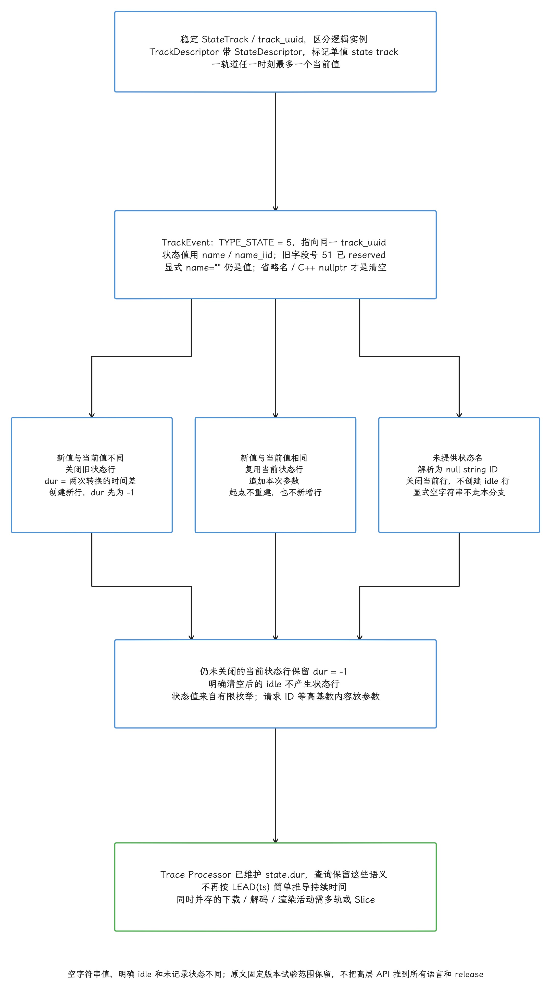

图：StateTrack同一时刻至多一个当前值，稳定trackuuid指向带StateDescriptor的TrackDescriptor，v57.1/57.2descriptor为空消息类型标记。TYPE_STATE5使用name/name_iid事件名字段，字段51reserved不是现行state字段。新不同值关旧行并新建dur-1；同值只附args不重建起点；省略name/name_iid或原文验证的C++nullptr关旧不建idle。显式空串在原文v57.2/v58.2形成状态行，不能当清空。尚未下一次转换/清空关闭的行dur-1；不要LEAD重算忽略同值/idle/open语义，独立并行活动用多轨/slice。

#### C high-level API：v57.2 与 v58.2

下面的调用向已经注册的状态轨道写入 `Buffering`。它在 [v58.2 C high-level 头文件](https://github.com/google/perfetto/blob/v58.2/include/perfetto/public/te_macros.h) 中可用，v57.2 发布头文件没有该宏；本次用两个版本的官方 C SDK 发布归档分别做了 C11 语法编译，v58.2 通过，v57.2 按预期报告 `PERFETTO_TE_STATE` 未定义。以下仍是省略类别定义与轨道注册的调用片段：

```c
PERFETTO_TE(player, PERFETTO_TE_STATE("Buffering"),
            PERFETTO_TE_REGISTERED_TRACK(&player_state_track));
```

`player_state_track` 必须使用所选版本的状态轨道注册接口构建 descriptor；普通 counter 或 named track 的 descriptor 不等于 state descriptor。v57.2 的公开 C 头文件没有 `PERFETTO_TE_STATE` 和 `PerfettoTeStateTrackRegister`；v58.2 已包含。项目应锁定实际采用的发布版本，再编译自己的完整注册与调用代码。

#### Android Java SDK 的 release tag 差异

v57.1 发布了 state track，但各语言 SDK 的高层 API 并未在同一个 release tag 中全部到位。源码核查得到下面的版本差异：

- `v57.1` 与 `v57.2` tag 下的 `src/android_sdk/.../PerfettoTrace.java` 只公开 slice、instant 和 counter 的事件类型，未出现 `TYPE_STATE` 或 `state(...)`；
- 上游 `main` 的 `sdk: add state track event support (C HL API + Java SDK)` 提交 #6464 才加入 `PerfettoTrace.state(...)`、state track builder、C high-level API 和 JNI（Java 与 C/C++ 之间的调用桥梁）路径；
- [v58.2 的 `PerfettoTrace.java`](https://github.com/google/perfetto/blob/v58.2/src/android_sdk/java/main/dev/perfetto/sdk/PerfettoTrace.java) 已公开 `state(Category, String, String)` 及动态名称入口；这证明对应 tag 有该源码接口，不能据此替项目实际解析到的 Maven artifact 做编译保证。

工程上以项目解析到的 Java artifact 和对应源码 commit 为准：锁定依赖，查看公共方法并编译完整使用代码。本次只核对 Java tag 源码，没有运行 Android Java 构建；若项目 artifact 没有 state API，可选已验证的 v57.2 C++ 路径，或升级到明确包含接口的 Java SDK 版本。


### 查询 `state` 表

#### 先确认分析器版本和表结构

Android 17 自带的 v54 Trace Processor 不认识 `state` 表。我们用 v57.1 或更高的兼容分析器打开 trace，先执行下面的结构查询。`PRAGMA table_info(...)` 是 SQLite/PerfettoSQL 用来列出表或视图字段的命令：

```sql
PRAGMA table_info(state);
```

v57.2 的公开 view（由 SQL 查询定义、读取时计算的表状结果）包含 `id`、`ts`、`dur`、`track_id`、`category`、`value` 和 `arg_set_id`。`ts` 与 `dur` 的单位都是纳秒，`arg_set_id` 可关联该状态附带的参数。状态列名是 `value`，不存在名为 `state` 的列。


#### 查询转换与已观测时长

下面按名称寻找有 state 记录的轨道，但只在恰好一个 `track.id` 匹配时计算。多实例同名轨道必须先从 `track`、descriptor UUID、进程和参数中选定目标，不能合并后冒充单个状态机。缺失或多匹配时该查询返回空集，报告应把歧义与零时长区分开。查询将完整区间和 `dur = -1` 的开放行都裁剪到 `trace_bounds` 的 `[start_ts, end_ts)`：

```sql
WITH candidates AS (
  SELECT DISTINCT t.id
  FROM track AS t
  JOIN state AS s ON s.track_id = t.id
  WHERE t.name = 'Player state'
), target AS (
  SELECT id FROM candidates WHERE (SELECT COUNT(*) FROM candidates) = 1
), bounded AS (
  SELECT
    s.track_id, s.value, s.category, s.arg_set_id,
    MAX(s.ts, b.start_ts) AS start_ts,
    MIN(CASE WHEN s.dur = -1 THEN b.end_ts ELSE s.ts + s.dur END,
        b.end_ts) AS end_ts
  FROM state AS s
  JOIN target AS t ON t.id = s.track_id
  CROSS JOIN trace_bounds AS b
  WHERE s.dur >= -1
)
SELECT
  track_id, start_ts AS ts, value, category,
  end_ts - start_ts AS observed_dur_ns,
  ROUND((end_ts - start_ts) / 1e6, 3) AS observed_dur_ms,
  arg_set_id
FROM bounded
WHERE end_ts > start_ts
ORDER BY ts;
```

`CROSS JOIN trace_bounds` 把同一 trace 范围附到每条记录。结果是从已记录状态事件开始、落在边界内的观测时长；开放状态可能在 trace 结束后继续，第一条已知状态之前则保持未知。即便业务早已进入该状态，分析器也不能凭后来的同名值推断其真实开始时间。更细的业务比较应把这里的边界改为明确的目标窗口，并验证事件与增量状态未丢失。


#### 汇总各状态占比

下面的查询把每行限制在 trace 边界内，再按状态值聚合；我们拿它比较一次录制中播放器的缓冲和播放占比：

```sql
WITH candidates AS (
  SELECT DISTINCT t.id
  FROM track AS t
  JOIN state AS s ON s.track_id = t.id
  WHERE t.name = 'Player state'
), target AS (
  SELECT id FROM candidates WHERE (SELECT COUNT(*) FROM candidates) = 1
), bounded AS (
  SELECT
    s.value,
    MIN(CASE WHEN s.dur = -1 THEN b.end_ts ELSE s.ts + s.dur END,
        b.end_ts) - MAX(s.ts, b.start_ts) AS dur
  FROM state AS s
  JOIN target AS t ON t.id = s.track_id
  CROSS JOIN trace_bounds AS b
  WHERE s.dur >= -1
)
SELECT
  value,
  ROUND(SUM(dur) / 1e6, 3) AS total_ms,
  ROUND(100.0 * SUM(dur) / NULLIF(SUM(SUM(dur)) OVER (), 0), 2)
    AS observed_percent
FROM bounded
WHERE dur > 0
GROUP BY value
ORDER BY total_ms DESC;
```

`SUM(SUM(dur)) OVER ()` 汇总所有状态值的合计时长。该分母只包含查询选定轨道中有 `state` 行且与窗口相交的区间；省略状态名的显式清空不会创建 idle 行，显式空字符串值则会进入分母。若要计算整个观测窗口占比，应另用窗口长度做分母，并把明确清空后的 idle 与首条事件前、丢包造成的未知区间分开；不能把所有空白都补成 idle。

<!-- gracker-diagram: ed14-02-state-window-and-denominator -->
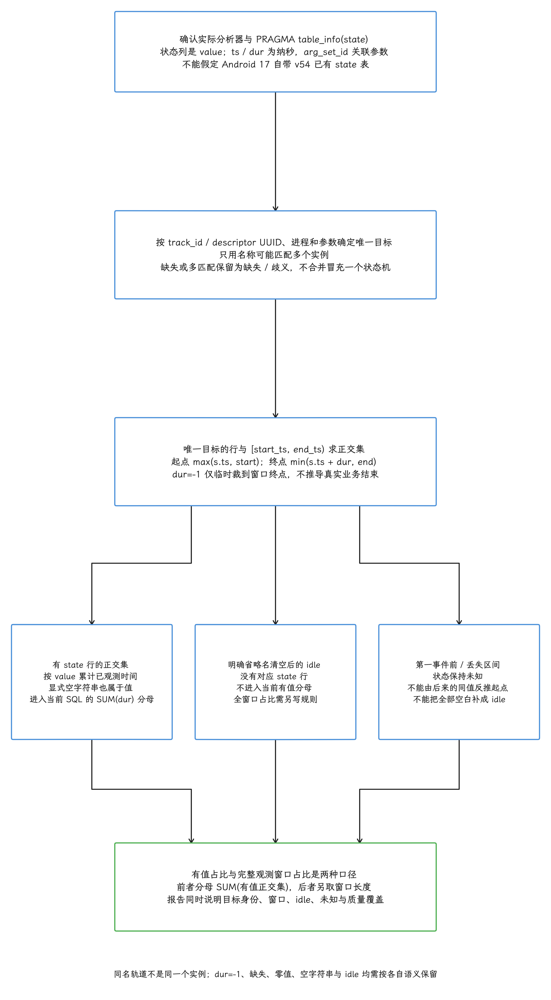

图：先PRAGMAtable_info(state)，v57.2view有id/ts/dur/track_id/category/value/arg_set_id，状态列value不是state。按trackid/UUID/process/args选唯一实例，同名多匹配/缺失返回空保留歧义。正区间裁剪max(s.ts,start)到min(s.ts+dur,end)，dur-1仅暂裁窗口末尾，非业务结束，第一事件前未知。当前SUMdur分母仅选定有state行的正交集，显式空串也入；省略名清空无idle行不入。完整窗口占比需另取窗口长度，已知idle与首事件前/丢失未知分别统计；丢失/增量状态完整性须验证。

### 在 Android 17 上采用 v57 能力


#### 路径一：只升级开发机分析器

这是改动最小的方案：

1. Android 17 继续使用系统 Perfetto 录制 sched、ftrace、atrace、FrameTimeline、heap profile 等既有数据；
2. 开发机安装固定版本的 v57.2 或更高 Trace Processor；
3. 用该分析器读取 trace，执行 SQL 并保存查询结果、工具版本和原始文件。

这个方案能获得新分析器的表结构、PerfettoSQL 标准库和解析修复，但旧 producer 依旧不会产生 `TYPE_STATE`。

#### 路径二：应用携带新版 SDK 生产 state track

需要原生状态轨道时，应把 producer SDK 与 Trace Processor/UI 作为一组有明确版本的能力交付：

1. 应用或测试进程链接包含状态轨道的 Perfetto SDK；
2. 在 in-process backend 或经验证的 system backend 上录制；
3. 使用 v57.2 或更高的兼容 Trace Processor 和 UI 打开结果；
4. 在目标 Android 17 build 上验证注册、SELinux、缓冲区、丢包统计和 SQL 表；
5. 为旧分析器保留可识别的降级标记，或者明确拒绝旧版本工具。

backend 是 SDK 写入 trace 的目标：in-process backend 在本进程管理会话与缓冲；system backend 连接设备 tracing service。官方的 [Tracing Protocol ABI](https://github.com/google/perfetto/blob/v54.0/docs/design-docs/api-and-abi.md) 由 protobuf-over-Unix-socket 协议、共享内存布局与 protobuf 消息构成，并按双向兼容维护；它与 C++ SDK 的编译接口不是同一层。目标镜像仍要核验 SDK 构建是否启用该 backend、socket 权限、数据源注册策略、SELinux、缓冲区和丢包。写入服务与离线解析分别验收：旧工具不会因服务搬运了新字段就自动理解 `TYPE_STATE`，不能把泛称的“SDK ABI 不匹配”当成连接失败结论。

平台采集服务的升级应随产品镜像整体验证：`traced` / `traced_probes` 与 init、Unix socket 权限、SELinux、Producer/Consumer IPC 协议和系统测试一起交付。它们的 Perfetto IPC 不应混称为 AIDL/Binder。离线主机 Trace Processor 可以独立升级；若把工具放进产品镜像，则仍按该镜像的权限、构建和兼容性要求交付，不能由主机解析成功推导设备服务兼容。


#### 路径三：维持 Android 17 平台兼容

用不了新版 SDK 时，可以按数据含义选择 Android 17 已有的轨道类型：

- 有明确开始和结束的活动：slice；
- 某个时刻的数值：counter；
- 单次状态转换提示：instant，并通过稳定名称或参数携带值；
- 需要计算状态持续时间：由生产端维护成对 slice，或在 SQL 中依据经过审核的 instant 事件构造区间。

这种兼容表达缺少 state track 的单值约束和专用 UI 展示。生产代码要自行保证状态转换合法，文档、SQL 和指标名称也应标明所用替代方案，避免与原生 `state` 表混用。

<!-- gracker-diagram: ed14-02-versioned-state-adoption-and-backends -->
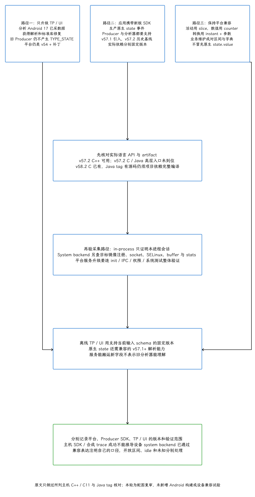

图：固定Android17platformv54+补丁proto无TYPE_STATE，v57.1引入state/v57.2沿用，本文历史v57.2与复核v58.2不混最新。仅升级TP/UI能新解析/SQL但不能生成旧Producer没录的state；新版SDKstate按实际语言release/artifact编译。原文v57.2C++nullptr主机inprocess验证，v57.2C/Java高层缺口，v58.2C11片段编译/Java仅tag源码不等项目Android构建。Systembackend需目标镜像注册/socket/SELinux/buffer/stats，PerfettoIPCprotobuf-overUnixsocket与SMB按ABI维护，非Binder/AIDL或泛称SDK编译ABI。旧表达slice/counter/instant维护转换字典/区间并标注，不冒充state表。

### v57 系列的其他变化

- `linux.systemd_journald` data source 采集使用 systemd 的 Linux 系统日志 journald，并在统一日志表中用 `log_source` 标明来源。Android 使用 logcat；该数据源不会在 Android 17 上取代 logcat。
- JSON Trace Event Format 用 `"ph": "X"` 表示完整区间；同线程同步事件可以正确嵌套。v57.2 合成测试中，完整父子区间留在同一轨道；交叉重叠（A 开始、B 开始、A 结束、B 结束）则被分配到 overflow track，并记录 `slice_spill_overlapping_complete_event`。需要表达独立、可交叉的活动时，生产端使用异步 `"b"` / `"e"` 事件。
- 查询结果网格增加列排序、重排、隐藏和更清楚的 SQL 错误显示。这些是 UI 操作能力，不改变表结构或 SQL 计算结果。
- `heapprofd.process_cmdline` 是按进程命令行选择 native heap profiler（C/C++ 堆分析器）目标的配置项。它支持部分通配符，但通配符只能匹配已经运行的进程；配置必须设置 `no_startup = true`，明确禁用“从进程启动时开始 profiling”的模式。
- C high-level API 和 Android Java SDK 增加嵌套轨道及同级轨道的排序、合并控制。correlation ID（关联 ID）只表示多个事件属于同一逻辑操作，不包含因果方向；需要表达跨线程的先后或因果关系时仍应使用 flow。
- Trace Processor 可从公开 URL 或 Perfetto permalink（Perfetto UI 保存并分享 trace 的链接）加载 trace。生产 trace 常含进程、线程与业务信息，公开 URL 只适合经过授权和脱敏的文件。
- `perfetto` Python 包默认选择与包版本对应的 Trace Processor 二进制，便于重复得到相同结果；切换到 `fetch_latest_trace_processor` 会让同一脚本在不同日期下载不同二进制，产生版本漂移。
- Adreno 是 Qualcomm GPU 系列。它的 `adreno_cmdbatch_retired`、`adreno_cmdbatch_sync` ftrace 事件在 v57.1 中可解析为 GPU timeline slice；目标设备是否提供这些内核事件仍取决于系统 build 与 GPU 驱动。
- v57.2 只修复携带自有 proto descriptor 的 trace 在 wire-compatible schema 变化后可能解析失败的问题。wire-compatible 表示字段变更仍遵守 protobuf 的序列化兼容规则；这项修复不改变 state track 的数据模型。


### 评审清单

评审含 v57 state track 的改动时，可逐项检查：

- [ ] Android 平台版本基线写成 Android 17 / API 37 / `android-17.0.0_r1`
- [ ] 平台内置 Perfetto 标为 v54.0 加平台补丁，没有写成 v57
- [ ] producer SDK、Trace Processor 和 UI 各自记录版本或 commit（源码提交标识）
- [ ] state track 使用稳定轨道身份和有限状态集合
- [ ] 清空编码已按所用 SDK/分析器实测，显式空字符串值与 idle 区分；占比分母说明 idle 和未知区间
- [ ] SQL 使用 `state.value` 和 `state.dur`，没有重复用 `LEAD()` 推导时长
- [ ] `dur = -1` 按 trace 边界处理，并注明只是观测窗口
- [ ] C high-level 与 Java 调用由项目实际 artifact 编译验证，注明 v57.2 与 v58.2 的 API 差异；源码核对不冒充 Java 编译
- [ ] trace 上传、公开 URL 和提供给 AI 模型的方式符合数据处理规则


### 源码与官方资料

- [Perfetto v57.1 release notes](https://github.com/google/perfetto/releases/tag/v57.1)
- [Android 17 标签下的 Perfetto CHANGELOG](https://android.googlesource.com/platform/external/perfetto/+/refs/tags/android-17.0.0_r1/CHANGELOG)
- [Android 17 标签下的 TrackEvent proto](https://android.googlesource.com/platform/external/perfetto/+/refs/tags/android-17.0.0_r1/protos/perfetto/trace/track_event/track_event.proto)
- [v57.1 TrackEvent proto](https://github.com/google/perfetto/blob/v57.1/protos/perfetto/trace/track_event/track_event.proto)
- [v57.1 StateDescriptor proto](https://github.com/google/perfetto/blob/v57.1/protos/perfetto/trace/track_event/state_descriptor.proto)
- [v57.1 `state` SQL view](https://github.com/google/perfetto/blob/v57.1/src/trace_processor/perfetto_sql/stdlib/prelude/after_eof/views.sql)
- [v57.1 StateTracker](https://github.com/google/perfetto/blob/v57.1/src/trace_processor/importers/common/state_tracker.cc)
- [v57.1 Android Java `PerfettoTrace`](https://github.com/google/perfetto/blob/v57.1/src/android_sdk/java/main/dev/perfetto/sdk/PerfettoTrace.java)
- [上游 Java state track 变更 #6464](https://github.com/google/perfetto/commit/0894477744bf11fa1f08ca81bbceb14cd5385737)


## 常见误区

**Slice 很长，所以 CPU 计算很重。** Slice 是墙上区间，线程可能大部分时间在等待。要看线程状态或可用的线程时间。

**Running 就能知道热点函数。** Running 只证明线程占用 CPU。函数级归因需要嵌套 Slice、调用栈采样或方法跟踪。

**Runnable 长就提高线程优先级。** Runnable 只证明线程在等 CPU。优先级、负载、affinity、cpuset、热限制和调度策略都要核对，盲目提权还会伤害其他线程和功耗。

**D 状态就是磁盘慢。** D 表示不可中断等待。没有 `blocked_function`、`io_wait` 或驱动证据时，先别把原因限定为磁盘。

**红色都代表同一种问题。** Thread State、锁竞争 Slice 和 FrameTimeline 各有自己的颜色语义。结论应写轨道类型和字段值。

**Android Studio System Trace 只看 App。** 当前 System Trace 能展示系统级活动。Perfetto UI 的差异主要在开放时间轴、SQL、扩展和跨进程分析能力，“有没有系统数据”这把尺子已经不适用。

## 小结

读 Perfetto UI，我们先把轨道对象、时间范围和数据源确认清楚，再去读 slice、counter、thread state 与 flow。颜色只是当前 UI 的视觉提示，墙上时间与 CPU 运行时间是两回事，结论要落回详情字段、稳定身份和 SQL。state track 另有独立的 producer、分析器与 UI 版本线，跨版本使用时，把实际 schema 和缺失的范围记录在案。


## 参考资料

- [Perfetto UI](https://perfetto.dev/docs/visualization/perfetto-ui)、[Commands and Macros](https://perfetto.dev/docs/visualization/ui-automation)、[Debug Tracks](https://perfetto.dev/docs/analysis/debug-tracks) 与上游 [`colorForThreadState()`](https://github.com/google/perfetto/blob/v58.2/ui/src/plugins/dev.perfetto.Sched/common.ts)：加载、导航、Area Selection、Pin、命令面板、SQL 轨道和配色实现边界。
- [CPU Scheduling events](https://perfetto.dev/docs/data-sources/cpu-scheduling)、[PerfettoSQL tables](https://perfetto.dev/docs/analysis/sql-tables) 与 [Android trace cookbook](https://perfetto.dev/docs/analysis/common-queries)：调度状态、waker、`thread_state`、D 状态和 `blocked_function`。
- [Android Jank detection with FrameTimeline](https://perfetto.dev/docs/data-sources/frametimeline) 与 [Track Event flows](https://perfetto.dev/docs/instrumentation/track-events)：Expected / Actual、帧字段、颜色和 Flow 语义。
- [PerfettoSQL standard library](https://perfetto.dev/docs/analysis/stdlib-docs)：`slices.self_dur`、Binder 和 Android 分析模块。
- [Android Studio System Trace](https://developer.android.com/studio/profile/cpu-profiler)：Android Studio 当前系统级时间轴的能力边界。
- Android 17 [`Scheduler.cpp`](https://android.googlesource.com/platform/frameworks/native/+/refs/tags/android-17.0.0_r1/services/surfaceflinger/Scheduler/Scheduler.cpp)、[`SurfaceFlinger.cpp`](https://android.googlesource.com/platform/frameworks/native/+/refs/tags/android-17.0.0_r1/services/surfaceflinger/SurfaceFlinger.cpp)、[`Output.cpp`](https://android.googlesource.com/platform/frameworks/native/+/refs/tags/android-17.0.0_r1/services/surfaceflinger/CompositionEngine/src/Output.cpp) 与 [`FrameTimeline.cpp`](https://android.googlesource.com/platform/frameworks/native/+/refs/tags/android-17.0.0_r1/services/surfaceflinger/Scheduler/FrameTimeline.cpp)：帧调度、提交、合成、显示输出和帧分类。
- Android 17 [`task_state.cc`](https://android.googlesource.com/platform/external/perfetto/+/refs/tags/android-17.0.0_r1/src/trace_processor/types/task_state.cc)、[`self_dur.sql`](https://android.googlesource.com/platform/external/perfetto/+/refs/tags/android-17.0.0_r1/src/trace_processor/perfetto_sql/stdlib/slices/self_dur.sql) 与 [`binder.sql`](https://android.googlesource.com/platform/external/perfetto/+/refs/tags/android-17.0.0_r1/src/trace_processor/perfetto_sql/stdlib/android/binder.sql)：调度状态、Self Duration 和 Binder 关联实现。
- common kernel [`android17-6.18-2026-06_r6/include/linux/sched.h`](https://android.googlesource.com/kernel/common/+/refs/tags/android17-6.18-2026-06_r6/include/linux/sched.h)：Linux task 状态位定义。
