# 线程 CPU 状态分析

线程状态只回答一个问题：在一段墙钟时间（wall-clock time，即现实经过的时间）里，线程是否具备运行条件、是否正占着 CPU。至于线程在执行哪个函数、等待哪把锁或哪次 I/O，我们要把状态区间与 Slice（Trace 时间轴上的事件区间）、调用栈、唤醒者、Binder（Android 的进程间通信机制）、文件系统和设备事件放到同一时间范围内核对，才能回答。


> 源码基线：AOSP `android-17.0.0_r1`（Android 17 / API 37）的 Perfetto 导入逻辑；内核 `android17-6.18-2026-06_r6`。
>
> 状态转换、四段 SQL 与数据缺失时的行为，另在主机上以 Trace Processor v54.0、v57.2、v58.2 解析合成 Trace 复核；这只覆盖解析逻辑，目标设备上的采集与性能表现要另行实测，且各发布版代码与该 tag 各有差异。旧平台同样有调度事件，字段、内核符号和标准库模块可能有出入。

## 14.3.1 状态从哪里来

### 从任务位到 UI 状态的三个层次

UI 里这些字符串从哪里来？我们从内核的任务状态位说起。Linux 6.18 的 `include/linux/sched.h` 把 `TASK_RUNNING` 定义为 0，这个值同时覆盖正在 CPU 上执行的任务和具备运行条件、还没上 CPU 的任务；所以只看 `task_struct->__state`，分不出 Running 与 Runnable，这一步区分要靠调度事件来完成。


Perfetto 依靠事件补出时间线：

- `sched_switch` 说明前一个线程何时离开 CPU、下一个线程何时进入 CPU。Perfetto 把下一个线程记为 `Running`，并用 `prev_state` 为离开的线程打开后续状态区间。
- `sched_waking` 记录唤醒动作。正常的阻塞到可运行转换中，Perfetto 关闭旧阻塞区间并打开 `R`；首次观察到线程时也可直接打开 `R`。重复唤醒与 `R+` 的导入行为见 14.3.5；每条 waking 未必对应一次新的睡眠结束。
- 下一次 `sched_switch` 选中该线程时，Perfetto 关闭 `R` 或 `R+`，打开 `Running`。


`utid` 是 Perfetto 在一份 Trace 内分配的线程唯一标识，`upid` 则是进程唯一标识；当操作系统进程号（PID）或线程号（TID）被复用时，我们靠它们区分前后不同的实例。`waker_utid` 标识执行唤醒动作的线程；`waker_id` 要等导入器找到该唤醒线程当时的 Running 行，才会填充并指向它，所以两者可能只有前者。`irq_context` 来自唤醒记录所保留的中断标志。这些标识都只在当前 Trace 内有效。


同一份调度事实有两个视角：`sched_slice` 从 CPU 视角记录“哪个 `utid` 在哪个 CPU 上运行多久，切出时是什么状态”；`thread_state` 从线程视角重建状态区间，并附带 CPU、I/O 等待、阻塞函数和唤醒者等可选字段，事件缺失时覆盖未必连续完整。两张表中的 `dur = -1` 表示没有可靠的结束时间，常见于 Trace 尾部或数据丢失，聚合时要把它留在统计之外。本文区间函数只统计 `dur > 0` 的已闭合状态，同时报告未覆盖时间；未知区间只是没被计入，它耗时多少仍属未知。

<!-- gracker-diagram: ch14-03-05-cpu-vs-thread -->
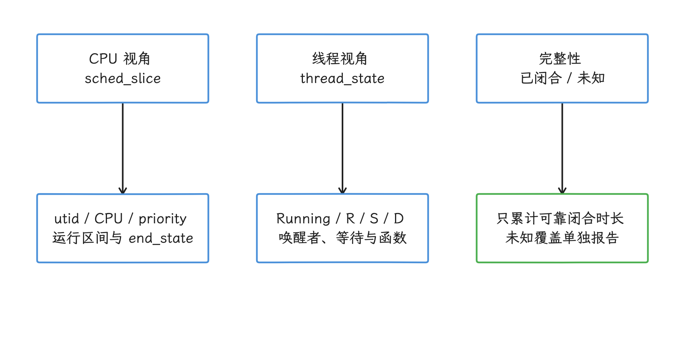

图：sched_slice 回答 CPU 由谁运行，thread_state 回答线程的状态与可用线索。 状态重建可能有缺口；dur = −1 要留在聚合之外。

### 常见状态与跨版本字符

| Perfetto 状态 | 含义 | 能直接得出的事实 |
| --- | --- | --- |
| `Running` | 线程被调度在某个 CPU 上 | 该调度区间占用 CPU 时间线 |
| `R` | Runnable | 线程具备运行条件，尚未进入 CPU |
| `R+` | Runnable (Preempted) | 前一次切出被内核标为抢占式切换 |
| `S` | Sleeping | 线程处于可中断睡眠 |
| `D` | Uninterruptible Sleep | 线程处于不可中断睡眠 |
| `T` | Stopped | 线程被停止 |
| `t` | Traced | 线程受跟踪控制 |
| `X` / `Z` | 退出 / 僵尸状态 | 线程处于退出流程 |
| `I` / `P` | `TASK_IDLE` 的报告态 / Parked（停驻） | 特殊任务状态；`I` 不等于 CPU idle 轨道，也不能据此认定为 swapper 线程 |
| `W` / `K` / `N` / `x` 等兼容字符 | Waking / Wake Kill / No Load / Task Dead | 来自旧内核位布局或文本输入等兼容路径，不保证出现在当前 6.18 二进制调度事件中 |

状态名称以详情面板或 SQL 字段为准。内核 `__state` 位、`sched_switch.prev_state` 的报告编码、Perfetto 解析后的字符串是三个层次：当前内核会掩码并重编码部分状态，直接把 `TASK_*` 数值塞进 `prev_state` 未必对得上。Perfetto 的二进制解码还依赖 Trace 中记录的内核版本，缺失时该 tag 回退到旧布局。UI 的颜色同样会随版本、主题和选中状态变化，把它当作稳定接口并不可靠。

<!-- gracker-diagram: ed14-03-versioned-state-reconstruction -->
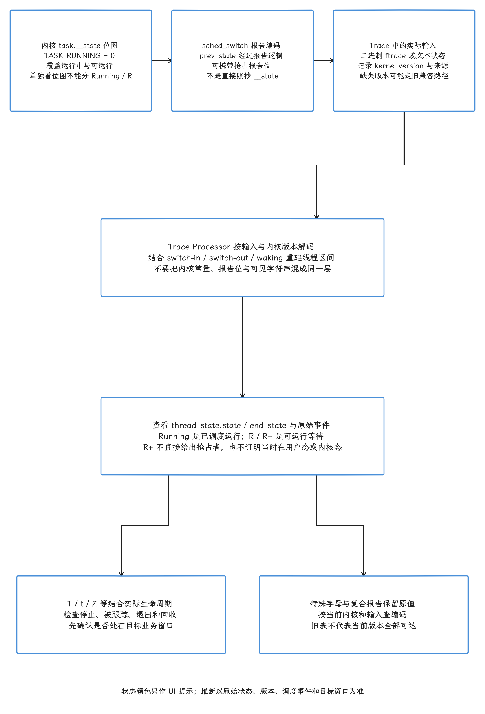

图：内核task.__state位图、sched_switch prev_state报告编码和TP重建字符串是不同层；TASK_RUNNING=0覆盖实际运行与可运行，需调度事件区分。固定内核版本与二进制/文本输入，旧版缺内核版本可能走兼容解码。Android17/内核6.18语境中R+来自抢占报告位，不直接证明用户/内核来源或谁抢占。T/t/Z及兼容字母保留原始state/end_state结合生命周期，不能假定旧表全部在当前编码可达。

### `R+` 的抢占编码

Tracepoint 是内核预先定义的静态事件记录点。在 `sched_switch` Tracepoint 里，6.18 内核按下面的逻辑编码抢占：

```c
if (preempt)
    return TASK_REPORT_MAX;

/* TP_printk() 在 TASK_REPORT_MAX 置位时追加 "+"。 */
```

这段逻辑把抢占式切出的线程统一呈现为 `R+`。至于抢占发生在用户态还是内核态、抢占者是谁、为什么抢占，`R+` 本身一样都没记。要回答这些问题，我们回到同一 CPU 上随后的 `sched_slice`，对照线程自身的优先级和调度策略；时间片、调度类和唤醒抢占都可能牵涉其中。

<!-- gracker-diagram: ch14-03-07-rplus-meaning -->
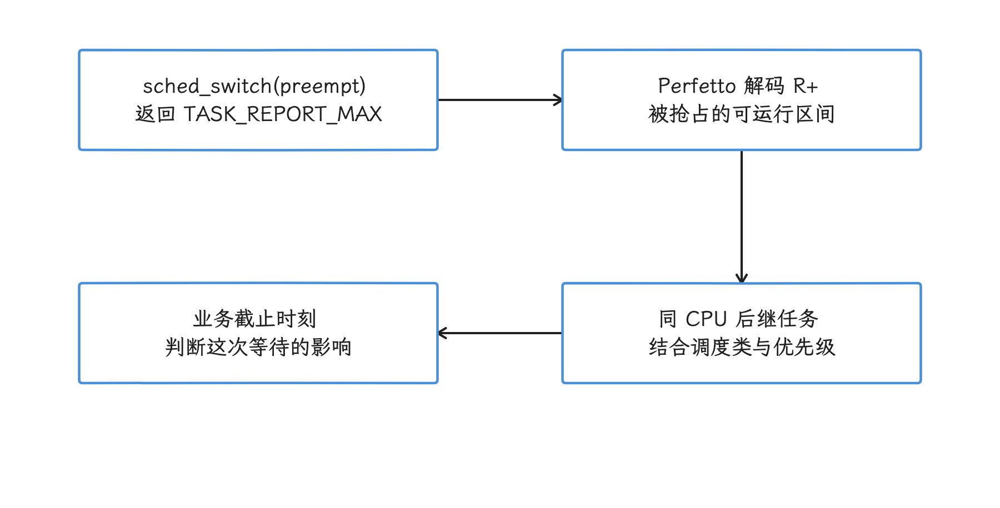

图：preempt 切出报告 R+；要从同 CPU 的后继执行重建现场。 用户态还是内核态、抢占原因是什么，都要靠后继执行还原。

读 `R` 时还要避开一个习惯性误读：把它当成“由睡眠刚刚唤醒”。线程在保持可运行状态时离开 CPU，同样可能产生 `R`；唤醒来源的讨论，以实际存在的 `sched_waking` 和 `waker_utid` 为准。


## 14.3.2 采集与 UI 读取

状态重建的质量取决于采集。下面的配置通过 ftrace（Linux 内核跟踪机制）采集线程状态、唤醒、D 状态原因、频率和中断，适合十几秒的定点复现：

```protobuf
buffers {
  size_kb: 65536
  fill_policy: RING_BUFFER
}
duration_ms: 15000

data_sources {
  config {
    name: "linux.ftrace"
    ftrace_config {
      compact_sched {
        enabled: true
      }

      ftrace_events: "sched/sched_switch"
      ftrace_events: "sched/sched_waking"
      ftrace_events: "sched/sched_wakeup_new"
      ftrace_events: "sched/sched_blocked_reason"
      ftrace_events: "sched/sched_process_exit"
      ftrace_events: "sched/sched_process_free"
      ftrace_events: "task/task_newtask"
      ftrace_events: "task/task_rename"

      ftrace_events: "power/cpu_frequency"
      ftrace_events: "power/cpu_idle"

      ftrace_events: "irq/irq_handler_entry"
      ftrace_events: "irq/irq_handler_exit"
      ftrace_events: "irq/softirq_entry"
      ftrace_events: "irq/softirq_exit"

      symbolize_ksyms: true
    }
  }
}

data_sources {
  config {
    name: "linux.process_stats"
    process_stats_config {
      scan_all_processes_on_start: true
    }
  }
}
```

这里有两层缓冲要分清。`buffers.size_kb` 配置的是 Perfetto 服务端 Trace buffer，`RING_BUFFER` 写满会覆盖最早的数据，事件突增时可能丢掉 Trace 开头；内核每 CPU 的 ftrace ring buffer 是另一层，由 `ftrace_config.buffer_size_kb` 等控制，把服务端 buffer 调大，内核 overrun 也不会因此自动消除。


三个调度事件分工不同：`sched_switch` 是构建 Running 和切出状态的基础，`sched_waking` 补充唤醒与 Runnable 起点，`sched_blocked_reason` 补充 D 状态的 `io_wait` 和睡眠函数。


`compact_sched` 只对 `sched_switch` / `sched_waking` 使用紧凑编码，格式不兼容时可回退到逐事件编码，其余 ftrace 事件保持原样。两条唤醒路径在中断标志上还有一处差别：紧凑 waking 保留的 `common_flags` 会传给线程状态的 `irq_context`，逐事件 `ParseSchedWaking()` 不传该参数。因此 `irq_context` 为 NULL 时，读作“这次没记录”更准确，“非中断”是过度解读。


`symbolize_ksyms` 尝试把内核地址解析成函数名。Android 平台构建可使用 init 预先打开并继承的 `/proc/kallsyms` 文件描述符；Linux / 独立构建还可依赖 capabilities（进程能力）、root 或允许读取地址的 sysctl 配置——“traced_probes 必须是 root”只描述其中一部分路径。无论采用哪条路径，都应检查符号实际可读、Tracepoint 是否采到和导入结果；解析失败时 `blocked_function` 可能为空。


设备可能缺少某些 Tracepoint，量产构建也可能限制内核符号，所以录制完成后先做体检：检查 `stats` 表中 `name = 'ftrace_setup_errors'` 的统计值，再查看该 tag 的 `metadata` 表中同名条目的详情。注意 `unknown_ftrace_events` / `failed_ftrace_events` 是 Trace 内 `FtraceStats` 消息的字段，与这两个同名 `stats` 行是两回事。丢失情况另查 `ftrace_cpu_has_data_loss`、`ftrace_cpu_overrun_delta` 等统计；若启用 `linux.perf`，还要看 `perf_cpu_lost_records` 等统计。不同发布版可能调整详情的保存位置，以所用处理器的表结构为准。至于空字段，它说明的只是“没查到”，离“没有发生”的结论还很远。


采集过关后，UI 里有两个互补入口：

- CPU Scheduling 轨道按 CPU 展示 `sched_slice`。选中区间可查看 `utid`、CPU、优先级和 `end_state`，也能看到之前的 Runnable 延迟与唤醒信息。
- 进程下的 `Thread State` 轨道按线程展示 `thread_state`。选中状态可查看持续时间、CPU、`io_wait`、`blocked_function`、唤醒者和中断环境。

分析关键路径时，我们先固定业务 Slice 或 FrameTimeline 帧，再看该时间范围内的线程状态。FrameTimeline 是 Android 12 起记录预期帧与实际帧时间线的机制；Looper 是 Android 线程处理消息队列的循环。把整条线程生命周期的状态占比拉出来，主导它的通常是 Looper 的正常睡眠，对解释一次掉帧或启动帮不上忙。


## 14.3.3 Running：已被调度，不等于应用代码独占 CPU

先看 Running。`Running` 表示调度器让该线程占据某个 CPU 的任务时间线，这段执行可能在用户态，也可能在系统调用或异常处理的内核态。硬中断（HardIRQ）会立即暂停当前任务去处理设备事件，但不一定发生 `sched_switch`，这段 IRQ 时间仍落在外层 Running 调度区间里。SoftIRQ 是随后处理延迟中断工作的机制，既可能在当前 CPU 的中断返回路径执行，也可能交给 `ksoftirqd` 内核线程。

<!-- gracker-diagram: ch14-03-15-running-interrupt-layers -->
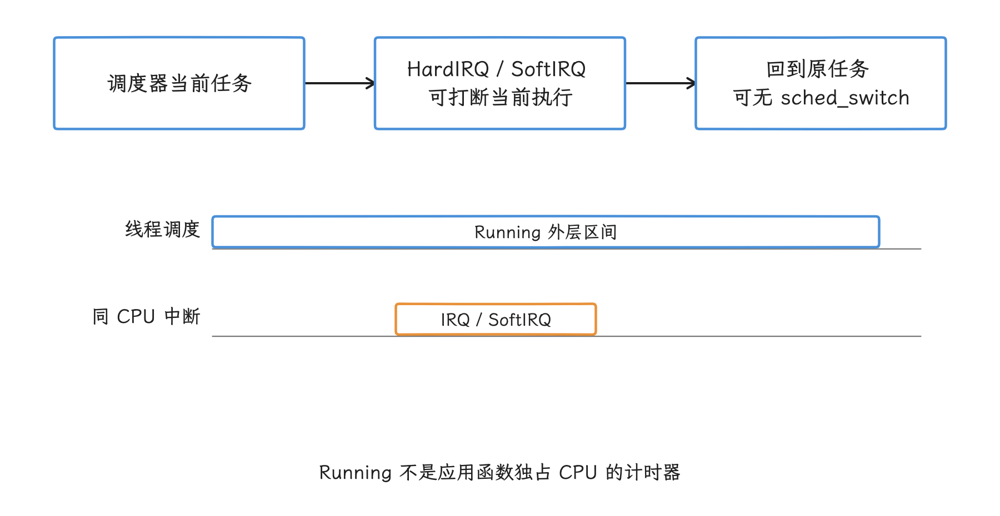

图：没有 sched_switch 时，中断处理仍可落在当前任务外层 Running 内。 轨道只表达嵌套关系，条长与实测或 CPU 比例无关。

因此，长 Running 区间需要分层验证：

- 应用或框架 Slice 能否解释这段工作。
- `linux.perf`（Perfetto 的 Linux perf 采样数据源）或 simpleperf（Android 原生性能采样器）样本中的 `cpu_mode` 和调用栈指向用户态还是内核态；`cpu_mode` 表示样本落在用户态、内核态或其他执行模式。
- 同一 CPU 的 IRQ / SoftIRQ 轨道是否覆盖其中一部分。
- 线程运行在哪个 CPU，该 CPU 的 `capacity`、频率和空闲状态如何；`capacity` 是调度器描述 CPU 相对计算能力的指标，不是实时利用率。
- 该区间是否位于启动、帧、输入或 Binder 的关键路径。

Running 的长短本身定不了性：一次必须完成的后台计算可以合法地占满 CPU；一段很短的 Running 也可能因为频繁唤醒、缓存失效或跨线程串行化而拖慢关键路径。


### 单帧 Running 与名义刷新周期

60 Hz 的名义周期约为 16.67 毫秒，120 Hz 约为 8.33 毫秒，这两个数字描述的是刷新周期。单个 `doFrame` 的 Running 时间要放回整帧里看：帧还包含 Runnable、同步等待、`RenderThread`、GPU 和 SurfaceFlinger（Android 显示合成服务），调度偏移、刷新率切换与预测都会改变 deadline（截止时刻）。

Android 12 及以上，我们先读 FrameTimeline 的 Expected / Actual Timeline（预期 / 实际帧时间线）和 overrun（实际帧超出预期截止时刻的时间），再回看线程状态。


### CPU 类型、容量与频率

CPU 编号与大小核布局由 SoC（System on Chip，系统级芯片）决定，“0—3 是小核、4—7 是大核”只对部分设备成立。我们先从 Perfetto 的 `cpu` 表确认拓扑：`cluster_id`、`processor` 和 `capacity`，频率轨道提供该时刻的 kHz。相同频率下，不同微架构和容量的 CPU 吞吐量可能不同；高频也说明不了线程负载高，因为 Governor（动态调频策略）、Boost（临时提高性能目标）与热策略都会影响频点。


手工绑核会缩小调度器可选 CPU 集合，还会受 cpuset、在线 CPU 和权限限制。这几个机制容易混：亲和性（affinity）限定线程可以在哪些 CPU 上运行，cpuset 用控制组给一组任务划定可用 CPU；uclamp 限定的是调度器使用的有效利用率提示上下界，影响容量选择和调频决策，它既算不上 CPU 允许掩码，也不保证固定核心或频率。


对普通应用来说，CPU 编号和固定亲和性都靠不住；平台侧若要调整这些参数，应使用同场景 Trace 验证延迟、能耗和热稳定性。

## 14.3.4 Runnable：测量唤醒到运行的等待

看 Runnable，我们量的是线程从“可以运行”到“真的运行”之间的等待。Runnable 区间表示线程具备运行条件却未在 CPU 上执行：由 `sched_waking` 打开的 `R`，其持续时间近似“被唤醒到被调度”的延迟；`R+` 则从抢占式切出持续到下一次运行。

Runnable 变长常见于：

- 所有合适的 CPU 都在运行其他任务，或高调度优先级、实时任务和 IRQ 持续占用。
- 调度类（如普通公平调度或实时调度）、nice（普通调度任务的相对优先级）和厂商策略影响竞争；cpuset / 亲和性约束可用 CPU；uclamp 等利用率提示影响容量与调频决策。这些机制里只有一部分直接限制 CPU 集合。
- CPU 离线、热限制、频率降低或设备容量不足，使队列消化速度下降。
- 唤醒放置（线程被唤醒时选择目标 CPU）与负载均衡暂时保留线程所在 CPU，避免跨核迁移成本。
- cgroup（Linux 控制组）的 CPU 带宽配额、实时节流（限制实时任务持续占用 CPU）或其他资源控制延后执行。

Trace 里明明有空闲 CPU、目标线程却一直在排队，这种画面先别急着判定调度器出错。Perfetto 官方文档指出，普通 Linux 调度配置并不保证严格 work-conserving——这个术语指“只要存在可运行任务和可用 CPU，就尽量不让 CPU 空闲”。调度器可能暂缓迁移，让线程留在原 CPU 复用缓存并降低迁移功耗；遇到这种情况，我们还要确认目标线程是否允许在那颗 CPU 运行。

<!-- gracker-diagram: ed14-03-runnable-eligibility-and-placement -->
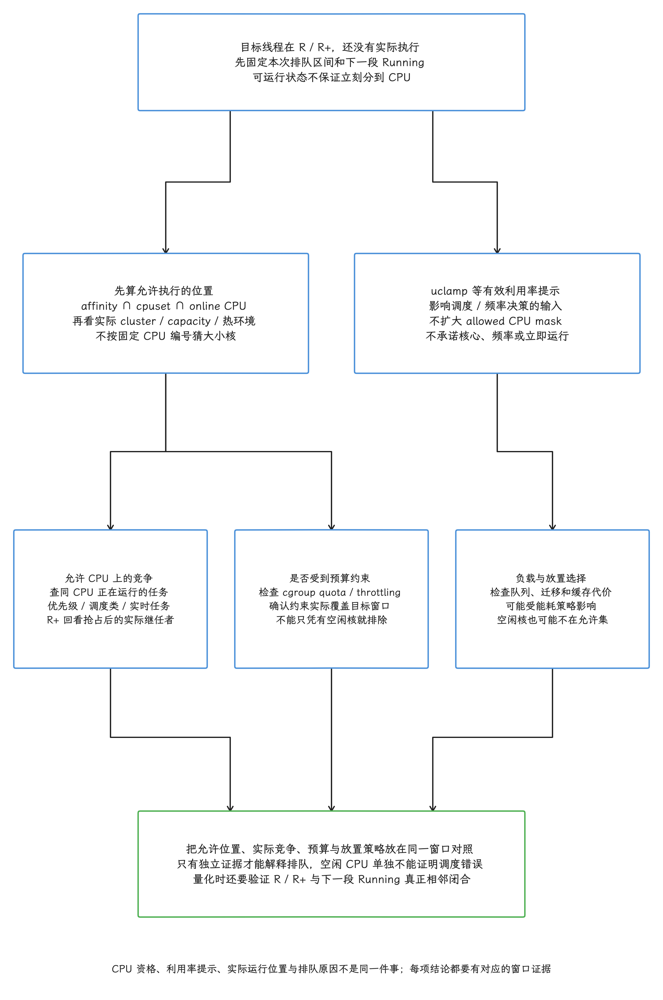

图：R/R+说明可运行未执行，延迟需检查affinity/cpuset/online交集、优先级/实时竞争、quotas/throttling、负载与放置偏好。uclamp为有效util约束提示，不改变allowedmask，也不承诺核心或频率。先查CPUcapacity/cluster/频率/thermal实际环境，不能按固定编号猜核型；idleCPU可能不在允许集或迁移代价/能耗策略保留当前放置。原文SQL还需closed/dur>=0和R/R+结束精确相邻Running，空结果不等于零延迟。

### 查询每次运行前的 Runnable 延迟

`sched.latency` 标准库把每个 Running 状态关联到它之前的 Runnable 状态。下面的查询列出 SystemUI 主线程最长的 20 次延迟：

```sql
INCLUDE PERFETTO MODULE sched.latency;

SELECT
  p.upid,
  t.utid,
  running.id AS running_state_id,
  runnable.id AS runnable_state_id,
  running.ts AS running_ts,
  runnable.state AS runnable_state,
  ROUND(l.latency_dur / 1e6, 3) AS latency_ms,
  ss.cpu,
  ss.priority,
  wp.name AS waker_process,
  wt.name AS waker_thread,
  runnable.irq_context
FROM sched_latency_for_running_interval AS l
JOIN thread_state AS running
  ON running.id = l.thread_state_id
JOIN thread_state AS runnable
  ON runnable.id = l.runnable_latency_id
JOIN sched_slice AS ss
  ON ss.id = l.sched_id
JOIN thread AS t
  ON t.utid = running.utid
JOIN process AS p
  USING (upid)
LEFT JOIN thread AS wt
  ON wt.utid = runnable.waker_utid
LEFT JOIN process AS wp
  ON wp.upid = wt.upid
WHERE p.name = 'com.android.systemui'
  AND t.is_main_thread
  AND runnable.dur >= 0
  AND running.dur >= 0
  AND runnable.ts + runnable.dur = running.ts
ORDER BY l.latency_dur DESC, running.ts, running.id
LIMIT 20;
```

这条查询会把同名进程的多个实例都列出来，输出用 `upid` / `utid` 和状态行 ID 区分；分析某次复现时，我们再进一步限定现场实例与时间窗。邻接条件要求 Runnable 的结束恰好等于 Running 的开始，缺唤醒事件时，历史上的旧 `R` 不会被误连过来；未闭合的 Running 也进不了结果。所以拿到空结果，含义是“查询没覆盖到”，而非“没有调度延迟”。`waker_process` 为空的来源有几种：保持可运行的切出、Trace 边界、数据丢失或缺少 waking。`irq_context = 1` 表示记录的 HardIRQ / SoftIRQ 标志置位，这时当前任务名多半属于被中断的线程，业务唤醒源要另找；NULL 表示未保留该信息。

<!-- gracker-diagram: ch14-03-21-latency-sql-adjacency -->
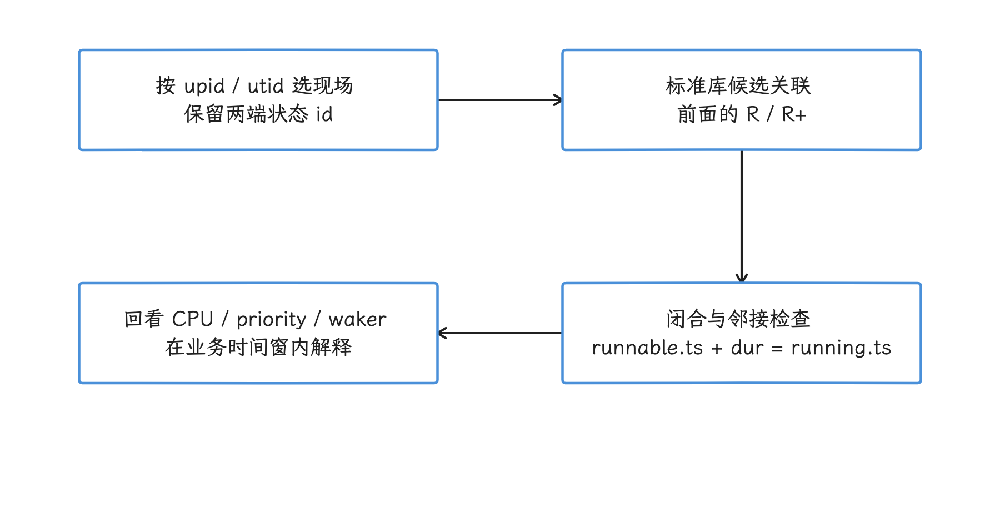

图：结果保留实例与状态行，并要求 Runnable 的结束等于 Running 的开始。 缺 wake 或未闭合 Running 会使结果不完整；空结果与零延迟是两回事。

### 解读 `R` 与 `R+`

`R+` 多说明线程遭遇抢占式切换。次数或占比高时，先别急着归因到优先级设置，我们接着查四件事：切出后哪条任务在相同 CPU 上运行、它属于哪个调度类、目标线程允许在哪些 CPU 执行、这段等待是否越过业务 deadline。优先级的结论要建立在这些事实之上。


读 `R` 先分来源：它可能是唤醒后的排队，也可能是线程保持可运行状态时的切出。SQL 里用 `waker_utid` 追查执行唤醒者；该 tag 的 UI Woken by（由谁唤醒）引用则依赖可用的 `waker_id`，只有 `waker_utid` 时，跳转未必可用。中断标志为真时 UI 可只显示 Interrupt，标志未知时也可能提示 maybe interrupt。还要记住，唤醒者只是把线程变为可运行的那一方，锁持有者、Binder 服务端或设备中断的源头，要靠 Binder Flow（Binder 事务的跨线程因果连线）、锁事件或代码路径另行确认。

## 14.3.5 Sleeping：找到等待条件和唤醒者

`S` 是可中断睡眠。以下等待都可能表现为 `S`：

- Looper 调用 `epoll_wait()`，等待文件描述符（进程访问文件、socket 等内核对象所用的编号）上的消息事件。
- 线程等待条件变量或 futex（用户态锁常用的内核等待机制）。
- 同步 Binder 客户端等待回复。
- 定时器等待到期。

大多数线程长期 Sleeping 是健康的空闲状态。

关键 Slice 内出现长 `S` 时，我们按以下线索追查：

- Slice 名称或事件触发采样栈说明线程在哪个等待 API 进入睡眠。
- `thread_state.waker_utid` 与 `waker_id` 指向哪个线程状态。
- Binder 事务、Monitor Contention（Java / Kotlin 监视器锁竞争）、futex、Flow（Trace 事件之间的因果连线）或定时器事件能否解释唤醒关系。
- 从唤醒到 Running 的 `R` 是否又贡献了明显调度延迟。

一次同步等待可以同时包含 `S + R + Running`：线程睡眠等待条件，条件满足后进入 Runnable，获得 CPU 后继续执行。只量 `S` 会漏掉唤醒后的排队。

<!-- gracker-diagram: ch14-03-23-sleeping-wait-chain -->
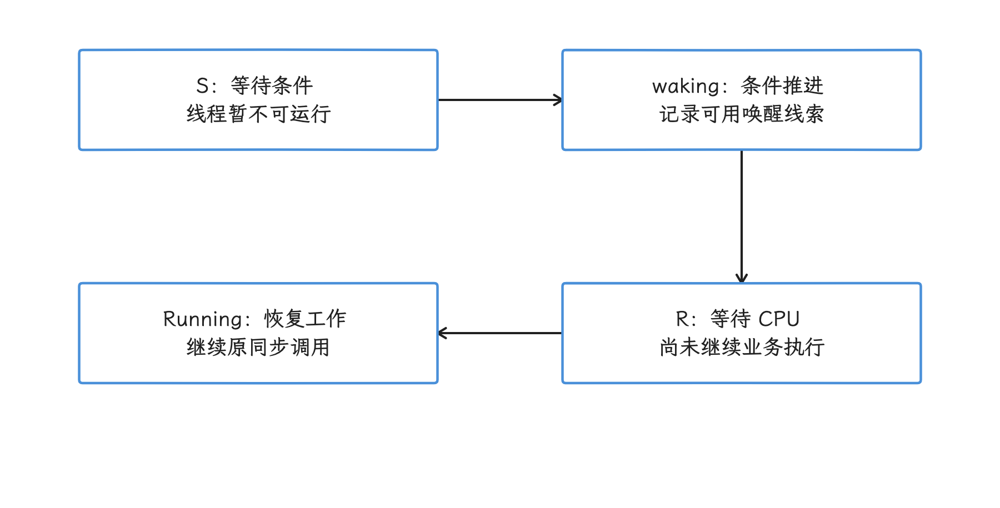

图：一次等待可同时包含睡眠、唤醒后排队与恢复执行。 只计 S 会漏掉 R；图为顺序示意，时长比例以实际 Trace 为准。

### Woken by 的来源与实现

Woken by 是 Perfetto UI 对唤醒来源的展示。在所核对的 tag 里，`PushWakingEvent()` 对 waking 分三种情况：线程没有历史行时直接打开 `R`；已有历史行且状态为 `Running` 或恰好为 `R` 时，把重复唤醒写入 `spurious_sched_wakeup`，保留当前状态；正常阻塞状态则被关闭并新开 `R`。


这里有一个容易踩的实现细节：该 tag 的 `IsRunnable()` 只比较字符串 `R`，不包含 `R+`。若 `R+` 区间内又收到 waking，原区间会被截断，转成带新唤醒线索的 `R`。所以“所有 Runnable 重复唤醒都不改状态”对这个 tag 站不住，新 `R` 的时长也代替不了完整的抢占等待。主机 v54.0 / v57.2 / v58.2 的合成输入复现了这一分段结果；它是所核对导入器的行为，内核并没有规定线程必须如此转换。

<!-- gracker-diagram: ed14-03-waking-state-branches -->
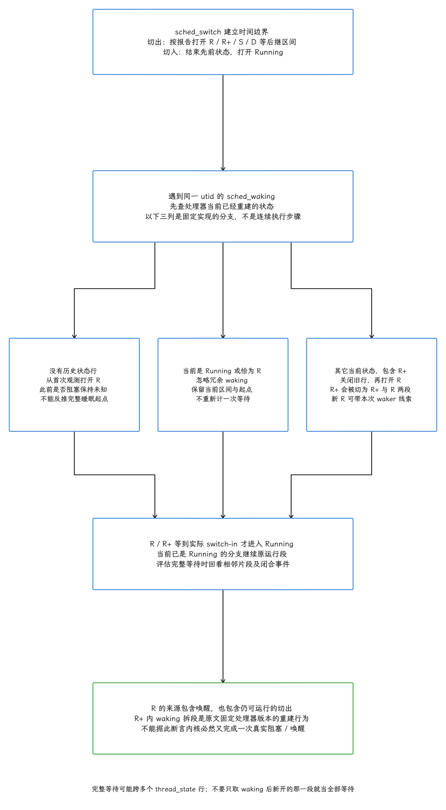

图：sched_switch切出按报告打开后继状态，切入Running；正常阻塞→waking打开R，R也可能来自可运行切出。原文固定TP实现PushWakingEvent无历史打开R，当前Running或恰为R忽略冗余；其它当前状态关闭旧行并开R。IsRunnable仅识别R，故waking落在R+内会截断R+另开R并附waker线索，完整等待需看两段。这是原文固定tag/合成trace观察的导入行为，不是内核必然重新唤醒承诺。

Woken by 记录的是执行唤醒动作的线程：

- 解锁路径中，它可能是释放锁的线程。
- Binder 回复中，它可能落在驱动或服务端执行路径。
- 中断唤醒中，`irq_context` 会标记 HardIRQ / SoftIRQ，当前被中断线程只是恰好在这个 CPU 上，设备事件的业务来源要另找。
- 缺少事件、Trace 起点或 ftrace 丢包都会造成关系中断。

<!-- gracker-diagram: ed14-03-waker-identity-and-causal-evidence -->
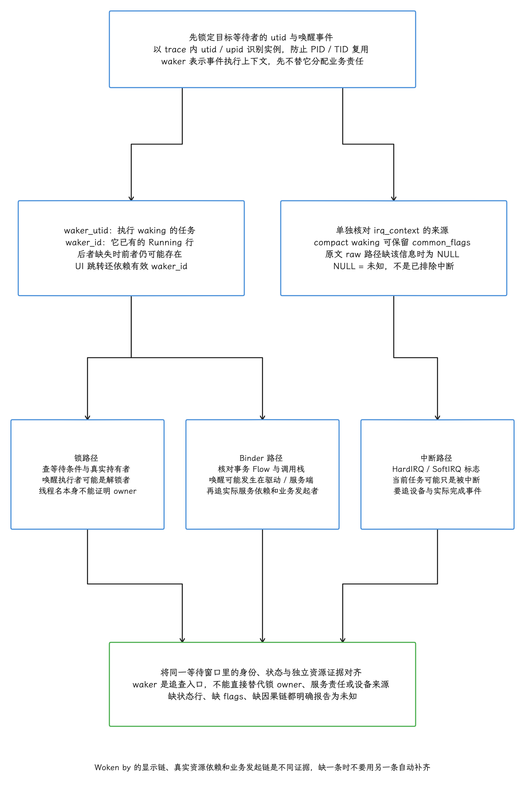

图：utid/upid为trace内身份，不按复用的tid/pid混线程。waker_utid是执行waking时的任务，waker_id关联它已有的Running状态行，后者缺失可能前者仍在；UIWokenby需有效waker_id。compactwaking保留common_flags至irq_context，原文rawParseSchedWaking未传，NULL是未知不是非IRQ。irq_context=1只说明Hard/SoftIRQ标志，当前任务可能被中断；锁owner、Binder业务发起者、设备完成来源要另证，waker不保证是唯一根因。

复杂等待可借助 UI 的 Critical Path（关键路径）视图查看跨线程依赖。该视图根据唤醒关系推导路径，结果受 Trace 完整性影响，最终仍要回到原始状态、Slice 与代码确认。

Perfetto 官方的调度阻塞案例还展示了事件触发调用栈：用 `linux.perf` 在 `sched_switch` 和 `sched_waking` 发生时采样，并用 `prev_comm`、`next_comm` 或 `comm` 过滤目标线程；这里的 `comm` 是内核记录的任务名。若对全系统每次调度切换都取栈，采样器很快会跟不上事件速度，因此必须限制过滤范围并检查丢样统计。

<!-- gracker-diagram: ch14-03-27-event-sampling -->
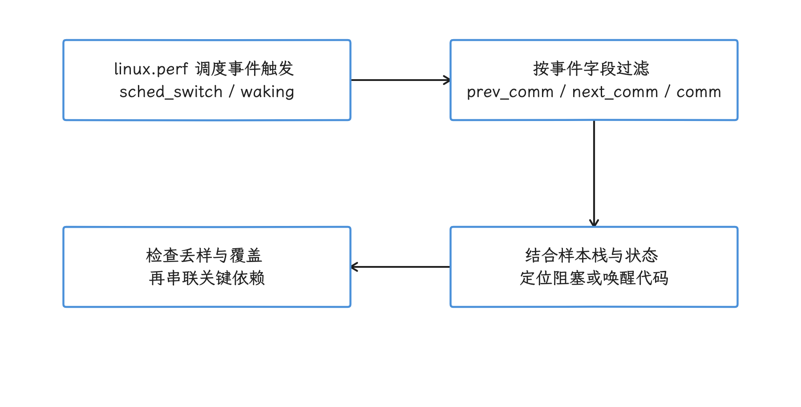

图：对目标调度事件取栈，补充线程进入等待或执行唤醒时的代码证据。 全系统每次切换都采栈可能跟不上；采样过滤和丢失统计是解释前提。

## 14.3.6 Uninterruptible Sleep：D 只说明不可中断等待

再看不可中断睡眠。Linux 6.18 把 `TASK_UNINTERRUPTIBLE` 定义为独立任务状态：处于该状态的普通信号不会让等待提前返回；条件满足后线程被唤醒，挂起的信号才有机会处理。内核还提供 `TASK_KILLABLE = TASK_WAKEKILL | TASK_UNINTERRUPTIBLE`，供允许致命信号唤醒的等待点使用。

D 状态可出现在块 I/O、Swap（交换区页面换入换出）、内存回收、页迁移、驱动等待和内核同步路径，磁盘只是其中一种。两类缺页也要分开：Minor Page Fault（次缺页）通常表示所需页面已在内存中，既不需要存储 I/O，也未必让线程睡眠；Major Page Fault（主缺页）可能等待文件页或 Swap 读入，判断时仍要页故障和块设备两边的记录。把所有 Page Fault 或所有 D 一律归为磁盘，方向就偏了。


### `io_wait` 与 `blocked_function` 的源码含义

锚点内核的 `sched_blocked_reason` Tracepoint 写入两个字段：

```c
__entry->caller = (void *)__get_wchan(tsk);
__entry->io_wait = tsk->in_iowait;
```

`io_wait` 来自任务的 `in_iowait` 记账标志。值为 1 表明内核把该任务标为 I/O 等待记账，仅此而已：字段里既没有文件名、设备、请求类型或调用方，也推不出业务原因；值为 0 时同样定性不了“内核锁”。`caller` 来自 `__get_wchan()`，其中 wchan（wait channel）表示内核观察到的睡眠位置；最初发起等待的应用函数或锁持有者是谁，它只给线索。


导入侧，`ParseSchedBlockedReason()` 把事件交给 `ThreadStateTracker`，在仍能找到对应最近阻塞行时补写 `io_wait` 与可解析的睡眠函数。这条 ftrace 路径每一步都要成立：采到该 Tracepoint、成功关联阻塞行、函数名解析需要有效地址及符号映射。缺事件、时序边界、0 地址或符号不足都可能留下 NULL；“配置过该事件”离“字段必有值”还隔着这几步。

还要区分采集前后的 `caller`：内核原始事件记录睡眠地址，Perfetto 采集端会把内核地址改写为索引，并把可解析名称放入 `InternedData.kernel_symbols`。导入器用该索引查名字，不是拿 Trace 中的数值直接当原始内核地址；缺索引映射时也会没有 `blocked_function`。

<!-- gracker-diagram: ed14-03-blocked-reason-field-chain -->
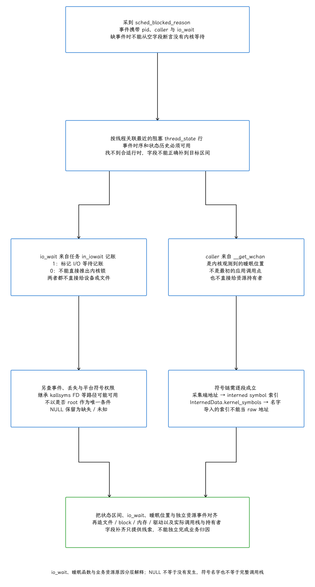

图：sched_blocked_reason携带pid/caller/io_wait，TP需按线程找到最近阻塞状态行才补字段。io_wait来自in_iowait是I/O等待记账，1不证明设备/文件/API，0不证明内核锁。caller来自__get_wchan为内核观测睡眠位置，非原始应用调用或owner；采集端可将地址改写interned kernel symbol索引，名字在InternedData.kernel_symbols，导入需有效索引/映射，不把索引当raw地址。符号来自继承kallsymsFD或平台允许路径，不以root作为唯一前提；NULL可能缺事件/状态历史/符号链，须查完整性。

### 查询 D 状态

下面的查询列出 SystemUI 主线程最长的 D 区间及其可用线索：

```sql
SELECT
  p.upid,
  t.utid,
  ts.id AS thread_state_id,
  ts.ts,
  ROUND(ts.dur / 1e6, 3) AS duration_ms,
  ts.io_wait,
  ts.blocked_function
FROM thread_state AS ts
JOIN thread AS t
  USING (utid)
JOIN process AS p
  USING (upid)
WHERE p.name = 'com.android.systemui'
  AND t.is_main_thread
  AND ts.state = 'D'
  AND ts.dur > 0
ORDER BY ts.dur DESC, ts.ts, ts.id
LIMIT 20;
```

此查询严格匹配 `state = 'D'`；若输入是旧版或文本 Trace，应另行核对是否存在 `D|K` 等复合字符串，并保留原值。非 Running 状态没有“正在执行的 CPU”，相邻 CPU 和 waking 的目标 CPU 只能补充放置线索，做不了阻塞期间的执行归属。`blocked_function` 为空时，我们依次检查 Tracepoint、符号权限、数据丢失和工具版本；空值说明链路某处断了，“没有内核阻塞”的结论还下不了。

归因 D 区间时，可按线索选择方向：

- `io_wait = 1` 且与块设备或文件系统事件重叠：继续查设备、inode（文件系统对象编号）、页故障、Swap 和发起调用栈。
- 内存回收、压缩或页迁移事件重叠：查看 PSI（Pressure Stall Information，资源压力停顿统计）、reclaim（内存回收）、compaction（内存页整理）和进程内存压力。
- `blocked_function` 指向驱动或同步路径：查对应子系统源码、等待条件与负责唤醒的执行路径。
- 多个线程等待同一资源：查持有者是否 Sleeping、Runnable 或被其他任务抢占，识别优先级反转（高优先级任务被持锁的低优先级任务间接拖延）和锁队列串行化。

<!-- gracker-diagram: ed14-03-d-state-candidate-validation -->
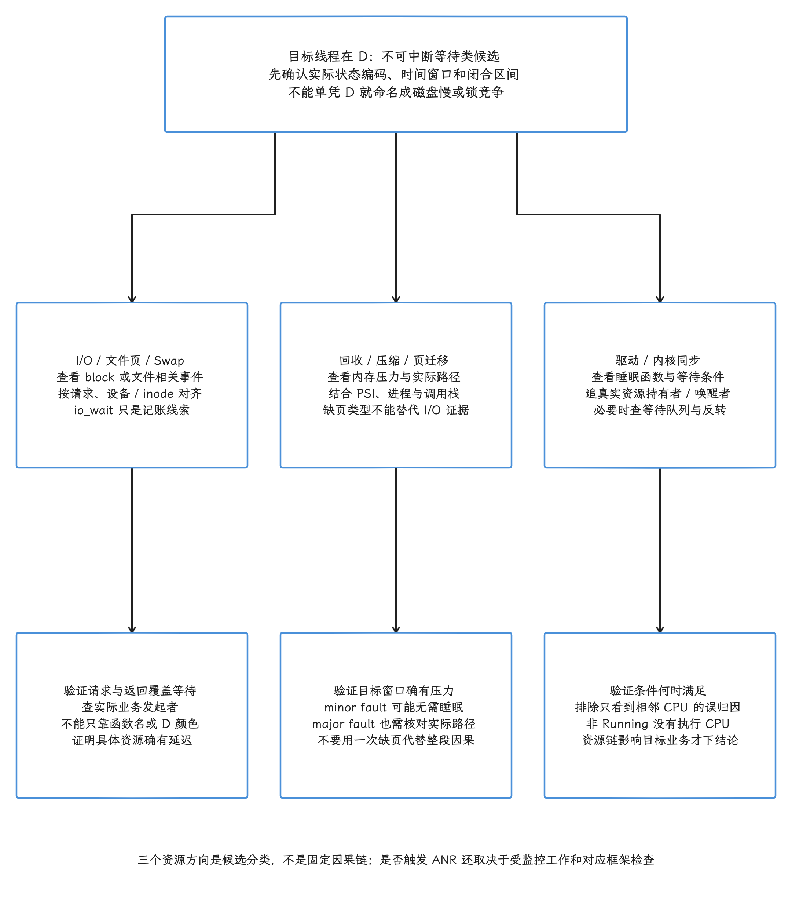

图：D为不可中断等待类，TASK_KILLABLE另允许fatalwake，不等于磁盘I/O。文件/块I/O/Swap、reclaim/压缩/迁页以及驱动/内核同步都可能；minor fault通常不必睡眠，major fault是否涉及实际I/O需独立证据。io_wait/wchan只是候选，不把0解释锁或1解释文件。非Running行没有正在执行CPU，相邻CPU/targetCPU仅是放置线索。影响ANR需证明阻断实际受监控工作与对应框架期限，不设通用D秒数。

D 状态与 ANR（Application Not Responding，应用无响应）的关系也常说得太直接。ANR 由输入分发、服务、广播等框架监控条件触发；D 只有在阻止受监控工作按时完成时，才会参与这条因果路径。适用于 D 的通用 ANR 秒数并不存在。


## 14.3.7 Stopped 与其他状态

`T` 常见于 `SIGSTOP`（强制暂停进程的信号）、Shell 作业控制或调试操作，`t` 表示被调试器等工具跟踪——调试会话中出现它们，可能完全符合预期。`Z` 表示退出后等待父进程回收的僵尸状态，短暂出现也未必指向性能故障；持续堆积才需要检查父进程的回收逻辑。

`X`、`I`、`P` 以及兼容路径中的 `x`、`W`、`K`、`N` 要按输入格式与内核版本解释，Perfetto 官方文档也提醒，其中一些字符组合本来就没有意义。遇到复合状态时，同时保留 `thread_state.state` / `sched_slice.end_state`，先核对 `sched_switch` 的报告编码，再查对应版本的 `TASK_*`；旧字符表与 6.18 的完整可达状态集合是两回事。


## 14.3.8 IRQ / SoftIRQ：调度区间里的隐含执行

Running 里还藏着一层中断执行。HardIRQ 在中断环境执行，会暂停当前 CPU 上的任务；SoftIRQ 可在中断返回路径执行，也可由 `ksoftirqd` 线程处理。HardIRQ 和在中断返回路径执行的 SoftIRQ 都不要求发生任务切换，外层线程在 `thread_state` 中仍可能连续显示 Running——把这整段 Running 都算成应用函数时间，会高估应用函数的执行时间。

下面的查询汇总已采集的 IRQ 与 SoftIRQ Slice：

```sql
SELECT
  tr.type AS interrupt_type,
  s.name,
  COUNT(*) AS event_count,
  ROUND(SUM(s.dur) / 1e6, 3) AS total_ms,
  ROUND(MAX(s.dur) / 1e6, 3) AS max_ms
FROM slice AS s
JOIN track AS tr
  ON tr.id = s.track_id
WHERE tr.type IN ('cpu_irq', 'cpu_softirq')
  AND s.dur > 0
GROUP BY tr.type, s.name
ORDER BY SUM(s.dur) DESC
LIMIT 30;
```

Ftrace 导入器把这两类区间分别放进 `cpu_irq` 和 `cpu_softirq` 轨道。上面的查询按类型和名称跨 CPU 汇总，`SUM(dur)` 是已记录区间的包含式时长之和；不同 CPU 的并行区间、嵌套 HardIRQ 与 SoftIRQ 都可能重叠，所以它不是业务墙钟时间，整表相加后直接从某线程 Running 中扣除会算错。归因时我们先限定业务窗口、目标线程实际运行的同一 CPU 和交集，再对重叠中断区间取并集，结合对应设备驱动与业务动作验证。

<!-- gracker-diagram: ch14-03-34-irq-window-union -->
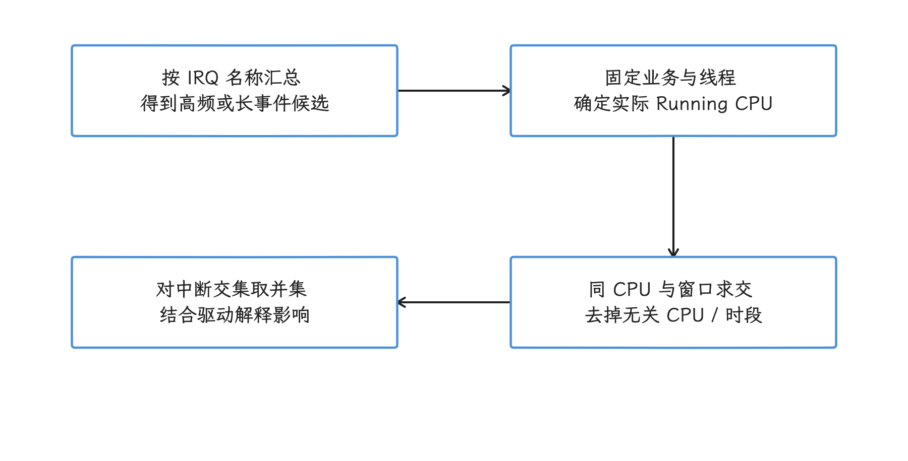

图：整表 SUM 只能找候选，业务归因需与目标 Running 在同 CPU 上求交。 跨 CPU 并行和嵌套 IRQ 可重叠，整表 SUM 直接从 Running 中扣掉会算错。

`ksoftirqd/<cpu>` 是对应 CPU 的可调度内核线程，其 Running 会出现在 CPU Scheduling 轨道，内部也可能有 SoftIRQ Slice。用 CPU 调度时间和 SoftIRQ 事件统计同一份工作时先核对重叠：`ksoftirqd` 的全部 Running 与其中 SoftIRQ 时长相加，会把同一份执行算两次。实际部署中的 CPU 在线状态、线程化中断和内核配置也要一并核对。

<!-- gracker-diagram: ch14-03-35-ksoftirqd-overlap -->
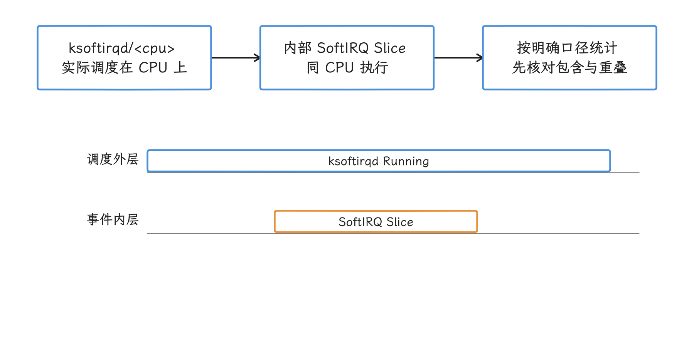

图：ksoftirqd 是可调度内核线程，其内部 SoftIRQ 事件可能已包含在外层 Running 中。 同一份执行按 Running 与内部 SoftIRQ 两次累加会翻倍；条长仅作机制示意。

## 14.3.9 在业务区间内量化状态

线程整段生命周期的状态占比很少能定位一次卡顿，量化要从业务区间切入。`sched.time_in_state` 提供区间函数，可把线程状态裁剪到指定起止时间。下面的查询选取 SystemUI 主线程中最长的 `Choreographer#doFrame`，汇总该 Slice 内的状态：

```sql
INCLUDE PERFETTO MODULE sched.time_in_state;

WITH process_choice AS MATERIALIZED (
  SELECT upid
  FROM process
  WHERE name = 'com.android.systemui'
    AND (SELECT COUNT(*) FROM process
         WHERE name = 'com.android.systemui') = 1
), target AS MATERIALIZED (
  SELECT s.id AS slice_id, s.ts, s.dur, t.utid, p.upid
  FROM slice AS s
  JOIN thread_track AS tt ON s.track_id = tt.id
  JOIN thread AS t USING (utid)
  JOIN process_choice AS p USING (upid)
  WHERE t.is_main_thread
    AND s.name GLOB 'Choreographer#doFrame*'
    AND s.dur > 0
  ORDER BY s.dur DESC, s.ts, s.id
  LIMIT 1
), states AS MATERIALIZED (
  SELECT x.state, x.io_wait, x.blocked_function, x.dur
  FROM target
  JOIN sched_time_in_state_for_thread_in_interval(
    target.ts, target.dur, target.utid
  ) AS x
), coverage AS (
  SELECT target.*,
    COALESCE((SELECT SUM(dur) FROM states), 0) AS observed_ns
  FROM target
)
SELECT
  c.upid, c.utid, c.slice_id,
  ROUND(c.dur / 1e6, 3) AS window_ms,
  ROUND(c.observed_ns / 1e6, 3) AS observed_ms,
  ROUND((c.dur - c.observed_ns) / 1e6, 3) AS unobserved_ms,
  x.state, x.io_wait, x.blocked_function,
  ROUND(x.dur / 1e6, 3) AS state_ms
FROM coverage AS c
LEFT JOIN states AS x ON TRUE
ORDER BY x.dur DESC, x.state, x.io_wait, x.blocked_function;

```

`MATERIALIZED` 让 Trace Processor 求值并复用公共表表达式，`GLOB` 按通配符匹配名称。此示例只在包名恰好对应一个 `upid` 时选择最长且闭合的候选 Slice；同名实例超过一个或没有匹配 Slice 时返回空结果，应先确认现场实例，将 `process_choice` 改为准确的 `upid` 条件。输出的 `slice_id` / `utid` 用于回查，最长 `doFrame` 只是候选，离最差用户体验帧还差一步筛选。


函数按半开区间 `[ts, ts + dur)` 裁剪，只累计正时长且已闭合的状态。`observed_ms` 为这些状态的覆盖时长，`unobserved_ms` 是业务窗口减去覆盖，未闭合尾部或数据缺口都留在未知部分。目标存在而无已知状态时保留一行，`state_ms` 为 NULL——这一行说的是“没有观测到”，某状态耗时为零的结论还下不了。覆盖超过窗口、出现负的未知值或明显断裂时，先排查输入和区间重叠，修复之前这组数字算不得有效占比。


Android 12 及以上，我们可以先在 FrameTimeline 中确定目标进程、Layer、Actual / Expected 的 token 与完整区间，再按其截止超时和 jank 分类选择帧。注意表内 row id、应用 token、display token 是三个不同的标识，统称 `frame_id` 会把不同对象混在一起。把选定窗口及明确的目标 `utid` 交给状态函数，得到的是该线程在此窗口的状态分解；GPU / SurfaceFlinger 侧的整帧归因要各自去做。该 tag 的这些区间函数面向少量窗口，批量分析大量 Slice 时应查看 `slices.time_in_state` 等相应标准库。

<!-- gracker-diagram: ed14-03-window-identity-and-state-coverage -->
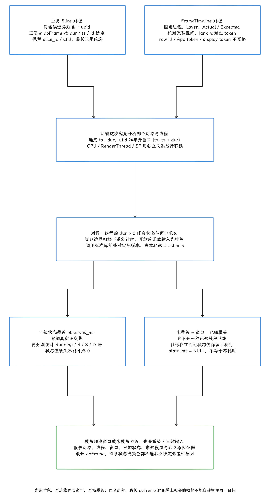

图：原SQL仅同名候选进程恰一个upid才继续，选择正闭合最长doFrame并按dur/ts/id稳定排序，保留sliceid/utid；最长doFrame仅候选非最差帧。FrameTimeline另按实际/Expected、进程layer、完整区间与token身份选帧，rowid/app token/display token不可互换，GPU/SF另线关联。固定同一线程半开窗口，只裁dur>0闭合状态；known来自observed正区间和，unknown=窗口-覆盖，非已知状态。目标存在无状态LEFTJOIN保留且state_msNULL而非0；覆盖超窗/unknown负值需先查重叠/输入错误。标准库/批量函数各按当前版本schema。

### 从状态走到修改点

| 区间特征 | 下一组证据 | 可以形成的结论 |
| --- | --- | --- |
| Running 为主 | Slice、用户态/内核态调用栈、CPU capacity/freq（相对容量 / 频率）、IRQ | 哪段执行或中断贡献 CPU 时间 |
| `R` 为主 | waker、同 CPU 运行者、调度类、cpuset/affinity（CPU 集合 / 亲和性）、CPU 在线状态 | 唤醒后为什么未及时运行 |
| `R+` 为主 | 切出后的任务、优先级、实时与 IRQ 活动 | 哪类抢占与 deadline 重叠 |
| `S` 为主 | 阻塞栈、waker、Binder、锁、Flow、定时器 | 等待条件由谁满足 |
| `D` 为主 | `io_wait`、`blocked_function`、页故障、回收、块设备、驱动 | 不可中断等待发生在哪个内核路径 |
| IRQ / SoftIRQ 高 | 中断名称、CPU、设备驱动、业务时间范围 | 中断处理占用了多少关键区间 |

做完分解，回到产出。状态只是分析入口；结论至少应包含业务区间、`upid` / `utid`、状态持续时间、至少一种能够解释原因的独立旁证，以及修改前后的同条件对照。


## 14.3.10 常见误读

### “线程 Running 占比高，所以它有性能故障”

Running 只表示线程被调度。还要确认它是否位于关键路径、执行内容是否可以减少，以及 IRQ 是否占用其中一部分。后台吞吐任务的高 CPU 使用率可能符合设计。

### “Runnable 长就是调度器选错”

Runnable 时长是观察到的排队结果。系统负载、调度类、优先级、亲和性、cpuset、CPU 容量、热限制、带宽控制和唤醒放置都可能贡献延迟。只看到空闲 CPU 还说明不了问题，因为目标线程未必允许迁移过去。

### “`R+` 就是某条高优先级线程抢占”

`R+` 只保存这次切出带有抢占标志。具体抢占者和原因需要查看相同 CPU 上后续运行的任务、调度类和优先级。

### “Sleeping 不消耗 CPU，所以不影响性能”

空闲线程 Sleeping 很正常。关键路径中的 Sleeping 会增加墙钟时间，需要查等待条件、唤醒者和唤醒后的 Runnable 延迟。

### “D 或 `io_wait = 1` 就是应用磁盘 I/O”

D 覆盖多种不可中断等待，`in_iowait` 也是内核记账标志。应用归因还要依赖调用栈、页故障、文件系统、块设备或驱动事件。

### “把各进程 CPU 利用率相加后应小于 100%”

CPU 时间以窗口墙钟时长为分母时，多线程进程并行运行可以超过 100%；单条线程在有效且不重叠的调度记录中，至多贡献一份该窗口 CPU 时间。在线 CPU 数恒定时，全系统这个口径的理论上限为 CPU 数乘以 100%；在线数变化时，上限改为该窗口平均在线 CPU 数乘以 100%。要报告占设备可用 CPU 时间的比例，就另以窗口内在线 CPU 时间的积分作为分母。按核秒归一化与按异构 CPU capacity 加权是两种口径，报告必须写清窗口、对象、是否含 IRQ、分母和是否做容量加权，或直接报告原始 CPU 时间。

<!-- gracker-diagram: ch14-03-40-cpu-percent-denominator -->
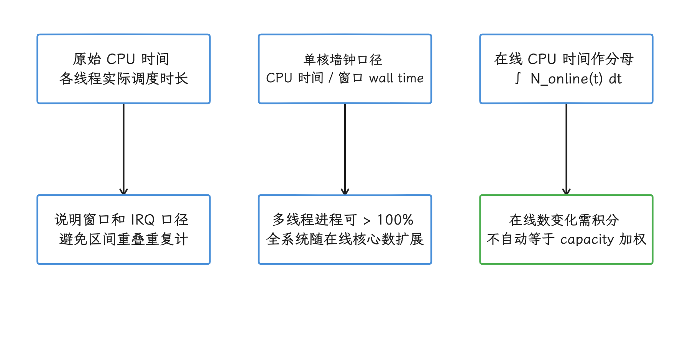

图：按墙钟归一化时，多线程进程可超过 100%；按在线核秒或容量加权是不同口径。 单线程没有并行的放大通道；在线数变化要积分，异构 capacity 加权须另行声明。

## 参考资料

- [Perfetto：CPU Scheduling events](https://perfetto.dev/docs/data-sources/cpu-scheduling)
- [Perfetto：用调度事件和调用栈分析阻塞](https://perfetto.dev/docs/case-studies/scheduling-blockages)
- [Android 17 `ThreadStateTracker` 源码](https://android.googlesource.com/platform/external/perfetto/+/refs/tags/android-17.0.0_r1/src/trace_processor/importers/common/thread_state_tracker.cc)
- [Android 17 Ftrace Parser 源码](https://android.googlesource.com/platform/external/perfetto/+/refs/tags/android-17.0.0_r1/src/trace_processor/importers/ftrace/ftrace_parser.cc)
- [Android 17 `thread_state` 表定义](https://android.googlesource.com/platform/external/perfetto/+/refs/tags/android-17.0.0_r1/src/trace_processor/tables/sched_tables.py)
- [Android 17 `sched.latency` 标准库](https://android.googlesource.com/platform/external/perfetto/+/refs/tags/android-17.0.0_r1/src/trace_processor/perfetto_sql/stdlib/sched/latency.sql)
- [Android 17 `sched.time_in_state` 标准库](https://android.googlesource.com/platform/external/perfetto/+/refs/tags/android-17.0.0_r1/src/trace_processor/perfetto_sql/stdlib/sched/time_in_state.sql)
- [Android 17 `FtraceConfig` 源码](https://android.googlesource.com/platform/external/perfetto/+/refs/tags/android-17.0.0_r1/protos/perfetto/config/ftrace/ftrace_config.proto)
- [Android 17 / Linux 6.18 `TASK_*` 定义](https://android.googlesource.com/kernel/common/+/refs/tags/android17-6.18-2026-06_r6/include/linux/sched.h)
- [Android 17 / Linux 6.18 调度 Tracepoint 定义](https://android.googlesource.com/kernel/common/+/refs/tags/android17-6.18-2026-06_r6/include/trace/events/sched.h)
- [Android 17 / Linux 6.18 调度器主流程](https://android.googlesource.com/kernel/common/+/refs/tags/android17-6.18-2026-06_r6/kernel/sched/core.c)
- [Android 17 任务状态编码](https://android.googlesource.com/platform/external/perfetto/+/refs/tags/android-17.0.0_r1/src/trace_processor/types/task_state.cc)
- [Android 17 采集错误统计](https://android.googlesource.com/platform/external/perfetto/+/refs/tags/android-17.0.0_r1/src/trace_processor/storage/stats.h)
- [Android 17 内核符号读取](https://android.googlesource.com/platform/external/perfetto/+/refs/tags/android-17.0.0_r1/src/kallsyms/lazy_kernel_symbolizer.cc)
- [Android 17 紧凑调度事件导入](https://android.googlesource.com/platform/external/perfetto/+/refs/tags/android-17.0.0_r1/src/trace_processor/importers/ftrace/ftrace_sched_event_tracker.cc)
- [Android 17 Runnable 标准库](https://android.googlesource.com/platform/external/perfetto/+/refs/tags/android-17.0.0_r1/src/trace_processor/perfetto_sql/stdlib/sched/runnable.sql)
- [高爷：Android Perfetto 系列 9，CPU 信息解读](https://www.androidperformance.com/2025/11/12/Android-Perfetto-09-CPU/)
- [高爷：Systrace Runnable 分析](https://www.androidperformance.com/2022/01/21/android-systrace-cpu-state-runnable/)
- [高爷：Systrace Running 分析](https://www.androidperformance.com/2022/03/13/android-systrace-cpu-state-running/)
- [高爷：Systrace Sleep 与 Uninterruptible Sleep 分析](https://www.androidperformance.com/2022/03/13/android-systrace-cpu-state-sleep/)
