# Perfetto 指标自动化与分析平台

一份 Trace 能支撑一次诊断；要把分析扩展成可复用查询、结构化指标、批量分析和持续集成，先要解决跨人员、跨构建、跨日期的一致性：同一条分析规则应始终产出语义一致的结果，异常发生时还留得下足够的原始证据。

> 源码基线：Android 17 / API 37 / `android-17.0.0_r1`；`external/perfetto` 指向提交 `ece66975738007dd0978b911d8a2077e49b8f31e`；内核 `android17-6.18-2026-06_r6`，ftrace（Linux 内核跟踪机制） 采集行为以它为准核对。设备可能使用其他内核分支。

往下读之前，我们先明确一件事：自动化分析把 Trace Processor SQL、指标和设备批处理组合成流程，产出要经得起复查——同一条规则，换人、换机器、隔一周再跑，结果都该对得上。主机侧的 Perfetto UI、Python 包和 Trace Processor 独立于设备系统升级，流水线还要把主机工具版本一并固定下来。在这两重前提之下，查询版本、输入质量、结果依据和回归基线，比“跑出一个分数”重要得多。

## SQL Metric、批处理与回归比较

把一次能用的查询变成团队长期依赖的资产，要经过几步：选对机制、定义指标和宏、接入 Python 批处理与持续集成门禁，再加上埋点设计和团队知识库。每一步都围绕同一个要求——换个人、换台机器、隔一次工具升级，结果仍然对得上。

### 四种可复用能力

Perfetto 提供了几套名称相近、用途不同的机制。选错层次后，查询可能照样能运行，却很难长期维护，所以我们先把这几套机制的分工摆清楚。

| 机制 | 输入 | 输出 | 适用位置 |
|---|---|---|---|
| PerfettoSQL 标准库 | `INCLUDE PERFETTO MODULE` | 稳定表、视图和函数 | 单份 Trace 查询的公共语义层 |
| Trace Summarization | 指标规格 + 标准库或 SQL | 统一的 `TraceSummary` protobuf | 新建自动化指标和跨 Trace 分析 |
| 旧版 v1 指标 | SQL + 自定义 protobuf | `TraceMetrics` protobuf | 维护已有指标，或兼容现有读取服务 |
| UI 命令宏 | JSON 命令序列 | 工作区、查询页、调试轨道等界面状态 | 重复执行人工诊断步骤 |

表格里的 protobuf（Protocol Buffers） 是一种带字段类型的结构化消息格式。说一份输出有契约，指的是字段名、类型、单位和含义都能被读取端稳定依赖；文件本身是否二进制编码，倒在其次。

PerfettoSQL 还定义了 `CREATE PERFETTO MACRO`，在查询执行前展开表达式或子查询。它和 UI 设置里的命令宏是两套东西，配置不共享，执行方式也不同。


### 自定义指标：新项目从 Trace Summarization 开始

#### v1 指标的现状与选择顺序

Android 17 标签和 v57.2 命令帮助都把 v1 指标标为 soft deprecated：已有指标与命令行兼容接口继续工作，但官方不再为这套体系增加新功能或新指标。新项目应使用 Trace Summarization。两者的 SQL 能力接近，输出契约差异很大，这正是我们选型时要看的部分。

v1 指标要求每个团队维护独立的输出 protobuf（消息类型由 `.proto` 文件定义，textproto 是消息实例的文本表示）；Trace Summarization 统一输出 `TraceSummary`，并在规格中声明维度、数值列、单位和极性——维度是进程名、场景这类分组字段，极性说明数值升高或降低哪一侧更好。有了统一的结构，批量处理、仪表板和长期性能回归追踪才好接上。

一个可维护的选择顺序如下：

1. 在标准库中查找已有模块，确认表的语义和适用版本。
2. 用 Trace Summarization 描述新指标。
3. 标准库存在缺口时，在仓库内增加自定义 PerfettoSQL 包。
4. 只有现有读取端依赖 `TraceMetrics` 时，才增加或修改 v1 指标。

#### Trace Summarization 的完整示例

我们来看一份具体规格：按进程计算 `RSS（Resident Set Size） + Swap` 的持续时间加权均值。RSS（Resident Set Size，驻留内存） 是进程当前驻留在物理内存中的页面量，Swap 是换出到交换区的页面量。规格用可读文本形式的 textproto 编写，直接引用官方 `linux.memory.process` 模块，并声明字节单位。

```textproto
metric_spec {
  id: "memory_per_process"
  dimensions: "upid"
  dimensions: "process_name"
  value: "avg_rss_and_swap"
  unit: BYTES
  query {
    table {
      table_name: "memory_rss_and_swap_per_process"
    }
    referenced_modules: "linux.memory.process"
    group_by {
      column_names: "upid"
      column_names: "process_name"
      aggregates {
        column_name: "rss_and_swap"
        op: DURATION_WEIGHTED_MEAN
        result_column_name: "avg_rss_and_swap"
      }
    }
  }
}
```

`DURATION_WEIGHTED_MEAN` 按每个样本覆盖的时间长度加权，适合由计数器样本还原出的区间数据。例如一个值保持 9 秒、另一个值只保持 1 秒时，前者应获得九倍权重；普通算术平均会忽略这项差异。

<!-- gracker-diagram: ch14-04-02-weighted-intervals -->
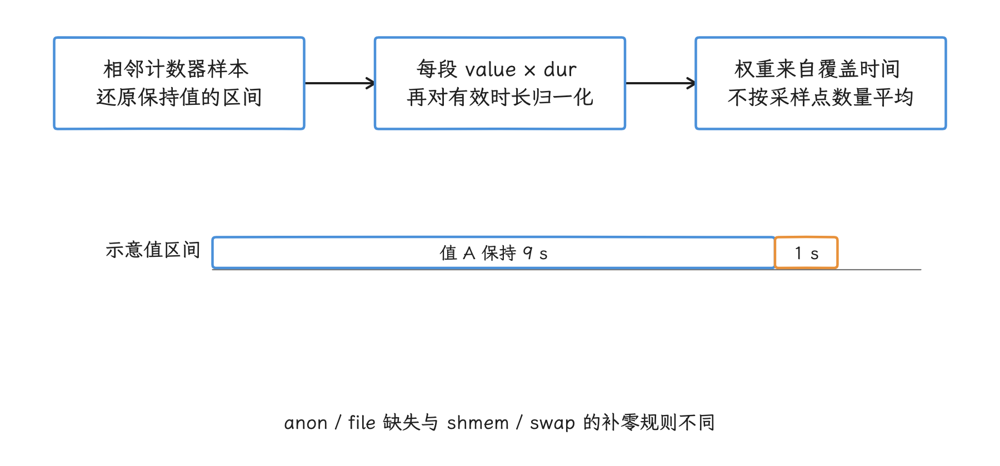

图：以区间持续时间作为权重，计算 Σ(value × dur) / Σ(dur)。 9∶1 是正文的教学例子；缺失区间与 NULL 的覆盖另行检查。

规格同时按 `upid` 和名称分组，避免同名进程、重启或 PID 复用被合并；`upid` 只在当前 Trace 内有效，跨 Trace 要另行对齐业务身份。这里求的是模块中可用内存区间的 `Σ(value × dur) / Σ(dur)`，没有限定某个业务窗口，也不等于缺失采样区间已被测量。固定 Android 17 模块中 anon/file RSS 缺失会传播为 NULL，shmem/swap 则按模块约定可补零；上线前应另外检查覆盖时间与数据源，不能把所有缺项都补成零。

这份规格可以用子命令接口执行：

```bash
trace_processor summarize \
  --metrics-v2 memory_per_process \
  trace.perfetto-trace \
  spec.textproto
```

输出是 `TraceSummary`，结果位于 `metric_bundles`（结果包列表）；每个 bundle 可以保存一组共享维度结构的指标。`--format binary` 可生成二进制 protobuf，默认 textproto 更适合人工检查。v57.2 仍完整支持旧式 `--summary` 参数，新脚本应采用子命令接口并固定二进制版本。


同一份规格也能从 Python 调用：

```python
from pathlib import Path
from perfetto.trace_processor import TraceProcessor, TraceProcessorConfig

config = TraceProcessorConfig(bin_path="tools/perfetto/trace_processor")
spec_text = Path("spec.textproto").read_text(encoding="utf-8")

with TraceProcessor(trace="trace.perfetto-trace", config=config) as tp:
    summary = tp.trace_summary(
        specs=[spec_text],
        metric_ids=["memory_per_process"],
    )
    print(summary)
```

`metric_ids` 只选择本次需要的指标 ID。省略该参数时，API 可以执行规格中的全部指标；大型规格库更适合显式选择，避免一次运行引入无关查询。

#### 存量 v1 指标：SQL 与 protobuf 的约定

团队如果已有读取 `TraceMetrics` 的服务，v1 指标仍可维护。我们用 CPU 运行时间做例子，展示完整的目录和命名约定，避开不稳定的 `activityStart`、`FirstFrame` 这类时间片名称。

存量指标可以把两个同名文件放进同一目录：

```text
legacy_metric/
├── top_five_processes.proto
└── top_five_processes.sql
```

Trace Processor 根据传入的 SQL 路径，查找同目录、同基本名的 protobuf 文件，再把自定义消息注册为 `TraceMetrics` 的扩展字段。扩展字段是 protobuf 在既有根消息上追加团队自定义结果的机制，走这条路时内置指标原样保留。

输出 protobuf 定义如下：

```protobuf
syntax = "proto2";

package perfetto.protos;

import "protos/perfetto/metrics/metrics.proto";

message ProcessCpuInfo {
  optional string process_name = 1;
  optional int64 cpu_time_ms = 2;
  optional uint32 scheduled_thread_count = 3;
  optional int64 upid = 4;
}

message TopFiveProcesses {
  repeated ProcessCpuInfo process = 1;
}

extend TraceMetrics {
  optional TopFiveProcesses top_five_processes = 450;
}
```

字段号 `450` 来自 Perfetto 为本地开发保留的 `450–500` 区间。字段号是 protobuf 在线路格式中识别字段的数字，重复就会冲突，所以团队内部仍要登记。扩展字段名 `top_five_processes` 还决定 SQL 文件名和输出视图名。

<!-- gracker-diagram: ch14-04-04-legacy-contract -->
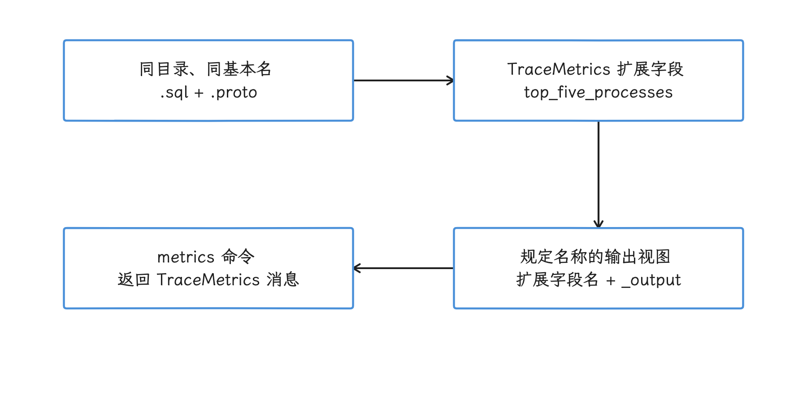

图：SQL 与同名 proto 注册自定义字段，由规定名称的输出视图生成根结果。 450–500 为本地开发区间，团队仍需登记字段号避免冲突。

对应 SQL 统计 `sched` 中已经运行完的调度时间片：

```sql
CREATE PERFETTO VIEW top_five_processes_by_cpu AS
SELECT
  p.upid,
  p.name AS process_name,
  CAST(SUM(s.dur) / 1e6 AS INT64) AS cpu_time_ms,
  COUNT(DISTINCT t.utid) AS scheduled_thread_count
FROM sched AS s
JOIN thread AS t USING (utid)
JOIN process AS p USING (upid)
WHERE s.dur > 0
  AND t.is_idle = 0
GROUP BY p.upid, p.name
ORDER BY SUM(s.dur) DESC, p.upid
LIMIT 5;

CREATE PERFETTO VIEW top_five_processes_output AS
SELECT TopFiveProcesses(
  'process',
  (
    SELECT RepeatedField(
      ProcessCpuInfo(
        'upid', upid,
        'process_name', process_name,
        'cpu_time_ms', cpu_time_ms,
        'scheduled_thread_count', scheduled_thread_count
      )
    )
    FROM top_five_processes_by_cpu
  )
);
```

`upid` 是 Perfetto 在当前 Trace 内分配的进程唯一标识。按 `upid` 分组，可以避开系统进程号 PID 复用和同名进程合并的问题。`thread.is_idle` 标识内核空闲任务（Linux 上 PID 为 0），示例用 `t.is_idle = 0` 将它排除，避免把 CPU 空闲时间列入进程 CPU 消耗榜。

榜单按原始纳秒总量排序，`cpu_time_ms` 只在展示时截为整数毫秒；多核上并行运行的 CPU 时间会相加，可能大于 Trace 的墙钟时长。`scheduled_thread_count` 统计的是 Trace 中出现过正时长、已闭合 `sched` 时间片的非空闲线程，进程创建过的全部线程要另行统计；`top_five_processes_output` 必须采用 `{TraceMetrics 扩展字段名}_output` 的形式，Trace Processor 靠这个命名约定找到根消息。

<!-- gracker-diagram: ch14-04-05-cpu-ranking -->
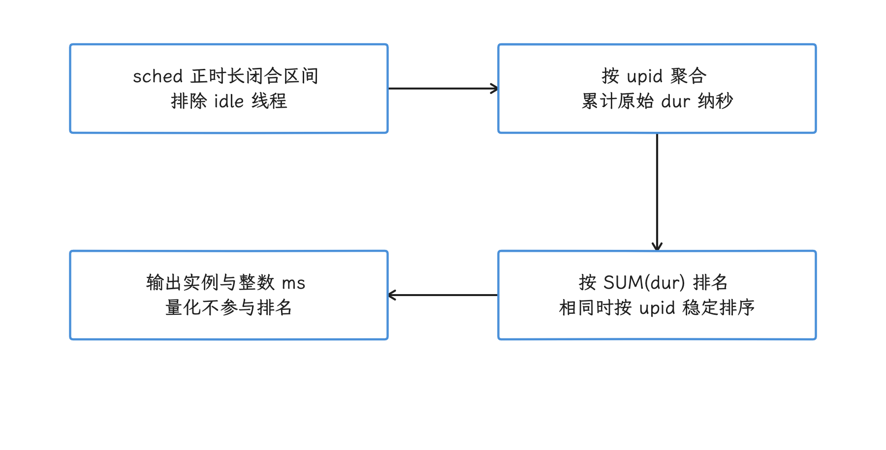

图：闭合调度时间按实例求和，用原始精度排序，再输出展示值。 多核 CPU 时间可以相加超过墙钟；调度线程数不是进程全部线程数。

工具提供两套等价命令，新子命令的参数更容易发现：

```bash
trace_processor metrics \
  --run legacy_metric/top_five_processes.sql \
  --output json \
  trace.perfetto-trace
```

旧脚本使用的 `--run-metrics legacy_metric/top_five_processes.sql` 与 `--metrics-output=json` 仍受兼容接口支持。`--metric-extension DISK_PATH@VIRTUAL_PATH` 把磁盘目录映射到 Trace Processor 内部的指标路径；把扩展挂到虚拟根路径 `/` 并覆盖内置指标时，工具要求同时传入 `--dev`。

`--dev` 开启的是可能随时变化的本地开发功能，生产流水线默认不要打开。升级主机工具时，先在固定测试 Trace 上对比新旧输出，再更新锁定版本。

#### 指标空结果与采集条件

查询成功但返回空表，表示没有匹配记录；它可能源于场景未发生，也可能源于采集或过滤条件。测得零、SQL NULL、空表和执行失败应分开处理。常见检查项包括：

- 采集配置没有启用指标所依赖的数据源；
- 轨迹在目标事件发生前结束；
- 目标进程未被 `atrace_apps` 允许；
- 工具版本缺少规格引用的标准库模块，这通常导致执行失败，应保留错误；
- 数据质量表已经记录丢包、截断或时钟问题；
- 进程名、包名或启动模式与查询条件不一致。

每个指标规格应同时记录依赖的数据源、支持的系统版本、单位、方向、空值含义和已知失效场景。CI（Continuous Integration，持续集成） 里的处理遵循同一条原则：空值和零分开对待，零才是测得的数值。

<!-- gracker-diagram: ch14-04-06-result-states -->
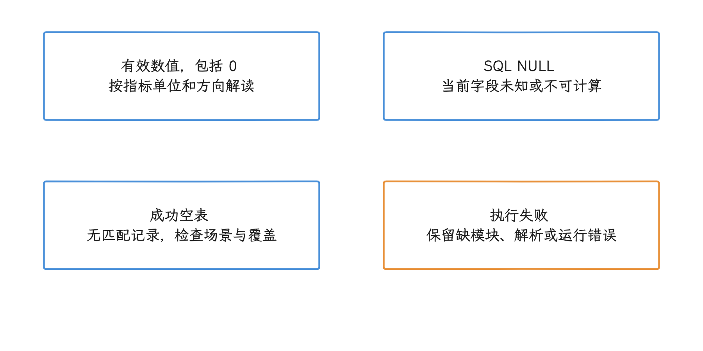

图：保留查询状态和数值缺失含义，再决定是否进入比较。 成功空表只表示无匹配，不能直接推出系统没有问题。

### 两类宏：SQL 复用与 UI 自动化

#### PerfettoSQL 宏

SQL 宏适合生成表、子查询或表达式片段：普通函数能完成的标量计算继续用函数就好，宏的价值在于把表名或列名当作参数。

下面的宏从任意兼容表中选出超过指定时长的时间片：

```sql
CREATE PERFETTO MACRO long_slices(
  input TableOrSubquery,
  min_dur Expr
)
RETURNS TableOrSubquery AS
(
  SELECT ts, dur, name, track_id
  FROM $input
  WHERE dur >= 0 AND dur >= $min_dur
);

SELECT ts, dur, name
FROM long_slices!(slice, 8 * 1000 * 1000)
ORDER BY dur DESC
LIMIT 20;
```

`TableOrSubquery` 和 `Expr` 是宏参数类型，分别表示表或子查询、普通 SQL 表达式；宏调用以 `!` 结尾，参数在查询真正执行前展开。查询里的 8 ms 只是筛选条件的示例值，判断一帧是否超期，要比较该帧自己的显示期限。


供多人使用的 SQL，值得从查询页里拿出来，组织成自定义 SQL 包，再用 `TraceProcessorConfig.add_sql_packages` 或命令行 `--add-sql-package` 注册。包名相当于模块命名空间，用来避免团队模块与标准库或其他团队重名；包名、查询接口和测试 Trace 都应纳入版本控制。

#### UI 命令宏

Perfetto UI 的宏是命名后的稳定命令序列。当前配置入口为 `Settings > Macros`，格式是 JSON 数组。宏由工程师从命令面板执行，也可以被启动命令引用。

下面的宏折叠现有轨道、固定 CPU 轨道，再为所有进程主线程中超过 8 ms 的时间片增加分组调试轨道：

```json
[
  {
    "id": "user.myteam.LongMainThreadSlices",
    "name": "Long Main-thread Slices",
    "run": [
      {
        "id": "dev.perfetto.CollapseTracksByRegex",
        "args": [".*"]
      },
      {
        "id": "dev.perfetto.PinTracksByRegex",
        "args": [".*CPU \\d+$"]
      },
      {
        "id": "dev.perfetto.AddDebugSliceTrackWithPivot",
        "args": [
          "SELECT s.ts, s.dur, s.name, printf('%s [upid=%d]', COALESCE(p.name, '[unnamed]'), p.upid) AS process_key FROM slice AS s JOIN thread_track AS tt ON s.track_id = tt.id JOIN thread AS t USING (utid) JOIN process AS p USING (upid) WHERE t.tid = p.pid AND s.dur >= 8000000",
          "process_key",
          "Long main-thread slices"
        ]
      }
    ]
  }
]
```

`AddDebugSliceTrackWithPivot` 要求查询返回 `ts`、`dur`、`name` 和分组列。Pivot 表示按某列的不同取值拆成多条调试轨道；示例用包含 `upid` 的 `process_key` 区分当前 Trace 内的进程实例。固定 Android 17 UI 的 `registerMacro()` 逐条 `await runCommand()`，没有逐条捕获异常：命令抛错或返回 rejected Promise 时，当前宏会中断；若命令内部自行处理错误并正常返回，才会继续。因此共享前要用代表性 Trace 检查每一步及失败路径。命令 ID 还要出现在 Perfetto 的稳定自动化参考中，避免依赖插件私有命令。

<!-- gracker-diagram: ed14-04-sql-and-ui-macro-execution -->
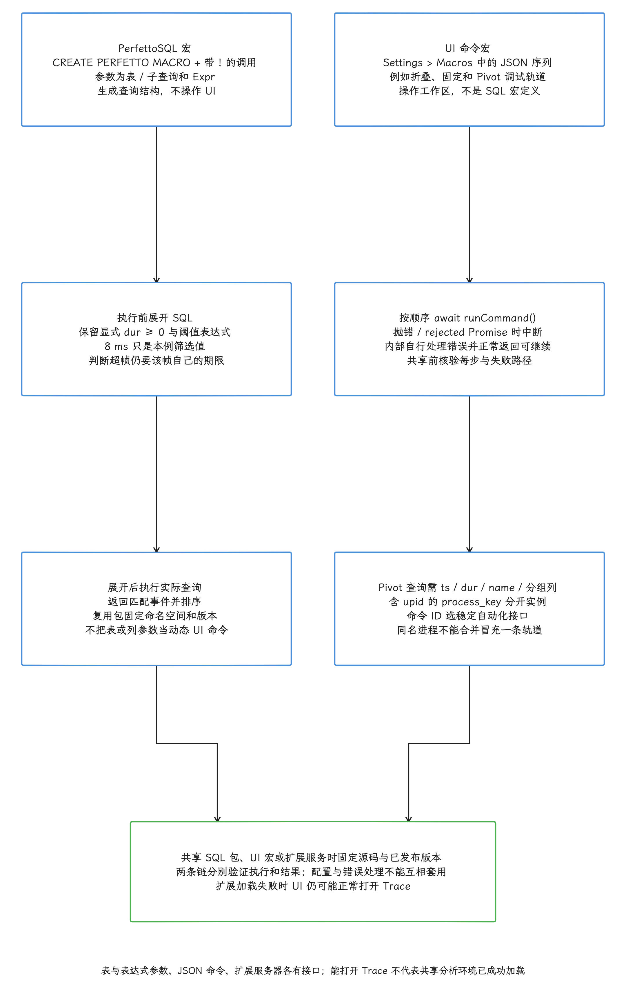

图：SQL宏用CREATE PERFETTO MACRO接收TableOrSubquery和Expr，调用带!，在查询执行前展开；示例dur>=0和8ms为过滤条件非帧deadline。UI宏为JSON命令序列，按registerMacro逐条await runCommand，抛错/rejected中断，命令自行吞错正常返回可继续；Pivot需要ts/dur/name/分组列，以含upid的键区分实例。SQL包与UI扩展共享需固定版本/反向域名命名空间/稳定命令ID，机制与配置不互通。

宏可以保存在本地设置中。个人使用时，把 JSON 存入仓库并提供安装说明即可；固定录制流程还可以用 `record_android_trace --ui-startup-commands`、带参数的深链接或浏览器窗口消息接口 `postMessage` 注入允许的启动命令。

多人共享更适合使用 Perfetto 扩展服务器。当前接口能分发宏、SQL 模块和 protobuf descriptor（描述字段结构的类型信息），既支持 GitHub 仓库，也支持带认证的 HTTPS 端点。服务器要声明反向域名命名空间，例如 `com.example.perfetto`；宏 ID 和 SQL 模块名必须以该命名空间开头，避免不同服务器重名。扩展加载失败时 UI 照样能打开 Trace，所以团队仍要把服务端清单、源码和已发布版本纳入版本控制，分析结果要能对应到固定的提交。

#### 单轨迹仪表板与跨轨迹仪表板

Perfetto UI 擅长对一份轨迹做交互诊断。工作区、查询页和调试轨道可以组成单轨迹仪表板，跨构建趋势则要交给后面的指标文件和时序存储来保存。

跨 Trace 仪表板应读取 Trace Summarization 或 Benchmark JSON。后者是 AndroidX Benchmark 输出的结构化测量报告：

| 层次 | 保存内容 | 回答的问题 |
|---|---|---|
| Perfetto UI | 宏、工作区、调试轨道、查询页 | 这次慢在哪里 |
| 指标文件 | `TraceSummary`、Benchmark JSON、工具版本 | 这次测到了什么 |
| 时序存储 | 按时间保存构建、设备、场景、样本与指标 | 何时开始变化 |
| 可视化与告警 | 分位数、基线区间、Trace 链接 | 是否需要人工复核 |

这张表只画了骨架，信息量在回溯路径上：趋势图上的每个异常点，都应能跳回原始 Trace、构建信息和指标规格版本。分位数表示样本排序后所处的位置，P50 就是中位数；这类聚合值要保存，只保存它们会丢掉根因线索。

<!-- gracker-diagram: ch14-04-09-trend-backtrace -->
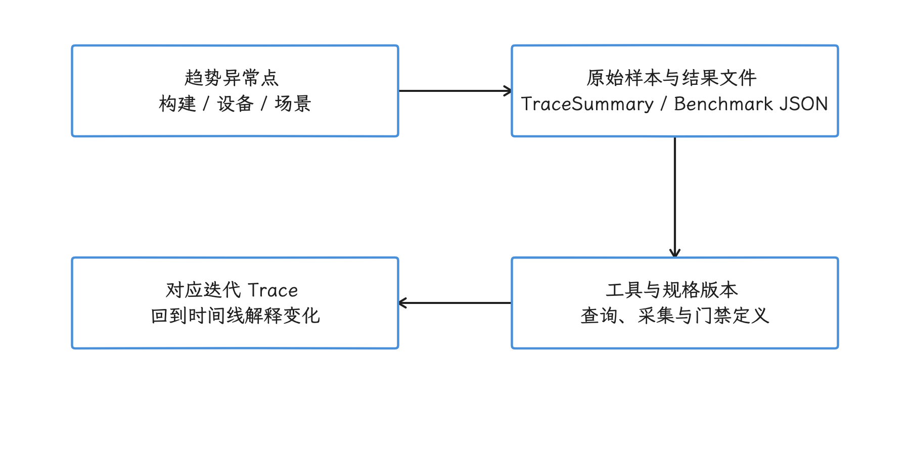

图：从趋势点沿样本、规格和原始轨迹回查，才能解释变化。 P50 / P95 等聚合值不保留每次迭代的完整因果线索。

### Trace Processor Python API

#### 固定二进制与工具版本记录

Python 侧的入口是 `pip`：`pip install perfetto` 会安装 Perfetto Python 客户端。客户端默认按包内 prebuilt manifest 下载固定的 Trace Processor，也允许显式指定二进制；Python 包版本号与原生二进制版本号不保证相同。例如本次复核的 `perfetto==0.57.2` 包内清单固定的是原生 v56.1，不能据此声称实际运行 v57.2。本文示例的 `tools/perfetto/trace_processor` 应放置并验证所选 v57.2 二进制；Pandas 示例还需安装 `pandas`。CI（持续集成） 更适合固定 Python 依赖和二进制摘要；摘要就是用来确认文件内容未变的哈希值，应与版本一起写入报告。


下面的示例使用指定二进制查询 `slice` 表中最长的正时长事件：

```python
from perfetto.trace_processor import TraceProcessor, TraceProcessorConfig

config = TraceProcessorConfig(
    bin_path="tools/perfetto/trace_processor",
)

with TraceProcessor(
    trace="trace.perfetto-trace",
    config=config,
) as tp:
    rows = tp.query("""
        SELECT ts, dur, name
        FROM slice
        WHERE dur > 0
        ORDER BY dur DESC
        LIMIT 20
    """)
    frame = rows.as_pandas_dataframe()
    print(frame.to_string(index=False))
```

`with` 上下文管理器会在代码块结束时关闭 Trace Processor 子进程。`as_pandas_dataframe()` 把结果复制成 Pandas DataFrame（带列名的内存表格），适合后续统计；只需逐行处理少量结果时，直接遍历查询结果能少保留一份表格数据。

#### 批量查询

`BatchTraceProcessor` 为每份 Trace 启动独立实例，并行执行同一查询：`query()` 返回每份 Trace 各自的数据表，`query_and_flatten()` 把这些表纵向合并，再由 resolver（把 URI 或路径解析成数据来源的组件） 组件补上来源列。

下面的代码统计每份轨迹中 `slice` 行数及正时长切片的累计时长。`slice` 可包含线程、设备、IRQ、GPU 等轨道，嵌套和并行区间会重复覆盖同一墙钟时间；这里的累加值用于检查数据规模，不能当作 CPU 消耗、互斥业务耗时或 Trace 时长：

```python
from glob import glob
from perfetto.trace_processor import TraceProcessorConfig
from perfetto.batch_trace_processor.api import (
    BatchTraceProcessor, BatchTraceProcessorConfig,
)

trace_paths = sorted(glob("traces/*.perfetto-trace"))

config = BatchTraceProcessorConfig(
    tp_config=TraceProcessorConfig(bin_path="tools/perfetto/trace_processor"),
)

with BatchTraceProcessor(trace_paths, config=config) as batch:
    summary = batch.query_and_flatten("""
        SELECT
          COUNT(*) AS slice_count,
          SUM(CASE WHEN dur > 0 THEN dur ELSE 0 END) AS total_slice_dur_ns
        FROM slice
    """)
    print(summary)
```

<!-- gracker-diagram: ch14-04-11-slice-sum-overlap -->
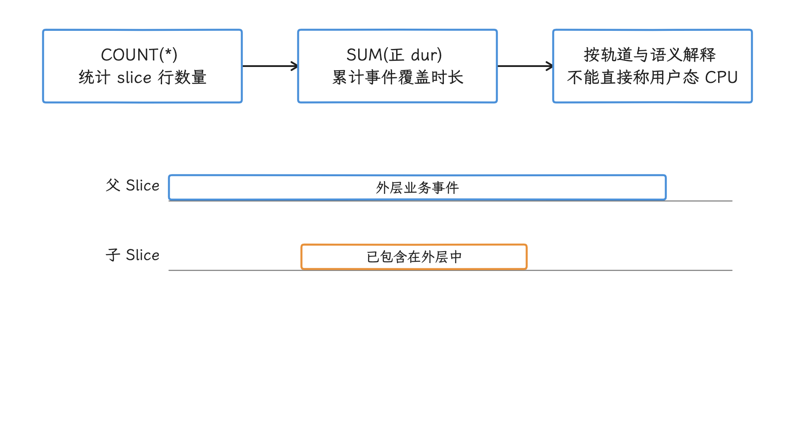

图：slice 是通用事件视图，嵌套与并行会重复覆盖相同墙钟。 图中条长只示意包含关系；SUM(dur) 不自动得到业务独占耗时。

来源列的名称取决于所用 Trace 地址 resolver，读取结果的代码要先确认实际列名，再决定怎么引用 `source` 这类名字。`BatchTraceProcessor` 会加载并保留本批所有 Trace 实例；限制加载或查询 worker 数量不等于限制驻留实例数。内存不足时应先拆分输入批次，完成一批并关闭实例后再处理下一批。单批规模与并发数要按 Trace 内容和机器内存实测，压缩文件大小只能作为参考。官方文档给出的 `2 × 平均文件大小 × Trace 数量` 适合粗略起步，数据类型和压缩率会让实际占用明显偏离。

<!-- gracker-diagram: ch14-04-12-batch-memory -->
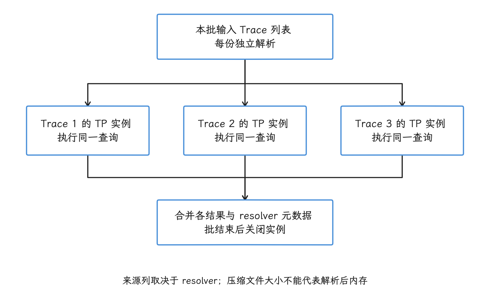

图：每份 Trace 各有一个驻留实例，结果表再纵向合并。 worker 限额不限制驻留实例总数；内存不足需拆分输入批次。

批量规模超过单机资源后，可评估 Bigtrace。它是分布式 Trace Processor 服务，用 Kubernetes（容器集群编排系统） 调度多个工作进程，适合已经具备对象存储和集群运维能力的团队。单纯为了几十份 Trace 引入 Bigtrace，运维成本通常高于收益。

#### 远程 Trace Processor 服务

v57.2 与 Android 17 标签都已提供服务子命令。下面的命令在本机 9001 端口启动原生 Trace Processor，开放 RPC（Remote Procedure Call，远程过程调用） 接口供 Perfetto UI 探测：

```bash
trace_processor server http --ip-address 127.0.0.1 --port 9001 trace.perfetto-trace
```

旧写法 `trace_processor --httpd trace.perfetto-trace` 在 v57.2 中仍完整支持。原生进程绕开浏览器 WebAssembly（浏览器内的沙箱二进制执行环境） 的内存限制，但 Trace 解析后的内存仍可能显著大于文件大小。

`external/perfetto/src/trace_processor/rpc/` 中的 `Rpc` 负责 protobuf 编解码，HTTP、stdio 和 WebAssembly 桥接负责传输。Python 客户端已经封装好协议协商、分批响应和错误处理；业务脚本调用 Python API 或命令行接口即可，`/rpc` 请求、分块传输和序列号管理这些细节都交给封装层。

<!-- gracker-diagram: ch14-04-13-native-rpc -->
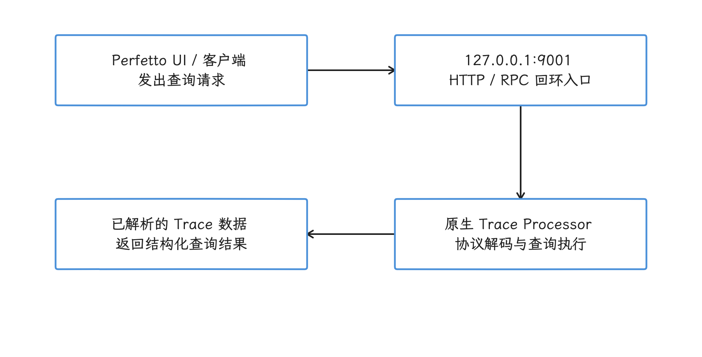

图：UI 或封装客户端把查询交给本机原生进程，Trace 数据驻留在主机。 原生进程仍受主机内存限制；版本与 RPC 协议需成套验证。

服务应只监听回环地址，即仅本机可访问的 `127.0.0.1` 或 `::1`。Trace 可能包含进程名、文件路径、埋点文本和业务标识，9001 端口要留在本机，避免直接暴露到共享网络。UI 和服务器版本相差过大时还可能出现 RPC 版本不匹配，升级时要成套验证。

### 把 Perfetto 放进持续集成

#### 测量值与诊断证据的分工

AndroidX Macrobenchmark 是在 Android 设备上重复执行启动、滚动等场景的基准测试库。它会输出 Benchmark JSON，并为每次测量保存一份 Perfetto Trace。持续集成中的门禁是根据测量结果自动决定构建是否允许继续；可以分两层处理：

- Benchmark JSON 作为门禁的主要数值来源；
- Perfetto SQL 或 Trace Summarization 生成诊断指标，并保留异常样本的原始轨迹。


从某个可能变化的 Slice 名称重新计算启动时间，再与 Macrobenchmark 的 `StartupTimingMetric` 混为同一个指标，这里藏着隐患：系统升级或埋点名称变化后，两套定义可能出现不易察觉的偏差。

#### 可复现的流水线

一条可靠的流水线至少记录这些信息：

1. 目标 APK（被测应用安装包）、测试 APK、提交和构建参数；
2. 真机序列号、机型、系统指纹（build fingerprint）、API 级别和电量；
3. 启动模式、编译模式（例如无预编译、部分预编译或完整预编译）、场景参数和迭代次数；
4. Benchmark JSON、每次迭代的轨迹和测试日志；
5. Perfetto Python 包、Trace Processor 二进制版本与摘要；
6. 指标规格、SQL 包和门禁策略的版本。

官方文档不建议用模拟器数值代表用户设备。固定真机适合代码合并前的自动门禁；共享设备池更适合趋势观察和夜间复测。低电量、可调试 APK、未配置为 profileable（允许性能分析）的 APK，这类 Macrobenchmark 配置错误要逐项处理，统一忽略时，不同运行可能处于不同测量条件。

按官方示例模块名，本地连接真机时可以这样运行整组基准：

```bash
./gradlew :macrobenchmark:connectedCheck
```

Gradle（Android 项目常用的构建系统） 会把 Benchmark JSON 和每次迭代的 `.perfetto-trace` 复制到 `build/outputs/connected_android_test_additional_output/` 下；当前插件还会按测试变体、连接方式和设备继续分子目录，例如 `debugAndroidTest/connected/<device>/`，收集脚本应递归发现报告，把父目录当作唯一位置会漏掉文件。

设备农场通常把构建、安装、运行和拉取测试文件拆成独立阶段；无论跑在哪类平台，指标含义都要保持一致。

#### 门禁阈值与设备噪声

“变慢 10%”或“p 值小于 0.05”这类通用数字，我们要先问它在自己的设备上是否成立。p 值来自假设检验，只有结合实验设计、样本数和预先选择的检验方法才有意义。做法是在固定设备和固定构建条件下反复运行未改代码，测出设备与场景自身的自然波动，再为每个场景制定阈值和复测策略。

下面的脚本只读取 Macrobenchmark JSON 中 `metrics.<指标>.runs` 的每次迭代标量，例如非负、越低越好的启动耗时；帧采样等 `sampledMetrics.<指标>.runs` 是嵌套数组，需要单独的聚合与实验单位设计。脚本先检查当前报告和基线的机型与系统指纹，再比较指定标量指标的中位数。这里的基线指已批准、用于比较的历史结果，中位数是样本排序后的中间值。阈值由调用者从版本库中的场景策略传入。

```python
#!/usr/bin/env python3
import argparse
import json
import math
import statistics
import sys
from pathlib import Path


def load_report(path, benchmark_name, metric_name):
    report = json.loads(Path(path).read_text(encoding="utf-8"))
    matches = [
        item for item in report["benchmarks"]
        if item["name"] == benchmark_name
    ]
    if len(matches) != 1:
        raise ValueError(
            f"{path}: expected one benchmark named {benchmark_name!r}, "
            f"found {len(matches)}"
        )

    metric = matches[0]["metrics"][metric_name]
    values = metric["runs"]
    if not isinstance(values, list) or not values:
        raise ValueError(f"{path}: expected nonempty scalar runs")
    if any(
        isinstance(value, bool) or not isinstance(value, (int, float))
        or not math.isfinite(value) or value < 0
        for value in values
    ):
        raise ValueError(f"{path}: samples must be finite nonnegative numbers")
    runs = [float(value) for value in values]
    return report["context"], runs


def main():
    parser = argparse.ArgumentParser()
    parser.add_argument("--current", required=True)
    parser.add_argument("--baseline", required=True)
    parser.add_argument("--benchmark", required=True)
    parser.add_argument("--metric", required=True)
    parser.add_argument("--max-regression-ratio", required=True, type=float)
    args = parser.parse_args()
    if not math.isfinite(args.max_regression_ratio) or args.max_regression_ratio < 0:
        raise ValueError("threshold must be finite and nonnegative")

    current_context, current_runs = load_report(
        args.current, args.benchmark, args.metric
    )
    baseline_context, baseline_runs = load_report(
        args.baseline, args.benchmark, args.metric
    )

    current_build = current_context["build"]
    baseline_build = baseline_context["build"]
    for key in ("model", "fingerprint"):
        if current_build[key] != baseline_build[key]:
            raise ValueError(f"environment mismatch: build.{key}")

    current_median = statistics.median(current_runs)
    baseline_median = statistics.median(baseline_runs)
    if baseline_median <= 0:
        raise ValueError("baseline median must be positive")
    ratio = current_median / baseline_median - 1.0
    if not math.isfinite(ratio):
        raise ValueError("regression ratio is not finite")

    print(
        json.dumps(
            {
                "benchmark": args.benchmark,
                "metric": args.metric,
                "current_median": current_median,
                "baseline_median": baseline_median,
                "regression_ratio": ratio,
                "current_sample_count": len(current_runs),
                "baseline_sample_count": len(baseline_runs),
            },
            ensure_ascii=False,
            allow_nan=False,
            indent=2,
        )
    )
    return 2 if ratio > args.max_regression_ratio else 0


if __name__ == "__main__":
    sys.exit(main())
```

脚本不内置阈值，拒绝空样本、非数值/非有限/负样本、非法阈值与零基线中位数；无效输入以非零状态失败，超过阈值返回 2，通过返回 0。业务要求的最小样本数要由正式流水线另行校验。比值计算适用于“数值越低越好”且基线中位数大于零的指标；基线为零、可能为负或方向相反的指标要改用对应规则。首次超过阈值后，应在同一设备复测，并把两轮报告与 Trace 一起交给评审，场景参数、编译模式和样本数的校验也放在正式流水线里。

<!-- gracker-diagram: ch14-04-15-finite-gate -->
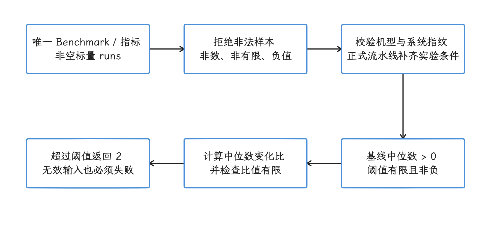

图：只对有限非负标量与正基线中位数执行越低越好的回归比较。 机型和指纹一致仍不足以证明条件一致；样本数、场景和编译模式另行校验。

#### 门禁采集与深度诊断的分离

增加 ftrace 事件、堆采样或密集应用埋点，本身就会改变被测程序和系统的采集开销。为了不让诊断开销污染测量结果，门禁配置和深度诊断配置可以分开：

- 常规门禁只采 Macrobenchmark 所需数据；
- 超过阈值后用同一提交复测并启用更详细的数据源；
- 诊断结果用于定位，不拿来替换原门禁样本；
- 每次采集配置变更都建立新基线，避免把工具开销变化记成产品性能变化。

这样既能控制日常测量开销，异常发生后也能拿到调度、Binder、内存或渲染方面的线索。

<!-- gracker-diagram: ed14-04-gate-evidence-and-diagnostic-capture -->
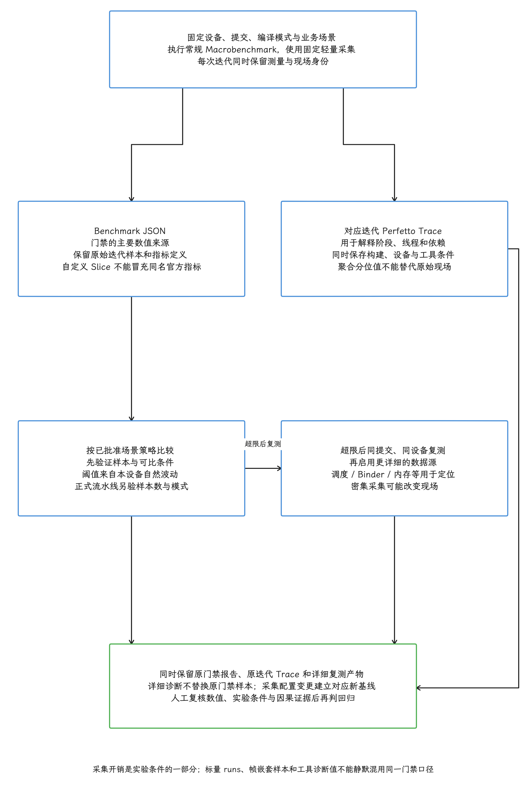

图：Macrobenchmark JSON是主要门禁数值源，各次迭代Perfetto Trace是诊断证据，保存APK/设备/编译模式/场景/采集/toolchain/策略等条件。自定义Slice重算不能冒充StartupTimingMetric。按设备自然波动与已批准阈值判定，首次超限同设备同提交复测，更密集数据源改变开销，诊断不替换原样本；采集配置更改需新基线。原标量脚本只处理metrics.<id>.runs，sampledMetrics嵌套需另设计。

### 自定义 Trace Point（埋点）

#### 选择平台 API 还是 Perfetto SDK

给应用或引擎加 Trace Point，先要在平台 API 和 Perfetto SDK 之间做选择。这里的 Trace Point 指代码主动写入 Trace 的应用或平台埋点，与 Linux 内核预定义的 Tracepoint 分属不同机制。事件可以分三类来看：同步时间片是同一线程上有明确起止的工作，异步时间片可跨线程或跨回调配对，计数器记录随时间变化的数值。Android 应用只用到这三类时，平台 Trace 或 NDK（Native Development Kit，C/C++ 开发工具包） 提供的 `ATrace_*` 已经足够；遇到 C++ 引擎、跨平台程序，或者需要分类过滤、流事件、强类型扩展，再上 Perfetto SDK。


| 接口 | 可用边界 | 适合场景 |
|---|---|---|
| `Trace.beginSection/endSection` | API 18+ | Java/Kotlin 同线程嵌套阶段 |
| `ATrace_beginSection/endSection` | NDK API 23+ | C/C++ 同线程嵌套阶段 |
| `Trace.beginAsyncSection/endAsyncSection` | API 29+ | Java/Kotlin 跨线程阶段 |
| `ATrace_beginAsyncSection/endAsyncSection` | NDK API 29+ | C/C++ 跨线程阶段 |
| `Trace.setCounter` / `ATrace_setCounter` | API 29+ | 随时间变化的数值 |
| Perfetto SDK `TRACE_EVENT` | C++17 SDK | 分类、流、计数器和扩展字段 |

#### Java/Kotlin 同步时间片

同步时间片必须在同一线程成对结束。下面的包装能在异常路径上保持平衡：

```kotlin
inline fun <T> tracedSection(name: String, block: () -> T): T {
    android.os.Trace.beginSection(name)
    return try {
        block()
    } finally {
        android.os.Trace.endSection()
    }
}

val bitmap = tracedSection("ImageDecode") {
    decodeImage(bytes)
}
```

`Trace.java` 把名称限制在 127 个 UTF-16 代码单元；普通汉字通常占一个，部分 emoji 等字符占两个。`beginSection()` 在应用追踪启用时检查长度，超长名称会抛出 `IllegalArgumentException`；`|`、换行和空字符则会在底层被替换为空格。名称应保持短、稳定且不含用户数据。


跨线程任务要使用相同名称和 cookie 配对：

```kotlin
fun startCapture(requestId: Int) {
    android.os.Trace.beginAsyncSection("CameraCapture", requestId)
}

fun finishCapture(requestId: Int) {
    android.os.Trace.endAsyncSection("CameraCapture", requestId)
}

fun updateQueueDepth(depth: Int) {
    android.os.Trace.setCounter("DecodeQueueDepth", depth.toLong())
}
```

cookie 是异步区间的整数关联 ID。时间上重叠的同名异步事件必须使用不同 cookie，结束事件再用同一名称与 cookie 找回对应起点。cookie 只负责配对，账号、文件名或其他敏感信息不要放进去。

<!-- gracker-diagram: ch14-04-19-async-cookie -->
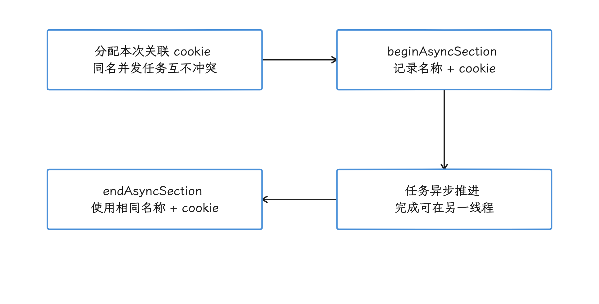

图：在开始和完成回调中使用同一名称与 cookie，允许跨线程配对。 重叠的同名任务需不同 cookie；配对标识不应携带敏感业务内容。

#### NDK `ATrace_*`

C/C++ 同步阶段的写法与 Java 层语义一致：

```cpp
#include <android/trace.h>

void DecodeFrame(const EncodedFrame& frame) {
  ATrace_beginSection("ImageDecode");
  Decode(frame);
  ATrace_endSection();
}
```

C++ 代码如果可能抛异常或提前返回，应再封装 RAII（Resource Acquisition Is Initialization，利用对象析构自动清理）守卫，确保 `ATrace_endSection()` 总能执行。异步 NDK API 从 API 29 起使用相同名称和 cookie 配对。

Android 平台、系统服务和 HAL（Hardware Abstraction Layer，硬件抽象层） 还会使用 `libcutils` 的小写 `atrace_begin()`，它允许显式选择 `ATRACE_TAG_*`。下面的代码把显示配置阶段放到 graphics 分类中：

```cpp
#include <cutils/trace.h>

void ConfigureDisplay(Display& display) {
  atrace_begin(ATRACE_TAG_GRAPHICS, "ConfigureDisplay");
  display.ApplyPendingConfiguration();
  atrace_end(ATRACE_TAG_GRAPHICS);
}
```

`libcutils/include/cutils/trace.h` 还提供 `ATRACE_BEGIN` / `ATRACE_END` 宏，使用编译单元里定义的 `ATRACE_TAG`。这套接口属于平台私有 API，普通应用应使用 SDK `Trace` 或 NDK `ATrace_*`，不要把 `libcutils` 头文件当作稳定的 NDK 接口。

应用 Trace Point 只有被采集配置允许时才会出现在系统 Trace 中。下面的 Android Perfetto 配置通过 `atrace_apps` 包名允许列表，启用目标应用的 `TRACE_TAG_APP` 分类事件：

```textproto
buffers {
  size_kb: 32768
  fill_policy: RING_BUFFER
}

data_sources {
  config {
    name: "linux.ftrace"
    ftrace_config {
      atrace_apps: "com.example.app"
      ftrace_events: "sched/sched_switch"
      ftrace_events: "sched/sched_waking"
    }
  }
}
```

`RING_BUFFER` 表示缓冲区满后覆盖最早的数据。`atrace_apps` 可以填写具体包名；`*` 会扩大到所有应用的 ATrace 事件，数据量和隐私暴露一起变大，不适合作为团队默认配置。


#### Native（C/C++） Perfetto SDK

如果系统 Trace 要把应用事件与调度、ftrace 等数据放在同一时间轴，应使用 system backend（系统后端）。下面是 TrackEvent 的最小初始化与同步时间片：

```cpp
#include <perfetto.h>

PERFETTO_DEFINE_CATEGORIES(
    perfetto::Category("rendering"),
    perfetto::Category("camera"));
PERFETTO_TRACK_EVENT_STATIC_STORAGE();

void InitTracing() {
  perfetto::TracingInitArgs args;
  args.backends |= perfetto::kSystemBackend;
  perfetto::Tracing::Initialize(args);
  perfetto::TrackEvent::Register();
}

void RenderFrame() {
  TRACE_EVENT("rendering", "RenderFrame");
  SubmitRenderWork();
}
```

`kSystemBackend` 连接系统中的 Perfetto 追踪服务 `traced`，采集会话由外部 Perfetto 客户端控制。`Initialize()` 与 `Register()` 只注册能力，外部会话还需启用 `track_event` 数据源并允许相应 category；前面的 `linux.ftrace/atrace_apps` 配置只针对平台 ATrace，不能代替 TrackEvent 配置。该模式适合能控制设备和部署的本地调试或实验室环境。`kInProcessBackend`（进程内后端） 还需在本进程创建、配置并启动 tracing session，所得 Trace 只包含本进程数据，不会自行带上系统调度；两种后端可以同时注册，各自会话不会因此自动合成同一输出。

<!-- gracker-diagram: ed14-04-event-source-and-session-matching -->
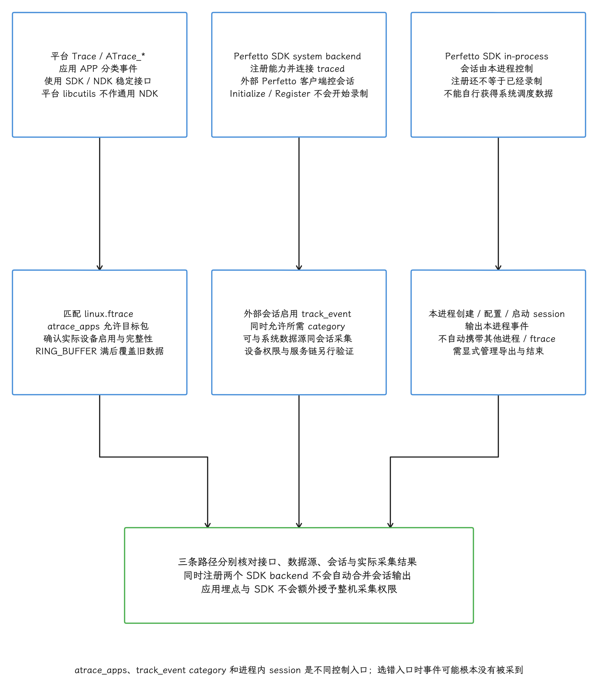

图：平台Trace/ATrace属于APP分类，由linux.ftrace和atrace_apps目标包允许采集；RING_BUFFER满覆盖最早数据。SDKsystem连接traced，Initialize/Register仅注册，外部会话需track_event与category。SDKinprocess需本进程创建配置启动session，仅本进程无整机调度；两backend可同时注册但输出不自动合并。请求配置不保证设备实际覆盖，不赋予应用额外系统采集权限。

TrackEvent 已支持时间片、计数器、Flow（事件之间的因果连线） 和调试注解（附加的键值信息）。Android 17 所带 Perfetto 还支持 TrackEvent protobuf descriptor；需要强类型业务字段时，可以把字段类型描述嵌入 Trace，让 Trace Processor 自动把数据解码到 `args` 表。

自定义 `perfetto::DataSource<T>` 的门槛更高。它能写自定义数据包，但 Trace Processor 也要具备对应导入逻辑。

只定义一个独立 `.proto`，指望代码生成器产生的 setter（字段写入方法） 自动进入上游 `TracePacket`，这条路走不通；`TracePacket` 是 Perfetto Trace 的顶层数据包容器，缺少平台 protobuf 扩展、descriptor 或自定义导入器，这类代码就形成不了可查询的结构化数据。

<!-- gracker-diagram: ch14-04-22-typed-import -->
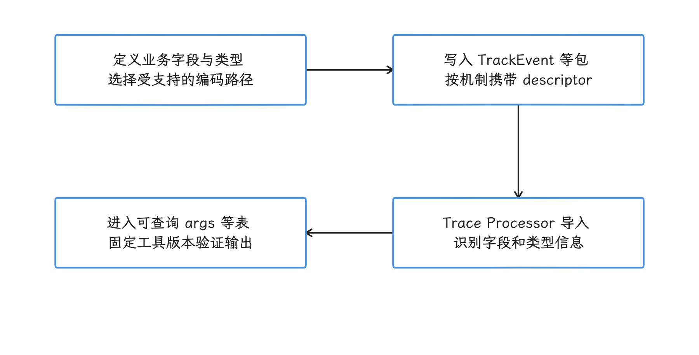

图：字段描述与导入能力共同决定 Trace Processor 能否查询结构化内容。 独立 proto 生成 setter 不会自动扩展上游 TracePacket。

#### 生产包治理

Trace 点的设计质量会直接影响轨迹可读性和线上信息暴露：

- 用稳定阶段名，动态标识放在 cookie、计数器或受控字段中；
- 同步区间严格嵌套，异步区间严格配对；
- 不写账号、URL 参数、文件路径、令牌或用户输入；
- 不在每个元素、每个像素或极短循环中密集埋点；
- 字符串需要格式化时先检查 `Trace.isEnabled()`，确认当前是否启用追踪，减少未采集状态下仍创建临时字符串对象；
- 对埋点开销做目标设备实测，不沿用其他设备的纳秒级估算。

Android 性能文档给出的经验值约为每个区间 5 微秒，并建议优先标记大于 0.1 ms 的工作。这是选择粒度的参考值，具体开销仍受设备、系统和采集配置影响。

不要用全局 `-assumenosideeffects class android.os.Trace` 规则清除发布包中的平台 Trace 调用。这条 R8（Android 字节码优化与压缩工具） 规则会假定方法没有副作用并删除调用，影响应用和依赖库的所有调用点，也会让诊断能力随构建配置变化。更可控的方案是只包装团队自己的可选埋点：

```kotlin
object AppTrace {
    inline fun <T> section(name: String, block: () -> T): T {
        if (!BuildConfig.ENABLE_APP_TRACE) {
            return block()
        }
        android.os.Trace.beginSection(name)
        return try {
            block()
        } finally {
            android.os.Trace.endSection()
        }
    }
}
```

把 `ENABLE_APP_TRACE` 设为构建期常量后，R8 可以移除不可达的 Trace 调用分支。发布前仍要检查 APK、混淆映射文件和实际 Trace，确认敏感字符串已移除、需要的诊断点仍存在。


### 团队级 Perfetto 分析知识库

只收集零散 SQL 的共享目录算不上知识库。一个可审查的最小目录可以这样组织：

```text
perfetto-analysis/
├── toolchain.lock
├── trace-configs/
│   ├── startup.textproto
│   └── rendering.textproto
├── sql-packages/
│   └── team.android/
├── summaries/
│   ├── startup.textproto
│   └── memory.textproto
├── ui-macros/
│   └── macros.json
├── gates/
│   └── policy.json
├── golden-traces/
│   └── manifest.json
└── tests/
```

`toolchain.lock` 记录 Python 包、Trace Processor 版本和二进制摘要。

黄金轨迹（golden（预先确认的基准值） trace）是结果已确认、用于回归测试的固定代表性 Trace；清单要记录其来源、系统版本、许可范围和预期结果，含敏感数据的文件本身应放在受控存储。

每次变更至少做四类检查：

1. SQL 能在空轨迹和代表性轨迹上执行；
2. 指标单位、维度、空值和极性符合事先声明的输出契约；
3. UI 宏中的命令 ID 属于稳定自动化接口；
4. 旧工具与新工具的差异经过固定轨迹对比。

知识库的评审重点应放在语义变化。格式调整可以自动化；指标定义、时间窗口、连接键（JOIN 的匹配字段）、阈值和采集依赖的变化，必须由熟悉该领域的工程师确认。


## 分析平台的任务、证据与版本治理

单个指标回答的是固定的问题；分析平台要接着管理 Trace 输入、查询版本、任务编排和结果依据，让每个结果都能回到原始时间线。

这个要求来自很现实的处境：一条 Perfetto trace 可以回答很多问题，但换一位分析者、隔一周再查，或者升级一次工具，同一个问题的过滤条件、单位和计算方法都可能变了。SmartPerfetto 用一条统一流程连接 Perfetto UI、`trace_processor_shell`、YAML Skill、场景策略、模型运行时、证据字段和报告存储：SQL 可以重跑，结论可以回查，多次分析可以按同一组指标比较。

下文涉及字段、阈值、runtime（调用模型和工具的执行适配层） 选择和企业迁移的实现细节，固定在 SmartPerfetto v1.3.0、提交 `24eba544cebf231524294aa50def33ee0e267c9e`，该版本固定使用 Perfetto v57.2 的 host 侧 `trace_processor_shell`。截至 2026-10-25 查询公开 release，最新版本为 v1.16.2（2026-10-14 发布）；本文仍只解释上述 v1.3.0 快照，新版本的新增或修复行为需另读对应版本源码。

Android 版本与 host 工具版本是两条独立的版本线，要分开对待：Android 版本决定设备能采到哪些数据源，host 侧 Perfetto 版本决定 trace 解析器、SQL schema 和 stdlib（PerfettoSQL 标准库）能力。用 v57.2 分析 Android 10～17 的 trace，设备端未必也在运行 v57.2。

<!-- gracker-diagram: ed14-04-independent-version-axes-and-toolchain -->
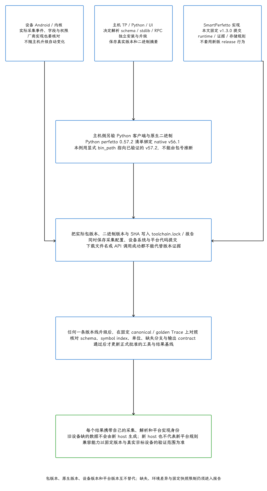

图：Android17设备/内核决定实际数据源和权限，主机TP/Python/UI决定schema/stdlib/RPC，SmartPerfetto固定v1.3.0提交决定runtime/证据/存储实现。perfetto Python0.57.2清单绑定nativev56.1，包号不证明运行v57.2；原文显式bin_path需放置验证所选v57.2。保存实际version/hash/toolchain，升级任何一线用canonical/goldentrace核对输入与contract，最新release不能倒灌旧快照。

### 从单次 Trace 问答到可复用分析结果

我们都有过这样的手工分析：打开 Perfetto UI，跑几段 SQL，把截图贴到 issue 里。会话结束后，截图还在，但“查询条件是什么”“数值来自哪一行”“换一条 trace 怎么用相同条件和算法复测”这些问题就很难回答了。SmartPerfetto 把一次分析产生的内容分成四类：

| 产物 | 主要用途 | 复核能力 |
| --- | --- | --- |
| 聊天答案 | 当前会话内解释现象、安排下一步查询 | 依赖会话中的工具结果 |
| SQL / Skill 表格 | 保存确定性取数结果 | 可检查查询、参数、列与行 |
| HTML 报告 | 分享一次完整调查 | 保留结论、限制和证据入口 |
| analysis result snapshot（分析结果快照） | 跨窗口、跨人员、跨版本比较 | 保存标准化指标、证据引用和报告身份 |

四类产物的保存周期不同。聊天答案可以随会话结束；snapshot 和报告则要携带指标来源、证据引用、运行模式、provider（模型服务提供方）、runtime 和部分失败原因。团队做回归分析时应优先保存 snapshot 或报告——后来的人如果只有一句模型结论，就无从确认它来自 trace 数据、外部知识，还是模型推断。


SmartPerfetto 处理的是单条和少量 trace，线上性能平台另有分工。线上第 90 / 99 百分位值（P90 / P99（第 90 / 99 百分位值））、慢帧率和启动耗时用于判断影响范围与趋势；少量代表性 trace 用于解释阶段耗时、线程状态和资源竞争怎样变化。两类材料的采样方式不同，复盘时应并列呈现；拿一条 trace 推导全量用户分布，结论是站不住的。

### Perfetto AI Assistant 的最小工作流

一次最小分析包含五个动作：加载 `.pftrace` 或 `.perfetto-trace`，说明包名与问题，限定场景或时间窗，选择分析模式，检查报告中的证据。如果已经在 Perfetto UI 选中 area（时间区间） 或 track event（时间线事件），前端可以只把该选区作为上下文提交给后端。选区只缩小查询范围，根因是否就在其中，还要靠进一步的查证。

`fast`、`full`、`auto` 控制分析 Agent 可以使用的工具范围、运行时间和模型调用量：

| 模式 | v1.3.0 行为 | 适合场景 |
| --- | --- | --- |
| `fast` | 轻量提示词、核心证据工具子集、较少的运行时间与模型调用量 | 已知问题的快速检查 |
| `full` | 完整工具、必须完成的计划与质量检查、notes 和 artifact | 因果链较长或需要逐层排除的问题 |
| `auto` | 由硬规则和轻量分类器决定；无法可靠分类时走 `full` | 日常入口 |

引用 reference trace（对照轨迹）、已注册源码或私有知识源时，后端会把 `fast` / `auto` 解析为 `full`，以便调用这些材料所需的工具。


Smart Profile 负责选择分析场景：preview 阶段先识别可分析的时间段，用户选中启动、滑动、点击、导航、设备状态或 ANR 后，系统再创建对应的深度分析 run（一次分析执行）。Smart Profile 决定“分析哪段场景”，`fast` / `full` 决定“投入多少工具和运行时间”，两者是不同设置。

模型并不直接读取整份 trace 字节。后端先通过 `trace_processor_shell`、SQL 和 Skill 取数，再把结构化结果、经过行列截断的表格片段、选区上下文及允许使用的报告片段交给 runtime；这样既限制了模型上下文大小，也让诊断先经过查询接口。数据外发的风险仍然存在：工具结果可能包含进程名、线程名、slice 文本或业务标识，使用外部 provider 前要评估脱敏与合规要求。

复核时要记录 Result ID（一次分析结果的标识）、`evidenceRefId`（证据引用标识）、表格行列、查询限制和 runtime 身份。只反馈“回答不对”不足以定位缺陷；这些字段能帮维护者区分 SQL 条件或单位错误、Skill 兼容问题、trace 数据源缺失、模型推断过度，以及报告展示错误。

### YAML Skill 与场景策略的分层设计

把可复用分析写成一段提示词，还是写成可执行的定义，直接决定它能否被测试。SmartPerfetto 把可复用分析分成 Skill、strategy 和 template 三层；v1.3.0 仓库中的 Skill 是可执行的 YAML 分析定义，和一段提示词是两回事。

Skill 可以声明参数、SQL、其他 Skill 引用、迭代、并行、条件分支、诊断输出和展示 schema，目录按 atomic（单项查询）、composite（组合查询）、comparison（对比）、deep（深入分析）、pipelines（多步流程）、modules（共用模块） 与 vendor（厂商扩展） 七类组织；文件数量会随版本变化，以仓库实际结构为准。

| 层级 | 主要职责 | 失败时的症状 | 复核方式 |
| --- | --- | --- | --- |
| Skill | 查询、参数、输出列、执行状态与证据来源 | 空表、错列、错时间窗、单位不一致 | 独立执行并检查 DataEnvelope |
| strategy | 场景路由、执行顺序、质量要求与误诊规则 | 选错调查路径、缺关键分支、过早收敛 | 对照场景和中间证据 |
| template | 报告结构与证据呈现 | 数字可见却无来源，限制项被遗漏 | 检查报告合约与证据引用 |

这组分层减少了临时生成 SQL 的比例。重复使用的查询放进 Skill，场景决策由 strategy 约束，报告格式交给 template。模型仍可解释数据、提出下一步查询和排列假设，但查询条件、单位换算与空结果含义应留在可测试的执行层。


Skill 输出经兼容适配器转换为 `DataEnvelope`，即 SmartPerfetto 的标准结果对象。

`meta` 保存 schema 版本、来源、时间、Skill/step、执行状态和证据身份；`data` 保存表格、图表、文本或诊断内容；`display` 保存展示层级、列定义与格式。`observed` 表示得到数据，`empty` 表示查询成功但没有匹配行，`optional_error` 表示可选查询失败。这三种状态要分开解读：把查询失败写成“没有发现问题”，就把故障藏进结论里了。


### SQL guardrail（规则式风险检查）、stdlib 文档与证据来源索引

写 Perfetto SQL 时有几类高频错误：工具升级后表或字段发生变化；漏写 stdlib module（PerfettoSQL 标准库模块）；忽略 `dur = -1` 表示事件尚未闭合；混用 Trace Processor 内部的 `utid/upid`（Trace Processor 内部唯一 ID） 和操作系统的 `tid/pid`（操作系统线程/进程 ID）；没有限制时间窗；以及在大表上执行没有范围限制的 JOIN。

SmartPerfetto 对用户直接提交的 raw SQL（用户直接提交的 SQL） 和 Skill SQL 使用不同的 include 构建路径：raw SQL 根据生成的 stdlib symbol index（标准库符号索引）分析依赖，按固定顺序补入 `INCLUDE PERFETTO MODULE ...;`；Skill 执行器则按 Skill 声明构造 include。自动补全只覆盖索引中已知的符号，symbol index 为空或语句识别不出来时，查询仍要显式写出 include。

执行后的 SQL 会生成 `QueryReviewV1`，这是一份查询复核元数据，记录实际读取的表、过滤条件、输出列、guardrail 告警、stdlib 注入、执行时长、行数与截断状态。

复杂 CTE（公用表表达式）、嵌套查询、JOIN 或窗口函数只能得到部分静态解析时，这份元数据必须标为 `partial`（证据不完整）。`QueryReviewV1` 的允许用途固定为 `review_metadata_only`：它能帮助人了解查询做过什么，诊断结论则要靠后面的证据体系支撑。

完整 Query Review 会随 DataEnvelope 或 Artifact（保存下来的分析产物） 进入报告；给模型的 compact projection（压缩后的内容片段） 不含可执行 SQL。所以报告里的可执行 SQL 是完整的，模型每轮分析看到的却可能是截断版本。


诊断证据由独立的 Evidence Contract 表达。这里的 contract 是一组必填字段，用来规定结论怎样指回原始查询结果。

一个数值证据可以记录 `traceId`、current（当前 trace）/reference（当前或对照 trace）、producer kind（数据生产方类型）、Skill 与 step、`queryHash`、`queryReviewId`、artifact、计划阶段，以及具体的 row selector（行定位条件）、column、actual value、单位和时间范围。claim（结论陈述）的支持等级分为 `verified`（证据完整）、`partial`、`inference`（推断） 和 `unsupported`（无支持）。

例如报告写“主线程 Runnable 120 ms”，至少要能定位到相应证据行和列；若再写“CPU 争用导致这 120 ms”，还需调度关系或其他证据支持因果判断。

<!-- gracker-diagram: ed14-04-query-metadata-evidence-and-claims -->
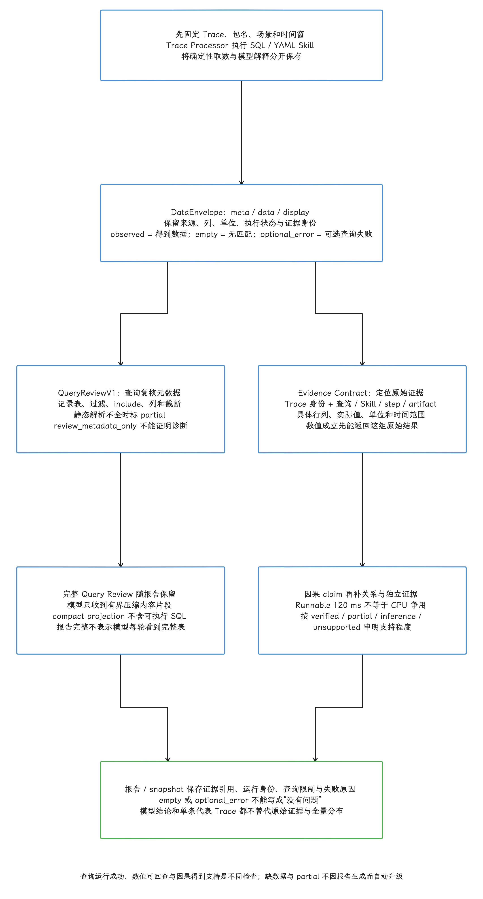

图：SQL/YAMLSkill经TP取数，DataEnvelope的meta/data/display保留来源与状态，observed/empty/optional_error不互换。QueryReviewV1记录表/过滤/include/列/时长/行数/截断，静态解析不全partial，用途review_metadata_only；完整SQL留报告，模型compactprojection不含可执行SQL。EvidenceContract另绑定tracecurrent/reference、Skill/step/queryhash/reviewid/artifact、行列实际值/单位/窗口。Runnable120ms的数值证据不能独自证明CPU竞争因果，claim标verified/partial/inference/unsupported。报告/snapshot保留运行身份与缺失原因，模型不直接读取整份trace字节，也不以单条trace推全量用户分布。

guardrail 覆盖的是规则里已经列出的风险，规则之外的正确性仍要靠人工判断。缺少 FrameTimeline、Binder、sched、GPU counter 或关键应用标记时，报告应列出缺失数据、降低支持等级，并给出补采配置；`empty` 同样要如实呈现，写成“系统没有问题”就失真了。

### 多 Trace 对比与性能回归判断

SmartPerfetto 支持两类对比。raw reference trace 对比要求当前会话同时能够访问 current 与 reference 两份原始 trace，适合围绕同一问题继续写查询。analysis result snapshot 对比读取已经完成的分析产物，适合版本回归、A/B、多候选结果和跨窗口复盘；这项对比只使用快照中保存的标准化指标与证据引用，不会重新查询原始 trace。

<!-- gracker-diagram: ch14-04-32-two-comparisons -->
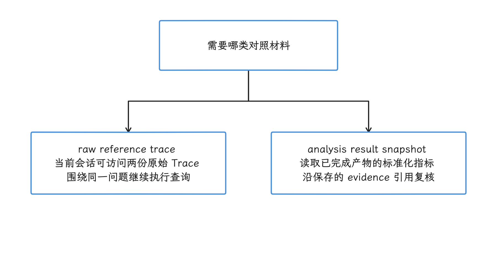

图：原始 Trace 可继续取数，结果快照只能比较已经保存的指标与依据。 快照比较不会重新查询原始 Trace；缺指标必须显式呈现。

标准指标键覆盖这些类别：

- 启动：总耗时、首帧、`bindApplication`、Activity start、主线程 blocked；
- 滑动：平均 FPS（每秒帧数）、帧数、Jank（卡顿帧） 数量与比例、帧时长 P50/P95/P99；
- CPU：主线程 Running/Runnable、大核占比、平均频率；
- 环境：trace 时长、设备型号、Android 版本和抓取配置摘要。

标准回填的范围更窄，只包含 `startup.total_ms`、`scrolling.avg_fps`、`scrolling.frame_count`、`scrolling.jank_count` 和 `scrolling.jank_rate_pct`。特别要注意 v1.3.0 的默认回填 SQL：启动从整份 Trace 的 `android_startups` 中取最大非 NULL `dur`，没有包名或场景窗口过滤；滑动读取整份 Trace 所有正时长 `actual_frame_timeline_slice`，没有进程、Layer、token 去重或场景窗口限制。因此这些回填值只能先作为全局候选，不能直接命名为“目标应用启动耗时”或“某次滑动 FPS”。正式回归要改用已校验身份、窗口和帧口径的 Skill/SQL，并在 golden Trace 上验证。TTFD（Time to Full Display，完全显示耗时）、PSS（按共享比例分摊的内存）、Java/Native Heap、DMA-BUF（Linux 设备驱动间共享的缓冲区）、bitmap、RSS 和 swap 等指标可以由 Skill、SQL 或报告模板提供，不在 v1.3.0 的内置回填集合里。缺失字段要显示为 missing metric，按零值参与比较会制造假象。

<!-- gracker-diagram: ch14-04-33-global-backfill -->
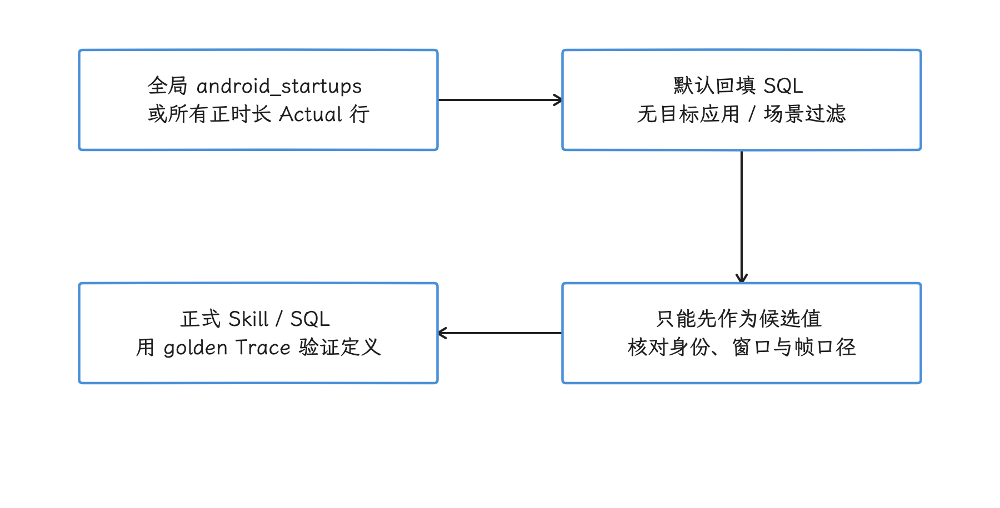

图：默认 SQL 未限制应用、Layer 和业务窗口，需验证后才可用于场景回归。 启动取全局最大 dur，帧统计可混入多进程、多 Layer 与 SF 行。

v1.3.0 的变化高亮同时使用相对阈值和按单位设置的绝对阈值。通用相对阈值为 5%；`ms` 为 5 ms，`fps` 为 1 fps，百分比为 1 个百分点，计数为 1，字节为 1 MiB，纳秒为 5,000,000 ns。规则比较绝对变化幅度和相对变化幅度，增加与减少都可能高亮。当数值有效且 assessment 不是 `same/unknown` 时，时间、FPS、字节与纳秒指标需达到绝对阈值，并在相对变化有限时同时达到 5%；相对变化为 NULL 或非有限数时仅检查绝对阈值。百分比和计数满足绝对或相对幅度阈值之一即可。未匹配绝对单位时，有有限相对变化用 5%，否则用绝对变化幅度大于 `1e-9` 的兜底。

<!-- gracker-diagram: ch14-04-34-highlight-threshold -->
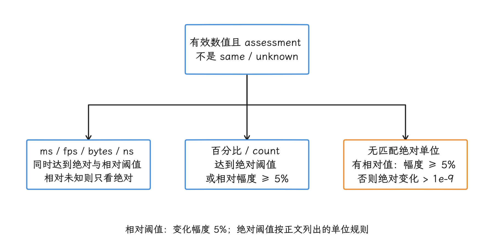

图：有效变化先按单位检查绝对与相对阈值，再决定界面高亮。 这是 UI 变化规则，不是统计显著性检验；NULL 和 unknown 分支需保留。

这些规则只决定界面是否高亮；统计显著性检验和 26.4 节中的置信区间、样本量、实验设计是另一回事，需要时仍以后者为准。

例如，发现启动 P90 上升后，我们可以分别抽取改动前的 baseline（改动前基线） 与改动后的 candidate（改动后候选版本） 两份 trace，生成 snapshot，再比较启动阶段、主线程状态、Binder、I/O 和首帧提交记录。若设备、温控、编译状态或抓取配置不一致，先标注环境差异再比较；把不可比样本的变化直接解释为代码回归，容易得出错误结论。

### Provider Manager：模型服务与执行适配层

模型配置分三层，各管一段：Connection 保存前端要访问的 SmartPerfetto 后端地址与可选的后端 token；Provider profile 保存模型 endpoint（服务地址）、模型凭证、模型 ID、通信协议及 runtime 选择；runtime 决定由哪套 Agent SDK 或 server adapter 调用 SmartPerfetto 工具。

<!-- gracker-diagram: ch14-04-35-connection-provider-runtime -->
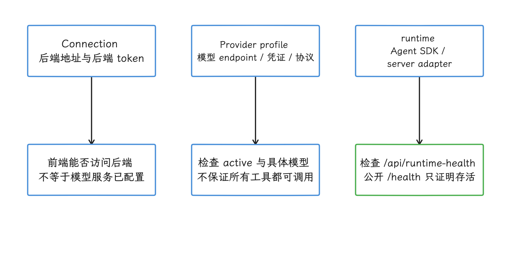

图：Connection、Provider profile 与 runtime 分别管理服务入口、模型与执行机制。 后端 token 与 provider key 授权对象不同，健康检查也需看实际 runtime。

| 配置项 | 作用 | 常见误解 |
| --- | --- | --- |
| Connection | 前端连接 SmartPerfetto 后端 | 把后端 token 当成模型 key |
| Provider profile | 配模型服务、模型 ID、协议类型 | 保存 profile 后忘记设为 active |
| active provider | 当前会话优先使用的 provider | 以为改 `.env` 会覆盖 active profile |
| env fallback | 脚本和服务端部署的默认凭证 | 只查 `.env`，不看 Provider Manager |
| runtime | 选择 Agent SDK / server adapter | provider 能对话就认定工具调用也一定可用 |

v1.3.0 注册了五种可用于正式运行的 runtime：

| runtime | 适配层 | 配置边界 |
| --- | --- | --- |
| `claude-agent-sdk` | Claude Agent SDK | 默认 runtime；支持 Anthropic、Bedrock、Vertex、DeepSeek 与兼容网关 |
| `openai-agents-sdk` | OpenAI Agents SDK | OpenAI、Ollama 与 OpenAI-compatible endpoint |
| `pi-agent-core` | Pi Agent Core | 仅 custom provider；禁用项目发现和 shell/file tools |
| `opencode` | 隔离的 OpenCode server / SDK | 仅 custom provider；不读取用户本机 OpenCode 项目状态 |
| `qoder-agent-sdk` | Qoder Agent SDK / `qodercli` | custom provider 或显式 env；SDK 为可选依赖 |

Qoder SDK 不随默认 Docker、portable 或 npm 安装提供，启用前要审阅它的独立条款，并显式安装 optional peer（可选的同级依赖） 依赖。Pi、OpenCode、Qoder 在 SmartPerfetto 里拿到的只是按请求生成的分析工具，别按通用 coding agent 的文件、shell 或网络权限去理解。

新建 session 时，系统依次检查请求指定的 `providerId`、Provider Manager 当前 active provider、`SMARTPERFETTO_AGENT_RUNTIME`，最后回到默认的 `claude-agent-sdk`。请求明确指定的 provider 不存在时会 fail-fast，即立即返回明确错误。这段顺序针对未传 `runtimeOverride`、未显式传 `providerId: null`、未启用 experimental runtime 的常规新请求；选择器对这些显式选项另有分支。


恢复历史 session 时，系统使用会话中保存的 provider/runtime：已保存的 provider 仍优先；env/default session 的 `runtimeOverride` 优先于当前环境变量；后来切换的 active provider 影响不到旧会话。已绑定的 provider 被删除时会立即报错并明确提示，避免静默改用另一个 provider。

v1.3.0 的会话快照还有一个缺口。常规 runtime 选择器已经接受 `qoder-agent-sdk`，但 `providerSnapshot.ts` 解析纯环境变量配置时只列出 Claude、OpenAI、Pi 和 OpenCode。只设置 `SMARTPERFETTO_AGENT_RUNTIME=qoder-agent-sdk` 时，本次运行可以进入 Qoder，env/default 会话快照却证明不了 Qoder 身份已被正确保存。这个限制不影响显式 provider 的存在性检查；恢复这类 Qoder session 前，应先在已修复版本上做回归，或重新创建 session。

<!-- gracker-diagram: ed14-04-new-versus-resumed-session-identity -->
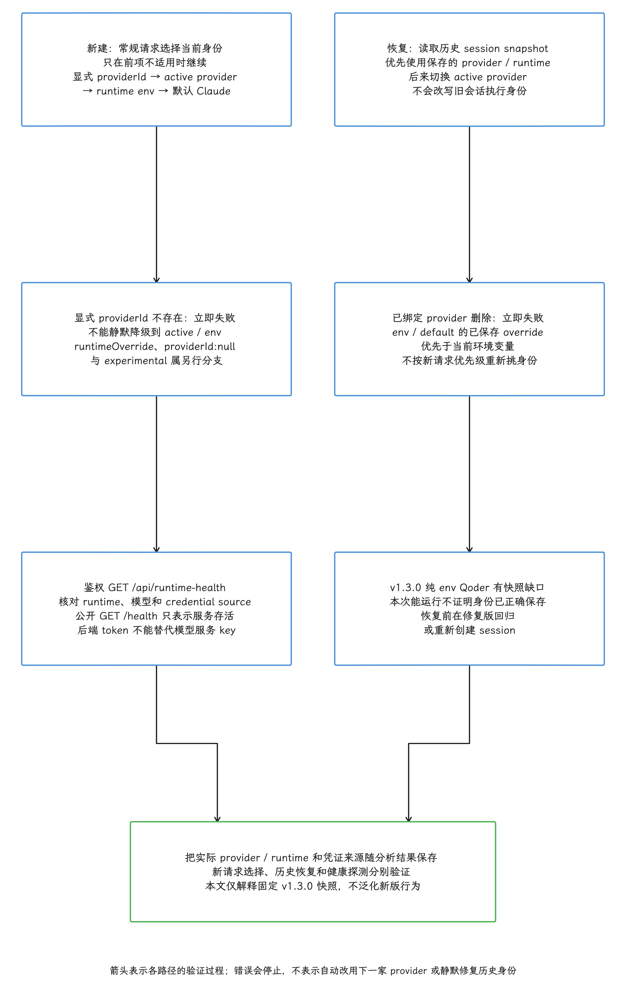

图：原文SmartPerfettov1.3.0常规新请求限定未传runtimeOverride/未显式providerId:null/未启experimental，依请求providerId→activeprofile→runtimeenv→默认Claude选择，不适用才下一层，显式provider不存在failfast。历史用已保存provider/runtime，绑定provider删除立即失败，env/default保存override优先当前env，不受后来active影响。纯envQoder选择器可运行但snapshot解析没Qoder，不能证明身份保存，修复版本回归或新建。真实身份用鉴权/api/runtime-health核验，公开/health仅存活，backendtoken与providerkey不同。

排障时要读取需要鉴权的 `GET /api/runtime-health`，检查 runtime、模型和 credential source（凭证来源）。公开的 `GET /health` 只表示服务进程存活；要确认分析 runtime 已按预期切换，仍以 `GET /api/runtime-health` 的结果为准。

### 运行分发、权限与隐私

运行方式应按维护责任选择。Docker 适合服务端部署；三平台 portable（免安装便携版）自带 Node.js 24、后端、预构建前端和固定的 trace processor；源码运行适合维护 Skill、strategy 与后端；npm CLI 提供 `smp` / `smartperfetto`，复用同一套 runtime、MCP（Model Context Protocol） 工具、报告和 session snapshot，但不启动 Web UI。批处理、CI 或内部服务可以使用 CLI / API / MCP。

部署者设置 `SMARTPERFETTO_API_KEY` 后，受保护 API 要携带相应凭证；企业用户还可以使用带角色与 scope（权限范围） 的持久 API key。后端 API key 保护的是 SmartPerfetto 服务入口，provider key 授权的是模型服务，两者不可混用。把服务暴露到非可信网络时，还要限制上传大小、代理超时、报告下载与管理接口。

trace 可能含有进程名、线程名、业务路径、URL 片段、用户操作节奏、设备信息与 slice 参数。上传给 provider 的内容片段、Result ID、HTML 报告、日志、workspace（隔离的工作空间） 分享和过期清理都应按敏感数据管理。

私有源码与外部知识源只有在本次请求明确选择、scope 与授权校验通过后才进入 runtime，不会自动提供给普通 trace 会话。使用 `provider_send` 时还要同时具备“该来源允许发送给 provider”和“本次运行允许发送”两项许可。

<!-- gracker-diagram: ch14-04-38-private-context-permission -->
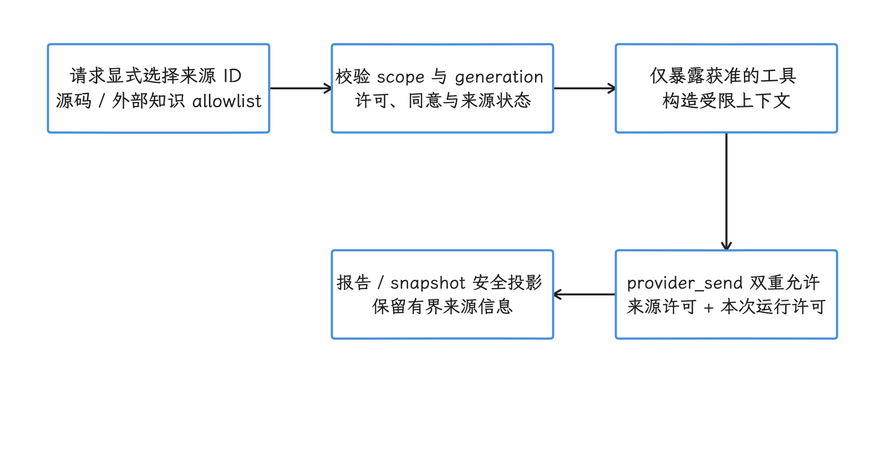

图：显式选择、scope 与许可共同限制私有材料的检索和外发。 背景知识不能冒充当前 Trace 证据；授权变化应使旧私有会话失效。

SmartPerfetto 只能分析调用方有权提供的 trace。Perfetto SDK 或 AndroidX Tracing 可以增加应用内事件，但不会赋予应用读取整机 ftrace、其他进程或系统服务内部数据的权限。系统级采集仍受 Manifest 中的 `profileable` / `debuggable` 属性、adb、ProfilingManager、系统签名权限和设备策略约束，参见 14.12 与 26.6 节。

### SmartPerfetto 与其他工具的分工

把前面这些工具放在一起，各自的位置就清楚了。Perfetto UI 提供时间轴观察和人工验证，`trace_processor_shell` 执行结果可重复的查询，Perfetto SDK 把应用事件写入 trace，ProfilingManager 提供受平台控制的 profiling 请求，APM（Application Performance Monitoring，应用性能监控）平台统计长期趋势。SmartPerfetto 位于解析器和团队调查流程之间，负责调用查询、汇集依据、生成报告与比较结果。

| 工具 | 更适合的问题 | 产物 |
| --- | --- | --- |
| Perfetto UI | 手工观察时间轴、验证某段事件关系 | 截图、选区、手动 SQL |
| `trace_processor_shell` | 批量查询、可重复 SQL、CI 检查 | CSV / SQL 输出 |
| SmartPerfetto | 开放式 trace 调查、证据报告、多 trace 对比 | Result ID、报告、Skill 表格 |
| Perfetto SDK / AndroidX Tracing | 把应用内部阶段写进 trace | 自定义 slice、counter、data source |
| ProfilingManager | Android 15（API 35）起的受控 profiling 请求 | 系统返回的 profiling 结果 |
| APM 平台 | 长期线上趋势、分位值、告警 | 指标、事件、抽样现场 |

开发期可以分析单条 trace，专项排障可以积累 Skill 与模板，灰度回归可以把异常样本与 baseline snapshot 比较。Agent 生成的因果结论，最终仍要回到 Perfetto UI 或 SQL 结果复核。涉及渲染链时，还要按 App、BufferQueue、SurfaceFlinger、HWC（Hardware Composer，硬件合成器） 和显示设备五段组织材料、逐段判断，而不是用一个长 slice 代替整条链。

### Skill 质量评估与回归测试

Skill 进入团队流程后，我们就要按可执行代码来维护它。最小测试集包含固定 trace、固定参数、输出列校验、空结果与可选错误分支、证据引用校验，再加上 SQL smoke test（确认基本路径可运行的快速测试） 和 golden report（用于逐次比较的基准报告）。Perfetto schema、stdlib、设备数据源与厂商实现都会变化，只检查 YAML 能否解析是不够的。

测试可以分为四层：

1. SQL 在固定 trace 上能够执行；
2. DataEnvelope 的列、单位、layer（展示层） 与 level（详细程度） 及执行状态符合 contract；
3. 关键指标与 golden 基准处于允许误差内；
4. 报告中的 evidence anchor 能返回表格行列，claim support 没有把 `partial` 升级成 `verified`。


启动、滑动、ANR、Binder、I/O、内存和功耗场景都要准备成功样本与缺字段样本。缺字段样本用于验证降级路径，例如缺少 FrameTimeline 时，帧级结论必须标为不完整。SmartPerfetto 固定 trace processor 版本后，仍要在 canonical trace（团队指定的标准测试 trace） 上做回归；升级 v57.2 之后的版本时，还要重新核对 schema、stdlib symbol index、标准指标和 golden 输出。

14.7 的 SQL 查询条件、单位与 Jank/CUJ 查询，14.11 的调查协议，以及 26.4 的回归判定可以转为 Skill contract。contract 应声明输入、输出、单位、证据解释、适用版本、缺失数据分支和人工复核入口。

### 企业内部 Trace 分析平台接入清单

企业接入前要确定 trace 存储、留存周期、报告可见范围、provider 凭证归属、模型请求出网策略、脱敏规则和审计范围。tenant 表示租户，workspace 表示租户内隔离的工作空间。表中的项目应落实到部署配置、权限测试和删除演练，写进文档只是第一步。

| 维度 | 建议检查项 |
| --- | --- |
| 多租户 | tenant / workspace 隔离、跨组报告分享审批 |
| Provider 隔离 | 每个租户单独 profile、独立 token、独立用量审计 |
| Trace 留存 | 上传大小限制、过期清理、敏感样本删除流程 |
| 报告权限 | Result ID 可见性、HTML report 分享范围、导出水印 |
| 审计 | 上传、分析、查看、分享、删除和 provider 修改记录 |
| 脱敏 | 包名、URL、账号、地理位置、业务参数、截图附件 |
| 回归 | 固定 trace 集合、Skill golden 基准、发布前 smoke test |

权限测试要覆盖同租户不同 workspace、不同 tenant、资源 owner（所有者）、过期数据和被删除 provider。能查看报告，未必同时有权查看原始 trace；两类资源应各自执行授权检查并保留审计记录。

### SmartPerfetto 与技术知识库联动

技术知识库保存机制解释、对应的源码版本和调查顺序，SmartPerfetto 在具体 trace 上执行查询并留下依据。输入参数、SQL、输出列、单位和失败分支等稳定规则适合转换为 Skill；依赖机型、版本或上下文判断的内容更适合放在 strategy 或机制说明中。

一种可执行的维护方法是：从章节选定一个可观察问题，编写 Skill，在固定 trace 上运行，检查报告里的依据是否成立，再把缺字段、厂商差异和误诊条件补回章节。章节修订后还要判断 Skill contract 是否需要同步修改，从而保持“机制说明—可执行查询—真实样本”三者一致。

<!-- gracker-diagram: ed14-04-versioned-semantic-regression-loop -->
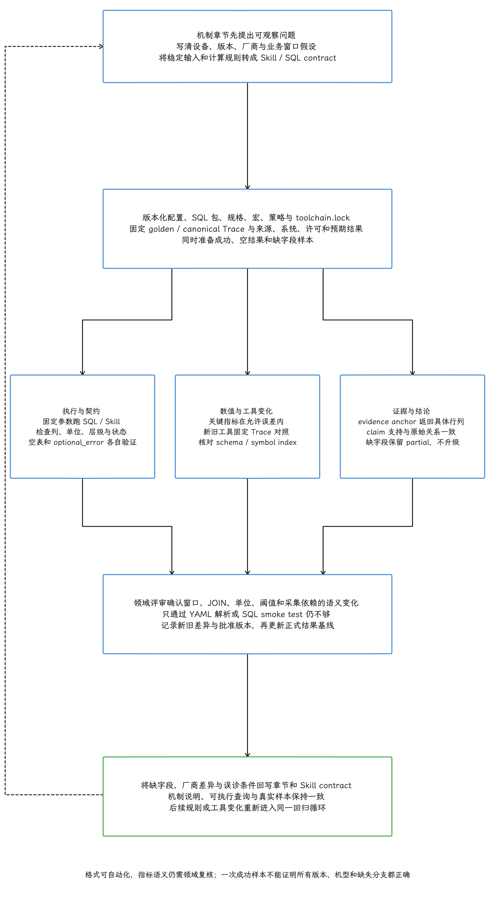

图：知识库固定toolchain/配置/SQL包/summary/UI宏/门禁策略/goldenmanifest，固定Trace记录来源系统许可预期，敏感样本受控。从机制章节可观察问题写Skillcontract，固定参数/窗口/JOIN/单位/缺失分支；SQL能执行与YAML能解析不证明指标正确。代表样本/空trace/缺字段分别验SQL、DataEnvelope列单位层级状态、golden误差、evidenceanchor行列及claim支持；partial不升级verified。新旧工具/schema/stdlibsymbolindex比较经领域审核，失效条件回写章节/Skill，不能从单次成功推所有厂商版本。

### 企业版迁移与 404 排查

SmartPerfetto 的企业迁移阶段决定 trace metadata（文件路径、归属和访问范围等元数据） 从文件系统还是数据库读取。v1.3.0 的状态如下：

| 阶段 | metadata 读取来源 | 写文件系统 | 写数据库 | 回退方式 |
| --- | --- | --- | --- | --- |
| `legacy` | filesystem | 是 | 否 | 关闭企业模式 |
| `dual-write` | filesystem | 是 | 是 | 删除数据库副本，文件系统仍为权威 |
| `cutover` | DB | 否 | 是 | 恢复切换前已验证的文件系统与 DB 快照 |
| `retired` | DB | 否 | 是 | 恢复退役前快照；不承诺反向转换 |

企业功能启用且未配置 `SMARTPERFETTO_ENTERPRISE_MIGRATION_PHASE` 时，默认阶段是 `dual-write`。进入 `cutover` 还要求 `SMARTPERFETTO_ENTERPRISE_CUTOVER_CONFIRMED=true`；缺少该确认时，服务会在解析迁移计划时拒绝启动。


该启动检查只验证确认开关，不能证明数据已经一致。运维人员应在设置确认开关前完成 filesystem 与 DB 的 reconciliation（逐项比对并处理不一致记录），并验证可用于恢复的快照。

诊断环境阶段时，可用下面的命令只打印两个迁移开关，不要把数据库口令或 provider key 写入工单：

```bash
printf 'phase=%s\n' "${SMARTPERFETTO_ENTERPRISE_MIGRATION_PHASE:-<unset>}"
printf 'cutover_confirmed=%s\n' "${SMARTPERFETTO_ENTERPRISE_CUTOVER_CONFIRMED:-<unset>}"
```

这两行只显示迁移阶段与切换确认，数据库口令和 provider key 都不会输出。第一行未设置且企业功能已开启时，应按 `dual-write` 解释；第二行只有在准备进入 `cutover` 时才应为 `true`。

`cutover` 阶段的 `readTraceMetadataForContext()` 只按当前 RequestContext 中的 tenant、workspace 和 owner 权限范围查询 `trace_assets`；查不到就返回 `null`，不会改查旧文件系统。

RequestContext 表示这次请求携带的身份与授权信息，RBAC（Role-Based Access Control） 表示按角色授予访问权限。假如这一步失败后悄悄改查文件系统，就可能绕过 DB 上的 RBAC 检查，还会掩盖尚未迁移的数据，所以别把这种回退当成修复 404 的手段。

遇到切换后的 404，可按以下顺序排查：

1. 确认生效阶段、enterprise feature flag（企业功能开关） 与 cutover confirmation；
2. 按请求的 tenant、workspace 和 owner 检查 `trace_assets` 是否存在记录；
3. 检查记录中的 `local_path`、文件搬运结果和服务进程访问权限；
4. 检查 SSO（Single Sign-On，单点登录） 映射、API key scope 与 RBAC，区分“记录缺失”和“当前用户不可见”；
5. 对照切换前 dry-run fingerprint（试运行结果摘要）、snapshot manifest（快照内容清单） 与数据库表计数；
6. 若切换数据不完整，停止写入，按项目提供的 snapshot restore 流程恢复文件系统和 SQLite 快照，再重新处理 reconciliation 中发现的不一致记录。

只把环境变量改回 `dual-write`，然后假设 DB 数据会自动写回文件系统，是行不通的：源码明确说明 dual-write 没有实现 reverse importer（从数据库反向导回文件系统的工具）。快照恢复会覆盖目标文件或目录，必须在维护窗口内由部署负责人执行，并在恢复前保留现场副本。

<!-- gracker-diagram: ed14-04-migration-authority-and-scoped-404 -->
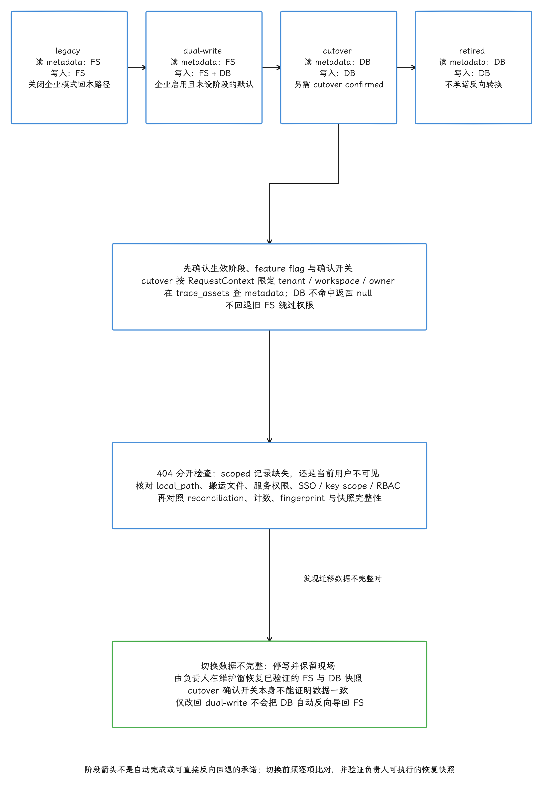

图：固定v1.3.0legacy读写FS；dualwrite读FS写FS+DB且企业启用未设phase默认此；cutover/retired读写DB，cutover需确认开关但开关不证明一致。应先reconciliation和可恢复快照。cutover按RequestContexttenant/workspace/owner查询trace_assets，不命中null不回旧FS，以免绕RBAC。404需查实际阶段、scoped记录、local_path/文件/权限、SSO/keyscope/RBAC和迁移指纹计数快照。若数据不完整停止写入保留现场由负责人维护窗恢复验证FS+SQLite快照；只改回dualwrite无reverseimporter，retired不承诺反向转换。

404 率、trace 访问成功率和数据库延迟的阈值应由团队按 SLO（Service Level Objective，服务等级目标） 与流量设定，SmartPerfetto 源码没有规定 99.5% 或 0.5% 这类通用目标。迁移监控还应包含 reconciliation 失败数、snapshot 完整性、按 scope 查询时未命中的原因分类，以及恢复演练结果。

### 复核准则

使用 SmartPerfetto 时，可以用四个问题约束分析质量：

1. 报告中的关键数值能否回到证据行列和 trace 身份？
2. 因果结论的支持等级是否与调度、时间关系或跨层证据相符？
3. 多 trace 指标是否使用相同查询条件、单位和采集环境，并明确缺失字段？
4. provider、runtime、私有上下文与企业存储是否遵守当前部署的权限边界？

四项中任何一项答不上来，都应把结论留在待验证状态。SmartPerfetto 可以减少重复查询和报告整理，但 Android 机制判断、Perfetto UI 人工核验和可重复的实验设计，最终仍要由人来完成。

## 小结

Perfetto 自动化要从一条可复用 SQL 开始，再逐步扩展到 Trace Summary、批处理、CI 回归和团队分析平台。扩展过程中，每个数值都要保留 trace 身份、查询、单位、样本数和工具版本；Agent、provider 或企业存储只是执行与治理层，改变不了 trace 缺字段、缺因果链时的证据上限。


## 参考资料

- [Android 17 `external/perfetto` 源码](https://android.googlesource.com/platform/external/perfetto/+/android-17.0.0_r1/)
- [Android 17 `Trace.java`](https://android.googlesource.com/platform/frameworks/base/+/android-17.0.0_r1/core/java/android/os/Trace.java)
- [Android 17 `libcutils` ATrace 接口](https://android.googlesource.com/platform/system/core/+/android-17.0.0_r1/libcutils/include/cutils/trace.h)
- [Trace Summarization](https://perfetto.dev/docs/analysis/trace-summary)
- [旧版 Trace-based Metrics](https://perfetto.dev/docs/analysis/metrics)
- [Android 17 `TraceSummary` 输出消息定义](https://android.googlesource.com/platform/external/perfetto/+/android-17.0.0_r1/protos/perfetto/trace_summary/file.proto)
- [Perfetto v57.2 线程表与 `is_idle` 定义](https://github.com/google/perfetto/blob/v57.2/src/trace_processor/tables/metadata_tables.py)
- [PerfettoSQL 语法](https://perfetto.dev/docs/analysis/perfetto-sql-syntax)
- [Trace Processor Python API](https://perfetto.dev/docs/analysis/trace-processor-python)
- [Batch Trace Processor](https://perfetto.dev/docs/analysis/batch-trace-processor)
- [Perfetto UI 命令与宏](https://perfetto.dev/docs/visualization/ui-automation)
- [稳定 UI 自动化命令参考](https://perfetto.dev/docs/visualization/commands-automation-reference)
- [Perfetto 扩展服务器](https://perfetto.dev/docs/visualization/extension-servers)
- [Perfetto Tracing SDK](https://perfetto.dev/docs/instrumentation/tracing-sdk)
- [Android ATrace 埋点](https://perfetto.dev/docs/getting-started/atrace)
- [Android NDK Tracing API](https://developer.android.com/ndk/reference/group/tracing)
- [Macrobenchmark 持续集成](https://developer.android.com/topic/performance/benchmarking/benchmarking-in-ci)
- [Android 性能测量与 Trace Point 开销建议](https://developer.android.com/topic/performance/measuring-performance)

- [SmartPerfetto v1.3.0 核对提交](https://github.com/Gracker/SmartPerfetto/tree/24eba544cebf231524294aa50def33ee0e267c9e)
- [Perfetto v57.2 host 工具固定配置](https://github.com/Gracker/SmartPerfetto/blob/24eba544cebf231524294aa50def33ee0e267c9e/scripts/trace-processor-pin.env)
- [Agent runtime 架构](https://github.com/Gracker/SmartPerfetto/blob/24eba544cebf231524294aa50def33ee0e267c9e/docs/architecture/agent-runtime.md)
- [runtime 选择与 snapshot override 顺序](https://github.com/Gracker/SmartPerfetto/blob/24eba544cebf231524294aa50def33ee0e267c9e/backend/src/agentRuntime/runtimeSelection.ts)
- [v1.3.0 provider/runtime 快照解析](https://github.com/Gracker/SmartPerfetto/blob/24eba544cebf231524294aa50def33ee0e267c9e/backend/src/services/providerManager/providerSnapshot.ts)
- [私有分析上下文边界](https://github.com/Gracker/SmartPerfetto/blob/24eba544cebf231524294aa50def33ee0e267c9e/docs/architecture/private-analysis-context.md)
- [DataEnvelope、Query Review 与 Analysis Receipt](https://github.com/Gracker/SmartPerfetto/blob/24eba544cebf231524294aa50def33ee0e267c9e/backend/docs/DATA_CONTRACT_DESIGN.md)
- [raw SQL stdlib include 注入](https://github.com/Gracker/SmartPerfetto/blob/24eba544cebf231524294aa50def33ee0e267c9e/backend/src/agentv3/sqlIncludeInjector.ts)
- [证据合约类型](https://github.com/Gracker/SmartPerfetto/blob/24eba544cebf231524294aa50def33ee0e267c9e/backend/src/types/evidenceContract.ts)
- [标准对比指标](https://github.com/Gracker/SmartPerfetto/blob/24eba544cebf231524294aa50def33ee0e267c9e/backend/src/types/multiTraceComparison.ts)
- [标准指标回填范围](https://github.com/Gracker/SmartPerfetto/blob/24eba544cebf231524294aa50def33ee0e267c9e/backend/src/services/standardMetricBackfillService.ts)
- [显著变化阈值](https://github.com/Gracker/SmartPerfetto/blob/24eba544cebf231524294aa50def33ee0e267c9e/backend/src/services/comparisonSignificance.ts)
- [企业迁移状态机与快照恢复](https://github.com/Gracker/SmartPerfetto/blob/24eba544cebf231524294aa50def33ee0e267c9e/backend/src/services/enterpriseMigration.ts)
- [企业 trace metadata 的 scoped 读取](https://github.com/Gracker/SmartPerfetto/blob/24eba544cebf231524294aa50def33ee0e267c9e/backend/src/services/traceMetadataStore.ts)

- [内存区间与 NULL 约定](https://android.googlesource.com/platform/external/perfetto/+/android-17.0.0_r1/src/trace_processor/perfetto_sql/stdlib/linux/memory/process.sql)
- [UI 宏顺序执行与异常传播](https://android.googlesource.com/platform/external/perfetto/+/android-17.0.0_r1/ui/src/core/command_manager.ts)
- [Python v57.2 包内原生工具清单](https://github.com/google/perfetto/blob/v57.2/python/perfetto/prebuilts/manifests/trace_processor_shell.py)
- [Python 批处理实例生命周期](https://github.com/google/perfetto/blob/v57.2/python/perfetto/batch_trace_processor/api.py)
- [最新 release 查询](https://github.com/Gracker/SmartPerfetto/releases/tag/v1.16.2)
