# Perfetto 输入延迟 SQL 深度分析

用 Perfetto SQL 分析输入延迟，先要把三件事定下来：用哪个 ID 作为这次输入的身份、统计落在哪段时间窗口、延迟算到哪个终点。InputDispatcher 侧的分发、应用侧的消费和帧呈现是三段不同的数据，只有对齐到同一个事件上，算出来的端到端延迟才可复查。

<!-- gracker-diagram: ch14-05-01-measurement-contract -->
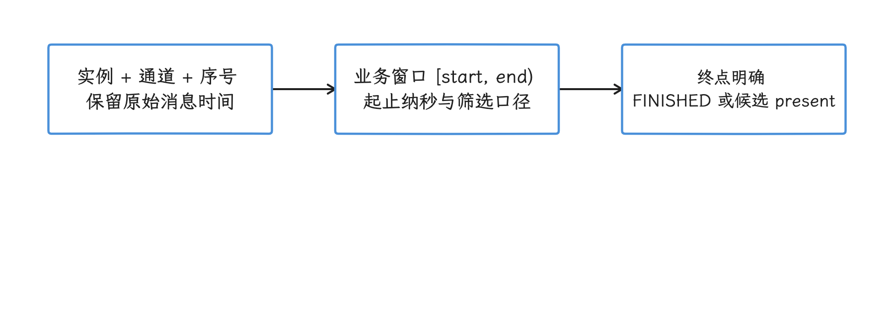

图：先固定投递身份、业务时间窗与延迟终点，再选择可核验的数据。 通道内序号和包名都不足以独立标识一次投递。

## 分析边界与源码基线

输入延迟排障常遇到三类问题：慢事件藏在大量正常样本中、ANR（Application Not Responding，应用无响应）发生前的队列状态不清楚、一次输入究竟关联了哪一帧。时间线界面适合观察单个现场，SQL 更适合筛选异常样本、计算分位数和复用判定逻辑。分位数描述样本排序后的位置，例如 P50 是中位数，P95 表示约 95% 的样本不高于该值。

本文核对的平台源码基线是 Android 17 / API 37 / `android-17.0.0_r1`。Perfetto 对应提交为 `ece66975738007dd0978b911d8a2077e49b8f31e`，`frameworks/native` 对应提交为 `ae266dcb706d083868578cfedce381ef44488a07`。调度事件的内核语义以 `android17-6.18-2026-06_r6` 为准。Perfetto 标准库还可以由较新的 Trace Processor 提供，因此分析报告需要同时记录系统版本、采集配置和 Trace Processor 版本。Android 12 是 FrameTimeline 能力的起点，不保证 12–16 的输入 ATrace 名称和公开列与本文完全相同；这些版本应重新核对设备埋点及所用模块。

<!-- gracker-diagram: ch14-05-02-version-axes -->
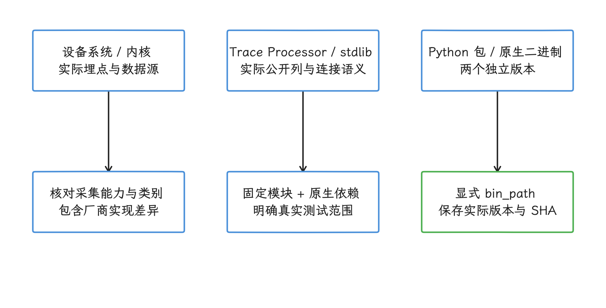

图：系统埋点、标准库与原生工具分别记录版本和摘要。 Android 12 的 FrameTimeline 起点不保证输入解析格式全版本一致。

查询内部的时间保留原始纳秒，毫秒展示用 `数值 / 1e6` 保留小数。固定标准库的 `time_to_ms()` 返回整数毫秒，会把 0.5 ms 截为 0；`PERCENTILE()` 返回浮点值，直接传给要求整数纳秒的该函数还会触发类型错误。用于 JOIN、裁剪和定位的时间键应继续使用原始纳秒。

<!-- gracker-diagram: ch14-05-03-time-precision -->
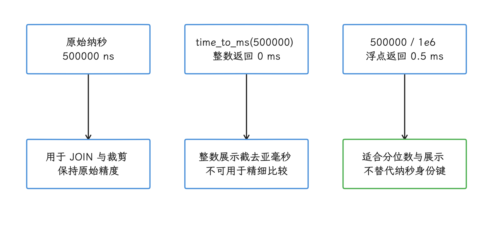

图：身份、窗口和连接用原始纳秒，显示毫秒用浮点除法。 time_to_ms 返回 LONG；PERCENTILE 的浮点结果不能直接传入。

`InputReader` 从 Linux 输入设备读取并解释事件，`InputDispatcher` 决定事件要投递给哪些窗口，应用处理完后通过输入通道返回 `FINISHED` 确认。SurfaceFlinger 是 Android 的显示合成服务，FrameTimeline 记录应用帧与合成帧的预期和实际时间。分析需要区分三段时间：

- 输入事件的语义时间戳到 `InputReader` 读取；语义时间戳表示事件自身携带的发生时刻，不等同于 Trace 记录写入时刻；
- `InputDispatcher` 发出消息到应用完成并返回 `FINISHED`；
- `InputReader` 读取到关联帧在 `SurfaceFlinger FrameTimeline` 中结束。

前述“读取”在该 SQL 中是 Reader 监听链路包装 Slice 的代理边界。三段数据的来源、时钟域和缺失条件不同。没有帧关联时，输入往返时间仍可能完整；没有完整的发送、接收和确认切片时，`android_input_events` 不会生成该行。分析时要把“没有记录”与“耗时为零”分开。

## `android.input` 中的两条数据链路

### 生命周期与帧关联

`android_input_events` 由 ATrace（Android 代码埋点形成的时间片）和 FrameTimeline 派生。Android 17 的 `android/input.sql` 会解析下列信息：

- `sendMessage(...)` 与 `receiveMessage(...)`：建立 `InputDispatcher`、应用接收、应用发送确认、系统收到确认四个节点；
- `UnwantedInteractionBlocker::notifyMotion(...)`：取得 `input_event_id`、`event_time` 和 `read_time`；
- `deliverInputEvent src=...` 与 `Choreographer#doFrame`：建立输入与应用帧的关联；
- `actual_frame_timeline_slice`：把应用帧映射到 `SurfaceFlinger` 帧，并取得呈现时间。

这条链路不依赖 `android.input.inputevent` 调试数据源。常规 `user` 量产构建也可以采集所需的 ATrace 与 FrameTimeline，但采集配置必须包含 `input`、`view`、`gfx` 类别、目标应用和 FrameTimeline 数据源。

<!-- gracker-diagram: ch14-05-04-independent-chains -->
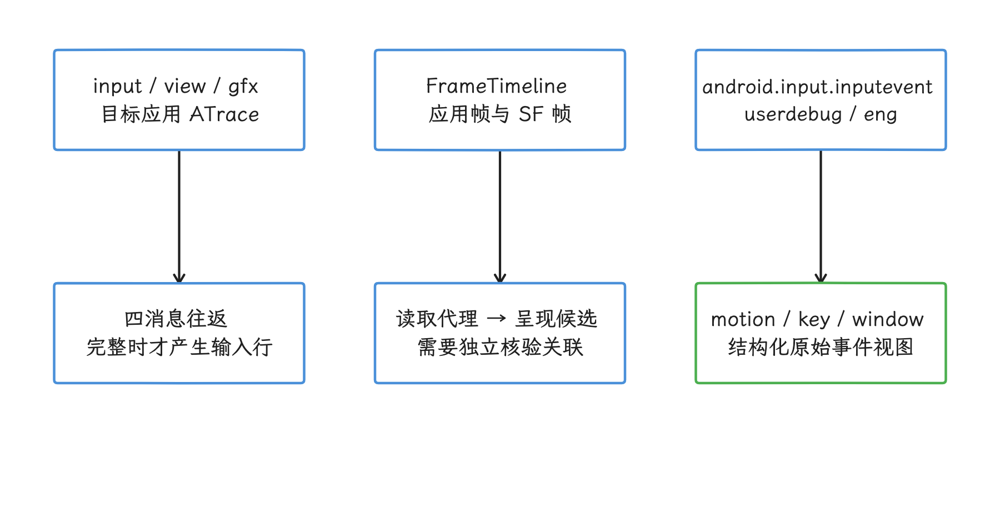

图：ATrace 与 FrameTimeline 生成生命周期候选，调试数据源生成原始视图。 只启用 inputevent 不会补齐四消息与帧关联。

下面这条查询用于确认标准库对象能够加载，并快速观察当前跟踪的覆盖率：

```sql
INCLUDE PERFETTO MODULE android.input;

SELECT
  COUNT(*) AS raw_row_count,
  COUNT(CASE WHEN read_time IS NOT NULL THEN 1 END) AS rows_with_read_candidate,
  COUNT(CASE WHEN frame_id IS NOT NULL THEN 1 END) AS rows_with_frame_candidate,
  COUNT(CASE WHEN is_speculative_frame = 1 THEN 1 END) AS speculative_candidate_rows,
  COUNT(CASE WHEN end_to_end_latency_dur IS NOT NULL THEN 1 END) AS rows_with_latency_candidate
FROM android_input_events;
```

这条查询检查的是标准库原始结果行和候选字段数量；空表上的条件计数都为零。`raw_row_count` 不是去重后的输入投递数，字段非 NULL 也不证明关联正确。结果为零时应检查采集与场景，不能据此判断输入很快；字段 NULL 表示缺失，候选帧较少时应核对 FrameTimeline、应用 ATrace 与窗口是否完整。

<!-- gracker-diagram: ch14-05-05-coverage-states -->
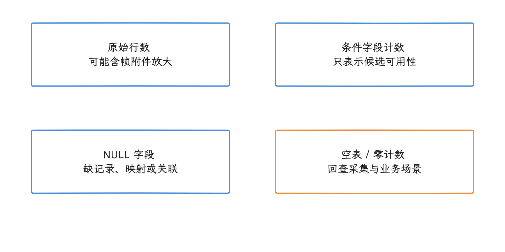

图：先看采集覆盖、原始行数和候选字段，再决定可统计的样本集合。 字段非空不证明关联正确，空结果不能当作零延迟。

固定 Android 17 的实现还有一个影响统计的限制：最终只按 `event_seq` 关联帧结果，而序号只在输入通道内递增。两个连接使用相同序号时，合成 Trace 已复现两次投递被扩成四行，并把另一事件的 `input_event_id`、`read_time`、帧和呈现延迟附到当前投递。往返统计必须先按实例、通道、序号和消息时间去重，并剔除这些候选帧字段；把含帧字段的整行做 DISTINCT 仍会保留错误权重。候选呈现链路则需独立核验，不能仅凭字段非空进入回归门禁。

<!-- gracker-diagram: ch14-05-06-cross-channel -->
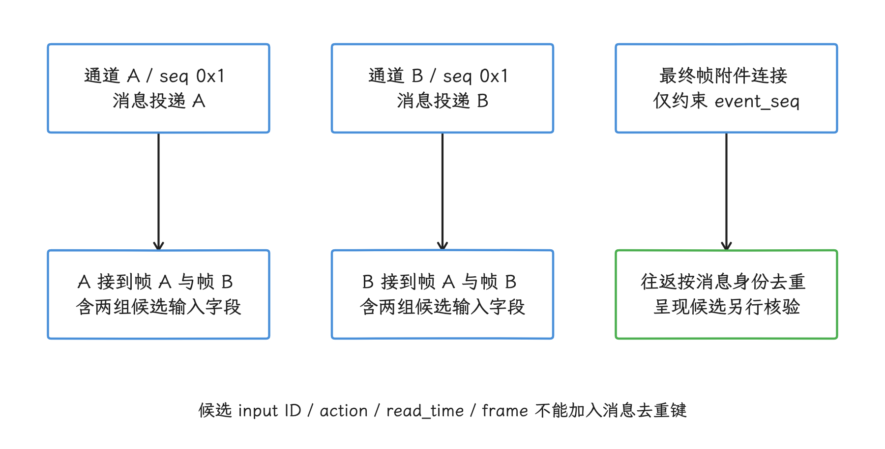

图：两个独立通道共享序号时，固定实现可把两次投递扩成四行。 这是受控合成 Trace 的实现复现；全行 DISTINCT 不能修复附件污染。

### 调试级原始事件

`android_motion_events`、`android_key_events` 与 `android_input_event_dispatch` 来自 `android.input.inputevent`。Android 17 的配置协议明确限制该数据源只能用于 `userdebug` 或 `eng` 调试构建，不能在普通 `user` 量产构建上启用。它记录 `InputDispatcher` 处理的原始事件字段和窗口分发决策，适合回答事件来源、动作、设备、窗口及隐私规则是否生效等问题。

两条链路不能当作同一张表拆分后的结果。原始视图使用数值型 `event_id`；生命周期表的 `input_event_id` 来自 ATrace 名称，通常是带 `0x` 等表示方式的十六进制文本。标准库没有公开、稳定的桥接视图。

原始事件与窗口分发可以用同为数值型的 `event_id` 关联，但要跨到 `android_input_events`，就应回到同一事件的时间线和源码格式核验；直接用 `CAST` 转换类型后做等值连接，可能把格式差异或 ID 碰撞误当成同一事件。

<!-- gracker-diagram: ch14-05-07-raw-id-bridge -->
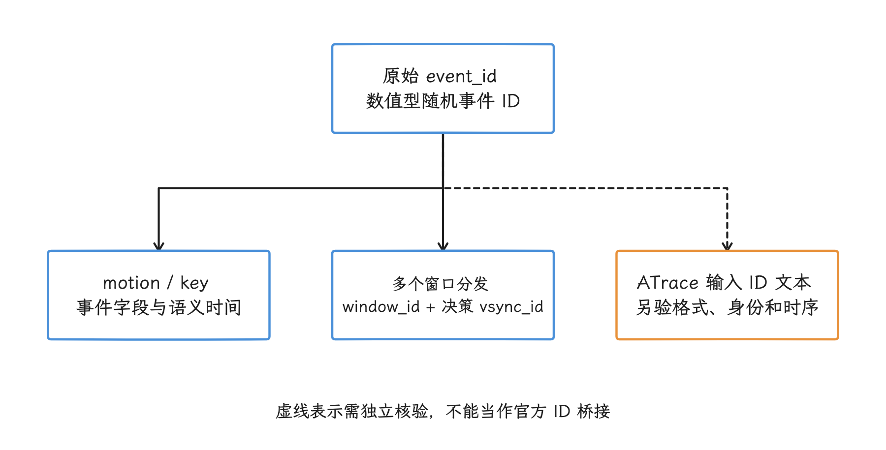

图：数值 event_id 可连接原始事件和多窗口分发，跨 ATrace 需另证身份。 十六进制文本转数值不能建立稳定的官方桥接关系。

这条查询展示原始动作事件、内核事件时间和窗口分发的一对多关系：

```sql
INCLUDE PERFETTO MODULE android.input;
INCLUDE PERFETTO MODULE time.conversion;

SELECT
  event.event_id,
  ((event.ts) / 1e6) AS dispatcher_processed_at_ms,
  ((EXTRACT_ARG(event.arg_set_id, 'kernel_time')) / 1e6) AS kernel_event_at_ms,
  event.source,
  event.action,
  event.device_id,
  event.display_id,
  dispatch.vsync_id,
  dispatch.window_id
FROM android_motion_events AS event
LEFT JOIN android_input_event_dispatch AS dispatch
  USING (event_id)
ORDER BY event.ts, dispatch.window_id
LIMIT 200;
```

解析器会把协议消息中单调时钟域的 `event_time_nanos` 转为 Trace 时间域；单调时钟只持续向前，不受墙上时间校准影响。转换后的值以 `kernel_time` 写入 `args`，`EXTRACT_ARG` 从 `arg_set_id` 对应的键值参数集中读出它。原始表的 `ts` 直接取自对应 TracePacket 的时间戳，不能解释成分析机器上 Trace Processor 解析数据包的时刻。同一事件可能投递给前台窗口、监视窗口或其他目标，因此结果出现多行并非重复数据。

<!-- gracker-diagram: ch14-05-08-raw-timestamps -->
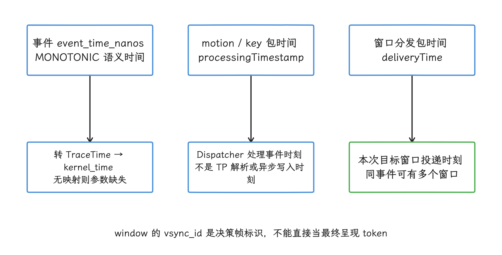

图：原始事件语义时间经时钟映射进入 args，包时间保留其生产端含义。 窗口 vsync_id 表示分发决策时的帧，不等同于最终呈现 token。

## 公共表结构与延迟公式

### `android_input_events`

生成结果需要匹配四个消息节点，但这个固定实现的帧连接可能把一份投递扩成多行，因此不能默认“一行就是一个投递”。消息往返列与候选帧列应分开解读。Android 17 的公开字段可以按用途分组：

| 分组 | 字段 | 含义 |
|---|---|---|
| 往返延迟 | `dispatch_latency_dur` | InputDispatcher 发出事件到应用收到事件 |
| 往返延迟 | `handling_latency_dur` | 应用收到事件到应用发送 `FINISHED` |
| 往返延迟 | `ack_latency_dur` | 应用发送 `FINISHED` 到 InputDispatcher 收到确认 |
| 往返延迟 | `total_latency_dur` | InputDispatcher 发出事件到系统收到确认 |
| 呈现候选 | `end_to_end_latency_dur` | Trace 域读取代理到候选帧呈现；无关联时为 `NULL` |
| 确认发送端 | `tid`, `thread_name`, `upid`, `pid`, `process_name` | 应用发送 `FINISHED` 的线程与进程；不保证等于接收线程 |
| 消息与动作 | `event_type`, `event_action`, `event_seq` | 消息类型与通道内文本序号；动作来自候选附件，可能被误关联 |
| 通道 | `event_channel`, `normalized_event_channel` | 原始通道名与标准库归一化结果 |
| 候选输入锚点 | `input_event_id`, `read_time`, `event_time` | 候选 ID、Trace 域读取代理时间与内联 MONOTONIC 事件时间；需核验归属和时钟 |
| 投递切片 | `dispatch_track_id`, `dispatch_ts`, `dispatch_dur` | InputDispatcher 侧切片 |
| 接收切片 | `receive_track_id`, `receive_ts`, `receive_dur` | 应用接收侧切片 |
| 帧关联 | `frame_id`, `is_speculative_frame` | 最终候选应用 Surface frame token（可为后续未丢弃帧）与原关联的推测标记；两者受下述实现限制 |

`tid` 和 `pid` 是操作系统线程号与进程号，`upid` 是 Perfetto 在当前 Trace 内分配的进程唯一标识，可区分 PID 被系统复用后的不同实例。 要定位应用实际接收线程，应从 `receive_track_id` 连接 `thread_track.utid` 和 `thread`，不能直接使用这里的 `thread_name`。Vsync ID 是一次垂直同步周期的标识。`normalized_event_channel` 会按 Android 17 标准库规则去掉部分对象前缀、冒号后缀或末尾数字，便于分组；它不是跨版本稳定的连接 ID。

<!-- gracker-diagram: ch14-05-09-finish-identity -->
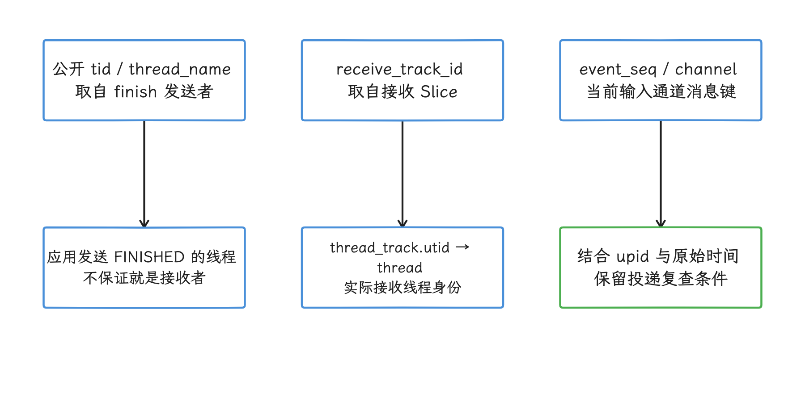

图：用接收轨道寻找实际接收线程，公开线程字段描述确认发送端。 upid 区分当前 Trace 内实例；不能把 finish 线程当成 receive 线程。

四段消息节点的计算关系如下：

| 指标 | 计算式 |
|---|---|
| `dispatch_latency_dur` | `receive.ts - dispatch.ts` |
| `handling_latency_dur` | `finish.ts - receive.ts` |
| `ack_latency_dur` | `finish_ack.ts - finish.ts` |
| `total_latency_dur` | `finish_ack.ts - dispatch.ts` |

输入传输使用基于 socket 的输入通道，ACK 是 acknowledgment（确认消息）的缩写。`ack_latency_dur` 不是 Binder（Android 进程间通信机制）往返耗时；将它归因于 Binder 拥塞会把排查方向带偏。应用收到事件后，`handling_latency_dur` 也可能覆盖输入批处理和框架分发开销，不能直接等同于某个业务回调的执行时间。

<!-- gracker-diagram: ch14-05-10-four-messages -->
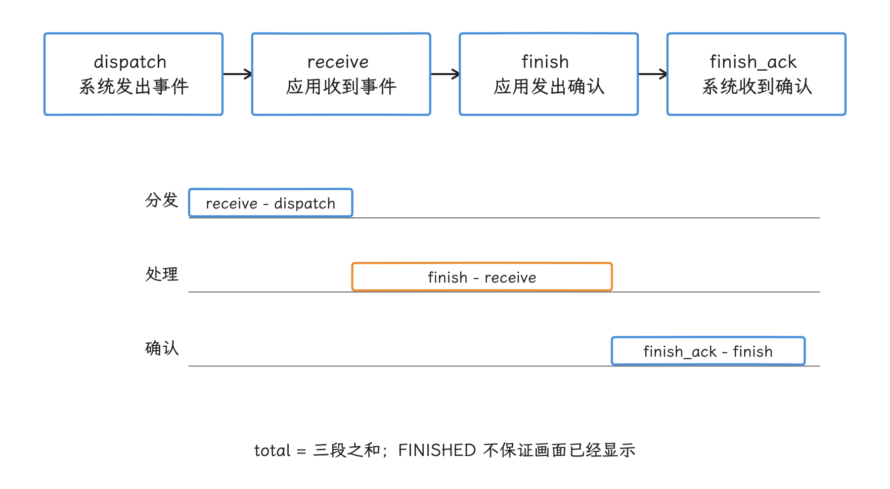

图：dispatch、receive、finish、finish_ack 依次界定分发、处理与确认。 输入通道是 socket；ACK 段不能称为 Binder 往返。

### 三张原始视图

原始视图的公开列在 Android 17 中保持紧凑，复杂 protobuf 消息字段通过 `arg_set_id` 对应的参数集查询：

| 视图 | 公开列 | 用途 |
|---|---|---|
| `android_motion_events` | `id`, `event_id`, `ts`, `arg_set_id`, `source`, `action`, `device_id`, `display_id` | MotionEvent 元信息及参数 |
| `android_key_events` | 上述字段加 `key_code` | KeyEvent 元信息及按键码 |
| `android_input_event_dispatch` | `id`, `event_id`, `arg_set_id`, `vsync_id`, `window_id` | 事件到窗口的分发决策 |

坐标、指针轴、策略标志、`down_time` 和 `kernel_time` 等字段保存在 `args`。字段是否存在还受脱敏等级影响；脱敏会省略敏感字段，因此参数查询必须允许 `NULL`。公开 `key_code` 列是一个例外：固定解析器直接调用 protobuf 解码 getter，省略该字段时可读为默认值 0；0 不能证明记录到了真实按键码。

<!-- gracker-diagram: ch14-05-11-redacted-defaults -->
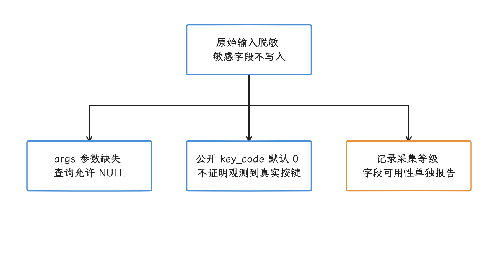

图：敏感参数缺失应保留未知，公开 key_code 的 0 也可能来自省略字段。 固定解析器的默认 getter 行为已用省略 key_code 的合成包核对。

## 输入往返延迟

### 找出慢样本

下面的查询默认使用整份 Trace 的时间窗，并要求名称恰好匹配一个进程实例；同名多实例时返回空结果，应先查明并显式选择 `upid`。正式实验应把参数中的起止时间改成同一业务场景。查询先对消息侧字段去重，再按总往返时间列出最慢样本：

```sql
INCLUDE PERFETTO MODULE android.input;
INCLUDE PERFETTO MODULE time.conversion;

WITH params(process_name, start_ts, end_ts) AS (
  SELECT 'com.example.reader', trace_start(), trace_end()
),
target_process AS (
  SELECT MIN(process.upid) AS upid
  FROM process JOIN params ON process.name = params.process_name
  HAVING COUNT(*) = 1
),
round_trips AS (
  SELECT DISTINCT
    event.upid,
    event.pid,
    event.tid,
    event.thread_name,
    event.process_name,
    event.event_type,
    event.event_seq,
    event.event_channel,
    event.normalized_event_channel,
    event.dispatch_track_id,
    event.dispatch_ts,
    event.dispatch_dur,
    event.receive_track_id,
    event.receive_ts,
    event.receive_dur,
    event.dispatch_latency_dur,
    event.handling_latency_dur,
    event.ack_latency_dur,
    event.total_latency_dur
  FROM android_input_events AS event
  JOIN target_process USING (upid)
  CROSS JOIN params
  WHERE event.dispatch_ts >= params.start_ts
    AND event.dispatch_ts < params.end_ts
)
SELECT
  upid, pid, tid AS finish_tid, event_channel, event_seq, event_type,
  dispatch_ts, receive_ts, dispatch_track_id, receive_track_id,
  ((dispatch_ts) / 1e6) AS dispatch_at_ms,
  thread_name AS finish_thread_name,
  normalized_event_channel,
  ((dispatch_latency_dur) / 1e6) AS dispatch_ms,
  ((handling_latency_dur) / 1e6) AS handling_ms,
  ((ack_latency_dur) / 1e6) AS ack_ms,
  ((total_latency_dur) / 1e6) AS total_ms
FROM round_trips
WHERE dispatch_latency_dur >= 0 AND handling_latency_dur >= 0
  AND ack_latency_dur >= 0 AND total_latency_dur >= 0
ORDER BY total_latency_dur DESC, dispatch_ts, event_channel, event_seq
LIMIT 100;
```

修改参数中的进程名与时间窗；同名进程有多个实例时不要任选一个。定位投递应联合保存 `upid`、通道、通道内序号和消息时间，不能只保留序号。去重列刻意不含候选输入 ID、动作和帧字段；这些附件可能已经被跨通道连接污染。负分段时长也应作为关联或时钟异常另查，不按正常样本进入分位数。`dispatch_ms` 高时检查 `InputDispatcher` 与目标线程的可运行、运行和睡眠状态；`handling_ms` 高时展开应用接收线程；`ack_ms` 高时检查应用发出确认后的调度与输入通道路径。单个分段偏高只能提供排查入口，不能独立证明根因。

<!-- gracker-diagram: ch14-05-12-roundtrip-dedup -->
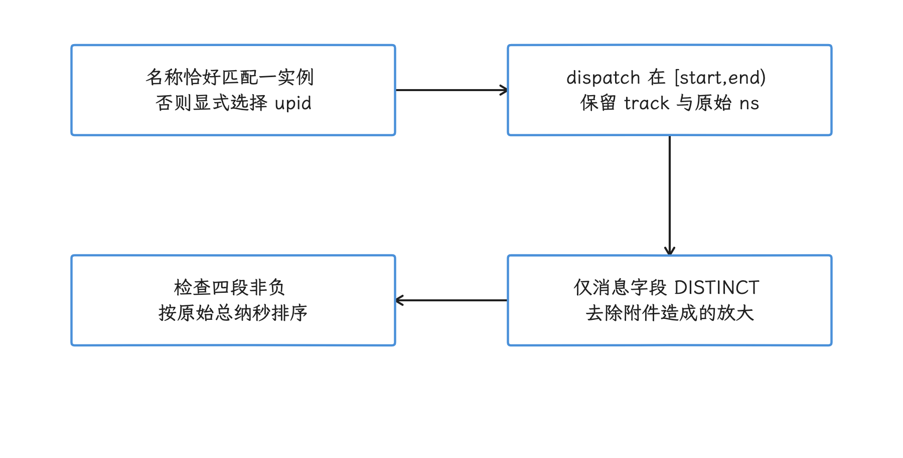

图：唯一进程实例与半开窗口内，对消息字段去重后筛出时序合法的慢样本。 候选帧侧字段不参与去重；负分段另作关联异常。

### 建立同场景分布

这条查询先在相同实例与窗口内按消息字段去重，再为三个分段及总往返计算 P50、P95、P99、最大值和样本量。分位数需要与样本量一起解读；按 `dur >= P95` 取尾部时，并列值可能使结果超过样本数的 5%，小样本也不足以稳定描述极端尾部：

```sql
INCLUDE PERFETTO MODULE android.input;
INCLUDE PERFETTO MODULE time.conversion;

WITH params(process_name, start_ts, end_ts) AS (
  SELECT 'com.example.reader', trace_start(), trace_end()
),
target_process AS (
  SELECT MIN(process.upid) AS upid
  FROM process JOIN params ON process.name = params.process_name
  HAVING COUNT(*) = 1
),
round_trips AS (
  SELECT DISTINCT
    event.upid,
    event.pid,
    event.tid,
    event.thread_name,
    event.process_name,
    event.event_type,
    event.event_seq,
    event.event_channel,
    event.normalized_event_channel,
    event.dispatch_track_id,
    event.dispatch_ts,
    event.dispatch_dur,
    event.receive_track_id,
    event.receive_ts,
    event.receive_dur,
    event.dispatch_latency_dur,
    event.handling_latency_dur,
    event.ack_latency_dur,
    event.total_latency_dur
  FROM android_input_events AS event
  JOIN target_process USING (upid)
  CROSS JOIN params
  WHERE event.dispatch_ts >= params.start_ts
    AND event.dispatch_ts < params.end_ts
    AND event.dispatch_latency_dur >= 0 AND event.handling_latency_dur >= 0
    AND event.ack_latency_dur >= 0 AND event.total_latency_dur >= 0
),
samples(stage, dur) AS (
  SELECT 'dispatch', dispatch_latency_dur FROM round_trips
  UNION ALL SELECT 'handling', handling_latency_dur FROM round_trips
  UNION ALL SELECT 'ack', ack_latency_dur FROM round_trips
  UNION ALL SELECT 'total', total_latency_dur FROM round_trips
)
SELECT
  stage,
  COUNT(*) AS sample_count,
  PERCENTILE(dur, 50) / 1e6 AS p50_ms,
  PERCENTILE(dur, 95) / 1e6 AS p95_ms,
  PERCENTILE(dur, 99) / 1e6 AS p99_ms,
  ((MAX(dur)) / 1e6) AS max_ms
FROM samples
WHERE dur IS NOT NULL AND dur >= 0
GROUP BY stage
ORDER BY CASE stage
  WHEN 'dispatch' THEN 1 WHEN 'handling' THEN 2
  WHEN 'ack' THEN 3 ELSE 4 END;
```

输入延迟没有脱离设备、刷新率、手势类型和负载的通用毫秒阈值。可靠的性能回退判定应固定设备、构建、Trace 配置、交互脚本、温度区间和样本量，再比较分位数及尾部样本。最大值对单次调度抖动很敏感，不适合单独作为门禁；门禁是持续集成中自动决定构建是否通过的规则。

<!-- gracker-diagram: ch14-05-13-percentiles -->
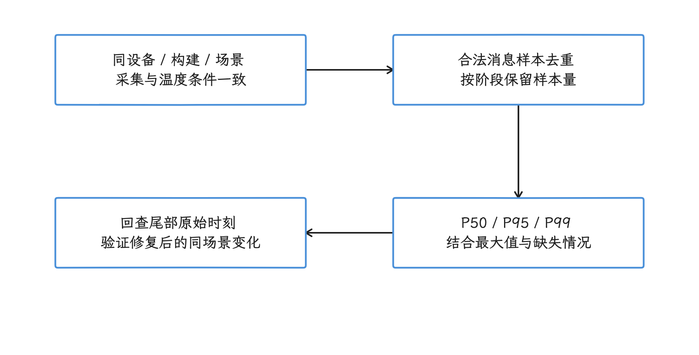

图：在固定实验条件下比较分位数、样本量和尾部现场。 P95 并列值可使尾部超过 5%；最大值不能独立担当通用门禁。

## 从事件发生到帧呈现

### 三段时间的组合

`end_to_end_latency_dur` 的公式是 Trace 时间域中的 `present_time - read_time`，但它首先只是候选值。普通 motion 的 `args.eventTime` 来自 MONOTONIC 事件时间，ATrace Slice 和 FrameTimeline 则已经是 Trace 时间，常见 Android 跟踪使用 BOOTTIME；两者不能直接相减。查询先用 `to_monotonic()` 转换两个 Trace 端点，再与事件时间组合。缺少时钟映射时，派生的 MONOTONIC 时长保留 NULL；附件歧义也显式保留，不能当作已测准延迟。

<!-- gracker-diagram: ch14-05-14-clock-domain -->
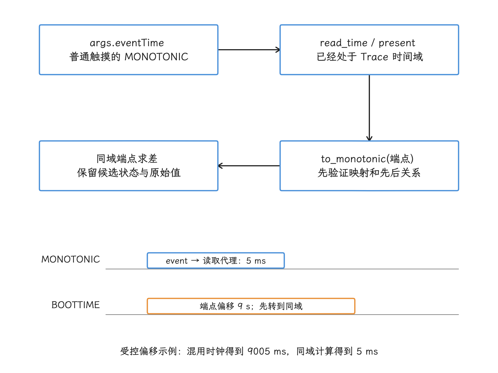

图：将读取与呈现 Trace 端点转为 MONOTONIC，再与内联事件时间相减。 缺映射保留 NULL；统一时钟不会修复错误的事件或帧附件。

```sql
INCLUDE PERFETTO MODULE android.input;
INCLUDE PERFETTO MODULE time.conversion;

WITH raw_candidates AS (
  SELECT *, COUNT(*) OVER (
    PARTITION BY upid, event_channel, event_seq, dispatch_ts, receive_ts
  ) AS attachment_row_count
  FROM android_input_events
)
,
converted AS (
  SELECT *, to_monotonic(read_time) AS monotonic_read,
    to_monotonic(read_time + end_to_end_latency_dur) AS monotonic_present
  FROM raw_candidates
)
SELECT
  upid, event_channel, event_seq, dispatch_ts, receive_ts,
  input_event_id AS candidate_input_event_id,
  process_name, event_action AS candidate_action,
  (monotonic_read - event_time) / 1e6 AS candidate_event_to_read_monotonic_ms,
  (monotonic_present - monotonic_read) / 1e6 AS candidate_read_to_present_monotonic_ms,
  (monotonic_present - event_time) / 1e6 AS candidate_event_to_present_monotonic_ms,
  end_to_end_latency_dur / 1e6 AS candidate_read_to_present_trace_ms,
  frame_id AS candidate_surface_frame_token,
  is_speculative_frame, attachment_row_count,
  CASE
    WHEN attachment_row_count > 1 THEN 'ambiguous_attachment'
    WHEN end_to_end_latency_dur < 0 THEN 'timestamp_order_invalid'
    WHEN monotonic_read IS NULL OR monotonic_present IS NULL
      THEN 'missing_monotonic_mapping'
    WHEN monotonic_read < event_time OR monotonic_present < monotonic_read
      THEN 'timestamp_order_invalid'
    ELSE 'unverified_stdlib_candidate'
  END AS association_status
FROM converted
WHERE event_time IS NOT NULL AND read_time IS NOT NULL
  AND end_to_end_latency_dur IS NOT NULL
ORDER BY candidate_event_to_present_monotonic_ms DESC, upid, dispatch_ts
LIMIT 100;
```

该路径的 `event_time` 来自 `TracedInputListener` 输出的 `args.eventTime`；`read_time` 则取 `UnwantedInteractionBlocker::notifyMotion` 包装 Slice 的起点，是 Reader 后续监听链路边界的代理时间，不是 EventHub 的 `read()` 时刻或触摸控制器中断时间。它们在此结果中还可能受附件误关联影响。FrameTimeline 的呈现候选是 SurfaceFlinger 帧区间结束，也不代表屏幕像素实际发光的物理时刻。 MONOTONIC 时长不包含系统挂起时间，BOOTTIME 时长包含；查询同时保留原始 Trace 域的读取到呈现候选，跨挂起时不能与 MONOTONIC 分段混加。设备的原始事件时间域仍应回到 EventHub 与采集元数据核验，传感器等路径不宜套用普通触摸假设。

<!-- gracker-diagram: ch14-05-15-reader-proxy -->
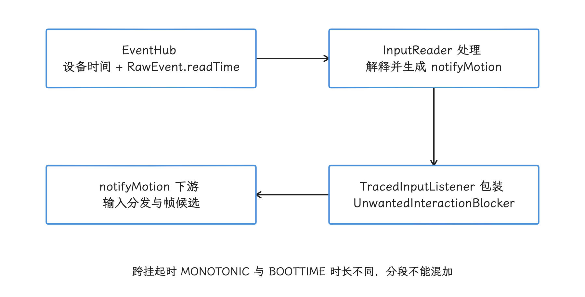

图：read_time 取 TracedInputListener 包装 Slice 起点，属于 Reader 监听链路代理。 它不是 EventHub readTime；软件候选 present 也不是面板发光时刻。

### 输入与 `doFrame` 的关联规则

标准库会在同一应用线程上查找与 `deliverInputEvent` 区间相交的 `Choreographer#doFrame`。找到交集时标记为精确关联；没有交集时，选择该线程上紧随其后的帧并标记 `is_speculative_frame = 1`。这里的“精确”只表示两个区间按规则相交，不自动证明业务因果。映射到 SurfaceFlinger 的步骤再按应用帧时间筛选未丢弃帧。

<!-- gracker-diagram: ch14-05-16-doframe-candidates -->
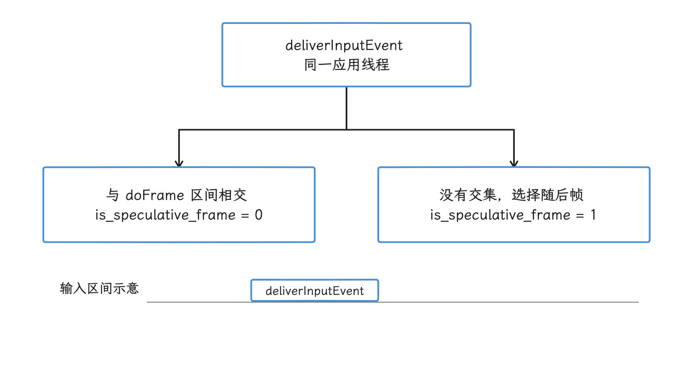

图：同线程输入与 doFrame 相交时取规则匹配，否则取随后帧并标推测。 exact 只是区间关系，不能证明该帧包含业务反馈。

这些规则带来三个限制：

- 推测关联只说明时间上最接近，不能证明该输入触发了该帧；
- 被丢弃的应用帧可能使 `frame_id` 指向后续未丢弃帧；
- 一个帧可合并多个 MOVE 事件，输入行与帧不是一一关系。

Android 17 的 `_input_read_time` 只匹配 motion 事件的 `UnwantedInteractionBlocker::notifyMotion*` Slice。按键事件可以有完整往返时间，却没有 `read_time`、`event_time` 或呈现延迟。以下划线开头表示标准库内部对象，外部查询不应依赖它。

该版本查找未丢弃帧的内部标量查询（预期返回单个值的子查询）使用 `app_ts >= frame_ts` 和 `LIMIT 1`，没有 `upid` 条件，也没有 `ORDER BY`，因此不保证取到目标进程最早的候选。最终帧附件还只按 `event_seq` 连接，存在前述跨通道放大。多应用绘制时，应独立固定输入身份、目标进程、Surface/Layer、应用 token 与 display token，再从底层 Actual 帧和对应 SF 帧重建呈现候选；仅在下游补 `upid`，不能修复已经混入的输入 ID、读取时间或呈现延迟。

<!-- gracker-diagram: ch14-05-17-frame-failure-gates -->
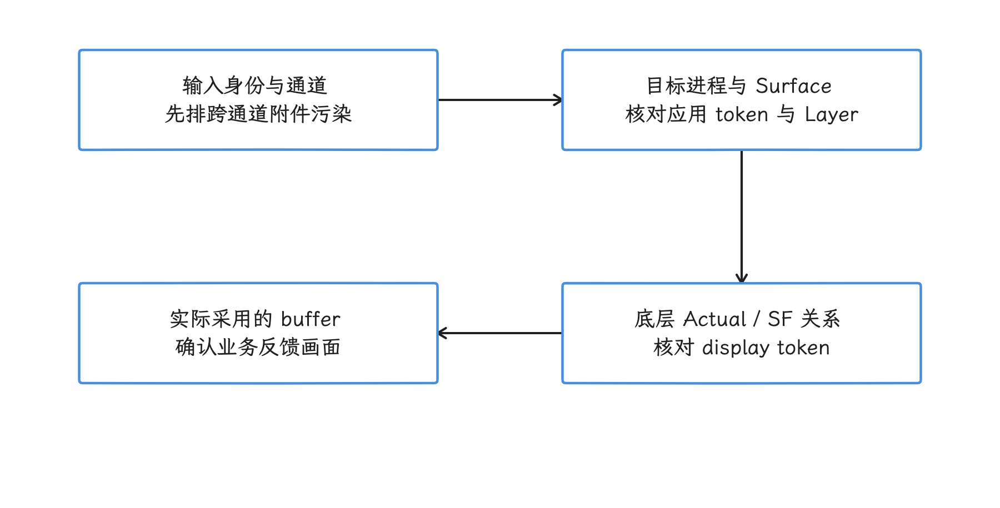

图：分别核验输入身份、应用 Surface、显示帧与实际采用的 buffer。 全局 LIMIT 1 无进程过滤和排序；下游补 upid 不能修复已污染字段。

下面的查询把候选帧附件连接到 `android_frames`，保留附件歧义和没有匹配到 HWUI 上下文的情况：

```sql
INCLUDE PERFETTO MODULE android.input;
INCLUDE PERFETTO MODULE time.conversion;

INCLUDE PERFETTO MODULE android.frames.timeline;

WITH raw_candidates AS (
  SELECT *, COUNT(*) OVER (
    PARTITION BY upid, event_channel, event_seq, dispatch_ts, receive_ts
  ) AS attachment_row_count
  FROM android_input_events
)
SELECT
  event.upid, event.event_channel, event.event_seq,
  event.input_event_id AS candidate_input_event_id,
  event.process_name,
  event.frame_id AS candidate_surface_frame_token,
  event.is_speculative_frame,
  event.attachment_row_count,
  CASE
    WHEN event.attachment_row_count > 1 THEN 'ambiguous_attachment'
    WHEN frame.do_frame_id IS NULL THEN 'no_matching_hwui_context'
    ELSE 'unverified_matching_context'
  END AS association_status,
  ((event.dispatch_ts) / 1e6) AS dispatch_at_ms,
  ((frame.ts) / 1e6) AS frame_start_at_ms,
  CASE WHEN frame.dur >= 0 THEN ((frame.dur) / 1e6) END AS frame_dur_ms,
  frame.do_frame_id, frame.draw_frame_id,
  frame.actual_frame_timeline_id, frame.expected_frame_timeline_id
FROM raw_candidates AS event
LEFT JOIN android_frames AS frame
  ON frame.frame_id = event.frame_id AND frame.upid = event.upid
WHERE event.frame_id IS NOT NULL
ORDER BY event.dispatch_ts, event.event_channel, event.frame_id
LIMIT 200;
```

同时使用候选 token 与 `upid` 只约束这一步上下文连接，不能修复此前的输入 ID、读取时间或全局呈现候选。`android_frames` 自身也是聚合视图，可能缺 Expected 数据或有多个 Layer/DrawFrame；应保留底层时间线 ID 再核对。帧持续时间长不等于输入处理慢，仍需联读 `doFrame`、RenderThread、SurfaceFlinger 和调度。

<!-- gracker-diagram: ch14-05-18-frame-context-leftjoin -->
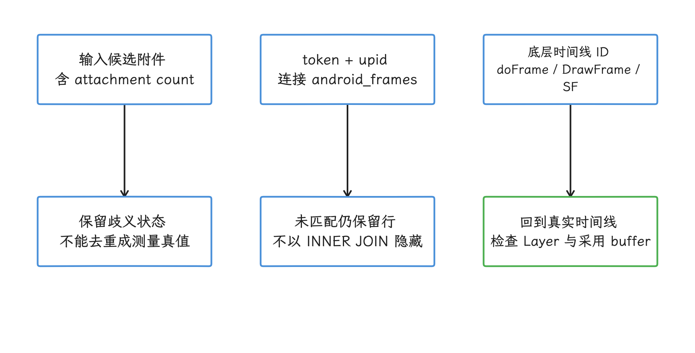

图：候选 token 加 upid 只约束当前上下文连接，LEFT JOIN 保留未匹配与歧义。 android_frames 也是聚合候选，缺 Expected 或多 Layer 时仍需底层 ID。

### 展开 `doFrame` 的全部后代切片

直接连接 `slice.parent_id = do_frame_id` 只能看到第一层子切片。定位输入、动画或遍历阶段时，应遍历完整的切片子树。下面的参数行选择一个应用和帧 ID：

```sql
INCLUDE PERFETTO MODULE android.frames.timeline;
INCLUDE PERFETTO MODULE time.conversion;

WITH params(process_name, frame_id) AS (
  VALUES ('com.example.reader', 123456)
),
target_process AS (
  SELECT MIN(process.upid) AS upid
  FROM process JOIN params ON process.name = params.process_name
  HAVING COUNT(*) = 1
)
SELECT
  frame.upid, frame.frame_id, frame.do_frame_id,
  slice.id AS slice_id, slice.name, slice.depth,
  ((slice.ts) / 1e6) AS start_ms,
  CASE WHEN slice.dur >= 0 THEN ((slice.dur) / 1e6) END AS dur_ms,
  slice.dur < 0 AS unclosed
FROM android_frames AS frame
JOIN target_process USING (upid)
CROSS JOIN params
JOIN descendant_slice(frame.do_frame_id) AS descendant
JOIN slice ON slice.id = descendant.id
WHERE frame.frame_id = params.frame_id
ORDER BY slice.ts, slice.depth, slice.id;
```

`descendant_slice()` 返回 `doFrame` 下所有层级的后代 Slice。查询要求名称恰好对应一个进程实例；未闭合切片保留行与 `unclosed` 标记，但毫秒时长为 NULL，避免把 `dur = -1` 当成负耗时。具体回调名称取决于版本、埋点和采集类别，应先看完整结果再筛选。

<!-- gracker-diagram: ch14-05-19-descendant-tree -->
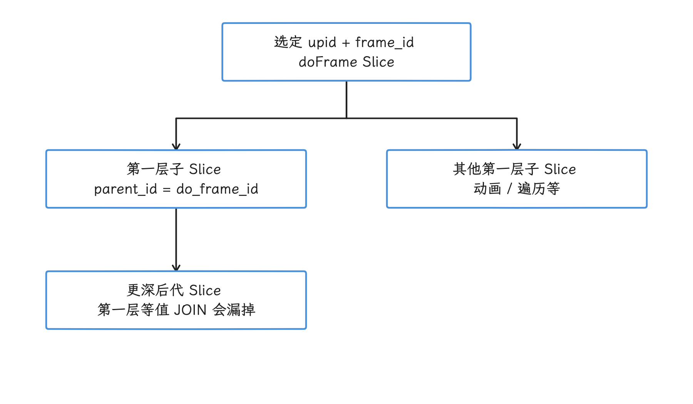

图：从选定 doFrame 遍历完整子树，按时间、深度和 ID 展开。 未闭合 dur=-1 保留 unclosed 状态，时长显示 NULL。

## `InputDispatcher` 的 `iq`、`oq` 与 `wq`

`InputDispatcher` 运行在承载 Android 核心系统服务的 `system_server` 进程中。Android 17 的 `InputDispatcher.cpp` 直接用 ATrace 计数器记录三类队列：

- `iq`（inbound queue）：`InputDispatcher` 尚未处理的全局入站队列；
- `oq:<channel>`（outbound queue）：每条连接上等待写入应用输入通道的出站队列；
- `wq:<channel>`（wait queue）：已经写给应用、仍等待 `FINISHED` 确认的队列。

这里的 channel 是 InputDispatcher 与一个输入目标之间的连接。源码中的计数器名称缓冲区长度为 40 字节，过长的通道名可能被截断。查询应使用 `oq:`、`wq:` 前缀，并在需要时结合目标时间和进程现场定位连接。

<!-- gracker-diagram: ch14-05-20-queue-lifecycle -->
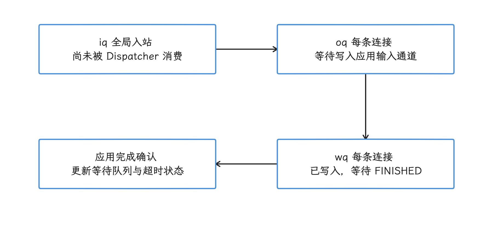

图：入站事件经分发进入连接出站队列，写入通道后等待完成确认。 三类长度均是计数器；通道名称缓冲区 40 字节可能截断。

这条查询用于确认当前跟踪中存在的 `InputDispatcher` 计数器：

```sql
SELECT process.upid AS system_upid,
  process.name AS process_name, counter.track_id,
  track.name AS queue_name, counter.ts,
  counter.ts / 1e6 AS sample_at_ms, counter.value AS queue_length
FROM counter
JOIN process_counter_track AS track ON track.id = counter.track_id
JOIN process USING (upid)
WHERE process.name = 'system_server'
  AND (track.name = 'iq' OR track.name GLOB 'oq:*' OR track.name GLOB 'wq:*')
ORDER BY counter.ts, counter.id
LIMIT 500;
```

`GLOB 'oq:*'` 和 `GLOB 'wq:*'` 使用通配符匹配对应前缀。如果没有结果，检查 `linux.ftrace` 是否启用了 ATrace 的 `input` 类别。旧文档中常见的 `InputDispatcher inbound queue` 等名称并不是 Android 17 源码写出的计数器名称。

`counter` 保存采样点，没有 `dur`；队列埋点在相关操作中写入当前值，不能假设所有来源都只记录发生变化的值。按阶梯值模型，一个样本保持到同轨道下一次采样；最后一个值外推到 Trace 结束只是分析假设，首条采样之前和采集缺口仍未知。下面的查询按此模型展开非零区间：

<!-- gracker-diagram: ch14-05-22-queue-evidence -->
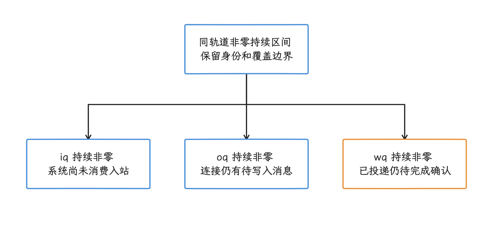

图：队列非零区间提示等待发生的位置，再结合线程和通道现场定位。 队列长度本身不能独立证明主线程、socket 或系统调度根因。

```sql
WITH queue_points AS (
  SELECT counter.id AS counter_id, counter.track_id,
    process.upid AS system_upid, track.name AS queue_name,
    counter.ts, counter.value AS queue_length,
    process.end_ts AS process_end_ts,
    LEAD(counter.ts) OVER (
      PARTITION BY counter.track_id ORDER BY counter.ts, counter.id
    ) AS next_ts
  FROM counter
  JOIN process_counter_track AS track ON track.id = counter.track_id
  JOIN process USING (upid)
  WHERE process.name = 'system_server'
    AND (track.name = 'iq' OR track.name GLOB 'oq:*' OR track.name GLOB 'wq:*')
),
queue_intervals AS (
  SELECT *, MIN(COALESCE(next_ts, trace_end()),
    COALESCE(process_end_ts, trace_end()), trace_end()) AS end_ts,
    CASE
      WHEN process_end_ts IS NOT NULL
        AND process_end_ts <= COALESCE(next_ts, trace_end())
        AND process_end_ts <= trace_end() THEN 'process_end_clip'
      WHEN next_ts IS NOT NULL AND next_ts <= trace_end() THEN 'next_sample'
      ELSE 'trace_end_extrapolation'
    END AS end_basis
  FROM queue_points
)
SELECT system_upid, track_id, queue_name, ts AS start_ts,
  ts / 1e6 AS start_ms, (end_ts - ts) / 1e6 AS dur_ms,
  queue_length, end_basis
FROM queue_intervals
WHERE queue_length > 0 AND end_ts > ts
ORDER BY queue_length DESC, end_ts - ts DESC, ts, track_id
LIMIT 200;
```

`LEAD()` 按 `(ts, id)` 取得同轨道下一条采样，重复时间戳产生的零长区间被排除。区间还会裁到当前进程结束与 `trace_end()` 中较早的时刻；`end_basis` 区分下一采样、进程边界和末值外推。末值保持只是模型假设，不能视为连续观测。瞬间出现非零值是正常流转的一部分。持续的 `iq` 表明 InputDispatcher 尚未消费完入站事件；持续的 `oq` 表明连接上仍有待写入事件；持续的 `wq` 表明已写入事件还在等待完成确认。队列堆积能缩小范围，但不能单独证明应用主线程、socket 写入或 `system_server` 调度中的哪一项是根因。

<!-- gracker-diagram: ch14-05-21-counter-intervals -->
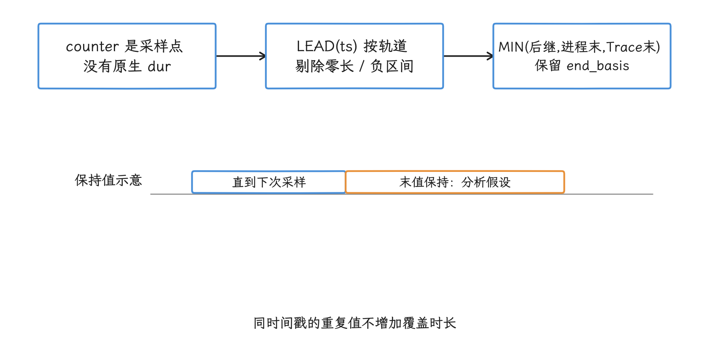

图：按轨道的 (ts,id) 构造阶梯区间，裁至进程或 Trace 边界。 首采样前未知，末值外推与采集缺口不等于连续观测。

## ANR 前的输入状态

### 以 `android_anrs` 为时间锚点

这里用平台记录构造查询时间窗，同时保留关联误差。通过名称通配符在 `slice` 中搜索 `ANR` 容易命中日志、应用自定义 Slice 或无关文本。`android.anrs` 模块会解析 `system_server` 的 `ErrorId`（平台为一次 ANR 生成的唯一标识）、subject（主题文本）和 ANR 计时器，并给出标准化的 `anr_type`。

这条查询列出输入分发类 ANR，以及跟踪中解析到的超时长度：

```sql
INCLUDE PERFETTO MODULE android.anrs;

SELECT error_id, process_name, pid,
  CASE WHEN COUNT(DISTINCT upid) = 1 THEN MIN(upid) END AS candidate_upid,
  COUNT(DISTINCT upid) AS candidate_process_count,
  ts, ts / 1e6 AS anr_at_ms, anr_type,
  anr_dur_ms, default_anr_dur_ms, timer_delay, subject
FROM android_anrs
WHERE anr_type IN (
  'INPUT_DISPATCHING_TIMEOUT',
  'INPUT_DISPATCHING_TIMEOUT_NO_FOCUSED_WINDOW'
)
GROUP BY error_id, process_name, pid, ts, anr_type,
  anr_dur_ms, default_anr_dur_ms, timer_delay, subject
ORDER BY ts, error_id;
```

`InputDispatcher` 的超时时长并非固定五秒。Android 17 会优先读取目标窗口的分发超时时长，找不到窗口时才使用默认值，并可能按平台的硬件超时倍率放大。Perfetto 的 `anr_dur_ms` 优先来自平台计时器；`default_anr_dur_ms` 只是 AOSP / Pixel 的参考默认值，OEM 厂商可以修改。 固定模块按 PID 选择最近的前序计时器，并仅按 PID 连接 `process`，没有同时验证进程生命周期。PID 复用可令同一 ANR 扩成多行；查询对 ANR 核心字段去重，并报告 `candidate_process_count`，不把任选的 `upid` 当作已确认目标。

<!-- gracker-diagram: ch14-05-23-anr-candidates -->
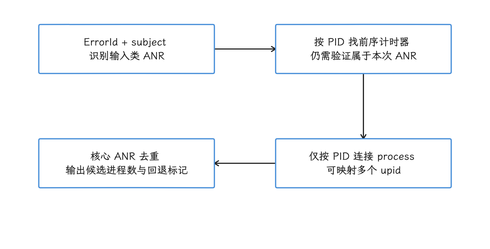

图：ErrorId、subject 和最近计时器构成 ANR 候选，进程候选数单独输出。 PID-only 连接会受复用影响；平台默认值不是所有设备固定超时。

### 查看 ANR 窗口内已完成的输入

下面的查询以超时到期为窗口终点，列出窗口内分发、且到该终点已完成往返的最近 50 个事件。`android_anrs.ts` 是 `ErrorId` 计数器的记录时刻；存在计时器时，减去纳秒单位的 `timer_delay` 才是到期时刻。缺少相应字段时使用记录时刻或默认超时长度估算窗口。`estimated_timer` 只表明是否使用了缺字段回退；值为 0 也不证明最近计时器属于本次 ANR。窗口起点不是精确阻塞起点，PID 关联仍需结合生命周期核验。

<!-- gracker-diagram: ch14-05-24-anr-window -->
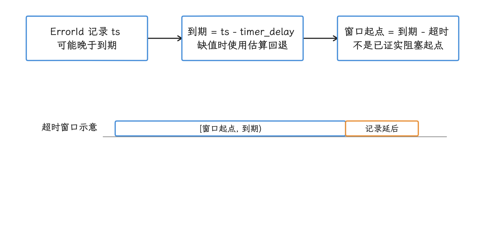

图：到期候选等于 ErrorId 记录时刻减 timer_delay，窗口向前展开超时长度。 estimated_timer 只标缺字段回退；0 也不证明计时器归属正确。

```sql
INCLUDE PERFETTO MODULE android.input;
INCLUDE PERFETTO MODULE time.conversion;

INCLUDE PERFETTO MODULE android.anrs;

WITH input_anrs AS (
  SELECT DISTINCT
    error_id, process_name, pid,
    COALESCE(anr_dur_ms, default_anr_dur_ms) AS timeout_ms,
    ts - COALESCE(timer_delay, 0) AS timeout_end_ts,
    timer_delay IS NULL AS estimated_timer
  FROM android_anrs
  WHERE anr_type IN (
    'INPUT_DISPATCHING_TIMEOUT',
    'INPUT_DISPATCHING_TIMEOUT_NO_FOCUSED_WINDOW'
  )
),
round_trips AS (
  SELECT DISTINCT
    event.upid,
    event.pid,
    event.tid,
    event.thread_name,
    event.process_name,
    event.event_type,
    event.event_seq,
    event.event_channel,
    event.normalized_event_channel,
    event.dispatch_track_id,
    event.dispatch_ts,
    event.dispatch_dur,
    event.receive_track_id,
    event.receive_ts,
    event.receive_dur,
    event.dispatch_latency_dur,
    event.handling_latency_dur,
    event.ack_latency_dur,
    event.total_latency_dur
  FROM android_input_events AS event
),
ranked AS (
  SELECT anr.error_id, anr.process_name AS anr_process,
    anr.timeout_end_ts, anr.timeout_ms, anr.estimated_timer,
    event.upid AS event_upid, event.pid AS event_pid,
    event.dispatch_ts, event.receive_ts,
    event.event_channel, event.event_seq, event.thread_name AS finish_thread_name,
    event.receive_track_id,
    event.dispatch_latency_dur, event.handling_latency_dur,
    event.ack_latency_dur, event.total_latency_dur,
    ROW_NUMBER() OVER (
      PARTITION BY anr.error_id
      ORDER BY event.dispatch_ts DESC, event.upid, event.event_channel, event.event_seq
    ) AS recency
  FROM input_anrs AS anr
  LEFT JOIN round_trips AS event
    ON event.process_name = anr.process_name
    AND (anr.pid IS NULL OR event.pid = anr.pid)
    AND event.dispatch_ts >= anr.timeout_end_ts - time_from_ms(anr.timeout_ms)
    AND event.dispatch_ts < anr.timeout_end_ts
    AND event.total_latency_dur >= 0
    AND event.dispatch_ts + event.total_latency_dur <= anr.timeout_end_ts
)
SELECT error_id, anr_process, timeout_ms, estimated_timer,
  event_upid, event_pid, event_channel, event_seq, receive_track_id,
  dispatch_ts, receive_ts, finish_thread_name,
  (timeout_end_ts - dispatch_ts) / 1e6 AS ms_before_timeout,
  dispatch_latency_dur / 1e6 AS dispatch_ms,
  handling_latency_dur / 1e6 AS handling_ms,
  ack_latency_dur / 1e6 AS ack_ms,
  total_latency_dur / 1e6 AS total_ms
FROM ranked WHERE recency <= 50
ORDER BY timeout_end_ts, error_id, recency;
```

`dispatch_ts + total_latency_dur` 是系统收到完成确认的时刻；额外的上界条件排除了超时后才完成的投递。`android_input_events` 只包含四个消息节点都匹配成功的投递。卡住并触发 ANR 的事件可能没有 `finish_ack`（系统收到完成确认的节点），因此不会出现在结果里。ANR 附近没有行并不等于没有输入；此时应查看 `wq:` 计数器、目标主线程调度状态和 ANR 主题字段。

<!-- gracker-diagram: ch14-05-25-completed-blindspot -->
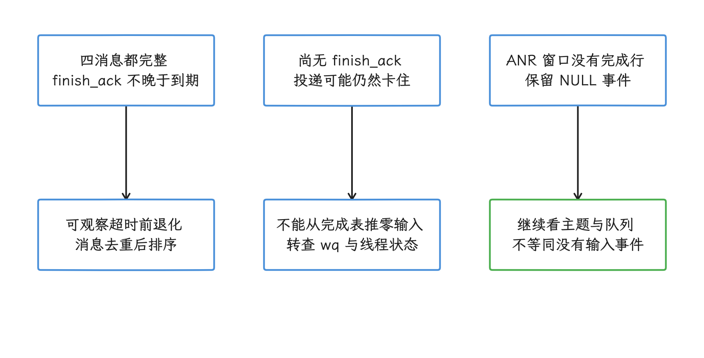

图：只统计窗口内分发并截至到期已完成的往返，同时保留没有完成行的 ANR。 导致超时的未确认输入可能完全不在 android_input_events 中。

下面的查询先把队列采样展开成持续区间，再与超时窗口求交集，保留窗口开始前已经出现的非零状态：

```sql
INCLUDE PERFETTO MODULE android.anrs;
INCLUDE PERFETTO MODULE time.conversion;

WITH input_anrs AS (
  SELECT DISTINCT
    error_id, process_name, pid,
    COALESCE(anr_dur_ms, default_anr_dur_ms) AS timeout_ms,
    ts - COALESCE(timer_delay, 0) AS timeout_end_ts,
    timer_delay IS NULL AS estimated_timer
  FROM android_anrs
  WHERE anr_type IN (
    'INPUT_DISPATCHING_TIMEOUT',
    'INPUT_DISPATCHING_TIMEOUT_NO_FOCUSED_WINDOW'
  )
),
queue_points AS (
  SELECT counter.id AS counter_id, counter.track_id,
    process.upid AS system_upid, track.name AS queue_name,
    counter.ts, counter.value AS queue_length,
    process.end_ts AS process_end_ts,
    LEAD(counter.ts) OVER (
      PARTITION BY counter.track_id ORDER BY counter.ts, counter.id
    ) AS next_ts
  FROM counter
  JOIN process_counter_track AS track ON track.id = counter.track_id
  JOIN process USING (upid)
  WHERE process.name = 'system_server'
    AND (track.name = 'iq' OR track.name GLOB 'oq:*' OR track.name GLOB 'wq:*')
),
queue_intervals AS (
  SELECT *, MIN(COALESCE(next_ts, trace_end()),
    COALESCE(process_end_ts, trace_end()), trace_end()) AS end_ts,
    CASE
      WHEN process_end_ts IS NOT NULL
        AND process_end_ts <= COALESCE(next_ts, trace_end())
        AND process_end_ts <= trace_end() THEN 'process_end_clip'
      WHEN next_ts IS NOT NULL AND next_ts <= trace_end() THEN 'next_sample'
      ELSE 'trace_end_extrapolation'
    END AS end_basis
  FROM queue_points
),
overlaps AS (
  SELECT anr.error_id, anr.process_name, anr.estimated_timer,
    anr.timeout_end_ts, queue.system_upid, queue.track_id,
    queue.queue_name, queue.queue_length, queue.end_basis,
    MAX(queue.ts, anr.timeout_end_ts - time_from_ms(anr.timeout_ms)) AS start_ts,
    MIN(queue.end_ts, anr.timeout_end_ts) AS end_ts
  FROM input_anrs AS anr JOIN queue_intervals AS queue
    ON queue.ts < anr.timeout_end_ts
    AND queue.end_ts > anr.timeout_end_ts - time_from_ms(anr.timeout_ms)
  WHERE queue.queue_length > 0
)
SELECT error_id, process_name, estimated_timer,
  system_upid, track_id, queue_name, queue_length, start_ts, end_ts,
  (timeout_end_ts - start_ts) / 1e6 AS ms_before_timeout,
  (end_ts - start_ts) / 1e6 AS overlap_dur_ms, end_basis
FROM overlaps WHERE end_ts > start_ts
ORDER BY timeout_end_ts, start_ts, track_id;
```

`overlap_dur_ms` 是已知非零状态与窗口相交的时长；同轨道的后继采样会结束该状态，首条采样之前的值仍然未知。结果包含 `system_server` 的所有匹配队列，不能直接归给 ANR 进程。目标连接名可能被截断，仍需在 `Perfetto UI` 中对齐同一时间段的 `InputDispatcher`、应用主线程和调度轨道。

<!-- gracker-diagram: ch14-05-26-queue-window-overlap -->
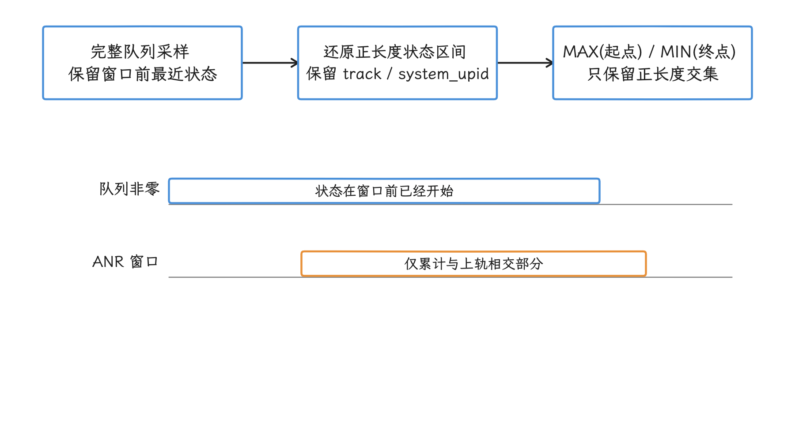

图：先从完整队列采样还原状态，再求与 ANR 窗口的正交集。 不能先删掉窗口前的采样；system_server 队列不能直接归给 ANR 进程。

## 三个可复用场景模板

### 滑动卡顿：按场景区间找尾部样本

参数行默认覆盖整份跟踪。复现实验时，把 `start_ts`、`end_ts` 改成场景标记的纳秒时间，并修改进程名：

```sql
INCLUDE PERFETTO MODULE android.input;
INCLUDE PERFETTO MODULE time.conversion;

WITH params(process_name, start_ts, end_ts) AS (
  SELECT 'com.example.reader', trace_start(), trace_end()
),
target_process AS (
  SELECT MIN(process.upid) AS upid
  FROM process JOIN params ON process.name = params.process_name
  HAVING COUNT(*) = 1
),
round_trips AS (
  SELECT DISTINCT
    event.upid,
    event.pid,
    event.tid,
    event.thread_name,
    event.process_name,
    event.event_type,
    event.event_seq,
    event.event_channel,
    event.normalized_event_channel,
    event.dispatch_track_id,
    event.dispatch_ts,
    event.dispatch_dur,
    event.receive_track_id,
    event.receive_ts,
    event.receive_dur,
    event.dispatch_latency_dur,
    event.handling_latency_dur,
    event.ack_latency_dur,
    event.total_latency_dur
  FROM android_input_events AS event
  JOIN target_process USING (upid)
  CROSS JOIN params
  WHERE event.dispatch_ts >= params.start_ts
    AND event.dispatch_ts < params.end_ts
    AND event.dispatch_latency_dur >= 0 AND event.handling_latency_dur >= 0
    AND event.ack_latency_dur >= 0 AND event.total_latency_dur >= 0
),
baseline AS (
  SELECT PERCENTILE(total_latency_dur, 95) AS p95_total
  FROM round_trips WHERE total_latency_dur >= 0
)
SELECT
  upid, pid, tid AS finish_tid, event_channel, event_seq, event_type,
  dispatch_ts, receive_ts, dispatch_track_id, receive_track_id,
  ((dispatch_ts) / 1e6) AS dispatch_at_ms,
  normalized_event_channel,
  ((dispatch_latency_dur) / 1e6) AS dispatch_ms,
  ((handling_latency_dur) / 1e6) AS handling_ms,
  ((ack_latency_dur) / 1e6) AS ack_ms,
  ((total_latency_dur) / 1e6) AS total_ms
FROM round_trips CROSS JOIN baseline
WHERE total_latency_dur >= 0 AND total_latency_dur >= baseline.p95_total
ORDER BY total_latency_dur DESC, dispatch_ts, event_channel, event_seq;
```

该模板把当前区间本身作为 baseline（比较基准），用其中的 P95 选出尾部样本，不给出脱离场景的固定阈值。把异常时间带回 UI 后，依次检查接收线程状态、`doFrame`、Binder Slice、GC（Garbage Collection，垃圾回收）、锁等待和 CPU 频率。

<!-- gracker-diagram: ch14-05-27-tail-to-ui -->
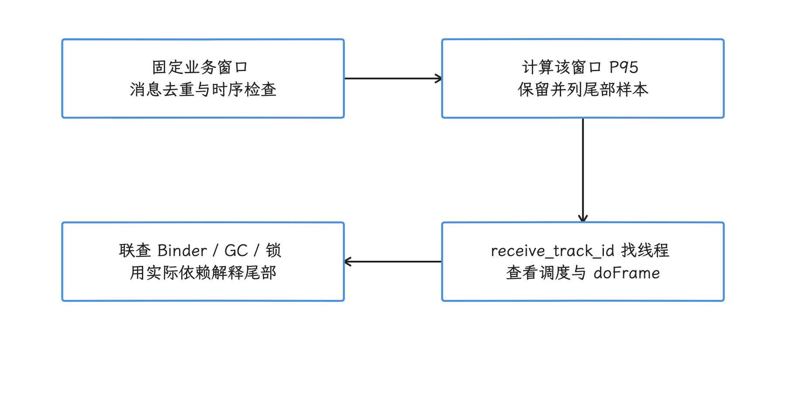

图：相同实例和窗口的 P95 筛出尾部后，用消息轨道和原始时刻回查 UI。 P95 是当前场景基准；候选帧需独立核验，不能套统一毫秒阈值。

### 输入 ANR：标准化 ANR 加队列

输入 ANR 的 SQL 已在上一节给出。实际排查应把三份证据并排：

- `android_anrs` 的类型、主题字段、计时器和目标进程；
- `iq`、`oq:`、`wq:` 的非零持续区间；
- 应用主线程在超时窗口内的运行、可运行、睡眠状态及长切片。

已完成事件的分段延迟用于观察超时前是否已经退化，不能替代未完成投递的现场。

<!-- gracker-diagram: ch14-05-28-anr-evidence-triad -->
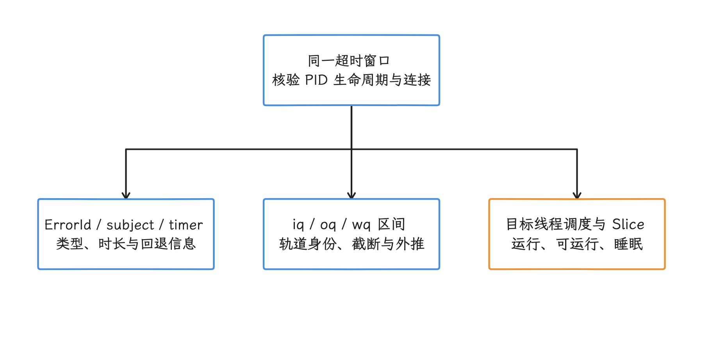

图：标准 ANR 候选、队列状态和线程现场共同约束排查。 已完成往返只能观察退化，不能代替未完成投递现场。

### 冷启动：第一个目标进程输入

“点击桌面图标到应用首帧”不属于 `android_input_events` 对目标应用的直接测量，因为启动手势先由 Launcher（桌面应用）接收。下面的查询回答一个更窄的问题：每次启动开始后，目标进程何时收到第一条可完整匹配的输入投递。

```sql
INCLUDE PERFETTO MODULE android.input;
INCLUDE PERFETTO MODULE time.conversion;

INCLUDE PERFETTO MODULE android.startup.startups;

WITH round_trips AS (
  SELECT DISTINCT
    event.upid,
    event.pid,
    event.tid,
    event.thread_name,
    event.process_name,
    event.event_type,
    event.event_seq,
    event.event_channel,
    event.normalized_event_channel,
    event.dispatch_track_id,
    event.dispatch_ts,
    event.dispatch_dur,
    event.receive_track_id,
    event.receive_ts,
    event.receive_dur,
    event.dispatch_latency_dur,
    event.handling_latency_dur,
    event.ack_latency_dur,
    event.total_latency_dur
  FROM android_input_events AS event
),
params(package_name) AS (VALUES ('com.example.reader')),
target_startups AS (
  SELECT startup.*,
    LEAD(startup.ts) OVER (
      PARTITION BY startup.package ORDER BY startup.ts, startup.startup_id
    ) AS next_startup_ts
  FROM android_startups AS startup JOIN params
    ON params.package_name = startup.package
),
process_map AS (
  SELECT DISTINCT startup_id, upid, pid, startup_type
  FROM android_startup_processes
),
mapped_startups AS (
  SELECT startup.*, map.upid, map.pid,
    map.startup_type AS process_startup_type,
    COUNT(map.upid) OVER (PARTITION BY startup.startup_id) AS mapped_process_count
  FROM target_startups AS startup
  LEFT JOIN process_map AS map USING (startup_id)
),
ranked AS (
  SELECT startup.startup_id, startup.package, startup.startup_type,
    startup.upid, startup.pid, startup.process_startup_type,
    startup.mapped_process_count, startup.ts AS startup_ts,
    startup.ts_end AS startup_end_ts,
    event.receive_ts, event.dispatch_ts, event.event_channel, event.event_seq,
    event.total_latency_dur,
    ROW_NUMBER() OVER (
      PARTITION BY startup.startup_id, startup.upid
      ORDER BY event.receive_ts, event.dispatch_ts, event.event_channel, event.event_seq
    ) AS input_order
  FROM mapped_startups AS startup
  LEFT JOIN round_trips AS event ON event.upid = startup.upid
    AND event.receive_ts >= startup.ts
    AND event.receive_ts < COALESCE(startup.next_startup_ts, trace_end())
    AND event.total_latency_dur >= 0
)
SELECT startup_id, package, startup_type, process_startup_type,
  upid, pid, mapped_process_count,
  CASE WHEN mapped_process_count = 0 THEN 'missing_process_map'
       WHEN mapped_process_count > 1 THEN 'multiple_instances'
       ELSE 'single_instance' END AS process_mapping_status,
  startup_ts, receive_ts, dispatch_ts, event_channel, event_seq,
  CASE WHEN startup_end_ts >= startup_ts
    THEN (startup_end_ts - startup_ts) / 1e6 END AS startup_ms,
  (receive_ts - startup_ts) / 1e6 AS first_input_after_start_ms,
  CASE WHEN receive_ts IS NULL OR startup_end_ts IS NULL
         OR startup_end_ts < startup_ts THEN NULL
       WHEN receive_ts <= startup_end_ts THEN 1 ELSE 0
  END AS input_arrived_during_startup,
  total_latency_dur / 1e6 AS first_input_round_trip_ms
FROM ranked WHERE input_order = 1
ORDER BY startup_ts, startup_id, upid;
```

这里通过 `android_startup_processes` 的 `startup_id`、`upid` 映射到应用实例，再以应用侧 `receive_ts` 选第一条输入；同包下一次启动开始构成不包含右端点的上界。一次启动可因进程死亡和重启对应多个实例，结果按实例分行；缺映射也保留，不能悄悄用包名前缀补齐。标准启动映射本身依赖包元数据、名称与窗口内 Activity 恢复证据，仍需核对现场。模板保留各类 `startup_type`，分析冷启动时再筛选对应结果。第一条目标输入可能发生在启动结束很久之后，`first_input_after_start_ms` 因而不能直接当作可交互时间。若目标是启动手势到首帧，应结合 `android_startups`、启动方输入事件、Flow（Trace 事件之间的因果连线）或自定义场景标记，并对跨进程因果关系单独建模。

<!-- gracker-diagram: ch14-05-29-startup-mapping -->
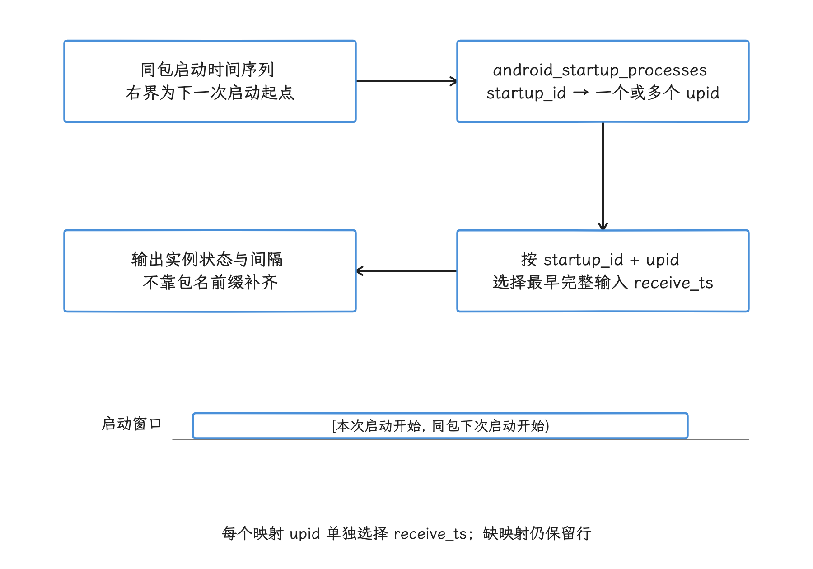

图：startup_id 经标准映射找到各 upid，再选其窗口内最早 receive_ts。 缺映射、多实例保留；第一条完整输入不等于可交互时间。

## SQL 与 Perfetto UI 的分工

SQL 适合重复执行的筛选和统计：

- 计算同场景 P50、P95、P99 与缺失率；
- 找出最慢事件、推测帧关联和队列非零区间；
- 在多份跟踪上运行相同判定；
- 固化修复前后的对比口径。

`Perfetto UI` 适合检查单个异常点周围的因果证据：

- 线程为何没有运行，或者运行后执行了什么；
- 输入处理是否落在 `doFrame` 内，是否错过目标 Vsync；
- Binder、锁、GC、I/O、频率与 `SurfaceFlinger` 是否同时异常；
- SQL 的进程、通道和帧关联是否符合现场。

实用流程是用 SQL 产出时间戳、事件 ID、进程、通道、帧 ID 和异常分段，再到 UI 展开该点；修复后用相同 SQL 与相同采集条件复测。§14.7 提供通用查询框架，这里进一步给出输入处理链路的可重复量化入口。

<!-- gracker-diagram: ch14-05-30-sql-ui-loop -->
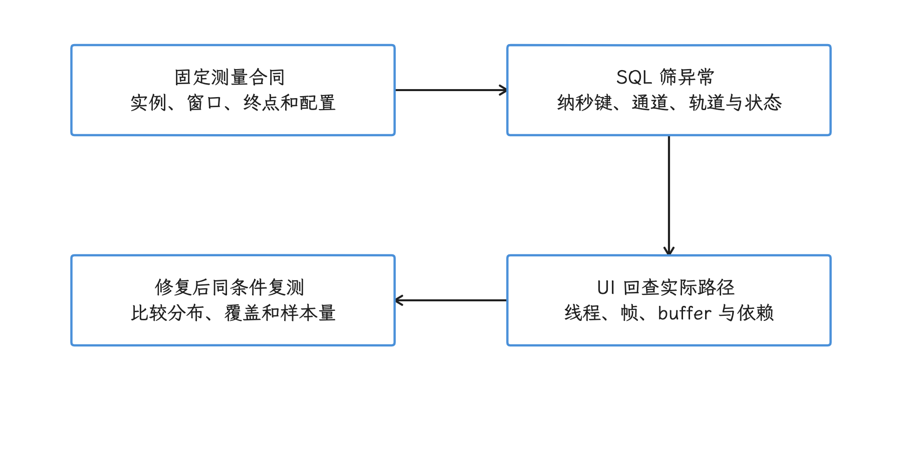

图：SQL 产出可回查样本，UI 核验身份和依赖，再以相同条件复测。 候选输入 ID 与 frame_id 均需复核，不能独立充当因果证据。

## `TraceConfig`：按问题选择采集面

### 常规输入往返与帧关联

TraceConfig 是声明缓冲区、采集时长和数据源的 protobuf 配置。下面是一份 Android 17 的文本格式示例，它采集输入 ATrace、应用视图与图形 Slice、FrameTimeline 以及调度上下文：

```protobuf
buffers {
  size_kb: 65536
  fill_policy: RING_BUFFER
}
duration_ms: 10000

data_sources {
  config {
    name: "linux.ftrace"
    target_buffer: 0
    ftrace_config {
      ftrace_events: "sched/sched_switch"
      ftrace_events: "sched/sched_waking"
      ftrace_events: "power/cpu_frequency"
      atrace_categories: "input"
      atrace_categories: "view"
      atrace_categories: "gfx"
      atrace_apps: "com.example.reader"
    }
  }
}

data_sources {
  config {
    name: "android.surfaceflinger.frametimeline"
    target_buffer: 0
  }
}
```

`RING_BUFFER` 表示缓冲区写满后覆盖最早的数据。修改 `atrace_apps` 和采集时长后即可用于目标场景。

`input` 类别提供 InputDispatcher 与队列计数器；应用侧 Slice 需要目标应用进入 ATrace 采集范围；FrameTimeline 用于 `frame_id` 和 `end_to_end_latency_dur`。缓冲区大小要按设备事件量和场景时长实测，不能把示例值视为固定配置。

<!-- gracker-diagram: ch14-05-31-collection-coverage -->
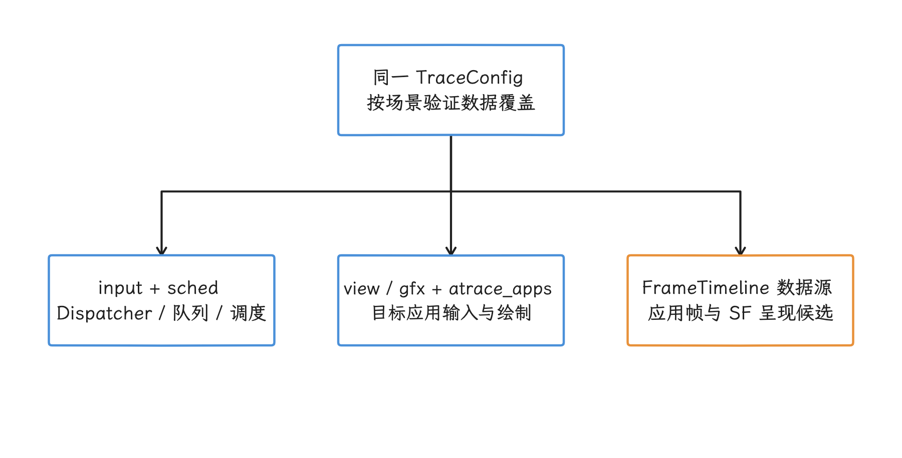

图：input ATrace、应用图形埋点与 FrameTimeline 分别提供消息、上下文和候选帧。 RING_BUFFER 可覆盖最早数据，配置请求不保证设备实际覆盖完整。

### 原始输入与窗口分发

需要原始 `MotionEvent`、`KeyEvent` 或窗口分发决策时，可以在 `userdebug` 或 `eng` 调试设备上追加下面的数据源。示例使用 `TRACE_MODE_USE_RULES`，表示逐条按规则决定记录等级：

```protobuf
data_sources {
  config {
    name: "android.input.inputevent"
    android_input_event_config {
      mode: TRACE_MODE_USE_RULES
      trace_dispatcher_input_events: true
      trace_dispatcher_window_dispatch: true
      rules {
        trace_level: TRACE_LEVEL_REDACTED
      }
    }
  }
}
```

没有匹配条件的规则会匹配所有事件；规则按声明顺序处理，首个匹配项决定记录等级。`TRACE_LEVEL_REDACTED` 是脱敏记录等级，会省略指针坐标、按键码和硬件扫描码。事件没有匹配任何规则时，默认使用 `TRACE_LEVEL_NONE`，即不记录。

<!-- gracker-diagram: ch14-05-32-raw-rule-order -->
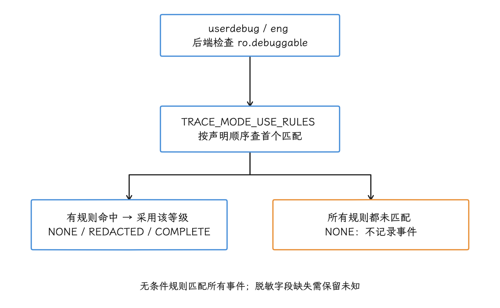

图：规则按声明顺序匹配，首个命中决定 NONE、REDACTED 或完整记录等级。 无条件规则匹配所有事件；没有规则命中时为 NONE。

`TRACE_MODE_TRACE_ALL` 会绕过隐私措施并记录系统处理的全部输入，只适合本地受控设备和测试，禁止用于线上采集。

包名规则检查一次事件的所有目标：`match_any_packages` 在任一目标包命中列表时成立，`match_all_packages` 要求所有目标 UID 都被允许列表覆盖，其中 System、Shell、Root UID 在固定后端中永久允许；因此不能把它理解为每个目标都必须显式写入包名列表。同一事件常被发送给前台应用、监视窗口等多个目标，因此两种规则的覆盖面可能与直觉不同。坐标、按键、IME（Input Method Editor，输入法）连接状态和安全窗口均属于敏感信息。

<!-- gracker-diagram: ch14-05-33-package-allowlists -->
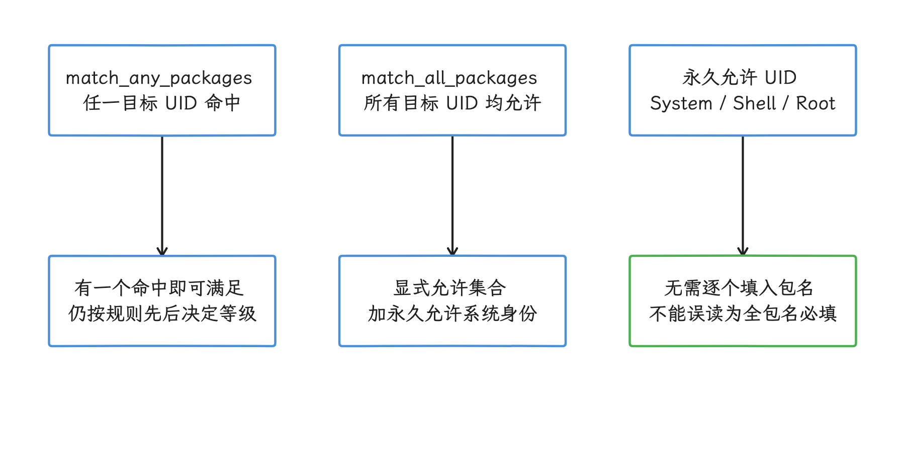

图：包名配置在后端映射到 UID；all 还计入永久允许的系统 UID。 多窗口或监视目标会改变匹配结果；隐私规则不能只看前台包。

原始事件数据源不会替代常规配置中的 ATrace 和 FrameTimeline。只打开它可以得到三张原始视图，却不保证 `android_input_events` 的消息往返与帧关联完整。

## 批量跟踪对比

批量比较前，应固定以下实验条件：

- 平台版本、设备型号、刷新率和电源模式；
- 场景脚本、输入注入方式、采集时长和预热方式；
- `TraceConfig`、`Trace Processor` 或 `perfetto` Python 包版本；
- 样本筛选条件、进程名、样本量和异常样本处理规则。

Perfetto 的 Batch Trace Processor 会为每份 Trace 启动独立解析实例，并对它们执行同一条 SQL。下面以 Python 包 `perfetto==0.57.2` 为 API 基线，通过 `bin_path` 显式指定已核验的原生 Trace Processor；包号不能证明原生版本。脚本读取 `traces`，先去除帧附件造成的消息重复，再计算往返分位数；候选帧可用率、推测候选率与歧义投递数单独汇总，最后用 Pandas（Python 表格分析库）合并结果。运行前将二进制放到示例路径，并保存实际版本、SHA 摘要与标准库来源。

```python
from glob import glob

import pandas as pd
from perfetto.trace_processor import TraceProcessorConfig
from perfetto.batch_trace_processor.api import (
    BatchTraceProcessor, BatchTraceProcessorConfig,
)

TRACE_FILES = sorted(glob("traces/*.perfetto-trace"))
if not TRACE_FILES:
    raise SystemExit("traces 目录中没有 .perfetto-trace 文件")

QUERY = """
INCLUDE PERFETTO MODULE android.input;
INCLUDE PERFETTO MODULE time.conversion;

WITH params(process_name, start_ts, end_ts) AS (
  SELECT 'com.example.reader', trace_start(), trace_end()
),
target_process AS (
  SELECT MIN(process.upid) AS upid
  FROM process JOIN params ON process.name = params.process_name
  HAVING COUNT(*) = 1
),
round_trips AS (
  SELECT DISTINCT
    event.upid,
    event.pid,
    event.tid,
    event.thread_name,
    event.process_name,
    event.event_type,
    event.event_seq,
    event.event_channel,
    event.normalized_event_channel,
    event.dispatch_track_id,
    event.dispatch_ts,
    event.dispatch_dur,
    event.receive_track_id,
    event.receive_ts,
    event.receive_dur,
    event.dispatch_latency_dur,
    event.handling_latency_dur,
    event.ack_latency_dur,
    event.total_latency_dur
  FROM android_input_events AS event
  JOIN target_process USING (upid)
  CROSS JOIN params
  WHERE event.dispatch_ts >= params.start_ts
    AND event.dispatch_ts < params.end_ts
    AND event.dispatch_latency_dur >= 0 AND event.handling_latency_dur >= 0
    AND event.ack_latency_dur >= 0 AND event.total_latency_dur >= 0
),
raw_target AS (
  SELECT event.* FROM android_input_events AS event
  JOIN target_process USING (upid) CROSS JOIN params
  WHERE event.dispatch_ts >= params.start_ts AND event.dispatch_ts < params.end_ts
),
candidate_tuples AS (
  SELECT DISTINCT upid, event_channel, event_seq, dispatch_ts, receive_ts,
    input_event_id, read_time, event_time, frame_id,
    is_speculative_frame, end_to_end_latency_dur
  FROM raw_target
),
candidate_quality AS (
  SELECT upid, event_channel, event_seq, dispatch_ts, receive_ts,
    COUNT(*) AS tuple_count,
    MAX(frame_id IS NOT NULL) AS has_frame_candidate,
    MAX(COALESCE(is_speculative_frame = 1, 0)) AS has_speculative_candidate
  FROM candidate_tuples
  GROUP BY upid, event_channel, event_seq, dispatch_ts, receive_ts
)
SELECT
  (SELECT COUNT(*) FROM process JOIN params ON process.name=params.process_name)
    AS target_process_matches,
  (SELECT upid FROM target_process) AS target_upid,
  (SELECT COUNT(*) FROM raw_target) AS raw_row_count,
  COUNT(*) AS event_count,
  PERCENTILE(total_latency_dur, 50) / 1e6 AS p50_ms,
  PERCENTILE(total_latency_dur, 95) / 1e6 AS p95_ms,
  PERCENTILE(total_latency_dur, 99) / 1e6 AS p99_ms,
  MAX(total_latency_dur) / 1e6 AS max_ms,
  (SELECT ROUND(100.0 * COALESCE(SUM(has_frame_candidate),0)
    / NULLIF(COUNT(*),0),2) FROM candidate_quality) AS candidate_frame_percent,
  (SELECT ROUND(100.0 * COALESCE(SUM(has_speculative_candidate),0)
    / NULLIF(COUNT(*),0),2) FROM candidate_quality) AS candidate_speculative_percent,
  (SELECT COUNT(*) FROM candidate_quality WHERE tuple_count > 1)
    AS ambiguous_candidate_deliveries
FROM round_trips WHERE total_latency_dur >= 0;
"""

config = BatchTraceProcessorConfig(
    tp_config=TraceProcessorConfig(bin_path="tools/perfetto/trace_processor"),
)
with BatchTraceProcessor(TRACE_FILES, config=config) as batch:
    per_trace = batch.query(QUERY)

summary = pd.concat(
    [frame.assign(trace_path=path) for path, frame in zip(TRACE_FILES, per_trace)],
    ignore_index=True,
)
summary.to_csv("input-latency-summary.csv", index=False)
print(summary.to_string(index=False))
```

`pd.concat()` 把每份 Trace 的 DataFrame（带列名的内存表格）纵向合并。修改查询参数行中的目标进程后，脚本会显式用文件路径标识每份结果，避免依赖地址解析器自动添加列的具体命名。

<!-- gracker-diagram: ch14-05-34-batch-two-populations -->
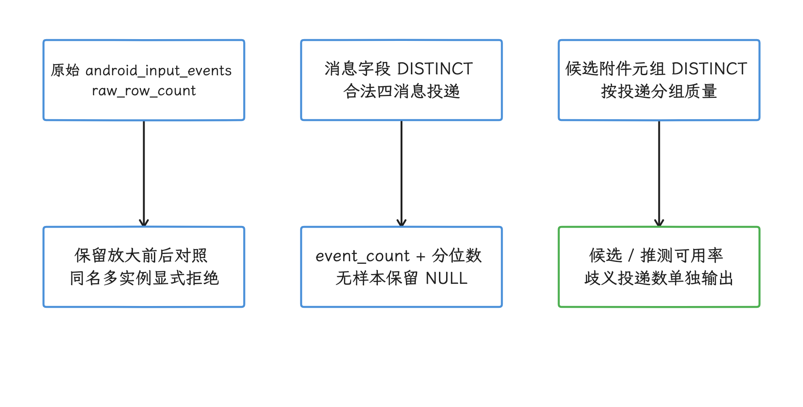

图：每份 Trace 内分别计算合法去重往返与候选附件质量，再按来源合并。 候选率只是可用性；无歧义也不证明全局帧候选正确。

`event_count` 是消息去重后的往返数，`raw_row_count` 保留标准库放大前后的对照。候选字段比例只描述字段可用性，不是呈现关联准确率；`ambiguous_candidate_deliveries` 为零也不能排除全局帧候选错误。同名进程不唯一时不计算该实例的分位数；无样本时分位数和比例保留 NULL。每份 Trace 的解析实例都会常驻，worker 限额不限制实例总数，输入规模较大时需要分批处理。

<!-- gracker-diagram: ch14-05-35-batch-residency -->
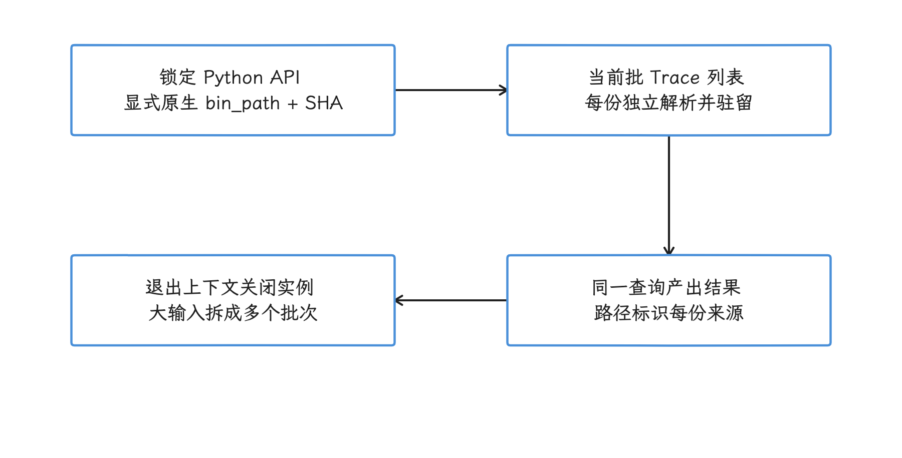

图：每份 Trace 各有解析实例，显式选原生工具并在内存不足时拆分输入。 worker 限额不限制驻留实例总数；压缩 Trace 大小不代表解析内存。

## 版本边界与核对清单

提交分析结论前，逐项确认：

- 设备平台高于 Android 17 时重新核验本文结论；当前平台源码基线记录为 `android-17.0.0_r1`；
- 涉及调度语义时，内核锚点记录为 `android17-6.18-2026-06_r6`；
- `Trace Processor` 版本支持当前查询中的公开列；
- 没有依赖以下划线开头的标准库内部对象；
- `android_input_events` 与原始 inputevent 视图没有被当作同一采集链路；
- 内联 `event_time` 与 Trace 时间端点先统一时钟；缺映射保留未知，MONOTONIC 与 BOOTTIME 分段不混加；
- 帧结果区分区间相交的规则匹配、推测和缺失，并检查跨通道放大与全局帧候选；
- ANR 时间来自 `android_anrs`，超时长度没有写死；
- 队列轨道使用 Android 17 源码中的 `iq`、`oq:`、`wq:`；
- 修复前后采集条件、覆盖率与样本量一致。

<!-- gracker-diagram: ch14-05-36-evidence-contract -->
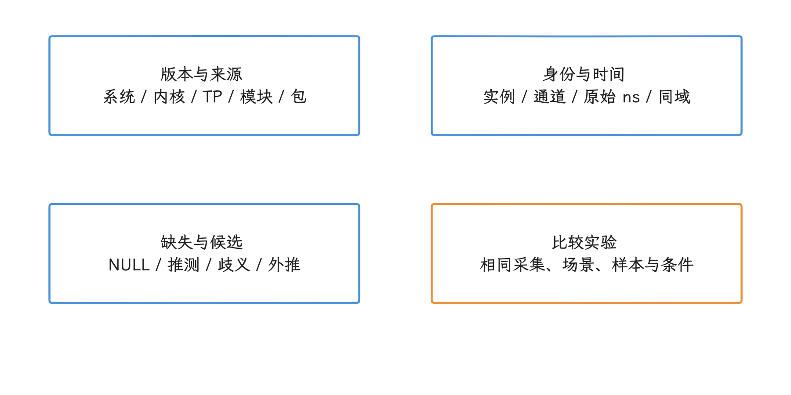

图：版本、数据语义、关联质量与实验条件共同决定结论是否可复查。 升级系统或工具后重核公开列、时钟与连接，合成验证不代表设备性能。

## 参考资料

- [Android 17 EventHub 事件时间域](https://android.googlesource.com/platform/frameworks/native/+/ae266dcb706d083868578cfedce381ef44488a07/services/inputflinger/reader/EventHub.cpp)
- [Android 17 Reader Trace 包装器](https://android.googlesource.com/platform/frameworks/native/+/ae266dcb706d083868578cfedce381ef44488a07/services/inputflinger/InputListener.cpp)
- [Android 17 Trace 时间转换实现](https://android.googlesource.com/platform/external/perfetto/+/ece66975738007dd0978b911d8a2077e49b8f31e/src/trace_processor/perfetto_sql/intrinsics/functions/clock_functions.h)
- [Android 17 标准启动与进程映射](https://android.googlesource.com/platform/external/perfetto/+/ece66975738007dd0978b911d8a2077e49b8f31e/src/trace_processor/perfetto_sql/stdlib/android/startup/startups.sql)
- [Android 17 原始输入规则与时间戳后端](https://android.googlesource.com/platform/frameworks/native/+/ae266dcb706d083868578cfedce381ef44488a07/services/inputflinger/trace/InputTracingPerfettoBackend.cpp)

- [PerfettoSQL 标准库：`android.input`](https://perfetto.dev/docs/analysis/stdlib-docs#android-input)
- [PerfettoSQL 语法与模块引入](https://perfetto.dev/docs/analysis/perfetto-sql-syntax)
- [Perfetto `Batch Trace Processor`](https://perfetto.dev/docs/analysis/batch-trace-processor)
- [Perfetto `TraceConfig` 协议参考](https://perfetto.dev/docs/reference/trace-config-proto#AndroidInputEventConfig)
- [Android 17 `android/input.sql`](https://android.googlesource.com/platform/external/perfetto/+/ece66975738007dd0978b911d8a2077e49b8f31e/src/trace_processor/perfetto_sql/stdlib/android/input.sql)
- [Android 17 `android/anrs.sql`](https://android.googlesource.com/platform/external/perfetto/+/ece66975738007dd0978b911d8a2077e49b8f31e/src/trace_processor/perfetto_sql/stdlib/android/anrs.sql)
- [Android 17 inputevent 配置协议](https://android.googlesource.com/platform/external/perfetto/+/ece66975738007dd0978b911d8a2077e49b8f31e/protos/perfetto/config/android/android_input_event_config.proto)
- [Android 17 inputevent `Trace Processor` 解析器](https://android.googlesource.com/platform/external/perfetto/+/ece66975738007dd0978b911d8a2077e49b8f31e/src/trace_processor/importers/proto/winscope/android_input_event_parser.cc)
- [Android 17 `InputDispatcher.cpp`](https://android.googlesource.com/platform/frameworks/native/+/ae266dcb706d083868578cfedce381ef44488a07/services/inputflinger/dispatcher/InputDispatcher.cpp)
- [Android 17 通用内核 6.18 锚点](https://android.googlesource.com/kernel/common/+/refs/tags/android17-6.18-2026-06_r6)
- §3.2 触摸延迟、预测与低延迟渲染
- §9.2 ANR 分析方法
- §14.2 Perfetto View 解读
- §14.7 Perfetto SQL 性能分析实战手册
