# Android Tracing 基础设施与自定义 Trace

Perfetto 界面里的调度 Slice（时间轴事件区间）、应用自定义区间和计数器来自多条采集路径。某条轨道没有数据时，只查 SQL 往往定位不到原因：事件可能没有通过 tracefs（Linux 内核追踪控制文件系统）启用，也可能已经写入内核缓冲区却来不及读取，还可能在 Perfetto 的共享内存或中央缓冲区中丢失。

<!-- gracker-diagram: ch14-06-01-visibility-layers -->
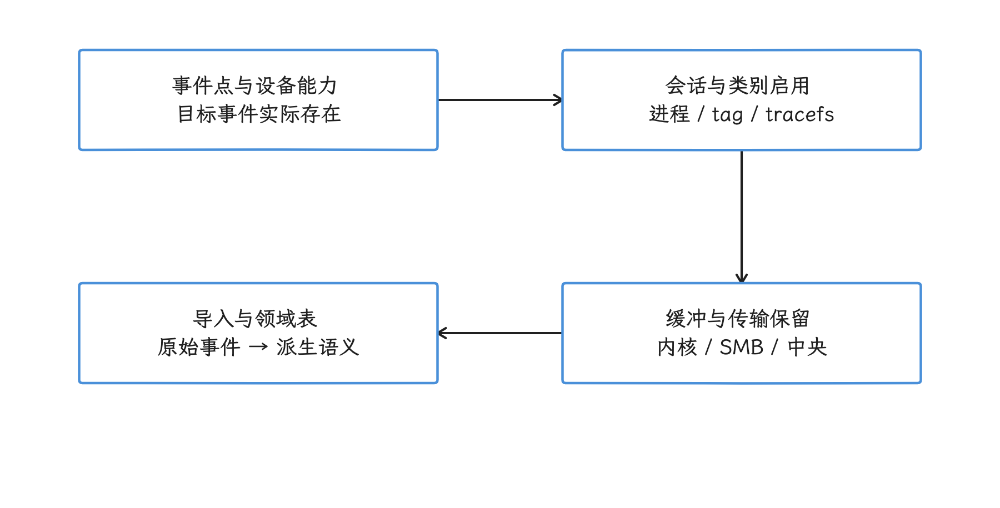

图：把事件存在、配置启用、传输保留与解析派生分层核对。 SQL 无结果不能独立区分采集缺失、覆盖或尚无领域解析。

> 源码基线：Android 17 / API 37 / AOSP `android-17.0.0_r1`；内核 `android17-6.18-2026-06_r6`。

这些现象分属不同的层，我们沿数据路径把它们拆开看：先走一遍内核 ftrace、atrace category 和 Perfetto 服务，再落到应用侧的 `android.os.Trace` 埋点，最后给出按层排查的做法。应用的 Trace 标记最终也会进入同一套基础设施，类别启用、进程权限和缓冲区配置都会影响它在时间线上的可见性。

## ftrace、atrace 与 Perfetto 采集路径

### 三层缓冲区

排查丢数时，我们先要分清“缓冲区”指的到底是哪一层：系统追踪里叫这个名字的地方至少有三处，混用名称会把丢数原因引向错误位置。一次采集里，数据由 Producer（数据生产者）生成，经共享内存提交给 `traced`，最终进入 Consumer（数据使用方）读取的中央缓冲区。下面这三层按数据流方向排列。

| 所在层 | 数据结构 | 写入者与读取者 | 常见丢数表现 |
|---|---|---|---|
| Linux 内核 | ftrace 的每 CPU 环形缓冲区 | tracepoint 或 `trace_marker` 写入，`traced_probes` 读取 | `ftrace_cpu_overrun_delta` 非零 |
| Perfetto 数据生产者 | 数据生产者（`Producer`）与 `traced` 之间的共享内存 | `traced_probes`、应用 SDK 等数据生产者写入，`traced` 接收提交 | `traced_buf_trace_writer_packet_loss` 非零 |
| Perfetto 服务 | `TraceConfig.buffers` 定义的中央缓冲区 | `traced` 汇集各数据源，数据使用方（`Consumer`）读取或写文件 | `traced_buf_chunks_overwritten` 或 `traced_buf_chunks_discarded` 非零 |

采用覆盖策略的环形缓冲区写满后会覆盖最早数据；常规采集配置直接控制第一层和第三层；第二层也能由 Producer 初始化参数调节，例如 SDK 的 `TracingInitArgs.shmem_size_hint_kb`。固定 Android 17 平台内部初始化还将共享内存提示设为 1024 KiB。它是生产者级参数，不等于中央缓冲区大小，也不由每份 ftrace 配置独立控制。`ftrace_config.buffer_size_kb` 管第一层，单位是“每个 CPU 的 KiB”；KiB 是 1024 字节。`TraceConfig.buffers.size_kb` 管第三层。两个参数名字相近，控制的内存和失效方式却完全不同，丢数时先按上表确定所在层，再决定动哪个。Perfetto 的[缓冲区说明](https://perfetto.dev/docs/concepts/buffers)给出了三类丢数统计及其语义。

<!-- gracker-diagram: ch14-06-02-buffer-controls -->
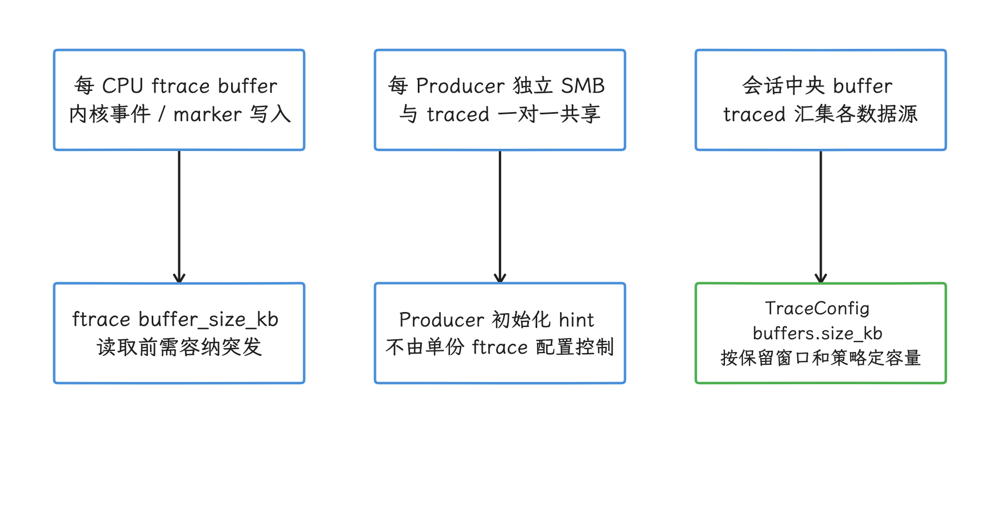

图：ftrace 的每 CPU 缓冲、Producer SMB 和会话中央缓冲分别配置。 平台 native helper 的 SMB hint 是 1024 KiB，不能当成所有 Producer 实际分配值。

### ftrace：事件源与函数 tracer

我们再从内核这层看起。ftrace 是 Linux 内核内置的可配置追踪框架，包含事件追踪、函数追踪、环形缓冲区和 tracefs 控制接口；“函数追踪器”只是其中一部分，Android 性能分析最常用的是事件追踪，也就是 tracepoint 路径。

#### “三种模式”的准确边界

tracer 是由 `current_tracer` 选择的一套记录算法，tracepoint 则是内核源码预先声明的静态事件点。许多教程把 `function`、`function_graph`、tracepoint 称作 ftrace 的三种模式。这个说法便于入门，但内核接口的分类更精确：

- `function` 是写入 `current_tracer` 的 tracer，记录经过筛选的函数入口。动态 ftrace 会在未启用时把可追踪调用点修补成低开销快速路径；具体机器指令和编译选项取决于 CPU 体系结构及内核构建配置。
- `function_graph` 也是 tracer。它在函数入口之外记录返回关系，因而能还原调用层级和耗时。过滤范围过宽时，事件量和对被测系统的扰动都会快速上升。
- tracepoint 属于事件源。启用 `sched/sched_switch` 等事件时，`current_tracer` 通常仍是 `nop`；`nop` 表示不启用函数 tracer，tracepoint 继续由 `events/<group>/<name>/enable` 独立控制。

因此“三种模式”指三种常见观测形态；tracepoint 在 `current_tracer` 之外，由独立的事件开关控制。日常系统性能采集我们优先选静态 tracepoint；函数 tracer 留给已经缩小到明确函数集合之后的内核调试。内核锚点的 [`ftrace.rst`](https://android.googlesource.com/kernel/common/+/refs/tags/android17-6.18-2026-06_r6/Documentation/trace/ftrace.rst)记录了 tracer、动态 ftrace 和过滤接口的定义。

<!-- gracker-diagram: ch14-06-03-tracer-event-source -->
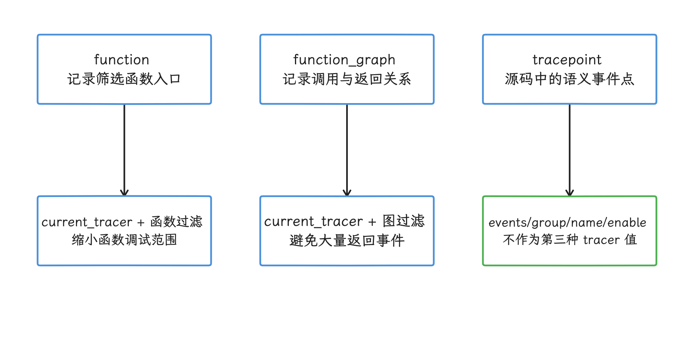

图：current_tracer 选择函数追踪器，事件开关控制 tracepoint。 current_tracer 为 nop 时，已启用的 tracepoint 仍可记录。

tracepoint 通过 `TRACE_EVENT` 等宏在源码中声明字段。未启用时使用静态分支快速路径；在启用 jump label 且体系结构支持的构建中，关闭路径可被修补为 NOP（空操作指令），不等于每次都执行一次普通条件判断。无 jump label 的回退、调用点参数求值和具体机器指令仍取决于构建，不能承诺统一的零开销。启用后还要分配事件、复制字段并写入当前 CPU 的环形缓冲区，实际成本由事件频率、字段长度和读取方速度共同决定。

<!-- gracker-diagram: ch14-06-04-disabled-fastpath -->
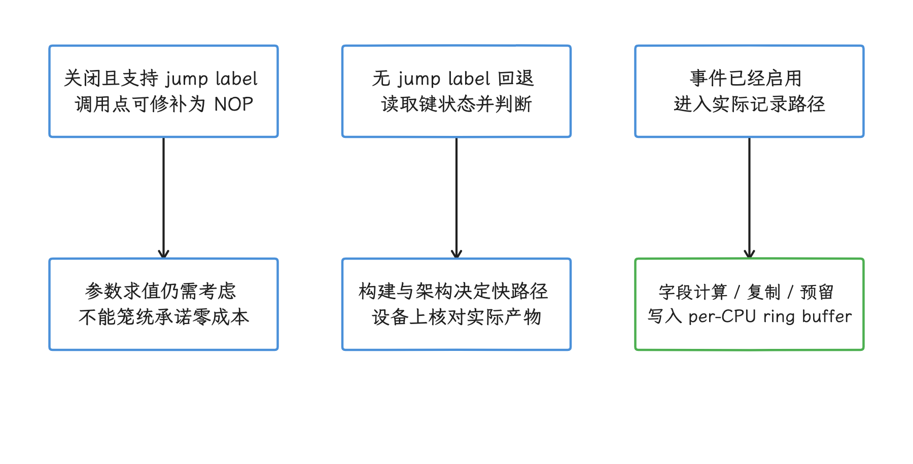

图：关闭路径使用静态分支，开启后才记录字段并写入当前 CPU 缓冲。 NOP 快速路径依赖架构与 jump label 配置，不能给固定条件判断次数。

#### tracefs 暴露了哪些控制点

设备通常把 tracefs 挂载在 `/sys/kernel/tracing/`；`/sys/kernel/debug/tracing/` 是旧 debugfs（内核调试文件系统）布局下的兼容回退位置，libcutils 仍会尝试它。排查采集问题时，下面这些节点最有用：

| tracefs 节点 | 含义 |
|---|---|
| `available_events` | 当前内核及已加载模块实际注册的事件 |
| `events/<group>/<name>/format` | 事件编号、字段布局和文本打印格式 |
| `events/<group>/<name>/enable` | 单事件启停开关 |
| `set_event` | 批量启停事件的兼容接口 |
| `available_tracers` / `current_tracer` | 可用 tracer 与当前 tracer |
| `set_ftrace_filter` / `set_graph_function` | 函数与函数图过滤范围 |
| `buffer_size_kb` | 每 CPU 内核环形缓冲区大小 |
| `per_cpu/cpu<N>/trace_pipe_raw` | 单 CPU 二进制事件流 |
| `per_cpu/cpu<N>/stats` | 单 CPU 缓冲区覆盖、丢弃和读取统计 |
| `tracing_on` | 当前 tracefs 实例是否记录事件 |

Perfetto 的 [`Tracefs::EnableEvent()`](https://android.googlesource.com/platform/external/perfetto/+/refs/tags/android-17.0.0_r1/src/traced/probes/ftrace/tracefs.cc)启用事件时先向单事件 `enable` 文件写 `1`，写入失败后才把 `group:name` 追加到 `set_event`；停用过程对称，回退内容是 `!group:name`。核对 `set_event` 内容时按这个顺序判断——“Perfetto 会把每个事件写入 `set_event`”的说法与当前源码对不上。

<!-- gracker-diagram: ch14-06-05-tracefs-enable-fallback -->
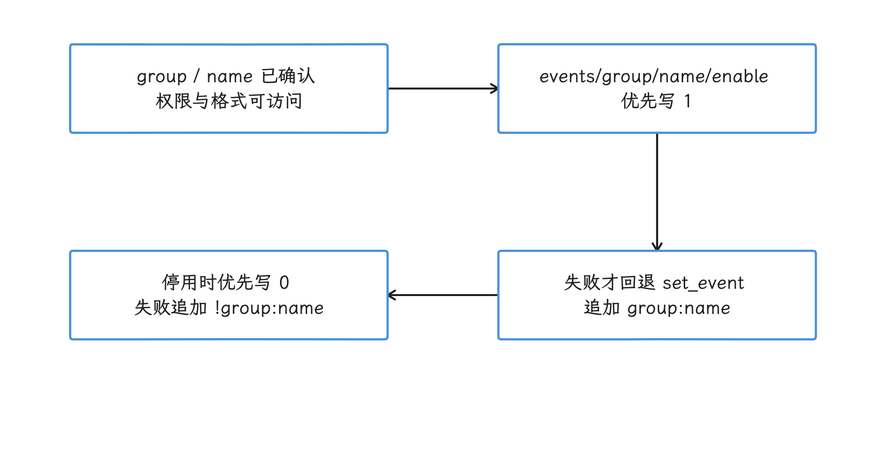

图：优先写 events 下的单事件 enable，失败时再追加 set_event。 停用对称使用 0 或 !group:name；并非每次都会写 set_event。

tracefs 还支持 `instances/<name>/` 下的命名实例；每个实例拥有自己的事件开关和缓冲区等状态。Perfetto 的 `FtraceController` 可以按 `FtraceConfig.instance_name` 创建并读取次级实例。次级实例可以隔离一部分内核追踪状态，但不能承载 Android atrace 配置：固定 `FtraceConfigMuxer` 会直接拒绝次级实例中的 `atrace_categories` 或 `atrace_apps` 请求，因为它们会影响全局状态。需要这些用户空间事件时，必须使用受支持的主实例配置。

<!-- gracker-diagram: ch14-06-06-secondary-instance -->
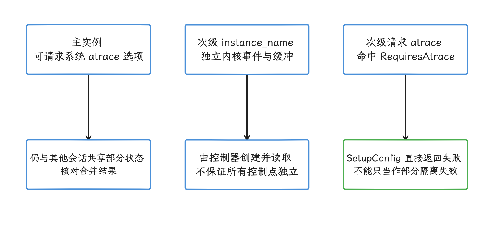

图：次级实例可分离内核状态，含 atrace 选项的请求会被固定实现拒绝。 atrace_categories 与 atrace_apps 影响全局状态，不能靠 instance_name 隔离。

#### 常用事件与设备差异

查事件名时以设备的 `available_events` 为准：GKI（Generic Kernel Image，Android 通用内核镜像）、厂商内核配置和驱动实现都会改变可用集合。

| 分析对象 | Android 17 锚点中的代表事件 | 说明 |
|---|---|---|
| CPU 调度 | `sched/sched_switch`、`sched/sched_waking`、`sched/sched_wakeup`、`sched/sched_wakeup_new` | 生成 `sched`、`thread_state` 等派生数据 |
| CPU 频率与空闲 | `power/cpu_frequency`、`power/cpu_idle`、可选的 `power/cpu_frequency_limits` | 频率限制事件是否存在仍需查设备 |
| Binder | `binder/binder_transaction`、`binder/binder_transaction_received`、`binder/binder_set_priority` | Binder 是 Android 进程间通信机制；Android 17 的追踪头文件没有旧资料常列的全局 `binder_lock` 事件 |
| 存储 | `block/*`、`f2fs/*`、`ext4/*` 中设备支持的事件 | 不同内核版本的 block 事件集合变化较多 |
| 中断 | `irq/*`、`ipi/*` | 高频事件应按问题范围选择 |
| 厂商驱动 | GPU、显示、UFS 等驱动自定义组 | UFS 是移动设备常用闪存接口；不能把某款设备的事件名写成 Android 通用接口 |

Binder 事件可以直接对照内核锚点的 [`drivers/android/binder_trace.h`](https://android.googlesource.com/kernel/common/+/refs/tags/android17-6.18-2026-06_r6/drivers/android/binder_trace.h)，atrace 的事件组合则对照平台锚点的 [`cmds/atrace/atrace.cpp`](https://android.googlesource.com/platform/frameworks/native/+/refs/tags/android-17.0.0_r1/cmds/atrace/atrace.cpp)。

读 Trace 时，Perfetto 会把可识别的高价值事件转换成领域表：调度事件参与构造 `sched` 和 `thread_state`，频率事件进入计数器相关表。`ftrace_event` 保留原始事件索引，`arg_set_id` 指向该事件的键值参数集合；我们核对采集、查看尚无专用解析器的事件时用它们。正式分析优先用语义更稳定的派生表。

<!-- gracker-diagram: ch14-06-07-raw-to-domain -->
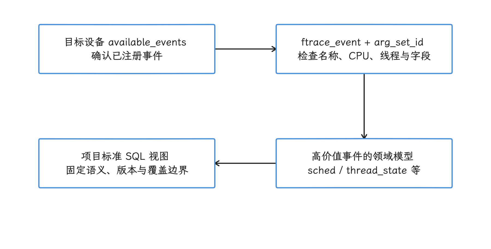

图：先用原始事件和 args 确认采集，再用适合问题的领域表分析。 事件名来自运行时描述，不能用 group_event 拼接猜测。

### atrace category 的构成与选择

看完事件源，再看用户空间这层的开关。`atrace` category 是 Android 定义的一组采集开关；tag 是用户空间事件所属类别的位标记，一个 category 可以控制 tag 位、内核事件，也可以同时控制两者：

- `view`、`wm`、`am` 等 category 主要对应 `ATRACE_TAG_*`；其中 `wm` 和 `am` 分别代表 WindowManager 与 ActivityManager。启用后，相应进程才会写这些用户空间追踪事件。
- `sched` 没有用户空间 tag 位，主要启用一组调度、任务和可选的内存相关 tracepoint。
- `gfx` 启用 `ATRACE_TAG_GRAPHICS`，还可附带 `gpu_mem/gpu_mem_total` 等内核事件。
- `freq` 和 `idle` 是两个独立 category，分别覆盖频率与 CPU idle 事件。
- 厂商可以从 `/vendor/etc/atrace/atrace_categories.txt` 增加设备专用 category 和 sysfs 开关；sysfs 是内核向用户空间暴露设备与驱动属性的虚拟文件系统。

Perfetto 的 `linux.ftrace` 数据源同时提供两种选择方式：

- `ftrace_events` 精确指定 `group/event`，适合已知问题和可复现实验。
- `atrace_categories` 复用 Android category，适合需要用户空间 tag 与配套内核事件的系统分析。

两种方式可以放在同一份配置中。category 展开后，我们要检查 Trace 中的 `unknown_ftrace_events`、`failed_ftrace_events` 和 atrace 错误，前两项分别表示事件名未知和事件启用失败。category 名称存在只说明这组开关被识别；其中每个可选事件在当前设备上是否存在，要看上面的检查结果。

<!-- gracker-diagram: ch14-06-08-category-composition -->
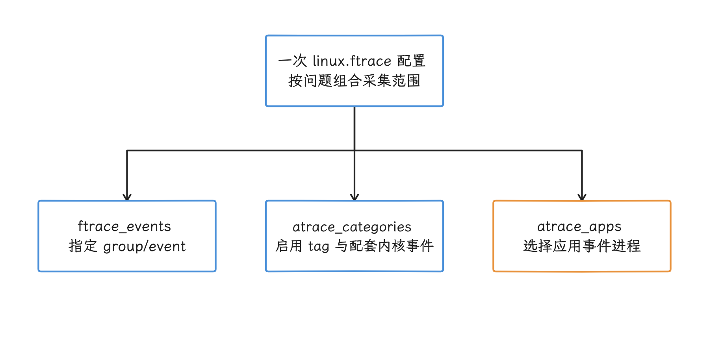

图：精确事件配置与 Android category 可以并用，再核对展开后的实际覆盖。 category 存在不保证其中每个可选事件在目标设备上可用。

### `traced` 与 `traced_probes` 如何协作

再往上看服务层。[`perfetto.rc`](https://android.googlesource.com/platform/external/perfetto/+/refs/tags/android-17.0.0_r1/perfetto.rc)定义了两个独立服务：

- `traced` 提供 Producer 套接字和 Consumer 套接字；套接字是进程间通信端点。它管理会话、中央缓冲区、数据源启停和输出读取。
- `traced_probes` 以受限权限访问 tracefs、`/proc` 等系统接口，注册 `linux.ftrace`、`linux.process_stats` 等数据源。

Perfetto CLI（命令行工具）、Android Studio 或 `TracingManager` 充当 Consumer。它们把 `TraceConfig` 交给 `traced`；`traced` 按数据源名称找到 Producer，再把只属于该数据源的 `DataSourceConfig` 子配置发给它。官方的 [Trace 配置说明](https://perfetto.dev/docs/concepts/config)和 [`traced_probes` 参考](https://perfetto.dev/docs/reference/traced_probes)详细描述了这套协作方式。

<!-- gracker-diagram: ch14-06-09-consumer-control -->
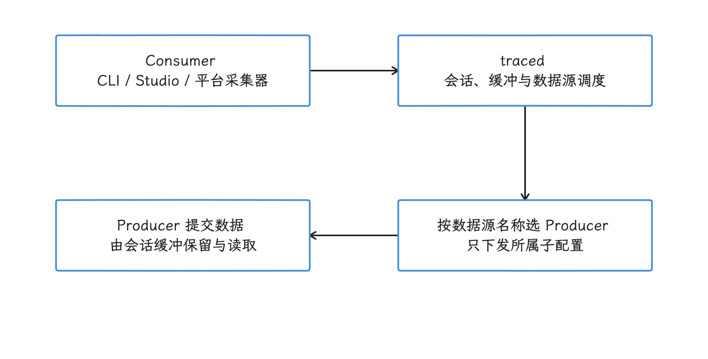

图：Consumer 提交会话配置，traced 分发数据源子配置并汇集 Producer 输出。 traced_probes 提供系统数据源，不能与 traced 服务混为一谈。

#### `linux.ftrace` 的采集过程

落到源码，`linux.ftrace` 的采集步骤可以归纳为：

1. `FtraceConfigMuxer` 合并同一 tracefs 实例上的活跃会话配置，计算事件并集；muxer 是把多路请求合并到共享资源的组件。
2. `Tracefs` 启用事件，配置时钟、缓冲区和受支持的选项。
3. `FtraceController` 为每个 CPU 打开 `per_cpu/cpu<N>/trace_pipe_raw`。
4. `CpuReader` 读取二进制页，按运行时取得的事件格式解码，并写成 Perfetto protobuf（按预定义字段编码的结构化消息）数据包。
5. `traced_probes` 通过 Producer 共享内存向 `traced` 提交数据包。
6. 会话退出时，muxer 只停用已不再被任何会话需要的事件；全部配置移除后才清理该实例的公共状态。

<!-- gracker-diagram: ch14-06-10-ftrace-pipeline -->
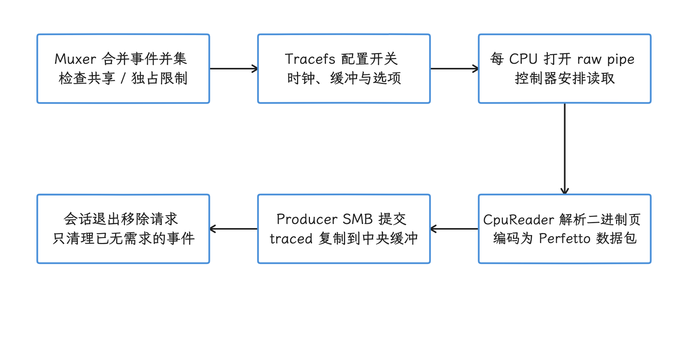

图：Muxer 合并请求，Tracefs 控制内核，控制器和 CpuReader 按 CPU 读取编码。 线程读取与共享服务调度会影响丢数；页面读取量不等于业务 CPU 时间。

多个会话并发采集时会共享部分 tracefs 状态，若干参数因此由共享状态决定，单个配置说了不算：`buffer_size_kb` 和 `drain_period_ms` 的 protobuf 注释都明确写着并发时不保证请求值。函数图还会修改 `current_tracer`，存在并发配置不兼容时，Perfetto 会拒绝启用或要求独占会话。

<!-- gracker-diagram: ch14-06-11-concurrent-requests -->
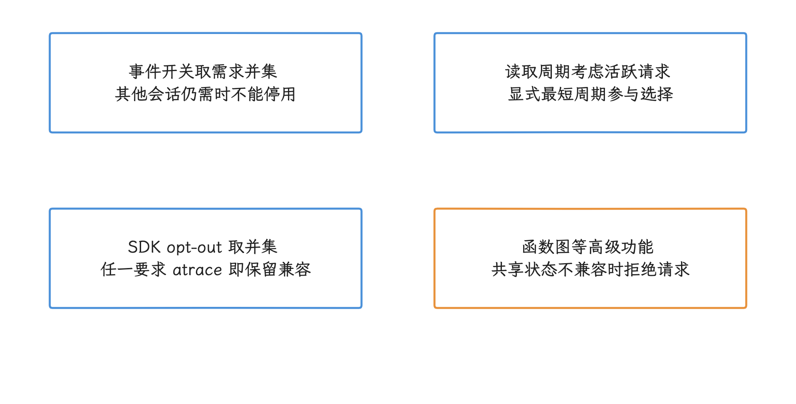

图：事件、应用类别与 SDK opt-out 都需结合活跃会话解释。 单份配置不能保证最终 buffer、读取周期或 SDK 偏好；高级功能可能要求独占。

#### 一份示例采集配置

看一份具体配置。下面的例子只演示字段归属和一组常见事件，时长和中央缓冲区大小都按实际问题另定；`ftrace_config.buffer_size_kb` 与 `drain_period_ms` 故意留空，交给 Perfetto 选默认值。

```protobuf
duration_ms: 10000

buffers {
  size_kb: 32768
  fill_policy: RING_BUFFER
}

data_sources {
  config {
    name: "linux.ftrace"
    target_buffer: 0
    ftrace_config {
      ftrace_events: "sched/sched_switch"
      ftrace_events: "sched/sched_waking"
      ftrace_events: "power/cpu_frequency"
      ftrace_events: "power/cpu_idle"

      atrace_categories: "gfx"
      atrace_categories: "view"
      atrace_apps: "com.example.app"
    }
  }
}
```

`RING_BUFFER` 表示中央缓冲区写满后覆盖最早的数据；这里的 32768 KiB 是 Perfetto 中央缓冲区，10 秒是示例采集窗口，真实值应由事件速率、复现窗口、设备内存和丢数统计共同决定。配置里列出的可选事件若在目标设备的 `available_events` 中找不到，就从配置中删掉。

内核缓冲区的默认大小由设备内存决定：`FtraceConfigMuxer` 在调用方未指定时，物理内存低于约 7 GiB 的设备选每 CPU 2 MiB，达到或高于该阈值选每 CPU 8 MiB；MiB 与 GiB 均按 1024 进位，1 GiB 等于 1024 MiB。这是当前源码里的默认分支，具体设备仍以实测为准。

<!-- gracker-diagram: ch14-06-12-buffer-defaults -->
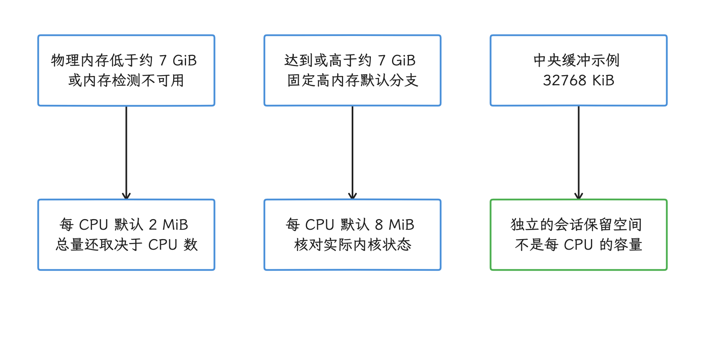

图：固定 Muxer 以约 7 GiB 物理内存为分界，选择每 CPU 2 或 8 MiB 默认值。 这是未显式请求时的固定实现分支，不能作为跨设备容量预算。

`drain_period_ms` 控制定时读取内核缓冲区的间隔。未设置时控制器使用 100 ms 历史周期；所有实例都使用缓冲区水位轮询时，保底周期放宽到 1000 ms——水位轮询在缓冲区达到指定占用比例时唤醒读取，内核 6.18 已支持它依赖的 6.9+ 接口，常规配置保持未设置即可。

<!-- gracker-diagram: ch14-06-13-drain-watermark -->
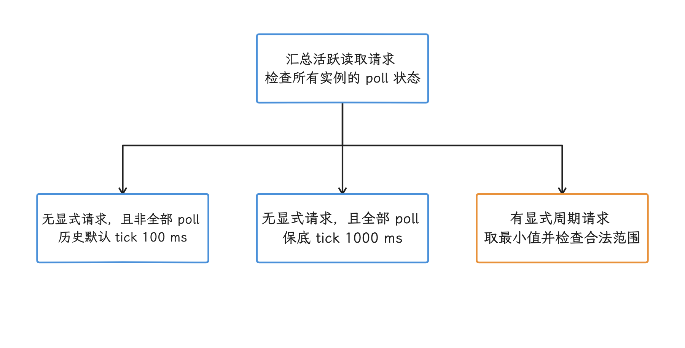

图：显式活跃请求参与最短周期选择，未请求时按水位轮询覆盖决定默认周期。 100 / 1000 ms 是控制器默认分支，实际唤醒与读完时刻不由它独立保证。

### 用户空间事件的两条路径

用户空间事件如今有两条路可走。较早版本的 `android.os.Trace` 通过 `trace_marker` 写入内核 ftrace，这条描述只适用于那些实现；TrackEvent 是 Perfetto 原生的结构化事件数据包，先写内核 ftrace 这一步可以省掉。当前的 Java Framework 路径已经能在 TrackEvent 与 atrace 兼容路径之间选择。

#### `android.os.Trace` 的当前路径

[`android_os_Trace.cpp`](https://android.googlesource.com/platform/frameworks/base/+/refs/tags/android-17.0.0_r1/core/jni/android_os_Trace.cpp)把 `nativeTraceBegin()`、`nativeTraceEnd()`、异步事件和计数器转交给 `tracing_perfetto::*`；[`tracing_perfetto.cpp`](https://android.googlesource.com/platform/frameworks/native/+/refs/tags/android-17.0.0_r1/libs/tracing_perfetto/tracing_perfetto.cpp)再按 category 状态选择路径：

- atrace tag 未启用、对应 Perfetto category 已启用：写 Perfetto TrackEvent。
- atrace tag 已启用、Perfetto category 未启用：调用 `atrace_begin()` 等 libcutils 接口。
- 两边都启用：`debug.atrace.prefer_sdk` 的 category 位决定是否优先走 Perfetto SDK。该属性由 `atrace --prefer_sdk` 配合 Perfetto 的 `atrace_categories_prefer_sdk` 管理，用于处理并发会话的兼容要求，避免同一埋点在两条路径上重复记录。并发配置汇总时，各会话的 SDK opt-out 取并集，任一会话仍要求某类别走 atrace，就不能仅凭另一会话的 `atrace_categories_prefer_sdk` 保证切到 SDK。
- 两边都未启用：调用直接返回，不产生事件。

<!-- gracker-diagram: ch14-06-14-java-backend-selection -->
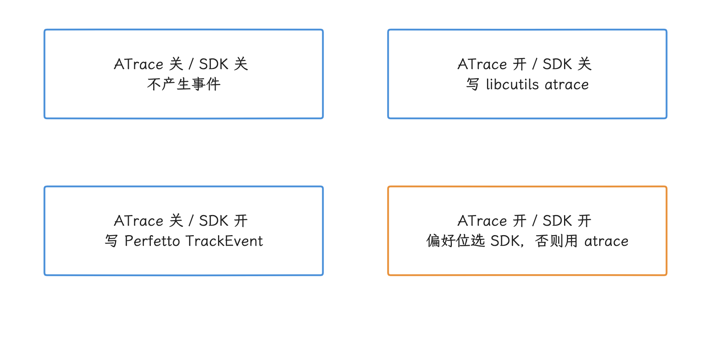

图：支持的单个 category 按 ATrace、SDK 启用状态及偏好位选择一条写入路径。 同一次调用最多写一个 backend；注册、属性缓存与设备传输需另外验证。

这套选择逻辑是逐步演进的：Android 14 及更早分支中的 Java Trace 主要走 libcutils atrace，Android 15 开始接入 `tracing_perfetto`，后续版本补上并发 atrace 会话的优先级处理。分析跨版本 Trace 时，我们把事件的采集路径与目标系统分支对应起来。

#### libcutils `ATRACE_*` 仍写 `trace_marker`

libcutils 是 Android 平台的底层 C 工具库。使用其 `cutils/trace.h` 中经典 `ATRACE_BEGIN()`、`ATRACE_END()`、`ATRACE_INT()` 的 Native C/C++ 代码，仍由 [`trace-dev.cpp`](https://android.googlesource.com/platform/system/core/+/refs/tags/android-17.0.0_r1/libcutils/trace-dev.cpp)打开 `/sys/kernel/tracing/trace_marker`——这是用户空间向 ftrace 写文本事件的入口——打开失败时再尝试 debugfs 路径。

libcutils 生成的常用消息格式如下：

| API | 写入格式 |
|---|---|
| 同步区间开始 | `B\|<pid>\|<name>` |
| 同步区间结束 | `E\|<pid>` |
| 异步区间开始/结束 | `S\|<pid>\|<name>\|<cookie>` / `F\|<pid>\|<name>\|<cookie>` |
| 即时事件 | `I\|<pid>\|<name>` |
| 计数器 | `C\|<pid>\|<name>\|<value>` |

表中的 cookie 是配对异步区间的整数关联 ID。这些字符串进入 ftrace 的 `print` 事件，再由 Perfetto 解析成 Slice、即时事件或计数器。Java JNI 会清理名称中的换行和竖线；经典 libcutils `ATRACE_*` 的 `WRITE_MSG` 不做这项清理，原生调用方应自行避免协议分隔字符。其消息缓冲区容量为 1024 字节，包含前缀、PID、名称、值和字符串终止符，不是名称可占满 1024 字节；应用公开区间 API 还有更短的名称限制。

两条路径汇合后的数据流如下图，其中 Perfetto TrackEvent 这一支不经过内核 ftrace 缓冲区。

```text
内核 tracepoint / libcutils ATRACE / Java atrace 兼容路径
  → 每 CPU ftrace 缓冲区 → traced_probes Producer → 共享内存 A ─┐
                                                            ├→ traced → 中央缓冲区 → Consumer / 文件
Java TrackEvent 路径 → 应用进程的 TrackEvent Producer → 共享内存 B ─┘

Consumer → TraceConfig → traced → 各 Producer 的 DataSourceConfig
```

图中 `traced` 接收 Consumer 的配置并协调 Producer，`traced_probes` 则是提供 `linux.ftrace` 等系统数据源的 Producer，两者职责不同。

<!-- gracker-diagram: ch14-06-15-producer-dataflow -->
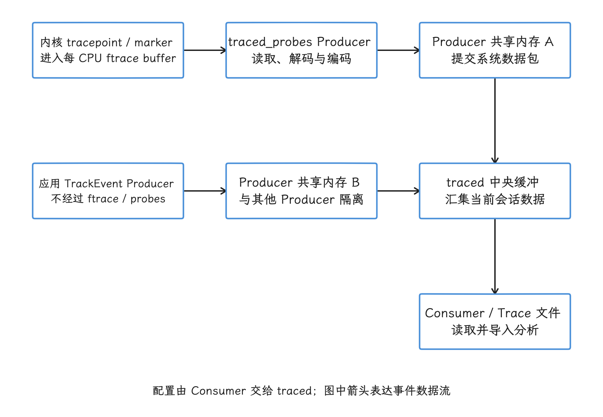

图：内核路径经 traced_probes，应用 TrackEvent 经自己的 Producer 和共享内存。 两条数据路径在 service 汇合，不共享彼此的 Producer SMB。

### App、Framework、内核三层自定义入口

数据路径清楚之后，我们来看在哪里加自己的事件。选入口先看要回答的问题：应用业务区间用 `android.os.Trace` 已经足够；平台原生 C/C++ 热路径用带 category 的 ATRACE；要观察内核状态转换时，才轮到添加 tracepoint。

<!-- gracker-diagram: ch14-06-16-custom-entry-points -->
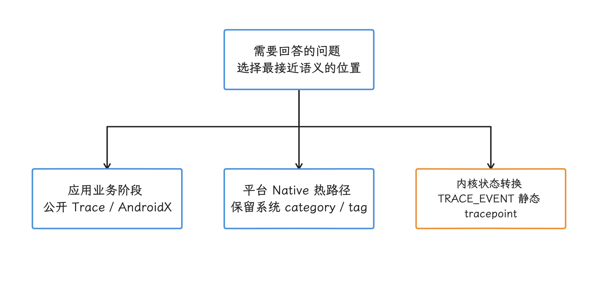

图：按业务任务、平台类别与内核状态转换选择埋点入口。 平台 cutils 宏不是普通应用 NDK 接口；添加 tracepoint 还需构建与权限验证。

#### App：同步区间、异步区间与计数器

下面是应用方法体内的代码，用于标记一次数据库读取。`finally` 保证异常路径也能闭合区间。

```java
Trace.beginSection("UserRepository.load");
try {
    loadUserDataFromDatabase();
} finally {
    Trace.endSection();
}
```

同步区间必须在同一线程正确嵌套；它显示在调用线程自己的轨道上，主线程之外同样适用。API 29 及以上可以用 `beginAsyncSection(name, cookie)` 与 `endAsyncSection(name, cookie)` 表示跨线程工作；同名并发操作需要不同 cookie，并在结束时复用同一个整数 ID。持续数值适合 `setCounter()`；用大量零时长区间去模拟计数器属于误用。

动态拼接区间名称会产生字符串分配，还可能把用户数据写进 Trace；名称构造确有成本时，用 `Trace.isEnabled()` 避免未采集状态下的临时对象。公开 API 的同线程配对、异步 `cookie` 和名称限制可查 [`android.os.Trace`](https://developer.android.com/reference/android/os/Trace)，应用侧 API 的完整用法、命名约束和 PerfettoSQL 读法见后文《应用 Trace API、异步事件与计数器》。

#### Framework 原生层：保留 category 语义

下面是平台函数中的示意节选，省略头文件和类声明。它标记原生函数范围，并在一个较小子区间上补充语义。

```cpp
void RenderEngine::drawLayers() {
    ATRACE_CALL();

    ATRACE_BEGIN("RenderEngine.prepareLayers");
    prepareLayers();
    ATRACE_END();

    submit();
}
```

`ATRACE_CALL()` 通过 RAII（Resource Acquisition Is Initialization，利用对象析构自动清理）在作用域退出时自动闭合；手工 `ATRACE_BEGIN()` / `ATRACE_END()` 要靠自己保证闭合，提前返回和错误分支都得记得补上。平台代码还要在包含 `trace.h` 前选定 `ATRACE_TAG`，让事件归入正确的 category，配置和可见性才会与设计意图一致。

<!-- gracker-diagram: ch14-06-17-balanced-scopes -->
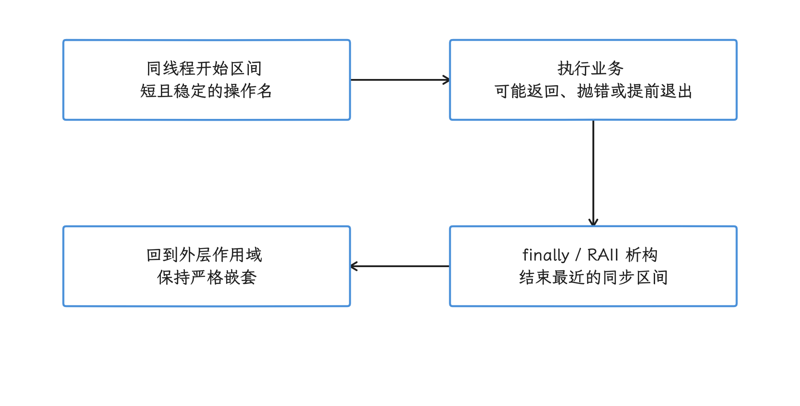

图：同步业务区间按同线程栈配对，异常和提前退出也必须闭合。 RAII 或 finally 只保护当前作用域，不能跨线程转移同步栈。

对极高频路径，区间边界要围住能回答问题的工作单元；把每次循环迭代、每个像素或每个小对象操作都写进系统 Trace，会同时推高目标线程成本和事件带宽。

#### 内核：在 6.18 锚点添加静态 tracepoint

下面的头文件展示内核源码基线上可用的最小声明形式。include guard 是防止头文件在一次编译中被重复展开的预处理保护；`define_trace.h` 必须位于它外面，`__assign_str(name)` 使用 Linux 6.18 的单参数形式。

```c
/* include/trace/events/my_custom.h */
#undef TRACE_SYSTEM
#define TRACE_SYSTEM my_custom

#if !defined(_TRACE_MY_CUSTOM_H) || defined(TRACE_HEADER_MULTI_READ)
#define _TRACE_MY_CUSTOM_H

#include <linux/tracepoint.h>

TRACE_EVENT(my_event,
    TP_PROTO(int value, const char *name),
    TP_ARGS(value, name),
    TP_STRUCT__entry(
        __field(int, value)
        __string(name, name)
    ),
    TP_fast_assign(
        __entry->value = value;
        __assign_str(name);
    ),
    TP_printk("value=%d name=%s",
              __entry->value, __get_str(name))
);

#endif /* _TRACE_MY_CUSTOM_H */

#include <trace/define_trace.h>
```

`__string(name, name)` 声明动态字符串字段并保存源表达式，`__assign_str(name)` 在快速赋值阶段把实际内容复制进事件。旧内核使用过双参数形式，移植代码时按目标分支的 `trace_events.h` 和样例改成 6.18 的单参数写法即可。源码基线中的 [`trace-events-sample.h`](https://android.googlesource.com/kernel/common/+/refs/tags/android17-6.18-2026-06_r6/samples/trace_events/trace-events-sample.h)提供了各字段宏的当前说明。

还需要在唯一一个编译单元（单独编译成一个目标文件的 `.c` / `.cc` 源文件）中实例化定义。下面这段代码只负责生成 tracepoint 符号。

```c
#define CREATE_TRACE_POINTS
#include <trace/events/my_custom.h>
```

业务代码随后调用生成的 helper（辅助函数）。下面的调用会产生 `my_custom:my_event`。

```c
#include <trace/events/my_custom.h>

static void update_state(int value, const char *name)
{
    trace_my_event(value, name);
}
```

编译只是准备步骤：相应内核需已启动，或模块已加载且事件注册成功，随后核对 `events/my_custom/my_event/` 和 `available_events`。模块事件在固定内核的 `MODULE_STATE_COMING` 通知中注册，不需要先触发 `trace_my_event()` 才出现。Perfetto 配置里写斜杠形式 `my_custom/my_event`；还需当前构建允许 `traced_probes` 访问、配置成功启用，再由实际执行到的调用点产生记录。

<!-- gracker-diagram: ch14-06-18-kernel-tracepoint-build -->
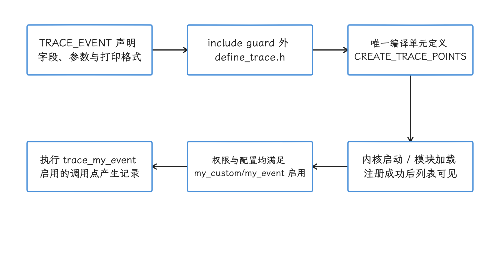

图：声明与构建后先在运行内核注册，确认权限并启用，最后由调用点产生记录。 样例按 6.18 单参数 __assign_str 编写，未声称完成目标内核编译或设备采集。

#### 从 `ftrace_event` 核对自定义事件

新增事件还没有专用 Trace Processor 解析器时，可以先列出原始事件名称。下面的查询也能发现配置名与实际 `ftrace_event.name` 的差异。

```sql
SELECT
  name,
  COUNT(*) AS event_count
FROM ftrace_event
GROUP BY name
ORDER BY event_count DESC;
```

结果中的名称以 Perfetto 实际写入的事件描述为准，靠 `group_event` 之类的拼接规则猜是猜不出来的。确认名称后，再通过 `arg_set_id` 连接 `args` 键值表展开字段；下面的查询保留 CPU、线程和全部参数。

<!-- gracker-diagram: ch14-06-19-generic-event-check -->
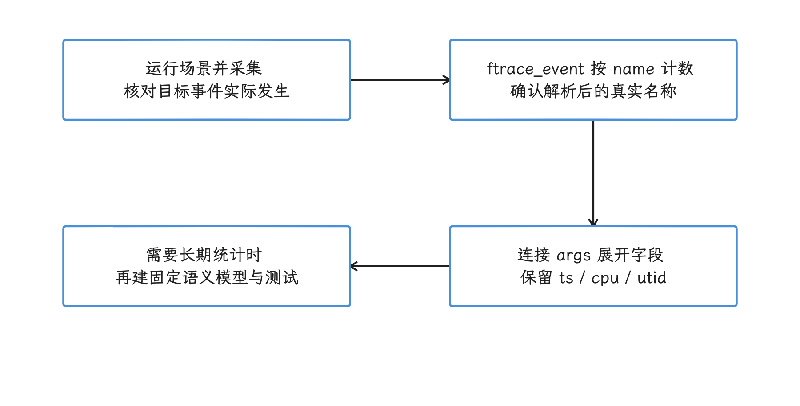

图：先发现实际事件名，再用 arg_set_id 展开原始字段并保留 CPU 与线程。 通用 protobuf 合成样本验证查询，不替代真实 tracepoint 注册和采集验证。

```sql
SELECT
  f.ts,
  f.cpu,
  f.utid,
  f.name,
  a.key,
  a.display_value
FROM ftrace_event AS f
LEFT JOIN args AS a USING (arg_set_id)
WHERE f.name = 'my_event'
ORDER BY f.ts, a.key;
```

若该事件要长期参与统计，就在 Perfetto 中增加专用 protobuf 与解析器，或在项目 SQL 库中封装语义视图。原始表的价值在验证采集；像调度状态、CPU 频率这类已有领域模型的数据，分析时仍用派生表。

### 追踪开销的构成与实测

开销问题我们单独拿出来讲。系统追踪对工作负载的影响由事件命中频率、每条事件的字段量、字符串构造、内核缓冲区写入、Producer 解析和读取周期共同决定；kprobe 观察内核函数，uprobe 观察用户空间函数，eBPF 是在内核受控环境中运行探针逻辑的机制。这些变量逐项不同，一张跨设备通用的纳秒数或百分比表回答不了 `function tracer`、tracepoint 或 uprobe 的真实成本。

| 机制 | 未启用时仍存在的工作 | 启用后的主要新增工作 | 使用建议 |
|---|---|---|---|
| 静态 tracepoint | 静态分支快速路径 | 字段计算、复制、每 CPU 缓冲区写入 | 系统性能采集的常用入口 |
| `function` / `function_graph` | 动态 ftrace 快速路径 | 大量函数事件、返回关系和过滤判断 | 只在可控构建上缩小函数集合 |
| libcutils ATRACE | tag 状态检查 | 名称处理、系统调用写 `trace_marker`、ftrace 记录 | 避开高频细粒度循环 |
| Perfetto TrackEvent | category 状态检查 | 数据包构造、共享内存提交 | 使用 category 与轨道模型控制范围 |
| eBPF kprobe/uprobe | 探针未挂载时无对应程序执行 | BPF 程序、map（内核中的键值数据结构）更新、可选环形缓冲区输出 | 根据命中率和程序内容实测 |

所以开销要实测：同一设备、同一构建、同一温控条件和同一输入脚本，交替运行无采集与有采集样本，这里的 A/B 指关闭与开启追踪的两组对照。比较目标指标之外，还要记录采集进程 CPU、Trace 文件增长速率和丢数统计；只跑一轮，追踪扰动和温度、频率、后台任务造成的波动就分不开了。

<!-- gracker-diagram: ch14-06-20-probe-effect-ab -->
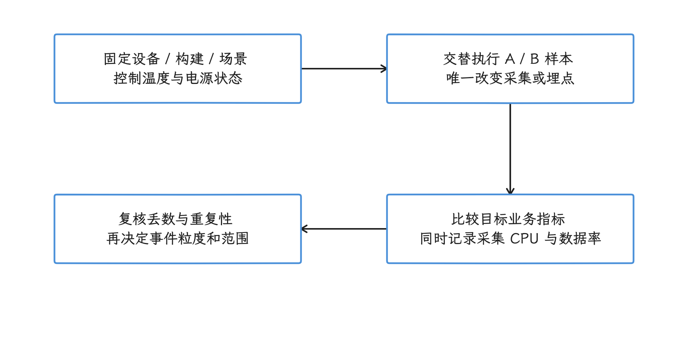

图：交替比较开与关采集，保留业务指标、采集资源、写入速率与丢数。 单轮差异混有温度、频率和后台负载，不能给各机制统一开销表。

### 丢数诊断与配置调整

采集完成后，我们先用一条统一查询检查丢数。`stats` 是 Trace Processor 汇总采集与解析自诊断项的表，新版工具把当前会话内的 ftrace 计数增量放在 `*_delta`；其中 `ftrace_cpu_overrun_delta` 可能仍标为 `info`，只筛 `data_loss` / `error` 会漏掉它，也会漏掉中央缓冲区的 `traced_buf_chunks_overwritten` 和 `traced_buf_chunks_discarded`，它们在固定源码中同为 `info`。因此下面的显式名称列表同时覆盖内核与中央缓冲区；严重等级不是“是否丢数”的完整分类。

```sql
SELECT
  name,
  idx,
  severity,
  source,
  value
FROM stats
WHERE value != 0
  AND (
    severity IN ('data_loss', 'error')
    OR name IN (
      'ftrace_cpu_overrun_delta',
      'ftrace_cpu_commit_overrun_delta',
      'ftrace_cpu_dropped_events_delta',
      'traced_buf_chunks_overwritten',
      'traced_buf_chunks_discarded'
    )
  )
ORDER BY name, idx;
```

查询有结果时，要按统计项所在层处理：

<!-- gracker-diagram: ch14-06-21-loss-diagnostics -->
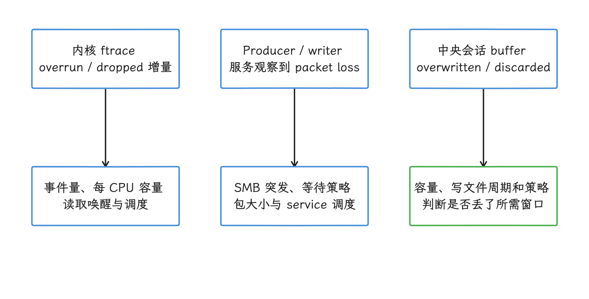

图：内核覆盖、writer 丢包与中央 buffer 覆盖或丢弃分别定位。 severity 不等于丢数分类，中央 overwritten / discarded 在固定源码中为 info。

- `ftrace_cpu_overrun_delta` 非零：内核旧事件在 `traced_probes` 读取前被覆盖。减少高频事件通常比盲目扩容更有效；确认事件集已经精简后，再评估每 CPU `buffer_size_kb` 或读取策略。
- `ftrace_cpu_commit_overrun_delta` 非零：内核记录提交发生异常，需检查缓冲区大小、极端中断负载和内核实现。
- `ftrace_cpu_dropped_events_delta` 非零：关闭覆盖模式后，缓冲区已满导致新事件被拒绝。
- `traced_buf_trace_writer_packet_loss` 非零：Producer 共享内存提交发生丢包，应检查数据生产者是否被阻塞、数据包是否过大及系统调度压力。
- `traced_buf_chunks_overwritten` 非零：中央 `RING_BUFFER` 已回绕并覆盖旧数据。它可能符合“只保留故障前最近窗口”的设计，也可能覆盖了分析所需的开头。
- `traced_buf_chunks_discarded` 非零：采用 `DISCARD` 策略的中央缓冲区已满，后续新数据被丢弃。

`buffer_size_kb`、`drain_period_ms`、`drain_buffer_percent` 调的都是内存占用、读取唤醒次数与丢数风险之间的权衡。每改一个参数，就重跑同一复现并复查 `stats`，用丢数统计确认“文件变大”真的等于“数据完整”。

<!-- gracker-diagram: ch14-06-22-retention-strategies -->
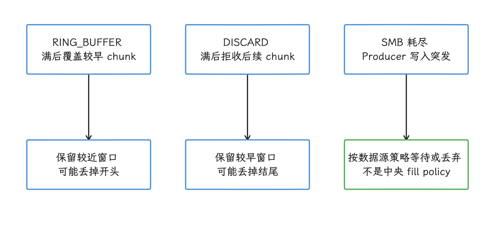

图：先缩小事件量和观测窗口，再根据所需历史选择中央缓冲策略。 中央 RING 回绕可符合设计，仍需确认场景开头和增量状态是否保留。

### 生产环境抓取约束

生产采集要把诊断价值、性能扰动和数据敏感性一起纳入配置。

- 按问题选择事件。调度延迟需要 `sched_switch` 和唤醒事件，未必需要所有 Binder、I/O、IRQ 和驱动事件。
- 采集窗口围绕可识别触发点设置。固定宣称某个秒数适合所有问题没有依据；低频故障可以用长时环形缓冲区配合触发器保留故障前窗口。
- 自定义名称使用稳定、低基数的操作名；低基数表示名称种类有限，不会为每个用户或请求生成新名称。用户输入、URL、账号、消息内容等数据要挡在 Trace 之外。
- 高频路径先计算事件速率，再决定采样、聚合或缩小区间。源码里一行 Trace 调用并不等于一次固定成本。
- 区分 `user` 量产构建、`userdebug` 调试构建和权限更宽的 `eng` 工程构建。函数图、内核符号和部分系统数据源在 `user` 构建上受 SELinux（Android 强制访问控制机制）、系统属性或 Perfetto 保护规则限制。
- 每份性能结论都保留 TraceConfig、设备构建号、内核版本、复现步骤和丢数查询结果。缺少这些信息时，后续很难判断差异来自代码还是采集条件。

### eBPF 与静态 tracepoint 的分工

静态 tracepoint 适合长期保留的内核语义事件。字段布局随内核演进，但事件位置由维护者在源码中选择，通常比函数符号更稳定。eBPF 可以附着到现有 tracepoint，在内核侧过滤或聚合；也可以用 kprobe / uprobe 观察内核 / 用户函数入口，用 kretprobe / uretprobe 观察对应的函数返回。

kprobe 与 uprobe 依赖函数符号、编译器内联（把函数体直接展开到调用点）、优化和二进制版本。平台升级后，探针位置与参数解释必须重新验证。BPF 程序若只在 map 中计数，与每次命中都向用户空间输出事件的成本差异很大。因此，静态 tracepoint、eBPF 聚合和 Perfetto 全量时间线要按问题组合选用，取舍依据是上面这些具体差异，固定开销表给不出答案。§15.16 会继续讨论 Android 动态探针的权限、版本边界和验证方法。

<!-- gracker-diagram: ch14-06-23-ebpf-semantic-choices -->
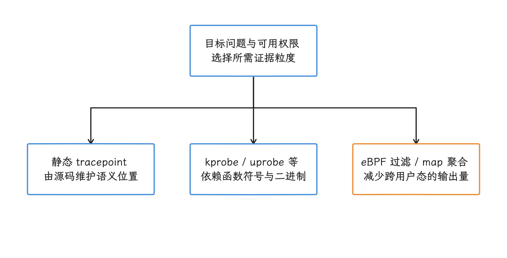

图：按语义稳定性、函数版本依赖和输出带宽组合观测方式。 BPF map 聚合与逐条输出成本不同；tracepoint 与探针位置均非稳定 ABI，升级后重验字段和参数。

### 启动期 Trace

标准 Perfetto 启动期 Trace 由 `perfetto.rc` 中的 `perfetto_trace_on_boot` 服务执行。持久属性是跨重启保留的 Android 系统配置项；该服务会等这类属性可用、`persist.traced.enable=1` 且 `traced` 已监听 Consumer 套接字，然后读取：

- 配置：`/data/misc/perfetto-configs/boottrace.pbtxt`，其中 pbtxt 是文本形式的 protobuf 配置
- 输出：`/data/misc/perfetto-traces/boottrace.perfetto-trace`
- 一次性触发属性：`persist.debug.perfetto.boottrace=1`

在允许 `root`（超级用户权限）的调试设备上，可以用下面的命令准备下一次启动采集。

```bash
adb root
adb push boottrace.pbtxt /data/misc/perfetto-configs/boottrace.pbtxt
adb shell setprop persist.debug.perfetto.boottrace 1
adb reboot

# 设备完成目标启动阶段后执行
adb pull /data/misc/perfetto-traces/boottrace.perfetto-trace
```

该属性会在服务启动时被清空，避免每次重启都重复抓取。服务要等 `/data` 数据分区、持久属性和 `traced` 就绪，这之前的内核和早期用户空间事件它未必都能覆盖；需要更早的窗口时，可以用内核启动参数预先配置 ftrace，再让 Perfetto 通过 `preserve_ftrace_buffer` 保留并读取已有内核缓冲区，也可以使用设备启动链提供的其他早期追踪方案。官方的 [Android boot tracing 案例](https://perfetto.dev/docs/case-studies/android-boot-tracing)给出了配置与触发流程。

<!-- gracker-diagram: ch14-06-24-boot-trace-gates -->
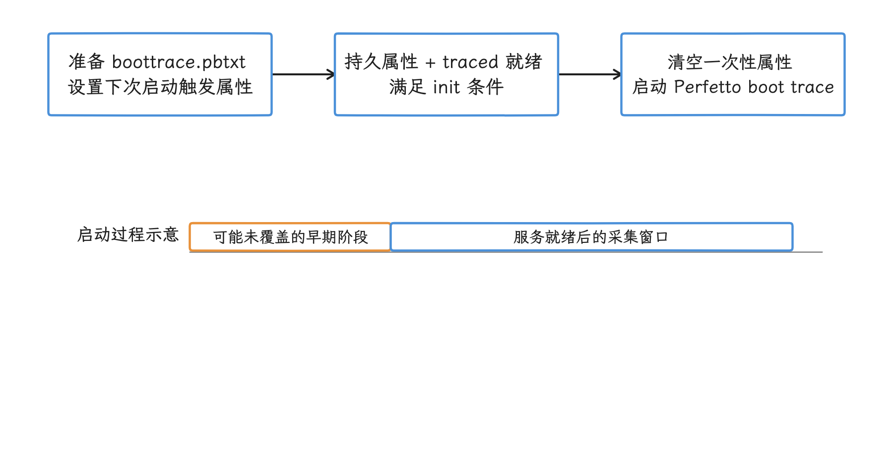

图：配置与一次性属性先准备，待持久属性和 traced 就绪后启动采集。 数据分区与服务就绪之前的阶段可能缺失，preserve 模式不能同时改时钟和缓冲大小。

历史沿革上，旧版本 Android 还存在 atrace boot trace 路径：它以 category 配置内核和用户空间 atrace 状态，输出流程与 Perfetto boot trace 不同。新配置以 `perfetto_trace_on_boot` 为准；阅读历史故障记录时，我们仍要能认出旧路径。

### 排查顺序

遇到“某条轨道没有数据”，按数据路径检查会更快：

1. 在目标设备的 `available_events` 中确认事件存在。
2. 确认配置使用正确的 `group/event`、atrace category 和目标应用名。
3. 检查 Trace 的 `unknown_ftrace_events`、`failed_ftrace_events` 与 atrace 错误。
4. 用 `ftrace_event` 验证原始事件是否进入 Trace，再查看派生表。
5. 运行本页统一的 `stats` 查询；除 `data_loss` 外，也检查手动列出的 `info` / `error` 级 ftrace 增量，定位丢数层。
6. Android 15 及以上的 Java Trace 同时考虑 TrackEvent 与 atrace 兼容路径；经典原生 C/C++ `ATRACE_*` 仍检查 `trace_marker`。
7. 只改动一个采集变量，并用同一复现验证变化。

这套顺序把“事件不存在”“配置没有启用”“采集途中丢失”“解析层没有派生数据”分成四类问题；定位到具体层之后再去调整事件、缓冲区或解析逻辑，每一步结论都有源码和采集证据支撑。

<!-- gracker-diagram: ch14-06-25-missing-data-diagnosis -->
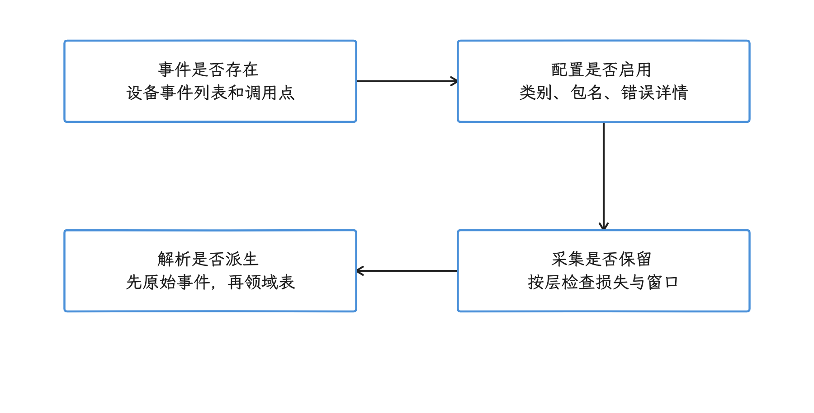

图：依次区分事件未注册、配置未启用、传输丢失和缺少语义派生。 每轮只改变一个采集变量，并保存同一复现场景的覆盖证据。

### ftrace 与 atrace 部分的源码锚点

- Android 17 平台：[`atrace.cpp`](https://android.googlesource.com/platform/frameworks/native/+/refs/tags/android-17.0.0_r1/cmds/atrace/atrace.cpp)、[`android_os_Trace.cpp`](https://android.googlesource.com/platform/frameworks/base/+/refs/tags/android-17.0.0_r1/core/jni/android_os_Trace.cpp)、[`tracing_perfetto.cpp`](https://android.googlesource.com/platform/frameworks/native/+/refs/tags/android-17.0.0_r1/libs/tracing_perfetto/tracing_perfetto.cpp)、[`trace-dev.cpp`](https://android.googlesource.com/platform/system/core/+/refs/tags/android-17.0.0_r1/libcutils/trace-dev.cpp)
- Android 17 Perfetto：[`tracefs.cc`](https://android.googlesource.com/platform/external/perfetto/+/refs/tags/android-17.0.0_r1/src/traced/probes/ftrace/tracefs.cc)、[`ftrace_controller.cc`](https://android.googlesource.com/platform/external/perfetto/+/refs/tags/android-17.0.0_r1/src/traced/probes/ftrace/ftrace_controller.cc)、[`ftrace_config_muxer.cc`](https://android.googlesource.com/platform/external/perfetto/+/refs/tags/android-17.0.0_r1/src/traced/probes/ftrace/ftrace_config_muxer.cc)、[`perfetto.rc`](https://android.googlesource.com/platform/external/perfetto/+/refs/tags/android-17.0.0_r1/perfetto.rc)
- Android 17 内核 6.18：[`ftrace.rst`](https://android.googlesource.com/kernel/common/+/refs/tags/android17-6.18-2026-06_r6/Documentation/trace/ftrace.rst)、[`trace-events-sample.h`](https://android.googlesource.com/kernel/common/+/refs/tags/android17-6.18-2026-06_r6/samples/trace_events/trace-events-sample.h)、[`binder_trace.h`](https://android.googlesource.com/kernel/common/+/refs/tags/android17-6.18-2026-06_r6/drivers/android/binder_trace.h)
- Perfetto 官方文档：[ftrace 采集与解析](https://perfetto.dev/docs/getting-started/ftrace)、[atrace instrumentation](https://perfetto.dev/docs/getting-started/atrace)、[TraceConfig](https://perfetto.dev/docs/reference/trace-config-proto)、[缓冲区与丢数](https://perfetto.dev/docs/concepts/buffers)


## 应用 Trace API、异步事件与计数器

数据路径清楚之后，剩下的问题都在应用和平台代码这一侧：埋点用哪个 API、事件在采集端怎么被识别、名称和生命周期怎么配对。

`android.os.Trace` 给应用代码提供了一组精简的 ATrace 接口。ATrace 是 Android 把应用和系统事件写入系统 trace 的轻量标记机制，能记录三种东西：同步切片（sync slice，同一线程 begin/end 之间的时间区间）、跨线程异步切片（async slice，一项逻辑任务从开始到结束的区间）和数值 Counter（随时间变化的状态值）。抓取系统 trace 时，不同数据源可以使用不同原始时钟。Trace Processor 在具有必要 ClockSnapshot 映射时把事件端点换算到统一的 Trace 时间，随后才能比较业务区间和系统等待。名称或 args 中自行携带的时间戳未必自动换算，不能直接与 `slice.ts` 相减；§14.5 给出了输入事件的具体例子。

埋点只是往代码里插入观测点，本身既不启动采集，也不保存历史；设备上先有一场选中了目标应用的 Perfetto 或系统跟踪会话在运行，事件才会进入 trace。

### 1. 公开 API 与平台私有接口

#### 1.1 第三方应用能调用什么

`android.os.Trace` 的公开 SDK 仍包含下面 6 个方法。这里的 trace tag（跟踪标签）是采集端可单独开关的一类事件；普通应用使用的是 app tag。

| API | 引入版本 | 语义 |
|---|---:|---|
| `beginSection(String)` / `endSection()` | API 18 | 当前线程上的嵌套同步切片 |
| `beginAsyncSection(String, int)` / `endAsyncSection(String, int)` | API 29 | 可跨线程结束的进程内异步切片 |
| `setCounter(String, long)` | API 29 | 进程范围的有符号 64 位数值样本 |
| `isEnabled()` | API 29 | 当前应用 trace tag 是否处于采集状态 |

API 18 只有同步切片。异步切片、Counter 和 `isEnabled()` 都在 API 29 才进入公开 SDK，把它们写成 API 18 能力会让低版本应用在验证或运行阶段失败。

<!-- gracker-diagram: ch14-06-26-public-api-boundaries -->
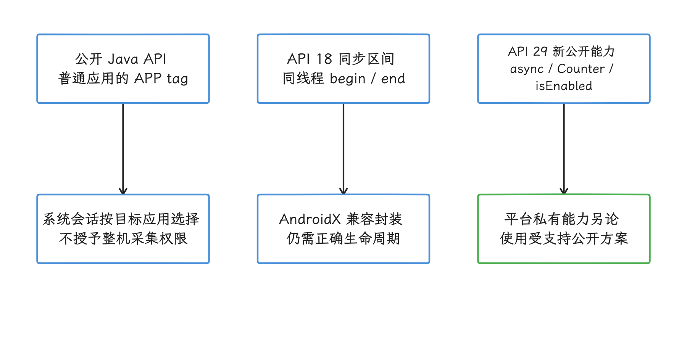

图：平台公开同步区间起于 API 18，异步、Counter 与 isEnabled 起于 API 29。 隐藏 tag / track / instant / 注册接口不能当作普通应用的稳定公开 SDK。

源码中的下列方法不属于普通应用 SDK：

- 带 `traceTag` 参数的 `traceBegin()`、`asyncTraceBegin()` 等重载；
- `asyncTraceForTrackBegin()` / `asyncTraceForTrackEnd()`；
- `instant()` / `instantForTrack()`；
- `registerWithPerfetto()`；
- `setAppTracingAllowed()`。

其中一部分带 `@SystemApi`，另一部分直接标记 `@hide`：`@SystemApi` 面向获准的系统组件，`@hide` 表示它不进入公开 SDK，平台模块、系统应用或 OEM 代码可在相应构建环境中使用。Play 应用想把它们当功能依赖，靠反射或 hidden-API 绕过限制这条路走不通。固定 Android 17 的 `setAppTracingAllowed()` 仍调用 JNI；原来的布尔许可参数已不参与判断，但 native 端会执行 `atrace_update_tags()` 刷新缓存，用于派生进程及时识别追踪状态。因此不能称为完全 no-op，也不能把它当普通应用的业务 trace 开关。AndroidX `forceEnableAppTracing()` 在 API 31 及以上跳过调用，是另一层兼容封装的行为。

#### 1.2 应用工程优先使用 AndroidX

截至 2026-10-25，AndroidX Tracing 的最新稳定版是 2.0.5，发布于 2026-10-21。为了复现经典 AndroidX 封装的系统 ATrace 路径，下面的依赖示例明确固定在 1.3.0；它负责低版本兼容，并提供自动配对 begin/end 的 Kotlin 扩展：

```kotlin
dependencies {
    implementation("androidx.tracing:tracing:1.3.0")
}
```

1.3.0 这组 API 把事件写入系统 trace；`trace` 与 suspend `traceAsync` 的实现已经合入 `tracing`，同版本 `tracing-ktx` 只传递依赖它。已核对发布的 Gradle module 元数据与 Android sources jar，而非只凭包名判断。2.0.0 起，AndroidX Tracing 新增稳定的进程内 Perfetto API，可在进程内缓冲 trace，并支持 flow、metadata（附在事件上的结构化说明）、Coroutine context propagation（协程切换线程时继续携带追踪上下文）和可插拔 sink（接收 trace 数据的输出端）。2.0.5 属于这条稳定线的后续修订。原有的 `android.os.Trace` 与 `trace {}` API 没有弃用，低频系统 trace 事件仍可继续使用，库代码尤其适合保留这条兼容路径。

两套路径的采集方式不同：2.0.x 的进程内 trace 暂时不会自动出现在 Android Studio System Trace 中，要与系统 trace 合并，就走 AndroidX/Benchmark 1.5 支持的采集与事后合并流程。升级时还要分别验证初始化时机、缓冲策略、输出格式和线上开销。

<!-- gracker-diagram: ch14-06-27-androidx-paths -->
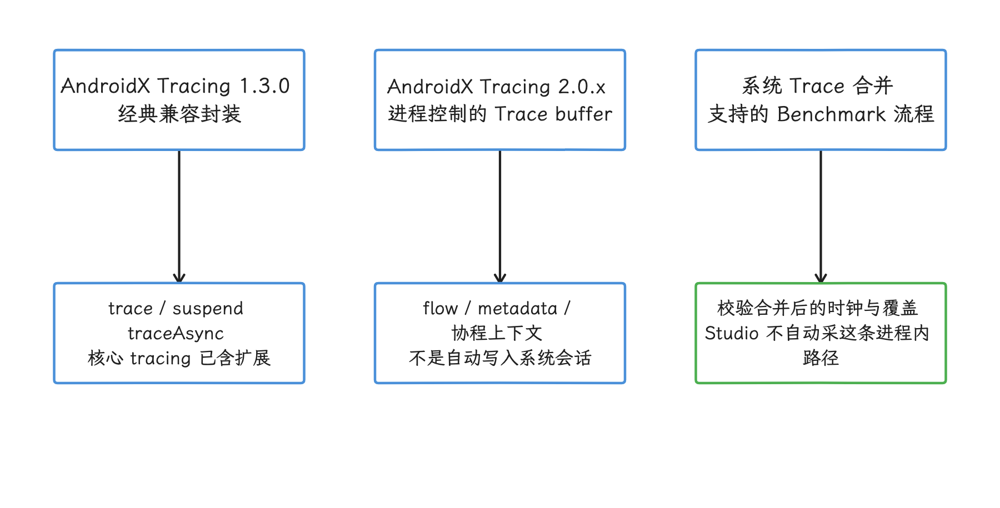

图：固定 1.3.0 复现经典 ATrace，2.0.x 进程内事件需支持的采集与合并流程。 最新稳定版核对为 2.0.5；依赖版本、初始化和输出路径要分别锁定。

### 2. 三类事件分别表达什么

#### 2.1 同步切片：当前线程做了什么

同步切片表示一段严格嵌套、在同一线程开始和结束的执行区间。下面的代码把一次数据库查询标在执行它的线程上：

```kotlin
import androidx.tracing.trace

fun readCachedFeed(): List<FeedItem> =
    trace("FeedRepository.readCache") {
        feedDao.readAll()
    }
```

`trace {}` 用 `try/finally` 保证 `endSection()` 一定执行。切片的 wall duration 是现实时间轴上的总时长，包含运行、被抢占、阻塞和睡眠；CPU time 只统计线程实际占用 CPU 的时间。要区分这些成分，还需在 Perfetto 中结合 `thread_state`、`sched` 和 I/O 数据。

<!-- gracker-diagram: ch14-06-28-sync-wall-cpu -->
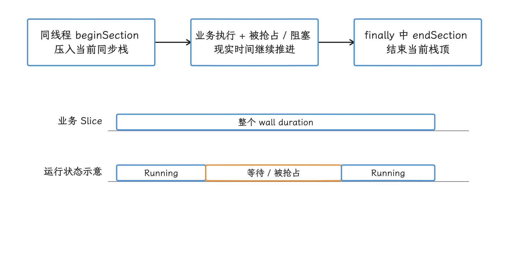

图：同步区间的 ts 与 dur 表示线程时间轴上的跨度，需调度表拆分运行和等待。 Slice wall duration 不等于 CPU time，重叠子区间也不能简单再累加。

同步切片遵守三条硬约束：

- begin/end 必须发生在同一线程；
- 调用必须按栈结构嵌套；
- `endSection()` 结束的是当前线程最近一次尚未结束的 section，它不接收名称。

同步切片要避开可能切换线程的协程挂起点。挂起点是协程暂停并允许底层线程执行其他工作的地方，协程恢复时可能已经换到另一条线程；若它在线程 B 恢复，线程 A 会留下未结束的栈，线程 B 又会结束一个不属于它的切片，后续时间线随之错位。

<!-- gracker-diagram: ch14-06-29-suspend-sync-stack -->
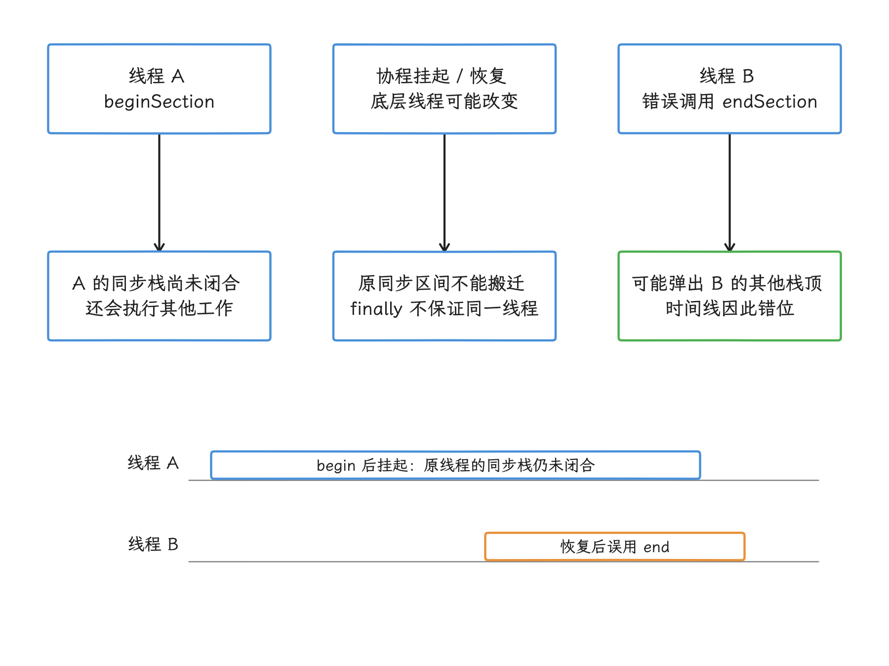

图：同步 section 的配对属于线程栈，恢复到另一线程不能结束原线程的 begin。 整段逻辑任务用异步或挂起感知 API；同步埋点只围住确定不挂起的区间。

#### 2.2 异步切片：一项工作经历了多条线程

异步切片记录逻辑任务的开始到完成，适合队列任务、网络请求、图片加载和协程。下面的示例使用 AndroidX 的 suspend 扩展包住一次请求：

```kotlin
import androidx.tracing.traceAsync
import java.util.concurrent.atomic.AtomicInteger

private val traceCookie = AtomicInteger()

suspend fun loadProfile(userKey: String): Profile {
    val cookie = traceCookie.incrementAndGet()
    return traceAsync("ProfileRepository.load", cookie) {
        profileRepository.load(userKey)
    }
}
```

异步 begin/end 可以位于不同线程，名称和 cookie 必须一致。elapsed time 指从开始到结束经过的时钟时间，切片里可能装着排队、网络等待、锁等待和多次调度；它计量的是逻辑任务的跨度，某一条线程未必持续执行了这么久。

示例中的 AtomicInteger 仅在它由全进程统一 tracing 组件独占分配时成立；不能让不同模块各自从 0 开始，整数回绕时也不能复用仍活跃的 ID。同一个名称下可能同时有多项任务在跑，cookie 就是用来区分它们的整数标识。Perfetto 的 ATrace 文档把所有异步事件的 cookie 视为进程内共享的整数命名空间，即同一进程里各处代码共用一组整数 ID。应用应由一个受控的 tracing 组件统一分配仍在使用的 cookie，任务完成后才允许复用。`name.hashCode()`、固定常量和多个互不协调的计数器都可能在重叠任务中碰撞。

<!-- gracker-diagram: ch14-06-30-async-cookie-lifetime -->
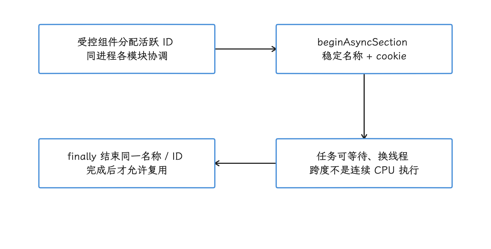

图：同一逻辑任务跨线程时保持名称与 cookie，活跃 ID 在进程内统一管理。 局部计数器不自动全进程唯一，回绕时也不能复用仍活跃的 ID。

公共 `beginAsyncSection()` 会创建进程范围的 async track，即在 Perfetto 时间线上承载逻辑任务区间的一行。多个切片在 UI 中上下排列只表示时间重叠，父子关系和因果关系从这里读不出来。需要 flow（用箭头表示事件间因果关系）、metadata 或可指定名称的 track 时，评估 Perfetto SDK 或 AndroidX Tracing 2.0。

<!-- gracker-diagram: ch14-06-31-async-stacking -->
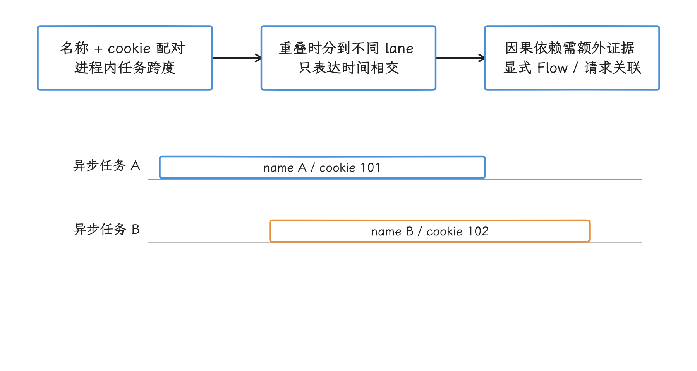

图：UI 通过上下摆放区分重叠异步区间，不自动建立业务因果或父子关系。 公开 ATrace async 没有 flow；跨进程的相同 name/cookie 也不会自动配对。

#### 2.3 Counter：某个状态在这一刻是多少

Counter 适合队列深度、活动连接数、缓存条目数和解码中内存等状态量。下面的代码只在队列深度发生变化时打点：

```kotlin
import androidx.tracing.Trace

fun onDecodeQueueChanged(depth: Int) {
    Trace.setCounter("ImageDecode.queueDepth", depth)
}
```

每次调用写入一个绝对值样本，Perfetto 用相邻样本绘制 Counter Track，也就是一条数值随时间变化的轨道；累加增量、求速率这些工作都留给了应用自己。高频循环应限制写入频率，或只在值变化时写，避免采集开销和 trace 缓冲区压力反过来改变被测行为。

<!-- gracker-diagram: ch14-06-32-counter-absolute-values -->
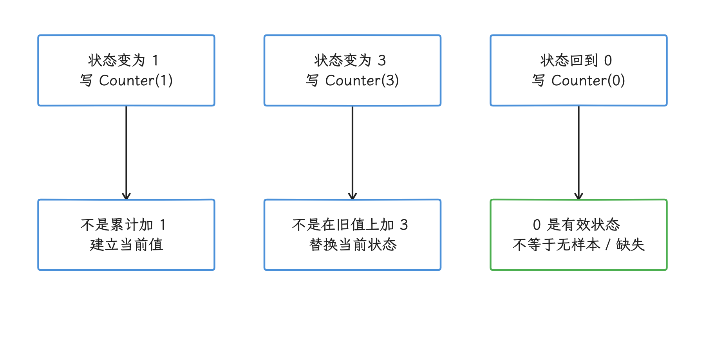

图：队列深度、连接数等状态用 Counter 绝对值记录，变化率和增量由应用另算。 AndroidX 1.3.0 示例使用 Int 兼容封装；高频调用仍会增加事件带宽。

### 3. 名称设计决定后续分析成本

#### 3.1 使用稳定、低 cardinality 名称

cardinality（基数）是一个字段可能出现的不同取值数量。Trace 名称应从一组规模小、相对固定的值中选择，让同一类工作保持同一名称，例如：

- `Startup.loadLocalConfig`
- `FeedRepository.readCache`
- `ImageDecode.decode`
- `Checkout.submit`

用户 ID、完整 URL、搜索词、文件路径和时间戳都要留在名称之外：动态名称会制造大量难以聚合的切片，还可能把个人数据写进可分享的 trace。需要区分少量固定分支时，用有限枚举后缀，如 `ImageDecode.jpeg` 与 `ImageDecode.webp`。

<!-- gracker-diagram: ch14-06-33-stable-names -->
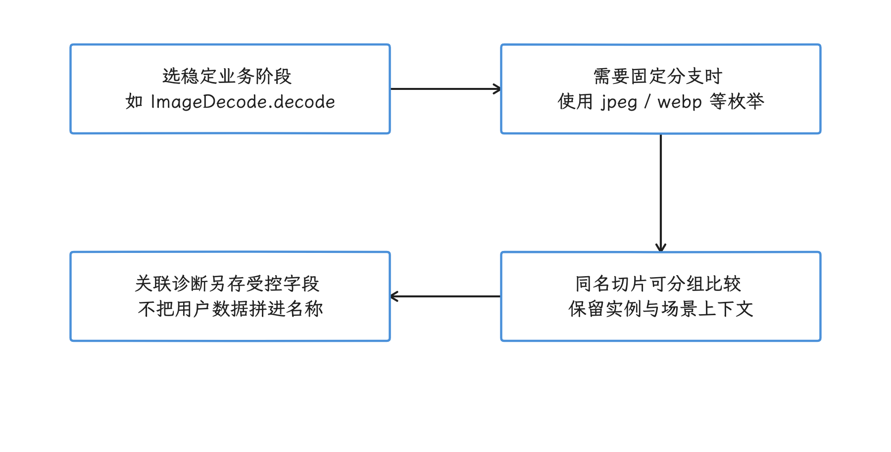

图：同类业务保持稳定操作名，用有限枚举后缀表达少量固定分支。 动态 URL、用户内容和请求唯一值会提高基数并可能泄露敏感数据。

#### 3.2 长度和字符约束

`beginSection()` 的公开约束是最多 127 个 Unicode code unit。这里的 code unit 是 Java UTF-16 字符串中的 16 位编码单元，也是 `String.length()` 计数的基本单位；一个增补平面字符会占两个 code unit，所以 127 这个上限落在编码单元上，可见字符数和字节数都要另行换算。JNI 层会把 `|` 与换行替换为空格，避免破坏 ATrace marker 文本协议。

平台公开异步与 Counter 方法没有与 `beginSection()` 相同的 127 code unit 检查；JNI 和 marker 缓冲仍有截断边界。本文固定的 AndroidX 1.3.0 封装则会把同步、异步和 Counter 标签统一截到 127 个 code unit。长名称截断还可能把不同操作变成相同标签，应主动使用稳定短名称。

<!-- gracker-diagram: ch14-06-34-name-boundaries -->
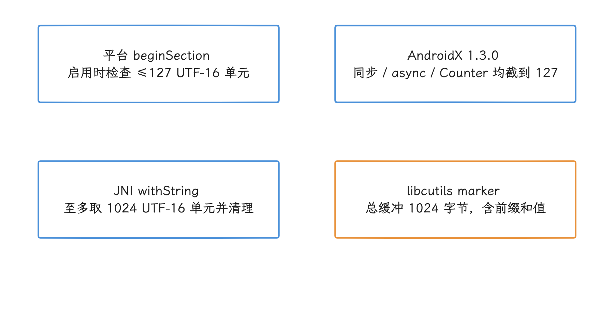

图：平台同步名按 UTF-16 检查 127，AndroidX 1.3.0 统一截标签，JNI 与 marker 另有限制。 不同长度单位不能混算；名称截断还可能把不同标签变成同名。

#### 3.3 延迟构造动态标签

trace 未启用时，API 会跳过事件写入；调用方在入参求值阶段创建的字符串却已经产生。下面的懒标签只会在 trace 活跃时构造：

```kotlin
import androidx.tracing.trace

fun decode(source: EncodedImage): Bitmap =
    trace(lazyLabel = { "ImageDecode/${source.format}" }) {
        decoder.decode(source)
    }
```

这里的 `format` 应来自小型固定枚举。若字段 cardinality 不可控，应改用稳定名称，并在 trace 外的受控诊断数据中保存关联信息。

<!-- gracker-diagram: ch14-06-35-lazy-label-evaluation -->
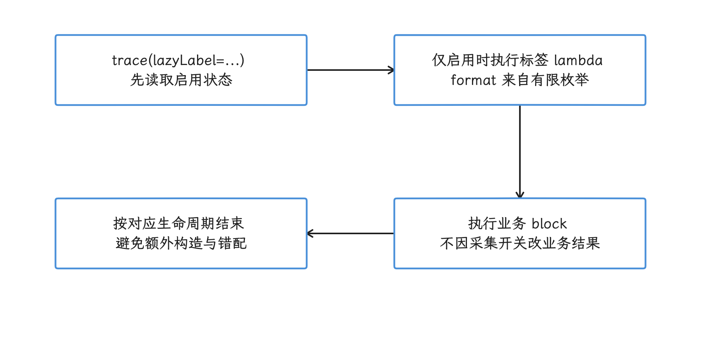

图：先判断启用状态，再构造有限枚举标签，最后用 finally 配对结束。 普通函数入参会先求值；关闭 trace 不能撤销已经发生的字符串分配。

### 4. 源码调用路径

#### 4.1 Java 到 native 代码

以 `Trace.beginSection("Feed.bind")` 为例，从 Java 到 native 的路径如下：

```text
Trace.beginSection()
  -> isTagEnabled(TRACE_TAG_APP)
  -> nativeTraceBegin()
  -> tracing_perfetto::traceBegin()
  -> ATrace backend 或已注册的内部 Perfetto backend
```

`Trace.java` 在调用 JNI 前检查 `TRACE_TAG_APP`。JNI（Java Native Interface）是 Java/ART 与 C/C++ 代码之间的调用桥梁。它的 `withString()` 将 Java 字符串转换为 modified UTF-8（JNI 使用的一种 UTF-8 变体）、清理 marker 协议的分隔字符，再进入 `frameworks/native/libs/tracing_perfetto`。

`tracing_perfetto::traceBegin()` 会根据当前注册和启用状态选择 backend，也就是实际接收和写入事件的实现路径；同一次调用只写进一个 backend，ATrace 与 Perfetto 二选一。`registerWithPerfetto()` 是隐藏的平台初始化入口，第三方应用借它控制这条路径行不通。固定 `Trace.java` 还以 `perfettoSdkTracingV3` 标志控制该入口中的注册动作；不能把“调用了注册方法”当作已开始采集，最终仍取决于实际注册、会话与 category 启用状态。

#### 4.2 ATrace 路径如何启用

选择 ATrace 后，`libcutils` 会在首次使用时打开：

1. `/sys/kernel/tracing/trace_marker`；
2. 失败时回退到 `/sys/kernel/debug/tracing/trace_marker`。

`trace-dev.inc` 缓存 `debug.atrace.tags.enableflags` 对应的 system property 信息，并在每次检查时读取 property serial。serial 用来标识当前属性版本，属性变化时它也会变化；代码只在 serial 改变后刷新 tag。应用选择来自 `debug.atrace.app_number` 与 `debug.atrace.app_N`。tag 状态判断里没有 TLS（thread-local storage，每条线程独立保存的数据）的参与。

<!-- gracker-diagram: ch14-06-36-property-cache -->
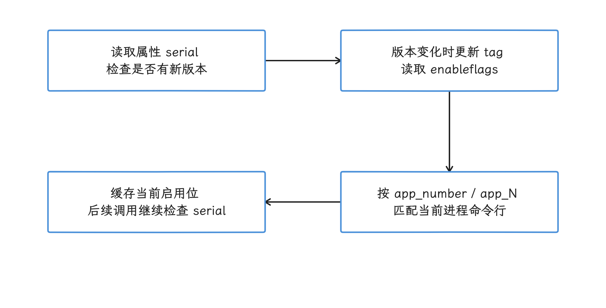

图：检查属性 serial 后才决定刷新 tag，应用选择来自进程命令行匹配。 该路径不使用线程本地 tag 缓存；首次打开 marker 也有初始化成本。

启用后的典型 marker 编码包括：

| 事件 | libcutils 写入前缀 | Trace Processor 结果 |
|---|---|---|
| 同步 begin/end | `B` / `E` | 线程范围的 `slice` |
| 异步 begin/end | `S` / `F` | 进程范围的 `slice` |
| Counter | `C` | `counter` |
| 私有 track/instant API | `G` / `H` / `I` / `N` | 对应 process track 或 instant |

这些字符是 Android 内部 ATrace marker protocol 的事件前缀；应用代码依赖公开 API 和 Trace Processor schema，marker 文本由系统负责拼写。common kernel 的 trace marker 与 ring buffer 实现以 [`android17-6.18-2026-06_r6`](https://android.googlesource.com/kernel/common/+/refs/tags/android17-6.18-2026-06_r6) 为核对基线，量产设备还可能带 OEM 内核改动。

#### 4.3 开销的量级与实测

启用态开销应按实际 backend 测量。经典 ATrace 路径包含名称处理和 `trace_marker` 写入系统调用，Java 路径还包含 JNI；TrackEvent 路径则直接构造并提交数据包，不能套用 marker 写入成本。begin/end 是两个事件，高频短函数容易让埋点开销接近业务工作，跨设备或跨 backend 的单事件固定耗时不能当预算。

trace 关闭时走快速检查，成本低于写入态，但离“零开销”或固定 2–5 ns 还有一段距离——动态标签分配、调用层级、设备 SoC（System on Chip，片上系统）、ART（Android Runtime）编译状态和 backend 都会改变结果。高频路径上的埋点，我们在目标设备上做 A/B 测量：只改变是否启用该埋点，比较两组结果。

### 5. 让事件进入 Perfetto

#### 5.1 TraceConfig

TraceConfig 是 Perfetto 对缓冲区、数据源和采集时长等参数的统一配置。应用 ATrace 事件由 `linux.ftrace` data source 采集；data source 是向 Perfetto 会话提供一类 trace 数据的组件，目标应用包名写在 `atrace_apps`。下面的 pbtxt 片段启用一个应用以及常用调度事件：

```protobuf
buffers {
  size_kb: 65536
  fill_policy: RING_BUFFER
}
data_sources {
  config {
    name: "linux.ftrace"
    ftrace_config {
      atrace_apps: "com.example.reader"
      ftrace_events: "sched/sched_switch"
      ftrace_events: "sched/sched_waking"
    }
  }
}
```

`RING_BUFFER` 表示缓冲区写满后从最旧的数据开始覆盖。`atrace_apps` 控制哪些应用的 `TRACE_TAG_APP` 事件进入会话，`ftrace_events` 则选择内核调度事件。系统服务的 ATrace 类别通过 `atrace_categories` 选择，例如 `am`、`wm`、`view` 或 `aidl`；应用包名选择与系统类别选择负责不同范围。

#### 5.2 命令行采集

Perfetto 官方 `record_android_trace` 脚本适合在开发机复现问题。下面的命令采集目标应用、调度和常用系统类别：

```bash
python3 record_android_trace \
  -o reader.perfetto-trace \
  -t 10s \
  -a com.example.reader \
  sched freq idle am wm
```

命令中的 `-a` 选择应用包名，后面的 `sched freq idle am wm` 选择调度、频率、空闲状态及系统服务类别。采集开始后再执行待分析的用户操作。若启动早期也在分析范围内，应确认数据源已经启动，再执行冷启动；冷启动指应用进程不存在、需要从创建进程开始的启动。Macrobenchmark 是 AndroidX 的性能基准测试框架，它会自动保留每轮测量的 trace，适合把自定义 section 与启动、帧指标放在同一实验中。

系统“开发者选项 > 系统跟踪”也能采集 Perfetto trace，但配置、设备 build、应用版本和操作步骤仍要随报告保存。

#### 5.3 `isEnabled()` 的含义

在固定 Android 17 中，`Trace.isEnabled()` 经 native 查询 `TRACE_TAG_APP` 对应的 ATrace tag 或 Perfetto app category 是否启用，任一路成立就可能返回 true；适合避免构造只供 trace 使用的字符串。它回答的是当前启用状态；至于 trace buffer 还剩多少空间、事件是否完整保留到文件、配置里有没有 sched、Binder 或 FrameTimeline、trace 里能不能记敏感信息，都要另外确认。因此它只适合控制观测代码的额外开销，鉴权、隐私判断和业务分支要另找业务自己的机制。

<!-- gracker-diagram: ch14-06-37-enabled-vs-retained -->
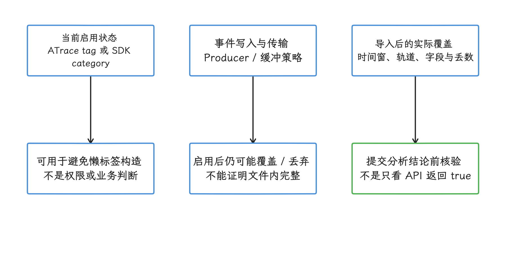

图：isEnabled 描述 ATrace 或 SDK app category 的当前状态，不能代替采集质量检查。 缓冲容量、时间窗、调度数据源和隐私判断均需独立确认。

### 6. 协程和线程池怎么埋

一条协程经常经历“调用线程提交—等待队列—工作线程执行—回调线程恢复”。整项任务用异步切片，单个不会 suspend（暂停协程）的 CPU 或同步 I/O 区间再用同步切片。下面的代码展示这两层语义：

```kotlin
import androidx.tracing.trace
import androidx.tracing.traceAsync
import kotlinx.coroutines.Dispatchers
import kotlinx.coroutines.withContext

suspend fun loadFeed(cookie: Int): List<FeedItem> =
    traceAsync("Feed.load", cookie) {
        val rows = withContext(Dispatchers.IO) {
            trace("Feed.queryDb") {
                feedDao.readAll()
            }
        }
        withContext(Dispatchers.Default) {
            trace("Feed.mapModels") {
                rows.map(::toFeedItem)
            }
        }
    }
```

`Feed.load` 包含等待和线程切换；`Feed.queryDb` 与 `Feed.mapModels` 各自落在执行线程上。这里明确假定 `feedDao.readAll()` 是不会挂起的同步 DAO 方法，映射循环也不挂起，begin/end 才保持同线程。如果实际使用 Room 的 suspend DAO，不能直接套这个同步包装；整段应保留异步区间，并对确定不会挂起的内部阶段单独埋点。

<!-- gracker-diagram: ch14-06-38-coroutine-two-levels -->
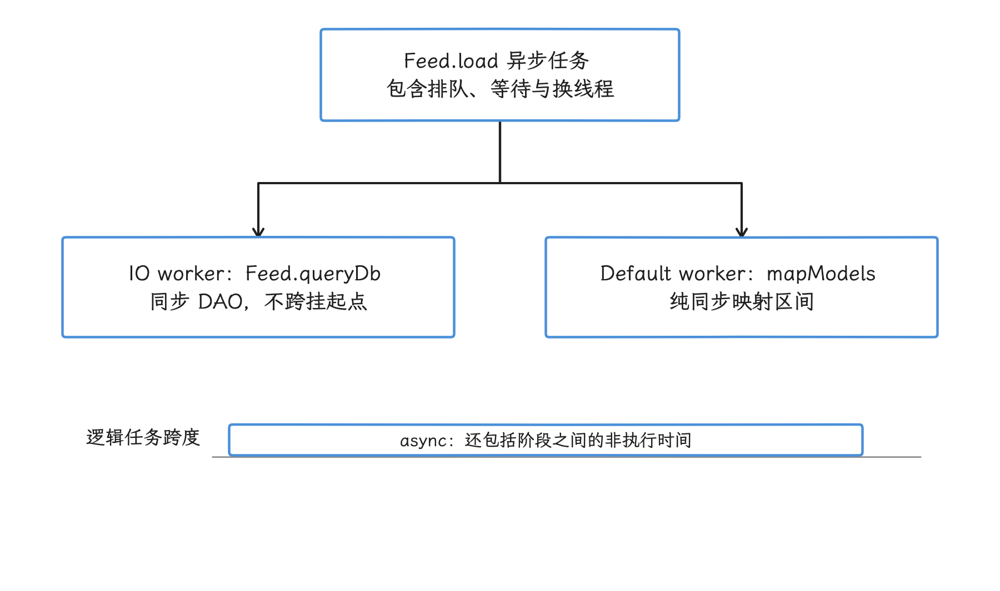

图：整项协程使用异步区间，确定不挂起的 DAO 和映射阶段各在线程内标记。 示例 DAO 明确为同步方法；实际 suspend DAO 不能套同线程同步包装。

线程池任务也遵循同一原则。这里的 worker 是从线程池取出并执行任务的工作线程：

- 提交到完成：异步切片；
- 单次 worker 执行：同步切片；
- 队列长度：Counter；
- 排队时间：优先记录提交、出队和执行起点。只有执行区间完整、同一任务无重叠且其他等待已单独排除时，才可用区间差估算；异步总跨度减执行时间通常还混有网络、锁和调度等待。

<!-- gracker-diagram: ch14-06-39-queue-duration-boundary -->
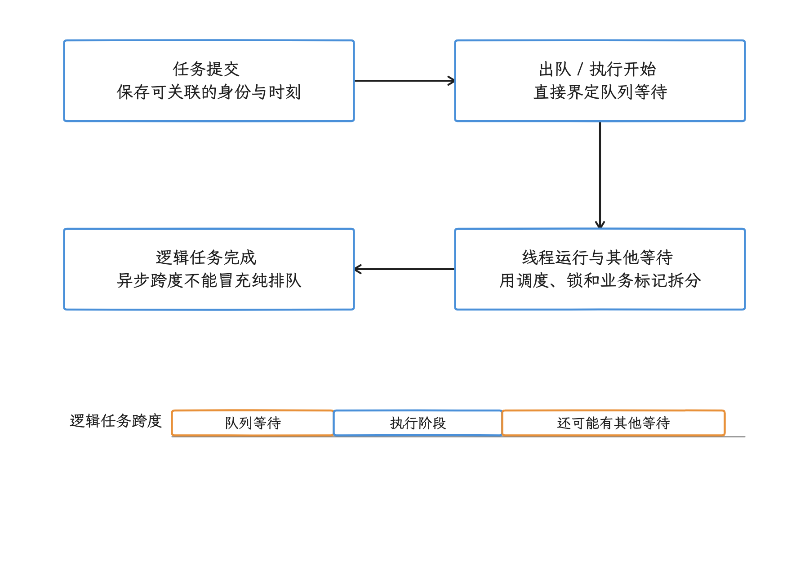

图：记录任务提交、出队和执行起点，才能将排队与其他等待分开。 异步总时长减执行片段一般还含网络、锁和调度等待，重叠区间不能重复相减。

UI 中异步轨道的上下排列只用于分开重叠区间，调用关系要从 flow edge 找；flow edge 是连接两个事件、表达先后或因果关系的有向边，公共 ATrace async event 并没有它。

### 7. Native 代码的公开 NDK 接口

NDK（Native Development Kit）是 Android 提供给 C/C++ 应用代码的开发接口。它在 `<android/trace.h>` 暴露与 Java API 对应的追踪能力，但各方法的引入版本与 Java SDK 不完全相同：

| NDK API | 可用版本 |
|---|---:|
| `ATrace_beginSection()` / `ATrace_endSection()` | API 23 |
| `ATrace_isEnabled()` | API 23 |
| `ATrace_beginAsyncSection()` / `ATrace_endAsyncSection()` | API 29 |
| `ATrace_setCounter()` | API 29 |

下面的 C++ 代码给一次同步解码加上线程切片：

```cpp
#include <android/trace.h>

class TraceScope {
public:
    explicit TraceScope(const char* name) {
        ATrace_beginSection(name);
    }

    ~TraceScope() {
        ATrace_endSection();
    }

    TraceScope(const TraceScope&) = delete;
    TraceScope& operator=(const TraceScope&) = delete;
};

DecodedFrame decodeFrame(const EncodedFrame& input) {
    TraceScope trace("VideoDecoder.decodeFrame");
    return decoder.decode(input);
}
```

`TraceScope` 使用 C++ RAII 惯用法：构造对象时开始切片，对象离开作用域执行析构函数时结束切片。这样无论正常返回还是异常展开，都会执行 `ATrace_endSection()`。名称要避开换行和 `|`；高频调用前可用 `ATrace_isEnabled()` 避免昂贵的标签构造。

平台源码中的 `<cutils/trace.h>` 还提供 `ATRACE_BEGIN`、`ATRACE_INT` 和系统 tag。它们属于平台内部接口。普通 NDK 应用使用 `<android/trace.h>`，事件隐式归入 app tag；`ATRACE_TAG_APP` 在 API 37 源码中的值是 `1 << 12`。固定 NDK `ATrace_*` 实现直接调用 libcutils `atrace_*`，不是前述 Java `tracing_perfetto` 选择入口，不能因为 API 名称对应就假定它也会切到 TrackEvent。

<!-- gracker-diagram: ch14-06-40-ndk-scope -->
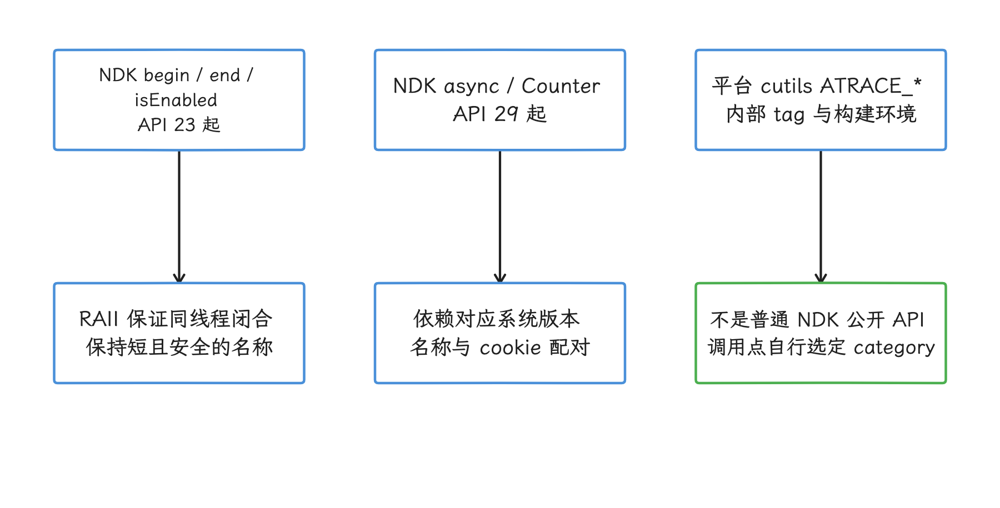

图：普通 NDK 使用公开 android/trace.h 和 APP tag，平台宏保留系统类别。 固定 NDK 实现直接走 libcutils，不能套用 Java 的双 backend 选择。

### 8. 平台私有能力该怎样理解

#### 8.1 track、instant 与 tag

API 37 的 `Trace.java` 包含 `asyncTraceForTrack*` 和 `instant*`。track 是 Perfetto 时间线上的命名行；前者允许平台代码指定 process track 并表达严格嵌套，后者写入 instant event，即只有时间点、没有持续时间的事件。这些能力停留在平台内部，面向第三方开发者的可编译示例里也就放不进去。

同样，`TRACE_TAG_AIDL`、`TRACE_TAG_WINDOW_MANAGER` 等 tag 面向平台代码。应用公开 API 始终使用 `TRACE_TAG_APP`，采集端以包名选择应用事件。

#### 8.2 Binder 自动切片覆盖什么

Binder 是 Android 的进程间通信（IPC）机制，AIDL 是描述 Binder 接口并生成通信代码的语言。`BBinder::transact()` 会在 `ATRACE_TAG_AIDL` 启用时调用 `startTrace()`；只有事务名称生成成功才开始切片，退出时再由 scope guard（作用域退出保护）闭合。配置 `aidl` 并覆盖对应窗口后，可以用这些服务端 AIDL Slice 观察执行线程和区间，但不能保证每次事务都存在这条切片。

这段自动切片与应用的 async section 各走各的：它不带后者的 cookie，也不为业务请求生成跨进程 trace context——trace context 是随调用传递、用于恢复因果关系的一组追踪标识，process-scoped 表示它只在所属进程内有效。应用进程与服务进程各自拥有进程内 async 轨道，两个进程写相同的 name/cookie，得到的仍是两条 slice。

<!-- gracker-diagram: ch14-06-41-binder-causal-context -->
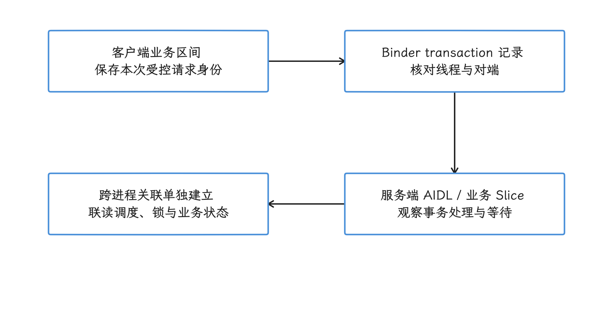

图：AIDL tag 控制服务端事务 Slice，跨进程业务因果还需组合请求与 Binder 证据。 AIDL tag 与事务名称生成均需成功；跨进程的相同 name/cookie 不会自动配对。

分析一次跨进程调用时应组合：

- 客户端业务切片；
- Binder transaction 数据；
- 服务端 AIDL/业务切片；
- 调度、锁和线程状态。

要显式表达跨进程因果关系，得靠协议层传递受控且不含敏感信息的 request ID（一次请求的关联标识），再在分析工具或 Perfetto SDK flow 中建立关系；`android.os.Trace` 的公开接口里找不到 flow 或 typed argument——typed argument 是带明确数据类型的事件键值参数。

#### 8.3 内部 Perfetto backend

`android-17.0.0_r1` 的 `frameworks/native/libs/tracing_perfetto` 为部分平台组件提供 Perfetto Track Event 路径。category 是可在采集时开关的一类事件。代码根据 ATrace 条件和已启用的 Perfetto category 二选一，同一次调用只走一条路径，开销也按一条路径估算。

第三方应用若需要 categories、typed metadata、flow 或自定义 track，可评估：

| 方案 | 稳定性与适用范围 |
|---|---|
| AndroidX Tracing 1.3.0 | 固定旧版；封装公开 ATrace section/async/counter，适合复现既有工程 |
| AndroidX Tracing 2.0.5 | 当前稳定版；2.0.0 引入进程内 Perfetto、metadata、flow、协程上下文和 sink。官方当前说明仍指出 Studio System Trace 不会自动采集这条进程内路径；系统 Trace 合并需走支持的采集流程 |
| Perfetto C++ SDK | 面向高级原生埋点；支持 categories、track、flow 和 typed arguments |

选型时还要确认由谁启动和读取采集、冷启动阶段何时初始化、trace 文件如何合并，以及线上开销是否可控；一次函数调用的耗时回答不了这些问题。

### 9. 用 PerfettoSQL 读取自定义事件

#### 9.1 Slice 已经是配对结果

Trace Processor 会把 begin/end 配对为一行 `slice`，其中 `ts` 是开始时间，`dur` 是持续时间；异步 section 也已经是完整 slice，我们直接查就好，不必对 `slice` 表做 self join（把表与自身连接）去凑 begin 和 end。

下面的查询同时覆盖线程切片和进程异步切片，并补齐进程/线程上下文：

```sql
INCLUDE PERFETTO MODULE slices.with_context;

SELECT id AS slice_id, upid, pid, utid, tid, track_id,
  ts, dur, name, process_name, thread_name, track_name
FROM thread_or_process_slice
WHERE process_name = 'com.example.reader'
  AND name GLOB 'Feed.*' AND dur >= 0
ORDER BY dur DESC, ts, id;
```

`thread_or_process_slice` 是同时覆盖线程切片和进程切片的标准库视图，`GLOB 'Feed.*'` 用通配符匹配以 `Feed.` 开头的名称。同步切片通常有 `thread_name`，进程范围异步切片的该列可能为空。`dur = -1` 表示切片未完成，或采集结束时仍处于开放状态；统计延迟前应排除这类记录并单独报警。

<!-- gracker-diagram: ch14-06-42-slice-context-views -->
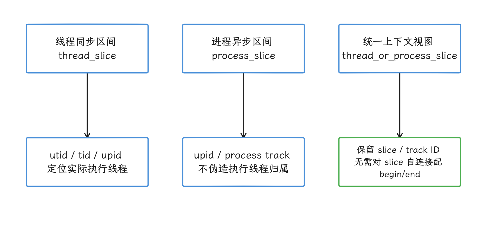

图：直接查询线程与进程上下文视图，保留实例、轨道和原始时间。 异步线程名可为空；dur=-1 的未闭合样本要单独报告，不计正常延迟。

#### 9.2 分位数语法

percentile（百分位数）表示有多少比例的样本不大于某个值，例如 P50 是中位数，P90 表示 90% 的样本不超过该值。PerfettoSQL 的 `PERCENTILE` 参数使用 0–100 的百分位值。下面的查询要求进程名恰好匹配一个实例，并默认使用整份 Trace 的半开时间窗，再计算该实例的 P50、P90 和 P99。正式场景应替换起止纳秒；同名多实例时先查明 `upid`，不能任选一个或混算：

```sql
INCLUDE PERFETTO MODULE slices.with_context;

WITH params(process_name, start_ts, end_ts) AS (
  SELECT 'com.example.reader', trace_start(), trace_end()
),
target_process AS (
  SELECT MIN(process.upid) AS upid
  FROM process JOIN params ON process.name = params.process_name
  HAVING COUNT(*) = 1
)
SELECT upid, name, COUNT(*) AS samples,
  PERCENTILE(dur, 50) / 1e6 AS p50_ms,
  PERCENTILE(dur, 90) / 1e6 AS p90_ms,
  PERCENTILE(dur, 99) / 1e6 AS p99_ms
FROM thread_or_process_slice JOIN target_process USING (upid)
CROSS JOIN params
WHERE name IN ('Feed.queryDb', 'Feed.mapModels')
  AND ts >= params.start_ts AND ts < params.end_ts AND dur >= 0
GROUP BY upid, name ORDER BY upid, name;
```

使用 `0.5`、`0.9`、`0.99` 会查询第 0.5、0.9、0.99 百分位，得不到 P50/P90/P99。多份 trace 的回归统计还应交给 Batch Trace Processor（批量处理多个 trace 文件的工具）或外部统计任务；单次 trace 内的切片算不上独立设备样本。

<!-- gracker-diagram: ch14-06-43-scoped-percentiles -->
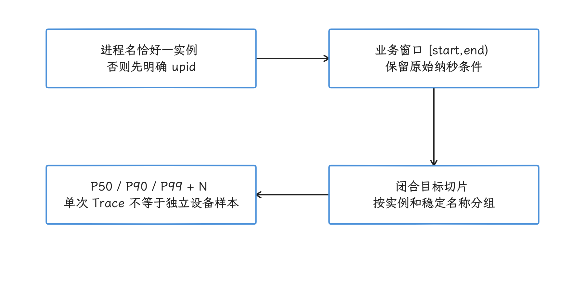

图：以唯一进程实例和半开场景窗筛选闭合样本，再按 0–100 参数计算分位数。 受控样本证明全局同名聚合会混入其他应用的 999 ms 切片。

#### 9.3 Counter 查询

应用 Counter 通常挂在 process counter track。下面的查询返回队列深度随时间的变化：

```sql
SELECT c.id AS counter_id, c.track_id, pct.upid, p.pid,
  c.ts, c.value, pct.name AS counter_name, p.name AS process_name
FROM counter AS c
JOIN process_counter_track AS pct ON c.track_id = pct.id
JOIN process AS p ON pct.upid = p.upid
WHERE p.name = 'com.example.reader'
  AND pct.name = 'ImageDecode.queueDepth'
ORDER BY c.track_id, c.ts, c.id;
```

Counter 的算术平均值会受到采样频率影响。时间加权平均应先按 `track_id` 把样本展开为 `[ts, next_ts)` 的阶梯区间，再裁到场景窗、进程与 Trace 边界，用有效区间时长作权重。首条样本之前未知，末值保持到边界属于外推假设，采集缺口也不等于连续观测；不要跨同名轨道或进程实例直接相加。§14.5 给出了带 `end_basis` 的完整区间与窗口求交示例。

<!-- gracker-diagram: ch14-06-44-counter-coverage -->
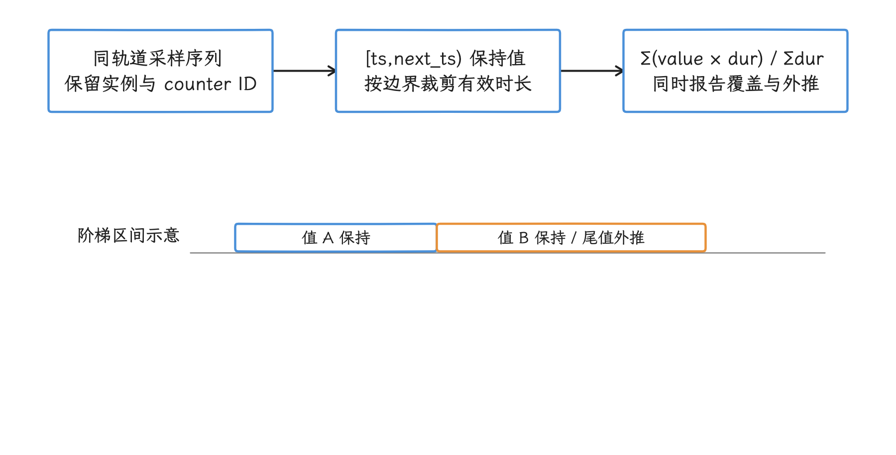

图：按 track_id 还原阶梯值区间，并裁到场景、进程和 Trace 边界后加权。 首值前未知，末值保持是外推假设，缺口不能当连续观测。

#### 9.4 `slice.category` 列的含义

`slice.category` 对 Track Event category 有明确含义，ATrace slice 的这一列通常是空的；按 `category = 'atrace'` 过滤，目标事件可能一个都留不下。应用事件用进程名、稳定的自定义名称和 track context 定位更可靠——track context 指切片所属线程、进程和轨道等上下文。

<!-- gracker-diagram: ch14-06-45-category-filter -->
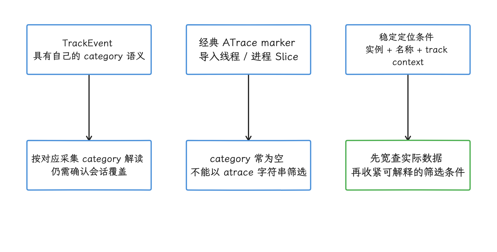

图：TrackEvent category 与 ATrace marker 来源不同，用进程、名称和轨道上下文定位。 ATrace Slice 的 category 通常为空，强制等于 atrace 会过滤掉目标记录。

### 10. 高频埋点和 buffer 失真

#### 10.1 埋点粒度

以下位置通常有分析价值：

- 启动阶段的配置、数据库、依赖初始化；
- 页面跳转中的数据准备与首帧前工作；
- 一次列表批处理、图片解码或序列化；
- 用户可感知的异步请求；
- 队列、连接和内存状态的低频 Counter。

逐元素循环、每像素处理、每次 Compose 小函数调用等位置容易让 trace 开销支配原始工作。可以把观测范围扩大到 batch（一次处理一组元素的批次），也可以只采样少量实例，并用 A/B trace 核对埋点对帧时间的影响。

Compose Runtime tracing 有自己的版本、依赖和切片语义，详见 [22.3 Compose Runtime Tracing](../../part5-app/ch22-rendering-practice/03-compose-compiler-modifier-diagnostics.md)；每个 `@Composable` 内的手工 begin/end、跨过可挂起操作的同步 section，都在避开之列。

#### 10.2 Ring buffer 会覆盖旧事件

ring buffer（环形缓冲区）会循环使用固定容量，`RING_BUFFER` 写满后会覆盖较早数据。出现“十秒采集只剩靠后的几秒”时，应检查：

- buffer 大小；
- ftrace event 与 atrace category 数量；
- 应用自定义事件频率；
- 采集时长；
- 是否同时抓了高吞吐数据源。

增加 buffer 缓解的只是容量压力；probe effect（探针效应）——观测动作本身改变被测程序的行为——仍然存在。处理时可以先缩短采集窗口、减少无关数据源、降低埋点频率，再按保留时长调整 buffer。

<!-- gracker-diagram: ch14-06-46-sampling-retention -->
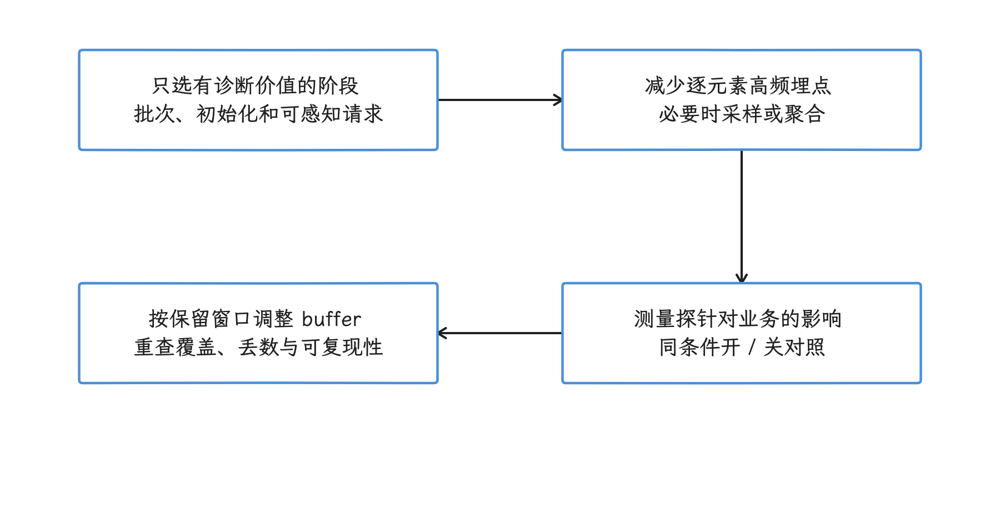

图：先缩小观测范围、降低频率，再按所需保留窗口调整缓冲。 扩容不能消除探针效应；Compose Runtime tracing 另有版本和切片语义。

#### 10.3 生产安全

trace 文件可能包含进程名、线程名、切片名和系统状态。应用自定义名称必须排除：

- 账号、手机号、设备标识；
- URL query、搜索词、消息正文；
- 文件系统中的用户路径；
- 认证 token、HTTP 会话 cookie、密钥；
- 可反推出个人行为的高基数 ID。

trace 采集、上传、保留和分享要遵守产品隐私政策；数据分类和脱敏是 `Trace.isEnabled()` 之外的工作。

### 11. 与 Macrobenchmark 配合

Macrobenchmark 会为每次测量保留 Perfetto trace，应用 section 因此能直接用于 performance gate（性能回归门限），即在持续集成中依据固定指标自动判断本次变更是否超过退化阈值：

1. 用稳定 section 包住业务阶段；
2. 用 `TraceSectionMetric` 对公开支持的聚合方式生成 metric；
3. metric 退化时打开对应迭代 trace；
4. 用版本化 PerfettoSQL 继续拆分调度、I/O、Binder 和子切片；
5. 在同设备、同 APK、同 compilation mode 下复测。

`TraceSectionMetric` 适合名称稳定、cardinality 较低的 section。variant 是同一应用的特定构建变体，compilation mode 则规定测试前代码采用预编译、部分编译还是解释/JIT 等状态；回归比较必须固定这两个条件。任意 SQL 后处理也应锁定 Trace Processor/Perfetto 版本，并保留原始 trace。自动化门限的设备和统计策略见 [15.6 自动化性能测试与 CLI Agent 工作流](../ch15-other-tools/06-automation-cli-agent-workflow.md)，Perfetto schema 的版本边界见 [14.1 Perfetto 入门、Trace 抓取与可靠性](01-perfetto-intro-capture-reliability.md)。

<!-- gracker-diagram: ch14-06-47-benchmark-evidence -->
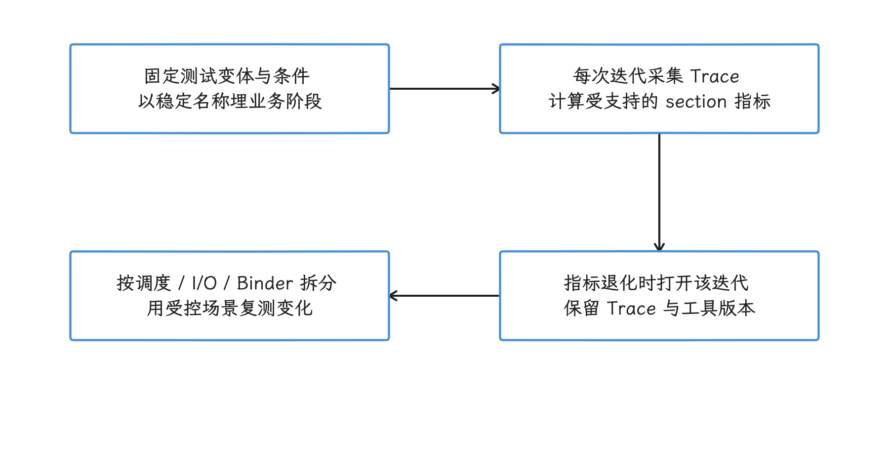

图：稳定业务 section 生成受支持的指标，退化时回查对应迭代的原始轨迹。 构建变体、编译模式、设备与采集条件要固定，任意 SQL 后处理也需版本化。

### 12. 排错清单

#### 切片完全不出现

- 采集配置是否包含目标 `atrace_apps`；
- 包名是否对应正在运行的进程；
- 事件是否发生在采集窗口内；
- `Trace.isEnabled()` 在复现期间是否返回 true；
- Macrobenchmark 是否运行了预期 variant 和目标包；
- trace 是否因 buffer 覆盖丢掉早期内容。

#### 同步切片栈错位

- 每个 begin 是否在同线程有且只有一个 end；
- 异常、early return（函数提前返回）和取消路径是否由 `finally` 保护；
- 同步 section 是否跨协程挂起点；
- 第三方 callback 是否换了线程。

#### 异步切片异常拉长或互相交叉

- begin/end 的名称是否逐字符一致；
- cookie 是否在重叠期间保持唯一；
- 取消与超时路径是否结束 section；
- 进程被杀时未结束的 slice 是否被错误纳入统计；
- UI 为分开重叠事件而采用的上下排列，是否被误读成父子关系。

#### SQL 查不到事件

- 先运行 `SELECT * FROM slice WHERE name GLOB '*关键字*' LIMIT 20`；
- 不要强制 `category = 'atrace'`；
- 同步切片查 `thread_slice`，异步切片查 `process_slice`，或统一查 `thread_or_process_slice`；
- `PERCENTILE` 使用 0–100；
- incomplete slice 的 `dur` 可能为负值。

<!-- gracker-diagram: ch14-06-48-troubleshooting-map -->
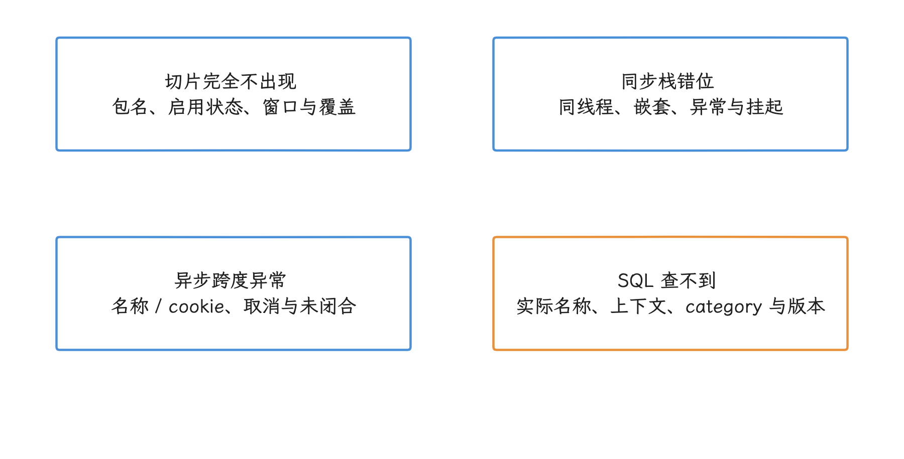

图：按现象检查配置、线程配对、异步身份与 SQL 过滤条件。 无结果、未闭合和缺失均保留状态，不能直接作为零耗时。

### 13. 源码核对表

| 结论 | Android 17 证据 |
|---|---|
| 公开 API 只有 6 个方法 | `frameworks/base/core/java/android/os/Trace.java` |
| `beginSection` 上限为 127 个 Java code unit | `Trace.java:507-516` |
| JNI 清理换行与竖线（ASCII 124） | `frameworks/base/core/jni/android_os_Trace.cpp:32-60` |
| Android 17 存在 ATrace/Perfetto backend 选择 | `frameworks/native/libs/tracing_perfetto/tracing_perfetto.cpp` |
| tag 通过 property serial 变化刷新 | `system/core/libcutils/trace-dev.inc:79-95` |
| trace marker 打开路径 | `system/core/libcutils/trace-dev.cpp:31-43` |
| `B/E/S/F/C` marker 编码 | `system/core/libcutils/trace-dev.cpp:72-116` |
| `ATRACE_TAG_APP` 为 `1 << 12` | `system/core/libcutils/include/cutils/trace.h:50-78` |
| AIDL server 事务由 tag 控制的 slice 包围 | `frameworks/native/libs/binder/Binder.cpp:479-500` |

行号对应 `android-17.0.0_r1`，后续分支可能移动。评审结论应同时记录源码 tag 和文件路径，避免用持续变化的 `main` 分支行号解释量产系统。

## 小结

Android Trace 的可见性取决于完整数据路径：内核 tracepoint 或用户态埋点先进入各自缓冲区，再由 Perfetto producer 与 service 收集、存储和解析。应用埋点按同步区间、跨线程任务或状态值选择 slice、async slice 或 counter，同时控制名称基数、配对生命周期和采集开销。再遇到轨道缺失，我们就沿“事件是否存在 → 配置是否启用 → 采集是否丢失 → 解析是否派生”逐层排查。


## 参考资料

- [Perfetto 多时钟域与导入映射](https://perfetto.dev/docs/concepts/clock-sync)
- [Android 17 backend 选择与共享内存初始化](https://android.googlesource.com/platform/frameworks/native/+/android-17.0.0_r1/libs/tracing_perfetto/tracing_perfetto_internal.cpp)
- [AndroidX Tracing 1.3.0 Android 发布源码](https://dl.google.com/dl/android/maven2/androidx/tracing/tracing-android/1.3.0/tracing-android-1.3.0-sources.jar)

- [Android 17 `Trace.java`](https://android.googlesource.com/platform/frameworks/base/+/android-17.0.0_r1/core/java/android/os/Trace.java)
- [Android 17 `android_os_Trace.cpp`](https://android.googlesource.com/platform/frameworks/base/+/android-17.0.0_r1/core/jni/android_os_Trace.cpp)
- [Android 17 `tracing_perfetto.cpp`](https://android.googlesource.com/platform/frameworks/native/+/android-17.0.0_r1/libs/tracing_perfetto/tracing_perfetto.cpp)
- [Android 17 `trace-dev.cpp`](https://android.googlesource.com/platform/system/core/+/android-17.0.0_r1/libcutils/trace-dev.cpp)
- [Android 17 `trace-dev.inc`](https://android.googlesource.com/platform/system/core/+/android-17.0.0_r1/libcutils/trace-dev.inc)
- [Android 17 `cutils/trace.h`](https://android.googlesource.com/platform/system/core/+/android-17.0.0_r1/libcutils/include/cutils/trace.h)
- [Android 17 `Binder.cpp`](https://android.googlesource.com/platform/frameworks/native/+/android-17.0.0_r1/libs/binder/Binder.cpp)
- [`android.os.Trace` API reference](https://developer.android.com/reference/android/os/Trace)
- [AndroidX Tracing releases](https://developer.android.com/jetpack/androidx/releases/tracing)
- [AndroidX Tracing API](https://developer.android.com/reference/kotlin/androidx/tracing/package-summary)
- [Android NDK tracing API](https://developer.android.com/ndk/reference/group/tracing)
- [Perfetto ATrace instrumentation](https://perfetto.dev/docs/getting-started/atrace)
- [Perfetto ATrace data source](https://perfetto.dev/docs/data-sources/atrace)
- [PerfettoSQL common queries](https://perfetto.dev/docs/analysis/common-queries)
- [PerfettoSQL `slices.with_context`](https://perfetto.dev/docs/analysis/stdlib-docs#slices-with_context)
- [Android 17 common kernel tag](https://android.googlesource.com/kernel/common/+/refs/tags/android17-6.18-2026-06_r6)
