# Perfetto SQL、SPAN_JOIN 与 Jank CUJ

Perfetto UI 适合寻找可疑时间段，SQL 适合回答能复查的定量问题：某一帧错过了多少时间预算，主线程在分析窗口内运行了多久，Binder（Android 的进程间通信机制） 客户端时间由哪些调度状态组成，一次 GC（垃圾回收） 从开始到结束的实际耗时中有多少时间在等待 CPU。我们把这种实际经过的时间称为“墙上时间”，其中既有线程运行时间，也有等待时间。

查询结果只覆盖 Trace 里已经采集到的事件。FrameTimeline（帧的期望与实际时间线）、调度、Binder（Android 进程间通信） 或 ART（Android Runtime） 事件缺失时，空表只说明“Trace 里没有这条数据”；系统里到底有没有发生过对应行为，要结合采集配置判断。我们拿到一份 Trace，总是先检查数据源，再下结论。


> 源码基线：Android 17 / API 37 / `android-17.0.0_r1`；内核 `android17-6.18-2026-06_r6`；查询按该版表结构复核，主机侧固定 Trace Processor v57.2，换版本需重新检查。

> 本轮核验使用 native Trace Processor 57.2 与 58.2：39 段 SQL 的空 Trace schema 检查，加上合成调度/ATrace/CUJ、区间算子、兼容模型表和配置片段检查，共 164 项。固定 Android 17 顶层 SQL 模块的导入依赖仍来自所用 native 版本；模型表测试不等同于平台解析回归。Java 强转仅作等价算术复现。本章未声称完成 Android/ART 构建、真实设备采集或性能测量。

本文示例优先使用 Perfetto SQL 标准库，需要理解原始数据时再回到 `slice`（时间轴区间事件）、`sched`、`thread_state` 和 `counter` 等基础表。做法上，我们先用表和视图筛出问题窗口，再通过时间跨度关联把线程、帧、调度和业务事件放到同一窗口；Jank CUJ 标准库提供现成语义，DataGrid 负责交互查询和结果检查。


## 数据模型、窗口选择与基础查询

### 查询前先固定分析对象与窗口

PerfettoSQL 是基于 SQLite 扩展的 SQL 方言，`INCLUDE PERFETTO MODULE`、`CREATE PERFETTO TABLE`、`SPAN_JOIN` 等追踪分析能力都由它提供，其中 `SPAN_JOIN` 用于计算两组时间区间的交集，后文的时间关联基本都落在它身上。

标准库模块会创建整理好的表、视图和函数。以 Binder 为例，`android.binder` 通过 flow（连接相关区间的事件关系）配对客户端事务与服务端回复，并区分同步调用和 `oneway` 单向异步调用；这些语义用 `slice.name GLOB '*binder*'` 做通配匹配拿不到，所以我们优先走标准库。

标准库随 Trace Processor 二进制发布，版本由分析侧决定：设备运行 Android 17，主机上用的 Trace Processor 仍可能是任意年代的老版本。所以团队查询应固定 Trace Processor 版本；升级二进制时，重新执行语法测试与基准 Trace 回归。


#### 四类标识的分工

常用表之间有四类标识：

- `pid`（进程 ID）、`tid`（线程 ID）是操作系统可见编号，进程或线程退出后可能复用。
- `upid`、`utid` 是 Trace Processor 在一份 Trace 内为进程和线程分配的唯一标识，关联表时优先使用它们。
- `track_id` 表示事件所在轨道；要指认具体事件，还得用帧号、Binder 事务号或 `slice.id` 这些各自的标识。
- `slice.id`、`frame_id`、`binder_txn_id` 属于对应事件模型，只在该模型规定的关系中关联。


我们先查询目标进程、主线程和 Trace 边界，检查对象是否唯一，避免把同名的历史进程实例合并。

```sql
WITH settings(process_name) AS (
  VALUES ('com.example.app')
)
SELECT
  process.upid,
  process.pid,
  process.name AS process_name,
  thread.utid,
  thread.tid,
  thread.name AS thread_name,
  thread.is_main_thread,
  trace_start() AS trace_start_ns,
  trace_end() AS trace_end_ns
FROM settings
JOIN process
  ON process.name = settings.process_name
JOIN thread
  USING (upid)
WHERE thread.is_main_thread = 1
   OR thread.tid = process.pid
ORDER BY process.start_ts, thread.start_ts;
```

结果可能有多行：同一个包名在采集期间重启时，会出现多个 `upid`。查询中的 `OR` 只是用 `tid = pid` 兼容 `is_main_thread` 信息缺失的 Trace，同一线程同时满足两个条件也只会返回一行。所以正式查询应选定与问题时段相交的 `upid`，并确认主线程候选唯一。下文直接分析进程的 SQL 使用 `123` 作为 upid 占位，必须替换成这条发现查询的实际结果；它不是 Android PID。`10000000000` 到 `15000000000` 同样只是原始纳秒窗口参数，须替换成目标 Trace 中的有效窗口。按包名选择启动实例、按 ErrorId 选择 ANR 与系统 CUJ 的查询另保留各自稳定身份。


#### 时间、开放区间与窗口裁剪

`ts` 和 `dur` 的单位都是纳秒。毫秒换算使用 `dur / 1e6`，秒换算使用 `dur / 1e9`。`trace_start()` 与 `trace_end()` 返回 Trace 的起止时间。部分正在进行的 `slice` 或调度状态会以 `dur = -1` 表示未闭合。若分析覆盖时长，可暂按窗口末端和 `trace_end()` 裁剪，并保留 `is_open` / `end_basis`：这个终点属于分析假设，要和观测到的完成时刻分开记录。延迟分位数只纳入已闭合事件，并另报未闭合数量。


时间窗口采用半开区间 `[start_ts, end_ts)`，也就是包含起点、不包含终点，这样更容易处理首尾相接的事件。两个区间相交的条件是 `a.ts < b.end_ts AND a.end_ts > b.ts`，交集长度为 `MIN(a.end_ts, b.end_ts) - MAX(a.ts, b.ts)`。先按 `upid`、`utid` 与窗口过滤，再做区间关联，可以大幅减少大 Trace 的计算量。


下面的模板把主线程状态裁到由分析者给定的窗口；两个数值只是查询参数，与平台超时或性能标准无关。

```sql
WITH
  settings(target_upid, start_ts, end_ts) AS (
    VALUES (
      123,
      10000000000,
      15000000000
    )
  ),
  target_main_thread AS (
    SELECT MIN(thread.utid) AS utid
    FROM settings
    JOIN process
      ON process.upid = settings.target_upid
    JOIN thread
      USING (upid)
    WHERE thread.is_main_thread = 1
       OR thread.tid = process.pid
    HAVING COUNT(*) = 1
  ),
  states AS (
    SELECT
      thread_state.*,
      CASE
        WHEN thread_state.dur = -1 THEN trace_end()
        ELSE thread_state.ts + thread_state.dur
      END AS state_end_ts
    FROM thread_state
    JOIN target_main_thread USING (utid)
  )
SELECT
  states.id,
  states.utid,
  states.state,
  states.io_wait,
  states.dur = -1 AS is_open,
  CASE WHEN states.dur = -1 THEN 'assumed_to_window_or_trace_end'
       ELSE 'observed_end' END AS end_basis,
  states.blocked_function,
  MAX(states.ts, settings.start_ts) AS ts,
  MIN(states.state_end_ts, settings.end_ts)
    - MAX(states.ts, settings.start_ts) AS dur
FROM states
CROSS JOIN settings
WHERE states.ts < settings.end_ts
  AND states.state_end_ts > settings.start_ts
ORDER BY ts;
```

输出中的每一行都已经裁到目标窗口。需要反复使用结果时，可以用 `CREATE PERFETTO TABLE` 先计算并保存，也就是把查询结果物化；这适合几十秒以上且包含全量调度事件的 Trace。一次性检查则保留 CTE（Common Table Expression，由 `WITH` 定义的临时结果集）即可。

#### 指标的分母、对照与帧时间量

我们读指标时先看分母和对照：“主线程 CPU 占用 80%”必须带上窗口才能复查；“Binder 超过 1 ms 就慢”还要交代接口语义、设备负载与调用是否同步。SQL 可以稳定地产生 P50、P90、P99：P50 是中位数，P90 和 P99 分别表示 90% 与 99% 的样本落在该值以内；而分位数要说明问题，还需要同场景、同设备配置、同采集配置的对照组。

帧分析还要区分三个量：


- `Choreographer#doFrame` 的 `dur` 是 UI 线程回调区间，可用于定位 UI 线程工作。
- FrameTimeline（系统记录的帧期望与实际时间线） 的期望/实际区间用于判断帧是否按期呈现。
- 刷新周期会随显示模式和可变刷新率变化，判断某帧是否超期要以该帧的截止时间为准，固定的 16.67 ms 或 8.33 ms 只能当周期参考。

### 帧时间与卡顿分析

#### `Choreographer#doFrame` 用于寻找 UI 线程耗时工作

Android 版本和追踪点实现会让 `doFrame` 名称带上帧号等后缀，因此查询使用 `GLOB 'Choreographer#doFrame*'`；`GLOB` 会按通配模式匹配名称。这张表适合做 UI 线程耗时排序与分布统计；系统级卡顿结论还需要结合 FrameTimeline。

计算目标进程 `doFrame` 的墙上时间分位数，可以判断 UI 线程回调是否相对基线变慢，并找出少量最慢、需要回到时间线检查的样本。

```sql
INCLUDE PERFETTO MODULE slices.with_context;

WITH do_frames AS (
  SELECT
    id,
    upid,
    ts,
    dur,
    name
  FROM thread_slice
  WHERE upid = 123
    AND is_main_thread = 1
    AND name GLOB 'Choreographer#doFrame*'
    AND dur >= 0
)
SELECT
  upid,
  COUNT(*) AS frame_count,
  ROUND(AVG(dur) / 1e6, 3) AS avg_do_frame_ms,
  ROUND(PERCENTILE(dur / 1e6, 50), 3) AS p50_do_frame_ms,
  ROUND(PERCENTILE(dur / 1e6, 90), 3) AS p90_do_frame_ms,
  ROUND(PERCENTILE(dur / 1e6, 99), 3) AS p99_do_frame_ms,
  ROUND(MAX(dur) / 1e6, 3) AS max_do_frame_ms
FROM do_frames
GROUP BY upid;
```

这些分位数描述主线程回调的墙上时间，其中可能同时包含 `Running`、`Runnable`、睡眠和锁等待。若 P99 变长，我们继续用 `thread_state` 分解长帧，确认时间去了哪里，再谈是不是业务代码计算量增加。

<!-- gracker-diagram: ch14-07-09-doframe-wall-cpu -->
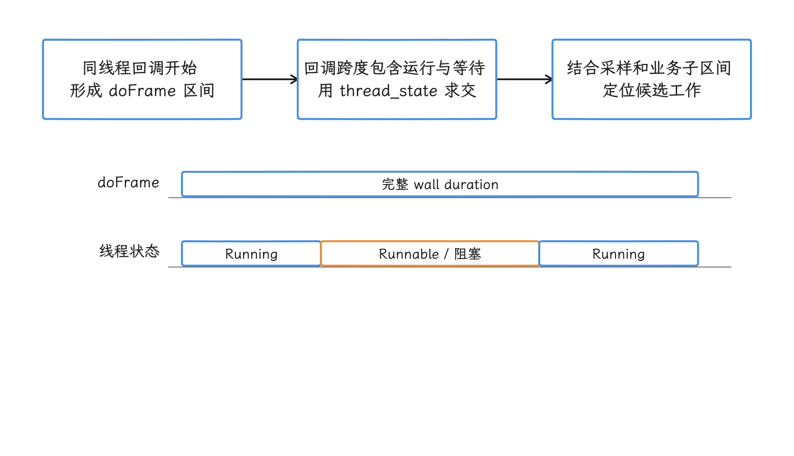

图：doFrame 的墙上时间可以同时包含 Running、Runnable 和阻塞。 P99 增长只说明回调变慢，要确认业务计算量，还需线程状态与函数采样。

#### FrameTimeline 给出系统判帧依据

FrameTimeline 从 Android 12 / API 31 开始提供每帧的期望与实际时间线。`actual_frame_timeline_slice` 包含 `jank_type`、`jank_severity_type`、`on_time_finish` 和 `present_type` 等平台判定；`android.frames.timeline` 会把 UI 线程的 `Choreographer#doFrame`、RenderThread（应用渲染线程） 的 `DrawFrame` 与时间线事件整理为 `android_frames`。

`android_frames` 有几个已知限制，用这张表时要心里有数：同一帧可能关联多个 `layer`（由系统合成的显示图层），表会聚合它们；当前实现只选第一个 `DrawFrame`，源码保留了对应待改进项；`actual_frame_timeline_count` 与 `draw_frame_count` 只计入标准库实际关联的不同 slice ID，多层和多次绘制也可能合法，这些列记录的是关联数量，本身没有判错含义。固定源码把 `expected_frame_timeline_count` 直接写成常数 1，要发现 expected 缺失或重复，需检查具体 ID 并按原始 expected 表的 `(upid, name)` 另计数。自动化统计应保留关联 ID、数量与数据缺口，且上游 INNER JOIN 已经排除的帧不会由这些列补回。


下面按标准库帧模型列出代表层的平台判定和 legacy 超额量。`actual_frame_timeline_id` 精确指向模型选中的一行，但多层时固定实现选的是最小 actual slice ID，这行标签只描述代表层。`android_frames_overrun` 另按 `frame_id` 对 actual 与 expected 做全局分组并选代表 ID，这个代表值和这里这行 actual 的逐层差值之间没有必然的对应关系；严谨的逐层报告应直接核对 `android_frames_layers` 与原始 expected/actual ID。

```sql
INCLUDE PERFETTO MODULE android.frames.timeline;
INCLUDE PERFETTO MODULE android.frames.per_frame_metrics;

WITH raw_actual_counts AS (
  SELECT CAST(name AS INTEGER) AS frame_id, COUNT(*) AS raw_actual_count
  FROM actual_frame_timeline_slice GROUP BY CAST(name AS INTEGER)
),
raw_expected_counts AS (
  SELECT CAST(name AS INTEGER) AS frame_id, COUNT(*) AS raw_expected_count
  FROM expected_frame_timeline_slice GROUP BY CAST(name AS INTEGER)
)
SELECT
  actual.id AS representative_actual_id,
  expected.id AS representative_expected_id,
  raw_actual_count, raw_expected_count,
  frames.upid,
  frames.frame_id,
  frames.ts,
  ROUND(frames.dur / 1e6, 3) AS frame_wall_ms,
  ROUND((CASE WHEN actual.dur >= 0 AND expected.dur >= 0
    AND raw_actual_count = 1 AND raw_expected_count = 1
    THEN overrun.overrun END) / 1e6, 3) AS deadline_overrun_ms,
  actual.jank_type,
  actual.jank_severity_type,
  actual.on_time_finish,
  actual.present_type,
  frames.actual_frame_timeline_count,
  frames.expected_frame_timeline_count,
  frames.draw_frame_count,
  frames.ui_thread_utid,
  frames.render_thread_utid
FROM android_frames AS frames
LEFT JOIN actual_frame_timeline_slice AS actual
  ON actual.id = frames.actual_frame_timeline_id
LEFT JOIN expected_frame_timeline_slice AS expected
  ON expected.id = frames.expected_frame_timeline_id
LEFT JOIN raw_actual_counts USING (frame_id)
LEFT JOIN raw_expected_counts USING (frame_id)
LEFT JOIN android_frames_overrun AS overrun
  USING (frame_id)
WHERE frames.upid = 123
ORDER BY frames.ts;
```

本查询只在原始 expected/actual 对该 frame_id 各有一条、且模型指针对应的区间均已闭合时显示 `deadline_overrun_ms`；否则保留 NULL。正值表示该唯一配对的 actual 结束晚于 expected，负值表示该配对仍有余量。下面的分布另外报告 verified_single_pair_overrun_samples 与 excluded_or_missing_overrun_samples；排除的多层、开放或缺失帧仍保留平台标签行，统计“无卡顿”时要把它们排除在外。`jank_type` 由平台记录，可继续区分应用、SurfaceFlinger（Android 的显示合成服务）、调度等类别。表为空时，先检查采集配置、Android 版本与目标进程是否产生了 FrameTimeline 数据。


按平台标签聚合帧数与超额分布，适合比较同一测试方案的多次运行。跨设备通用的“卡顿率及格线”这里不设，需要阈值时结合对照数据另行确定，查询只负责把分布算出来。

```sql
INCLUDE PERFETTO MODULE android.frames.timeline;
INCLUDE PERFETTO MODULE android.frames.per_frame_metrics;

WITH raw_actual_counts AS (
  SELECT CAST(name AS INTEGER) AS frame_id, COUNT(*) AS raw_actual_count
  FROM actual_frame_timeline_slice GROUP BY CAST(name AS INTEGER)
),
raw_expected_counts AS (
  SELECT CAST(name AS INTEGER) AS frame_id, COUNT(*) AS raw_expected_count
  FROM expected_frame_timeline_slice GROUP BY CAST(name AS INTEGER)
),
frame_results AS (
  SELECT
    frames.upid,
    frames.frame_id,
    actual.jank_type,
    actual.jank_severity_type,
    CASE WHEN actual.dur >= 0 AND expected.dur >= 0
    AND raw_actual_count = 1 AND raw_expected_count = 1
    THEN overrun.overrun END AS overrun,
    raw_actual_count, raw_expected_count
  FROM android_frames AS frames
  LEFT JOIN actual_frame_timeline_slice AS actual
    ON actual.id = frames.actual_frame_timeline_id
  LEFT JOIN expected_frame_timeline_slice AS expected
    ON expected.id = frames.expected_frame_timeline_id
  LEFT JOIN raw_actual_counts USING (frame_id)
  LEFT JOIN raw_expected_counts USING (frame_id)
  LEFT JOIN android_frames_overrun AS overrun
    USING (frame_id)
  WHERE frames.upid = 123
)
SELECT
  upid,
  COALESCE(jank_type, 'Missing FrameTimeline verdict') AS jank_type,
  COALESCE(jank_severity_type, 'Unknown severity') AS severity,
  COUNT(*) AS frame_count,
  COUNT(overrun) AS verified_single_pair_overrun_samples,
  SUM(CASE WHEN overrun IS NULL THEN 1 ELSE 0 END) AS excluded_or_missing_overrun_samples,
  ROUND(PERCENTILE(overrun / 1e6, 50), 3) AS p50_overrun_ms,
  ROUND(PERCENTILE(overrun / 1e6, 90), 3) AS p90_overrun_ms,
  ROUND(MAX(overrun) / 1e6, 3) AS max_overrun_ms
FROM frame_results
GROUP BY upid, jank_type, severity
ORDER BY frame_count DESC;
```

缺少平台判定的行应单独保留。这一类行可能来自采集不完整或关联失败，合入“无卡顿”会把这两种情况掩盖掉；比较版本时也应同步记录缺失比例。

<!-- gracker-diagram: ed14-07-frame-model-pairing-and-missing-verdict -->
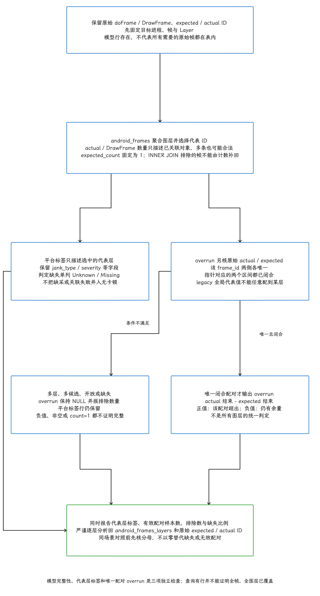

图：固定android_frames聚合layer、只选首个DrawFrame、actual代表最小sliceid，actual/drawcount仅实际关联数且多条可合法；expectedcount常数1非完整性，需原expected(upid,name)另查原ID，INNERJOIN已排除帧不补回。legacyandroid_frames_overrun按frameid全局聚合选代表，与当前代表层actual差值不必对应。原查询仅原actual/expected按frameid各唯一且指针对应闭合才显示overrun，否则NULL和排除数，平台标签行仍留。正值为actualend晚于expected，负值该配对有余量，缺标签或无效配对不并入NoJank，跨层严谨报告查android_frames_layers与原始id。

### 线程调度与 CPU 使用

#### `sched` 回答线程何时占用 CPU

`sched` 的一行表示某个线程在一个 CPU 上连续运行的区间，把 `dur` 累加起来就是 CPU 运行时间，再除以明确的墙上时间窗口，才得到该线程在此窗口内的 CPU 占用比例。单线程的占用比例通常位于 0% 到 100% 之间，多线程进程把各线程比例相加可以超过 100%。

按线程统计目标进程在指定窗口中的 CPU 运行时间，可以把“CPU 很忙”转换成带窗口的线程排名。

```sql
WITH
  settings(target_upid, start_ts, end_ts) AS (
    VALUES (
      123,
      10000000000,
      15000000000
    )
  ),
  target_threads AS (
    SELECT
      thread.utid,
      thread.tid,
      thread.name AS thread_name
    FROM settings
    JOIN process
      ON process.upid = settings.target_upid
    JOIN thread
      USING (upid)
  ),
  clipped_sched AS (
    SELECT
      target_threads.utid,
      sched.dur = -1 AS is_open,
      target_threads.tid,
      target_threads.thread_name,
      MAX(sched.ts, settings.start_ts) AS ts,
      MIN(
        CASE
          WHEN sched.dur = -1 THEN trace_end()
          ELSE sched.ts + sched.dur
        END,
        settings.end_ts
      ) - MAX(sched.ts, settings.start_ts) AS dur
    FROM sched
    JOIN target_threads USING (utid)
    CROSS JOIN settings
    WHERE sched.ts < settings.end_ts
      AND CASE
            WHEN sched.dur = -1 THEN trace_end()
            ELSE sched.ts + sched.dur
          END > settings.start_ts
  )
SELECT
  tid,
  thread_name,
  SUM(CASE WHEN is_open THEN 1 ELSE 0 END) AS assumed_end_intervals,
  ROUND(SUM(dur) / 1e6, 3) AS cpu_time_ms,
  ROUND(
    100.0 * SUM(dur) / (settings.end_ts - settings.start_ts),
    2
  ) AS one_core_occupancy_pct
FROM clipped_sched
CROSS JOIN settings
GROUP BY utid, tid, thread_name
ORDER BY SUM(dur) DESC;
```

`one_core_occupancy_pct` 以单个 CPU 核心在查询中的 5 秒可用时间为分母。高占用说明线程经常在运行，要把责任落到函数热点，还需结合采样栈、调用栈或 `slice`；低占用伴随长延迟时，我们把注意力转向 `Runnable` 排队、睡眠、I/O 与同步等待。


#### `thread_state` 直接给出 `Runnable` 等待

`sched.end_state` 只描述线程离开 CPU 那一刻的状态；离开 CPU 之后到下次运行之间是什么状态，要看 `thread_state`。它已把 `sched_switch`、wakeup 与阻塞原因整理成连续区间：

- `Running`：线程正在 CPU 上运行。
- `R` / `R+`：线程可运行，但尚未获得 CPU；`R+` 表示线程被抢占后仍保持可运行。
- `S`：可中断睡眠，常见于等待事件、条件变量或 Binder 回复。
- `D`：不可中断睡眠；`io_wait = 1` 时可进一步判断为内核 I/O 等待。
- `blocked_function`：采集并完成内核符号化时，记录阻塞所在的内核函数。
- `waker_utid`：记录唤醒方，部分行可能缺失。


汇总目标主线程在窗口内的调度状态，可以区分 CPU 计算、等待 CPU、等待 I/O 与其他阻塞时间。

```sql
WITH
  settings(target_upid, start_ts, end_ts) AS (
    VALUES (
      123,
      10000000000,
      15000000000
    )
  ),
  main_thread AS (
    SELECT MIN(thread.utid) AS utid
    FROM settings
    JOIN process
      ON process.upid = settings.target_upid
    JOIN thread
      USING (upid)
    WHERE thread.is_main_thread = 1
       OR thread.tid = process.pid
    HAVING COUNT(*) = 1
  ),
  clipped AS (
    SELECT
      thread_state.dur = -1 AS is_open,
      thread_state.state,
      thread_state.io_wait,
      thread_state.blocked_function,
      MIN(
        CASE
          WHEN thread_state.dur = -1 THEN trace_end()
          ELSE thread_state.ts + thread_state.dur
        END,
        settings.end_ts
      ) - MAX(thread_state.ts, settings.start_ts) AS dur
    FROM thread_state
    JOIN main_thread USING (utid)
    CROSS JOIN settings
    WHERE thread_state.ts < settings.end_ts
      AND CASE
            WHEN thread_state.dur = -1 THEN trace_end()
            ELSE thread_state.ts + thread_state.dur
          END > settings.start_ts
  )
SELECT
  state,
  io_wait,
  COALESCE(blocked_function, '<no blocked function>') AS blocked_function,
  COUNT(*) AS interval_count,
  SUM(CASE WHEN is_open THEN 1 ELSE 0 END) AS assumed_end_intervals,
  ROUND(SUM(dur) / 1e6, 3) AS total_ms,
  ROUND(MAX(dur) / 1e6, 3) AS longest_ms
FROM clipped
GROUP BY state, io_wait, blocked_function
ORDER BY SUM(dur) DESC;
```

较长的 `R` / `R+` 区间说明线程已经具备运行条件，却在运行队列中等待。它可能来自 CPU 争用、优先级、CPU 亲和性、`cgroup`（控制组的 CPU 配额或调度限制） 的配额或调度限制，也可能来自频率策略，归因时要把这些因素放在一起看。较长的 `S` 也要与 Binder、`futex`（同步原语争用时的内核等待）、monitor（Java `synchronized` 使用的对象锁）竞争和应用 `slice` 对时。

列出最长的 `Runnable` 区间及唤醒方，可以从汇总值回到具体时刻，并定位谁把主线程唤醒。

```sql
WITH target_main_thread AS (
  SELECT MIN(thread.utid) AS utid
  FROM process
  JOIN thread USING (upid)
  WHERE process.upid = 123
    AND (thread.is_main_thread = 1 OR thread.tid = process.pid)
  HAVING COUNT(*) = 1
)
SELECT
  state.utid,
  state.ts,
  ROUND(state.dur / 1e6, 3) AS runnable_ms,
  state.state,
  state.cpu,
  waker.tid AS waker_tid,
  waker.name AS waker_thread,
  waker_process.name AS waker_process,
  state.irq_context
FROM thread_state AS state
JOIN target_main_thread
  ON target_main_thread.utid = state.utid
LEFT JOIN thread AS waker
  ON waker.utid = state.waker_utid
LEFT JOIN process AS waker_process
  ON waker_process.upid = waker.upid
WHERE state.state IN ('R', 'R+')
  AND state.dur >= 0
ORDER BY state.dur DESC
LIMIT 30;
```

`waker_utid` 为空时，先考虑字段缺失：旧 Trace、缺少 wakeup 事件、数据丢失和内核路径差异都会造成这种情况，唤醒本身仍可能发生过。`sched_switch` 与 `sched_waking` 这两个内核追踪点提供原始事件，Trace Processor 再把它们整理成这里的状态区间。


### Binder 事务分析

#### 用 `android_binder_txns` 配对客户端与服务端

`android.binder` 模块同时整理同步事务和 `oneway` 异步事务。同步事务中，`client_dur` 覆盖客户端发起调用到收到回复的墙上时间，`server_dur` 覆盖服务端处理与回复区间；异步事务没有同步等待关系，客户端发送与服务端接收可能相隔较远，统计时我们按 `is_sync` 分组。

`interface`、`method_name` 与 `aidl_name` 依赖 AIDL（Android Interface Definition Language） 或 HIDL（硬件抽象层接口定义语言）追踪 `slice`。字段为空时，事务配对仍可能有效，只是 Trace 里缺少接口名。

`client_monotonic_dur` 和 `server_monotonic_dur` 通过端点的 `to_monotonic()` 映射计算，不包含全机休眠；时钟映射不足时可能为空。分析用户感知延迟仍要保留 Trace 时间域的跨度及其时钟依据。

按接口、方法和同步类型统计目标进程发起的 Binder 事务，可以找出高频接口和少量最慢的调用，同时保留样本量。

```sql
INCLUDE PERFETTO MODULE android.binder;

SELECT
  client_upid,
  is_sync,
  COALESCE(interface, '<unresolved interface>') AS interface,
  COALESCE(method_name, '<unresolved method>') AS method_name,
  server_upid,
  server_process,
  COUNT(*) AS call_count,
  ROUND(PERCENTILE(client_dur / 1e6, 50), 3) AS p50_client_ms,
  ROUND(PERCENTILE(client_dur / 1e6, 90), 3) AS p90_client_ms,
  ROUND(PERCENTILE(client_dur / 1e6, 99), 3) AS p99_client_ms,
  ROUND(MAX(client_dur) / 1e6, 3) AS max_client_ms
FROM android_binder_txns
WHERE client_upid = 123
  AND client_dur >= 0
GROUP BY client_upid, is_sync, interface, method_name, server_upid, server_process
ORDER BY p99_client_ms DESC, call_count DESC;
```

同步与异步结果的 `client_dur` 含义不同，两组数要分开看延迟分布。接口名缺失的事务也要保留；直接过滤空值的话，最难解释的调用会从报表里消失。


#### 把 Binder 墙上时间分解为调度状态

客户端调用耗时长，可能是服务端执行慢，也可能是客户端等待回复期间被调度、设备休眠或数据不完整。`android_sync_binder_thread_state_by_txn` 已经对客户端和服务端区间分别执行 `SPAN_JOIN`，给出各调度状态的累计时间。

列出目标进程同步事务两端的状态分解，可以判断长事务主要消耗在 `Running`、`Runnable` 还是睡眠状态。

```sql
INCLUDE PERFETTO MODULE android.binder;

SELECT
  binder.binder_txn_id,
  COALESCE(binder.interface, '<unresolved interface>') AS interface,
  COALESCE(binder.method_name, '<unresolved method>') AS method_name,
  binder.client_thread,
  binder.server_process,
  binder.server_thread,
  states.thread_state_type,
  states.thread_state,
  states.thread_state_count,
  ROUND(states.thread_state_dur / 1e6, 3) AS state_ms
FROM android_binder_txns AS binder
JOIN android_sync_binder_thread_state_by_txn AS states
  USING (binder_txn_id)
WHERE binder.client_upid = 123
  AND binder.is_sync = 1
ORDER BY binder.client_dur DESC, binder.binder_txn_id, state_ms DESC;
```

`thread_state_type = 'binder_txn'` 表示客户端区间，`binder_reply` 表示服务端回复区间。客户端处于 `S` 往往符合等待同步回复的预期；服务端出现较长 `R` / `R+`，才说明服务端线程在排队等 CPU。确认具体工作仍要回到该事务的 `slice` 子树，也就是事务区间内嵌套的子区间。

<!-- gracker-diagram: ch14-07-17-binder-state-decomposition -->
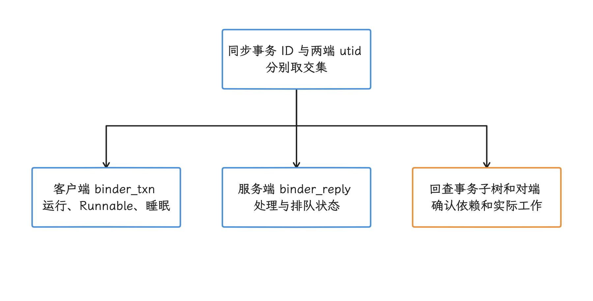

图：客户端和服务端各自的事务区间需要关联各自线程状态。 客户端睡眠可能是正常等待回复；服务端 Runnable 才是服务线程排队线索。

所谓“Binder 线程池利用率”也要给出容量与窗口。只累加 Binder 线程 CPU 时间，得到的是运行时间；线程池可能睡眠等待工作，也可能在处理非 Binder `slice`，线程池是否饱和（缺少空闲线程接收新事务），要靠服务端并发事务数、可用 Binder 线程数、事务排队与各线程状态一起判断。


### 内存与 GC 分析

#### GC 墙上时间与全线程暂停

ART 的垃圾回收包含并发阶段与暂停阶段。`*concurrent*GC` 顶层 `slice` 的 `dur` 覆盖整个回收事件，与所有 Java 线程的停顿时间是两个不同的量。`android.garbage_collection` 模块会把 GC 区间与执行该 GC 的线程状态相交，并结合 `Heap size (KB)` 计数器估算回收量。

读取标准库整理好的 GC 事件，可以同时观察墙上时间、CPU 运行、`Runnable`、I/O 等待和回收量，避免只盯着一个 `dur`。

```sql
INCLUDE PERFETTO MODULE android.garbage_collection;

SELECT
  upid,
  gc_id,
  gc_ts,
  gc_type,
  is_mark_compact,
  thread_name,
  ROUND(gc_dur / 1e6, 3) AS wall_ms,
  ROUND(gc_running_dur / 1e6, 3) AS running_ms,
  ROUND(gc_runnable_dur / 1e6, 3) AS runnable_ms,
  ROUND(gc_unint_io_dur / 1e6, 3) AS uninterruptible_io_ms,
  ROUND(gc_unint_non_io_dur / 1e6, 3) AS uninterruptible_non_io_ms,
  ROUND(gc_int_dur / 1e6, 3) AS interruptible_sleep_ms,
  ROUND(reclaimed_mb, 3) AS reclaimed_mb,
  ROUND(min_heap_mb, 3) AS min_heap_mb,
  ROUND(max_heap_mb, 3) AS max_heap_mb
FROM android_garbage_collection_events
WHERE upid = 123
ORDER BY gc_ts;
```

`reclaimed_mb` 依赖 GC 前后的堆计数器，计数器缺失时相关列可能为空。状态分解描述的是 GC 工作线程；要研究暂停，应在 GC 时间窗内检查主线程和其他应用执行线程的 `slice`、调度状态及 ART 暂停标记。

<!-- gracker-diagram: ch14-07-19-gc-wall-versus-pause -->
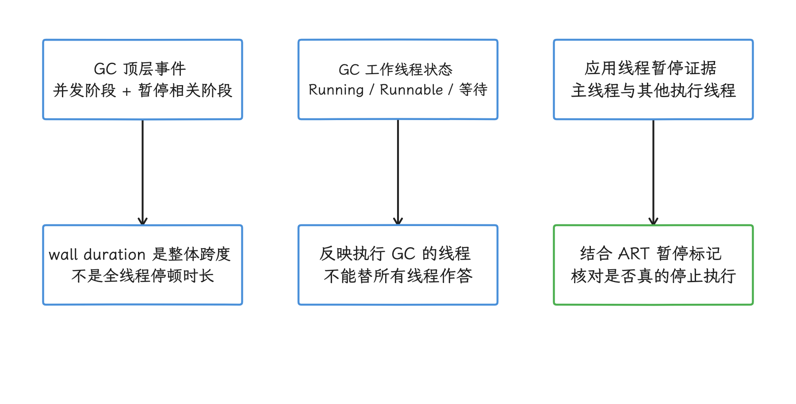

图：GC 标准库拆解的是 GC 工作线程的整段事件，不直接等于应用暂停。 回收量依赖堆 Counter；研究 STW 还需应用线程状态和 ART 暂停标记。

#### Java 堆计数器是离散采样点

`Heap size (KB)` 每次变化产生一个计数器点。两点之间只能解释为“最近一次记录值持续到下一次更新”，未采集时刻的分配细节从这里看不出来。查询这些采样点，可以检查目标进程的 Java 堆趋势和采样间隔。

```sql
SELECT
  process.upid,
  counter.id AS counter_id,
  counter.track_id,
  counter.ts,
  ROUND(counter.value / 1024.0, 3) AS heap_mib,
  ROUND(
    (
      LEAD(counter.ts) OVER (
        PARTITION BY counter.track_id
        ORDER BY counter.ts, counter.id
      ) - counter.ts
    ) / 1e6,
    3
  ) AS until_next_sample_ms
FROM counter
JOIN process_counter_track AS track
  ON track.id = counter.track_id
JOIN process
  USING (upid)
WHERE process.upid = 123
  AND track.name = 'Heap size (KB)'
ORDER BY counter.ts, counter.id;
```

这里用 1024 把 KiB 换成 MiB。标准库中的列名采用 `*_mb`，该模块按自身约定换算；跨报表比较时应标明单位，避免把 MB 与 MiB 混在一列。


### 启动时间分析

#### 平台启动事件优先于手工拼 `slice`

手工用 `bindApplication` 到第一个 `doFrame` 推导冷启动，容易漏掉 `system_server`（承载 Android 核心系统服务的进程） 发起阶段、`RenderThread` 渲染、可见帧以及热启动分支。

`android.startup.startups` 会按 Trace 中记录的 SDK 版本与事件格式选择解析路径，输出 `android_startups` 和 `android_startup_processes`。`android.startup.time_to_display` 继续关联首帧与 `reportFullyDrawn()`，给出 TTID（Time To Initial Display，首次显示耗时） 与 TTFD（Time To Full Display，完全显示耗时）。


列出目标包的启动区间与显示时间，可以保留平台识别的 `cold`、`warm`、`hot` 分类。这三类对应进程和 Activity 是否已经存在的不同启动路径，命名跟耗时长短无关；查询同时区分启动区间、首次显示与完全显示。

```sql
INCLUDE PERFETTO MODULE android.startup.startups;
INCLUDE PERFETTO MODULE android.startup.time_to_display;

SELECT
  startups.startup_id,
  startups.ts,
  startups.startup_type,
  ROUND(startups.dur / 1e6, 3) AS startup_interval_ms,
  ROUND(display.time_to_initial_display / 1e6, 3) AS ttid_ms,
  ROUND(display.time_to_full_display / 1e6, 3) AS ttfd_ms,
  display.upid AS display_upid,
  display.ttid_frame_id,
  display.ttfd_frame_id,
  processes.upid,
  processes.pid
FROM android_startups AS startups
LEFT JOIN android_startup_time_to_display AS display
  USING (startup_id)
LEFT JOIN android_startup_processes AS processes
  USING (startup_id)
WHERE startups.package = 'com.example.app'
ORDER BY startups.ts;
```

TTFD 依赖应用调用 `reportFullyDrawn()` 以及对应追踪事件，空值表示未测得，计算时按缺失处理。进程在启动期间死亡并重建时，一个 `startup_id` 可能关联多个进程，查询会保留每个 `upid`，但 TTID / TTFD 仍是该启动实例的一组显示时间，会在这些进程行中重复。要确认标准库最终用哪个进程匹配首帧，同时查看 `android_startup_time_to_display.upid`。

<!-- gracker-diagram: ed14-07-startup-identity-and-display-boundaries -->
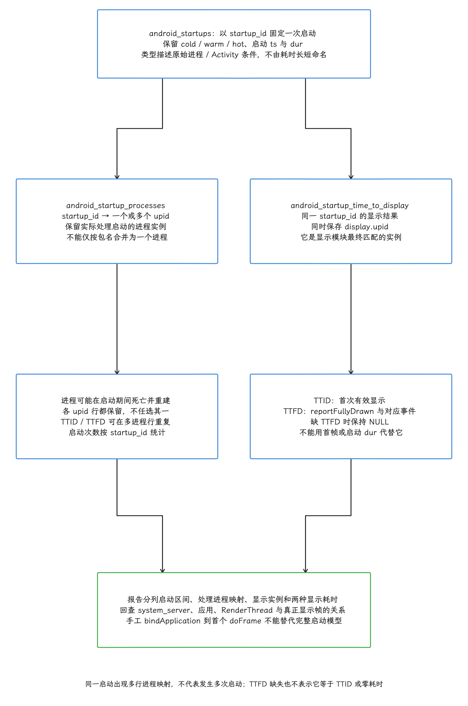

图：android_startups的startupid标识启动实例与cold/warm/hot类型，非时长分类。startup_processes可同一startup关联多个死亡重建upid，各行显示同一组TTID/TTFD，计数需按startupid；display.upid是显示模块实际匹配实例。TTID首次显示与TTFDreportFullyDrawn/对应事件不同，缺TTFD保留NULL不取首帧补；启动区间dur不同于两显示量。不可用bindApplication到首doFrame代全跨进程启动，需要system_server/RT/可见帧证据。

#### 标准库分解启动主线程时间

`android.startup.startup_breakdowns` 会把启动主线程 `slice` 与 `thread_state` 裁成互斥区间，并按标准库规则给每段生成 `reason`。这些原因是派生分类，属于标准库整理的结果，适合筛选候选原因；确认时仍要回到原始时间线和源码。

按启动和原因汇总耗时，可以找出 `Running`、`Runnable`、Binder、I/O、类加载等时间主要落在哪些区间。

```sql
INCLUDE PERFETTO MODULE android.startup.startup_breakdowns;

SELECT
  startups.startup_id,
  startups.startup_type,
  breakdown.reason,
  COUNT(*) AS interval_count,
  ROUND(SUM(breakdown.dur) / 1e6, 3) AS total_ms,
  ROUND(MAX(breakdown.dur) / 1e6, 3) AS longest_ms
FROM android_startups AS startups
JOIN android_startup_opinionated_breakdown AS breakdown
  USING (startup_id)
WHERE startups.package = 'com.example.app'
GROUP BY startups.startup_id, startups.startup_type, breakdown.reason
ORDER BY startups.startup_id, SUM(breakdown.dur) DESC;
```

模块源码明确建议采集 Binder、ART、`am` 和 `view` 事件。缺少这些数据时，原因分类会变粗：查询仍能执行，解释力会打折扣。


#### 启动区间内的 Binder 事务

启动期间的 Binder 调用需要同时满足进程映射与时间相交。仅按进程名搜索会混入启动之前、之后或旧进程实例的调用。

按启动实例汇总应用发起的 Binder 事务，可以区分同步等待与异步发送，并保留服务端进程和接口维度。

```sql
INCLUDE PERFETTO MODULE android.startup.startups;
INCLUDE PERFETTO MODULE android.binder;

SELECT
  startup.startup_id,
  startup.startup_type,
  binder.is_sync,
  binder.server_process,
  COALESCE(binder.interface, '<unresolved interface>') AS interface,
  COALESCE(binder.method_name, '<unresolved method>') AS method_name,
  COUNT(*) AS call_count,
  ROUND(SUM(binder.client_dur) / 1e6, 3) AS summed_full_client_ms,
  ROUND(SUM(MIN(binder.client_ts + binder.client_dur, startup.ts_end)
    - MAX(binder.client_ts, startup.ts)) / 1e6, 3) AS summed_overlap_ms,
  ROUND(MAX(binder.client_dur) / 1e6, 3) AS max_client_ms
FROM android_startups AS startup
JOIN android_startup_processes AS startup_process
  USING (startup_id)
JOIN android_binder_txns AS binder
  ON binder.client_upid = startup_process.upid
 AND binder.client_ts < startup.ts_end
 AND binder.client_ts + binder.client_dur > startup.ts
WHERE startup.package = 'com.example.app'
  AND binder.client_dur >= 0
GROUP BY
  startup.startup_id,
  startup.startup_type,
  binder.is_sync,
  binder.server_process,
  binder.interface,
  binder.method_name
ORDER BY startup.startup_id, summed_overlap_ms DESC;
```

各事务可能互相重叠，`summed_full_client_ms` 累加完整事务跨度，`summed_overlap_ms` 只累加与启动窗口的交集；两者都可能因并发或嵌套重复覆盖，算独占阻塞时间前要先归并；同步主线程事务更接近直接阻塞候选，后台线程或异步事务需要继续核对依赖关系。

<!-- gracker-diagram: ch14-07-24-startup-binder-intersection -->
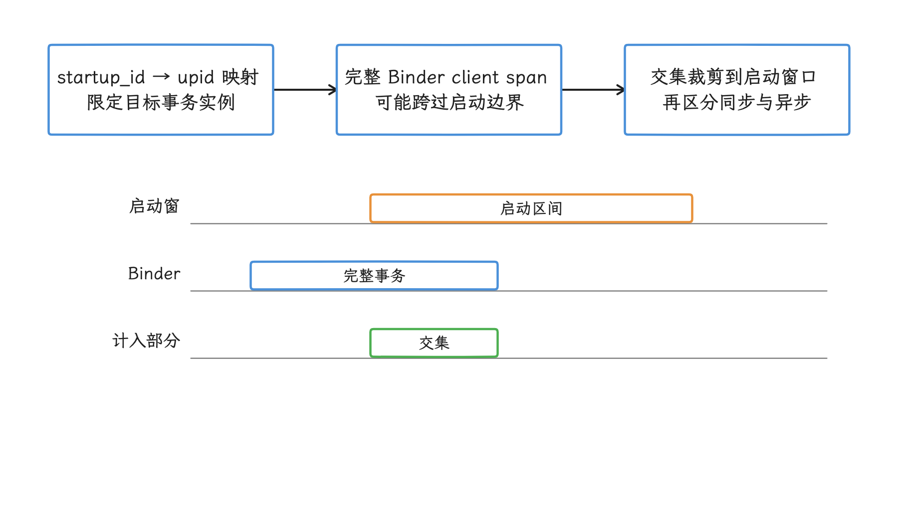

图：完整事务跨度和启动窗口内交集要分列，且并发事务可能重复覆盖。 两种时长都可能重复覆盖，独占阻塞要另算；后台和异步事务需再核对依赖。

### ANR（Application Not Responding，应用无响应） 分析

#### ANR 超时因类型而异

输入分发超时常见默认值为 5 秒，Broadcast、Service、JobService、前台服务和 `system_server` 看门狗使用不同规则；这里的看门狗是检测系统线程长时间无响应的超时机制。OEM（设备厂商）与前后台状态还可能改写超时。


`android.anrs` 模块会从 `system_server` 的 ErrorId、Subject 与计时事件中解析 `anr_type`、`anr_dur_ms` 和 `default_anr_dur_ms`；源码也明确标注默认值仅对应 AOSP（Android Open Source Project） / Pixel 的常见配置。

查询 Trace 中的 ANR，可以集中查看派生的类型、主题和时长；各列是解析结果，现场认定还要按下述方式核对。固定源码按 PID 连接 process，没有限制生存期；最近 timer 也是 PID 与时间上的候选，未知主题的 duration 还可能回退为 0。应按 ErrorId 检查重复与身份歧义，再核对平台日志、计时器和实际配置。


```sql
INCLUDE PERFETTO MODULE android.anrs;

SELECT
  ts,
  process_name,
  pid,
  upid,
  error_id,
  anr_type,
  anr_dur_ms,
  default_anr_dur_ms,
  ROUND(timer_delay / 1e6, 3) AS timer_delay_ms,
  subject,
  intent,
  component
FROM android_anrs
ORDER BY ts;
```

该表依赖对应平台事件被写入 Trace。表为空时，可以另查 `android_logs` 或外部 `bugreport` 诊断包，但日志与 Trace 需要有可校准的时间基准。`default_anr_dur_ms` 适合解释平台默认路径；设备现场的超时配置，以现场记录为准。

#### 从 ANR 时刻向前检查主线程

分析窗口应由 ANR 类型和现场信息决定。下面的模板选择目标进程最近一次 ANR，并向前查看 10 秒、向后查看 1 秒。两个窗口值是分析参数，运行前应按 `anr_dur_ms`、事件类型和 Trace 覆盖范围修改。

```sql
INCLUDE PERFETTO MODULE android.anrs;

WITH
  settings(process_name, lookback_ns, after_ns) AS (
    VALUES ('com.example.app', 10000000000, 1000000000)
  ),
  chosen_anr AS (
    SELECT DISTINCT a.process_name, a.pid, a.error_id, a.ts
    FROM android_anrs a JOIN settings s ON s.process_name = a.process_name
    ORDER BY a.ts DESC, a.error_id LIMIT 1
  ),
  resolved AS (
    SELECT a.*, CASE WHEN COUNT(p.upid) = 1 THEN MIN(p.upid) END AS resolved_upid,
      COUNT(p.upid) AS process_candidates,
      MIN(p.start_ts IS NOT NULL AND p.end_ts IS NOT NULL) AS all_bounds_known
    FROM chosen_anr a LEFT JOIN process p
      ON p.pid = a.pid AND p.name = a.process_name
     AND (p.start_ts IS NULL OR p.start_ts <= a.ts)
     AND (p.end_ts IS NULL OR a.ts < p.end_ts)
    GROUP BY a.process_name, a.pid, a.error_id, a.ts
  ),
  main_thread AS (
    SELECT MIN(t.utid) AS utid, COUNT(t.utid) AS main_candidates
    FROM resolved a JOIN thread t ON t.upid = a.resolved_upid
    WHERE a.process_candidates = 1
      AND (t.is_main_thread = 1 OR t.tid = a.pid)
  ),
  intersections AS (
    SELECT st.state, st.io_wait, st.blocked_function,
      st.dur = -1 AS is_open,
      MIN(CASE WHEN st.dur = -1 THEN trace_end() ELSE st.ts + st.dur END,
          a.ts + settings.after_ns, trace_end())
        - MAX(st.ts, a.ts - settings.lookback_ns, trace_start()) AS overlap_dur
    FROM resolved a CROSS JOIN settings CROSS JOIN main_thread mt
    JOIN thread_state st ON st.utid = mt.utid AND mt.main_candidates = 1
    WHERE a.process_candidates = 1
      AND st.ts < MIN(a.ts + settings.after_ns, trace_end())
      AND CASE WHEN st.dur = -1 THEN trace_end() ELSE st.ts + st.dur END
        > MAX(a.ts - settings.lookback_ns, trace_start())
  ),
  totals AS (
    SELECT state, io_wait, blocked_function, COUNT(*) AS interval_count,
      SUM(CASE WHEN is_open THEN 1 ELSE 0 END) AS assumed_end_intervals,
      SUM(overlap_dur) / 1e6 AS total_ms, MAX(overlap_dur) / 1e6 AS longest_ms
    FROM intersections WHERE overlap_dur > 0
    GROUP BY state, io_wait, blocked_function
  )
SELECT a.error_id, a.ts AS anr_ts, a.pid, a.resolved_upid,
  a.process_candidates, mt.main_candidates, a.all_bounds_known,
  CASE WHEN a.process_candidates = 0 THEN 'no_compatible_process'
       WHEN a.process_candidates > 1 THEN 'ambiguous_process'
       WHEN mt.main_candidates != 1 THEN 'missing_or_ambiguous_main'
       ELSE 'single_compatible_candidate' END AS identity_status,
  totals.*
FROM resolved a CROSS JOIN main_thread mt LEFT JOIN totals ON 1
ORDER BY total_ms DESC;
```

结果的解释依赖状态：大量 `Running` 要结合调用栈和 `slice` 找 CPU 工作；大量 `R` / `R+` 指向调度排队；`D` 且 `io_wait = 1` 指向内核 I/O 等待；`S` 还需检查 Binder 回复、`futex`（用户空间同步原语发生争用时使用的内核等待机制）、monitor contention 与应用等待事件。`blocked_function` 记录的是内核侧阻塞点，Java 层持锁者不在它的视野内。


### 锁竞争与同步分析

#### Monitor contention 提供阻塞方与持锁方

Monitor contention 指线程进入 Java `synchronized` 代码时，对象锁已被其他线程持有而发生等待。ART 会把这类锁竞争记录成带方法信息的 `slice`；`android.monitor_contention` 模块解析阻塞线程、持锁线程、方法、源码位置、锁名和 Binder 回复关系。`lock_name` 已是标准表字段，但它来自周围 `slice` 的解析，缺失时应回到 `blocking_method` 与 `blocked_method`。

列出目标进程最长的 monitor 锁竞争，可以同时确认谁被阻塞、谁持锁，以及主线程是否参与。

```sql
INCLUDE PERFETTO MODULE android.monitor_contention;

SELECT
  upid,
  id,
  ts,
  ROUND(dur / 1e6, 3) AS wait_ms,
  lock_name,
  blocked_thread_name,
  blocked_thread_tid,
  blocked_method,
  blocked_src,
  blocking_thread_name,
  blocking_thread_tid,
  blocking_method,
  blocking_src,
  waiter_count,
  is_blocked_thread_main,
  is_blocking_thread_main,
  binder_reply_id
FROM android_monitor_contention
WHERE upid = 123
  AND dur >= 0
ORDER BY dur DESC
LIMIT 30;
```

`waiter_count` 来自 ART 在竞争入口执行 `num_waiters_.fetch_add(1)` 得到的旧计数，0 表示当时此前没有等待者；它不是固定排队编号，也代表不了整个线程池的等待人数。`binder_reply_id` 有值时，持锁工作可能发生在 Binder 服务线程，应继续检查对应事务和持锁线程状态。

<!-- gracker-diagram: ch14-07-28-monitor-owner-information -->
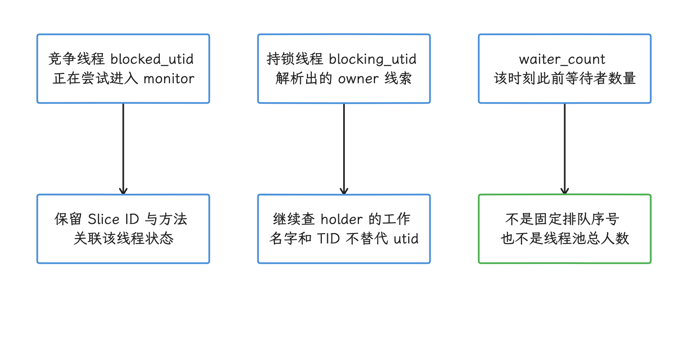

图：monitor 语义表从 ART Slice 中解析竞争线程、持锁线程、方法与位置。 waiter_count 是入口原子计数的旧值，0 不表示线程池总等待数为 0。

#### 锁等待与帧的交集关联

锁等待可能从 `doFrame` 开始前一直延续到回调内，也可能在回调结束后仍然存在，起止可能跨在回调两侧。按“contention 完全包含于 `doFrame`”过滤会漏掉两端跨界的事件；我们直接计算两个半开区间的交集，把跨界的部分也接住。

统计每个应用帧的 `doFrame` 中，UI 线程被 monitor 锁竞争覆盖的时间，可以识别锁等待与慢帧的时间相关性。查询不预设固定毫秒阈值。

```sql
INCLUDE PERFETTO MODULE android.frames.timeline;
INCLUDE PERFETTO MODULE android.frames.per_frame_metrics;
INCLUDE PERFETTO MODULE android.monitor_contention;

WITH lock_overlap AS (
  SELECT
    frames.upid,
    frames.frame_id,
    do_frame.dur AS do_frame_dur,
    contention.id AS contention_id,
    contention.lock_name,
    contention.blocking_thread_name,
    MIN(do_frame.ts + do_frame.dur, contention.ts + contention.dur)
      - MAX(do_frame.ts, contention.ts) AS overlap_dur
  FROM android_frames AS frames
  JOIN slice AS do_frame
    ON do_frame.id = frames.do_frame_id
  JOIN android_monitor_contention AS contention
    ON contention.blocked_utid = frames.ui_thread_utid
   AND contention.ts < do_frame.ts + do_frame.dur
   AND contention.ts + contention.dur > do_frame.ts
  WHERE frames.upid = 123
    AND frames.dur >= 0
    AND do_frame.dur >= 0
    AND contention.dur >= 0
)
SELECT
  frames.upid,
  frames.frame_id,
  ROUND(frames.dur / 1e6, 3) AS frame_wall_ms,
  ROUND(lock_overlap.do_frame_dur / 1e6, 3) AS do_frame_ms,
  ROUND(overrun.overrun / 1e6, 3) AS deadline_overrun_ms,
  COUNT(lock_overlap.contention_id) AS contention_count,
  ROUND(SUM(lock_overlap.overlap_dur) / 1e6, 3) AS lock_overlap_ms,
  GROUP_CONCAT(DISTINCT lock_overlap.lock_name) AS lock_names
FROM android_frames AS frames
JOIN lock_overlap
  USING (upid, frame_id)
LEFT JOIN android_frames_overrun AS overrun
  USING (frame_id)
WHERE frames.upid = 123
GROUP BY
  frames.upid,
  frames.frame_id,
  frames.dur,
  lock_overlap.do_frame_dur,
  overrun.overrun
ORDER BY lock_overlap_ms DESC;
```

同一段 `doFrame` 中的多个锁等待通常不会在同一个 UI 线程上重叠，若采集数据或解析结果出现重叠，简单求和可能超过回调时长。遇到这种情况要检查原始 `slice`，或先把重叠区间归并后再求和。


### `SPAN_JOIN` 与跨维度时间关联

#### `SPAN_JOIN` 计算两个区间流的交集

`SPAN_JOIN` 接受两张至少含 `ts`、`dur` 的表或视图，并输出它们的时间交集。`PARTITIONED cpu` 会先按 CPU 编号分组，只让编号相同的区间求交。每张输入表在同一分区内必须互不重叠，普通业务 `slice` 经常嵌套，直接交给 `SPAN_JOIN` 会破坏这个前提；而违反约束时 Perfetto 未必报错，结果可能静默出错。


CPU 运行区间和 CPU 频率区间是典型用法。`sched` 已按 CPU 给出不重叠运行片段；`counter` 需要用下一采样点补出 `dur`。把两者交给 `SPAN_JOIN`，可计算目标进程每个线程在各 CPU 频率上的运行时间。

```sql
INCLUDE PERFETTO MODULE linux.cpu.frequency;

CREATE PERFETTO VIEW cookbook_sched AS
SELECT ts, dur, ucpu, utid FROM sched
WHERE dur > 0 AND ucpu IS NOT NULL;

CREATE PERFETTO VIEW cookbook_frequency AS
SELECT ts, dur, ucpu, cpu, track_id AS frequency_track_id, freq AS freq_khz
FROM cpu_frequency_counters
WHERE dur > 0 AND freq IS NOT NULL
  AND ucpu IN (
    SELECT ucpu FROM cpu_frequency_counters
    GROUP BY ucpu HAVING COUNT(DISTINCT track_id) = 1
  );

CREATE VIRTUAL TABLE cookbook_sched_with_frequency
USING SPAN_JOIN(
  cookbook_sched PARTITIONED ucpu,
  cookbook_frequency PARTITIONED ucpu
);

SELECT process.upid, thread.utid, thread.tid,
  process.name AS process_name, thread.name AS thread_name,
  joined.ucpu, joined.cpu, joined.frequency_track_id, joined.freq_khz,
  ROUND(SUM(joined.dur) / 1e6, 3) AS running_ms
FROM cookbook_sched_with_frequency AS joined
JOIN thread USING (utid) JOIN process USING (upid)
WHERE process.upid = 123
GROUP BY process.upid, thread.utid, thread.tid, process.name, thread.name,
  joined.ucpu, joined.cpu, joined.frequency_track_id, joined.freq_khz
ORDER BY running_ms DESC;
```

该脚本会在当前 SQL 会话创建对象，重复执行前要删除对象或更换名称。它只接受每个 ucpu 一条频率轨道；多轨 CPU 被排除，先用 `COUNT(DISTINCT track_id)` 检查被排除范围，并保留覆盖率。`cpufreq` 只在频率事件或轮询数据存在时有结果；事件驱动采集还可能缺失 Trace 开头的初始频率。空结果先怀疑频率数据缺失，CPU 可能仍在运行。


#### 哪些区间流适合做交集

monitor contention slice 覆盖 ART 记录的整段竞争过程，对应到内核状态时，除了睡眠还可能包含别的阶段。固定 `Monitor::Lock()` 在改变线程状态、获取锁之前开始 ATrace，在恢复可运行并更新持锁信息后结束；因此同一 `utid` 的 contention slice 可与 `Running` 相交。先与 `thread_state` 分解运行、Runnable 和睡眠，再只给实际 Running 片段关联 CPU 频率。空交集只描述本次窗口，据此还总结不出“锁竞争与运行必然互斥”的规则。

<!-- gracker-diagram: ch14-07-30-monitor-includes-running -->
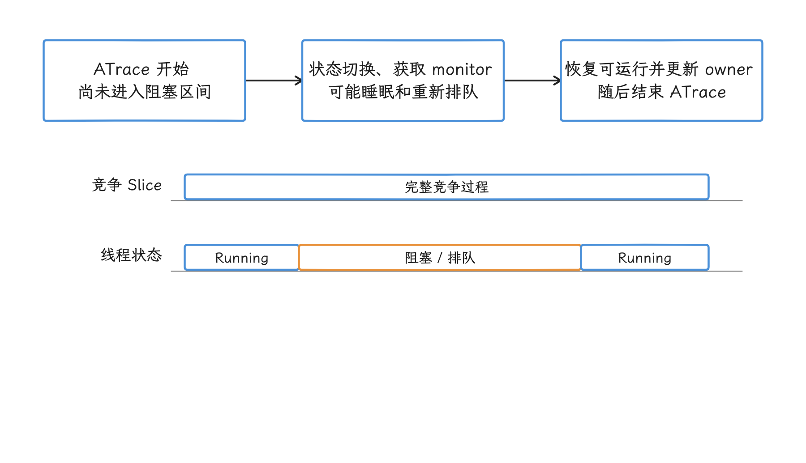

图：ART 的竞争 Slice 包住阻塞前后处理，可能与 Running、Runnable 和睡眠相交。 contention 与 sched 的互斥关系要按交集验证；只对实际 Running 交集关联频率。

帧分析可以按以下关系组织：


1. 用 `android_frames` 取得帧窗口、`doFrame` 和 UI / `RenderThread` 的 `utid`。
2. 把 `doFrame` 与 UI 线程的 `thread_state` 相交，得到 `Running`、`Runnable`、睡眠与 I/O 等待时间。
3. 把 `doFrame` 与 `android_monitor_contention` 相交，得到锁等待覆盖时间。
4. 只对 `Running` 片段关联 `sched` 和 `cpufreq`，解释线程获得 CPU 后运行在哪个频率。

每段 `doFrame` 的 UI 线程状态分解和锁等待覆盖可以筛出后续要检查的帧；CPU 频率仍使用上一段 `SPAN_JOIN` 结果按时间窗另行关联。

```sql
INCLUDE PERFETTO MODULE android.frames.timeline;
INCLUDE PERFETTO MODULE android.frames.per_frame_metrics;
INCLUDE PERFETTO MODULE android.monitor_contention;

WITH
  target_frames AS (
    SELECT
      frames.*,
      do_frame.ts AS do_frame_ts,
      do_frame.dur AS do_frame_dur
    FROM android_frames AS frames
    JOIN slice AS do_frame
      ON do_frame.id = frames.do_frame_id
    WHERE frames.upid = 123
      AND frames.dur >= 0
      AND do_frame.dur >= 0
  ),
  state_overlap AS (
    SELECT
      frames.upid,
      frames.frame_id,
      states.state,
      states.io_wait,
      MIN(
        frames.do_frame_ts + frames.do_frame_dur,
        CASE
          WHEN states.dur = -1 THEN trace_end()
          ELSE states.ts + states.dur
        END
      ) - MAX(frames.do_frame_ts, states.ts) AS overlap_dur
    FROM target_frames AS frames
    JOIN thread_state AS states
      ON states.utid = frames.ui_thread_utid
     AND states.ts < frames.do_frame_ts + frames.do_frame_dur
     AND CASE
           WHEN states.dur = -1 THEN trace_end()
           ELSE states.ts + states.dur
         END > frames.do_frame_ts
  ),
  state_totals AS (
    SELECT
      upid,
      frame_id,
      SUM(CASE WHEN state = 'Running' THEN overlap_dur ELSE 0 END) AS running_dur,
      SUM(CASE WHEN state IN ('R', 'R+') THEN overlap_dur ELSE 0 END) AS runnable_dur,
      SUM(
        CASE
          WHEN state = 'D' AND io_wait = 1 THEN overlap_dur
          ELSE 0
        END
      ) AS io_wait_dur,
      SUM(
        CASE
          WHEN state = 'S' THEN overlap_dur
          ELSE 0
        END
      ) AS interruptible_sleep_dur
    FROM state_overlap
    GROUP BY upid, frame_id
  ),
  lock_totals AS (
    SELECT
      frames.upid,
      frames.frame_id,
      COUNT(*) AS contention_count,
      SUM(
        MIN(
          frames.do_frame_ts + frames.do_frame_dur,
          contention.ts + contention.dur
        ) - MAX(frames.do_frame_ts, contention.ts)
      ) AS lock_overlap_dur
    FROM target_frames AS frames
    JOIN android_monitor_contention AS contention
      ON contention.blocked_utid = frames.ui_thread_utid
     AND contention.ts < frames.do_frame_ts + frames.do_frame_dur
     AND contention.ts + contention.dur > frames.do_frame_ts
    WHERE contention.dur >= 0
    GROUP BY frames.upid, frames.frame_id
  )
SELECT
  frames.upid,
  frames.frame_id,
  frames.ts,
  ROUND(frames.dur / 1e6, 3) AS frame_wall_ms,
  ROUND(frames.do_frame_dur / 1e6, 3) AS do_frame_ms,
  ROUND(overrun.overrun / 1e6, 3) AS deadline_overrun_ms,
  ROUND(state_totals.running_dur / 1e6, 3) AS running_ms,
  ROUND(state_totals.runnable_dur / 1e6, 3) AS runnable_ms,
  ROUND(state_totals.io_wait_dur / 1e6, 3) AS io_wait_ms,
  ROUND(
    state_totals.interruptible_sleep_dur / 1e6,
    3
  ) AS interruptible_sleep_ms,
  COALESCE(lock_totals.contention_count, 0) AS observed_contention_count,
  ROUND(COALESCE(lock_totals.lock_overlap_dur, 0) / 1e6, 3) AS observed_lock_ms
FROM target_frames AS frames
LEFT JOIN android_frames_overrun AS overrun
  USING (frame_id)
LEFT JOIN state_totals
  USING (upid, frame_id)
LEFT JOIN lock_totals
  USING (upid, frame_id)
ORDER BY overrun.overrun DESC, frames.ts;
```

状态总量接近 `do_frame_ms`，说明调度事件覆盖较完整；差值较大时应检查 Trace 是否从区间中途开始、是否有数据丢失，或 UI 线程标识是否正确。锁竞争是与调度状态相交的业务原因维度，记录区间还可能包含 Running 和 Runnable，与各状态时长相加会重复计数。没有匹配到锁 slice 只表示“未观察到”，还需核对 ART 采集与解析覆盖。

### I/O：把线程等待与块设备活动分开

块设备事件描述请求何时进入和离开设备队列，文件系统事件描述更高层的读写、同步和页操作。线程进入 `D` 状态还不足以归因到存储，块设备繁忙也不足以说明请求来自目标进程；把线程等待和设备活动关联起来，才能同时回答这两个问题。

录制前先检查目标设备公开的文件系统和块事件：

```bash
adb shell 'cat /sys/kernel/tracing/available_events' \
  | grep -E '^(block|f2fs|ext4|erofs):'
```

设备输出决定 `ftrace_events` 能配置哪些事件。采集结束后先查 `stats` 中 `name = 'ftrace_setup_errors'` 的汇总，再查看 `metadata` 中同名详情。`unknown_ftrace_events` 与 `failed_ftrace_events` 是 setup 报告字段，不是固定 `stats.name`；还要另查 per-CPU overrun 等录制期间丢数。否则容易把未启用或丢失的数据误读成“没有 I/O”。


标准库的 `linux.block_io` 模块可以按设备查看仍在队列或设备中的活动请求：

```sql
INCLUDE PERFETTO MODULE linux.block_io;

SELECT
  ts,
  linux_device_major_id(dev) AS major_id,
  linux_device_minor_id(dev) AS minor_id,
  ops_in_queue_or_device
FROM linux_active_block_io_operations_by_device
WHERE ops_in_queue_or_device > 0
ORDER BY ts;
```

这张表回答“哪台块设备在何时有多少请求”，不含应用进程和文件路径。应用归因至少还需要以下依据中的两类：


- 目标线程的文件、SQLite、资源加载或自定义 Trace slice 与设备活动重叠；
- 同一区间的 `thread_state` 为 `D`，并且 `sched_blocked_reason` 或内核调用栈指向块层、文件系统或页故障路径；
- 文件系统事件携带的 inode（文件系统对象编号）、设备或操作类型与块设备请求相符；
- 停止目标操作或切换到对照场景后，线程等待和设备压力同步变化。

`SharedPreferences.commit()` 会同步等待结果；`apply()` 虽先更新内存并安排磁盘写入，但 Android 用来管理延后任务的 `QueuedWork` 仍可能在组件停止时等待后台任务。SQLite 事务、`fsync`（把修改强制写回持久存储）、首次资源页故障和系统回写也要按各自事件验证。

全量 `raw_syscalls/sys_enter` / `sys_exit` 事件率很高，只应在短窗口、足够大的缓冲区和明确复现场景下启用。

### 功耗：联合频率、空闲、Suspend 与唤醒锁

CPU 频率高只表示策略选择了较高频点，是否在持续执行大量工作要看运行时间。调度负载、Governor（动态选择 CPU 频率的策略）、Boost（短时提高性能档位的机制）、热限制、CPU 容量和任务所在核心集群都会影响频率。功耗分析至少要联合 CPU 运行时间、频率、空闲状态、Suspend（整机进入低功耗休眠）和唤醒锁；唤醒锁用于要求系统保持唤醒。


下面的配置片段面向单机器 Trace，采集频率、空闲、系统休眠和内核唤醒锁；buffer 与时长仍需按目标设备的数据率调整。后续 suspend/唤醒锁模板在多机器输入上停止输出，需先拆分来源；频率模板则显式保留 ucpu。

```protobuf
data_sources {
  config {
    name: "linux.ftrace"
    ftrace_config {
      ftrace_events: "sched/sched_switch"
      ftrace_events: "power/cpu_frequency"
      ftrace_events: "power/cpu_idle"
      ftrace_events: "power/suspend_resume"
      ftrace_events: "power/wakeup_source_activate"
      ftrace_events: "power/wakeup_source_deactivate"
    }
  }
}

data_sources {
  config {
    name: "android.kernel_wakelocks"
    kernel_wakelocks_config { poll_ms: 1000 }
  }
}
```

部分设备不会公开完整的 suspend、wakeup source（内核记录的唤醒来源）或 idle 事件。USB 调试连接本身也可能阻止设备进入完整系统休眠，测试记录必须注明供电与连接方式。

下面的查询把系统休眠区间与唤醒锁累计持有时间放进同一结果集：

```sql
INCLUDE PERFETTO MODULE android.suspend;
INCLUDE PERFETTO MODULE android.kernel_wakelocks;

WITH power_summary AS (
  SELECT
    'suspend_state' AS category,
    power_state AS item,
    SUM(dur) AS total_dur
  FROM android_suspend_state
  WHERE machine_id = 0 AND (SELECT COUNT(*) FROM machine) = 1
  GROUP BY power_state

  UNION ALL

  SELECT
    'wakelock:' || type AS category,
    name AS item,
    SUM(held_dur) AS total_dur
  FROM android_kernel_wakelocks
  WHERE (SELECT COUNT(*) FROM machine) = 1
  GROUP BY name, type
)
SELECT
  category,
  item,
  ROUND(total_dur / 1e9, 3) AS total_s
FROM power_summary
ORDER BY category, total_dur DESC;
```

`android_suspend_state` 从已有 suspend 事件派生区间，再补出 awake 空档；主机器完全没有有效 suspend slice 时，会把整段 Trace 回退为 awake，这既说明不了采集完整，也说明不了设备从未休眠。`android_kernel_wakelocks.held_dur` 来自相邻累计计数值之差，描述采样区间内累计持有时间，还原不了每一次 acquire/release 的确切时刻；末点、缺口、重置和同名不同 type 都需单列。唤醒锁持有与耗电相关，但仍需找到持有者和同一区间中的实际工作。


CPU 频率应按区间做时间加权；直接平均离散采样点，会让持续时间不同的频点获得相同权重：

```sql
INCLUDE PERFETTO MODULE linux.cpu.frequency;

SELECT
  ucpu,
  cpu,
  ROUND(SUM(1.0 * freq * dur) / SUM(dur) / 1000.0, 1) AS weighted_avg_mhz,
  ROUND(MAX(freq) / 1000.0, 1) AS max_mhz,
  ROUND(SUM(dur) / 1e9, 3) AS covered_s
FROM cpu_frequency_counters
WHERE freq IS NOT NULL AND dur > 0
GROUP BY ucpu, cpu
ORDER BY ucpu, cpu;
```

`freq` 的单位是 kHz。加权平均频率适合比较相同设备和场景中的策略结果，做能量估算还不够：CPU 可能高频空闲，也可能低频持续运行。还要关联 `cpu_idle_counters`、`sched`、功率轨（芯片不同供电域的测量通道）和电池电流。系统进不了 Suspend 时，再按时间顺序检查显示状态、用户空间 / 内核唤醒锁、活跃定时器和 `android.wakeups` 给出的唤醒或休眠失败原因。


### 跨进程关联使用稳定标识

启动、Binder 和显示都跨进程。启动使用 `startup_id` 与 `android_startup_processes.upid`；Binder 使用 `binder_txn_id` / `binder_reply_id`；帧使用 `surface_frame_token`、`display_frame_token` 与 flow 关系；调度使用 `utid` / `upid`。

PID、TID、进程名和线程名只用于筛选与展示，唯一身份交给上面这些稳定标识。


跨进程区间应来自同一录制会话。合并不同设备或不同会话的 Trace 时，必须有可验证的时钟快照和同步事件；时钟快照记录同一已知时刻在不同时间基准下的数值，用于建立换算关系。只按文件起点平移，毫秒级的因果判断就靠不住了。

### 从 SQL 排名到可复查结论

SQL 排名适合缩小范围，性能结论仍要经过时间、线程、事件和源码四项核对：

1. 记录 Trace 文件、采集配置、设备构建、刷新率、场景步骤和 Trace Processor 版本。
2. 从 FrameTimeline 判定、启动实例或 ANR 事件选定时间窗，避免先看整份 Trace 中排名前 N 的全局结果。
3. 用 `upid`、`utid` 和事件 `id` 固定对象；进程名与线程名只用于筛选和展示。
4. 用 `thread_state` 判断时间花在 `Running`、`Runnable` 还是等待，再选择采样栈、Binder、GC、锁或 I/O 查询。
5. 回到 Perfetto UI 检查事件的父子关系、相邻事件与数据缺口。
6. 用平台源码和内核基线确认追踪点语义；缺少依据时保留为候选原因。

一条可复查的结论应写成：“FrameTimeline 将帧 842 标记为 `App Deadline Missed`；该帧 UI 线程有 6.2 ms 的 `R` 状态，其中最长区间由某线程唤醒；同窗口未发现 monitor 锁竞争。”数字必须来自具体 Trace；教程中的示例参数照抄成产品阈值、时间相关性写成因果关系，都是常见错误。


### 基础查询部分的源码与文档依据

- [PerfettoSQL 入门与 `SPAN_JOIN`](https://perfetto.dev/docs/analysis/perfetto-sql-getting-started)
- [PerfettoSQL 语法与模块加载](https://perfetto.dev/docs/analysis/perfetto-sql-syntax)
- [Trace Processor 基础表：`slice`、`sched`、`thread_state`](https://perfetto.dev/docs/analysis/sql-tables)
- [CPU 调度数据源与线程状态编码](https://perfetto.dev/docs/data-sources/cpu-scheduling)
- [FrameTimeline 数据源与原始表](https://perfetto.dev/docs/data-sources/frametimeline)
- [CPU 频率数据源与 `cpufreq` 计数器](https://perfetto.dev/docs/data-sources/cpu-freq)
- [Android 17 `android.frames.timeline` 标准库源码](https://android.googlesource.com/platform/external/perfetto/+/refs/tags/android-17.0.0_r1/src/trace_processor/perfetto_sql/stdlib/android/frames/timeline.sql)
- [Android 17 `android.frames.per_frame_metrics` 标准库源码](https://android.googlesource.com/platform/external/perfetto/+/refs/tags/android-17.0.0_r1/src/trace_processor/perfetto_sql/stdlib/android/frames/per_frame_metrics.sql)
- [Android 17 `android.binder` 标准库源码](https://android.googlesource.com/platform/external/perfetto/+/refs/tags/android-17.0.0_r1/src/trace_processor/perfetto_sql/stdlib/android/binder.sql)
- [Android 17 `android.garbage_collection` 标准库源码](https://android.googlesource.com/platform/external/perfetto/+/refs/tags/android-17.0.0_r1/src/trace_processor/perfetto_sql/stdlib/android/garbage_collection.sql)
- [Android 17 `android.startup.startups` 标准库源码](https://android.googlesource.com/platform/external/perfetto/+/refs/tags/android-17.0.0_r1/src/trace_processor/perfetto_sql/stdlib/android/startup/startups.sql)
- [Android 17 `android.startup.time_to_display` 标准库源码](https://android.googlesource.com/platform/external/perfetto/+/refs/tags/android-17.0.0_r1/src/trace_processor/perfetto_sql/stdlib/android/startup/time_to_display.sql)
- [Android 17 `android.anrs` 标准库源码](https://android.googlesource.com/platform/external/perfetto/+/refs/tags/android-17.0.0_r1/src/trace_processor/perfetto_sql/stdlib/android/anrs.sql)
- [Android 17 ART Monitor 的实际竞争区间](https://android.googlesource.com/platform/art/+/android-17.0.0_r1/runtime/monitor.cc)
- [Android 17 ftrace setup 自诊断字段](https://android.googlesource.com/platform/external/perfetto/+/android-17.0.0_r1/src/trace_processor/storage/stats.h)
- [Android 17 `android.monitor_contention` 标准库源码](https://android.googlesource.com/platform/external/perfetto/+/refs/tags/android-17.0.0_r1/src/trace_processor/perfetto_sql/stdlib/android/monitor_contention.sql)
- [Android 17 `linux.block_io` 标准库源码](https://android.googlesource.com/platform/external/perfetto/+/refs/tags/android-17.0.0_r1/src/trace_processor/perfetto_sql/stdlib/linux/block_io.sql)
- [Android 17 `android.suspend` 标准库源码](https://android.googlesource.com/platform/external/perfetto/+/refs/tags/android-17.0.0_r1/src/trace_processor/perfetto_sql/stdlib/android/suspend.sql)
- [Android 17 `android.kernel_wakelocks` 标准库源码](https://android.googlesource.com/platform/external/perfetto/+/refs/tags/android-17.0.0_r1/src/trace_processor/perfetto_sql/stdlib/android/kernel_wakelocks.sql)
- [Android 17 kernel 6.18 `sched` tracepoint 定义](https://android.googlesource.com/kernel/common/+/refs/tags/android17-6.18-2026-06_r6/include/trace/events/sched.h)


## 时间跨度关联与窗口函数

基础查询定位对象之后，我们用 SPAN_JOIN 的重叠区间回答多个轨道在同一时刻发生了什么；排序、累计和相邻事件计算则交给窗口函数。

区间关联最容易出现“SQL 能运行，数字却多算或少算”的问题。帧、线程调度状态和锁等待已经用 `ts` 与 `dur` 定义区间，结束时间才写成 `ts + dur`；CPU 频率、内存等计数器只有采样时刻，要先补出有效区间。输入区间一旦重叠、分区键选错或末端边界没有定义，`SPAN_JOIN` 不会替查询者修正语义。

本节示例基于文首基线的 PerfettoSQL 标准库与 `span_join_operator` 约束。分析历史版本时，按对应字段差异调整查询，结论也不套用高于目标版本的平台假设。

### `SPAN_JOIN` 处理区间交集

Perfetto 把含 `ts` 和 `dur` 的一行称为时间段（`span`）。区间采用半开形式 `[ts, ts + dur)`，即包含起点、不包含终点；相邻区间在同一个端点接触时，交集长度为零。`slice`、`sched` 和 `thread_state` 已经是时间段，`counter` 表中仍是离散采样点。

普通 SQL 也能计算交集。两段时间相交的条件为 `a.ts < b.end_ts AND b.ts < a.end_ts`，交集起点取两个起点的较大值，终点取两个终点的较小值。下面用固定数据验证这套公式，便于观察边界。

```sql
WITH
  table_a(id, ts, dur) AS (
    VALUES
      (1, 10, 10),
      (2, 30, 10)
  ),
  table_b(id, ts, dur) AS (
    VALUES
      (11, 15, 20),
      (12, 40, 5)
  )
SELECT
  table_a.id AS a_id,
  table_b.id AS b_id,
  MAX(table_a.ts, table_b.ts) AS overlap_ts,
  MIN(
    table_a.ts + table_a.dur,
    table_b.ts + table_b.dur
  ) - MAX(table_a.ts, table_b.ts) AS overlap_dur
FROM table_a
JOIN table_b
  ON table_a.ts < table_b.ts + table_b.dur
 AND table_b.ts < table_a.ts + table_a.dur
ORDER BY a_id, b_id;
```

第一段交集是 `[15, 20)`，时长为 5。`table_a` 的第二段结束于 40，`table_b` 的第二段从 40 开始，两者只接触端点，因此不会输出一行。对小表或可能嵌套的事件，普通区间条件通常更容易保留事件身份。

<!-- gracker-diagram: ch14-07-41-span-toy-intersection -->
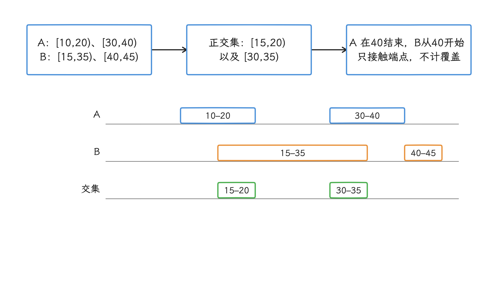

图：合成 SQL 中相交区间取较大起点和较小终点，首尾相接不输出正交集。 图上数值对应教程合成输入，不是设备性能时间。

`SPAN_JOIN` 把交集计算实现为虚拟表算子：查询时由 Trace Processor 动态生成行，不在数据库中保存一份实体表。它会将两侧区间按时间切开，并把两侧除 `ts`、`dur` 和分区键以外的列带到结果中。下面的合成数据演示按整数分区关联。

```sql
CREATE PERFETTO TABLE demo_left (
  ts TIMESTAMP,
  dur DURATION,
  part_id LONG,
  left_name STRING
) AS
WITH data(ts, dur, part_id, left_name) AS (
  VALUES
    (10, 10, 1, 'left-a'),
    (30, 10, 1, 'left-b'),
    (10, 10, 2, 'left-c')
)
SELECT * FROM data;

CREATE PERFETTO TABLE demo_right (
  ts TIMESTAMP,
  dur DURATION,
  part_id LONG,
  right_name STRING
) AS
WITH data(ts, dur, part_id, right_name) AS (
  VALUES
    (15, 20, 1, 'right-a'),
    (12, 4, 2, 'right-b')
)
SELECT * FROM data;

CREATE VIRTUAL TABLE demo_intersection
USING SPAN_JOIN(
  demo_left PARTITIONED part_id,
  demo_right PARTITIONED part_id
);

SELECT
  ts,
  dur,
  part_id,
  left_name,
  right_name
FROM demo_intersection
ORDER BY part_id, ts;
```

分区 1 会输出 `[15, 20)` 与 `[30, 35)`，分区 2 会输出 `[12, 16)`。脚本会在当前 Trace Processor 会话创建对象；重复运行前要删除这些对象或更换名称。


#### 同分区区间的互斥约束

实现会按分区和 `ts` 推进两侧游标；游标是逐行读取查询结果的位置。为了保持这一算法的成本可控，算子要求同一输入表、同一分区内的时间段互不重叠；源码和官方文档都明确说明，违反约束时可能静默产生错误行，算子不会主动报错。

输入还要满足以下条件：


- 底层算子要求两侧都有 `ts`，且至少一侧有 `dur`。缺少 `dur` 的一侧只按采样时刻参与匹配，不会自动延续到下一条记录；区间分析应为两侧都显式提供 `dur`。
- `dur` 应大于零；`dur = -1` 的开放区间要先裁到查询窗口或 `trace_end()`。
- 分区列必须是整数、取值非空；固定算子会跳过 NULL 分区行，字符串分区会报错。两侧都分区时，列名必须相同；除 `ts`、`dur` 和共同分区键外，两侧同名输出列会使创建失败，需先重命名。
- 分区键必须表达同一种实体，例如 `ucpu` 对 `ucpu`、`utid` 对 `utid`。
- 只给一侧分区也受支持，未分区表会分别与每个分区求交。

字符串可以用 `HASH()` 转成整数，但哈希只解决列类型。两个字符串字段的业务含义不同，转成整数后依旧不具备关联关系；自动化查询还应评估哈希碰撞，也就是不同字符串得到同一整数的风险是否可接受。

### 用窗口函数把计数器点变成时间段

计数器在 `ts` 处记录“数值从此刻开始变为 `value`”。所谓前向有效区间，是把这个值视为从当前 `ts` 持续到下一条记录，即 `[当前 ts, 下一条 ts)`；同一轨道的末条记录延续到明确的窗口末端。

窗口函数 `LEAD()` 必须按 `track_id` 分组，并按 `(ts, id)` 稳定排序。同轨同时间戳的较早记录生成零时长，保留该时刻最后一条记录向前延续；若这套 tie-break 满足不了项目要求，需把重复时间戳标成歧义。按 `ucpu` 做交集前，还须确认每个 ucpu 只有一条已选择的频率轨道，避免多轨重叠。

<!-- gracker-diagram: ch14-07-44-counter-leading-interval -->
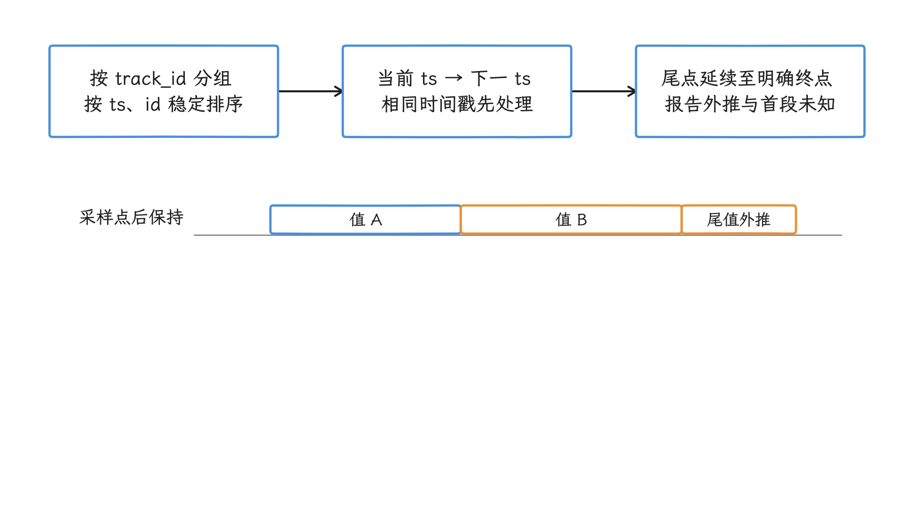

图：同轨按 ts/id 稳定排序，从当前点延续到下一点，再按窗口裁剪。 同时间戳较早记录形成零时长；若不接受最后 ID 规则，应标成歧义。

手工把 `cpufreq` 计数器转成前向区间，并通过 `cpu` 表取得跨机器 Trace 也唯一的 `ucpu`，可以核对标准库的输入语义。

```sql
WITH frequency_points AS (
  SELECT
    counter.id AS counter_id,
    counter.ts,
    LEAD(counter.ts) OVER (
      PARTITION BY counter.track_id
      ORDER BY counter.ts, counter.id
    ) AS next_ts,
    counter.track_id,
    cpu_desc.ucpu,
    track.cpu,
    CAST(counter.value AS INTEGER) AS freq_khz
  FROM counter
  JOIN cpu_counter_track AS track
    ON track.id = counter.track_id
  JOIN cpu AS cpu_desc
    ON cpu_desc.machine_id IS track.machine_id
   AND cpu_desc.cpu = track.cpu
  WHERE track.name = 'cpufreq'
)
SELECT
  counter_id, track_id,
  ts,
  COALESCE(next_ts, trace_end()) - ts AS dur,
  ucpu,
  cpu,
  freq_khz
FROM frequency_points
WHERE COALESCE(next_ts, trace_end()) > ts
ORDER BY ucpu, ts;
```

`cpu` 是单机中常见的逻辑 CPU 编号，`ucpu` 是 Trace 内的唯一 CPU 标识。多机器 Trace 应按 `ucpu` 分区。末条记录裁到 `trace_end()` 只表示“最近一次已知值延续到 Trace 结束”，首个采样点之前的频率依旧是空白。

<!-- gracker-diagram: ch14-07-45-ucpu-identity -->
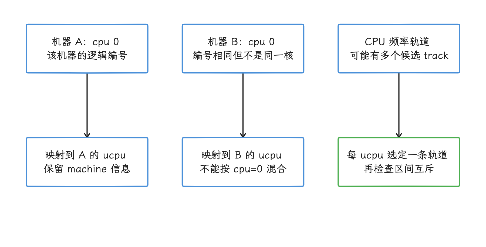

图：逻辑 cpu 编号可跨机器重复，ucpu 才是整份 Trace 的唯一 CPU 身份。 按 ucpu 求交前仍需确认每个 CPU 已选择唯一且不重叠的频率轨道。

标准库已经封装了同一过程：`linux.cpu.frequency` 通过 `counters.intervals` 生成 `cpu_frequency_counters`，输出 `ts`、`dur`、`freq`、`ucpu` 和 `cpu`，正式查询优先使用该表。

```sql
INCLUDE PERFETTO MODULE linux.cpu.frequency;

SELECT
  id AS counter_id, track_id,
  ts,
  dur,
  ucpu,
  cpu,
  freq
FROM cpu_frequency_counters
WHERE dur > 0
ORDER BY ucpu, ts;
```

频率表为空时，应检查 `power/cpu_frequency` ftrace 内核追踪事件或 `linux.sys_stats` 的 CPU 频率定时读取是否启用。事件驱动采集可能在 Trace 开头缺少初始频率；`SPAN_JOIN` 会保留这个数据缺口，不会猜测频率。

### `PARTITIONED` 前的输入验证

`sched` 按 `ucpu` 分区时天然互斥，因为同一个 CPU 同一时刻只运行一个线程。`thread_state` 按 `utid` 分区也应形成互斥状态区间。普通线程 `slice` 带有父子嵌套，直接按 `utid` 交给 `SPAN_JOIN` 会重复计算父层和子层。

下面的检查使用“前序最大结束时间”寻找同一 `utid` 中的重叠。`LAG()` 只能读取排序后的上一行，运行最大值则保留截至当前行之前出现过的最晚结束时间，因此还能识别 `[1, 10)`、`[2, 3)`、`[9, 12)` 这类嵌套后再次相交的序列。

<!-- gracker-diagram: ed14-07-span-input-validation-and-nested-overlap -->
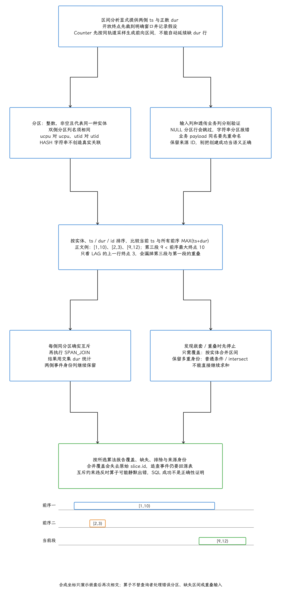

图：区间分析两侧显式ts/dur>0，开放dur-1先裁明确窗口；底层要求两侧ts至少一侧dur，缺dur侧不自动延续，两侧缺dur失败。分区整数非NULL，同名双侧同实体，NULL被跳过、字符串报错、payload同名需重命名，HASH仅类型不保证实体且有碰撞。一侧分区亦支持但混合空表需特测。每侧同分区须互斥，违反可能静默漏行。排序ts/dur/id，以MAX(ts+dur) over preceding检查当前ts<previousmax，例[1,10)/[2,3)/[9,12)第三段9<10，LAG前行end3漏判。重叠时按目标限定层级、只覆盖则合并或保ID用普通条件/intersect，不直接继续SPAN求和。

```sql
WITH
  candidate_span AS (
    SELECT
      slice.id,
      slice.ts,
      slice.dur,
      thread_track.utid,
      slice.name
    FROM slice
    JOIN thread_track
      ON thread_track.id = slice.track_id
    WHERE slice.name GLOB 'Choreographer#doFrame*'
      AND slice.dur > 0
  ),
  checked AS (
    SELECT
      candidate_span.*,
      MAX(ts + dur) OVER (
        PARTITION BY utid
        ORDER BY ts, dur, id
        ROWS BETWEEN UNBOUNDED PRECEDING AND 1 PRECEDING
      ) AS previous_max_end
    FROM candidate_span
  )
SELECT
  id,
  ts,
  dur,
  utid,
  name,
  previous_max_end
FROM checked
WHERE ts < previous_max_end
ORDER BY utid, ts;
```

有输出就说明候选表违反互斥约束。处理方式取决于分析目标：限定具体层级或事件名可以保留事件身份；只关心覆盖时长时，可以先合并区间；需要保留多重重叠身份时，应使用普通区间关联或 `intervals.intersect`。

`intervals.overlap` 提供 `interval_merge_overlapping_partitioned!` 宏，可以按多个分区列把相交区间合成最小的不重叠覆盖集。下面把目标进程的 `doFrame` 区间按 `upid`、`utid` 合并，适合在只统计覆盖时长时清理输入。

```sql
INCLUDE PERFETTO MODULE intervals.overlap;
INCLUDE PERFETTO MODULE slices.with_context;

WITH target_intervals AS (
  SELECT
    ts,
    dur,
    upid,
    utid
  FROM thread_slice
  WHERE upid = 123
    AND name GLOB 'Choreographer#doFrame*'
    AND dur > 0
)
SELECT
  ts,
  dur,
  upid,
  utid
FROM interval_merge_overlapping_partitioned!(
  (SELECT * FROM target_intervals),
  (upid, utid)
)
ORDER BY upid, utid, ts;
```

合并后就找不回原始 `slice.id`。诊断单个事件时应保留原始表；计算某类事件对窗口的总覆盖时间时，合并可以避免嵌套或重复事件被累计多次。


### 案例：每帧运行时间与 CPU 频率

`Choreographer#doFrame` 的墙上时间，也就是从开始到结束实际经过的时间，同时包含运行、等待 CPU 和睡眠；分析频率时只应关联 `sched` 中的 `Running` 区间。`android.frames.timeline` 已经整理 FrameTimeline 的期望 / 实际帧事件，并给出帧与 `doFrame` 的对应关系，免得我们手工按名称和行号生成不稳定的 `frame_id`。

异构 SoC（System on a Chip，系统级芯片）上，不同 CPU 簇的频率范围与每 MHz 性能不同，把所有 CPU 的 kHz 混成一个平均值没有可比性。查询输出每帧、每个 `ucpu`、每个频点的运行驻留时间，也就是线程在该频点累计运行了多久；解释性能时再结合 CPU capacity（核心的相对计算能力）、簇信息和同设备基线。

下面的脚本以两次交集的输入互斥为前提：先对候选 `cookbook_do_frames` 按 utid 检查前序最大结束时间，再检查同一 ucpu 的频率轨道数量与区间重叠。有重叠时先处理或停止计算；这两层输入即使来自标准表，有效性也要按目标 Trace 逐项验证。满足前提后，先关联调度与频率，再按 utid 裁进 doFrame。


```sql
INCLUDE PERFETTO MODULE android.frames.timeline;
INCLUDE PERFETTO MODULE linux.cpu.frequency;

CREATE PERFETTO TABLE cookbook_do_frames (
  ts TIMESTAMP,
  dur DURATION,
  utid LONG,
  upid LONG,
  frame_id LONG,
  do_frame_id LONG,
  frame_wall_dur DURATION
) AS
SELECT
  do_frame.ts,
  do_frame.dur,
  frames.ui_thread_utid AS utid,
  frames.upid,
  frames.frame_id,
  do_frame.id AS do_frame_id,
  frames.dur AS frame_wall_dur
FROM android_frames AS frames
JOIN slice AS do_frame
  ON do_frame.id = frames.do_frame_id
WHERE frames.upid = 123
  AND do_frame.dur > 0
  AND frames.dur > 0;

CREATE PERFETTO TABLE cookbook_ui_sched (
  ts TIMESTAMP,
  dur DURATION,
  ucpu LONG,
  utid LONG
) AS
SELECT
  sched.ts,
  sched.dur,
  sched.ucpu,
  sched.utid
FROM sched
JOIN (
  SELECT DISTINCT utid
  FROM cookbook_do_frames
) AS target_threads
  USING (utid)
WHERE sched.dur > 0
  AND sched.ucpu IS NOT NULL;

CREATE PERFETTO VIEW cookbook_selected_frequency AS
SELECT * FROM cpu_frequency_counters
WHERE dur > 0 AND freq IS NOT NULL AND ucpu IN (
  SELECT ucpu FROM cpu_frequency_counters
  GROUP BY ucpu HAVING COUNT(DISTINCT track_id) = 1
);

CREATE VIRTUAL TABLE cookbook_sched_frequency
USING SPAN_JOIN(
  cookbook_ui_sched PARTITIONED ucpu,
  cookbook_selected_frequency PARTITIONED ucpu
);

CREATE VIRTUAL TABLE cookbook_frame_running_frequency
USING SPAN_JOIN(
  cookbook_do_frames PARTITIONED utid,
  cookbook_sched_frequency PARTITIONED utid
);

SELECT
  upid,
  frame_id,
  do_frame_id,
  ROUND(frame_wall_dur / 1e6, 3) AS frame_wall_ms,
  ROUND(
    SUM(SUM(dur)) OVER (PARTITION BY upid, frame_id) / 1e6,
    3
  ) AS known_frequency_running_ms,
  ucpu,
  cpu,
  freq AS freq_khz,
  ROUND(SUM(dur) / 1e6, 3) AS residency_ms,
  ROUND(
    100.0 * SUM(dur)
      / SUM(SUM(dur)) OVER (PARTITION BY upid, frame_id),
    2
  ) AS frame_running_share_pct
FROM cookbook_frame_running_frequency
GROUP BY
  upid,
  frame_id,
  do_frame_id,
  frame_wall_dur,
  ucpu,
  cpu,
  freq
ORDER BY upid, frame_id, ucpu, freq;
```

`known_frequency_running_ms` 只累计同时具有 `sched` 和频率数据的运行时间。它小于该帧的主线程总运行时间时，可能存在频率采集缺口。`frame_running_share_pct` 的分母也是已知频率运行时间，与 `doFrame` 的 CPU 占用比例是两回事。

<!-- gracker-diagram: ed14-07-running-frequency-intersections-and-denominator -->
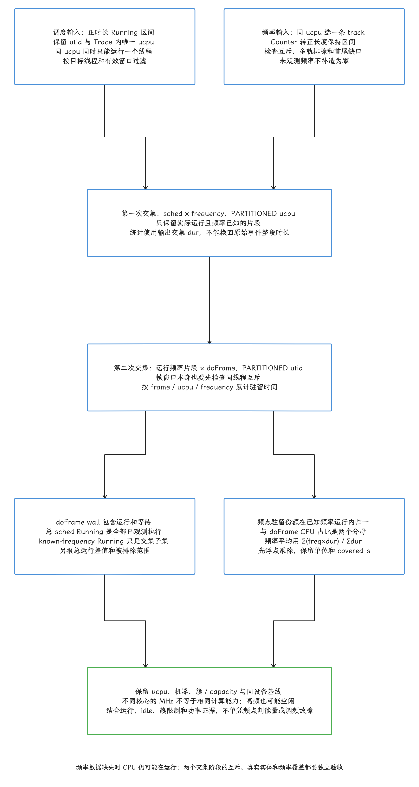

图：sched用正闭合Running和ucpu，频率选每ucpu单条track，按track(ts,id)生成正区间并查互斥，排除多轨和首前缺口/尾外推；同utid帧亦先验证互斥。第一SPANsched×freq按ucpu，第二与doFrame按utid，输出每frame/ucpu/freq交集dur。doFramewall含等待，总schedrunning是获得CPU时间，knownfrequencyrunning只两证据同时存在子集；frame_running_share以known为分母，另报covered和总运行差，不等CPU占用。加权频率SUM(1.0*freq*dur)/SUMdur先浮点并明kHz/MHz，异构核心MHz不可比能力，频率不是能耗或自动调频错误；同设备配置对照cluster/capacity/idle/suspend/power。

频率低未必是调频故障：线程可能运行在能效核，短任务也可能在升频前完成；温控、ADPF（应用提交性能提示的框架）、线程优先级、CPU affinity（限定线程可用的核心）和厂商调度策略都可能影响选择。判断时应比较同一设备、同一场景和同一采集配置，并把 `ucpu` 映射到 CPU capacity 或簇。

### 帧 × Binder / 锁 / GC 的交叉分析

`SPAN_JOIN` 适合互斥区间流。Binder 事务可能出现嵌套调用，普通 `slice` 也有父子层级，直接按 `utid` 送入算子会违反约束；标准库已经提供 Binder、monitor 竞争和 GC 事件的语义表，我们可以先按 `doFrame` 裁剪，再按事件类型合并覆盖区间。

这条查询分别计算 UI 线程 Binder 客户端区间、UI 线程 monitor 锁等待和进程 GC 活动与 `doFrame` 的重叠。`interval_merge_overlapping_partitioned!` 会在每个帧和事件类型内合并重叠，避免同类嵌套事件重复累计。

<!-- gracker-diagram: ed14-07-frame-event-clipping-and-coverage-union -->
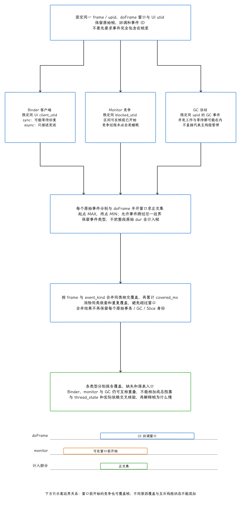

图：先固定frameid/upid/UIutid及doFramets/dur，Binder取同UIclientutid并区分sync等待与asyncsend，monitor取同blockedutid，GC按进程事件gc_ts/gc_dur。普通区间条件允许事件跨窗口边界，max起点min终点取正dur；只按完全包含会漏起前/终后事件。每frame/eventkind合并同类重叠，再SUMcoveredms，源ID需另查原表。不同类型仍可重叠不可相加总阻塞；monitor含Running/Runnable，GC整段非STW，Binderasync非同步阻塞，因果与缺采需threadstate/ART/采样独立验证。

```sql
INCLUDE PERFETTO MODULE android.frames.timeline;
INCLUDE PERFETTO MODULE android.binder;
INCLUDE PERFETTO MODULE android.monitor_contention;
INCLUDE PERFETTO MODULE android.garbage_collection;
INCLUDE PERFETTO MODULE intervals.overlap;

WITH
  frame_windows AS (
    SELECT
      frames.upid,
      frames.frame_id,
      frames.ui_thread_utid,
      do_frame.ts,
      do_frame.dur
    FROM android_frames AS frames
    JOIN slice AS do_frame
      ON do_frame.id = frames.do_frame_id
    WHERE frames.upid = 123
      AND do_frame.dur > 0
  ),
  binder_overlap AS (
    SELECT
      MAX(frames.ts, binder.client_ts) AS ts,
      MIN(
        frames.ts + frames.dur,
        binder.client_ts + binder.client_dur
      ) - MAX(frames.ts, binder.client_ts) AS dur,
      frames.upid,
      frames.frame_id,
      CASE
        WHEN binder.is_sync = 1 THEN 'binder_sync_client'
        ELSE 'binder_async_send'
      END AS event_kind
    FROM frame_windows AS frames
    JOIN android_binder_txns AS binder
      ON binder.client_upid = frames.upid
     AND binder.client_utid = frames.ui_thread_utid
     AND binder.client_ts < frames.ts + frames.dur
     AND binder.client_ts + binder.client_dur > frames.ts
    WHERE binder.client_dur > 0
  ),
  lock_overlap AS (
    SELECT
      MAX(frames.ts, contention.ts) AS ts,
      MIN(
        frames.ts + frames.dur,
        contention.ts + contention.dur
      ) - MAX(frames.ts, contention.ts) AS dur,
      frames.upid,
      frames.frame_id,
      'monitor_contention' AS event_kind
    FROM frame_windows AS frames
    JOIN android_monitor_contention AS contention
      ON contention.upid = frames.upid
     AND contention.blocked_utid = frames.ui_thread_utid
     AND contention.ts < frames.ts + frames.dur
     AND contention.ts + contention.dur > frames.ts
    WHERE contention.dur > 0
  ),
  gc_overlap AS (
    SELECT
      MAX(frames.ts, gc.gc_ts) AS ts,
      MIN(
        frames.ts + frames.dur,
        gc.gc_ts + gc.gc_dur
      ) - MAX(frames.ts, gc.gc_ts) AS dur,
      frames.upid,
      frames.frame_id,
      'gc_activity' AS event_kind
    FROM frame_windows AS frames
    JOIN android_garbage_collection_events AS gc
      ON gc.upid = frames.upid
     AND gc.gc_ts < frames.ts + frames.dur
     AND gc.gc_ts + gc.gc_dur > frames.ts
    WHERE gc.gc_dur > 0
  ),
  all_overlap AS (
    SELECT * FROM binder_overlap
    UNION ALL
    SELECT * FROM lock_overlap
    UNION ALL
    SELECT * FROM gc_overlap
  ),
  merged_overlap AS (
    SELECT *
    FROM interval_merge_overlapping_partitioned!(
      (
        SELECT
          ts,
          dur,
          upid,
          frame_id,
          event_kind
        FROM all_overlap
        WHERE dur > 0
      ),
      (upid, frame_id, event_kind)
    )
  )
SELECT
  upid,
  frame_id,
  event_kind,
  ROUND(SUM(dur) / 1e6, 3) AS covered_ms
FROM merged_overlap
GROUP BY upid, frame_id, event_kind
ORDER BY upid, frame_id, covered_ms DESC;
```

三类覆盖时间彼此可能重叠，直接相加得不到“总阻塞时间”。同步 Binder 的客户端区间包含等待回复，异步事务的客户端区间只描述发送；monitor 记录的是 UI 线程的竞争过程，纯等待时间仍要用调度状态拆分；`gc_activity` 覆盖整个标准库 GC 事件，包含并发工作与等待，与 stop-the-world（暂停应用受管线程执行）阶段是两个量。

<!-- gracker-diagram: ch14-07-51-causal-dimensions-overlap -->
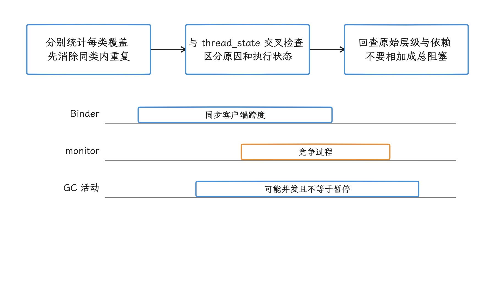

图：Binder、锁竞争与 GC 活动可能与同一帧时间重叠。 这些量不是互斥状态；GC 活动与主线程暂停要分开统计。

确定因果关系还要检查 `thread_state` 和事件层级。帧内出现 GC 活动，只说明时间相关；主线程在同一时段是否停顿，要看主线程状态和 ART 暂停事件。合并后的表也不再保留原始事务或 GC `id`，追踪单个事件时应回查标准库源表。

### 与 Trace Processor 标准库配合

标准库封装了解析差异和常见区间关系，直接相关的模块包括：

- `linux.cpu.frequency`：把 `cpufreq` 计数器转成 `cpu_frequency_counters`。
- `counters.intervals`：提供计数器前向区间宏。
- `intervals.overlap`：统计、展平和合并重叠区间。
- `intervals.intersect`：对多个区间表求交，并保留输入 id。
- `slices.with_context`：提供带线程与进程信息的 `thread_slice` 等视图。
- `android.frames.timeline`、`android.binder`、`android.monitor_contention`、`android.garbage_collection`：提供 Android 平台语义表。

`sched.thread_executing_span_with_slice` 的源码展示了标准库内部做法：先使用展平后的 `slice`，确保同一 `utid` 的输入互斥，再用 `SPAN_LEFT_JOIN` 关联 `thread_state`。该模块导出的很多对象以 `_` 开头，属于内部实现细节，长期脚本要避开这些名字。

选择工具时按输入形状判断：

<!-- gracker-diagram: ch14-07-52-choose-interval-tool -->
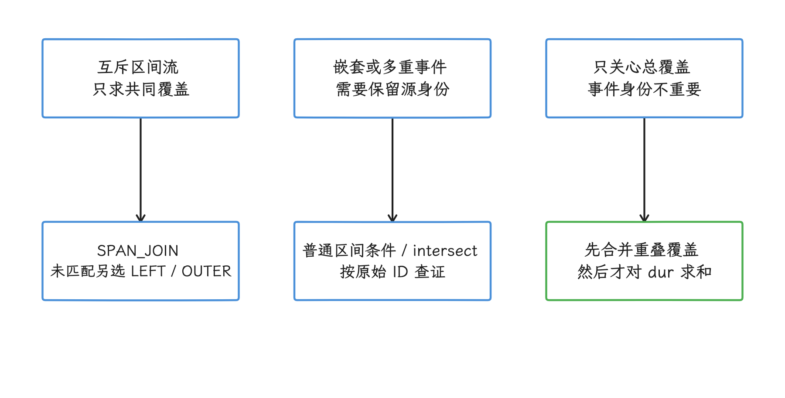

图：互斥流、嵌套事件和纯覆盖统计需要不同算子。 先明确是否保留未匹配时间以及原始 ID，再选算法。

- 两侧都是互斥时间段，且只关心交集切片：`SPAN_JOIN`。
- 一侧或两侧的未匹配区间也要保留：`SPAN_LEFT_JOIN` / `SPAN_OUTER_JOIN`。
- 输入含嵌套或需要保留多重事件身份：普通区间条件或 `intervals.intersect`。
- 只统计一类事件的总覆盖：先用 `interval_merge_overlapping_partitioned!` 合并。

### `SPAN_LEFT_JOIN` 与 `SPAN_OUTER_JOIN`

`SPAN_JOIN` 只输出两侧真实区间的交集。`SPAN_LEFT_JOIN` 会用影子时间段（`shadow span`）补足左侧未匹配的时间，`SPAN_OUTER_JOIN` 会补足两侧未匹配时间。影子时间段是算子生成的占位区间，不是 Trace 中实际采集的事件；结果中的另一侧业务列为空，可以区分“有覆盖”和“没有覆盖”。

下面的固定数据演示左连接如何保留左侧空档。

```sql
CREATE PERFETTO TABLE left_demo (
  ts TIMESTAMP,
  dur DURATION,
  part_id LONG,
  left_name STRING
) AS
WITH data(ts, dur, part_id, left_name) AS (
  VALUES
    (10, 20, 1, 'left-a')
)
SELECT * FROM data;

CREATE PERFETTO TABLE right_demo (
  ts TIMESTAMP,
  dur DURATION,
  part_id LONG,
  right_name STRING
) AS
WITH data(ts, dur, part_id, right_name) AS (
  VALUES
    (15, 5, 1, 'right-a')
)
SELECT * FROM data;

CREATE VIRTUAL TABLE left_demo_result
USING SPAN_LEFT_JOIN(
  left_demo PARTITIONED part_id,
  right_demo PARTITIONED part_id
);

SELECT
  ts,
  dur,
  part_id,
  left_name,
  right_name
FROM left_demo_result
ORDER BY ts;
```

结果会把左侧 `[10, 30)` 切成 `[10, 15)`、`[15, 20)`、`[20, 30)`；中间一段带有 `right_name`，两侧空档的该列为 `NULL`。这类输出适合计算“帧内没有 Binder 覆盖的时间”，前提是左表本身满足互斥约束。

<!-- gracker-diagram: ch14-07-53-left-shadow-gaps -->
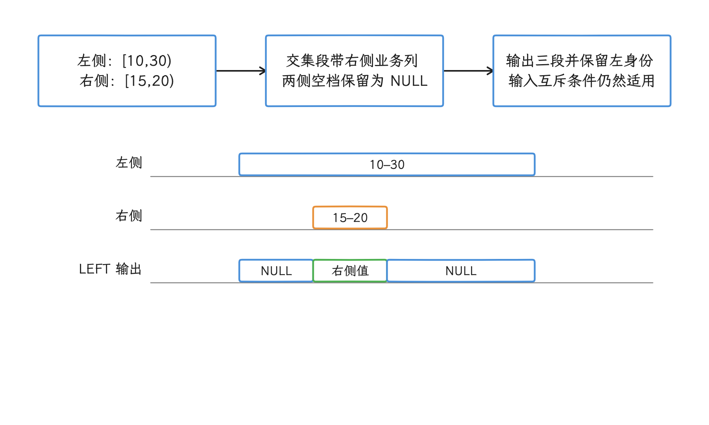

图：左连接把左区间按右侧覆盖切开，未覆盖部分的右侧业务列为 NULL。 影子时间段是算子补出的占位，与采集到的右侧事件要区分开。

空表行为要区分分区形状：固定实现中，只有一侧分区的 mixed partitioning 场景里，空的分区侧参加 SPAN_OUTER_JOIN，或它是 SPAN_LEFT_JOIN 的右侧时，才会使结果为空。两侧按同名键分区时，右表全空仍可保留左侧区间并令右侧业务列为 NULL；未分区右表为空也可保留左侧。固定源码的 InitialEofBehavior 分支和 native 57.2/58.2 合成表测试都区分这些情况，官方文档的概括到这里要止步，“所有空分区表都没有输出”是过度推广。依赖未匹配区间的自动化查询应按实际分区组合测试。

<!-- gracker-diagram: ch14-07-54-empty-partition-shapes -->
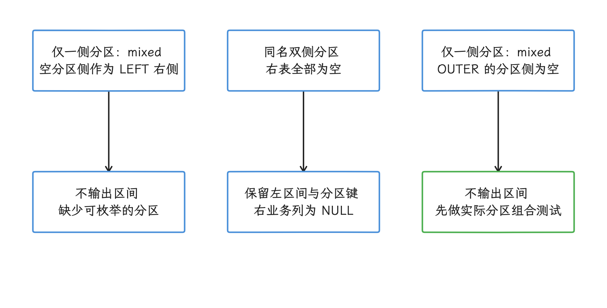

图：空表输出取决于哪一侧分区及连接种类，普通外连接直觉在这里会失真。 固定代码和 native57/58 测试：同名双侧分区的空右表仍可保留左侧。

### 查询成本与索引策略

`SPAN_JOIN` 不构造完整笛卡尔积，也就是不会先组合两表中的每一对行：`CreateSqlQuery()` 会为子查询生成按分区和 `ts` 排序的读取，游标再按较早结束的一侧向前移动。总体成本仍由输入构造、排序和输出交集数量决定。

大 Trace 查询按以下顺序控制成本：

1. 按 `upid`、`utid`、`ucpu` 和明确时间窗过滤原始表。
2. 用 `CREATE PERFETTO TABLE` 先计算并保存会重复使用的窗口函数结果，也就是把结果物化。
3. 只带入后续需要的列，避免把大字符串和完整 `args` 键值参数放进虚拟表。
4. 在每个分区检查重叠和非正 `dur`，防止错误输入扩大输出。
5. 用 `EXPLAIN QUERY PLAN` 查看查询计划，也就是 Trace Processor 准备按什么顺序扫描和关联数据，再决定是否创建索引。

Perfetto 原生表的 `id` 查询已有专门优化。需要为物化表加索引时使用 `CREATE PERFETTO INDEX`，并评估内存成本；索引建立从键值到数据行的快速定位结构，帮助筛选和等值关联，`SPAN_JOIN` 所需的时间顺序排序与重叠输入的问题则要另外解决。


### 在 CI 中复用复杂 Perfetto SQL

CI（Continuous Integration，持续集成）查询要固定采集配置、Trace Processor 版本、输出列与比较方法；设备型号、构建、刷新率、温控前置条件和场景步骤也要随结果保存。缺少 `sched_switch` 或 `cpufreq` 时，查询应显式报告覆盖不足，把空值当零会得出错误结论。

在独立 Trace Processor 进程中执行 SQL 文件并把结果写到 CSV（逗号分隔文本），可以让流水线同时保留查询脚本和原始输出。

```bash
trace_processor_shell \
  trace.perfetto-trace \
  --query-file frame_cpu_frequency.sql \
  > frame_cpu_frequency.csv
```

每次启动独立进程也能避免前一次查询创建的临时表污染当前运行。判断性能是否相对基线变差，应比较同设备、同场景的分布，并在仓库中记录阈值来源；16.67 ms、某个固定 kHz 或任意百分比都不具备跨设备通用性。


### 排查清单

提交区间查询前逐项核对：

- 输入表是否都有有效 `ts` 与正数 `dur`。
- `dur = -1` 是否已裁到明确窗口。
- 分区列是否为整数，两侧是否表达同一种实体。
- 单机 `cpu` 与 Trace 内唯一 `ucpu` 是否用在正确场景。
- 同一输入、同一分区内是否存在嵌套或重叠。
- 计数器是否按 `track_id` 生成前向区间，首尾缺口是否被记录。
- 结果是否使用交集 `dur` 加权，是否误用原始事件时长。
- 不同事件类型的覆盖时间是否发生重叠，汇总时是否重复累计。
- FrameTimeline、Binder、GC、锁与调度事件是否在采集配置中启用。
- 空结果究竟表示“没有事件”，还是数据源、解析或关联条件缺失。

`SPAN_JOIN` 解决的是互斥区间流的时间交集。把输入约束、采集缺口和分区语义写进查询，结果才具备复查价值。


### 区间关联部分的源码与文档依据

- [PerfettoSQL 入门：`SPAN_JOIN` 与窗口函数](https://perfetto.dev/docs/analysis/perfetto-sql-getting-started)
- [PerfettoSQL 语法与索引](https://perfetto.dev/docs/analysis/perfetto-sql-syntax)
- [Perfetto SQL 标准库索引](https://perfetto.dev/docs/analysis/stdlib-docs)
- [CPU 频率采集与已知边界](https://perfetto.dev/docs/data-sources/cpu-freq)
- [Android 17 `span_join_operator.cc`](https://android.googlesource.com/platform/external/perfetto/+/refs/tags/android-17.0.0_r1/src/trace_processor/perfetto_sql/intrinsics/operators/span_join_operator.cc)
- [Android 17 `span_join_operator.h`](https://android.googlesource.com/platform/external/perfetto/+/refs/tags/android-17.0.0_r1/src/trace_processor/perfetto_sql/intrinsics/operators/span_join_operator.h)
- [Android 17 `linux.cpu.frequency` 标准库源码](https://android.googlesource.com/platform/external/perfetto/+/refs/tags/android-17.0.0_r1/src/trace_processor/perfetto_sql/stdlib/linux/cpu/frequency.sql)
- [Android 17 `intervals.overlap` 标准库源码](https://android.googlesource.com/platform/external/perfetto/+/refs/tags/android-17.0.0_r1/src/trace_processor/perfetto_sql/stdlib/intervals/overlap.sql)
- [Android 17 `android.frames.timeline` 标准库源码](https://android.googlesource.com/platform/external/perfetto/+/refs/tags/android-17.0.0_r1/src/trace_processor/perfetto_sql/stdlib/android/frames/timeline.sql)
- [Android 17 `android.binder` 标准库源码](https://android.googlesource.com/platform/external/perfetto/+/refs/tags/android-17.0.0_r1/src/trace_processor/perfetto_sql/stdlib/android/binder.sql)
- [Android 17 `android.garbage_collection` 标准库源码](https://android.googlesource.com/platform/external/perfetto/+/refs/tags/android-17.0.0_r1/src/trace_processor/perfetto_sql/stdlib/android/garbage_collection.sql)
- [Android 17 kernel 6.18 `sched` tracepoint 定义](https://android.googlesource.com/kernel/common/+/refs/tags/android17-6.18-2026-06_r6/include/trace/events/sched.h)


## Jank CUJ 标准库与交互验证

自定义 SQL 胜在灵活，标准库则把常见 CUJ 语义统一起来。这一节我们沿标准库把系统交互的卡顿分析走一遍：中间结果用 DataGrid 检查，最终留下的结论仍要能回到 SQL 和 Trace 中的具体位置。

CUJ 是 Critical User Journey，指系统重点监控的一段用户交互；Jank 指帧未按期完成所表现出的卡顿。本节的分析基准是文首的源码标签及其中的 Perfetto。

上游 Perfetto v54.0 在这里只作为版本演进的参照：它引入了 DataGrid 改进、Jank CUJ 相关线程、基于计数器的加权卡顿、`heap_graph_stats` 和两种采样格式导入能力。Android 17 的 Perfetto 已包含 v54 之后的改动，把两者画等号会出错。

分析时要区分三层：

- DataGrid 是结果表组件，提供筛选、排序、透视等交互；
- Data Explorer 是节点式查询编辑器，负责组织结构化查询和中间结果；
- PerfettoSQL 标准库与指标脚本定义字段语义，是可复核结论的依据。


界面帮我们缩小范围，SQL、trace 和源码负责验证结论是否成立。

### DataGrid 与 Data Explorer 的版本差异

Perfetto v54.0 的变更日志明确记录了 DataGrid 的三类改进：可配置透视表、`glob`（通配符匹配）/ `contains` / `not-contains` 过滤器、过滤器的 distinct value picker（非重复值选择器）。同期的 snap-to-boundaries（吸附到边界）属于时间范围选择功能，与 DataGrid 过滤无关。[Perfetto v54.0 变更日志](https://github.com/google/perfetto/blob/v54.0/CHANGELOG)

v54.0 标签中已经存在节点式查询插件，插件标识为 `dev.perfetto.ExplorePage`。Android 17 固定标签把对应插件命名为 `dev.perfetto.DataExplorer`，并包含图编辑、导入导出、固定链接和仪表盘等实现。

两个版本的 `QueryExecutionService` 都把节点图转成 `PerfettoSqlStructuredQuery`，通过 Trace Processor 的 `summarizer` 同步、查询和物化；这里的“物化”是把查询结果暂存成可再次读取的表，DataGrid 随后通过 `SQLDataSource` 读取它。[v54.0 ExplorePage 源码](https://github.com/google/perfetto/tree/v54.0/ui/src/plugins/dev.perfetto.ExplorePage) [Android 17 DataExplorer 源码](https://android.googlesource.com/platform/external/perfetto/+/refs/tags/android-17.0.0_r1/ui/src/plugins/dev.perfetto.DataExplorer/)

<!-- gracker-diagram: ch14-07-59-ui-materialization -->
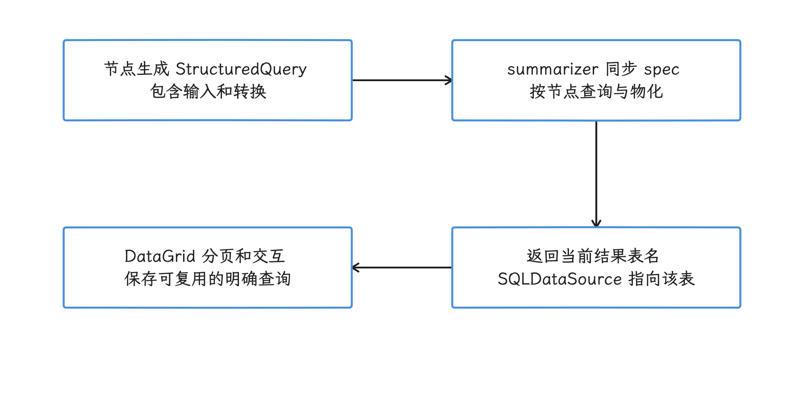

图：执行服务把节点转成结构化查询，通过 summarizer 管理物化结果。 临时表名和界面状态不作长期稳定接口，UI 与 TP 版本分别保存。

本节分别核对 v54.0 ExplorePage 与 Android 17 DataExplorer 的源码；UI 与 Trace Processor 可以独立更新，当前网页的界面能力以 UI 自己的版本为准，从分析二进制版本是推不出来的。下面只依赖固定 Android 17 的 `android.cujs.base`、`android.cujs.threads` 等明确入口；换用其他 Trace Processor 时，先查配套 schema 并运行样本回归。

这套执行方式带来两个工程约束：

- 节点图生成的 SQL、物化表名和界面状态可能随 UI 版本变化，报告要记录 Perfetto UI 与 Trace Processor 版本；
- 需要长期保存并复用的是输入 trace、明确的 SQL、字段单位和源码 tag；自动生成的物化表名可能随 UI 版本变化，只当作临时结果看待。

DataGrid 最适合承载“窄表”：一行表示一个 CUJ、一帧或一段线程状态，一列表示一个可解释维度。宽表通常列多、连接关系也更复杂；未经约束便直接做透视，重复行和多层 FrameTimeline 数据很容易放大计数。


### 系统 Jank CUJ 的三组输入

系统的 Jank CUJ 指标汇合三组独立数据。FrameTimeline 同时记录一帧原本应在何时完成的 expected timeline，以及它实际完成时刻的 actual timeline；vsync（垂直同步） ID 用于标识对应帧。


| 输入 | 产生者 | 在指标中的用途 |
|---|---|---|
| `J<CUJ_NAME>`、`FT#beginVsync`、`FT#endVsync` 等标记 | `InteractionJankMonitor` / Java `FrameTracker` | 定义 CUJ 名称、状态、进程、UI 线程和 vsync 边界 |
| `J<CUJ_NAME>#totalFrames`、`#weightedAppJank` 等计数器 | Java `FrameTracker.finishTraced()` | 提供 CUJ 结束后的聚合计数 |
| expected / actual FrameTimeline、`jank_type`、`jank_score` | SurfaceFlinger FrameTimeline | 给出逐帧时序与 App / SF（SurfaceFlinger）分类 |

HWUI（Android 硬件加速 UI 渲染器） 的 C++ `JankTracker` 是另一套帧统计实现：它计算 `kMissedDeadline`、`kSlowUI`、`kSlowSync`、`kSlowRT` 等本地帧指标，通过 FrameMetrics 帧时序报告接口上报，而 `android_jank_cuj` 所需的 Java FrameTracker 计数器仍由 Java 侧产生。两个类名相近，数据来源与职责要分清。[Android 17 Java FrameTracker](https://android.googlesource.com/platform/frameworks/base/+/refs/tags/android-17.0.0_r1/core/java/com/android/internal/jank/FrameTracker.java) [Android 17 HWUI JankTracker](https://android.googlesource.com/platform/frameworks/base/+/refs/tags/android-17.0.0_r1/libs/hwui/JankTracker.cpp)

<!-- gracker-diagram: ch14-07-62-java-frame-tracker-vs-hwui -->
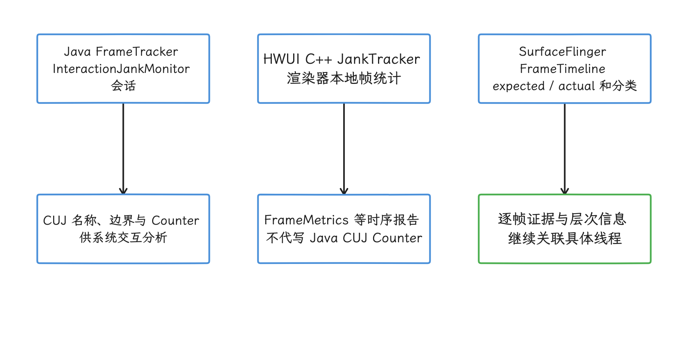

图：Java FrameTracker 写系统 CUJ 聚合 Counter，HWUI JankTracker 维护本地帧统计。 类名相近不表示是同一数据源；必须按实际产生者解释字段。

`android.cujs.base` 对输入有明确限制：

- CUJ 必须是 `process_track` 上持续时间大于零、名称匹配 `J<*>` 的 slice（有开始和结束时间的事件区间）；
- 进程名必须匹配 `com.android.*` 或 `com.google.android*`；
- `FT#end`、`FT#cancel`、begin/end vsync、layer id 和 UI thread 标记用于修正状态与边界；
- 内部 CASE 可生成 `completed`、`canceled` 或 NULL，但公共 `android_jank_cuj` 随后过滤掉 canceled，并过滤持续时间不超过 4 ms 的未知状态 CUJ；实际保留 completed 及部分 NULL。它不是所有交互尝试的完整分母。

第三方 App 即使写出同名标记，也不会自动进入这张表：过滤发生在 Android 17 标准库源码里，与 DataGrid 的显示条件无关。[Android 17 `android.cujs.base`](https://android.googlesource.com/platform/external/perfetto/+/refs/tags/android-17.0.0_r1/src/trace_processor/perfetto_sql/stdlib/android/cujs/base.sql)

<!-- gracker-diagram: ch14-07-63-cuj-public-filter -->
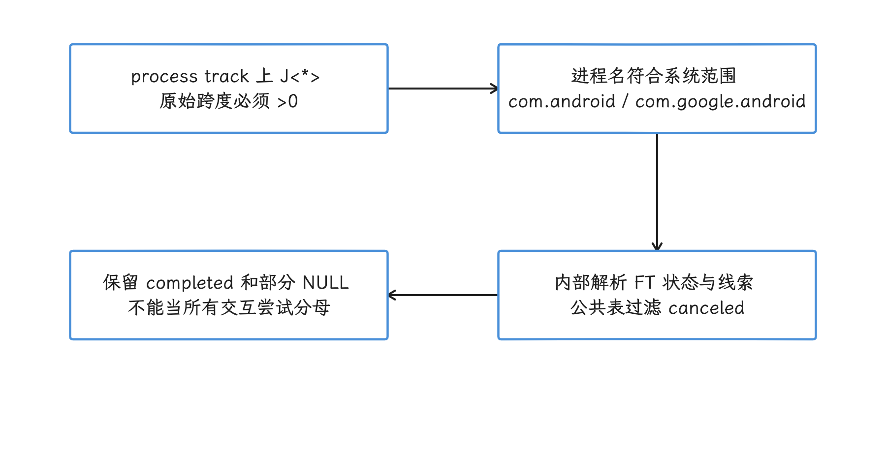

图：固定标准库按系统进程、process track、名称和状态过滤 CUJ。 取消记录以及不超过4 ms的未知状态会被过滤；第三方模仿 J<*> 不会自动纳入。

### 建立可筛选的 CUJ 窄表

这条查询使用公共标准库，列出系统 CUJ 及其 RenderThread，适合作为 DataGrid 或 Data Explorer 的首张表。

```sql
INCLUDE PERFETTO MODULE android.cujs.base;
INCLUDE PERFETTO MODULE android.cujs.threads;

SELECT
  c.upid, c.ui_thread, c.slice_id,
  c.cuj_id,
  c.cuj_name,
  c.process_name,
  c.state,
  c.ts,
  c.dur,
  c.begin_vsync,
  c.end_vsync,
  COUNT(r.utid) OVER (PARTITION BY c.cuj_id) AS render_thread_candidates,
  r.utid AS render_thread_utid,
  r.track_id AS render_thread_track_id
FROM android_jank_cuj AS c
LEFT JOIN android_jank_cuj_render_thread AS r USING (cuj_id)
ORDER BY c.ts;
```

`LEFT JOIN` 会保留没有 RenderThread 记录的 CUJ；但同一进程有多条同名线程或 track 时可能返回多行，所以本查询仍是候选关联表。`render_thread_candidates` 大于 1 时，应结合生存期与实际 DrawFrame 轨道选定，CUJ 数量要按 cuj_id 统计，结果行数只作参考。缺失可能来自场景没有走对应 HWUI 路径、线程名不匹配、CUJ 被截断或采集数据不足；我们先按这几种情况排查，再谈 RenderThread 是否参与。

<!-- gracker-diagram: ch14-07-64-cuj-render-candidates -->
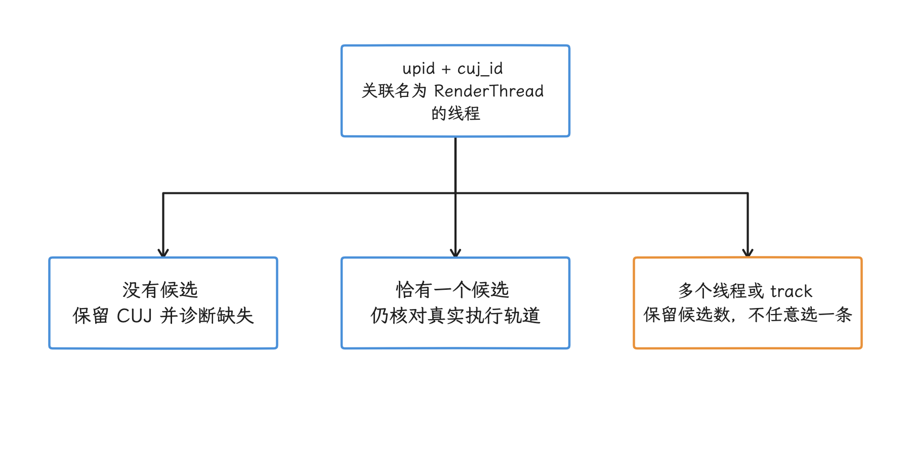

图：公共线程模块按同进程线程名和 track 关联，报告保留候选数。 候选数大于1时要结合生存期与实际 DrawFrame 轨道选定，CUJ 数量按 cuj_id 统计。

`cuj_id` 是 trace 内的 CUJ 编号，`upid` 和 `utid` 分别是 Trace Processor 在该 trace 中分配的唯一进程与线程 ID，`track_id` 标识承载事件的轨道。它们与操作系统原始的 PID、TID 不属于同一标识域。

`android.cujs.threads` 的公共入口包括 `android_jank_cuj_app_thread(thread_name)` 和 `android_jank_cuj_render_thread`。GPU completion（GPU 完成相关线程）、HWC release（Hardware Composer 释放栅栏相关线程）、SurfaceFlinger main、SurfaceFlinger GPU completion 与 RenderEngine（SurfaceFlinger 的渲染引擎）等表由 `android/android_jank_cuj.sql` 的指标初始化过程继续创建。

需要长期维护的脚本不要直接依赖 `_android_sf_process`、`_android_sf_thread()` 这类下划线开头的内部对象；它们没有公共兼容承诺。

### 基于计数器的加权卡顿

Java `FrameTracker.finishTraced()` 在 CUJ 收尾后写出：

- `totalFrames`、`missedFrames`、`missedAppFrames`、`missedSfFrames`；
- `maxSuccessiveMissedFrames`、`maxFrameTimeMillis`、`totalAnimTime`；
- `weightedAppJank`、`weightedSfJank`。

计数器名称是 `J<CUJ_NAME>#COUNTER_NAME`。固定标准库先用 upid 筛出具备 CUJ 的进程轨道，但取值函数只按 CUJ 名、counter 名和时间查值，没有 upid 参数；下一次 CUJ 结束时间也只按 CUJ 名分区。同名交互跨进程且时间相邻时可串值：合成 Trace 中两个 Google 进程本应分别读到 7 和 11，原指标却都读到 11。报告查询应显式用 `(upid, cuj_id)` 隔离并检查候选计数。`com.android.*` 与 Pixel Launcher 从 CUJ 结束时刻开始找计数器，其他被标准库纳入的 Google 进程允许向前回看 4 ms。这是 Android 17 SQL 中的兼容规则，第三方 App 不宜照搬成通用时序约定。

<!-- gracker-diagram: ch14-07-65-cuj-counter-cross-process -->
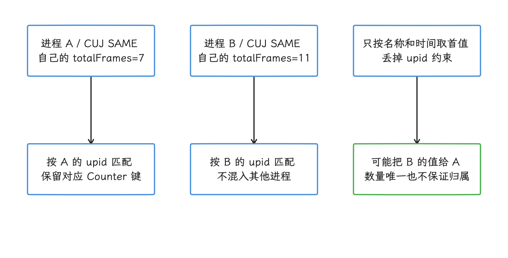

图：固定取值函数只有名称和时间参数，跨进程同名 CUJ 可能串值。 合成测试本应读取7和11，原指标都读到11；报告改用 upid 与 cuj_id。

下面的查询里，我们按进程与 CUJ 实例读取计数器，保留原始记录、匹配候选数量及加权速率。存在歧义时不输出唯一计数；不使用下述有截断风险的时长计数器反推“总量”。

```sql
INCLUDE PERFETTO MODULE android.cujs.base;

WITH
  settings(max_counter_delay_ns) AS (VALUES (200000000)),
  ordered AS (
    SELECT *, LEAD(ts_end) OVER (
      PARTITION BY upid, cuj_name ORDER BY ts_end, ts, cuj_id
    ) AS next_cuj_end
    FROM android_jank_cuj
  ),
  windows AS (
    SELECT ordered.*,
      CASE WHEN process_name GLOB 'com.android.*'
              OR process_name = 'com.google.android.apps.nexuslauncher'
           THEN ts_end ELSE MAX(ts, ts_end - 4000000) END AS search_start,
      MIN(COALESCE(next_cuj_end, trace_end()),
          ts_end + max_counter_delay_ns, trace_end()) AS search_end
    FROM ordered CROSS JOIN settings
  ),
  candidates AS (
    SELECT w.cuj_id, t.name AS counter_track_name,
      SUBSTR(t.name, LENGTH(w.cuj_slice_name) + 2) AS counter_name,
      c.id AS counter_id, c.ts AS counter_ts, c.value
    FROM windows w
    JOIN process_counter_track t ON t.upid = w.upid
    JOIN counter c ON c.track_id = t.id
    WHERE t.name IN (
      w.cuj_slice_name || '#totalFrames',
      w.cuj_slice_name || '#missedFrames',
      w.cuj_slice_name || '#missedAppFrames',
      w.cuj_slice_name || '#missedSfFrames',
      w.cuj_slice_name || '#maxSuccessiveMissedFrames',
      w.cuj_slice_name || '#weightedAppJank',
      w.cuj_slice_name || '#weightedSfJank',
      w.cuj_slice_name || '#totalAnimTime',
      w.cuj_slice_name || '#maxFrameTimeMillis'
    ) AND c.ts >= w.search_start AND c.ts < w.search_end
  ),
  per_counter AS (
    SELECT cuj_id, counter_name, COUNT(*) AS n,
      CASE WHEN COUNT(*) = 1 THEN MAX(value) END AS value,
      GROUP_CONCAT(counter_id || '@' || counter_ts) AS candidate_keys
    FROM candidates GROUP BY cuj_id, counter_name
  )
SELECT w.upid, w.cuj_id, w.cuj_name, w.state,
  w.ts, w.dur, w.search_start, w.search_end,
  CASE WHEN COUNT(p.counter_name) = 0 THEN 'missing'
       WHEN MAX(p.n) > 1 THEN 'ambiguous'
       WHEN COUNT(p.counter_name) < 9 THEN 'partial_single_candidates'
       ELSE 'single_candidates_only' END AS counter_quality,
  GROUP_CONCAT(p.counter_name || ':' || p.n || '[' || p.candidate_keys || ']')
    AS counter_candidates,
  MAX(CASE WHEN p.counter_name = 'totalFrames' THEN p.value END) AS total_frames,
  MAX(CASE WHEN p.counter_name = 'missedFrames' THEN p.value END) AS missed_frames,
  MAX(CASE WHEN p.counter_name = 'missedAppFrames' THEN p.value END) AS missed_app_frames,
  MAX(CASE WHEN p.counter_name = 'missedSfFrames' THEN p.value END) AS missed_sf_frames,
  MAX(CASE WHEN p.counter_name = 'weightedAppJank' THEN p.value END) / 1000.0
    AS weighted_app_jank_per_s,
  MAX(CASE WHEN p.counter_name = 'weightedSfJank' THEN p.value END) / 1000.0
    AS weighted_sf_jank_per_s,
  MAX(CASE WHEN p.counter_name = 'totalAnimTime' THEN p.value END)
    AS reported_anim_duration_ms,
  MAX(CASE WHEN p.counter_name = 'maxFrameTimeMillis' THEN p.value END)
    AS reported_max_frame_ms
FROM windows w LEFT JOIN per_counter p USING (cuj_id)
GROUP BY w.upid, w.cuj_id, w.cuj_name, w.state,
  w.ts, w.dur, w.search_start, w.search_end
ORDER BY w.ts, w.upid, w.cuj_id;
```

原始 weighted 计数器记录“加权分数 / totalAnimationTime × 10^9 × 1000”的整数化结果，除以 1000 后才是 jank/s。这个分母由帧间隔及非负 present delay 累加，和 CUJ slice 的墙上时间对不上。更关键的是，固定 FrameTracker 写 totalAnimTime 时先把纳秒 long 强转 int，再除以 10^6：2.2 秒会得到 -2094 ms；回绕后也可能是正数。这个计数器只能按原样记录，要用它反推精确加权总量，先到设备源码确认改版是否修复。

<!-- gracker-diagram: ch14-07-68-java-duration-narrowing -->
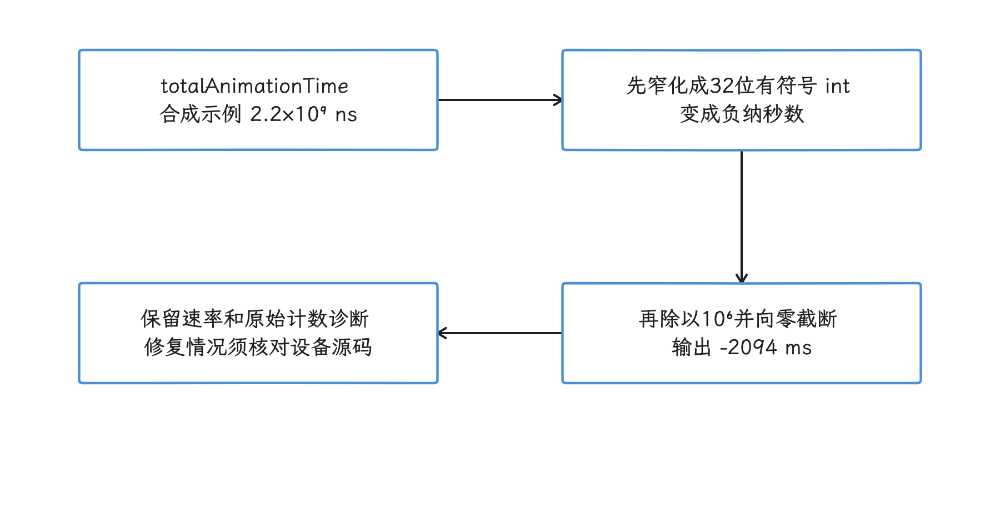

图：固定 Java 代码先把纳秒 long 转成32位 int，再换算毫秒。 2.2秒得到 -2094ms；回绕后也可能为正，反推精确加权总量前先核对设备源码。

本查询的 `*_jank_per_s`、候选数与质量标记是报告别名，不是原始 metric 表字段。200 ms 是可修改的报告搜索上限，不是平台保证；4 ms 回看沿用固定 SQL 的兼容候选规则。搜索窗采用半开区间，多条候选保留键且该字段为 NULL。即使只有一条候选也只确认“本搜索窗内唯一”，同进程同名交互重叠、迟到或漏采时仍需人工核对归属。[Android 17 计数器指标](https://android.googlesource.com/platform/external/perfetto/+/refs/tags/android-17.0.0_r1/src/trace_processor/metrics/sql/android/jank/internal/counters.sql) [Android 17 指标输出](https://android.googlesource.com/platform/external/perfetto/+/refs/tags/android-17.0.0_r1/src/trace_processor/metrics/sql/android/android_jank_cuj.sql)


加权速率、逐帧分数和 missed frame 数是不同统计量；缺失或歧义样本先分类，直接 COALESCE 成零会以正常样本的身份混进排名。固定 FrameTracker 的 missed 计数使用 experimental 分类，而 weighted 累加受 useNewJankClassificationForJps 标志选择，报告还需记录分类版本；根因仍要展开具体帧、线程与调用栈。

<!-- gracker-diagram: ch14-07-67-weighted-jank-rate -->
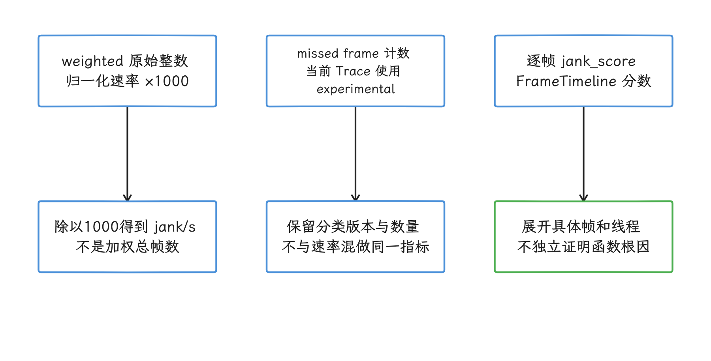

图：weighted Counter 除以1000得到 jank/s，missed frame数和逐帧分数另有统计口径。 固定 FrameTracker 的 weighted 分类受标志控制，与 experimental missed 计数要分别解读。

指标同时提供计数器指标、trace 指标与时间线指标：

- 计数器指标来自 Java FrameTracker 的事后汇总；
- trace 指标来自 `android_jank_cuj_frame`，组合 DoFrame（UI 线程帧回调）、DrawFrame（RenderThread 绘制）、GPU fence（CPU 与 GPU 之间的同步栅栏）与 FrameTimeline；
- 时间线指标直接按 `android_jank_cuj_frame_timeline` 聚合。

三者不一致时，要检查标记、计数器、FrameTimeline、回调漏采、trace 截断和分类版本；挑一个数盖过另外两个，会把问题掩盖起来。


### 从异常 CUJ 展开到异常帧

有了异常 CUJ，我们接下来把它展开成帧。以下查询列出指标模型保留下来的 App missed 或 SF missed 帧，并保留回调漏采标记；它不是全部帧的完整分母。固定 frames.sql 的 frame_base 要求 doFrame、DrawFrame 及匹配 GPU fence，WHERE 条件会排除未匹配的 fence 行，前面的丢失不会由最终回调标记补回。完整性应另从原始 FrameTimeline 和源表核对。

<!-- gracker-diagram: ch14-07-70-cuj-frame-model-filters -->
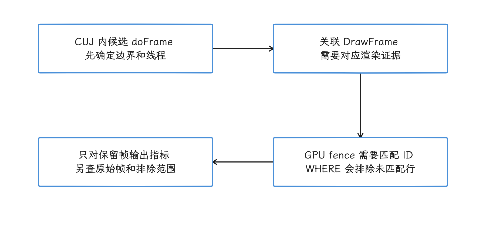

图：固定 frame_base 要求 doFrame、DrawFrame 与匹配 GPU fence，最终帧表不是全部帧分母。 LEFT JOIN 后的 WHERE 可排除无 fence 行；这些帧一旦排除，最终回调标记也补不回来。

```sql
SELECT RUN_METRIC('android/android_jank_cuj.sql');

SELECT
  c.cuj_name,
  f.cuj_id,
  f.frame_number,
  f.vsync,
  f.dur / 1e6 AS dur_ms,
  f.dur_expected / 1e6 AS expected_ms,
  f.app_missed,
  f.sf_missed,
  f.jank_score,
  f.sf_callback_missed,
  f.hwui_callback_missed
FROM android_jank_cuj_frame AS f
JOIN android_jank_cuj AS c USING (cuj_id)
WHERE COALESCE(f.app_missed, 0) != 0
   OR COALESCE(f.sf_missed, 0) != 0
ORDER BY f.jank_score DESC, f.dur DESC
LIMIT 50;
```

`app_missed` 与 `sf_missed` 来自 FrameTimeline `jank_type` 的分类函数。它们给出 App 侧或 SurfaceFlinger 侧的责任线索；要落到具体函数、锁、调度或 GPU 等待，还需要继续展开。`sf_callback_missed` / `hwui_callback_missed` 表示 trace 没捕获到预期回调，与 SurfaceFlinger 或 HWUI 自身掉帧是两回事。

Android 17 指标在 expected timeline 缺失时，会用 `16.6 ms` 作为 `dur_expected` 的兼容回退；这个值来自指标源码，设备当时是否运行在 60 Hz，从这里看不出来。所以报告中遇到该回退，应把 expected timeline 缺失列为采集限制。


FrameTimeline 的 `on_time_finish` 同样只是判据之一：Buffer Stuffing（buffer queue 中积压了过多帧）可能在 App 按期完成时仍被标为 jank；Prediction Error 表示 FrameTimeline 的时序预测出现偏差，语义也与普通超时不同。

优先使用 `jank_type`、`jank_score`、expected/actual 时间线和标准库聚合结果。[Android 17 FrameTimeline 文档](https://android.googlesource.com/platform/external/perfetto/+/refs/tags/android-17.0.0_r1/docs/data-sources/frametimeline.md) [Android 17 jank type 分类](https://android.googlesource.com/platform/external/perfetto/+/refs/tags/android-17.0.0_r1/src/trace_processor/perfetto_sql/stdlib/android/frames/jank_type.sql)

### 用 thread_state 判断时间花在哪里

异常帧有了时间范围后，我们再把 UI 线程状态裁进帧窗口。这条查询按状态、I/O wait 与 blocked function 汇总相交时间。

```sql
SELECT RUN_METRIC('android/android_jank_cuj.sql');

WITH bad_frame AS (
  SELECT
    f.cuj_id,
    f.frame_number,
    f.ts,
    f.dur,
    mt.utid
  FROM android_jank_cuj_frame AS f
  JOIN android_jank_cuj_main_thread AS mt USING (cuj_id)
  WHERE f.dur > 0
    AND (
      COALESCE(f.app_missed, 0) != 0 OR
      COALESCE(f.sf_missed, 0) != 0
    )
),
intersection AS (
  SELECT
    b.cuj_id,
    b.frame_number,
    st.state,
    st.io_wait,
    st.blocked_function,
    MIN(b.ts + b.dur, st.ts + st.dur) -
      MAX(b.ts, st.ts) AS overlap_dur
  FROM bad_frame AS b
  JOIN thread_state AS st
    ON st.utid = b.utid
   AND st.dur > 0
   AND st.ts < b.ts + b.dur
   AND b.ts < st.ts + st.dur
)
SELECT
  cuj_id,
  frame_number,
  state,
  io_wait,
  blocked_function,
  SUM(overlap_dur) / 1e6 AS overlap_ms
FROM intersection
WHERE overlap_dur > 0
GROUP BY
  cuj_id,
  frame_number,
  state,
  io_wait,
  blocked_function
ORDER BY cuj_id, frame_number, overlap_ms DESC;
```

`Running` 表示线程正在 CPU 上执行；`R` 与 `R+` 表示 Runnable，其中 `R+` 带有被抢占语义；`D` 表示不可中断睡眠。`io_wait = 1` 和 `blocked_function` 能缩小排查范围；字段缺失时，I/O、锁或内核等待要靠其他线索确认。Running 占比高也只说明 CPU 执行时间多，函数热点仍需采样剖析。

UI 线程只是应用侧的一部分。RenderThread 要改用 `android_jank_cuj_render_thread.utid`；GPU completion、HWC release 与 SurfaceFlinger 线程则使用指标初始化出的相关线程和 slice 表。每条线程都要与它实际参与工作的时间窗求交集，UI 帧窗口套用到其他线程前，先核对线程自己的工作窗口。

<!-- gracker-diagram: ch14-07-72-cuj-thread-windows -->
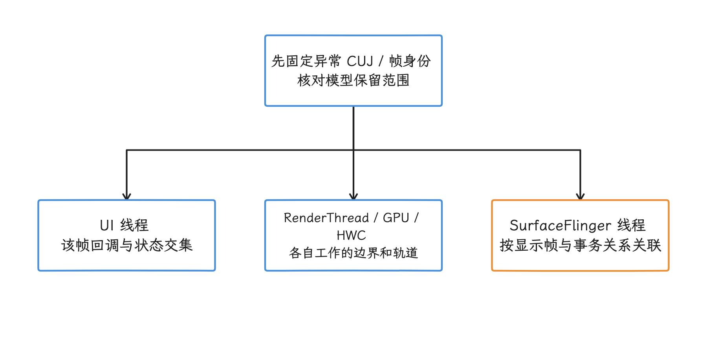

图：UI、RenderThread、GPU/HWC 与 SurfaceFlinger 各用自己的线程身份和工作窗口。 UI 帧窗口套用到其他线程前，先核对线程自己的工作窗口。

### 第三方 App 的分析路径

第三方 App 不在 `android_jank_cuj` 的默认进程过滤范围内：写 `J<*>` slice 或 `J<*>#*` 计数器，也绕不过 `JOIN android_jank_cuj USING (upid)` 这道关联。单纯模仿系统计数器名称只会混淆数据来源，数据仍由应用自己的 `Trace` 调用产生。

第三方 App 更适合组合三种能力：

- AndroidX JankStats 负责收集应用内帧指标，并把当时的 UI 状态附到帧记录上；
- `Trace` 写应用自有命名空间的阶段标记；
- FrameTimeline 与 `thread_state` 在 Perfetto 中完成逐帧和调度分析。

这段代码用公开 `Trace` API 标记一次跨回调的应用交互。标记使用应用命名空间，避免与系统 `J<*>` CUJ 混淆。

```kotlin
private const val FEED_SCROLL = "myapp.cuj.feed_scroll"

fun onScrollStarted(cookie: Int) {
    Trace.beginAsyncSection(FEED_SCROLL, cookie)
}

fun onScrollSettled(cookie: Int) {
    Trace.endAsyncSection(FEED_SCROLL, cookie)
}
```

cookie 是区分同名异步区间的整数 ID；并发交互必须使用不同 cookie，每次 begin 必须有一次匹配的 end。采集配置还要把目标包加入 `atrace_apps`（可采集应用标记的包名列表），并启用 `android.surfaceflinger.frametimeline`，否则标记或帧数据会缺失。

随后用以下查询处理 thread track 与 process track 上的自定义 slice，并把它关联到 `android_frames` 与 overrun。

```sql
INCLUDE PERFETTO MODULE slices.with_context;
INCLUDE PERFETTO MODULE android.frames.per_frame_metrics;

WITH custom_cuj AS (
  SELECT
    id AS custom_cuj_id, track_id AS custom_cuj_track_id,
    ts,
    dur,
    name,
    upid,
    process_name
  FROM thread_or_process_slice
  WHERE upid = 123
    AND name = 'myapp.cuj.feed_scroll'
    AND dur > 0
)
SELECT
  c.custom_cuj_id, c.custom_cuj_track_id, c.upid,
  c.ts AS custom_cuj_ts, c.dur AS custom_cuj_dur,
  c.name AS custom_cuj_name,
  f.frame_id,
  f.ts,
  f.dur / 1e6 AS frame_dur_ms,
  o.overrun / 1e6 AS overrun_ms,
  f.ui_thread_utid,
  f.render_thread_utid
FROM custom_cuj AS c
JOIN android_frames AS f
  ON f.upid = c.upid
 AND f.ts < c.ts + c.dur
 AND c.ts < f.ts + f.dur
LEFT JOIN android_frames_overrun AS o USING (frame_id)
ORDER BY c.custom_cuj_id, f.ts;
```

把 upid 占位 123 和标记名称替换为目标实例。每行保留 custom_cuj_id：同一帧可与多个自定义交互窗口相交，累加行数前先按交互身份分组。这里的 overrun 仍是前文说明的 legacy frame_id 模型值，多层、开放及缺失配对需单独核对；NULL 按缺失处理。时间相交只说明窗口相关，该交互是否导致卡顿，要回到线程状态和事件层级确认。这条路径不依赖系统 CUJ 进程白名单，也不会自动获得 Java FrameTracker 的加权计数器。


### `heap_graph_stats` 与 DMA-BUF

Jank 伴随内存上涨时，我们可以单独引入 `android.memory.heap_graph.heap_graph_stats`。它每行对应一次 ART heap graph，汇总 Java heap、NativeAllocationRegistry（Java 对象的 native 分配记账）、对象数、OOM adj（进程被回收的优先级调整值）、anon RSS + swap（匿名驻留内存与换出量）和 DMA-BUF RSS（共享 DMA buffer 的驻留内存）。

这条查询把主要内存字段换算成 MiB，便于在 DataGrid 中按采样时间比较。

```sql
INCLUDE PERFETTO MODULE android.memory.heap_graph.heap_graph_stats;

SELECT
  h.upid,
  p.name AS process_name,
  h.graph_sample_ts,
  h.total_heap_size / 1024.0 / 1024.0 AS total_heap_mib,
  h.reachable_heap_size / 1024.0 / 1024.0 AS reachable_heap_mib,
  h.reachable_native_alloc_registry_size / 1024.0 / 1024.0
    AS reachable_native_registry_mib,
  h.anon_rss_and_swap_size / 1024.0 / 1024.0 AS anon_rss_swap_mib,
  h.dmabuf_rss_size / 1024.0 / 1024.0 AS dmabuf_rss_mib,
  h.oom_score_adj
FROM android_heap_graph_stats AS h
JOIN process AS p USING (upid)
ORDER BY h.graph_sample_ts;
```

模块把“覆盖 dump 时刻的区间”和“dump 之后 500 ms 内的数据点”一起作为候选，再按区间起点与 dump 的绝对距离排序；覆盖候选并没有优先权。已有一个较早开始且仍覆盖 dump 的区间时，也可能选中更近的未来点；边界还使用含终点的 BETWEEN。报告应保留时间偏移与数据来源，把它当严格同时刻的快照会出错。

<!-- gracker-diagram: ch14-07-74-heap-closest-future -->
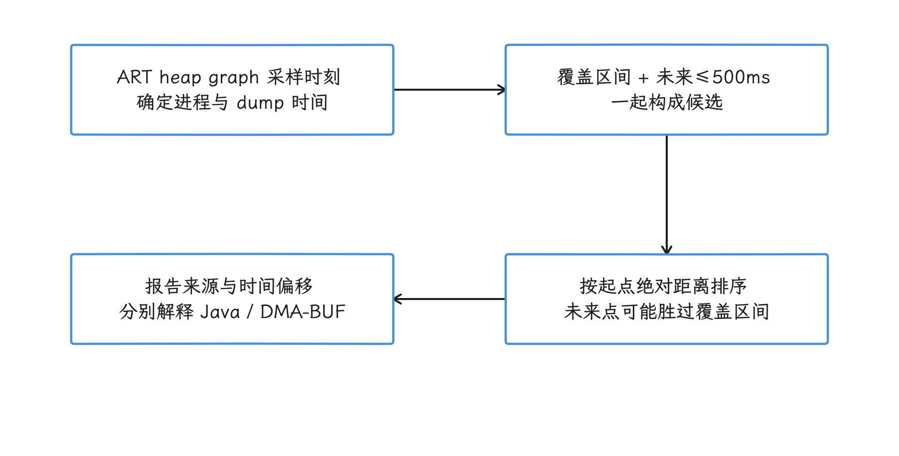

图：覆盖 dump 的区间和未来500 ms候选一起按起点距离排序，未优先保证覆盖。 结果不是原子快照；原始时间偏移、采样缺口和字段NULL要保留。

各字段可能为 `NULL`，也不构成同一时刻的原子快照。trace 没有 ART heap graph 时，表自然为空。[Android 17 heap graph stats](https://android.googlesource.com/platform/external/perfetto/+/refs/tags/android-17.0.0_r1/src/trace_processor/perfetto_sql/stdlib/android/memory/heap_graph/heap_graph_stats.sql)

Java heap 稳定而 DMA-BUF RSS 上涨时，我们继续检查图形 buffer、解码、Surface 生命周期和跨进程持有，单凭这个变化还定位不到泄漏对象；Java heap 与 DMA-BUF 同时上涨时，也要分别验证对象可达路径和图形资源所有权。

### v54 表结构变化的迁移

v54.0 的变化应按表结构处理，字符串替换靠不住：

| v54.0 变化 | 迁移原则 |
|---|---|
| 删除 `slice.stack_id` / `slice.parent_stack_id` | 使用 `slices.stack` 标准库的栈关系函数 |
| 所有表的 `machine_id` 改为非空，host（本机）为 `0` | 删除 `machine_id IS NULL` 假设；多机 trace 在有该列的表上显式限定机器 |
| `metadata` 增加 `trace_id` 与 `machine_id` | 只在 metadata 语义需要时使用；不能假设每张业务表都有 `trace_id` |
| 删除 `--add-sql-module` / `--override-sql-module` | 改用 `--add-sql-package` / `--override-sql-package` |

标准库、指标与核心表的兼容级别不同。以下划线开头的对象、指标中间表、Data Explorer 物化表都更容易变化。需要长期运行的查询应固定 Trace Processor 版本，入口尽量使用公开表和公开模块，并在升级时运行空 trace 语法测试与代表性 trace 回归。


### Collapsed Stack 与 Firefox Profiler 导入

v54.0 增加了 Collapsed Stack 和 Firefox Profiler preprocessed JSON 导入：

- Collapsed Stack 保存“调用栈 + 聚合计数”，适合迁移已有的 FlameGraph 数据；
- Firefox Profiler preprocessed JSON 主要保留已处理的采样信息。

这两类输入通常没有 Android system trace 的 FrameTimeline、Binder、调度、CUJ 标记和设备计数器。它们可以回答 CPU 样本集中在哪些栈；某个 Android 帧为何超时，还要靠重新采集带 FrameTimeline、sched 调度事件、应用 atrace 与必要系统数据源的 Perfetto trace 来做逐帧归因。


### 一轮可复核的分析顺序

1. 记录 Android 构建、Perfetto UI、Trace Processor、采集配置和负载条件。
2. 查询标记、计数器、FrameTimeline、sched 与相关线程是否存在，列出采集缺口。
3. 区分系统 InteractionJankMonitor CUJ 与第三方 App 自定义窗口。
4. 按 `(upid, cuj_id)` 生成窄表，核对线程与计数器关联数量、取消过滤、缺失和分类版本，再按已验证的加权速率、丢帧数和最大帧时比较。
5. 展开异常帧，分别查看 App / SF 分类、回调漏采与 expected timeline 回退。
6. 对 UI、RenderThread、GPU/HWC 和 SurfaceFlinger 线程做时间交集，再结合函数采样、GPU fence、Binder 进程间通信或内存证据。
7. 在报告中分开写观测、推断、采集限制和经过对照实验确认的根因。

DataGrid 和 Data Explorer 负责提高浏览效率。提交审阅的结论应能由保存的 SQL 在相同 Trace Processor 上复现，并能回到 Android 17 或 v54.0 的明确源码位置解释字段含义。


## 小结

可复用的 Perfetto SQL 应先固定问题窗口和稳定身份，再选择基础表、标准库或 `SPAN_JOIN`；点状 counter 先还原为区间，区间相交用交集时长，父子 slice 和一对多关联要防止重复计数。Jank CUJ 标准库统一了系统交互语义，第三方 App、缺失轨道和版本差异仍要显式降级处理；最终报告保留 SQL、单位、行数、采集缺口与源码语义。

## Jank CUJ 参考源码

- [Perfetto v54.0 release](https://github.com/google/perfetto/releases/tag/v54.0)
- [Android 17 DataExplorer plugin](https://android.googlesource.com/platform/external/perfetto/+/refs/tags/android-17.0.0_r1/ui/src/plugins/dev.perfetto.DataExplorer/index.ts)
- [Android 17 DataExplorer query execution](https://android.googlesource.com/platform/external/perfetto/+/refs/tags/android-17.0.0_r1/ui/src/plugins/dev.perfetto.DataExplorer/query_builder/query_execution_service.ts)
- [Android 17 CUJ threads](https://android.googlesource.com/platform/external/perfetto/+/refs/tags/android-17.0.0_r1/src/trace_processor/perfetto_sql/stdlib/android/cujs/threads.sql)
- [Android 17 CUJ frame counters](https://android.googlesource.com/platform/external/perfetto/+/refs/tags/android-17.0.0_r1/src/trace_processor/perfetto_sql/stdlib/android/cujs/cuj_frame_counters.sql)
- [Android 17 Jank CUJ metric initialization](https://android.googlesource.com/platform/external/perfetto/+/refs/tags/android-17.0.0_r1/src/trace_processor/metrics/sql/android/jank/android_jank_cuj_init.sql)
- [Android 17 Jank CUJ frames](https://android.googlesource.com/platform/external/perfetto/+/refs/tags/android-17.0.0_r1/src/trace_processor/metrics/sql/android/jank/frames.sql)
- [Android 17 InteractionJankMonitor](https://android.googlesource.com/platform/frameworks/base/+/refs/tags/android-17.0.0_r1/core/java/com/android/internal/jank/InteractionJankMonitor.java)
- [Android 17 Trace API](https://android.googlesource.com/platform/frameworks/base/+/refs/tags/android-17.0.0_r1/core/java/android/os/Trace.java)
