# Perfetto Profile 导入与 Flamegraph 分析

这一篇解决的问题是：手上的 CPU profile 怎么进 Perfetto、进来之后能回答什么。输入既有设备侧录的 Simpleperf protobuf 和 `linux.perf` 采样，也有外部工具导出的 pprof、Collapsed Stack；它们和 system trace 的时间轴怎么对上、火焰图怎么读、结论怎么固化成可复查的查询，就是下面的主线。先分清两条版本线：Perfetto v53、v54 能打开哪些文件，说的是主机分析端；设备侧 `linux.perf` 采集要另外核对 Android 版本、系统构建类型和应用可分析性。检查时我们把“文件能否被新版 Perfetto 打开”和“设备能否录到调用栈”分开对待。

> 源码基线：Android 17 / API 37 / AOSP `android-17.0.0_r1`。


## Profile 与 system trace 的数据边界

拿到一份 profile，我们先分清它和 system trace 记的东西差在哪里。系统跟踪记录带时间位置的事件：调度、线程状态、Binder（Android 进程间通信）、FrameTimeline（系统记录的帧期望与实际时间线）、GC（垃圾回收）和计数器都属于这一类。CPU 采样走的是另一条路：周期性采样中断到来时记下当时的调用栈，用来看一段 CPU 执行集中在哪些路径。两类数据可以联合录制，也可以各自独立成文件。

要得到可关联的时间轴，直接的做法是把 `linux.perf` 和其他数据源放进同一次录制，录完再确认时钟快照、进程身份和事件覆盖；分开录制的两份带时间戳文件，要谈时间点关联，就得先完成明确的时钟校准、身份核对和受支持的合并处理，只把两份文件拖进 UI，时间轴并不会自动对齐。


| 输入 | 数据形态与保留信息（按下文注明的版本） | 不能单独证明的内容 |
|---|---|---|
| 原生 Perfetto system trace | 按已启用的数据源生成 `slice`（时间轴区间事件）、`sched`、`thread_state`、FrameTimeline、计数器等<br>事件时间、持续时间、线程状态和跨进程关系 | 未启用调用栈采样时，无法给出完整函数热点 |
| pprof（基于 protobuf 的聚合 profile 格式） | `__intrinsic_aggregate_profile`、`__intrinsic_aggregate_sample`，UI 有专用页面<br>调用树、指标类型、单位和每条栈的聚合值 | 不生成逐次采样时间轴，不能定位某一帧 |
| Simpleperf protobuf | `cpu_profile_stack_sample`<br>样本时间、线程、调用栈、映射和已解析的符号 | 导入器忽略上下文切换记录，不会生成 `sched` 或 `thread_state` |
| Perfetto `linux.perf` | `perf_sample`，并可与 ftrace、FrameTimeline 联合录制<br>同一 trace 时钟下的样本、线程、CPU、调用栈和展开错误 | 采样命中数不能直接换算成单次函数耗时 |
| 带调用栈的 TrackEvent（Perfetto 原生结构化事件） | 事件自身及其调用栈<br>业务事件与栈的明确关联，区域选择可聚合火焰图 | 它记录事件附带的栈，不等同于周期性 CPU 采样 |
| Firefox Profiler 预处理 JSON | `cpu_profile_stack_sample`；v57.2 另有受支持的 marker Slice，固定 Android 17 导入器仅处理样本<br>采样调用栈，以及部分即时 / 区间 marker | 不重建 Android 调度或 FrameTimeline，部分 marker UI 元数据不导入 |
| Collapsed Stack | 聚合调用树，指标为 `samples/count`<br>根到叶的栈字符串和正整数计数 | 没有进程时间轴、线程状态和 Android 系统事件 |

protobuf 是 Protocol Buffers 的二进制消息格式。三条入口各写各的表：Android 17 的 pprof 导入器按 pprof 中的指标类型和单位建立聚合表；Simpleperf（Android 的 CPU 分析工具）导入器把样本写入 `cpu_profile_stack_sample`；`linux.perf` 样本进入 `perf_sample`。写 SQL 时按入口对表名；`__intrinsic_` 开头的是 Perfetto 内部表名，核对当前实现用它正合适，跨版本复用前要再确认。[Android 17 pprof 导入器](https://android.googlesource.com/platform/external/perfetto/+/android-17.0.0_r1/src/trace_processor/importers/pprof/pprof_trace_reader.cc)、[Android 17 Simpleperf protobuf 导入器](https://android.googlesource.com/platform/external/perfetto/+/android-17.0.0_r1/src/trace_processor/importers/simpleperf_proto/simpleperf_proto_parser.cc)

<!-- gracker-diagram: ch14-08-03-import-table-routing -->
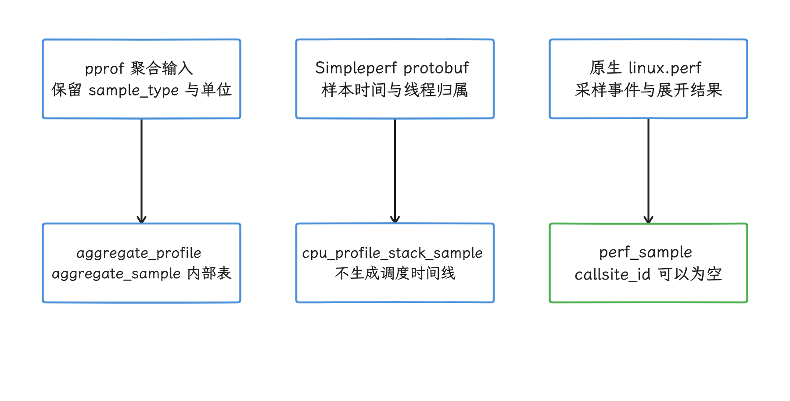

图：pprof、Simpleperf 和 linux.perf 进入不同的数据表。 内部 __intrinsic 表用于核对当前实现，不是跨版本稳定接口。

Flamegraph 是一种调用栈聚合图：纵向表示调用深度，横向宽度表示当前所选指标的累计值；宽度讲的是聚合量，一次调用持续多久，要回到带时间的区间数据去看。英文名与 Perfetto UI 及多数分析工具一致，本文沿用。

<!-- gracker-diagram: ch14-08-04-flamegraph-width-depth -->
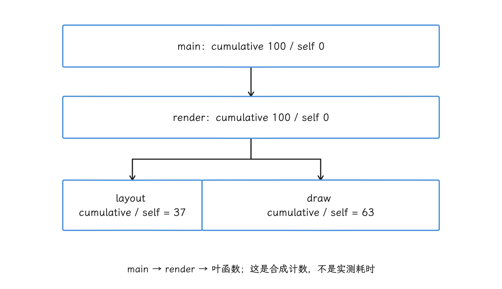

图：合成示例中两条叶路径的计数为 37 与 63，上层累计为 100。 子块宽度按计数37:63绘制；横向不是时间轴，单位必须另行确认。

诊断交互卡顿时，我们先用 FrameTimeline、`slice` 和 `thread_state` 圈定异常区间，再看区间内的 `perf_sample`，判断这段时间的 CPU 消耗落在哪些调用路径上。追持续高 CPU 则是另一种手法：聚合 profile 能快速指出热点，但目标线程分到多少 CPU、有没有被别的线程抢占，还得靠调度数据确认。全局火焰图回答的是“哪里最热”；帧级的因果链，要走前一条路径去找。


本轮在主机 Trace Processor 57.2、58.2 上，用固定 Android 17 protobuf 描述生成最小 pprof 与 Simpleperf 文件，并导入本文 Collapsed Stack 示例；另用合成 PerfSample / TrackEvent / Firefox marker 验证表与选区语义。SQL 语法检查与模型表检验会分别注明。这里没有执行 Android 设备采集、Simpleperf 录制、ART 构建或开销测量；UI 行为按对应版本源码核对。

## pprof：只有聚合值，没有逐样本时间轴

Perfetto v53 加入了 pprof 导入和专用 UI 页面。Android 17 的解析代码同时支持原始 protobuf 和 gzip 压缩输入，并保留每种 `sample_type`（指标类型）的名称与单位。一个 pprof 文件里可能同时存在 CPU 时间、分配字节数和对象数，读火焰图前我们先确认当前选中的指标，宽度跟着指标走，CPU 时间只是其中一种。

pprof 里 `location_id` 的顺序以叶节点开头，导入器会把它翻转成 Perfetto 使用的根到叶调用树。导入后的样本保持聚合形态，带原始时间戳的 `perf_sample` 得从带时间轴的采集入口来；即使 pprof 元数据里带了采集周期，想把某条调用栈准确放回某个 `Choreographer#doFrame`，也还是要靠另行录制的 trace。

<!-- gracker-diagram: ch14-08-06-pprof-unit-and-order -->
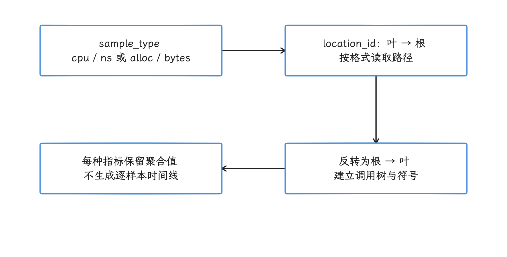

图：导入器把叶到根的 location_id 反转为根到叶，并按指标保留聚合值。 time_nanos、duration 或 period 元数据不能还原每个样本发生时刻。

导入之后，我们按这个顺序检查：


- 在 pprof 专用页面确认当前指标及单位，例如 `cpu/nanoseconds` 或 `alloc_space/bytes`。
- 对比 self 与 cumulative。self 是直接落在当前叶节点的聚合量，cumulative 是当前节点及其整个子树的聚合量。
- 检查映射名、函数名和源码位置。映射名指出代码来自哪个二进制文件或共享库；只看得到地址或宽泛库名时，符号证据还不算完整。
- 需要解释卡顿时，另行抓取包含 FrameTimeline 和调度数据的原生 trace；两次独立录制能对照场景，逐时间点对应就谈不上了。

Perfetto v54 的 `traceconv profile` 增加了输出类型自动检测。它负责的是从 Perfetto trace 导出 profile，跟打开 pprof 文件是两回事，后者不需要先执行这条命令。[Perfetto v53/v54 变更记录](https://android.googlesource.com/platform/external/perfetto/+/android-17.0.0_r1/CHANGELOG)

<!-- gracker-diagram: ch14-08-08-profile-import-export -->
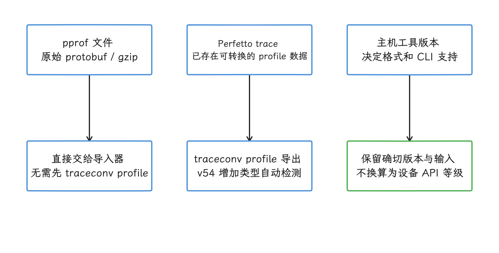

图：打开 pprof 是导入聚合 profile；traceconv profile 是从 trace 导出。 输出类型自动检测不等于为聚合文件补出原始时间戳。

## Simpleperf protobuf：保留样本时间，不导入调度记录

Simpleperf 路径可用于 Android 10—17 上具备分析权限的应用；上量产设备前先核对应用的 profileable / debuggable 条件，系统应用或不可分析应用可能要额外权限或调试构建。下面的系统设置包只是示例目标，在具体设备上能否直接录成，要按这两个条件试过再定。主机脚本先录制二进制采样文件 `perf.data`，再由 `report-sample` 输出 Perfetto 可识别的 protobuf。Android 17 源码中的格式头为 `SIMPLEPERF`，版本号为 1。

这条命令用系统设置应用走一遍完整数据流。`100 Hz` 表示目标采样频率约为每秒 100 次，这是为控制分析开销给出的录制选择，不是所有设备都该固定的阈值。


```bash
python system/extras/simpleperf/scripts/app_profiler.py \
  --app com.android.settings \
  -r "-e task-clock:u -f 100 -g --duration 10" \
  -o perf.data

simpleperf report-sample \
  --protobuf \
  --show-callchain \
  --symdir "$ANDROID_PRODUCT_OUT/symbols" \
  -i perf.data \
  -o simpleperf.trace
```

`-g` 要求录制调用链，`--show-callchain` 要求导出完整链，两个开关要成对用：Android 17 的 `report-sample` 在未指定 `--show-callchain` 时会把地址数组裁成一个元素，祖先采样地址随之丢失，导入后的图就谈不上完整调用链；单个地址上已有的符号或内联层级，也补不回被截去的机器调用栈。`--symdir` 会递归查找带符号文件；应用经过 R8 代码压缩与混淆后，还可向 `report-sample` 传入与该 APK 同构建的 `--proguard-mapping-file`。[Android 17 `report-sample` 参数与实现](https://android.googlesource.com/platform/system/extras/+/android-17.0.0_r1/simpleperf/cmd_report_sample.cpp)

<!-- gracker-diagram: ed14-08-simpleperf-record-export-and-preservation -->
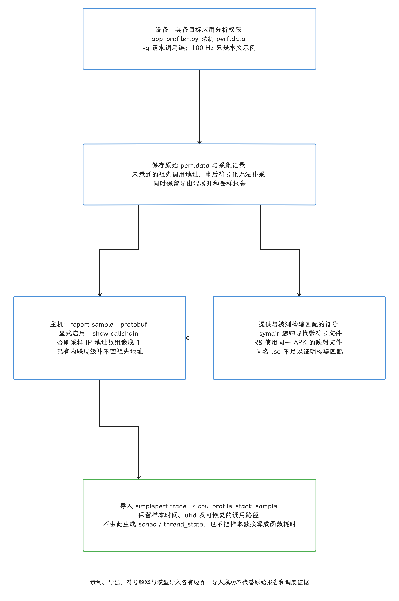

图：固定Android17路径先用app_profiler录perf.data，-g获取调用链；report-sample --protobuf须显式--show-callchain，否则IP数组裁为1，已有内联信息不能恢复祖先地址。--symdir递归查找匹配符号，R8映射须同APK构建；100Hz只是示例非合格线。导入cpu_profile_stack_sample保留时间和线程，过程不补采集缺失或导入器丢弃信息；保存perf.data及导出端展开/丢样报告。

Simpleperf protobuf 中的样本带时间戳和线程标识。Android 17 导入器会把 Simpleperf 的叶到根调用链反转成 Perfetto 的根到叶顺序，再写入 `cpu_profile_stack_sample`。同一格式中的上下文切换记录，也就是 CPU 从一个线程切换到另一个线程的记录，当前会被忽略。所以打开 `simpleperf.trace`，我们看得到样本的时间位置；线程当时在 Running、Runnable 还是休眠，要回到带调度数据的 trace 里查。

这条查询枚举 Simpleperf 导入后的进程实例、线程和采样覆盖范围，先保留 `upid` / `utid` 再选目标。固定导入器只由 Thread 记录建立进程归属，并不从 `MetaInfo.app_package_name` 生成进程名；进程名可能为 NULL，因此这里不按包名过滤。

<!-- gracker-diagram: ch14-08-11-simpleperf-identity-enumeration -->
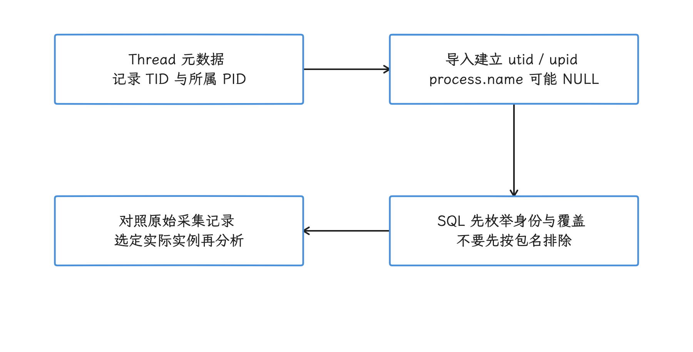

图：先列出 upid、utid、PID/TID 与样本范围，再核对原始采集目标。 MetaInfo 中的包名不自动生成 process.name；按包名过滤可能漏掉全部样本。

```sql
SELECT
  thread.upid,
  process.pid,
  process.name AS process_name,
  thread.utid,
  thread.tid,
  thread.name AS thread_name,
  COUNT(*) AS sample_count,
  MIN(sample.ts) AS first_sample_ts,
  MAX(sample.ts) AS last_sample_ts
FROM cpu_profile_stack_sample AS sample
JOIN thread USING (utid)
LEFT JOIN process ON process.upid = thread.upid
GROUP BY thread.upid, process.pid, process.name,
         thread.utid, thread.tid, thread.name
ORDER BY thread.upid, sample_count DESC;
```

查询结果用于核对已知 PID / TID、线程名和样本覆盖；名称为空时需回看原始采集记录。行数说明的是样本量，函数执行的毫秒数要另外测。固定导入器还忽略 `event_count`、`event_type_id`、`unwinding_result` 与 LostSituation 丢样记录：本文只用一个事件类型录制，避免多种事件混在一个无事件类型列的调用树中；丢样与展开情况要回导出端的报告去看，这些记录进不了 Perfetto，告警也就无从谈起。[Android 17 Simpleperf tokenizer](https://android.googlesource.com/platform/external/perfetto/+/android-17.0.0_r1/src/trace_processor/importers/simpleperf_proto/simpleperf_proto_tokenizer.cc)

<!-- gracker-diagram: ch14-08-12-simpleperf-information-loss -->
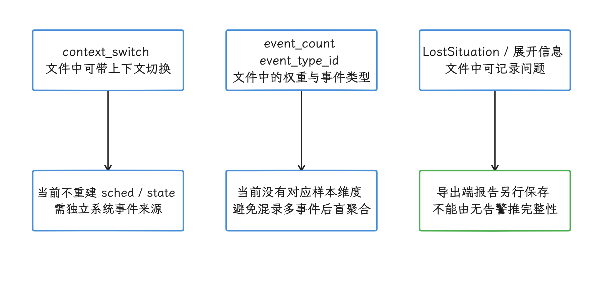

图：固定导入器保留栈样本，却忽略上下文切换、事件权重类型与丢样详情。 空调度表或没有丢样告警不能证明线程未运行或录制无丢样。

## `linux.perf`：把 CPU 样本录进同一条时间轴

走 `linux.perf` 这条路，我们先把设备侧条件问清楚。Perfetto 官方命令行采集文档把 Android 设备下限标为 Android 15：量产 `user` 构建要求目标应用在清单中声明 `profileable`（允许性能分析）或 `debuggable`，用于调试的 `userdebug`、`eng` 构建权限条件不同。这一段的版本约束都属于设备侧采集能力，和主机 Trace Processor 能导入哪些文件格式，是两条各自独立的版本线。

<!-- gracker-diagram: ch14-08-13-linux-perf-prerequisites -->
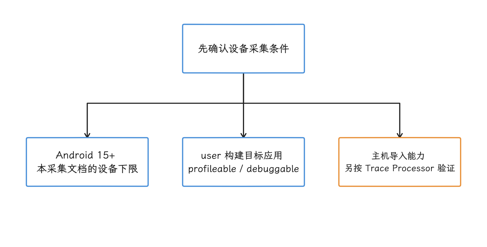

图：按设备版本、系统构建和应用分析权限决定能否采到调用栈。 官方此路径标明 Android 15+；userdebug/eng 条件不同，不能只看主机版本。

`linux.perf` 走 Linux 的 `perf_event_open` ABI（应用二进制接口，用户空间与内核约定的数据布局和调用规则）：Android 17 的 Perfetto 采集端向内核请求每个样本的 TID（线程 ID）、时间和计数值；启用用户态展开后，再请求用户寄存器与栈内存，用来从机器状态还原调用栈；启用内核帧后，请求内核调用链。对应的内核 ABI 标志定义在 `PERF_SAMPLE_TID`、`PERF_SAMPLE_TIME`、`PERF_SAMPLE_CALLCHAIN`、`PERF_SAMPLE_REGS_USER` 和 `PERF_SAMPLE_STACK_USER` 中。[Android 17 Perfetto perf 事件配置](https://android.googlesource.com/platform/external/perfetto/+/android-17.0.0_r1/src/profiling/perf/event_config.cc)、[android17-6.18-2026-06_r6 perf 事件 ABI](https://android.googlesource.com/kernel/common/+/android17-6.18-2026-06_r6/include/uapi/linux/perf_event.h)

<!-- gracker-diagram: ch14-08-14-perf-event-open-abi -->
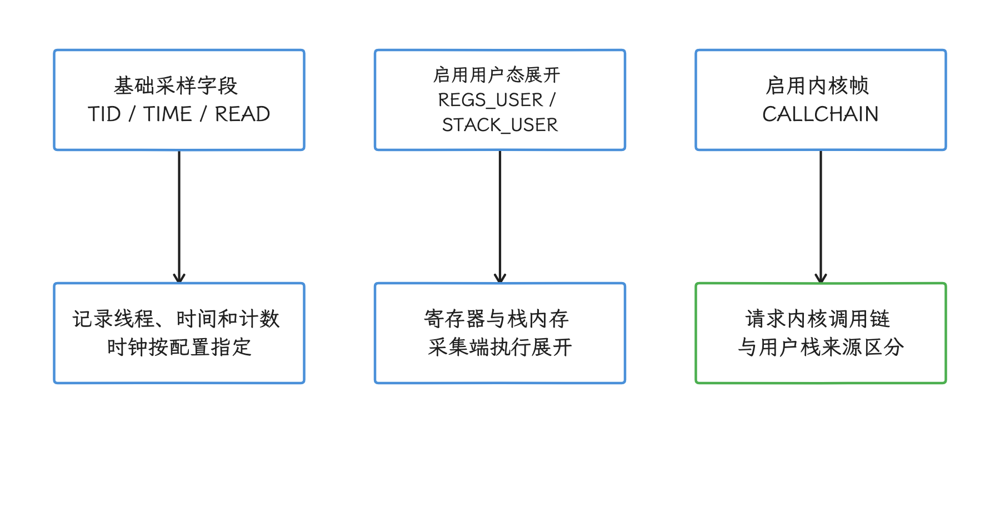

图：采集端请求 TID、时间、计数，再按配置请求用户态展开材料与内核链。 采样状态是还原调用栈的输入，展开可能失败；不是给每次函数调用计时。

这段配置以 `100 Hz` 周期采样系统设置应用，同时录制调度、进程快照和 FrameTimeline。Perfetto 文档建议非原生调用栈的采样频率低于每 CPU 200 Hz；具体用多少还要看设备核数、展开错误和被测负载。

<!-- gracker-diagram: ch14-08-15-per-cpu-rate-and-scope -->
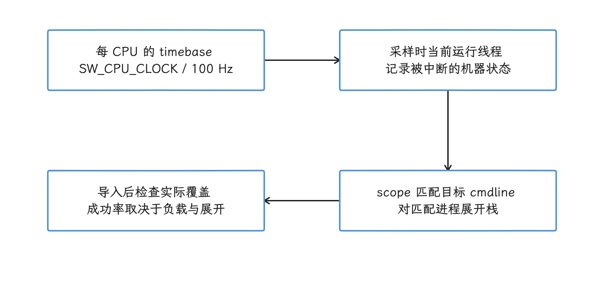

图：SW_CPU_CLOCK 按每 CPU 触发采样，scope 只对匹配进程展开调用栈。 非原生栈建议低于每CPU 200Hz；它不是每个进程必定每秒100个成功样本。

```protobuf
duration_ms: 10000
buffers: {
  size_kb: 40960
  fill_policy: DISCARD
}

data_sources {
  config {
    name: "linux.perf"
    perf_event_config {
      timebase {
        counter: SW_CPU_CLOCK
        frequency: 100
        timestamp_clock: PERF_CLOCK_MONOTONIC
      }
      callstack_sampling {
        scope {
          target_cmdline: "com.android.settings"
        }
        kernel_frames: true
      }
    }
  }
}

data_sources {
  config {
    name: "linux.ftrace"
    ftrace_config {
      ftrace_events: "sched/sched_switch"
      ftrace_events: "sched/sched_waking"
    }
  }
}

data_sources {
  config {
    name: "linux.process_stats"
    process_stats_config {
      scan_all_processes_on_start: true
    }
  }
}

data_sources {
  config {
    name: "android.surfaceflinger.frametimeline"
  }
}
```

这些数据源在同次录制成功产出、所需时钟信息可用且没有相关采集缺口时，导入后的 `perf_sample`、`sched`、进程信息和 FrameTimeline 可在同一 Trace 时间轴上关联。配置本身不证明 FrameTimeline 或调用栈实际存在；录后要分别检查目标进程、帧表、`callsite_id` 和采集诊断。


录制开销也是证据的一部分：高频采样、多核设备、Java / JIT（Just-In-Time，运行时即时编译）代码展开和内核帧都会增加采集端工作量，复现时应记录频率、构建类型、设备型号和是否启用内核帧。[Android 17 CPU profiling 文档](https://android.googlesource.com/platform/external/perfetto/+/android-17.0.0_r1/docs/getting-started/cpu-profiling.md)


下面两条查询分别枚举每个进程实例及线程的覆盖范围，并查看 perf 导入诊断。先从结果选定实际 `upid` / `utid`，后续不要仅按同名进程或可复用的 PID / TID 合并。`stats` 是 Trace Processor 汇总采集与解析自诊断项的表。

```sql
SELECT
  thread.upid,
  process.pid,
  process.name AS process_name,
  thread.utid,
  thread.tid,
  thread.name AS thread_name,
  COUNT(*) AS sample_record_count,
  COUNT(sample.callsite_id) AS callstack_sample_count,
  SUM(sample.callsite_id IS NULL) AS samples_without_callstack,
  MIN(sample.ts) AS first_sample_ts,
  MAX(sample.ts) AS last_sample_ts,
  SUM(sample.unwind_error IS NOT NULL) AS unwind_error_count
FROM perf_sample AS sample
JOIN thread USING (utid)
LEFT JOIN process ON process.upid = thread.upid
GROUP BY thread.upid, process.pid, process.name,
         thread.utid, thread.tid, thread.name
ORDER BY thread.upid, sample_record_count DESC;

SELECT
  name,
  idx,
  value,
  severity,
  source
FROM stats
WHERE name GLOB 'perf_*'
  AND value != 0
ORDER BY name, idx;
```

第一组分别报告样本记录数、有栈样本数、无栈数和展开错误；`perf_sample` 的 `callsite_id` 可以为 NULL，所以读行数时要把有栈、无栈分开，成功展开的调用栈以有栈样本那一列为准。第二组暴露 perf 数据源或导入阶段记录的非零统计项；`severity` 可能包含 info、error 或 data_loss，定性前先看严重级别。样本少的原因要逐项排：线程运行时间短、过滤条件不匹配、丢样本、展开失败都有可能，合格线随场景定。

<!-- gracker-diagram: ch14-08-18-record-count-versus-stack-count -->
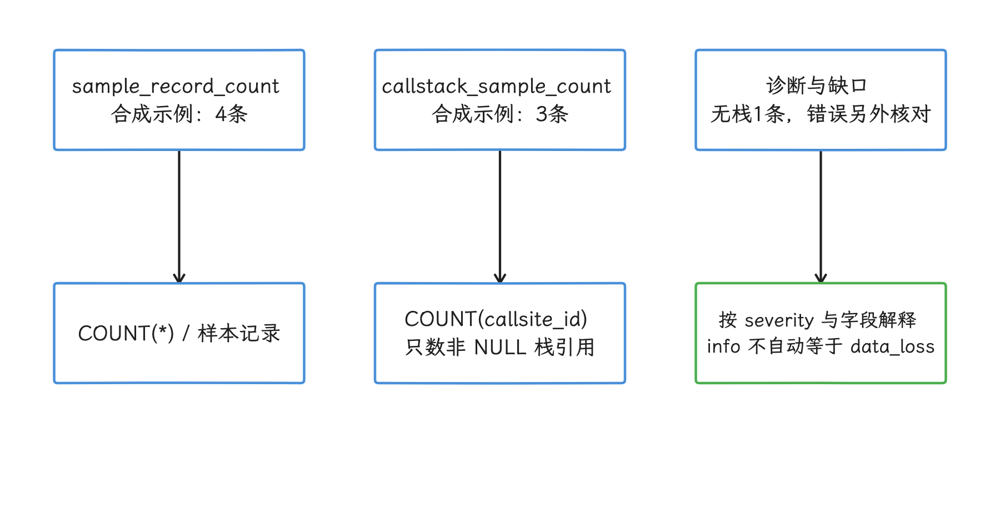

图：分别报告原始记录、有栈、无栈和展开错误，不把非零 stats 一律当丢样。 合成文件4条记录只有3条有栈；该数值只用来说明字段语义。

## 选区 Flamegraph 与 TrackEvent 调用栈

CPU 火焰图的横向宽度表示当前指标的聚合值。对周期性 `linux.perf` 样本，常见指标是样本数；对 pprof，它可能是 CPU 纳秒、分配字节或对象数；对 Collapsed Stack，它是行尾给出的计数。宽度不表示某次调用从开始到结束的墙上时间，单次持续时间需要 `slice.dur`、方法跟踪或其他区间证据。

阅读火焰图，我们先区分两个值：

- **self**：该函数位于采样调用栈叶节点的数量或指标值。
- **cumulative**：该函数出现在调用路径任意层级时累计的数量或指标值。

一个调度函数可能 cumulative 很宽而 self 很窄，说明大量热点经过它进入不同子路径；一个叶函数 self 很宽，才表示采样经常中断在该函数内部。采样频率、采样时刻是否偶然与周期性工作对齐、线程运行份额和展开质量都会影响排名；这种排名是统计证据，不是精确计时。


Perfetto v53 还支持把调用栈附到 TrackEvent 的 Slice 或 instant event（瞬时事件）上，点选单个事件就能看到它附带的栈。选区火焰图按所选轨道与记录点筛选：Slice 的开始栈和结束栈，分别看对应端点是否落进选区，instant 只看自身记录点；一个开始、结束栈都入选的 Slice 可贡献两次，而区间与选区相交、两个记录点都落在选区外的 Slice，一次也不贡献。

这个视图的度量随 UI 版本变化：固定 Android 17 与 UI v57.2 仅提供 Samples 计数；UI v58.2 另提供 `callstack_weight` 的 Weight 度量和可添加的数值参数度量，Weight 只统计非 NULL 权重，数值参数度量只统计带该数值键的记录点，缺值的记录点不进统计。我们按所用 UI 版本和实际选中的 measure（度量项）写结论。[UI v57.2 实现](https://raw.githubusercontent.com/google/perfetto/v57.2/ui/src/plugins/dev.perfetto.TrackEvent/index.ts)、[UI v58.2 实现](https://raw.githubusercontent.com/google/perfetto/v58.2/ui/src/plugins/dev.perfetto.TrackEvent/track_event_callstack_flamegraph.ts)


这里要和 CPU 采样区分开：TrackEvent 调用栈表达的是“事件记录时附带的调用关系”，`perf_sample` 表达的是“采样中断时 CPU 上的调用关系”。两者可以互相印证，但不是同一种采样来源。

<!-- gracker-diagram: ed14-08-trackevent-endpoints-and-versioned-measures -->
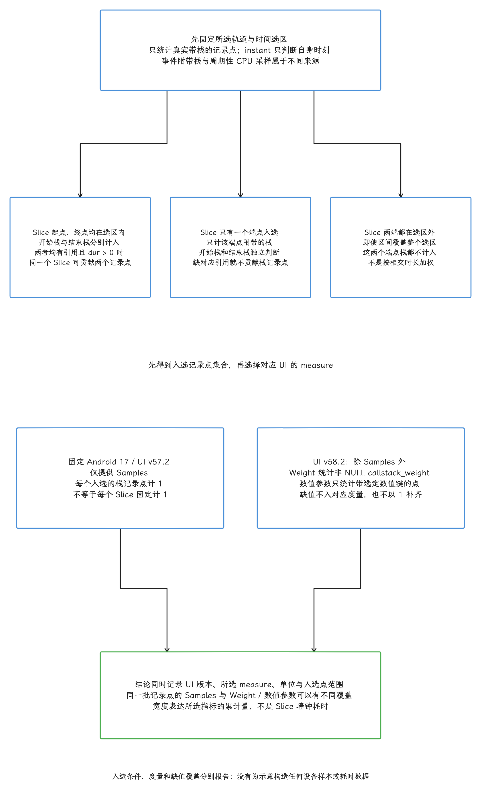

图：只对所选轨道和时间选区内真实带栈的记录点统计。Slice开始、结束独立判断，结束栈要求dur>0及对应引用；两端都入选可贡献两次，两端均在外即使区间覆盖选区也不贡献，instant只看自身记录点。固定Android17/UI57.2仅Samples；UI58.2另有callstack_weight的Weight与选定数值参数度量，缺权重或缺键的点不入对应度量，不能以1补齐。属于事件附带栈，不等同周期CPU采样。

做选区分析时，我们把四个维度同时限定住：


- 时间：异常帧、启动阶段、Binder 往返或明确的用户操作标记。
- 线程：主线程、RenderThread、Binder 工作线程或已确认的后台工作线程。
- 场景：冷启动与热启动、首帧与滚动、缓存命中与未命中，分别单独聚合，混在一起会失去问题指向。
- 指标：样本数、CPU 时间、分配字节等指标需要在结论里写明。

## 符号、内联函数与 R8 还原

函数名读不读得出来，取决于采集产物与构建产物是否对得上。Native 栈需要正确的 ELF（二进制文件格式）、Build ID（标识具体二进制构建的标识值，生成方式取决于工具链）和展开信息；Java / Kotlin 的混淆栈需要同一 APK 构建生成的 `mapping.txt`。路径里能找到同名 `.so` 只是第一步，Build ID 对得上，这份符号才能用来证明线上地址对应某个函数。

<!-- gracker-diagram: ch14-08-23-symbols-build-identity -->
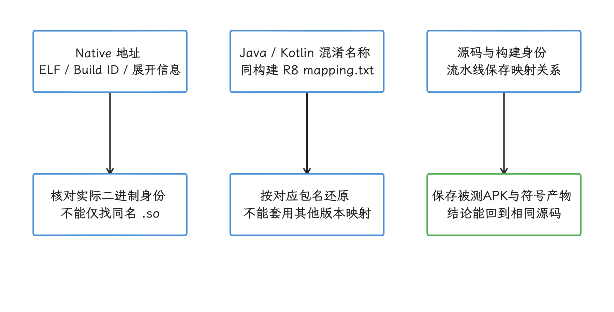

图：Native 栈核对 ELF 与 Build ID，混淆栈核对同 APK 的映射文件。 文件同名不能证明构建相同；Build ID 的生成方式取决于工具链。

编译器内联会把函数体展开到调用点，让一个机器码地址对应多层源码调用关系。Perfetto v53 的 UI 能标出 inline frame（内联调用帧），分析时我们保留这些层级：外层调用者解释业务入口，内联函数解释执行的源码位置。缺少 DWARF 调试信息中的内联记录时，火焰图上没有某个函数名只能说明符号信息不全；要判断该函数有没有执行，还得靠别的证据。

<!-- gracker-diagram: ch14-08-24-inline-source-layers -->
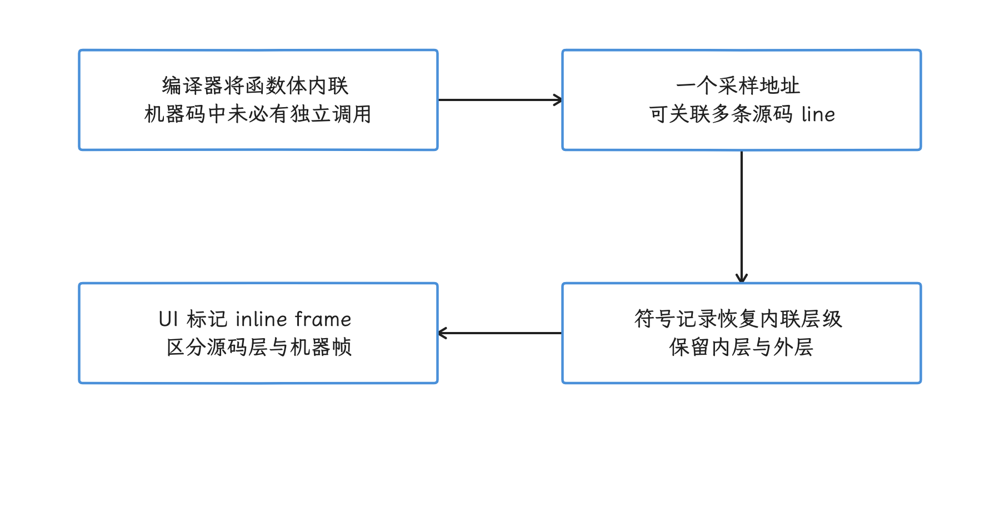

图：内联记录把一个机器位置映射到内层函数与外层调用者。 缺少内联调试信息时，图中没有函数名不能证明该函数没有执行。

针对包含可富化原生调用栈数据的 Perfetto trace，`traceconv bundle` 可作为交付方式：它把 trace、符号和去混淆信息打包成 TAR 归档，Perfetto UI 与 `trace_processor_shell` 都能直接打开，不需要手工解包和拼接。Android 17 固定源码中的 bundle 命令只提供 `--symbol-paths`、`--no-auto-symbol-paths` 和 `--verbose` 等选项，没有 `--proguard-map`，Java / Kotlin 映射这时通过 `PERFETTO_PROGUARD_MAP` 环境变量传入。构建流水线要保证 `R8_MAPPING_FILE` 指向被测 APK 的同一次构建，变量格式固定为 `包名=映射文件`，多个包用冒号分隔。下面的命令沿用 Android 构建输出目录，把系统设置包与它的 R8 映射绑定后打包。


```bash
PERFETTO_PROGUARD_MAP="com.android.settings=$R8_MAPPING_FILE" \
traceconv bundle \
  --symbol-paths "$ANDROID_PRODUCT_OUT/symbols" \
  raw-trace.perfetto-trace \
  settings-profile.tar
```

输出是 TAR，其中包含 `trace.perfetto`，收集成功时还会带上 `symbols.pb`、`deobfuscation.pb`；这种 Trace archive（追踪归档）无需手工解包。主机 v57.2 的 `traceconv bundle` 已支持可重复传入的 `--proguard-map [pkg=]PATH`；使用前核对手上的二进制版本，不把主机选项当作固定 Android 17 设备命令。[v57.2 CLI 源码](https://raw.githubusercontent.com/google/perfetto/v57.2/src/traceconv/traceconv.cc)[Android 17 `traceconv bundle` CLI](https://android.googlesource.com/platform/external/perfetto/+/android-17.0.0_r1/src/traceconv/main.cc)、[Android 17 bundle 内容生成](https://android.googlesource.com/platform/external/perfetto/+/android-17.0.0_r1/src/traceconv/trace_to_bundle.cc)

<!-- gracker-diagram: ed14-08-bundle-input-build-and-cli-branches -->
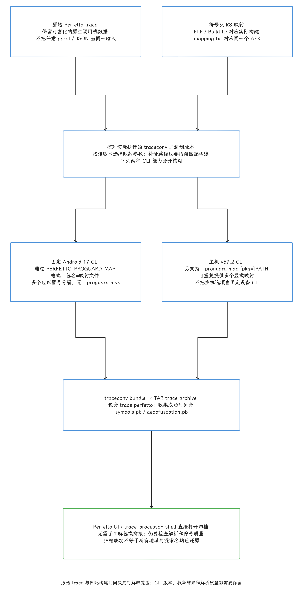

图：针对可富化原生调用栈的Perfetto trace，符号与映射需对应实际被测构建。固定Android17 CLI没有--proguard-map，通过PERFETTO_PROGUARD_MAP提供包名=映射文件，多包冒号分隔；主机v57.2另支持可重复--proguard-map [pkg=]PATH，按实际二进制选配置方式。traceconv bundle输出TAR含trace.perfetto，symbols.pb/deobfuscation.pb取决于收集结果；UI与TP可直接打开，不必手工解包，打包成功不证明符号全还原。

另一条路径是手工生成符号包和 R8 去混淆包，再利用 protobuf trace 可拼接的特性拼出 UI 可直接打开的文件，主要用于兼容旧脚本，或必须输出原生 protobuf trace 的流水线：

```bash
PERFETTO_BINARY_PATH="$ANDROID_PRODUCT_OUT/symbols" \
traceconv symbolize raw-trace.perfetto-trace > symbols.pb

PERFETTO_PROGUARD_MAP="com.android.settings=$R8_MAPPING_FILE" \
traceconv deobfuscate raw-trace.perfetto-trace > deobfuscation.pb

cat raw-trace.perfetto-trace symbols.pb deobfuscation.pb \
  > enriched-trace.perfetto-trace
```

`symbols.pb` 和 `deobfuscation.pb` 是额外的 TracePacket（Perfetto Trace 的数据包）流，要和原始 trace 拼在一起才是可直接打开的 enriched trace。[Android 17 符号化与去混淆文档](https://android.googlesource.com/platform/external/perfetto/+/android-17.0.0_r1/docs/data-sources/native-heap-profiler.md)

<!-- gracker-diagram: ch14-08-27-protobuf-concatenation -->
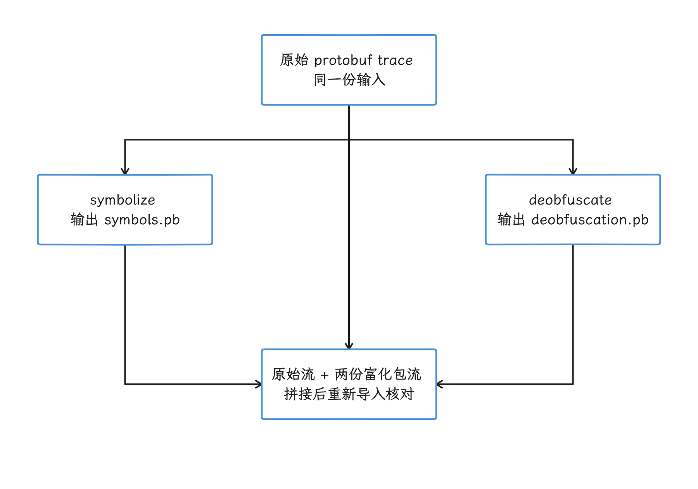

图：原始 protobuf trace 后附符号与去混淆 TracePacket 流，得到富化文件。 这里适用于相容原生 protobuf 流，不能把任意 pprof、TAR 或 JSON 当作同一种字节流拼接。

## SQL 与 DataGrid：从探索走向可复现查询

写 SQL 之前，我们先在 DataGrid 里把数据摸个大概：Perfetto v54 的 DataGrid 增加了 pivot（按维度分组汇总）、glob（通配匹配）、contains（包含）、not-contains（不包含）等筛选方式和 distinct value picker（去重值选择器），适合快速发现线程、映射或函数分布。探索出的结论要给别人复查、要批量重跑、要进代码评审时，就固化成 SQL，并记录 Trace Processor 版本。


`linux.perf.samples` 标准库把 `perf_sample` 的调用栈整理成树。这条查询按累计样本数查看整份 Trace 的热点。v57.2 另有 `stacks.cpu_profiling` 模块，能统一查询 Linux perf、Simpleperf、Firefox / Gecko 等带时间戳的 CPU profile；pprof 没有逐样本时间维度，仍走独立的聚合表与页面。

```sql
INCLUDE PERFETTO MODULE linux.perf.samples;

SELECT
  id,
  parent_id,
  name,
  mapping_name,
  source_file,
  line_number,
  self_count,
  cumulative_count
FROM linux_perf_samples_summary_tree
ORDER BY cumulative_count DESC
LIMIT 50;
```

`self_count` 是以该调用帧为叶节点的样本数，`cumulative_count` 是该帧出现在调用树任意层级的样本数。这里的调用帧指调用栈中的一层函数记录，跟 UI 渲染帧是两个概念。该表汇总全部有可用调用栈的 `perf_sample`，同名函数可能挂在不同的调用路径或映射下；认节点靠 `id` / `parent_id` 保留的树结构，光看 `name` 会把不同节点混成一个。无 `callsite_id` 的样本不会进入树中已解析的调用路径；要做进程或时间过滤，先筛选原始样本并用 UI 选区圈定窗口，整份 Trace 的排名要归因到某个短暂渲染帧，得先走完这一步。

<!-- gracker-diagram: ch14-08-29-summary-tree-path-identity -->
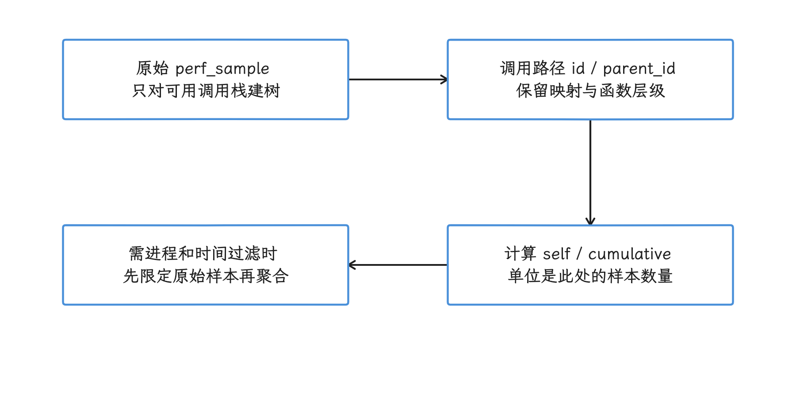

图：调用树使用 id/parent_id 保留路径，整份trace汇总只计有可用栈的样本。 全局排名不能归因于短暂帧；不同路径、映射或实例下同名节点不能盲合并。

同一份 trace 含有 FrameTimeline 与 `linux.perf` 时，可以按候选帧模型的 UI 线程和时间区间统计样本。下例的 `123` 是待替换的 Trace 内部 `upid`，先用前面的覆盖查询选定进程实例。`android_frames` 是兼容模型：它按 `(upid, frame_id)` 聚合多 Layer 和多个 DrawFrame，取代表性 ID，并用 INNER JOIN 排除部分缺失数据；`expected_frame_timeline_count` 固定为 1，只是模型常量，expected 是否唯一、是否完整，这份数据说明不了。因此结果保留模型计数和代表 ID；要逐 Layer 看异常帧，还得回到原始 FrameTimeline 记录。

<!-- gracker-diagram: ch14-08-30-frame-model-identity -->
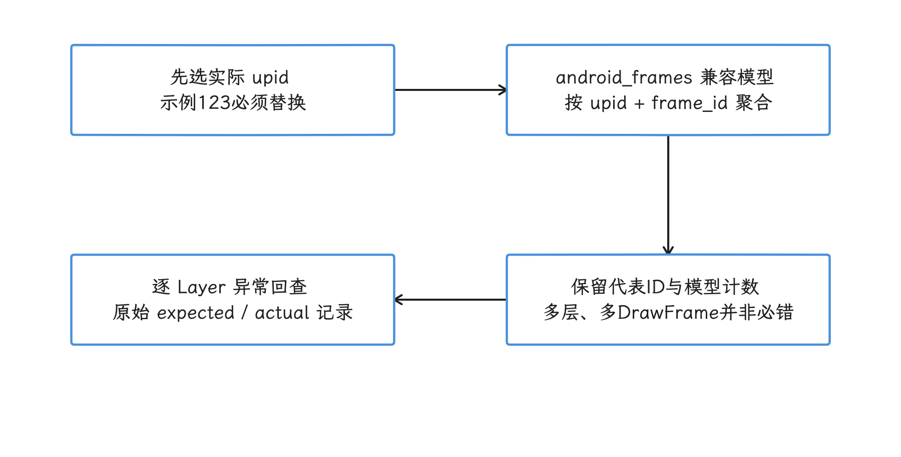

图：按实际 upid 固定进程，保留代表性事件 ID、多层和DrawFrame计数。 INNER JOIN 可排除缺失记录；expected_count=1 是常量，不能证明数据完整。

```sql
INCLUDE PERFETTO MODULE android.frames.timeline;

WITH target_frames AS (
  SELECT
    upid, frame_id, ts, dur, ui_thread_utid,
    do_frame_id, actual_frame_timeline_id,
    expected_frame_timeline_id, actual_frame_timeline_count,
    draw_frame_count
  FROM android_frames
  WHERE upid = 123
    AND dur > 0
)
SELECT
  frame.upid, frame.frame_id, frame.ui_thread_utid,
  frame.do_frame_id, frame.actual_frame_timeline_id,
  frame.expected_frame_timeline_id,
  frame.actual_frame_timeline_count, frame.draw_frame_count,
  frame.ts, frame.dur,
  COUNT(sample.id) AS ui_thread_sample_record_count,
  COUNT(sample.callsite_id) AS ui_thread_callstack_sample_count
FROM target_frames AS frame
LEFT JOIN perf_sample AS sample
  ON sample.utid = frame.ui_thread_utid
 AND sample.ts >= frame.ts
 AND sample.ts < frame.ts + frame.dur
GROUP BY frame.upid, frame.frame_id, frame.ui_thread_utid,
         frame.do_frame_id, frame.actual_frame_timeline_id,
         frame.expected_frame_timeline_id,
         frame.actual_frame_timeline_count, frame.draw_frame_count,
         frame.ts, frame.dur
ORDER BY frame.ts;
```

这里分别统计模型窗口内 UI 线程的 perf 记录数和其中有栈的样本数，时间采用半开区间 `[ts, ts + dur)`。重叠的模型窗口可能重复命中同一个样本，逐帧计数直接相加就可能重复计数，全 Trace 总数要单独算。本文 `SW_CPU_CLOCK` 周期采样只会在该线程运行时命中；换成 tracepoint 等其他 timebase 后要重新解释采样语义。零样本既可能表示线程未运行，也可能与采样频率、区间过短、过滤或丢样本有关，判断时结合 `thread_state`、FrameTimeline 的 jank（帧未按期呈现）标记和展开统计。

<!-- gracker-diagram: ch14-08-31-frame-sample-halfopen -->
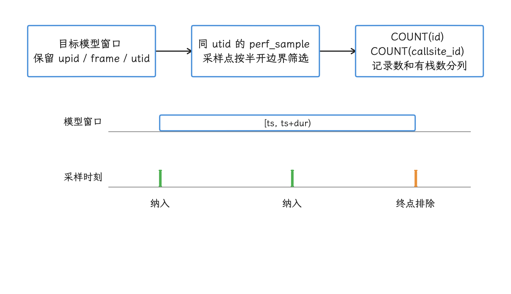

图：只把同 UI utid 且位于 [ts,ts+dur) 的样本计入该模型窗口。 分别统计记录与有栈样本；重叠模型窗口会重复命中，不能直接相加当总数。


## FrameTimeline、Binder 与 GC 的证据拼接


Profile 与系统跟踪联合分析时，每类数据各管一段证明责任：

<!-- gracker-diagram: ch14-08-33-causal-evidence-responsibilities -->
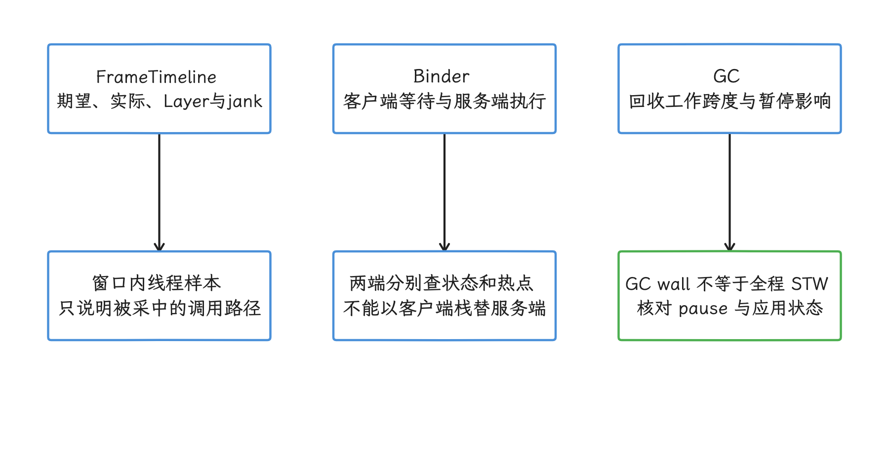

图：FrameTimeline 给出帧分类与窗口，Binder 连接两端，GC 还需暂停证据。 等待的客户端不产生活跃用户CPU样本；服务端热点要在服务端utid查找。

- **FrameTimeline** 给出帧的实际区间、预期区间和 jank 分类。`perf_sample` 只能说明该区间内某线程被采中时的调用路径。
- **Binder** 的 Slice 与 flow（连接相关 Slice 的事件关系）用于连接客户端等待和服务端执行。客户端线程 blocked（阻塞等待）时不产生用户态 CPU 样本；服务端线程的热点，要到服务端 `utid` 上找。
- **GC** Slice 说明一次回收活动的范围；应用线程是否全程 Stop-The-World（暂停受管线程执行），要结合具体 GC pause Slice、线程状态和帧重叠关系判断。采样落在分配路径，支持的是“分配活动较重”这一层的判断。

一个经得起复查的卡顿结论可以写成：某个 FrameTimeline 异常帧与主线程 Running 区间重叠，区间内主线程样本集中在某条已完成符号化的调用路径，复现实验中该分布稳定出现。若主线程大部分时间 blocked，我们就顺着 Binder、锁或 I/O 这些等待链往下查；全局火焰图里某函数排名靠前，单独一条定不了该帧的根因。


## Firefox Profiler 与 Collapsed Stack 迁移

手头已有的 profile 文件要搬进 Perfetto，这一节看两个入口：Perfetto v54 支持 Firefox Profiler 预处理 JSON 和 Collapsed Stack，主要用于接入已有的 profile 文件和工具链。

Collapsed Stack 是一种已经按调用路径聚合的纯文本格式。每行采用根到叶的分号分隔栈，末尾是正整数计数。下面是一份最小格式示例，用于说明解析方向和计数含义。

```text
main;render;layout 37
main;render;draw 63
```

导入后 `render` 的 cumulative count 为两行计数之和，`layout` 与 `draw` 的 self count 分别来自各自行尾。该格式没有线程身份、样本时间、Binder、FrameTimeline 或 CPU 频率，适合比较聚合热点，不适合帧级诊断。


Firefox Profiler 预处理 JSON 可保留 CPU 样本、线程和进程信息。

固定 Android 17 parser 只有样本与线程元数据分支；主机 v57.2 的已核对实现能把受支持的 instant、完整 interval 以及同轨道按 LIFO 匹配的 start/end marker 导入为 Slice，并把 marker 的 `data` 展开成参数。同名同类别 marker 的非嵌套重叠可能被丢弃，需检查 `slice_drop_overlapping_complete_event` 等诊断；自定义颜色、tooltip（悬浮信息）模板、profile counters（计数器）和 profiler overhead（分析器自身开销）等 UI 或 profile 级元数据仍不导入。


原始资料已有 Simpleperf protobuf 时，可以直接导入并保留样本和线程归属；同时保存导出端原始文件与丢样、展开报告，不把该导入器省略的事件类型或权重假定为仍然可用。Firefox marker、Android FrameTimeline 和调度事件要按来源分别解释。[v57.2 Firefox 格式与限制](https://raw.githubusercontent.com/google/perfetto/v57.2/docs/getting-started/other-formats.md)

<!-- gracker-diagram: ed14-08-firefox-samples-markers-and-exclusions -->
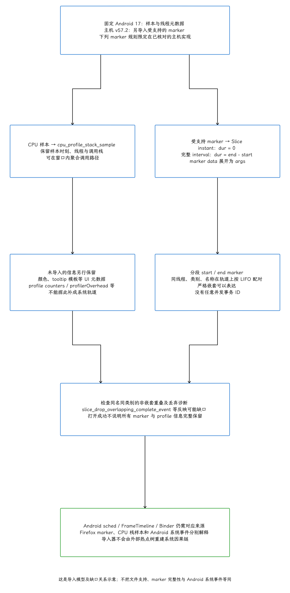

图：固定Android17 parser仅样本与线程元数据；已核对主机v57.2另支持instant、完整interval和同轨道LIFO的start/end marker。CPU样本进入cpu_profile_stack_sample，受支持marker变Slice，data展开args。非嵌套同名同类别重叠可能被丢，检查slice_drop_overlapping_complete_event等；颜色/tooltip模板、counters/profilerOverhead等未导入，不能据此重建Android sched/FrameTimeline/Binder。

## 大 trace 的分析顺序

拿到一份大 trace，我们按证据依赖关系推进：


1. 确认输入类型、设备版本、Perfetto/Trace Processor 版本和采集方式。
2. 检查目标进程、线程、时间覆盖、非零 `stats` 和调用栈展开错误。
3. 从 FrameTimeline、启动阶段、Binder flow、ANR（Application Not Responding，应用无响应）前窗口或用户标记选定异常区间。
4. 在区间内限定线程，阅读 self 与 cumulative 分布，并确认指标单位。
5. 用 `thread_state`、`sched`、slice 和 flow 解释 CPU 执行、等待与跨进程关系。
6. 把稳定查询保存为 SQL，记录采样频率、构建类型、符号目录、Build ID 和 R8 映射版本。

收尾时用这份清单复查结论：


- 当前文件是聚合 profile，还是包含统一时间轴的原生 trace？
- SQL 使用的是 `cpu_profile_stack_sample` 还是 `perf_sample`？
- 火焰图宽度对应样本数、CPU 时间、分配字节，还是其他指标？
- Native Build ID、展开信息和 R8 `mapping.txt` 是否与被测构建一致？
- 展开错误、丢样本或目标过滤是否影响调用树？
- 帧、Binder、GC 与采样结论是否来自同一次录制？
- 结论是否区分 CPU 热点、墙钟耗时、等待时间和系统调度？

## 参考资料

- [Android 17 / API 37 Perfetto 源码锚点](https://android.googlesource.com/platform/external/perfetto/+/android-17.0.0_r1/)
- [android17-6.18-2026-06_r6 内核源码锚点](https://android.googlesource.com/kernel/common/+/android17-6.18-2026-06_r6/)
- [Perfetto v53.0 Release Notes](https://github.com/google/perfetto/releases/tag/v53.0)
- [Perfetto v54.0 Release Notes](https://github.com/google/perfetto/releases/tag/v54.0)
- [Perfetto v54 external trace formats](https://raw.githubusercontent.com/google/perfetto/v54.0/docs/getting-started/other-formats.md)
- [Perfetto v54 CPU profiling](https://raw.githubusercontent.com/google/perfetto/v54.0/docs/getting-started/cpu-profiling.md)
- [Android 17 pprof 导入源码](https://android.googlesource.com/platform/external/perfetto/+/android-17.0.0_r1/src/trace_processor/importers/pprof/pprof_trace_reader.cc)
- [Android 17 Simpleperf protobuf 导入源码](https://android.googlesource.com/platform/external/perfetto/+/android-17.0.0_r1/src/trace_processor/importers/simpleperf_proto/simpleperf_proto_parser.cc)
- [Android 17 `linux.perf.samples` 标准库](https://android.googlesource.com/platform/external/perfetto/+/android-17.0.0_r1/src/trace_processor/perfetto_sql/stdlib/linux/perf/samples.sql)
- [Android 17 Simpleperf `report-sample` 源码](https://android.googlesource.com/platform/system/extras/+/android-17.0.0_r1/simpleperf/cmd_report_sample.cpp)
