# Perfetto CPU 频率与 DVFS 关联分析

本文讨论 DVFS（Dynamic Voltage and Frequency Scaling，动态电压与频率调节）时，以 Android 17 / API 37 / `android-17.0.0_r1` 为平台版本，以 `android17-6.18-2026-06_r6` 为内核版本。Perfetto 的 CPU Frequency 轨道记录软件可见的频率状态，线程轨道记录调度状态。把两者放进同一时间窗，才能回答“线程处于 Running 状态时，所在 CPU 报告了什么频率”。

<!-- gracker-diagram: ch14-09-01-question-scope -->
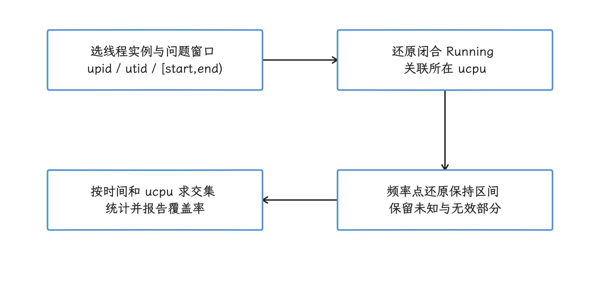

图：只回答指定线程 Running 时所在 CPU 报告的频率。 这不是硬件有效周期、指令量或整机能耗的直接测量。

这条证据有明确限制：频率轨并非直接测量硬件时钟。Android 17 内核在 cpufreq 普通切换完成后，把 `freqs->new` 写入 `cpu_frequency`；快速切换路径写入驱动返回的 `freq`。同一 cpufreq policy（共享一套性能控制接口的一组 CPU）内的在线 CPU 会分别产生事件。`linux.sys_stats` 轮询的也是 sysfs（Linux 向用户空间暴露内核状态的虚拟文件接口）中的值。仅凭这些数据，不能断言某段代码获得了对应数量的有效执行周期。

<!-- gracker-diagram: ch14-09-02-kernel-reporting -->
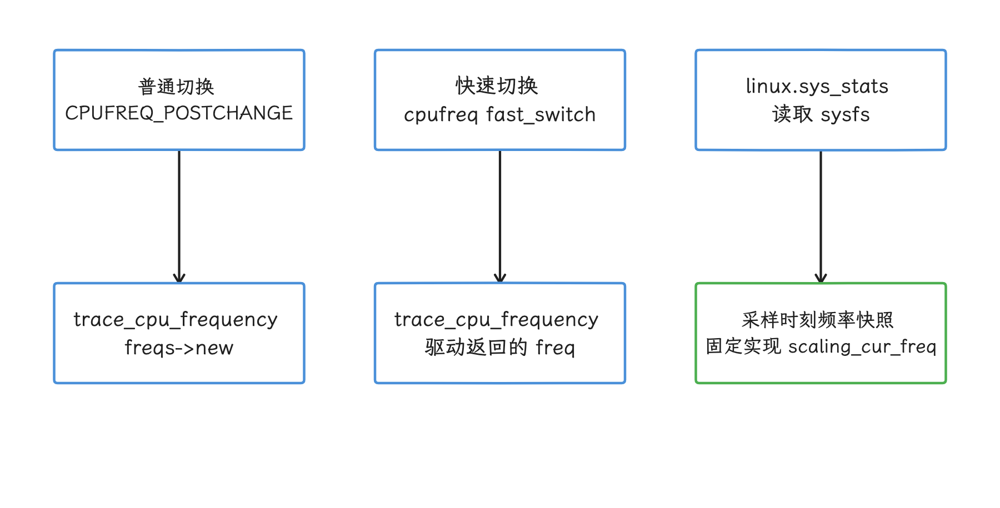

图：普通路径记录完成切换的 freqs->new，快速路径记录驱动返回值。 同 policy 在线 CPU 可分别报告；事件不保证全区间硬件实际时钟。

可复核来源分成三层：Android 17 tag 下的 Perfetto 采集、Trace Processor 表和 ProfilingManager 源码；`android17-6.18-2026-06_r6` 下的 CPUFreq、CPUIdle 与 schedutil 内核源码/文档；以及端侧 LLM（Large Language Model，大语言模型）DVFS 论文中限定在 Pixel 7 / Pixel 7 Pro、Android 13、Tensor G2 和特定推理栈内的实验结果。第三层只用于观察多个硬件域的 governor 是否协同，论文数字不能外推成 Android 17 或其他 SoC 的通用结论。

<!-- gracker-diagram: ch14-09-03-three-baselines -->
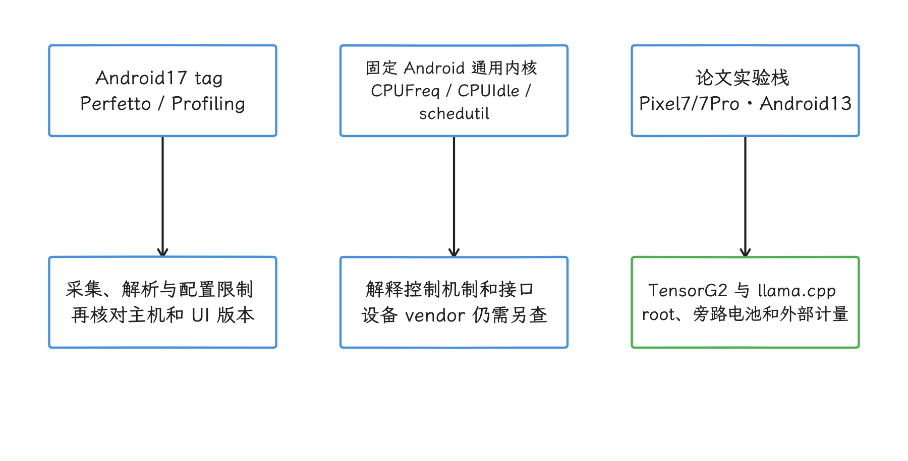

图：源码说明通用行为，论文数字只适用于其受控实验。 Android13 TensorG2 的结果不能直接外推 Android17 或其他 SoC。

## 频率轨记录的是什么

Linux CPUFreq 调频框架把控制路径分成 policy、governor 和 scaling driver：

- policy 表示一组共享硬件性能控制接口的 CPU，并维护允许的最小、最大频率与当前频率；
- governor 根据利用率、时序约束等信息提出目标频率；
- scaling driver 把目标提交给硬件，硬件仍可能受固件、温控或内部控制影响。

<!-- gracker-diagram: ch14-09-04-cpufreq-control -->
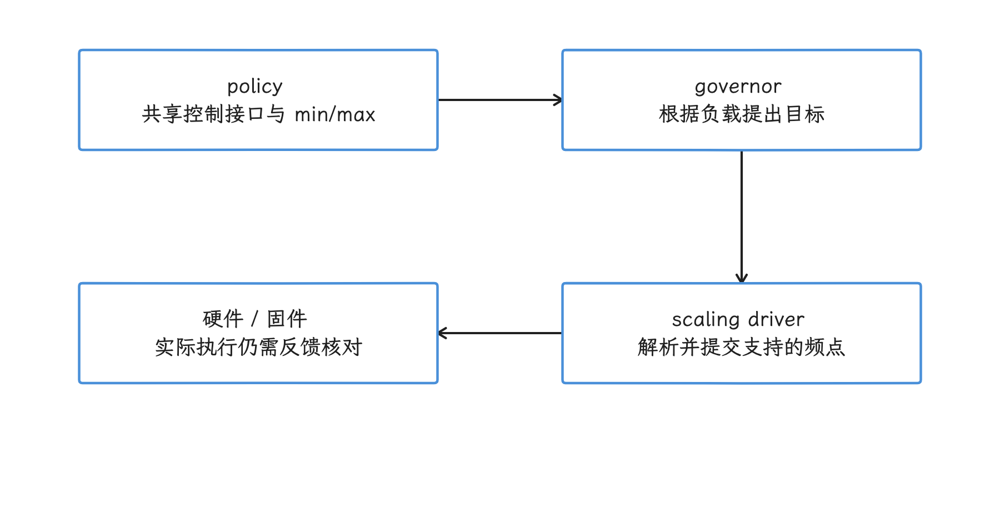

图：policy 管控制范围，governor 提目标，driver 提交硬件。 固件、温控和内部控制仍可影响最终有效运行状态。

Android 17 的 `schedutil` governor 以利用率和 CPU capacity（相对算力）计算候选频率，再交给 `cpufreq_driver_resolve_freq()` 选择驱动支持的频点。源码还保留 Android vendor hook（供厂商插入定制逻辑的钩子），厂商可以改写映射结果。默认更新间隔来自 `cpufreq_policy_transition_delay_us(policy)`，不存在跨设备通用的固定调频周期。[Android 17 schedutil 源码](https://android.googlesource.com/kernel/common/+/refs/tags/android17-6.18-2026-06_r6/kernel/sched/cpufreq_schedutil.c)

<!-- gracker-diagram: ch14-09-05-schedutil-resolution -->
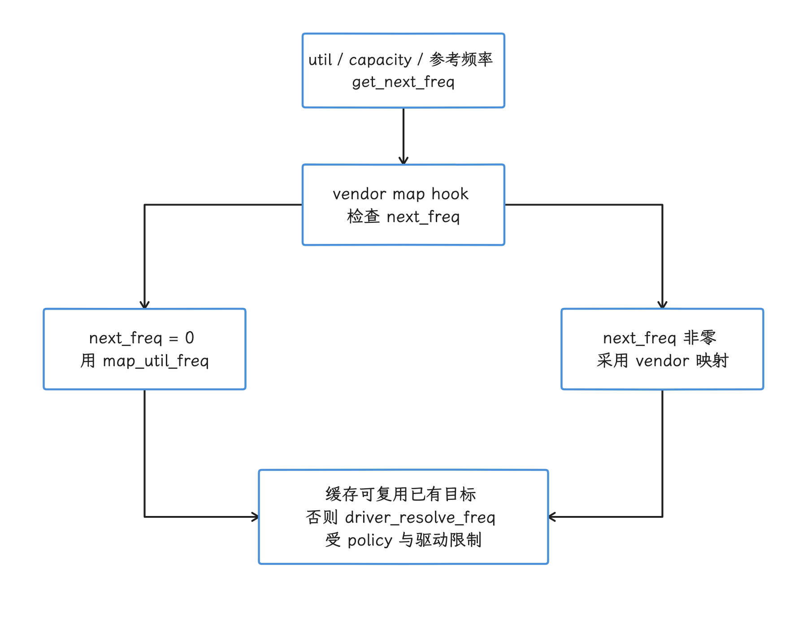

图：利用率和 capacity 参与映射，非零 vendor 结果可替换默认映射。 更新间隔来自 policy transition delay；图不承诺固定周期或最终频率。

频率证据可以按下面的强弱理解：

| 数据 | 能证明什么 | 不能单独证明什么 |
|---|---|---|
| `power/cpu_frequency` | cpufreq 路径报告了一次频率切换 | 硬件在整个区间都精确运行于该频率 |
| `linux.sys_stats` | 轮询时刻的 sysfs 频率值 | 两次轮询之间的瞬时切换 |
| `power/cpu_frequency_limits` | policy 的最小、最大频率约束发生更新 | 约束由 thermal、Power HAL 还是厂商逻辑触发 |
| `cpuinfo_cur_freq` / `cpuinfo_avg_freq` | 驱动具备相应反馈能力时，更接近硬件观测 | 所有设备都实现并允许读取 |
| PMU（Performance Monitoring Unit，性能监控单元）/ AMU（Activity Monitor Unit，活动监控单元）与硬件功耗计 | 实际执行、周期或能耗的补充证据 | 单靠 Perfetto cpufreq 轨无法替代这些数据 |

Android 17 的 Perfetto 文档和 proto（Protocol Buffers 配置定义）注释把轮询路径描述为读取 `cpuinfo_cur_freq`，同一版本的 `CpuFreqInfo::ReadCpuCurrFreq()` 实现读取的是 `scaling_cur_freq`。内核文档指出，`scaling_cur_freq` 多数情况下表示 scaling driver 最近请求的 P-state（处理器性能状态），未必等于硬件瞬时频率。核对某一版本时应以该版本实现为准，同时保留文档与实现的差异。[Android 17 Perfetto 采集实现](https://android.googlesource.com/platform/external/perfetto/+/refs/tags/android-17.0.0_r1/src/traced/probes/common/cpu_freq_info.cc) [Android 17 CPUFreq 文档](https://android.googlesource.com/kernel/common/+/refs/tags/android17-6.18-2026-06_r6/Documentation/admin-guide/pm/cpufreq.rst)

<!-- gracker-diagram: ch14-09-06-sysfs-implementation -->
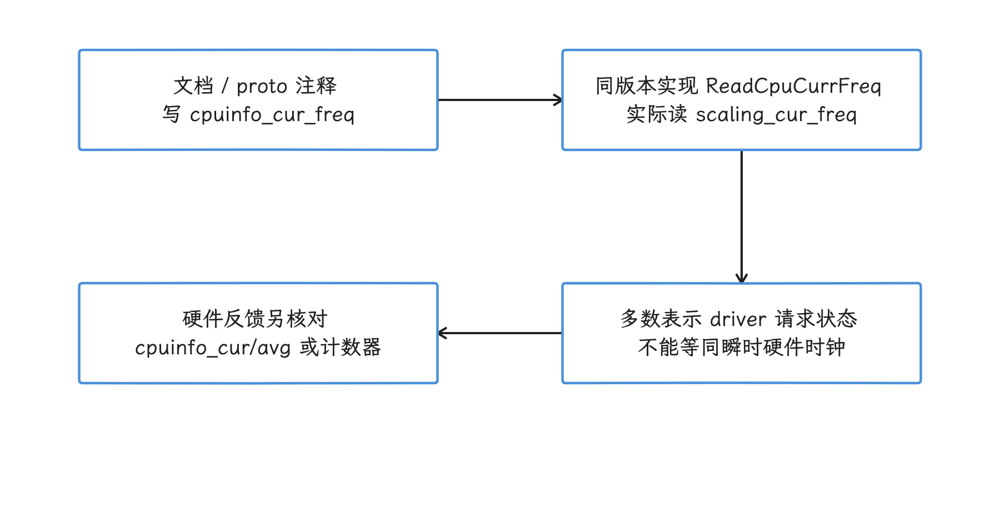

图：区分文档所写的路径、实际实现和硬件反馈能力。 读取失败、空值或解析失败可填0；0先按缺失或无效候选处理。

## 采集入口：事件、轮询和系统信息

下面的配置同时采集频率切换、频率限制、空闲状态、调度事件、轮询频率和可用频点。`500 ms` 来自 Android 17 Perfetto 官方示例，只用于补充初始频率和观察慢变化；它不适合还原单帧内的调频过程。

```protobuf
data_sources: {
  config {
    name: "linux.ftrace"
    ftrace_config {
      ftrace_events: "power/cpu_frequency"
      ftrace_events: "power/cpu_frequency_limits"
      ftrace_events: "power/cpu_idle"
      ftrace_events: "power/suspend_resume"
      ftrace_events: "sched/sched_switch"
      ftrace_events: "sched/sched_waking"
      ftrace_events: "sched/sched_wakeup_new"
    }
  }
}

data_sources: {
  config {
    name: "linux.sys_stats"
    sys_stats_config {
      cpufreq_period_ms: 500
    }
  }
}

data_sources: {
  config {
    name: "linux.system_info"
  }
}
```

`linux.ftrace` 通过内核 tracepoint（预先定义的静态事件点）记录 `power/cpu_frequency` 的切换时刻，`linux.sys_stats` 补充轮询快照，`linux.system_info` 在采集开始时读取一次可用频点。三条路径都可能因驱动、内核配置、权限或 sysfs 导出差异而缺失，采集后应先检查数据完整性。[Android 17 Perfetto CPU frequency 文档](https://android.googlesource.com/platform/external/perfetto/+/refs/tags/android-17.0.0_r1/docs/data-sources/cpu-freq.md)

事件驱动路径只在频率发生变化时写记录。某个 CPU 在 trace 开头保持原频点，轨道左侧就会留白；这段空白不能解释为 CPU 停止运行。轮询能补快照，却会漏掉采样点之间的切换。面向启动和掉帧的分析要保留事件驱动采集。

<!-- gracker-diagram: ch14-09-08-event-poll-gaps -->
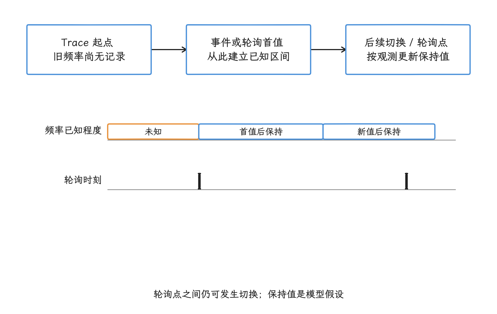

图：切换事件不能回填首值之前，轮询不能重建点间的全部变化。 示意未给实际时间比例；单帧分析保留事件路径并检查覆盖率。

`power/cpu_frequency_limits` 值得与频率事件一起抓。Android 17 内核在 policy 限制更新时记录 `min_freq`、`max_freq` 和 policy 的代表 CPU，它能区分“governor 没有请求更高频率”和“当前上限不允许再升频”这两类线索。限制来源仍需结合 thermal、Power HAL、节电模式和厂商代码确认。[Android 17 CPU frequency tracepoint](https://android.googlesource.com/kernel/common/+/refs/tags/android17-6.18-2026-06_r6/include/trace/events/power.h) [Android 17 cpufreq core](https://android.googlesource.com/kernel/common/+/refs/tags/android17-6.18-2026-06_r6/drivers/cpufreq/cpufreq.c)

<!-- gracker-diagram: ch14-09-07-collection-channels -->
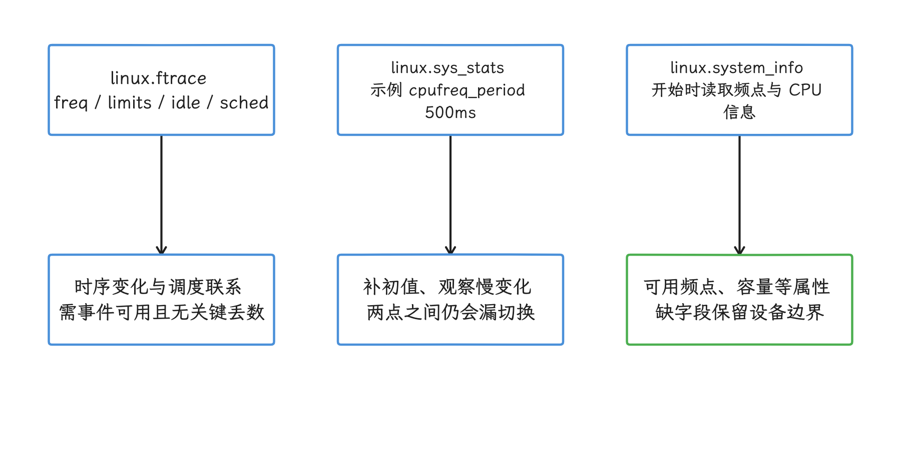

图：ftrace 抓切换，sys_stats 补快照，system_info 抓可用频点。 配置可解析不等于目标设备产出；先查实际表、stats 和 setup metadata。

<!-- gracker-diagram: ch14-09-09-limits-not-request -->


图：比较连续上下限值，判断当时是否允许更高频率。 相同限制可重复上报；只见上限不能唯一判定低请求还是限频，来源需另查。

## Running、Runnable、idle 与频率

线程状态和频率轨回答不同问题：

| 观察组合 | 当前证据支持的判断 | 应补的证据 |
|---|---|---|
| Running 长，报告频率高 | 线程获得 CPU，执行时间较长 | 调用栈、函数采样、缓存与内存停顿、PMU |
| Running 长，报告频率低 | 低频、限频或低容量 CPU 值得检查 | policy limit、thermal、uclamp、CPU capacity、硬件频率反馈 |
| Runnable 长 | 线程可运行却在等待 CPU | 同 CPU 的运行者、优先级、调度类、CPU 压力 |
| Sleeping 长 | 线程主动等待 | 锁、条件变量、Binder 进程间通信、futex（用户态同步所用的内核等待机制）、定时器 |
| D 状态长 | 不可中断等待 | I/O、驱动、内核阻塞原因 |
| CPU idle，频率轨保留高值 | 频率值可能是进入 idle 前的残留 | `cpuidle`、唤醒源、设备功耗 |

Running 时间也不能直接换算成“CPU 算力已用满”。相同 wall time（墙上时钟经过的时间）下，指令级并行度、缓存未命中、内存带宽、分支预测、SMT（Simultaneous Multithreading，同时多线程）/共享资源和迁核都会改变有效吞吐。频率分析适合定位相关性，根因判断还要依赖调用栈、硬件计数器和对照实验。

<!-- gracker-diagram: ch14-09-10-state-evidence -->


图：Running 是获得 CPU 的区间，Runnable 是等待 CPU；S/D 还需等待原因。 高频 Running 仍可受缓存、内存、分支或共享资源限制。

分析 App 卡顿时，可以沿着下面的顺序读取：

1. 在 UI 线程或 RenderThread 找到对应帧和慢 slice（Perfetto 中有起止时间的事件区间）。
2. 统计 slice 内 Running、Runnable、Sleeping 与 D 状态。
3. 只对 Running 子区间关联 `ucpu`、逻辑 CPU、capacity、频率和 idle 状态。
4. 向前覆盖足够的负载建立阶段，观察唤醒、迁核、policy 限制与升频次序。观察窗应由 workload 周期决定，不套固定毫秒数。
5. 用调用栈、thermal（温控状态）、uclamp（utilization clamp，调度器利用率约束）、Power HAL（电源硬件抽象层）或 PMU 证据验证假设。

<!-- gracker-diagram: ch14-09-11-jank-reading-order -->
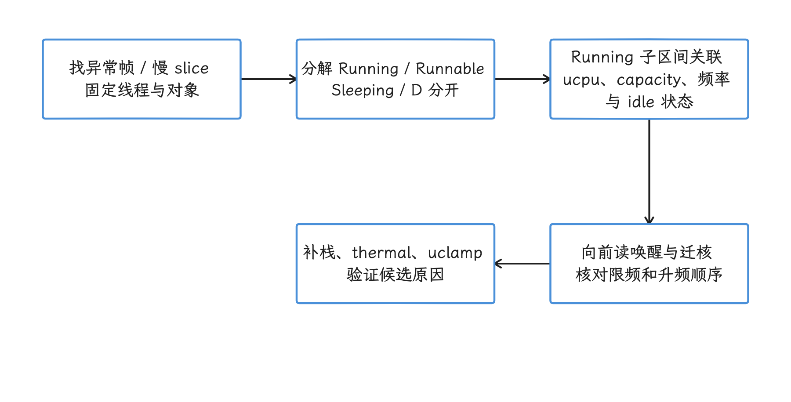

图：先分解异常窗口，再对 Running 做频率与拓扑关联。 向前观察长度由 workload 周期决定；不能套固定毫秒数。

Perfetto 的 `cpu_idle_counters`（CPUIdle 状态区间表）已把原始值 `4294967295` 转成 `-1`，代表 CPU 回到 active；非负值越大通常表示更深的 idle state。具体 state 含义由 SoC 和 CPUIdle driver 定义，不能跨设备比较数字本身。

<!-- gracker-diagram: ch14-09-12-idle-normalization -->


图：原始4294967295规范为-1；非负值表示设备定义的 idle state。 state编号不可跨SoC直接比较；频率残留不能替代空闲状态或功耗。

CPUIdle 的 target residency 是进入某个状态后至少停留多久才比浅层状态更节能，其中包含进入成本；exit latency 是从唤醒到开始执行第一条指令的最坏时间。短任务的首段延迟可能同时受 idle 退出与升频影响，需要观察任务唤醒前后的完整区间。[Android 17 CPUIdle 文档](https://android.googlesource.com/kernel/common/+/refs/tags/android17-6.18-2026-06_r6/Documentation/admin-guide/pm/cpuidle.rst)

<!-- gracker-diagram: ch14-09-13-idle-exit-boundary -->


图：residency 判断进入状态是否划算，exit latency 约束唤醒到首条指令的最坏延迟。 若进入中唤醒且必须完成进入，exit latency 上界也应覆盖相关进入阶段。

## policy、cluster 与 CPU 标识

CPUFreq policy 是调频控制域，cluster 是处理器拓扑或容量分组。很多 Android SoC 的 policy 与 cluster 一一对应，所以多个 CPU 会同步变频；这是一种常见实现，不能当成定义。异构平台也可能让一个 cluster 出现多个 policy，或让多个逻辑 CPU 共享同一 policy。

<!-- gracker-diagram: ch14-09-14-policy-topology -->


图：同步频率可以提示共享控制域，不能据此定义 cluster。 具体成员用 sysfs 和目标设备源码确认，capacity 与频点集合仅作交叉校验。

本地设备上，`policy*/related_cpus` 和 `policy*/affected_cpus` 是判断共享控制接口的直接证据。下面的命令读取 policy 成员、频率限制、governor 和可用频点。

```bash
adb shell 'for p in /sys/devices/system/cpu/cpufreq/policy*; do
  echo "[$p]"
  for f in related_cpus affected_cpus scaling_min_freq scaling_max_freq \
           scaling_governor scaling_available_frequencies; do
    if [ -r "$p/$f" ]; then
      printf "%s: " "$f"
      cat "$p/$f"
    fi
  done
done'
```

输出中的 `related_cpus` 包含 policy 关联的在线和离线 CPU，`affected_cpus` 表示当前在线且受该 policy 影响的 CPU。部分厂商设备不会导出所有文件，缺字段时应记录设备边界，避免补写推测值。

<!-- gracker-diagram: ch14-09-15-policy-members -->
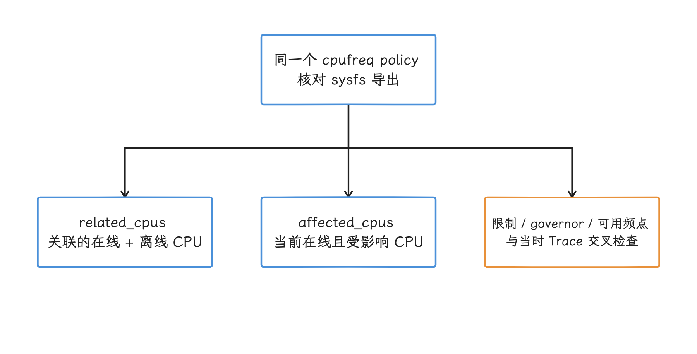

图：related_cpus 包含关联的在线与离线 CPU，affected_cpus 是当前在线受影响成员。 设备不导出字段时记录缺失，不能推测补齐；命令仅做语法检查。

Trace Processor 里有三种容易混淆的标识：

- `cpu` 是设备内的逻辑 CPU 编号；
- `ucpu` 是 Trace Processor 的可连接 CPU 标识，多机或虚拟化 trace 也能保持唯一；
- `cluster_id` 和 `capacity` 来自已采集的处理器信息，用于描述拓扑与相对容量。

只要查询涉及 `sched` 和 CPU counter 的时间交集，就应以 `ucpu` 分区。把 `sched.ucpu` 与 `cpu_counter_track.cpu` 直接比较，会混用两个标识域，在多机 trace 中尤其危险。

下面的查询读取 Android 17 `linux.system_info` 产生的可用频点，并与 CPU 拓扑关联。

```sql
SELECT
  c.cpu,
  c.cluster_id,
  c.capacity,
  cf.freq
FROM cpu_freq AS cf
JOIN cpu AS c ON cf.ucpu = c.ucpu
ORDER BY c.cpu, cf.freq;
```

Android 17 的原始公开表名是 `cpu_freq`，连接键是两侧的 `ucpu`。当前 Perfetto 的内建公开 schema 另提供 `cpu_available_frequencies` 视图；它不应直接替换这段面向 Android 17 配套 schema 的原始表查询。频点集合、`cluster_id`、`capacity` 和同步变频可以互相校验，policy 成员仍以设备 sysfs 或内核源码为准。[Android 17 `cpu_freq` 表定义](https://android.googlesource.com/platform/external/perfetto/+/refs/tags/android-17.0.0_r1/src/trace_processor/tables/metadata_tables.py)

<!-- gracker-diagram: ch14-09-16-cpu-identity-domains -->


图：sched.cpu 是 ucpu 兼容别名，counter轨cpu是设备逻辑编号。 多机连接 counter 需 machine_id + 逻辑cpu；展示逻辑编号从cpu表读取。

<!-- gracker-diagram: ch14-09-17-public-view-version -->
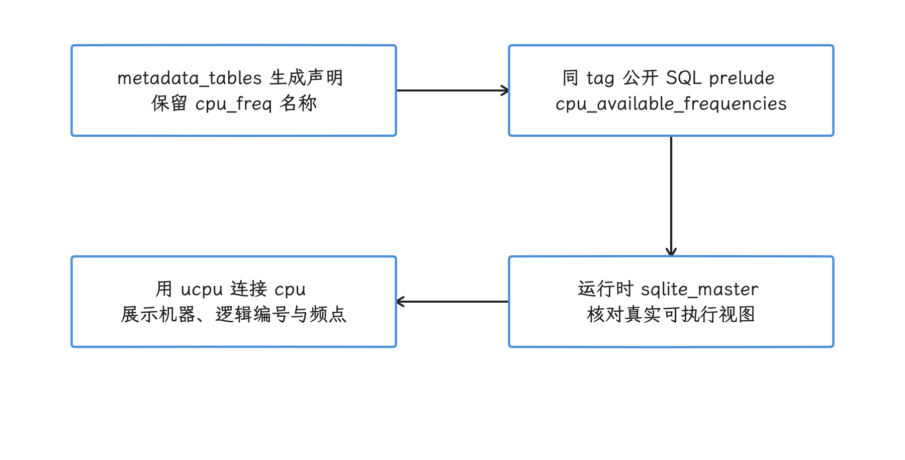

图：固定公开视图是 cpu_available_frequencies，不能只看 wrapping 声明。 主机57.2/58.2实测无cpu_freq；仍记录各自版本，不推定所有历史版本。

## 三类 workload 的判断方法

### 启动短突发

冷启动由类加载、资源解析、Binder 往返、View 构建、编译与首次绘制等阶段组成。关键线程在低频 Running，且频率在关键 slice 结束附近才抬升，可以提出“调频响应晚于该段工作”的假设。还要排除下面几种情况：

- 当前 CPU 属于低容量 policy，线程随后发生迁核；
- policy 的 `scaling_max_freq` 已被 thermal、节电模式或系统策略限制；
- `power/cpu_frequency` 表示请求值，硬件有效频率另有偏差；
- 代码受缓存或内存停顿限制，提高频率对 wall time 的收益有限；
- UI 线程 Running 之外仍有较长 Runnable、Binder 或 I/O 等待。

优化应先减少工作量：删减首帧前任务，合并可延后的工作，降低同步 I/O 与跨进程往返。系统侧调优还要结合 PerformanceHint / ADPF（Android Dynamic Performance Framework，应用向系统提交性能提示的框架）、uclamp、Power HAL 和目标设备的能效曲线验证，不能从一条低频轨直接推出“锁最高频”。

<!-- gracker-diagram: ch14-09-18-startup-short-burst -->
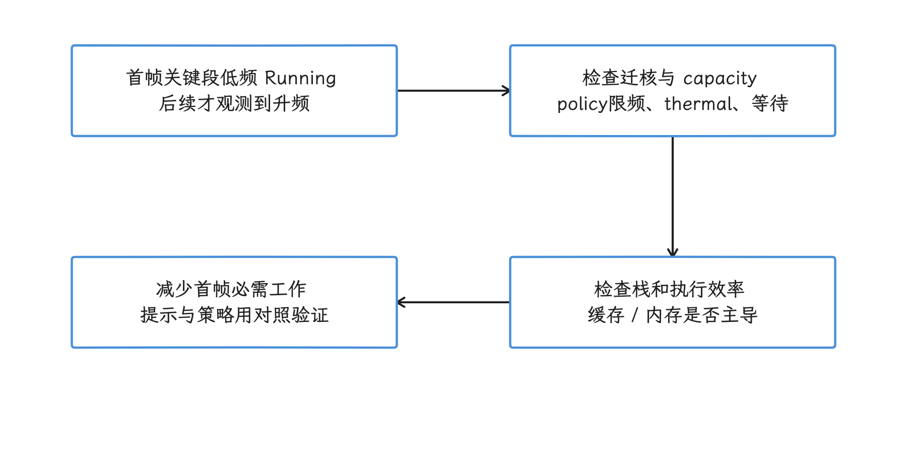

图：低频 Running 与后续升频只形成响应时序假设。 先减少首帧工作与同步等待；系统调优需设备对照，不能直接推出锁最高频。

### 连续渲染负载

滑动、动画和游戏帧循环具有重复节奏。分析时按帧切窗，并分别观察 UI 线程、RenderThread（应用渲染线程）、GPU 提交线程与 SurfaceFlinger（系统合成服务）。频率升降若总是落后于负载相位，可能带来周期性 wall time 波动；线程迁往不同 capacity CPU、Runnable 排队或 GPU fence（生产者与消费者之间的同步对象）等待也会产生相似现象。

<!-- gracker-diagram: ch14-09-19-render-phase -->
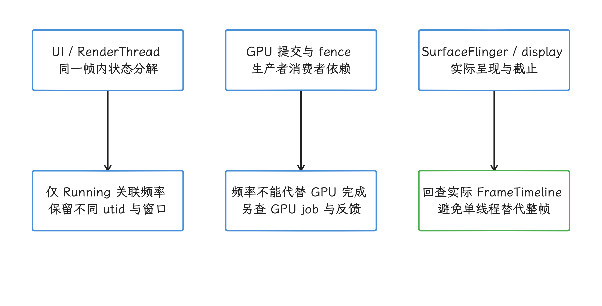

图：帧周期内分别核对UI、RenderThread、GPU提交与合成侧的工作和等待。 相似波动可来自迁核、排队或fence等待；频率相位滞后仍是待验证假设。

频率高不保证帧能按期完成，频率低也不必然是异常。帧内工作量较少时，低频可能正是能效目标。判断依据应是相同设备、相同温度和相同 workload 下的帧时序与频率变化，并结合 2.x 渲染章节的应用、RenderThread、GPU、合成与显示链路。

### 后台批处理

压缩、数据库迁移、索引和日志整理通常对单帧时序不敏感。低频可能延长 active 时间（CPU 非空闲时间），高频可能缩短完成时间并提高瞬时功耗。哪种方案能耗更低，取决于电压频率曲线、内存行为、policy 能效、idle state、唤醒次数和 thermal 状态。

频率轨不含电压，也不等价于整机功耗。后台任务的评估至少要同时比较完成时间、CPU active/idle 分布、唤醒次数、温度和硬件功耗数据。高频更快或低频更省电都只能作为待验证假设。

<!-- gracker-diagram: ch14-09-20-batch-efficiency -->
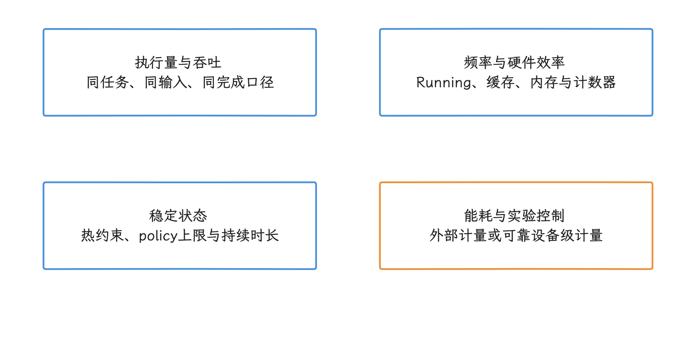

图：持续负载同时比较执行效率、能耗和稳定热状态。 相同高频不保证相同吞吐；单靠频率轨不能得到能耗。

## 用 SQL 重建频率时间线

Android 17 把原始频率和 idle 事件建模为 `counter`，轨道属性放在 `cpu_counter_track`。下面的查询用于确认 trace 是否含有原始数据。

```sql
SELECT
  c.ts,
  t.name,
  t.cpu,
  c.value
FROM counter AS c
JOIN cpu_counter_track AS t ON t.id = c.track_id
WHERE t.name IN ('cpufreq', 'cpuidle')
ORDER BY c.ts, t.cpu
LIMIT 200;
```

`cpufreq` 的值单位是 kHz。`cpuidle` 原始值 `4294967295` 代表退出 idle。结果为空时要回查采集配置和设备支持情况；UI 没有显示轨道时也应执行该查询，因为 Android 17 文档记录过“缺少 idle 事件时 UI 不渲染频率轨，但 SQL 数据存在”的显示问题。

Perfetto 标准库已经把 counter 转成带 `dur` 的区间。下面的查询读取频率区间和规范化后的 idle 区间。

```sql
INCLUDE PERFETTO MODULE linux.cpu.frequency;
INCLUDE PERFETTO MODULE linux.cpu.idle;

SELECT ts, dur, ucpu, cpu, freq
FROM cpu_frequency_counters
ORDER BY ts, cpu
LIMIT 100;

SELECT ts, dur, cpu, idle
FROM cpu_idle_counters
ORDER BY ts, cpu
LIMIT 100;
```

`cpu_frequency_counters` 同时提供 `ucpu` 与逻辑 `cpu`；`cpu_idle_counters.idle = -1` 表示 active。`dur = -1` 可能表示区间延续到 trace 末尾，做交集或聚合时要按查询目标处理开放区间。[Android 17 frequency 标准库](https://android.googlesource.com/platform/external/perfetto/+/refs/tags/android-17.0.0_r1/src/trace_processor/perfetto_sql/stdlib/linux/cpu/frequency.sql) [Android 17 idle 标准库](https://android.googlesource.com/platform/external/perfetto/+/refs/tags/android-17.0.0_r1/src/trace_processor/perfetto_sql/stdlib/linux/cpu/idle.sql)

下面的模板用 `ucpu` 对调度区间与频率区间做 `SPAN_JOIN`（按时间求区间交集）。它是后续频率分布、迁核和帧窗口查询共用的准备步骤。

```sql
INCLUDE PERFETTO MODULE linux.cpu.frequency;

CREATE PERFETTO VIEW _running_spans AS
SELECT ts, dur, ucpu, cpu, utid
FROM sched
WHERE dur > 0;

CREATE PERFETTO VIEW _frequency_spans AS
SELECT ts, dur, ucpu, freq
FROM cpu_frequency_counters
WHERE dur > 0 AND freq IS NOT NULL;

CREATE VIRTUAL TABLE _running_with_frequency
USING SPAN_JOIN(
  _running_spans PARTITIONED ucpu,
  _frequency_spans PARTITIONED ucpu
);
```

结果中的每一行都是“某线程在某逻辑 CPU 上 Running，且该 CPU 处于某个已知频率区间”的时间交集。使用内连接会舍弃未知频率区间，汇总时应同时报告被覆盖的 Running 时间，防止把缺失数据当成零。

下面的查询以 `com.android.settings` 主线程为可执行示例，统计它在各频点上的 Running 时间。

```sql
WITH target_thread AS (
  SELECT t.utid
  FROM thread AS t
  JOIN process AS p ON t.upid = p.upid
  WHERE p.name = 'com.android.settings'
    AND t.tid = p.pid
),
running_freq AS (
  SELECT swf.dur, swf.freq
  FROM _running_with_frequency AS swf
  JOIN target_thread USING (utid)
  WHERE swf.dur > 0
)
SELECT
  freq,
  SUM(dur) / 1000000.0 AS running_ms,
  ROUND(100.0 * SUM(dur) / SUM(SUM(dur)) OVER (), 2) AS pct
FROM running_freq
GROUP BY freq
ORDER BY running_ms DESC;
```

把包名替换为目标进程名即可复用。`tid = pid` 用于定位 Linux 主线程，随后全程使用 `utid`，从而避开长 trace 中 tid 复用。这里的百分比是“已知频率覆盖范围内的 Running 时间占比”，不能解释为指令占比、周期占比或能耗占比。

下面的查询把 UI 线程 Running 区间裁到 `android_frames`（FrameTimeline 标准库生成的帧表）的帧窗口内，适合检查掉帧附近的频率分布。

```sql
INCLUDE PERFETTO MODULE android.frames.timeline;

SELECT
  f.frame_id,
  swf.cpu,
  swf.freq,
  SUM(
    MIN(swf.ts + swf.dur, f.ts + f.dur) -
    MAX(swf.ts, f.ts)
  ) / 1000000.0 AS ui_running_ms
FROM android_frames AS f
JOIN _running_with_frequency AS swf
  ON swf.utid = f.ui_thread_utid
 AND swf.ts < f.ts + f.dur
 AND f.ts < swf.ts + swf.dur
WHERE f.process_name = 'com.android.settings'
GROUP BY f.frame_id, swf.cpu, swf.freq
ORDER BY f.frame_id, ui_running_ms DESC;
```

这个结果只覆盖 UI 线程。RenderThread 需要改用 `f.render_thread_utid` 单独查询；GPU、SurfaceFlinger 和显示侧仍要沿渲染链路核对。帧窗口内缺少频率行时，先计算该帧的 Running 时间与频率覆盖率，再讨论低频相关性。

线程迁核可以直接从公共结果里观察。下面的查询列出目标主线程连续 Running 区间之间的 CPU、cluster 与频率变化。

```sql
WITH target_thread AS (
  SELECT t.utid
  FROM thread AS t
  JOIN process AS p ON t.upid = p.upid
  WHERE p.name = 'com.android.settings'
    AND t.tid = p.pid
),
ordered AS (
  SELECT
    swf.ts,
    swf.dur,
    swf.cpu,
    c.cluster_id,
    c.capacity,
    swf.freq,
    LAG(swf.cpu) OVER (ORDER BY swf.ts) AS prev_cpu,
    LAG(c.cluster_id) OVER (ORDER BY swf.ts) AS prev_cluster_id
  FROM _running_with_frequency AS swf
  JOIN target_thread USING (utid)
  JOIN cpu AS c ON c.ucpu = swf.ucpu
)
SELECT *
FROM ordered
WHERE prev_cpu IS NOT NULL
  AND (cpu != prev_cpu OR cluster_id != prev_cluster_id)
ORDER BY ts;
```

该查询展示相邻的已知频率 Running 区间，不保证两行之间没有 Runnable、Sleeping 或未知频率空洞。迁核原因需要结合 `thread_state`、wakeup（线程唤醒事件）、uclamp、调度优先级和系统负载判断。

<!-- gracker-diagram: ch14-09-21-raw-counter-check -->
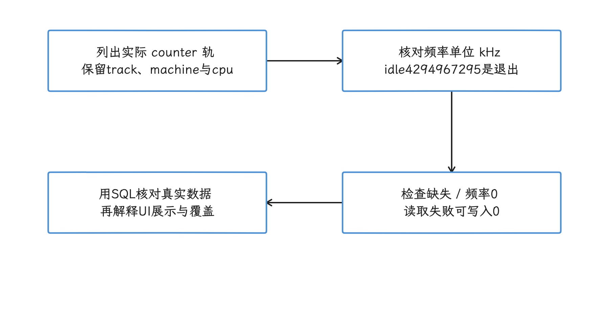

图：频率为kHz；原始idle退出值需归一化，缺轨与零值先查采集和实现。 UI无轨不等于SQL无数据；读取失败填0不证明硬件停止。

<!-- gracker-diagram: ch14-09-22-counter-leading-intervals -->
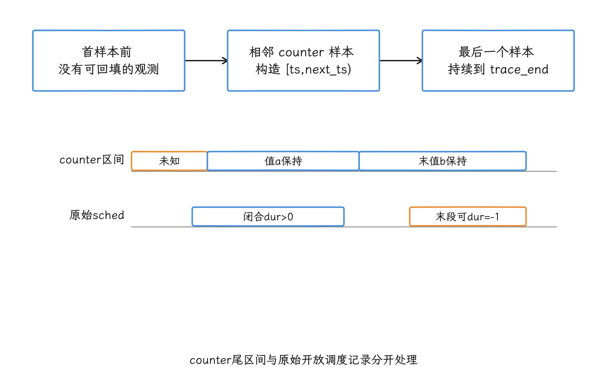

图：标准宏把样本延伸到下次样本，最后一个延伸到trace_end。 首样本之前未知；尾值延续不是硬件连续测量，和sched.dur=-1是不同情况。

<!-- gracker-diagram: ch14-09-23-span-preflight -->
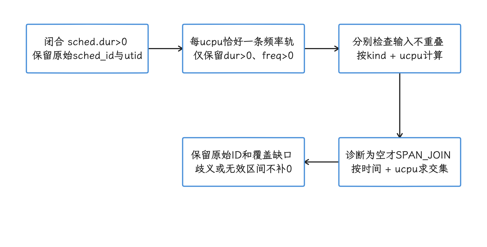

图：两侧按ucpu分区，排除开放Running、无效频率和多轨歧义。 发现任一输入重叠时整体清空SPAN输入并停止统计；缺失频率不补0。

<!-- gracker-diagram: ch14-09-24-process-instance -->
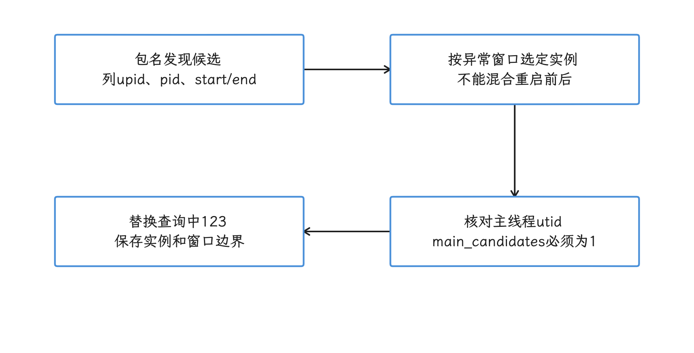

图：枚举同名重启实例，按问题窗口选定upid，再确认主线程候选数为1。 示例123是待替换的Trace内部upid，不是PID；空或多候选不能给有效统计。

<!-- gracker-diagram: ch14-09-25-span-time-intersection -->
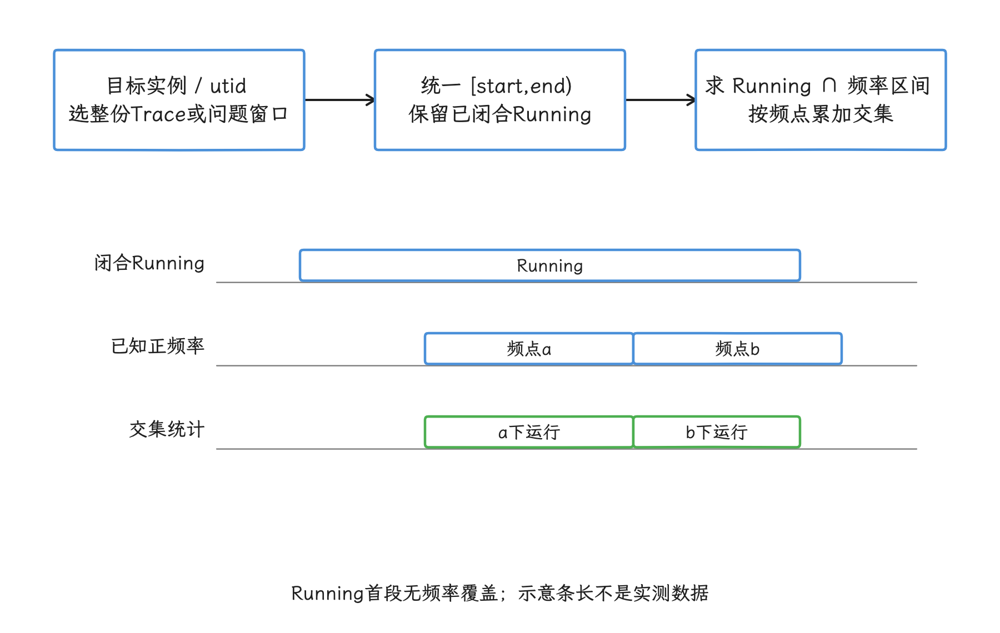

图：两种区间先按同一半开窗口裁剪，再按ucpu求交集。 此图只示意求交；没有频率覆盖的Running必须留在覆盖率分母。

<!-- gracker-diagram: ch14-09-26-two-denominators -->


图：合成校验：闭合Running55ms，其中已知正频率40ms，覆盖率72.73%。 频点pct以40ms为分母，覆盖率以55ms为分母；开放记录另列，不是周期或能耗占比。

<!-- gracker-diagram: ch14-09-27-frame-model-coverage -->


图：按upid固定模型帧，分别聚合闭合Running和频率交集后再关联。 android_frames聚合多Layer/DrawFrame且会排除缺记录，expected计数常量1不证明完整。

<!-- gracker-diagram: ch14-09-28-frame-overlap-boundary -->


图：UI与RenderThread分别选utid；重叠模型窗口可能覆盖同一Running。 改RenderThread要同时改两个CTE；GPU、SF与显示仍走各自证据链。

<!-- gracker-diagram: ch14-09-29-migration-before-frequency -->
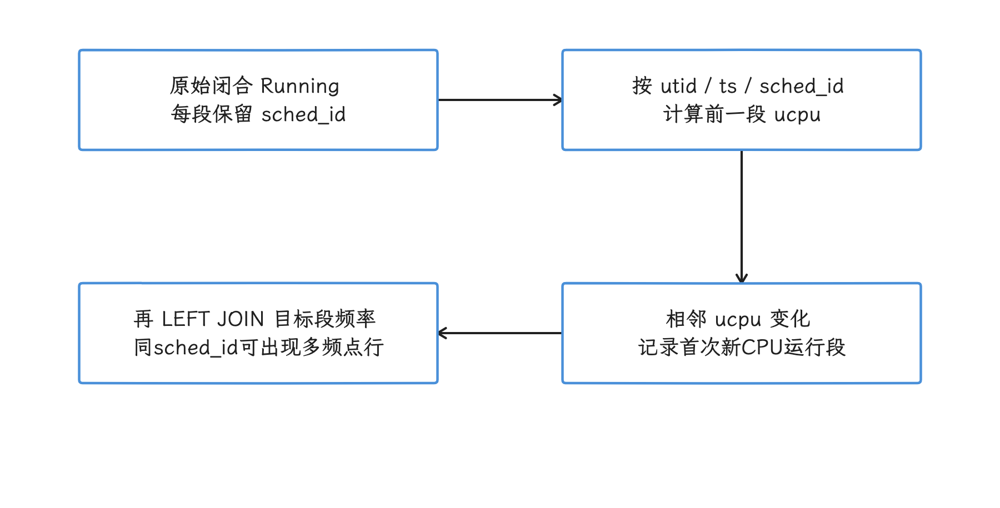

图：LAG按utid分区并以ts、sched_id排序，比较相邻原始Running的ucpu。 频率切分不产生新调度；LEFT JOIN保留未知频率迁核候选。

<!-- gracker-diagram: ch14-09-30-migration-observation -->
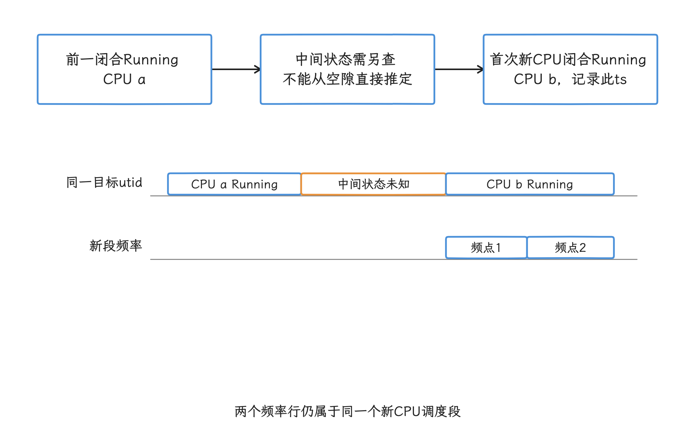

图：ts是首次观测到新CPU运行的起点，不是迁核决定的精确时刻。 两段间隙可含Runnable、Sleeping、开放段或缺口，不能直接当Runnable时长。

## 端侧 AI 推理中的 governor 协同

论文 *Dissecting the Impact of Mobile DVFS Governors on LLM Inference Performance and Energy Efficiency* 研究了 CPU、GPU 和内存调频各自决策时的能效错配。实验设备是 Pixel 7 与 Pixel 7 Pro，SoC 为 Tensor G2，系统为 Android 13；测试采用 llama.cpp、OpenCL/CLBlast、TinyLlama 1.1B、StableLM-Zephyr 3B 和 Llama-2 7B，并在 root、battery bypass（拆机旁路电池并由功耗仪供电）、屏幕关闭和外部功耗采样条件下运行。

<!-- gracker-diagram: ch14-09-31-paper-test-boundary -->
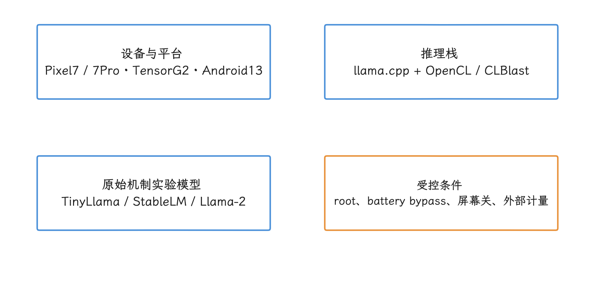

图：原始实验限定Pixel7/7Pro、TensorG2、Android13和指定GPU推理栈。 root、旁路供电、屏幕关闭与外部功耗计环境不同于一般线上App。

在这组实验边界内，独立 governor 相对同能耗的频率组合，部分 prefill（处理输入提示）/ decode（逐 token 生成）延迟最多增加 40.4%。论文提出统一管理 CPU、GPU 和内存频率的 energy-aware governor FUSE；在相同单 token 能耗下，它平均降低 7.0%—16.9% 的 TTFT（Time to First Token，首 token 延迟）和 25.4%—36.8% 的 TPOT（Time per Output Token，平均每个输出 token 的时间）。[论文页面](https://arxiv.org/abs/2507.02135)

这些数字不能外推到 Android 17、其他 SoC、NPU（Neural Processing Unit，神经网络加速器）后端或不同推理运行时。它们提供的是一种诊断视角：GPU 执行仍依赖 CPU 提交，KV cache（注意力计算复用的 key/value 缓存）与权重访问受内存系统影响，单看 CPU 利用率可能低估整条推理流水线的时序需求。

<!-- gracker-diagram: ch14-09-34-inference-domains -->
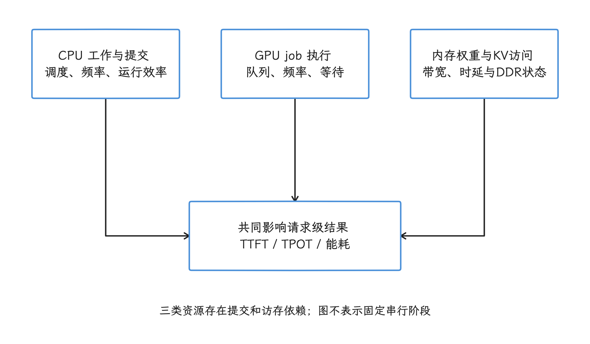

图：CPU提交、GPU执行和内存访问共同影响推理阶段的进度。 该依赖视角不保证所有SoC出现论文中的反馈；NPU和其他运行时需独立验证。

端侧推理 trace 至少要把 CPU sched/cpufreq、GPU job 与频率、内存带宽或 DDR（Double Data Rate，双倍数据率内存）频率、thermal、TTFT、TPOT 和单 token 能耗放在相同实验中。设备不暴露 GPU 或 DDR 数据时，结论应明确限定为 CPU 侧观察。

<!-- gracker-diagram: ch14-09-32-paper-percent-base -->


图：第4节最多下降40.4%以默认governor延迟为分母。 归一化100→59.6只是百分比说明；反向增加约67.8%，不是40.4%，也不是设备绝对延迟。

<!-- gracker-diagram: ch14-09-33-fuse-two-step -->


图：离线搜索GPU候选，再为至多两组候选搜索CPU，运行时按阶段应用。 内存governor保持默认；200条请求的真实请求指标按近似等总能耗目标，不能写成每次精确等token能耗。

<!-- gracker-diagram: ch14-09-35-inference-measurement -->
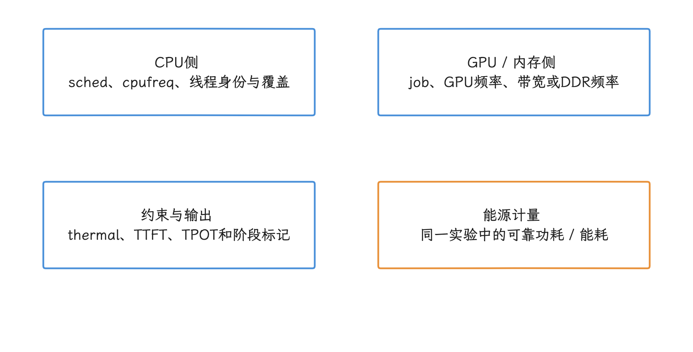

图：同一实验记录CPU、GPU/DDR、thermal、TTFT/TPOT与可靠能耗。 设备不暴露GPU或DDR时，结论限定CPU侧；trace频率不能代替功耗仪。

## 与 EAS、uclamp、thermal 交叉验证

CPU Frequency 是结果信号，解释其来源还要结合下面几组证据：

- **EAS（Energy Aware Scheduling，能耗感知调度）与 task placement（任务放置）**：确认线程所在 CPU 的 `capacity`、迁核方向和同核竞争，详见 5.1 节；
- **uclamp 与 PerformanceHint**：确认任务的利用率下限、上限及会话提示是否改变 schedutil 输入，详见 5.2 节；
- **CPUFreq policy**：对照 `scaling_min_freq`、`scaling_max_freq`、governor、`cpu_frequency_limits` 和可用频点；
- **thermal 与电源策略**：检查温度、冷却设备、节电模式、Power HAL 和 sustained workload，详见 11.1 节；
- **执行效率**：用 Simpleperf / perf 采样工具、PMU、AMU 或厂商计数器排除缓存、内存和 CPU 前端停顿。

<!-- gracker-diagram: ch14-09-36-cross-validation -->
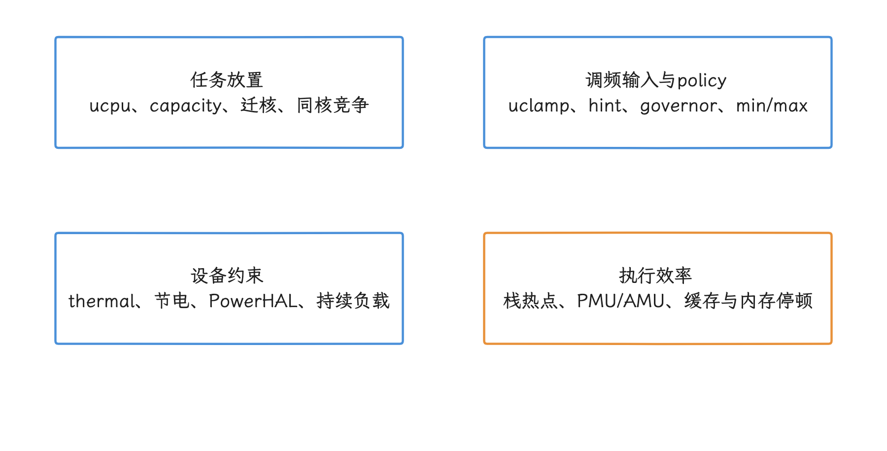

图：先定位任务放置，再核对利用率约束、policy、热约束和执行效率。 频率曲线本身不能唯一反推出EAS、uclamp或thermal根因。

Android 17 通用内核能说明 CPUFreq、schedutil、uclamp、EAS 与 CPUIdle 的框架。设备上的 energy model（调度器估算性能与能耗的数据表）、频点表、thermal policy、Power HAL 和 vendor hook 可能来自厂商内核或闭源组件。没有目标设备的源码、sysfs 和 trace，结论只能停留在通用框架层。

<!-- gracker-diagram: ch14-09-37-vendor-scope -->
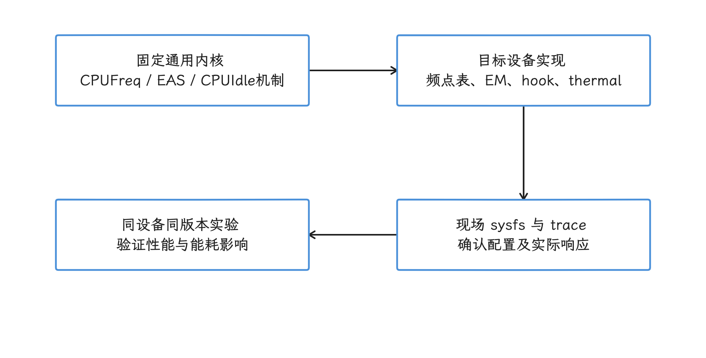

图：通用内核说明框架，设备源码/sysfs/trace确认实际策略。 缺少目标设备证据时停留在通用机制，不能互推不同厂商。

## 线上与工具预设的采集边界

本地 `adb perfetto` 接受完整 TraceConfig，在设备允许的范围内可以显式启用分析所需的数据源。Android Studio Profiler 使用工具自己的采集配置，版本与入口不同会得到不同字段；分析前应检查 `cpu_counter_track` 和 trace metadata，不应按界面名称推断采集内容。

<!-- gracker-diagram: ch14-09-38-tool-recording-scope -->
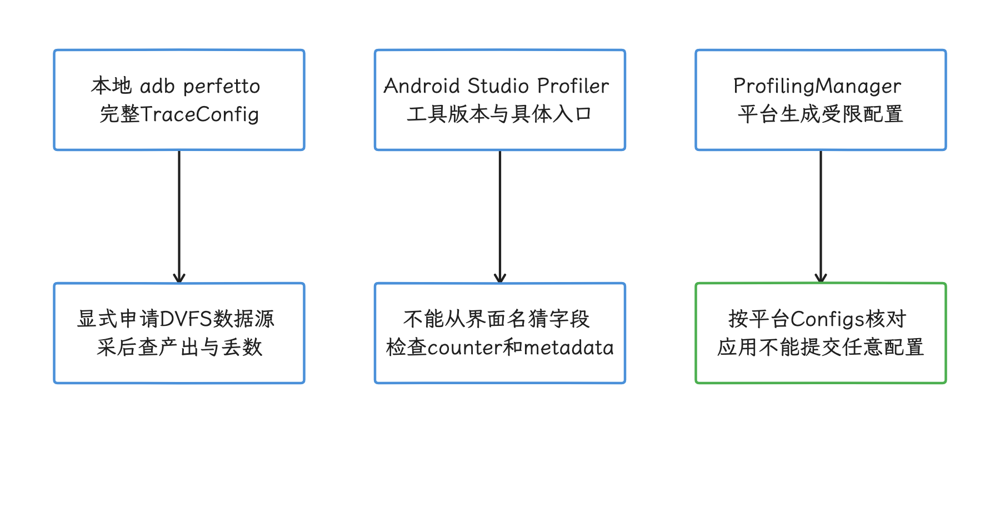

图：本地可提交完整配置，工具预设需逐版本检查实际数据。 权限与设备支持仍约束产出；以实际表、轨道和metadata为准。

Android 17 的 `ProfilingManager`（面向应用的系统性能采样 API）system trace 由平台 `Configs` 生成固定配置。该配置包含 compact sched（压缩编码的调度事件）、进程信息、应用 atrace 分类和 SurfaceFlinger FrameTimeline，未启用 `power/cpu_frequency`、`power/cpu_idle`、`linux.sys_stats` 或 `linux.system_info`。system trace 结果还会经过 redaction（敏感信息裁剪），并受系统 rate limiter（采样频率限制）、参数范围和设备配置约束。它可以支持应用侧线上性能采样，却不能替代本地 CPU DVFS TraceConfig。[Android 17 Profiling 配置](https://android.googlesource.com/platform/packages/modules/Profiling/+/refs/tags/android-17.0.0_r1/service/java/com/android/os/profiling/Configs.java) [Android 17 ProfilingService](https://android.googlesource.com/platform/packages/modules/Profiling/+/refs/tags/android-17.0.0_r1/service/java/com/android/os/profiling/ProfilingService.java)

拿到线上 trace 后，先列出实际存在的数据源和轨道。缺少 idle、policy limit、GPU 或 thermal 时，报告应写成“已观测 CPU 频率与调度状态的相关性”，不能升级为整机能耗或 governor 根因。

<!-- gracker-diagram: ch14-09-39-online-preset-limits -->
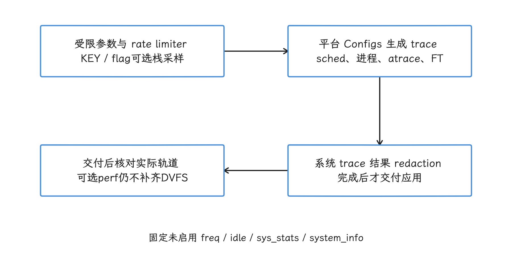

图：固定配置有compact sched、进程、应用atrace与FrameTimeline，可条件附加栈采样。 可选linux.perf不补freq/idle/sys_stats/system_info；结果还受redaction和请求rate limiter限制。

<!-- gracker-diagram: ch14-09-40-online-evidence-level -->
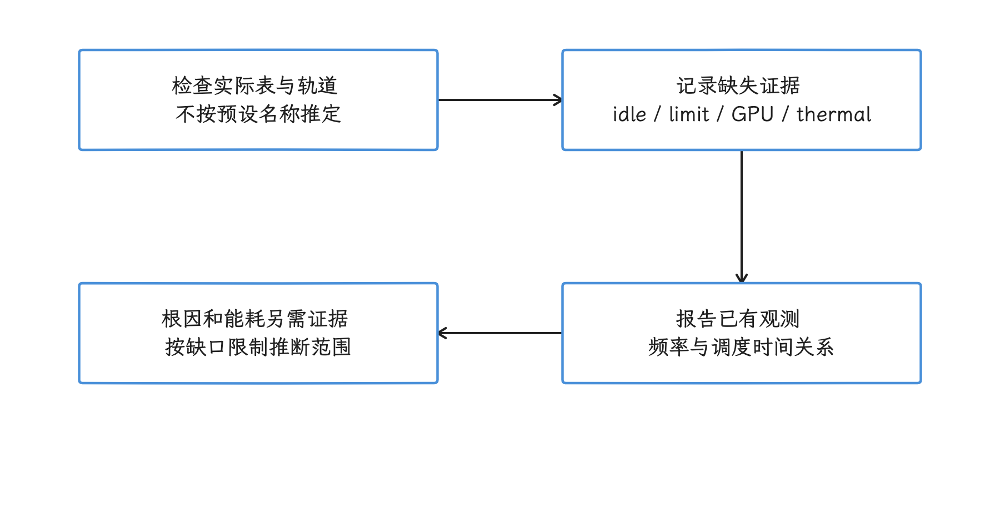

图：先列实际数据源与轨道，再决定报告支持哪一层结论。 缺idle、limit、GPU或thermal时，CPU频率相关性不能升级为整机能耗或governor根因。

## 误判清单

- **USB 改变 idle 条件**：Android 17 Perfetto 文档指出，许多 Android 设备接入 USB 时，USB driver stack 持有 wakelock（阻止系统进入休眠的锁），部分 idle state 不会出现。USB trace 的 idle 分布未必代表脱线使用。
- **轨道开头空白**：`power/cpu_frequency` 只记录切换，空白可能来自初始值缺失；用轮询补快照，并在 SQL 中报告覆盖率。
- **idle 区间的频率残留**：CPU clock-gated（关闭时钟以降低动态功耗）后，轨道可能保留进入 idle 前的频率。频率值不能替代 idle state 或功耗数据。
- **请求频率等同硬件频率**：`cpu_frequency` 与 `scaling_cur_freq` 多数情况下更接近软件请求或驱动报告值；需要硬件反馈才能讨论有效频率。
- **高频等同高吞吐**：缓存未命中、内存带宽、分支和共享资源会让高频 Running 仍然很慢。
- **低频等同 governor 反应慢**：policy 上限、thermal、uclamp、节电模式、迁核和 vendor hook 都可能限制结果。
- **同步变频等同 cluster**：同步轨迹只能提示共享 policy；用 `cluster_id`、capacity、`related_cpus` 和源码确认拓扑。
- **频率等同功耗**：轨道没有电压、漏电、内存、GPU 和屏幕功耗。整机能耗需要硬件功耗计或可靠的设备级计量。
- **UI 没轨等同没数据**：Android 17 文档记录过 cpuidle 缺失导致 UI 不渲染 cpufreq 的问题，SQL 查询才是数据存在性的判据。
- **厂商策略可以互推**：高通、联发科、三星、Google Tensor 的 policy、Power HAL、thermal 与 GPU/内存调频实现不同，结论必须绑定设备、版本和 workload。

<!-- gracker-diagram: ch14-09-41-misreading-checks -->
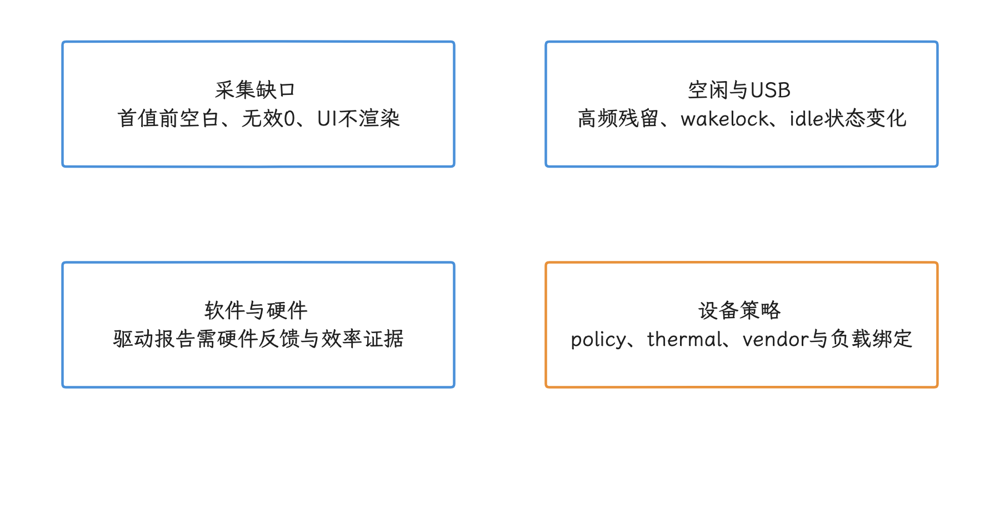

图：同一频率曲线可由不同采集和设备条件形成，按证据逐项检查。 USB可改变idle分布；高频不等于高吞吐、低频不等于governor慢、频率不等于功耗。

## 查询结果应怎样写进报告

一份可复核的 DVFS 结论至少包含：

1. 设备、构建版本、内核版本、Trace Processor 版本与采集配置；
2. workload、温度、充电/USB、屏幕、节电模式和重复次数；
3. 目标线程的 wall time、Running、Runnable、阻塞与频率覆盖率；
4. CPU 的逻辑编号、`ucpu`、capacity、cluster 与 cpufreq policy；
5. 频率切换、policy limit、idle、迁核和 thermal 的时间关系；
6. 代码或调用栈热点，以及必要的 PMU、AMU、GPU、内存与功耗证据；
7. 明确区分观测、推断和已验证根因。

<!-- gracker-diagram: ch14-09-42-report-artifacts -->
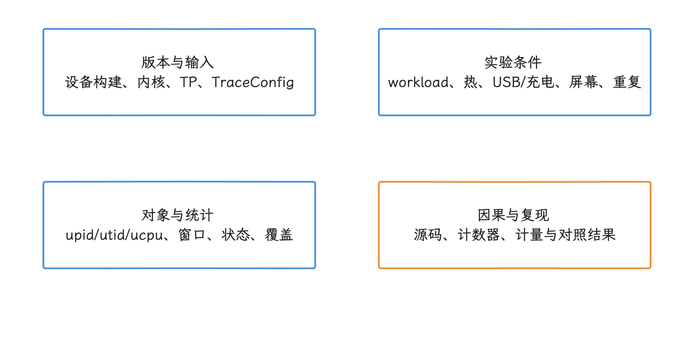

图：保存输入、配置、版本、实验条件、对象身份、窗口和覆盖分母。 把观测、推断和验证分开；缺失GPU/DDR/功耗证据时保留边界。

“目标线程在已知频率覆盖的 Running 时间中，有多少比例落在某频点”是可复核观测。“governor 导致掉帧”属于因果结论，需要对照实验：固定 workload，控制温度与系统状态，改变一个调频相关变量，并确认帧时序随之稳定变化。这样写，频率轨才会从截图线索变成可验证的性能证据。

<!-- gracker-diagram: ch14-09-43-causal-control -->
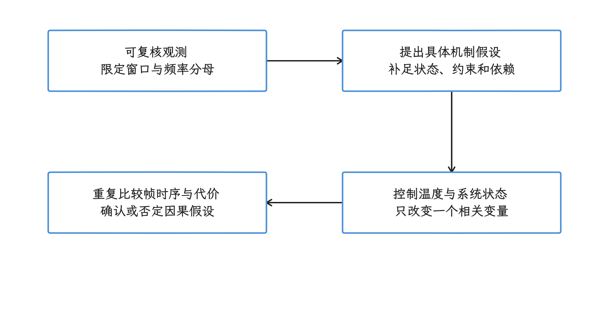

图：保持workload和系统条件，改变一个调频变量，观察帧时序是否稳定响应。 CPU状态、频率覆盖和依赖链须同时复核；单次截图关联不足以确认根因。

## 小结

CPU 频率轨是调频请求或驱动报告的状态信号，不是指令执行量、瞬时硬件有效频率或功耗。分析时要先把频率点还原为区间，再与目标线程的 Running 区间相交，并报告频率覆盖率。因果判断还必须联合 CPU 拓扑、policy limit、idle、迁核、uclamp、thermal 和对照实验；缺少 GPU、DDR 或功耗数据时，结论应明确限定在 CPU 侧观测。
