# Perfetto CPU 频率与 DVFS 关联分析

排查卡顿或启动耗时时，我们常要把“线程正在 CPU 上运行”和“所在 CPU 报告的频率”放进同一个时间窗。Perfetto 的 CPU Frequency 轨道记录软件可见的频率状态，线程轨道记录调度状态；两者对齐之后，“线程处于 Running 状态时，所在 CPU 报告了什么频率”就成了一个可以直接回答的问题。本文讨论这条分析路径上的 DVFS（Dynamic Voltage and Frequency Scaling，动态电压与频率调节）数据该怎么用、结论能下到哪一层。

> 源码基线：Android 17 / API 37，AOSP `android-17.0.0_r1`；内核 `android17-6.18-2026-06_r6`。


先看清这条数据链的性质：频率轨来自软件写入，内核在 cpufreq 普通切换完成后把 `freqs->new` 写入 `cpu_frequency`，快速切换路径写入驱动返回的 `freq`；同一 cpufreq policy（共享一套性能控制接口的一组 CPU）内的在线 CPU 会分别产生事件；`linux.sys_stats` 轮询的也是 sysfs（Linux 向用户空间暴露内核状态的虚拟文件接口）中的值。所以这些数据回答的是“软件请求了什么频率”，要断言某段代码获得了对应数量的有效执行周期，还需要下一节表里那类硬件反馈来补。


可复核来源分成三层：平台源码里的 Perfetto 采集、Trace Processor 表和 ProfilingManager；内核侧的 CPUFreq、CPUIdle 与 schedutil 源码/文档；以及端侧 LLM（Large Language Model，大语言模型）DVFS 论文的实验结果，它限定在 Pixel 7 / Pixel 7 Pro、Android 13、Tensor G2 和特定推理栈内。第三层只用于观察多个硬件域的 governor 是否协同，论文数字要留在它自己的实验范围内引用。


## 频率轨记录的是什么

Linux CPUFreq 调频框架把控制路径分成 policy、governor 和 scaling driver：

- policy 表示一组共享硬件性能控制接口的 CPU，并维护允许的最小、最大频率与当前频率；
- governor 根据利用率、时序约束等信息提出目标频率；
- scaling driver 把目标提交给硬件，硬件仍可能受固件、温控或内部控制影响。


`schedutil` governor 以利用率和 CPU capacity（相对算力）计算候选频率，再交给 `cpufreq_driver_resolve_freq()` 选择驱动支持的频点。源码还保留 Android vendor hook（供厂商插入定制逻辑的钩子），厂商可以改写映射结果。更新间隔默认来自 `cpufreq_policy_transition_delay_us(policy)`，按各自 policy 取值，跨设备并没有统一的固定调频周期。[Android 17 schedutil 源码](https://android.googlesource.com/kernel/common/+/refs/tags/android17-6.18-2026-06_r6/kernel/sched/cpufreq_schedutil.c)

<!-- gracker-diagram: ed14-09-cpufreq-policy-governor-hook-and-driver -->
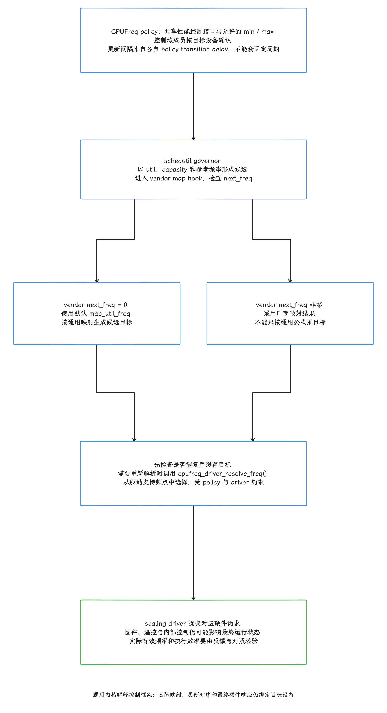

图：policy定义共享控制域和min/max；schedutil用util、capacity、参考频率计算候选，vendor map hook非零结果替代默认映射，零值走map_util_freq。缓存可复用目标，否则cpufreq_driver_resolve_freq解析支持频点，仍受policy和driver限制。更新间隔来自各policy transition delay，非跨设备固定周期；最终硬件/固件响应另需反馈，不把控制链画成有效频率保证。

频率数据能回答到哪一步，可以按下面的强弱理解：

| 数据 | 能证明什么 | 不能单独证明什么 |
|---|---|---|
| `power/cpu_frequency` | cpufreq 路径报告了一次频率切换 | 硬件在整个区间都精确运行于该频率 |
| `linux.sys_stats` | 轮询时刻的 sysfs 频率值 | 两次轮询之间的瞬时切换 |
| `power/cpu_frequency_limits` | policy 设置路径报告的最小、最大频率约束 | 约束由 thermal、Power HAL 还是厂商逻辑触发 |
| `cpuinfo_cur_freq` /<br>`cpuinfo_avg_freq` | 驱动具备相应反馈能力时，更接近硬件观测 | 所有设备都实现并允许读取 |
| PMU（Performance Monitoring Unit，性能监控单元）/ AMU（Activity Monitor Unit，活动监控单元）与硬件功耗计 | 实际执行、周期或能耗的补充证据 | 单靠 Perfetto cpufreq 轨无法替代这些数据 |

这一层里有一处文档与实现的差异值得先记下：Perfetto 文档和 proto（Protocol Buffers 配置定义）注释把轮询路径描述为读取 `cpuinfo_cur_freq`，同一版本的 `CpuFreqInfo::ReadCpuCurrFreq()` 实现读取的是 `scaling_cur_freq`。内核文档也说明，`scaling_cur_freq` 多数情况下表示 scaling driver 最近请求的 P-state（处理器性能状态），与硬件瞬时频率之间还隔着驱动报告这一层。我们核对某一版本时以该版本的实现为准，文档与实现的差异同时记下来。[Android 17 Perfetto 采集实现](https://android.googlesource.com/platform/external/perfetto/+/refs/tags/android-17.0.0_r1/src/traced/probes/common/cpu_freq_info.cc) [Android 17 CPUFreq 文档](https://android.googlesource.com/kernel/common/+/refs/tags/android17-6.18-2026-06_r6/Documentation/admin-guide/pm/cpufreq.rst)

<!-- gracker-diagram: ed14-09-software-frequency-sources-and-hardware-boundary -->
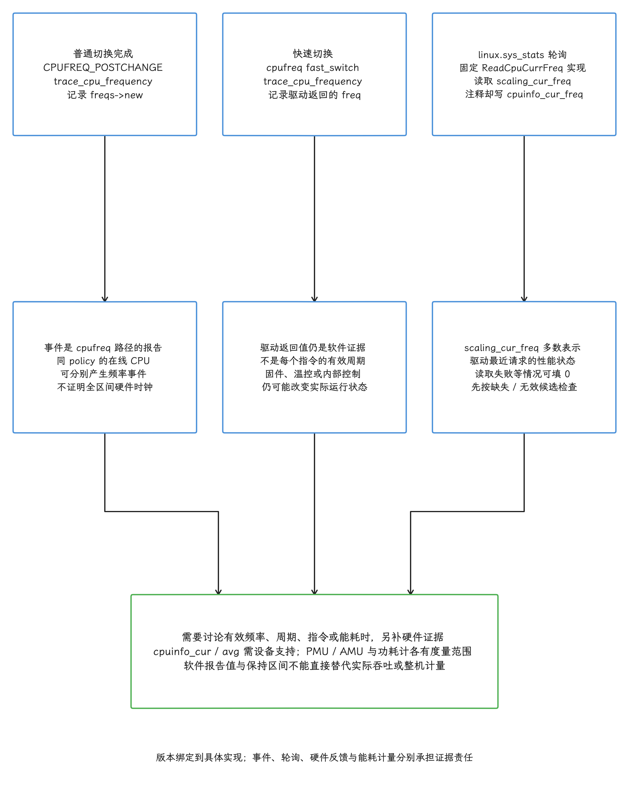

图：固定内核普通切换完成CPUFREQ_POSTCHANGE写freqs->new，fast_switch写driver返回freq，同policy在线CPU可分别产生事件。固定Perfetto ReadCpuCurrFreq实际读scaling_cur_freq，文档/proto注释cpuinfo_cur_freq差异需记录；读取失败/空值/解析失败可填0，先按缺失无效候选，不证明停钟。多数scaling_cur_freq为driver最近请求状态，硬件有效频率/执行周期/能耗另要设备支持的硬件反馈与计量，不能用软件保持曲线替代。

## 采集入口：事件、轮询和系统信息

下面以系统设置包为目标给出一份可解析的完整 TraceConfig，记录频率切换、频率限制、空闲、调度、轮询和可用频点，并补充实例身份、应用绘制标记与 FrameTimeline。示例缓冲区和 10 秒窗口需要按实际复现过程及丢数情况调整；FrameTimeline 属于 Android 12+，更旧设备应移除该数据源并使用对应版本的帧模型。发出去的配置只是请求，设备实际产出了什么，采集完还要逐项核对。`500 ms` 来自 Android 17 Perfetto 官方示例，只用于补充初始频率和观察慢变化；要还原单帧内的调频过程，还得靠事件路径。

```protobuf
duration_ms: 10000
buffers { size_kb: 40960 fill_policy: RING_BUFFER }

data_sources: {
  config {
    name: "linux.ftrace"
    ftrace_config {
      ftrace_events: "power/cpu_frequency"
      ftrace_events: "power/cpu_frequency_limits"
      ftrace_events: "power/cpu_idle"
      ftrace_events: "power/suspend_resume"
      ftrace_events: "sched/sched_switch"
      ftrace_events: "sched/sched_waking"
      ftrace_events: "sched/sched_wakeup_new"
      atrace_categories: "gfx"
      atrace_categories: "view"
      atrace_apps: "com.android.settings"
    }
  }
}

data_sources: {
  config {
    name: "linux.sys_stats"
    sys_stats_config {
      cpufreq_period_ms: 500
    }
  }
}

data_sources: {
  config {
    name: "linux.system_info"
  }
}

data_sources {
  config {
    name: "linux.process_stats"
    process_stats_config { scan_all_processes_on_start: true }
  }
}

data_sources {
  config { name: "android.surfaceflinger.frametimeline" }
}
```

`linux.ftrace` 通过内核 tracepoint（预先定义的静态事件点）记录 `power/cpu_frequency` 的切换时刻，`linux.sys_stats` 补充轮询快照，`linux.system_info` 在采集开始时读取一次可用频点。这些路径及补充数据源都可能因版本、驱动、内核配置、权限或 sysfs 导出差异而缺失，所以我们采集后的第一件事是核对实际表、`stats`、ftrace setup metadata 与目标身份。本轮仅在 native Trace Processor57.2/58.2 导入受控合成数据并验证 SQL，配置用固定 Android17 描述编译；帧模型测试会注明兼容模型表，全程没有涉及 Android 设备录制、内核/ART 构建、硬件频率反馈或功耗实测。[Android 17 Perfetto CPU frequency 文档](https://android.googlesource.com/platform/external/perfetto/+/refs/tags/android-17.0.0_r1/docs/data-sources/cpu-freq.md)


事件驱动路径只在频率发生变化时写记录：某个 CPU 在 trace 开头保持原频点，轨道左侧就会留白，这段空白只说明“还没有切换事件”，CPU 是否仍在运行，要看调度和 idle 轨道。轮询能补快照，代价是漏掉采样点之间的切换。所以面向启动和掉帧的分析，要保留事件驱动采集。


`power/cpu_frequency_limits` 值得与频率事件一起抓：内核在 policy 限制更新时记录 `min_freq`、`max_freq` 和 policy 的代表 CPU。它回答的是“当时的上限允许到多少”，governor 曾请求过什么要靠别的数据回答；看到上限偏低时，“governor 只请求了低频”和“被限频”两种解释都还成立，区分它们还得继续查。同一次 policy 设置也可能报告与前次相同的上下限，我们先比较前后数值，再讨论变化；限制来自 thermal、Power HAL、节电模式还是厂商代码，也要分别确认。[Android 17 CPU frequency tracepoint](https://android.googlesource.com/kernel/common/+/refs/tags/android17-6.18-2026-06_r6/include/trace/events/power.h) [Android 17 cpufreq core](https://android.googlesource.com/kernel/common/+/refs/tags/android17-6.18-2026-06_r6/drivers/cpufreq/cpufreq.c)

<!-- gracker-diagram: ch14-09-09-limits-not-request -->
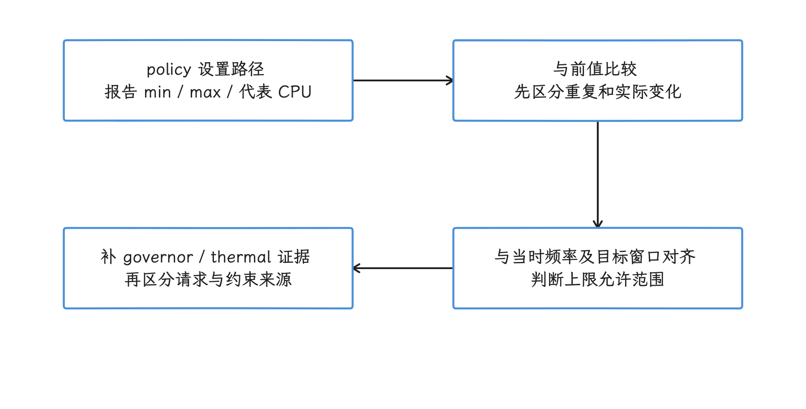

图：比较连续上下限值，判断当时是否允许更高频率。 相同限制可重复上报；只见上限时低请求与限频都有可能，来源需另查。

## Running、Runnable、idle 与频率

线程状态和频率轨回答不同问题：

| 观察组合 | 当前证据支持的判断 | 应补的证据 |
|---|---|---|
| Running 长，报告频率高 | 线程获得 CPU，执行时间较长 | 调用栈、函数采样、缓存与内存停顿、PMU |
| Running 长，报告频率低 | 低频、限频或低容量 CPU 值得检查 | policy limit、thermal、uclamp、CPU capacity、硬件频率反馈 |
| Runnable 长 | 线程可运行却在等待 CPU | 同 CPU 的运行者、优先级、调度类、CPU 压力 |
| S 状态长 | 线程处于可中断睡眠，等待事件或资源 | 锁、条件变量、Binder 进程间通信、futex（用户态同步所用的内核等待机制）、定时器 |
| D 状态长 | 不可中断等待 | I/O、驱动、内核阻塞原因 |
| CPU idle，频率轨保留高值 | 频率值可能是进入 idle 前的残留 | `cpuidle`、唤醒源、设备功耗 |

Running 时间也换算不成“CPU 算力已用满”：相同 wall time（墙上时钟经过的时间）下，指令级并行度、缓存未命中、内存带宽、分支预测、SMT（Simultaneous Multithreading，同时多线程）/共享资源和迁核都会改变有效吞吐。所以我们把频率分析当作定位相关性的工具，根因判断再交给调用栈、硬件计数器和对照实验。

<!-- gracker-diagram: ch14-09-10-state-evidence -->
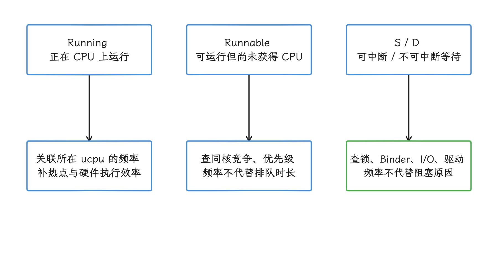

图：Running 是获得 CPU 的区间，Runnable 是等待 CPU；S/D 还需等待原因。 高频 Running 仍可受缓存、内存、分支或共享资源限制。

我们分析 App 卡顿时，沿着下面的顺序读：

1. 在 UI 线程或 RenderThread 找到对应帧和慢 slice（Perfetto 中有起止时间的事件区间）。
2. 统计 slice 内 Running、Runnable、Sleeping 与 D 状态。
3. 只对 Running 子区间关联 `ucpu`、逻辑 CPU、capacity、频率和 idle 状态。
4. 向前覆盖足够的负载建立阶段，观察唤醒、迁核、policy 限制与升频次序。观察窗应由 workload 周期决定，不套固定毫秒数。
5. 用调用栈、thermal（温控状态）、uclamp（utilization clamp，调度器利用率约束）、Power HAL（电源硬件抽象层）或 PMU 证据验证假设。


Perfetto 的 `cpu_idle_counters`（CPUIdle 状态区间表）已把原始值 `4294967295` 转成 `-1`，代表 CPU 回到 active；非负值越大通常表示更深的 idle state。具体 state 含义由 SoC 和 CPUIdle driver 定义，所以这些数字只在同一台设备内比较。

<!-- gracker-diagram: ch14-09-12-idle-normalization -->
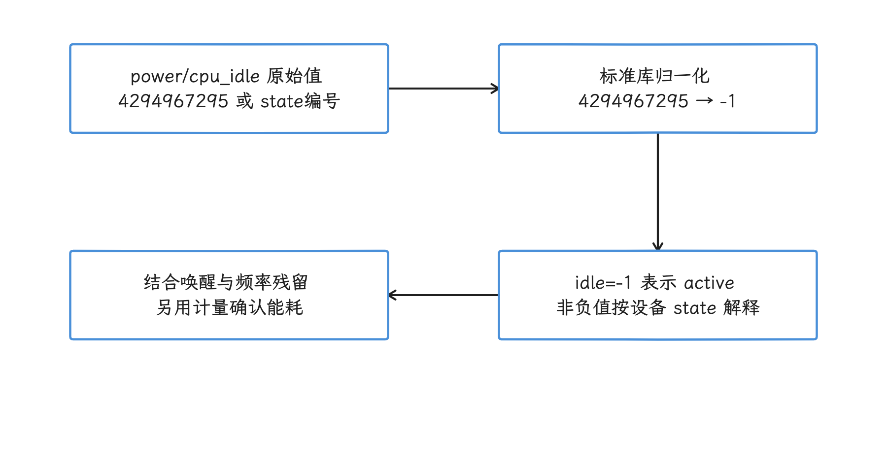

图：原始4294967295规范为-1；非负值表示设备定义的 idle state。 state编号留在同一SoC内比较；空闲状态与功耗看各自轨道。

CPUIdle 的两个参数经常被一起引用：target residency 回答“在这个状态停留多久才划算”——它是进入某个状态后至少停留多久才比浅层状态更节能，其中包含进入成本；exit latency 回答“醒来要等多久”——它是唤醒后恢复到可执行第一条指令的最坏延迟。若唤醒发生在进入状态的过程中、硬件必须先完成进入再退出，该上界还须覆盖相应进入阶段。短任务的首段延迟可能同时来自 idle 退出与升频，所以我们观察任务时，要看唤醒前后的完整区间。[Android 17 CPUIdle 文档](https://android.googlesource.com/kernel/common/+/refs/tags/android17-6.18-2026-06_r6/Documentation/admin-guide/pm/cpuidle.rst)

<!-- gracker-diagram: ch14-09-13-idle-exit-boundary -->
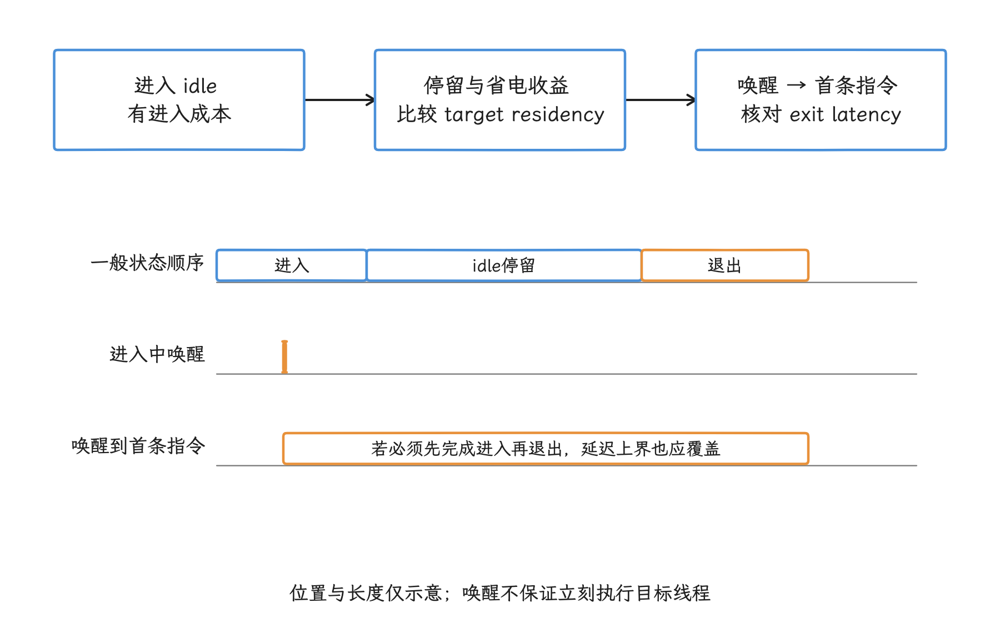

图：residency 判断进入状态是否划算，exit latency 约束唤醒到首条指令的最坏延迟。 若进入中唤醒且必须完成进入，exit latency 上界也应覆盖相关进入阶段。

## policy、cluster 与 CPU 标识

CPUFreq policy 是调频控制域，cluster 是处理器拓扑或容量分组。很多 Android SoC 的 policy 与 cluster 一一对应，于是多个 CPU 同步变频；我们把它当常见实现看待，具体成员仍要分别确认——异构平台可能让一个 cluster 出现多个 policy，也可能让多个逻辑 CPU 共享同一 policy。

<!-- gracker-diagram: ch14-09-14-policy-topology -->
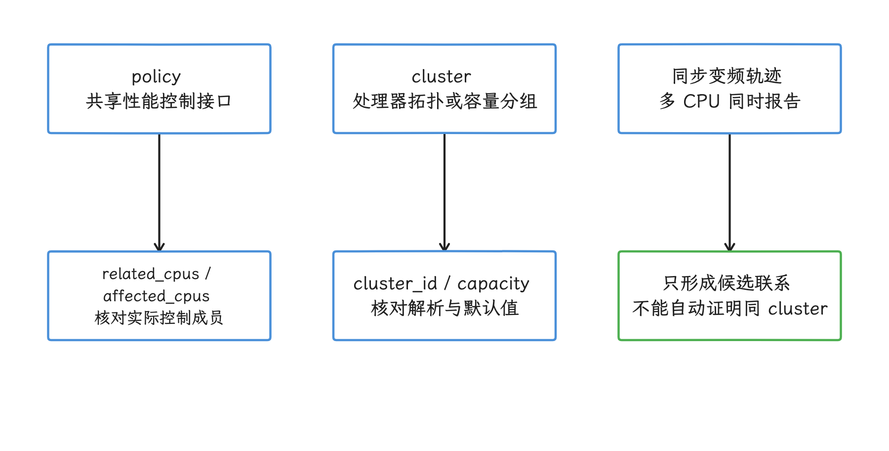

图：同步频率可以提示共享控制域，cluster 的定义另用 sysfs 和目标设备源码确认，capacity 与频点集合仅作交叉校验。

本地设备上，`policy*/related_cpus` 和 `policy*/affected_cpus` 是判断共享控制接口的直接依据。下面的命令读取 policy 成员、频率限制、governor 和可用频点。

```bash
adb shell 'for p in /sys/devices/system/cpu/cpufreq/policy*; do
  echo "[$p]"
  for f in related_cpus affected_cpus scaling_min_freq scaling_max_freq \
           scaling_governor scaling_available_frequencies; do
    if [ -r "$p/$f" ]; then
      printf "%s: " "$f"
      cat "$p/$f"
    fi
  done
done'
```

输出中的 `related_cpus` 包含 policy 关联的在线和离线 CPU，`affected_cpus` 表示当前在线且受该 policy 影响的 CPU。部分厂商设备只导出其中一部分文件，缺了哪个字段就如实记录哪个，避免补写推测值。


Trace Processor 里有三种容易混淆的标识：

- `cpu.cpu` 是设备内逻辑 CPU 编号；其他表里同名的 `cpu` 列要按各自语义解读；
- `ucpu` 是 Trace Processor 的可连接 CPU 标识，多机或虚拟化 trace 也能保持唯一；
- `cluster_id` 与 `capacity` 用于描述拓扑和相对容量，但要核对采集、解析和推断来源；`cluster_id` 只是默认值时先别下拓扑结论，`capacity` 也可能缺失。

我们做 `sched` 与 CPU counter 的时间交集时，先把 CPU 统一成 `ucpu`：公开 prelude 的 `sched.cpu` 与 `cpu_available_frequencies.cpu` 是 `ucpu` 的兼容别名，未必是设备逻辑编号；`cpu_counter_track.cpu` 则来自轨道的逻辑 CPU 维度。Counter 要用 `(machine_id, cpu)` 连接 `cpu` 表取得 `ucpu`；最终展示逻辑编号时读 `cpu.cpu`，同名列的标识域可能不同，连接前逐个确认。[Android17 公开CPU与调度schema](https://android.googlesource.com/platform/external/perfetto/+/android-17.0.0_r1/src/trace_processor/perfetto_sql/stdlib/prelude/after_eof/cpu_scheduling.sql)

<!-- gracker-diagram: ch14-09-16-cpu-identity-domains -->
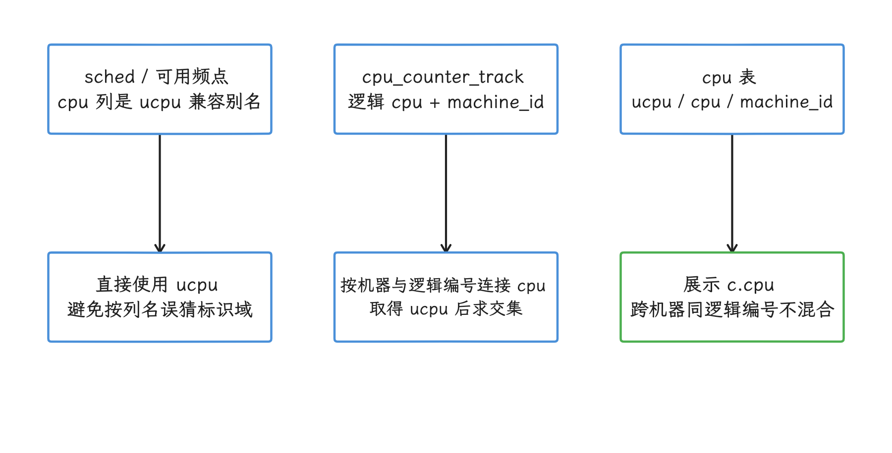

图：sched.cpu 是 ucpu 兼容别名，counter轨cpu是设备逻辑编号。 多机连接 counter 需 machine_id + 逻辑cpu；展示逻辑编号从cpu表读取。

下面使用 Android17 公开 prelude 和主机57.2/58.2 均可核对的 `cpu_available_frequencies`，通过 `ucpu` 关联真实逻辑编号和机器身份。

```sql
SELECT
  c.machine_id, c.ucpu, c.cpu,
  c.cluster_id, c.capacity, cf.freq
FROM cpu_available_frequencies AS cf
JOIN cpu AS c ON cf.ucpu = c.ucpu
ORDER BY c.machine_id, c.cpu, cf.freq;
```

`metadata_tables.py` 里保留着 `wrapping_sql_view=cpu_freq` 声明，但同 tag 的公开 SQL prelude 明确定义的是 `cpu_available_frequencies`；本轮 native57.2/58.2 里也是该视图存在、`cpu_freq` 缺席。一个表名是否真的可执行，要同时核对公开 SQL 和实际 `sqlite_master`，表生成声明只当线索。频点集合、`cluster_id`、`capacity` 和同步变频可以互相校验，policy 成员仍以设备 sysfs 或内核源码为准。[Android 17 `cpu_freq` 表定义](https://android.googlesource.com/platform/external/perfetto/+/refs/tags/android-17.0.0_r1/src/trace_processor/tables/metadata_tables.py)


## 三类 workload 的判断方法

### 启动短突发

冷启动由类加载、资源解析、Binder 往返、View 构建、编译与首次绘制等阶段组成。当我们看到关键线程在低频 Running、频率到关键 slice 结束附近才抬升，可以先提出“调频响应晚于该段工作”的假设，再逐一排除下面几种情况：

- 当前 CPU 属于低容量 policy，线程随后发生迁核；
- policy 的 `scaling_max_freq` 已被 thermal、节电模式或系统策略限制；
- `power/cpu_frequency` 表示请求值，硬件有效频率另有偏差；
- 代码受缓存或内存停顿限制，提高频率对 wall time 的收益有限；
- UI 线程 Running 之外仍有较长 Runnable、Binder 或 I/O 等待。

优化的第一步是减少工作量：删减首帧前任务，合并可延后的工作，降低同步 I/O 与跨进程往返。系统侧调优还要结合 PerformanceHint / ADPF（Android Dynamic Performance Framework，应用向系统提交性能提示的框架）、uclamp、Power HAL 和目标设备的能效曲线验证；“锁最高频”这种结论，一条低频轨撑不起来。


### 连续渲染负载

滑动、动画和游戏帧循环带有重复节奏，我们按帧切窗，分别观察 UI 线程、RenderThread（应用渲染线程）、GPU 提交线程与 SurfaceFlinger（系统合成服务）。频率升降总是落后于负载相位时，可能出现周期性 wall time 波动；线程迁往不同 capacity CPU、Runnable 排队或 GPU fence（生产者与消费者之间的同步对象）等待也会产生相似现象，读 trace 时要把这几种来源放在一起分辨。


这一节要防着直接拿频率高低下结论：帧内工作量较少时，低频可能正是能效目标，高频之下帧也可能照样超期。我们看的是相同设备、相同温度和相同 workload 下的帧时序与频率变化，并结合第13章渲染管线中的应用、RenderThread、GPU、合成与显示链路。

### 后台批处理

压缩、数据库迁移、索引和日志整理通常对单帧时序不敏感。低频可能延长 active 时间（CPU 非空闲时间），高频可能缩短完成时间并提高瞬时功耗。哪种方案能耗更低，取决于电压频率曲线、内存行为、policy 能效、idle state、唤醒次数和 thermal 状态。

频率轨里既没有电压，也算不出整机功耗，后台任务的评估至少要同时比较完成时间、CPU active/idle 分布、唤醒次数、温度和硬件功耗数据；“高频更快”和“低频更省电”都先当作待验证假设看待。


## 用 SQL 重建频率时间线

原始频率和 idle 事件在表里被建模为 `counter`，轨道属性放在 `cpu_counter_track`。我们先用下面的查询确认 trace 里有没有这些原始数据。

```sql
SELECT
  c.id AS counter_id, c.track_id, c.ts,
  t.name, t.machine_id, cpu.ucpu, cpu.cpu,
  c.value
FROM counter AS c
JOIN cpu_counter_track AS t ON t.id = c.track_id
JOIN cpu ON cpu.machine_id IS t.machine_id AND cpu.cpu = t.cpu
WHERE t.name IN ('cpufreq', 'cpuidle')
ORDER BY t.machine_id, cpu.cpu, c.ts, c.id
LIMIT 200;
```

`cpufreq` 的值单位是 kHz，`cpuidle` 原始值 `4294967295` 代表退出 idle。`CpuFreqInfo::ReadCpuCurrFreq()` 在读取失败或缺失时可填0，所以看到频率0，先按缺失/无效候选处理，“硬件停止”是另一个问题，要另行确认。结果为空时回查采集配置和设备支持情况；UI 没有显示这条轨道时也照样执行该查询——Android 17 文档记录过“缺少 idle 事件时 UI 不渲染频率轨，但 SQL 数据存在”的显示问题。


Perfetto 标准库已经把 counter 转成带 `dur` 的区间。下面的查询读取频率区间和规范化后的 idle 区间。

```sql
INCLUDE PERFETTO MODULE linux.cpu.frequency;
INCLUDE PERFETTO MODULE linux.cpu.idle;

SELECT f.id, f.track_id, f.ts, f.dur,
       c.machine_id, f.ucpu, c.cpu, f.freq
FROM cpu_frequency_counters AS f
JOIN cpu AS c USING (ucpu)
ORDER BY c.machine_id, c.cpu, f.ts, f.id
LIMIT 100;

SELECT i.id, i.track_id, i.ts, i.dur,
       c.machine_id, c.ucpu, c.cpu, i.idle
FROM cpu_idle_counters AS i
JOIN cpu_counter_track AS t ON t.id = i.track_id
JOIN cpu AS c ON c.machine_id IS t.machine_id AND c.cpu = t.cpu
ORDER BY c.machine_id, c.cpu, i.ts, i.id
LIMIT 100;
```

上面的两个 SELECT 要分别执行，独立 CLI 单次返回多份结果时先拆开。两张标准表的标识范围有差别：`cpu_frequency_counters` 提供 `ucpu`，`cpu_idle_counters` 只保留轨道与逻辑 `cpu`，多机时需像示例一样补机器映射；`idle=-1` 表示 active。`counter_leading_intervals!` 已把尾样本持续到 `trace_end()`，所以这里的频率/idle 标准区间按闭合区间对待；尾值延续本身是分析假设，首样本之前仍是未知。带着 `dur=-1` 开放区间的是原始 `sched`，它确实需要另行处理——本节下方只分析闭合 Running，并报告被排除的开放记录。[Android17 counter区间宏](https://android.googlesource.com/platform/external/perfetto/+/android-17.0.0_r1/src/trace_processor/perfetto_sql/stdlib/counters/intervals.sql)[Android 17 frequency 标准库](https://android.googlesource.com/platform/external/perfetto/+/refs/tags/android-17.0.0_r1/src/trace_processor/perfetto_sql/stdlib/linux/cpu/frequency.sql) [Android 17 idle 标准库](https://android.googlesource.com/platform/external/perfetto/+/refs/tags/android-17.0.0_r1/src/trace_processor/perfetto_sql/stdlib/linux/cpu/idle.sql)

<!-- gracker-diagram: ed14-09-collection-and-frequency-hold-model -->
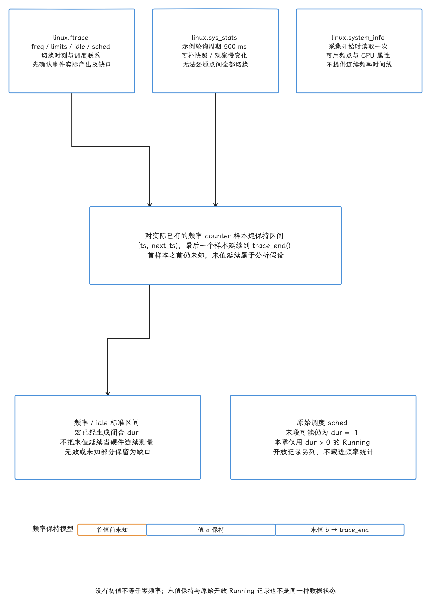

图：ftrace切换事件记录时序，sys_stats500ms仅示例快照不能还原点间切换，system_info启动时一次读取可用频点/CPU信息。counter_leading_intervals把样本延到下次样本，尾值到trace_end，首样本之前未知；保持不是硬件连续测量。原始sched.dur=-1另行处理，本章仅闭合Running并报告开放记录；缺失/无效频率不补0。轨道为关系示意，无设备时间数值。

下面的模板用 `ucpu` 对调度区间与频率区间做 `SPAN_JOIN`（按时间求区间交集），也是后面频率分布、迁核和帧窗口查询共用的准备步骤。

```sql
INCLUDE PERFETTO MODULE linux.cpu.frequency;

CREATE PERFETTO VIEW _running_spans AS
SELECT s.id AS sched_id, s.ts, s.dur, s.ucpu,
       c.cpu, c.machine_id, s.utid
FROM sched AS s
JOIN cpu AS c USING (ucpu)
WHERE s.dur > 0;

CREATE PERFETTO VIEW _frequency_track_quality AS
SELECT ucpu, COUNT(DISTINCT track_id) AS candidate_tracks,
       SUM(freq IS NULL OR freq <= 0) AS invalid_intervals
FROM cpu_frequency_counters
GROUP BY ucpu;

CREATE PERFETTO VIEW _frequency_spans AS
SELECT f.id AS frequency_counter_id,
       f.track_id AS frequency_track_id, f.ts, f.dur, f.ucpu, f.freq
FROM cpu_frequency_counters AS f
JOIN _frequency_track_quality AS q USING (ucpu)
WHERE f.dur > 0 AND f.freq > 0 AND q.candidate_tracks = 1;

-- Each side must be non-overlapping within each ucpu.
CREATE PERFETTO VIEW _span_input_overlaps AS
WITH intervals AS (
  SELECT 'running' AS kind, ucpu, ts, dur, sched_id AS id
  FROM _running_spans
  UNION ALL
  SELECT 'frequency', ucpu, ts, dur, frequency_counter_id
  FROM _frequency_spans
), checked AS (
  SELECT *, MAX(ts + dur) OVER (
    PARTITION BY kind, ucpu ORDER BY ts, id
    ROWS BETWEEN UNBOUNDED PRECEDING AND 1 PRECEDING
  ) AS previous_max_end
  FROM intervals
)
SELECT kind, ucpu, id, ts, dur
FROM checked WHERE ts < previous_max_end;

CREATE PERFETTO VIEW _span_running AS
SELECT * FROM _running_spans
WHERE NOT EXISTS (SELECT 1 FROM _span_input_overlaps);

CREATE PERFETTO VIEW _span_frequency AS
SELECT * FROM _frequency_spans
WHERE NOT EXISTS (SELECT 1 FROM _span_input_overlaps);

CREATE VIRTUAL TABLE _running_with_frequency
USING SPAN_JOIN(
  _span_running PARTITIONED ucpu,
  _span_frequency PARTITIONED ucpu
);

SELECT * FROM _span_input_overlaps;
```

先把准备块独立执行一遍，确认 `_span_input_overlaps` 为空；一旦有结果，就停止后续统计，回查录制/合并或输入模型——本模板让 SPAN 两侧整体为空，防的是静默漏算。再看 `_frequency_track_quality`：同一 `ucpu` 出现多条 cpufreq 轨时，本例保守排除该 CPU 的频率输入（并行轨要先分清才能各自使用）；NULL/非正频率区间同样排除。这样得到的有效结果，是闭合 Running 与已知正频率保持区间的交集，保留原始调度 ID、counter ID、track ID 与机器身份；首值前、无效值、多轨歧义和采集缺口都按缺口如实报告，补成0反而会制造“有数据”的假象。模板排除了原始 `sched.dur=-1`，所以它统计的是闭合 Running，目标线程的全部运行时间要另看开放记录。


先枚举目标包的进程和主线程候选，再按问题窗口选定实际 `upid`，同名重启实例分开处理；后续 SQL 里的 `123` 是待替换的 Trace 内部 `upid`，与 PID 是两回事，主线程候选数必须恰好为1。


```sql
SELECT p.upid, p.pid, p.name, p.start_ts, p.end_ts,
       t.utid, t.tid, t.name AS thread_name
FROM process AS p
JOIN thread AS t USING (upid)
WHERE p.name = 'com.android.settings'
  AND (t.is_main_thread = 1 OR t.tid = p.pid)
ORDER BY p.start_ts, p.upid, t.utid;
```

接下来统计选定实例整份 Trace 中、已闭合主线程 Running 的频率分布。若只研究某段问题窗口，先把 Running 和频率区间按同一半开窗口裁剪，再做准备与汇总。

<!-- gracker-diagram: ed14-09-span-validation-and-running-intersections -->
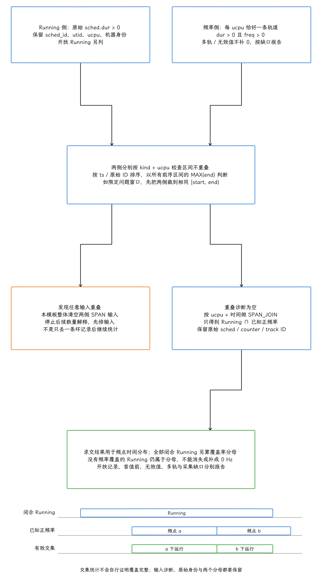

图：两侧按ucpu分区：sched只取dur>0并保留sched_id/utid，频率仅取单轨CPU、dur>0和freq>0；多轨歧义及无效值保留缺口。各侧用runningMAX前序end查重叠，任一输入重叠时整体SPAN输入清空并停止统计；诊断为空才求交。指定窗口须同一半开范围裁剪两侧。SPAN结果为闭合Running与已知正频率交集，保留原始counter/track/sched身份；全部闭合Running另作为覆盖分母，不能把无频率段补0。

```sql
WITH target_thread AS (
  SELECT CASE WHEN COUNT(*) = 1 THEN MIN(t.utid) END AS utid,
         COUNT(*) AS main_candidates
  FROM thread AS t JOIN process AS p USING (upid)
  WHERE p.upid = 123 AND (t.is_main_thread = 1 OR t.tid = p.pid)
), running_freq AS (
  SELECT swf.freq, SUM(swf.dur) AS dur
  FROM _running_with_frequency AS swf
  JOIN target_thread USING (utid)
  GROUP BY swf.freq
), coverage AS (
  SELECT t.*,
    (SELECT SUM(r.dur) FROM _running_spans AS r
     WHERE r.utid = t.utid) AS closed_running_dur,
    (SELECT SUM(dur) FROM running_freq) AS known_frequency_dur,
    (SELECT COUNT(*) FROM sched AS s
     WHERE s.utid = t.utid AND s.dur = -1) AS open_sched_records,
    (SELECT COUNT(*) FROM _span_input_overlaps) AS overlap_errors
  FROM target_thread AS t
)
SELECT c.utid, c.main_candidates, c.overlap_errors, c.open_sched_records,
       c.closed_running_dur / 1e6 AS closed_running_ms,
       c.known_frequency_dur / 1e6 AS known_frequency_ms,
       ROUND(100.0 * c.known_frequency_dur /
             NULLIF(c.closed_running_dur, 0), 2) AS frequency_coverage_pct,
       f.freq, f.dur / 1e6 AS running_ms,
       ROUND(100.0 * f.dur / NULLIF(c.known_frequency_dur, 0), 2) AS pct
FROM coverage AS c LEFT JOIN running_freq AS f ON TRUE
ORDER BY running_ms DESC;
```

复用时替换成实际 `upid` 并核对唯一主线程；`main_candidates!=1` 或 `overlap_errors>0` 时，先把输入修好再谈数量。两个比例各有各的分母：`frequency_coverage_pct` 以该实例已闭合的 Running 时间为分母，`pct` 以其中有已知正频率的交集时间为分母。开放记录另列，尾频率延续仍属保持值假设；这些比例描述的都是时间分布，指令、周期或能耗占比要靠相应的计数数据。

<!-- gracker-diagram: ch14-09-26-two-denominators -->
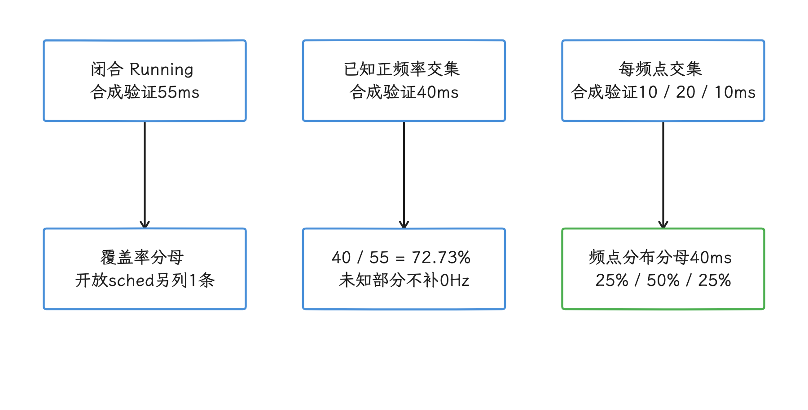

图：合成校验：闭合Running55ms，其中已知正频率40ms，覆盖率72.73%。 频点pct以40ms为分母，覆盖率以55ms为分母；开放记录另列，不是周期或能耗占比。

下面把 UI 线程 Running 裁到 `android_frames` 的候选模型窗口，保留 `upid`、代表性ID和模型计数。这份模型表会聚合多Layer/多个DrawFrame，部分基础数据通过INNER JOIN排除，expected计数还固定为1，逐Layer的完整帧列表要到原始 FrameTimeline 里去看；我们先回查异常的原始 FrameTimeline，再来解释下面的频率覆盖。

<!-- gracker-diagram: ch14-09-27-frame-model-coverage -->
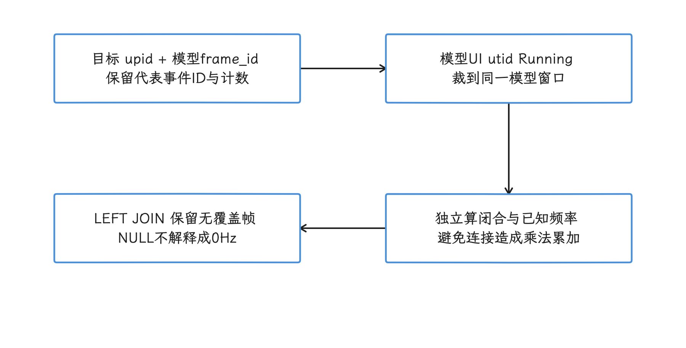

图：按upid固定模型帧，分别聚合闭合Running和频率交集后再关联。 android_frames聚合多Layer/DrawFrame且会排除缺记录，expected计数常量1不证明完整。

```sql
INCLUDE PERFETTO MODULE android.frames.timeline;

WITH target_frames AS (
  SELECT * FROM android_frames WHERE upid = 123 AND dur > 0
), frame_running AS (
  SELECT f.*,
    (SELECT SUM(MIN(r.ts + r.dur, f.ts + f.dur) - MAX(r.ts, f.ts))
     FROM _running_spans AS r
     WHERE r.utid = f.ui_thread_utid
       AND r.ts < f.ts + f.dur AND f.ts < r.ts + r.dur
    ) AS closed_running_dur
  FROM target_frames AS f
), frequency_groups AS (
  SELECT f.upid, f.frame_id, swf.ucpu, swf.cpu, swf.machine_id, swf.freq,
    SUM(MIN(swf.ts + swf.dur, f.ts + f.dur) - MAX(swf.ts, f.ts)) AS dur
  FROM target_frames AS f
  JOIN _running_with_frequency AS swf
    ON swf.utid = f.ui_thread_utid
   AND swf.ts < f.ts + f.dur AND f.ts < swf.ts + swf.dur
  GROUP BY f.upid, f.frame_id, swf.ucpu, swf.cpu, swf.machine_id, swf.freq
), known_coverage AS (
  SELECT upid, frame_id, SUM(dur) AS known_frequency_dur
  FROM frequency_groups GROUP BY upid, frame_id
)
SELECT f.upid, f.frame_id, f.ts, f.dur,
       f.do_frame_id, f.actual_frame_timeline_id,
       f.actual_frame_timeline_count, f.draw_frame_count,
       g.machine_id, g.ucpu, g.cpu, g.freq,
       g.dur / 1e6 AS ui_running_ms,
       f.closed_running_dur / 1e6 AS closed_running_ms,
       k.known_frequency_dur / 1e6 AS known_frequency_ms,
       ROUND(100.0 * k.known_frequency_dur /
             NULLIF(f.closed_running_dur, 0), 2) AS frequency_coverage_pct
FROM frame_running AS f
LEFT JOIN known_coverage AS k USING (upid, frame_id)
LEFT JOIN frequency_groups AS g USING (upid, frame_id)
ORDER BY f.ts, ui_running_ms DESC;
```

这个结果只针对模型选定的 UI 线程。改查RenderThread时，把两个CTE里的UI utid条件一并换成 `render_thread_utid`；GPU、SurfaceFlinger与显示侧仍沿各自链路核对。看到NULL频率或覆盖率，先按无匹配/缺口候选解释，补成0Hz会把缺口藏起来；输入重叠诊断必须为空。相互重叠的模型窗口可能重复覆盖同一Running片段，逐帧行直接相加就可能算重，全Trace总量要单独统计。

<!-- gracker-diagram: ch14-09-28-frame-overlap-boundary -->
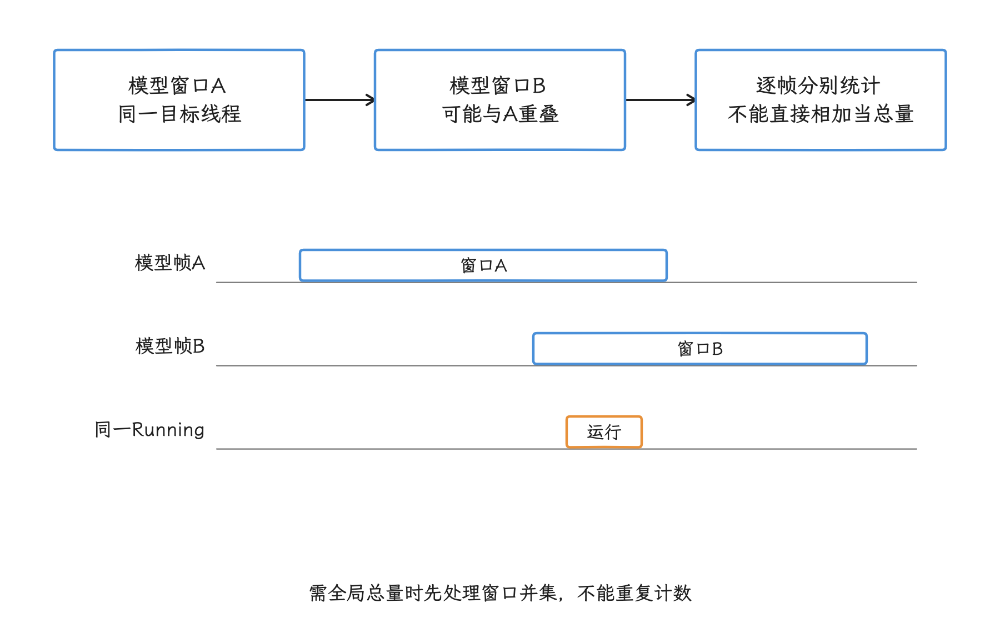

图：UI与RenderThread分别选utid；重叠模型窗口可能覆盖同一Running。 改RenderThread要同时改两个CTE；GPU、SF与显示仍走各自证据链。

线程迁核直接从公共结果里就能观察。我们先在原始闭合 Running 区间上按 `utid` 分区、以 `(ts,sched_id)` 排序找出相邻记录的 `ucpu` 变化，再关联目标段的频率；这样识别出的变化都来自原始调度记录，频率切分点只参与关联，未知频率的迁核候选也通过查询里的 LEFT JOIN 保留下来。


```sql
WITH target_thread AS (
  SELECT CASE WHEN COUNT(*) = 1 THEN MIN(t.utid) END AS utid,
         COUNT(*) AS main_candidates
  FROM thread AS t JOIN process AS p USING (upid)
  WHERE p.upid = 123 AND (t.is_main_thread = 1 OR t.tid = p.pid)
), ordered AS (
  SELECT r.*,
    LAG(r.ucpu) OVER (
      PARTITION BY r.utid ORDER BY r.ts, r.sched_id
    ) AS previous_ucpu,
    LAG(r.ts + r.dur) OVER (
      PARTITION BY r.utid ORDER BY r.ts, r.sched_id
    ) AS previous_running_end
  FROM _running_spans AS r JOIN target_thread USING (utid)
), candidates AS (
  SELECT * FROM ordered
  WHERE previous_ucpu IS NOT NULL AND ucpu != previous_ucpu
)
SELECT m.sched_id, m.utid, m.ts, m.dur,
       m.machine_id, m.ucpu, m.cpu,
       c.cluster_id, c.capacity,
       m.previous_ucpu, previous.cpu AS previous_cpu,
       previous.cluster_id AS previous_cluster_id,
       m.previous_running_end,
       m.ts - m.previous_running_end AS between_running_gap_ns,
       f.frequency_track_id, f.freq,
       SUM(MIN(m.ts + m.dur, f.ts + f.dur) - MAX(m.ts, f.ts)) / 1e6
         AS known_frequency_ms
FROM candidates AS m
JOIN cpu AS c ON c.ucpu = m.ucpu
LEFT JOIN cpu AS previous ON previous.ucpu = m.previous_ucpu
LEFT JOIN _frequency_spans AS f
  ON f.ucpu = m.ucpu
 AND f.ts < m.ts + m.dur AND m.ts < f.ts + f.dur
GROUP BY m.sched_id, m.utid, m.ts, m.dur, m.machine_id, m.ucpu, m.cpu,
         c.cluster_id, c.capacity, m.previous_ucpu, previous.cpu,
         previous.cluster_id, m.previous_running_end,
         f.frequency_track_id, f.freq
ORDER BY m.ts, m.sched_id, f.freq;
```

这里的 `ts` 是线程首次在另一 CPU 上被观测到的闭合Running段起点，迁核决定的精确时刻仅凭它还定不下来。两段之间可以有Runnable、Sleeping、开放段或数据缺口，`between_running_gap_ns` 只度量两段闭合 Running 的间隔，Runnable 时长要另行统计；同一目标段可因频率变化产生多行，认段要靠 `sched_id`。迁核原因还要结合线程状态、唤醒、uclamp、优先级及负载来判断；`cluster_id` 缺失或取默认值时，先放下拓扑结论。

<!-- gracker-diagram: ed14-09-migration-from-original-sched-and-frequency -->
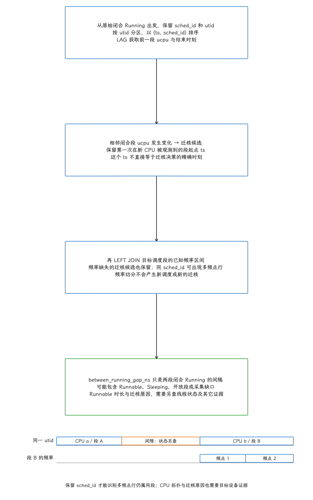

图：先在原始闭合Running按utid分区、(ts,sched_id)排序LAG前一ucpu，ucpu变化成为候选；其ts仅首次观测到新CPU闭合Running起点，不是精确迁核决策时刻。两段间隙可含Runnable/Sleeping/开放段/缺口，不直接等Runnable。之后LEFT JOIN目标段频率保留未知频率候选，同sched_id可多频点行仍是同调度段。迁核原因需状态、唤醒、约束与负载另证，默认cluster_id不证拓扑。

## 端侧 AI 推理中的 governor 协同

单个 CPU 之外，端侧推理还牵动 GPU 和内存：论文 *Dissecting the Impact of Mobile DVFS Governors on LLM Inference Performance and Energy Efficiency* 研究了 CPU、GPU 和内存调频各自决策时的能效错配。实验设备是 Pixel 7 与 Pixel 7 Pro，SoC 为 Tensor G2，系统为 Android 13；测试采用 llama.cpp、OpenCL/CLBlast、TinyLlama 1.1B、StableLM-Zephyr 3B 和 Llama-2 7B，并在 root、battery bypass（拆机旁路电池并由功耗仪供电）、屏幕关闭和外部功耗采样条件下运行。


论文第4节以默认 governor 延迟为基准，报告在这组实验边界及采样输入/输出长度内，等能耗的频率组合可使部分 prefill（处理输入提示）/ decode（逐token生成）延迟最多降低40.4%。引用这个数字时要带着分母：它说的是“组合相对默认 governor 降了多少”，反向改写成“默认governor延迟增加40.4%”就换错了基准；摘要里“较长延迟”的措辞也代替不了第4节的具体对比，引用时回到第4节的口径。

<!-- gracker-diagram: ch14-09-32-paper-percent-base -->
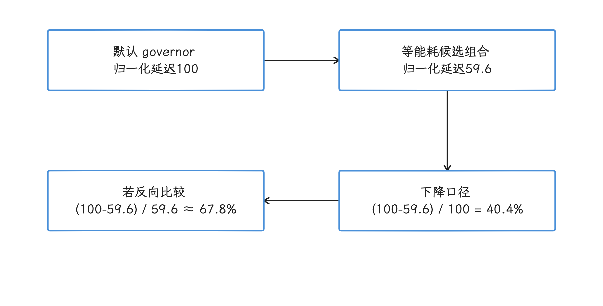

图：第4节最多下降40.4%以默认governor延迟为分母。 归一化100→59.6只是百分比说明；反向增加约67.8%，不是40.4%，也不是设备绝对延迟。

论文以 llama.cpp b2202 扩展实现 FUSE：离线先搜索 GPU 候选频率，再为至多两个 GPU 候选搜索 CPU 频率，运行时按 prefill/decode 阶段和请求长度应用 CPU/GPU 组合；内存 governor 保持默认。它是该受控实验栈中的统一能效策略，与 Android17 通用系统 governor 之间隔着实验栈这层边界。FUSE 评估覆盖论文表2的六个4-bit模型；其中 ShareGPT 真实请求实验抽样200条，prefill≤512 token、decode≤256 token。在论文设定的近似等总能耗目标下，三组模型的平均 TTFT（Time to First Token，首 token 延迟）降低7.0%—16.9%，TPOT（Time per Output Token，平均每个输出 token 的时间）降低25.4%—36.8%；这组数字描述的是平均效果，逐次推理、逐 token 的能耗要另做计量。[论文页面](https://arxiv.org/abs/2507.02135)

<!-- gracker-diagram: ch14-09-33-fuse-two-step -->
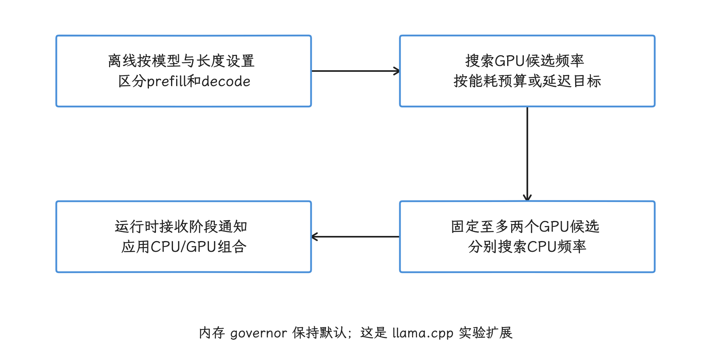

图：离线搜索GPU候选，再为至多两组候选搜索CPU，运行时按阶段应用。 内存governor保持默认；200条请求的真实请求指标按近似等总能耗目标，属于平均效果。

这些数字的适用范围就是论文那组设备和推理栈；换到 Android 17、其他 SoC、NPU（Neural Processing Unit，神经网络加速器）后端或不同推理运行时，都要重新测。对我们更有用的是它带来的诊断视角：GPU 执行仍依赖 CPU 提交，KV cache（注意力计算复用的 key/value 缓存）与权重访问受内存系统影响，单看 CPU 利用率可能低估整条推理流水线的时序需求。


照这个视角采集端侧推理 trace，至少要把 CPU sched/cpufreq、GPU job 与频率、内存带宽或 DDR（Double Data Rate，双倍数据率内存）频率、thermal、TTFT、TPOT 和单 token 能耗放在相同实验中；设备不暴露 GPU 或 DDR 数据时，结论就明确限定在 CPU 侧观察。


## 与 EAS、uclamp、thermal 交叉验证

CPU Frequency 是结果信号，我们解释它的来源时，要结合下面几组数据：

- **EAS（Energy Aware Scheduling，能耗感知调度）与 task placement（任务放置）**：确认线程所在 CPU 的 `capacity`、迁核方向和同核竞争，详见 5.1 节；
- **uclamp 与 PerformanceHint**：确认任务的利用率下限、上限及会话提示是否改变 schedutil 输入，详见 5.2 节；
- **CPUFreq policy**：对照 `scaling_min_freq`、`scaling_max_freq`、governor、`cpu_frequency_limits` 和可用频点；
- **thermal 与电源策略**：检查温度、冷却设备、节电模式、Power HAL 和 sustained workload，详见 11.1 节；
- **执行效率**：用 Simpleperf / perf 采样工具、PMU、AMU 或厂商计数器排除缓存、内存和 CPU 前端停顿。


通用内核能讲清 CPUFreq、schedutil、uclamp、EAS 与 CPUIdle 的框架；设备上的 energy model（调度器估算性能与能耗的数据表）、频点表、thermal policy、Power HAL 和 vendor hook 可能来自厂商内核或闭源组件。所以通用内核这条线到这里为止，具体设备的结论要回到它的源码、sysfs 和 trace 上。


## 线上与工具预设的采集边界

本地 `adb perfetto` 接受完整 TraceConfig，在设备允许的范围内可以显式启用分析所需的数据源。Android Studio Profiler 用的是工具自己的采集配置，版本与入口不同会得到不同字段；我们分析前先检查 `cpu_counter_track` 和 trace metadata，界面名称只当入口线索。


Android17 `ProfilingManager` 的system trace由平台 `Configs` 生成受限配置，应用不能直接提交任意TraceConfig。固定源码还在 `KEY_COLLECT_STACK_SAMPLING` 与 `systemTraceAddStackSampling` flag条件下支持附加linux.perf栈采样，“固定配置”要读成“默认之外还有条件扩展”，但该可选栈采样仍补不齐下面缺失的DVFS事件。这份配置包含 compact sched（压缩编码的调度事件）、进程信息、应用 atrace 分类和 SurfaceFlinger FrameTimeline，未启用 `power/cpu_frequency`、`power/cpu_idle`、`linux.sys_stats` 或 `linux.system_info`。system trace 结果还会经过 redaction（敏感信息裁剪），并受系统 rate limiter（采样频率限制）、参数范围和设备配置约束。它可以支持应用侧线上性能采样；本地 CPU DVFS 分析还是要交回完整 TraceConfig。[Android 17 Profiling 配置](https://android.googlesource.com/platform/packages/modules/Profiling/+/refs/tags/android-17.0.0_r1/service/java/com/android/os/profiling/Configs.java) [Android 17 ProfilingService](https://android.googlesource.com/platform/packages/modules/Profiling/+/refs/tags/android-17.0.0_r1/service/java/com/android/os/profiling/ProfilingService.java)

<!-- gracker-diagram: ed14-09-local-tools-and-online-preset-capabilities -->
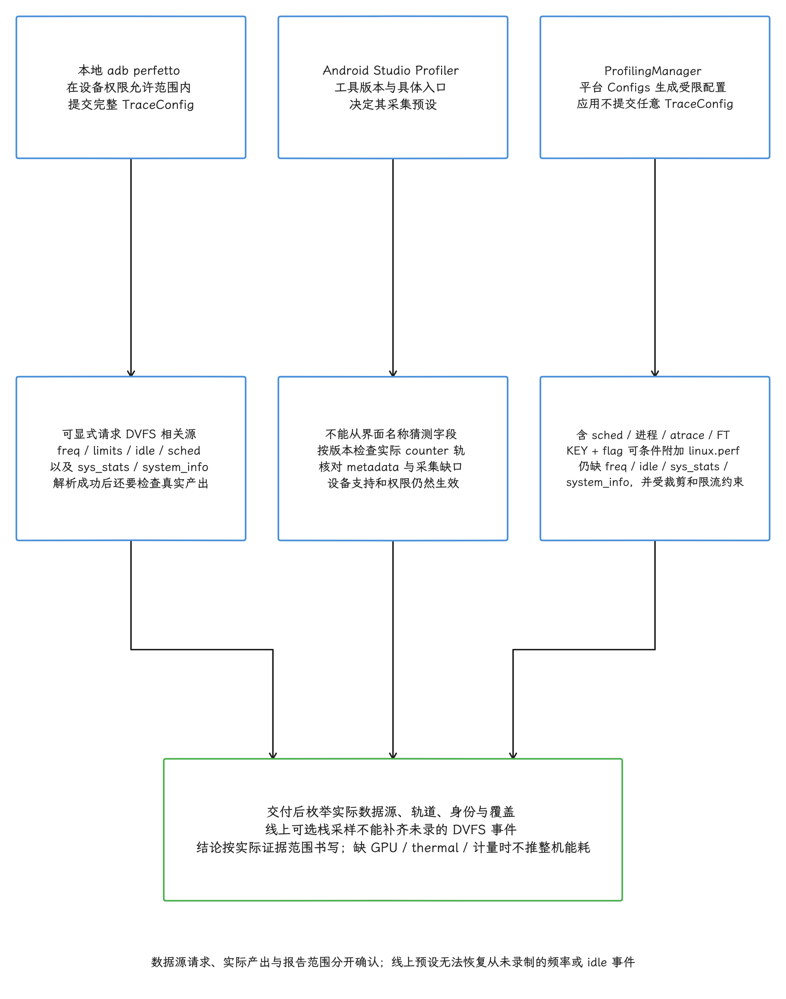

图：本地adb perfetto在权限允许内可提交完整TraceConfig；Studio由工具版本与入口决定预设；固定Android17 ProfilingManager由Configs生成受限system trace，应用不能提交任意配置，KEY_COLLECT_STACK_SAMPLING与对应flag可条件扩展linux.perf。固定预设含compact sched/进程/应用atrace/FrameTimeline，未启用freq、idle、sys_stats、system_info，且redaction、rate limiter、参数与设备配置仍约束交付。可选栈不补DVFS缺失源，交付后枚举真实轨道。

拿到线上 trace 后，先把实际存在的数据源和轨道列出来。缺少 idle、policy limit、GPU 或 thermal 时，报告写到“已观测 CPU 频率与调度状态的相关性”为止；要升级到整机能耗或 governor 根因，得先把这些缺的数据补上。


## 误判清单

- **USB 改变 idle 条件**：Android 17 Perfetto 文档指出，许多 Android 设备接入 USB 时，USB driver stack 持有 wakelock（阻止系统进入休眠的锁），部分 idle state 不会出现。USB trace 的 idle 分布未必代表脱线使用。
- **轨道开头空白**：`power/cpu_frequency` 只记录切换，空白可能来自初始值缺失；用轮询补快照，并在 SQL 中报告覆盖率。
- **idle 区间的频率残留**：CPU clock-gated（关闭时钟以降低动态功耗）后，轨道可能保留进入 idle 前的频率；判断 idle 与功耗，要看各自的轨道和数据。
- **请求频率等同硬件频率**：`cpu_frequency` 与 `scaling_cur_freq` 多数情况下更接近软件请求或驱动报告值；需要硬件反馈才能讨论有效频率。
- **高频等同高吞吐**：缓存未命中、内存带宽、分支和共享资源会让高频 Running 仍然很慢。
- **低频等同 governor 反应慢**：policy 上限、thermal、uclamp、节电模式、迁核和 vendor hook 都可能限制结果。
- **同步变频等同 cluster**：同步轨迹只能提示共享 policy；用 `cluster_id`、capacity、`related_cpus` 和源码确认拓扑。
- **频率等同功耗**：轨道没有电压、漏电、内存、GPU 和屏幕功耗。整机能耗需要硬件功耗计或可靠的设备级计量。
- **UI 没轨等同没数据**：Android 17 文档记录过 cpuidle 缺失导致 UI 不渲染 cpufreq 的问题，SQL 查询才是数据存在性的判据。
- **厂商策略可以互推**：高通、联发科、三星、Google Tensor 的 policy、Power HAL、thermal 与 GPU/内存调频实现不同，结论必须绑定设备、版本和 workload。


## 查询结果应怎样写进报告

一份可复核的 DVFS 结论至少包含：

1. 设备、构建版本、内核版本、Trace Processor 版本与采集配置；
2. workload、温度、充电/USB、屏幕、节电模式和重复次数；
3. 目标线程的 wall time、Running、Runnable、阻塞与频率覆盖率；
4. CPU 的逻辑编号、`ucpu`、capacity、cluster 与 cpufreq policy；
5. 频率切换、policy limit、idle、迁核和 thermal 的时间关系；
6. 代码或调用栈热点，以及必要的 PMU、AMU、GPU、内存与功耗证据；
7. 明确区分观测、推断和已验证根因。


写报告时把这两层分开：“目标线程在已知频率覆盖的 Running 时间中，有多少比例落在某频点”是可复核观测；“governor 导致掉帧”属于因果结论，需要对照实验——固定 workload，控制温度与系统状态，改变一个调频相关变量，并确认帧时序随之稳定变化。这样写，频率轨才会从截图线索变成可验证的性能证据。


## 小结

回到开头的问题：CPU 频率轨回答的是“软件请求了什么频率”，指令执行量、瞬时硬件有效频率和功耗各有各的数据来源。我们分析时先把频率点还原为区间，再与目标线程的 Running 区间相交，并报告频率覆盖率；因果判断要联合 CPU 拓扑、policy limit、idle、迁核、uclamp、thermal 和对照实验一起做。缺少 GPU、DDR 或功耗数据时，结论就写到 CPU 侧观测为止。
