# BufferQueue 阻塞的 Perfetto 识别

本文以 Android 17 / API 37、`android-17.0.0_r1` 为平台源码版本；涉及调度状态与 fence 内核语义时，以 `android17-6.18-2026-06_r6` 为内核版本。Android 12—16 只用于解释版本演进。

`BufferQueue` 是连接图形 Producer（生产者）与 Consumer（消费者）的有界缓冲队列。Producer 通过 `dequeueBuffer()` 取得可复用的 slot（带编号的 buffer 位置），完成绘制后用 `queueBuffer()` 提交；Consumer 通过 `acquireBuffer()` 取走 buffer，并在不再使用时 release。fence 是表示 GPU、合成器或显示硬件何时完成访问的同步对象。下游迟迟不 release，Producer 便可能因没有可用 slot 而等待，这就是本文所说的 BufferQueue backpressure（背压）。

<!-- gracker-diagram: ch14-10-01-slot-fence-cycle -->
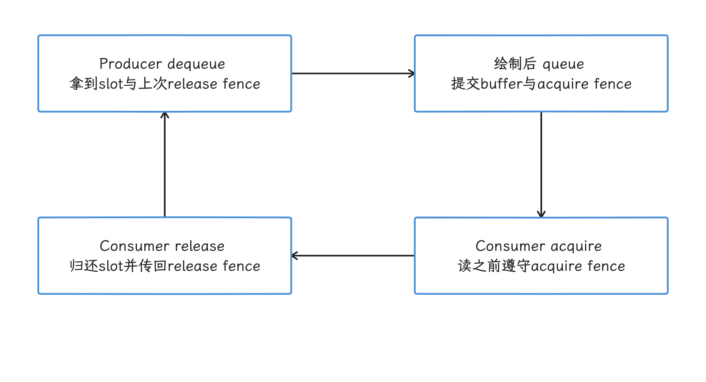

图：slot在Producer、queued、Consumer与free状态间流转，fence约束读写安全。 非shared常规路径示意；slot可取与fence已signal是两件事，下游持有可形成背压。

Perfetto 文档把 `Buffer Stuffing` 定义为一种队列状态：App 在前一帧尚未 present（显示到屏幕）时继续提交新帧，未显示的 buffer 增加，后续帧即使按时完成也会带着额外延迟。可复用 slot 用尽后，Producer 还可能进入 `dequeueBuffer()` 等待。这个分类不能单独证明 App 绘制超时，也不能直接指出哪一条 BufferQueue 阻塞。

<!-- gracker-diagram: ch14-10-02-stuffing-latency -->
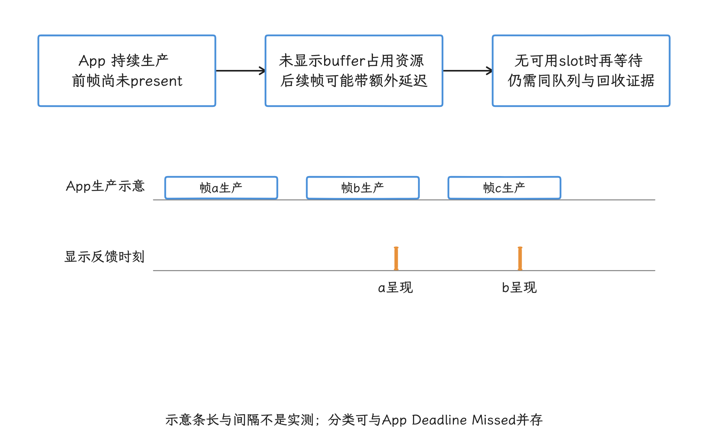

图：App继续生产、前帧仍待present时，可出现排队与dequeue等待。 分类不直接给出目标队列长度、App CPU超时或输入延迟实测。

可靠诊断需要把 FrameTimeline、目标 layer（合成图层）、Producer 线程、BLAST 计数器、SurfaceFlinger（系统合成服务，后文简写为 SF）帧和 release 时刻放进同一时间窗。开始查询前，还要确认画面经过哪些队列和 layer：

- 标准 HWUI（Android 硬件加速 UI 渲染器）窗口的 RenderThread 把宿主 App Window buffer 交给窗口 BLAST（App 进程内的窗口 BufferQueue 实现）队列；
- SurfaceView 内容拥有独立 Surface、BufferQueue 和 SurfaceFlinger child layer，宿主窗口与内容队列不能合并归因；
- TextureView 先由外部 Producer 写 SurfaceTexture，再由宿主 HWUI 采样进 App Window，至少要区分输入队列与宿主窗口队列；
- Camera、视频和游戏的 Producer 可能跨进程，并且可以有不同的排队策略。

<!-- gracker-diagram: ch14-10-03-surface-topology -->
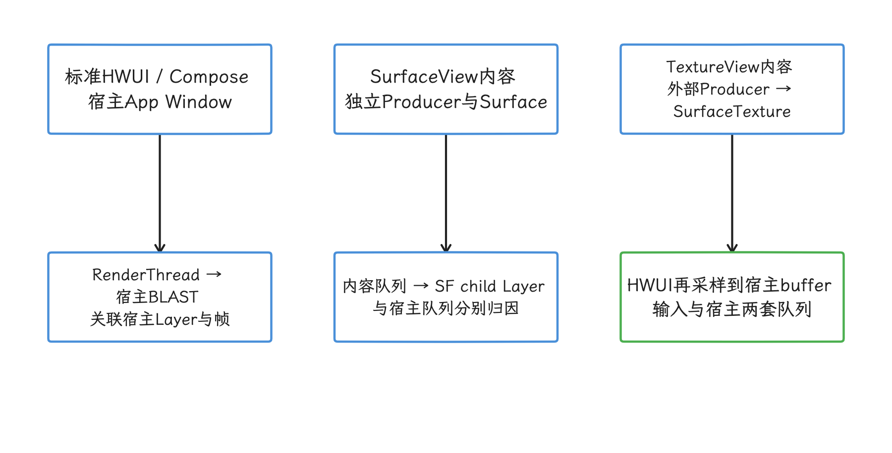

图：标准窗口走宿主BLAST；SurfaceView有独立child队列；TextureView另有输入队列。 同进程和RenderThread不代表同队列，Camera/视频还要确认实际载体和Producer。

BufferQueue 的 slot 与 fence 细节见 2.8；标准窗口、SurfaceView、TextureView、混合渲染和 Camera 的路径选择见 13.1。

## 从 FrameTimeline 找到目标 Surface

Android 12 起，FrameTimeline 在 App 和 SurfaceFlinger 两侧提供 Expected / Actual Timeline。Expected 是预测时序；App Actual 从 `Choreographer#doFrame` 或原生 vsync callback 对应的软件起点开始。固定 Android17 的 `SurfaceFrame::setAcquireFenceTime()` 通常取 acquire fence signal 与提交 queue time 的较大值；若 fence 仍为 `SIGNAL_TIME_PENDING`，暂取 queue time。因此 Actual end 不是无条件的GPU完成证明，更不是屏幕光学显示时刻。SF DisplayFrame 与 App SurfaceFrame 是不同对象。

<!-- gracker-diagram: ch14-10-04-frame-end-identity -->
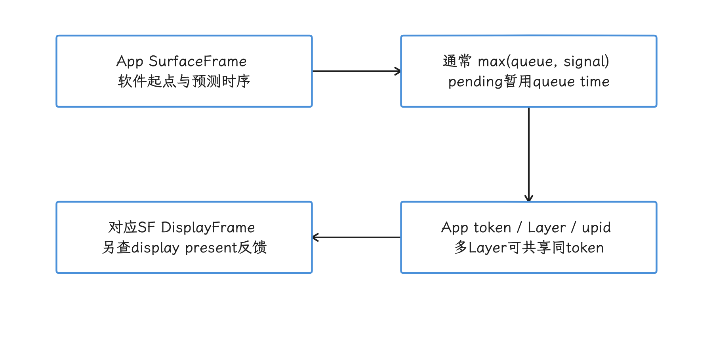

图：App Actual通常取queue与acquire signal较晚者，pending时固定实现回退queue。 Actual end不无条件证明GPU完成或物理显示；关联保留upid、Layer和Actual行ID。

排查时先读取四组字段：

| 字段 | 含义 | 用途 |
|---|---|---|
| `surface_frame_token` | App SurfaceFrame token | 关联 App `doFrame`、RenderThread slice |
| `display_frame_token` | SurfaceFlinger display frame token | 关联 SF `Actual Timeline` 和 flow |
| `jank_type` | 帧分类字符串 | 筛选 `Buffer Stuffing` |
| `layer_name` | 该帧对应的 Layer / Surface | 区分主窗口、视频、Camera、SurfaceView 等独立 Surface |

`upid` 是 Trace 内部进程实例ID，token 用于关联帧。先发现候选，再固定实际 `upid`、精确 `layer_name` 与 Actual slice ID；同一token可以涉及多个Layer/Surface，不能只按token去重。随后用App/SF token、track、Layer ID、BufferQueue名称及frame number联系证据。同名Layer也可能跨生命周期，名称加同进程仍不自动构成唯一队列身份。

固定 Perfetto FrameTimeline 文档仍标注 SurfaceView 未完整支持；这限定本文的文档基线，不能据一页文档推断所有新版本或厂商实现。SurfaceView主体内容优先沿独立child Layer、实际Producer、BufferQueue frame number、fence和SF present重建。缺少App Actual不能证明没有更新。

TextureView 的 App FrameTimeline 主要描述宿主窗口，外部 SurfaceTexture 输入帧仍要另行关联。UI 颜色会随版本与主题调整，报告中应保存 `jank_type` 原始字符串。

<!-- gracker-diagram: ch14-10-05-coverage-identity -->
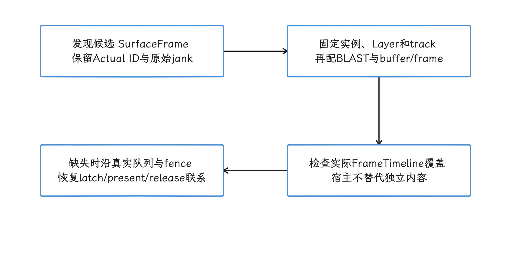

图：宿主FrameTimeline与外部内容帧分开，缺App Actual时继续查Producer/Layer/fence。 固定文档标注SurfaceView未完整支持，不能据此推定所有版本、厂商或无更新。

## `dequeueBuffer` 为什么会等

`android-17.0.0_r1` 的 `BufferQueueProducer::dequeueBuffer()` 会调用 `waitForFreeSlotThenRelock()`。源码中有两类等待条件：

1. 找不到可复用的 free buffer 或 free slot；
2. 快速断开重连等场景造成 `mQueue.size() > getMaxBufferCountLocked()`。

阻塞模式下，Producer 调用虚函数 `waitForBufferRelease()`。Android 17 有两种实现：

- 通用 `BufferQueueProducer` 仍在条件变量 `mDequeueCondition` 上执行 `wait()` 或带超时的 `wait_for()`；条件变量用于让线程睡眠，直到释放方发出状态可能已变化的通知；
- App Window 使用的 `BBQBufferQueueProducer` 覆盖了该函数，通过 `BufferReleaseReader::readBlocking()` 在 `BufferReleaseChannel` 上等待。这个通道是 SurfaceFlinger 到 App 的 Unix domain socket（同一设备上进程间通信所用的本地套接字），消息携带 `ReleaseCallbackId`、release fence 和当前 `maxAcquiredBufferCount`；`eventfd` 是内核提供的事件通知文件描述符，出现其他释放原因时用它中断阻塞读取，让等待方重新检查 slot。

<!-- gracker-diagram: ch14-10-07-wait-transports -->
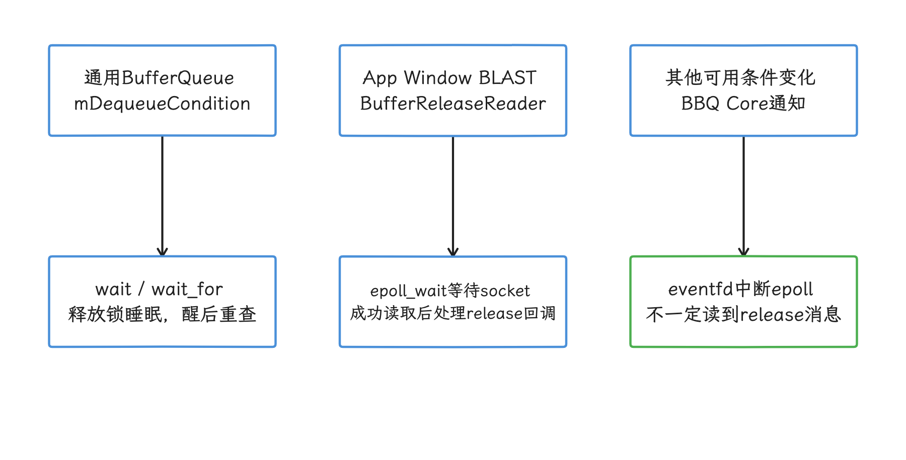

图：通用队列等条件变量，BLAST专用队列等socket，eventfd中断可促使重查slot。 socket携带ID/fence/max acquired；收到句柄不等于fence signal，超时或中断不是成功回收证明。

需要重试时，仅当 `(mDequeueBufferCannotBlock || mAsyncMode)` 且 `acquiredCount <= mMaxAcquiredBufferCount` 才直接返回 `WOULD_BLOCK`，超额临时acquire等条件下仍可等待。`mBufferHasBeenQueued` 且Producer已dequeue到上限时，返回 `INVALID_OPERATION`；等待超时另返回 `TIMED_OUT`。这些返回分支都不等于一次GPU超时。固定17 BLAST覆盖函数有 `ATRACE_CALL()`，因此外层dequeue内可见waitForBufferRelease；通用实现未必记录此内层slice。

<!-- gracker-diagram: ch14-10-06-slot-predicate -->
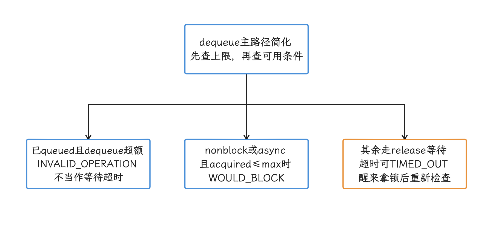

图：缺可用buffer或队列超限时重试，非阻塞返回还受acquired数量条件约束。 简化主要非shared分支；已有queued且dequeue到上限先报INVALID_OPERATION，唤醒不保证获得slot。

在下面的信号中，acquire 表示 Consumer 取走 buffer，latch 表示 SurfaceFlinger 为目标显示帧选中该 buffer，composition 表示合成多个 layer，present 表示把最终帧送到显示设备，release 表示该 layer buffer 已可交还复用。acquire fence 通知 Consumer 何时可以读取，release fence 通知 Producer 何时可以复写。Trace 中应组合检查：

- `RenderThread` 或原生渲染线程出现 `dequeueBuffer`、`waitForBufferRelease`、EGL swap（OpenGL ES 交换前后缓冲）或 HWUI 提交 slice；
- 同一线程的 `thread_state` 与等待窗口重叠；条件变量和 `epoll_wait` 常表现为 `S`，`D` 往往指向另一类内核或驱动等待；
- App Actual Timeline 出现 `Buffer Stuffing`，目标 layer 的 BLAST 计数器同期变化；
- SurfaceFlinger 侧的 acquire、latch、composition、present 或 release 能解释 buffer 何时返回；
- App/SF deadline 字段与 `present_type` 能排除单纯的 App CPU 超时。

外层 `dequeueBuffer` 的墙钟时长可包含执行、mutex竞争、等待正在进行的分配、slot重试、调度排队以及新buffer分配，不能全部记为“等slot”。BLAST内层等待还包含release读取后的回调处理；外层与嵌套内层时间重叠，不可相加。CPU周期采样主要覆盖Running，睡眠中的等待点需明确slice、thread_state、内核原因或可符号化调试trace补证。

<!-- gracker-diagram: ch14-10-08-walltime-not-slot-time -->
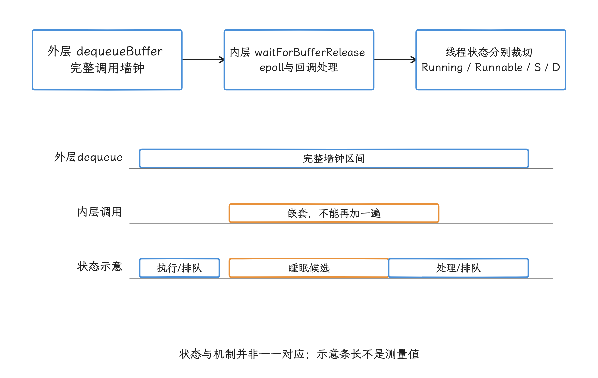

图：dequeue可含执行、锁、分配、排队和slot重试；内层也含回调处理。 先用状态与明确等待点拆分；嵌套slice重叠，不能跨层相加当总睡眠。

`App Deadline Missed` 是App帧时间超过分类截止的结果，时间中可以包含CPU/GPU工作、Runnable或BufferQueue及其他等待；它不专指CPU执行超时。背压与该分类可以同时出现。固定17 legacy Buffer Stuffing分类还参考前一latch和预测时间，并可调整判定App是否按时完成的截止，不能把on_time_finish直接当成原始Expected预算比较。

Android17 BLAST成功读到release并处理回调后，可把这次 `waitForBufferRelease` 调用的经过时长传给Choreographer；超时、被中断或错误返回路径不会都上报。`durationNanos > mLastFrameIntervalNanos / 2` 时标记stuffed，随后doFrame可返回DELAY_FRAME以等下次Vsync，并在恢复中施加动画offset。实际是否多次恢复、是否达到累计延迟阈值还受 `bufferStuffingMultiRecovery()` / `bufferStuffingRecoveryThreshold()` 等flag控制。`Buffer stuffing recovery`、`buffer stuffed`、`Negative offset` 是恢复路径线索，不等同FrameTimeline分类，也不表示CPU执行变慢；设计说明中的“一次动画仅一次”不覆盖启用multi-recovery的代码路径。

<!-- gracker-diagram: ch14-10-09-stuffing-recovery -->
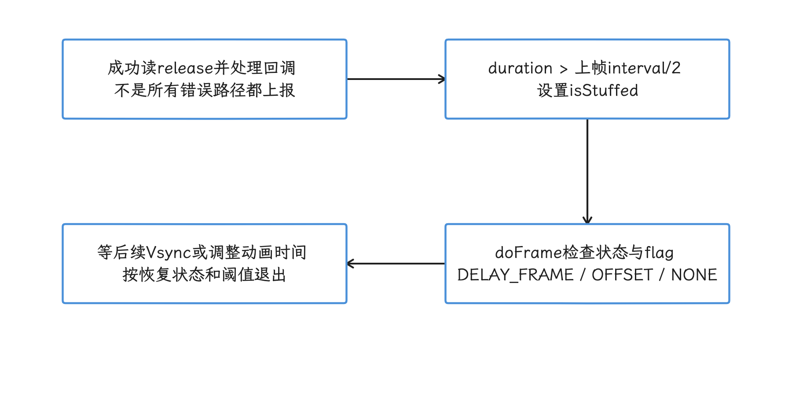

图：成功release回调后可上报调用时长，超过上一帧间隔一半时标记stuffed。 multi-recovery与累计阈值由flag控制；恢复事件不等同FrameTimeline分类或CPU变慢。

## 三种“积压”信号不能当成同一个队列长度

Android 17 的 `BLASTBufferQueue.cpp` 为每个实例建立 `QueuedBuffer - <name>BLAST#<id>` 计数器。源码写入的值是：

`mNumFrameAvailable + mNumAcquired - mPendingRelease.size()`

这个计数器描述 App 进程内 BLAST 的内部状态，不等同于 `BufferQueueCore::mQueue.size()`。公式中的 `mNumFrameAvailable` 是等待 BLAST 消费的可用 frame 数，`mNumAcquired` 是 BLAST 已取得的 buffer 数，`mPendingRelease` 保存已收到release、但按策略尚待归还本地队列的buffer记录（ID与fence）。相减后的值不能直接翻译成 QUEUED slot 数。

另一个常见计数器是 SurfaceFlinger 侧的 `BufferTX - <layerName>`。这里的 buffer transaction 是 App 向 SurfaceFlinger 提交、携带新 buffer 的 layer 状态更新。`Layer` 在 transaction 到达服务端时增加该值，在 latch 或 drop 时减少。它描述尚未 latch/drop 的服务端 buffer transaction，也不是 App BufferQueue 的 slot 数。

| 信号 | 所在层 | 能回答什么 |
|---|---|---|
| FrameTimeline `Buffer Stuffing` | App SurfaceFrame分类 | 提示排队/延迟状态，不能直接当作目标队列长度或输入延迟实测 |
| `QueuedBuffer - <name>BLAST#<id>` | App 进程 BLAST | BLAST 内部 available、acquired 与 pending-release 的组合变化 |
| `BufferTX - <layerName>` | SurfaceFlinger `Layer` | buffer transaction 到达服务端后是否及时 latch 或 drop |
| `BufferQueueCore::mQueue.size()` | 某条BufferQueue内部 | queued BufferItem数；固定源码在queueBuffer、acquireBuffer等路径以consumer名称记录ATRACE_INT，是否采到及能否唯一识别需现场确认 |

结合源码公式判读 `QueuedBuffer`：

- 计数器上升：先按 `Δavailable + Δacquired - ΔpendingRelease` 解释组合变化，并回查具体方法；单条曲线不能唯一反推出某个成员或queued slot增加；
- 计数器长时间高位：BLAST 处理、SurfaceFlinger 消费或 release 回调可能落后，也要检查等待一组更新同时提交的同步 transaction 是否暂时阻止 BLAST 消费；
- 计数器上升后dequeue变长：是传导候选，仍需同队列身份、实际slot等待和release时序；分配、锁竞争或Runnable也会放大外层时长；
- 计数器已回落而渲染仍停顿：检查 release fence、GPU/driver 等待、线程调度和应用锁。

多个 Surface 同时更新时，应把计数器名、`layer_name`、layer id、BufferQueue 名和 frame token 配对。主窗口的 `Buffer Stuffing` 不能自动归因给同进程的视频 layer。

<!-- gracker-diagram: ch14-10-10-counter-domains -->
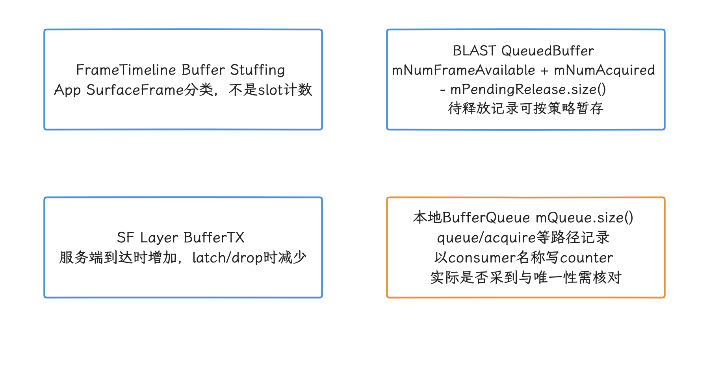

图：FrameTimeline是分类，BLAST是组合状态，BufferTX是SF待处理buffer事务，mQueue是本地queued数。 先确认计数器实例/track与Layer、buffer身份；不能把它们互换为同一队列长度。

## Producer 到 display 的证据时间线

这张时序骨架描述 Android 17 App Window 的 BLAST 路径，读图时要分清 App 进程内的 BufferQueue Consumer 与 SurfaceFlinger 的 layer transaction。RenderEngine 是 SurfaceFlinger 的 GPU 合成引擎，HWC（Hardware Composer）是对显示硬件合成能力的抽象层。

<!-- gracker-diagram: ch14-10-11-forward-release-branches -->
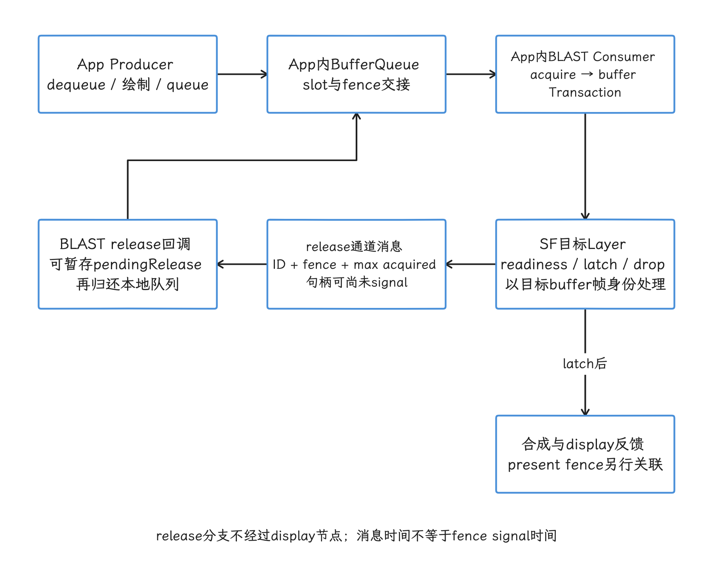

图：本地BLAST把buffer送到SF，回收按ID和fence返回，不是当前帧present后的固定下一步。 drop/替换也可回收，BLAST可能暂存已回调buffer；释放通知与fence signal分别检查。

```text
App Producer → 本地BufferQueue → App内BLAST Consumer
  dequeue / 遵守上次release fence / 绘制 → queue(buffer, acquire fence)
  BLAST acquire → 向SF提交带buffer的Transaction

SF目标Layer处理buffer：
  接收 → readiness / latch → composition → display present反馈
  分支：可能在未显示前drop或被替换，并返回相应release依赖

buffer回收分支（以ReleaseCallbackId对应的buffer/帧为准）：
  SF发送release fence句柄，消息本身不保证fence已signal
    → BufferReleaseChannel → BLAST releaseBufferCallback
    → 可能暂存mPendingRelease，按持有策略释放
    → BufferQueueConsumer::releaseBuffer → 通知Producer重查slot
    → Producer取得slot后，复写前继续遵守返回的release fence

display present fence 与 per-layer release fence 分开关联；
回收不是“当前buffer present以后立即返回”的固定串行步骤。
```

`BufferQueueConsumer::releaseBuffer()` 在有效非shared状态下把slot从active移到free buffer列表并通知；acquire时drop旧buffer、队列计数变化或其他条件也可通知。通用Core唤醒条件变量，BBQ专用Core中断release reader，等待者拿回锁后重新检查谓词；通知不保证本线程立刻取得slot。BLAST releaseBufferCallback还可按EGL/当前max acquired策略把已回调buffer暂存mPendingRelease，消息到达不一定立即执行底层releaseBuffer。

release fence 还要单独理解。slot 回到 Producer 后可能携带尚未 signal 的 fence；图形栈在复写 buffer 前必须遵守该 fence。slot 等待回答“有没有可复用 buffer”，fence 等待回答“这个 buffer 何时安全可写”，两种等待在 trace 中不能混为一类。

<!-- gracker-diagram: ch14-10-12-slot-versus-fence -->
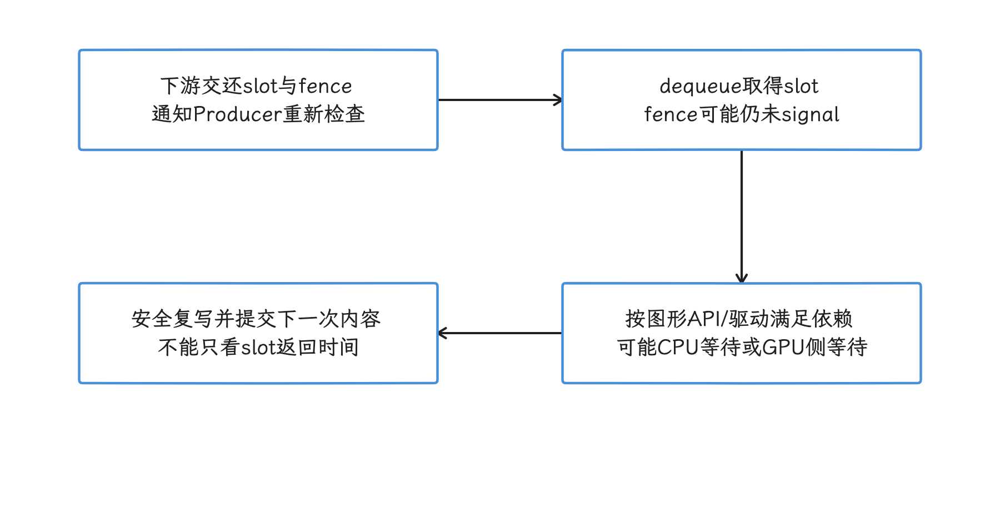

图：slot归还后dequeue可返回仍未signal的release fence，复写前必须满足依赖。 present fence与per-layer release fence分别关联；不能仅凭S/D判定是哪一种等待。

present fence描述display present的同步边界，per-layer release fence描述某个buffer在复写前必须满足的读取完成依赖；二者可经不同路径返回，不能假定时间相同或一律先present后release。release消息可携带尚未signal的fence。SF及时present或消息很快到达，只能削弱相应阶段的假设，不能单独排除旧buffer持有、fence、调度、分配或应用同步；仍要按buffer/frame身份连接等待与回收证据。

## 多 Surface 场景

视频列表、Camera 预览和混合渲染页面往往有多条内容生产路径。分析前先列出每个 Producer、Consumer、BufferQueue、SurfaceControl layer、宿主关系和最终 DisplayFrame。

| 场景 | 队列拓扑 | 检查重点 |
|---|---|---|
| 标准列表或纯 Compose 页面 | 宿主 HWUI → App Window BLAST | 从主线程、RenderThread、宿主 `QueuedBuffer` / `BufferTX` 和 App SurfaceFrame 建立单窗口证据 |
| SurfaceView 视频 | 宿主 App Window 与视频 child layer 各有队列 | 分开归因宿主交互与视频内容；FrameTimeline 不能完整代表 SurfaceView 主体 |
| TextureView 视频 | 视频 Producer → SurfaceTexture；宿主 HWUI → App Window BLAST | 分开检查外部输入队列与宿主窗口队列；SF 通常只看到最终宿主 layer |
| CameraX 预览 | Camera/HAL（Hardware Abstraction Layer，硬件抽象层）Producer 写 Preview Surface；载体可能是 SurfaceView 或 TextureView | 先确认实际载体，再沿 request/result、buffer fence、预览队列和最终 layer 关联 |
| 多窗口或 Popup/Dialog | 每个 ViewRoot/窗口拥有自己的 App Window BLAST | 同进程、同 RenderThread 不代表共用 BufferQueue；按窗口 layer 与 BLAST id 分组 |

只有确认每个队列和 layer 的身份后，token、计数器和 `dequeueBuffer` 才能进入同一条证据时间线。跨 layer、跨窗口或跨 TextureView 两套队列拼接事件，会把同时发生误写成因果关系。

<!-- gracker-diagram: ch14-10-13-queue-identity -->
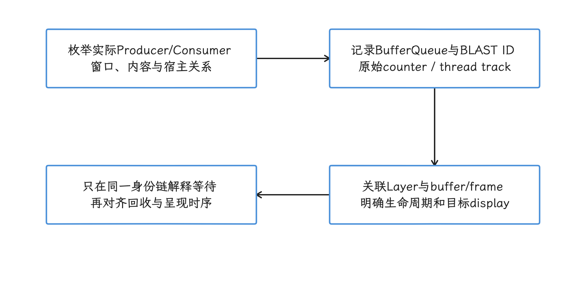

图：把Producer/Consumer、队列、Layer和buffer/frame身份连起来，再使用token和计数器。 同进程、同线程、同名Layer或同token都不能单独证明同队列；同时发生不等于因果。

## 容易混淆的四类等待

1. **App工作主导**：doFrame、traversal、bind或回调窗口长且缺少明确slot等待时，继续拆Running、Runnable、应用锁与同步；长slice本身仍不是纯CPU执行时间。
2. **GPU 或 fence 等待**：GPU 写入、SF/HWC 读取或 release fence 尚未完成，证据落在 fence、GPU timeline 和 driver wait。
3. **SF/HWC 合成慢**：SF Actual Timeline 变长，jank type 指向 `SurfaceFlingerCpuDeadlineMissed`、`SurfaceFlingerGpuDeadlineMissed` 或 `DisplayHAL`。Producer 等待可能是下游变慢的反馈。
4. **应用同步或 Binder 等待**：渲染相关线程卡在应用锁、Binder 进程间调用或资源加载，时间窗与 BufferQueue release 对不上。

<!-- gracker-diagram: ch14-10-14-wait-differential -->
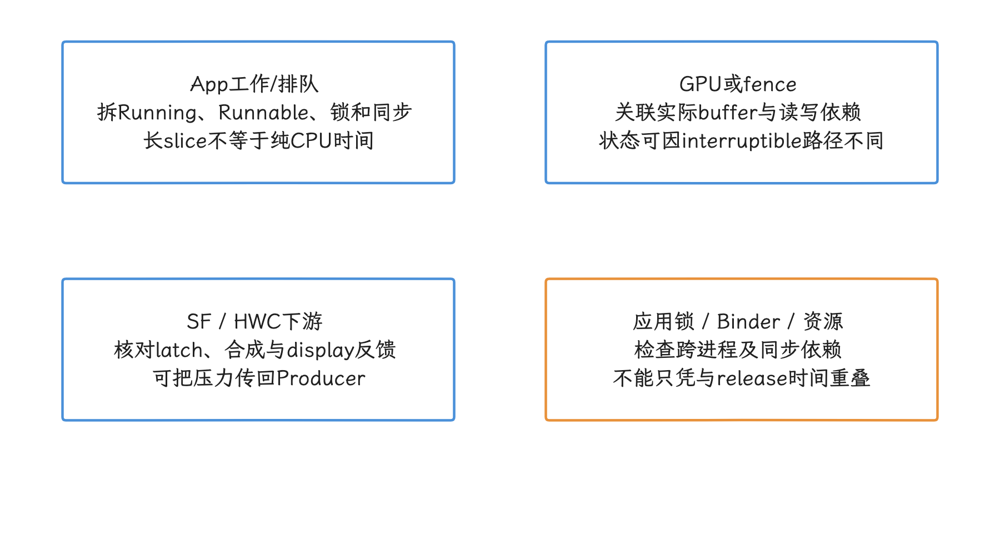

图：长帧和长dequeue可由App工作、fence、SF/HWC或应用同步形成，先分解证据。 类别可并存；App Deadline Missed和S/D状态都不是唯一根因判据。

背压判断需要同一队列上的成组证据：Producer缺少可用buffer/slot的等待，和下游持有、acquire/drop、release或相关计数变化相互吻合。FrameTimeline Buffer Stuffing、BLAST QueuedBuffer、SF BufferTX都是可用的补充，不能要求所有队列都同时具备这些轨道；缺FrameTimeline的SurfaceView也可沿真实slot/fence/回收路径验证。缺少队列身份时，只能报告同进程候选重叠，并列出待补证据。

## Android 15、16、17 的源码边界

三个标签的通用算法都在 `waitForFreeSlotThenRelock()` 中重新检查 slot，但等待传输机制已经变化：

| 平台标签 | 通用 BufferQueue | App Window BLAST 队列 |
|---|---|---|
| `android-15.0.0_r1` | 直接等待 `mDequeueCondition`，释放点调用 `notify_all()` | 沿用条件变量路径 |
| `android-16.0.0_r1` | `BUFFER_RELEASE_CHANNEL` 分支启用时经虚函数进入通用条件变量实现；关闭时仍在调用点直接等待条件变量 | 同一开关启用时，`BBQBufferQueueProducer` 覆盖 `waitForBufferRelease()` 并读取 release 通道；关闭时回到条件变量 |
| `android-17.0.0_r1` | 无条件调用虚函数，默认实现仍等待 `mDequeueCondition` | `BufferReleaseChannel` 成为无条件实现；BLAST 覆盖函数用 `epoll_wait` 读取 release 消息，`BBQBufferQueueCore` 用 `eventfd` 中断等待 |

Android 17 的通道消息带有明确的 `ReleaseCallbackId` 与 release fence，SurfaceFlinger 可经该通道把 release 结果直接送到对应 BLAST 客户端。BLAST 的阻塞读取使用 `epoll_wait`（等待文件描述符事件的系统调用），并可由 `eventfd` 唤醒。这个变化只覆盖使用 BLAST 专用 Producer 的队列；SurfaceTexture、ImageReader 或其他通用 BufferQueue 仍可能走条件变量。源码结构变化也不能证明某台设备已经消除 BufferQueue 阻塞，Perfetto 仍要核对等待时长、目标队列、release fence 和下游帧时序。

<!-- gracker-diagram: ch14-10-15-release-version-boundary -->
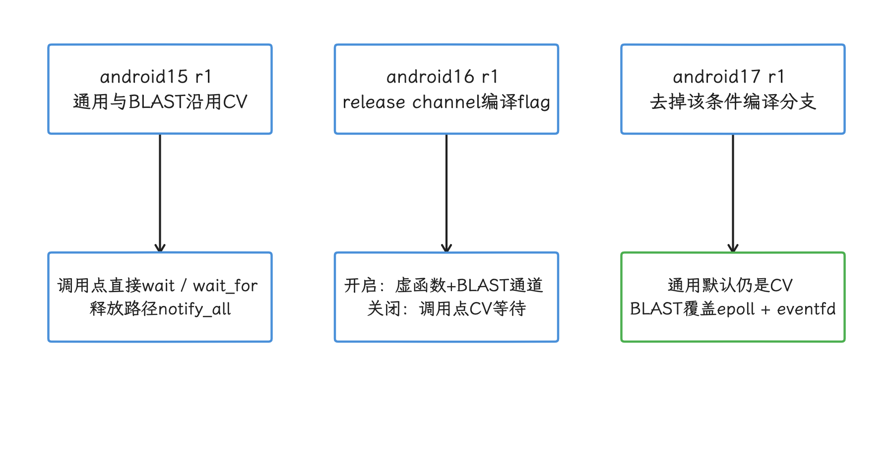

图：15直接等条件变量，16由编译flag选择，17虚调用与BLAST通道路径无该条件编译分支。 只覆盖BLAST专用Producer；代码变化不证明目标设备flag、性能收益或已经消除阻塞。

## PerfettoSQL：先找候选帧

这条查询从 App Actual Timeline 中筛出 Buffer Stuffing，并保留进程、layer 与两个 token：

```sql
SELECT afts.id AS actual_slice_id, afts.track_id, afts.arg_set_id,
       afts.ts, afts.dur, afts.upid,
       afts.surface_frame_token AS app_token,
       afts.display_frame_token AS sf_token,
       afts.jank_type, afts.on_time_finish, afts.present_type,
       afts.layer_name, p.name AS process_name,
       EXTRACT_ARG(afts.arg_set_id, 'Is Buffer?') AS is_buffer,
       CASE WHEN afts.dur = -1 THEN 'open'
            WHEN afts.dur = 0 THEN 'zero'
            WHEN afts.dur > 0 THEN 'closed-positive'
            ELSE 'invalid' END AS duration_status
FROM actual_frame_timeline_slice AS afts
LEFT JOIN process AS p USING (upid)
WHERE afts.surface_frame_token != 0
  AND LOWER(afts.jank_type) GLOB '*buffer*stuff*'
ORDER BY afts.ts, afts.id;
```

此发现查询保留全部候选和原始jank字符串，并标出开放/零时长。`Is Buffer?` 来自args，固定公开表没有同名列，值为Yes/No/Unspecified；NULL或Unspecified不当成已证实buffer，No不纳入下面的buffer候选。on_time_finish与Buffer Stuffing可同时出现，还需核对固定分类算法与工具版本。只有dur>0的已闭合记录适合下面的正时长求交；不能先把-1尾段当成负时间或0。

<!-- gracker-diagram: ch14-10-16-sql-candidate-quality -->
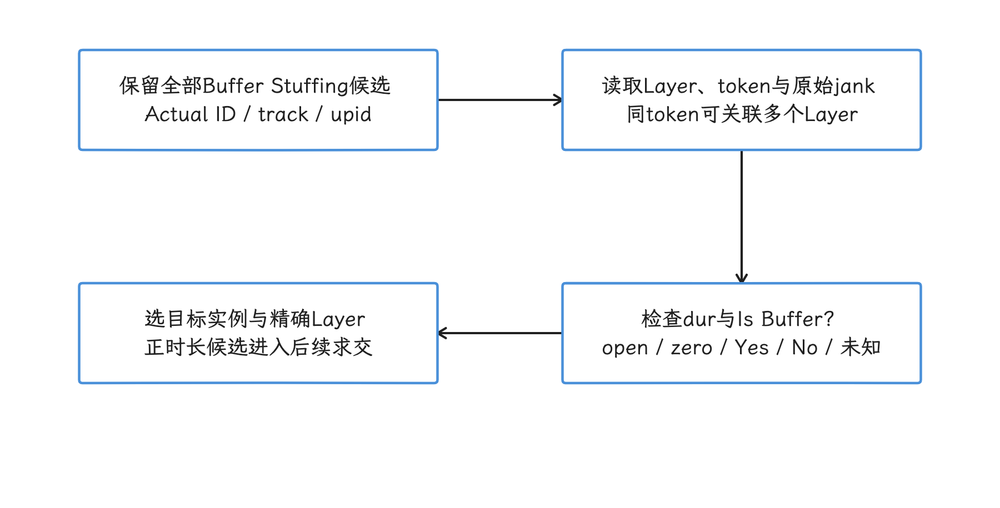

图：发现查询保留Actual ID、track、token、Layer与时长质量，再固定真实upid和Layer。 Is Buffer?来自args；Yes/No/Unspecified分开，开放/零时长只作质量诊断，正时长求交排除。

## PerfettoSQL：关联同进程的 dequeue slice

先从上一查询选定实际upid和精确Layer名称，替换下面123与REPLACE_WITH_LAYER_NAME。结果固定目标进程实例与Layer候选，分别保留Actual和等待slice的ID/track/parent/depth，同时返回完整slice墙钟与窗口内交集时长。它覆盖固定17外层dequeue/内层waitForBufferRelease以及固定16通道路径的waiting for free buffer；这些名称只是发现规则。

```sql
WITH target_frames AS (
  SELECT *, EXTRACT_ARG(arg_set_id, 'Is Buffer?') AS is_buffer
  FROM actual_frame_timeline_slice
  WHERE upid = 123 AND layer_name = 'REPLACE_WITH_LAYER_NAME'
    AND surface_frame_token != 0 AND dur > 0
    AND LOWER(jank_type) GLOB '*buffer*stuff*'
    AND EXTRACT_ARG(arg_set_id, 'Is Buffer?') IS NOT 'No'
), producer_wait AS (
  SELECT s.id AS wait_slice_id, s.track_id AS wait_track_id,
         s.parent_id, s.depth, s.ts, s.dur, s.name,
         t.utid, t.upid, t.name AS thread_name, p.name AS process_name
  FROM slice AS s JOIN thread_track AS tt ON s.track_id = tt.id
  JOIN thread AS t USING (utid)
  LEFT JOIN process AS p ON p.upid = t.upid
  WHERE t.upid = 123 AND s.dur > 0
    AND (LOWER(s.name) GLOB '*dequeuebuffer*'
      OR LOWER(s.name) GLOB '*waitforbufferrelease*'
      OR LOWER(s.name) GLOB '*waiting for free buffer*')
)
SELECT f.id AS actual_slice_id, f.track_id AS actual_track_id,
       f.upid, f.layer_name, f.surface_frame_token AS app_token,
       f.display_frame_token AS sf_token, f.is_buffer,
       f.ts AS frame_ts, f.dur / 1e6 AS frame_ms,
       w.wait_slice_id, w.wait_track_id, w.parent_id, w.depth,
       w.utid, w.process_name, w.thread_name, w.name AS wait_slice,
       w.ts AS wait_ts, w.dur / 1e6 AS full_slice_ms,
       MAX(f.ts, w.ts) AS overlap_ts,
       (MIN(f.ts + f.dur, w.ts + w.dur) - MAX(f.ts, w.ts)) / 1e6
         AS overlap_ms
FROM target_frames AS f JOIN producer_wait AS w
  ON w.upid = f.upid AND w.ts < f.ts + f.dur AND f.ts < w.ts + w.dur
ORDER BY f.ts, f.id, overlap_ms DESC, w.wait_slice_id;
```

交集按半开区间计算，能找到从帧窗口之前开始的等待；相邻端点不算正时长重叠。`full_slice_ms` 是完整调用墙钟，`overlap_ms` 才是该帧窗口内的部分，两者均不是已经证实的slot睡眠时长。外层dequeue与内层等待可同时返回，同一等待也可能命中重叠帧，不能直接跨行求和。同进程/同Layer名称仍需BLAST ID、原始track、buffer/frame和回收证据确认队列；未知is_buffer保留并标明，No被排除。

<!-- gracker-diagram: ch14-10-17-sql-overlap-window -->
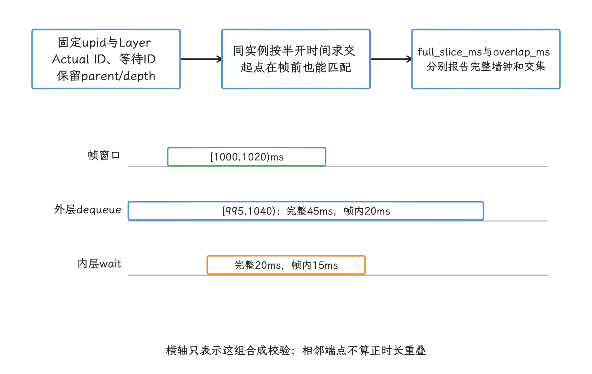

图：合成校验：帧[1000,1020)ms，外层dequeue45ms但帧内20ms，内层wait20ms但帧内15ms。 同进程/同Layer名称仍只是队列候选；嵌套slice或重叠模型帧不能跨行直接相加。

## PerfettoSQL：核对线程状态

从上一步选择一个明确的wait_slice_id，替换下面12345；该值是slice内部ID，不是线程ID或PID。查询只裁切这一个已闭合slice，按同utid的闭合thread_state求交，保留无匹配行并报告状态覆盖与被排除的开放状态；不把trace尾部未知状态补成睡眠。

```sql
WITH target_wait AS (
  SELECT s.id AS wait_slice_id, s.track_id, s.parent_id, s.depth,
         s.ts, s.dur, s.name AS wait_slice, tt.utid
  FROM slice AS s JOIN thread_track AS tt ON s.track_id = tt.id
  WHERE s.id = 12345 AND s.dur > 0
), clipped_states AS (
  SELECT st.id AS state_id, w.wait_slice_id,
         st.state, st.io_wait, st.blocked_function,
         MAX(w.ts, st.ts) AS ts,
         MIN(w.ts + w.dur, st.ts + st.dur) AS end_ts
  FROM target_wait AS w JOIN thread_state AS st
    ON st.utid = w.utid AND st.dur > 0
   AND st.ts < w.ts + w.dur AND w.ts < st.ts + st.dur
), checked_states AS (
  SELECT *, MAX(end_ts) OVER (
    PARTITION BY wait_slice_id ORDER BY ts, state_id
    ROWS BETWEEN UNBOUNDED PRECEDING AND 1 PRECEDING
  ) AS previous_max_end
  FROM clipped_states
), coverage AS (
  SELECT w.*,
    (SELECT SUM(end_ts - ts) FROM clipped_states) AS covered_dur,
    (SELECT COUNT(*) FROM checked_states WHERE ts < previous_max_end)
      AS overlap_errors,
    (SELECT COUNT(*) FROM thread_state AS st
     WHERE st.utid = w.utid AND st.dur = -1
       AND st.ts < w.ts + w.dur AND w.ts < trace_end()) AS open_state_records
  FROM target_wait AS w
), state_groups AS (
  SELECT wait_slice_id, state, io_wait, blocked_function,
         SUM(end_ts - ts) AS dur
  FROM clipped_states
  GROUP BY wait_slice_id, state, io_wait, blocked_function
)
SELECT c.wait_slice_id, c.track_id, c.parent_id, c.depth,
       c.utid, t.upid, t.name AS thread_name, p.name AS process_name,
       c.wait_slice, c.ts, c.dur / 1e6 AS full_slice_ms,
       c.open_state_records, c.overlap_errors,
       CASE WHEN c.overlap_errors = 0 THEN c.covered_dur / 1e6 END
         AS closed_state_ms,
       CASE WHEN c.overlap_errors = 0
            THEN ROUND(100.0 * c.covered_dur / c.dur, 2) END AS state_coverage_pct,
       g.state, g.io_wait, g.blocked_function,
       CASE WHEN c.overlap_errors = 0 THEN g.dur / 1e6 END AS overlap_ms
FROM coverage AS c
LEFT JOIN state_groups AS g USING (wait_slice_id)
LEFT JOIN thread AS t ON t.utid = c.utid
LEFT JOIN process AS p ON p.upid = t.upid
ORDER BY overlap_ms DESC, g.state;
```

`Running`、R、R+、S、D分别表示运行、可运行、被抢占后可运行、可中断睡眠、不可中断睡眠。epoll/条件变量常见S，但fence等待也可因调用方式不同表现为S或D，不能按状态字母唯一识别机制。`state_coverage_pct` 的分母是所选完整slice时长；开放状态被排除，NULL是没有闭合匹配而非0ms睡眠。`overlap_errors>0` 时统计列置NULL，先检查合并/解析或模型；不能把各层候选slice的结果继续相加。

<!-- gracker-diagram: ch14-10-18-sql-state-coverage -->
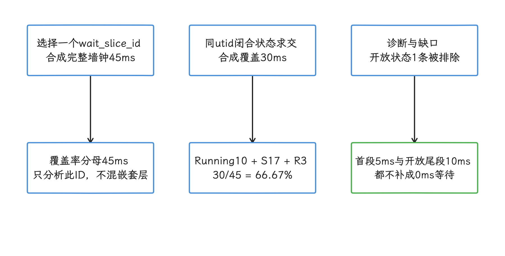

图：合成外层slice45ms中，闭合状态30ms：Running10、S17、R3，覆盖率66.67%。 首段5ms无状态、末段10ms开放状态被排除；缺匹配保留NULL，输入重叠时数值置NULL先排错。

`blocked_function` 主要来自内核 `sched_blocked_reason` 事件，对 `D` 状态更有帮助。字段为 `NULL` 可能是线程处于可中断睡眠、事件未采集或内核符号不可见，不能反向证明没有等待。线程状态只说明调度层发生了什么，仍需和等待 slice、release 消息与目标队列相互印证。 本轮仅做固定源码核对、native Trace Processor57.2/58.2受控合成导入及SQL校验；未运行Android设备录制、系统/内核构建、release通道实机或GPU/display性能测量。

## 小结

BufferQueue背压需要同一队列的Producer等待和下游持有/回收证据相互吻合。标准窗口可联合FrameTimeline、BLAST ID、QueuedBuffer、BufferTX与display时序；其他队列按实际Producer/Consumer和slot/fence链路验证。缺少足以连接等待与回收的身份或时序证据时，报告疑似背压和待补数据；不能把某一特有轨道缺失当作没有背压的证明。

<!-- gracker-diagram: ch14-10-19-evidence-verdict -->
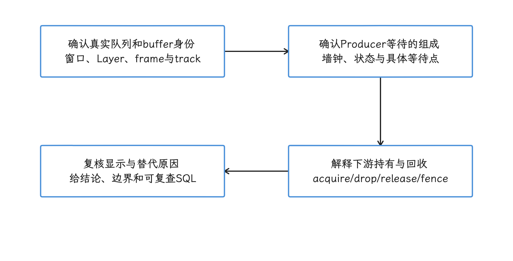

图：同队列的Producer等待与下游持有/回收互证，再排除分配、fence、调度和应用同步。 标准BLAST轨道是补充；证据不足时报告疑似与待补项，不以某条特有轨道缺失作为反证。

## 源码与官方资料

- [Android 17 Perfetto FrameTimeline 文档](https://android.googlesource.com/platform/external/perfetto/+/refs/tags/android-17.0.0_r1/docs/data-sources/frametimeline.md)
- [Android 17 BufferQueueProducer](https://android.googlesource.com/platform/frameworks/native/+/refs/tags/android-17.0.0_r1/libs/gui/BufferQueueProducer.cpp)
- [Android 17 BufferQueueConsumer](https://android.googlesource.com/platform/frameworks/native/+/refs/tags/android-17.0.0_r1/libs/gui/BufferQueueConsumer.cpp)
- [Android 17 BufferQueueCore](https://android.googlesource.com/platform/frameworks/native/+/refs/tags/android-17.0.0_r1/libs/gui/BufferQueueCore.cpp)
- [Android 17 BLASTBufferQueue](https://android.googlesource.com/platform/frameworks/native/+/refs/tags/android-17.0.0_r1/libs/gui/BLASTBufferQueue.cpp)
- [Android 17 BufferReleaseChannel](https://android.googlesource.com/platform/frameworks/native/+/refs/tags/android-17.0.0_r1/libs/gui/include/gui/BufferReleaseChannel.h)
- [Android 17 SurfaceFlinger Layer release](https://android.googlesource.com/platform/frameworks/native/+/refs/tags/android-17.0.0_r1/services/surfaceflinger/Layer.cpp)
- [Android 17 Buffer stuffing 设计说明](https://android.googlesource.com/platform/frameworks/native/+/refs/tags/android-17.0.0_r1/libs/gui/BufferStuffing.md)
- [Android 17 Choreographer recovery](https://android.googlesource.com/platform/frameworks/base/+/refs/tags/android-17.0.0_r1/core/java/android/view/Choreographer.java)
- [Android 16 BufferQueueProducer](https://android.googlesource.com/platform/frameworks/native/+/refs/tags/android-16.0.0_r1/libs/gui/BufferQueueProducer.cpp)
- [Android 16 BLASTBufferQueue](https://android.googlesource.com/platform/frameworks/native/+/refs/tags/android-16.0.0_r1/libs/gui/BLASTBufferQueue.cpp)
- [Android 15 BufferQueueProducer](https://android.googlesource.com/platform/frameworks/native/+/refs/tags/android-15.0.0_r1/libs/gui/BufferQueueProducer.cpp)
- [Kernel 6.18 `sched_blocked_reason`](https://android.googlesource.com/kernel/common/+/refs/tags/android17-6.18-2026-06_r6/include/trace/events/sched.h)
- [Kernel 6.18 dma-fence](https://android.googlesource.com/kernel/common/+/refs/tags/android17-6.18-2026-06_r6/drivers/dma-buf/dma-fence.c)
