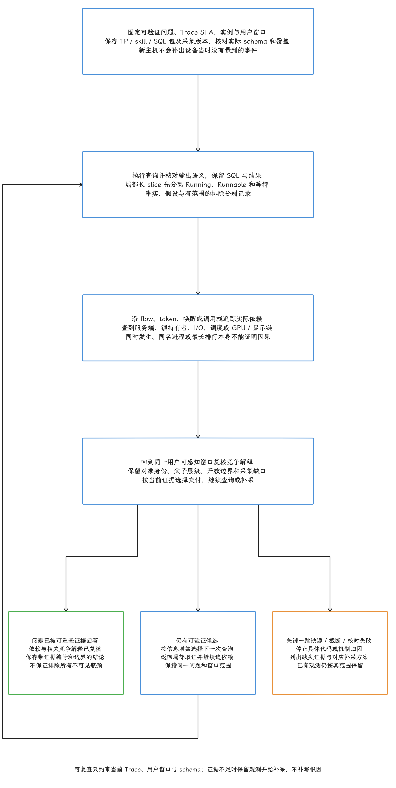
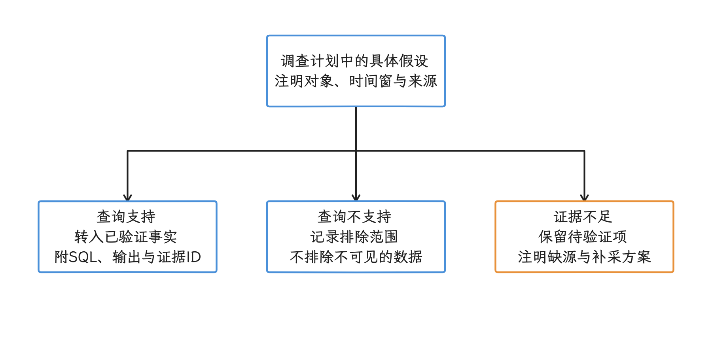
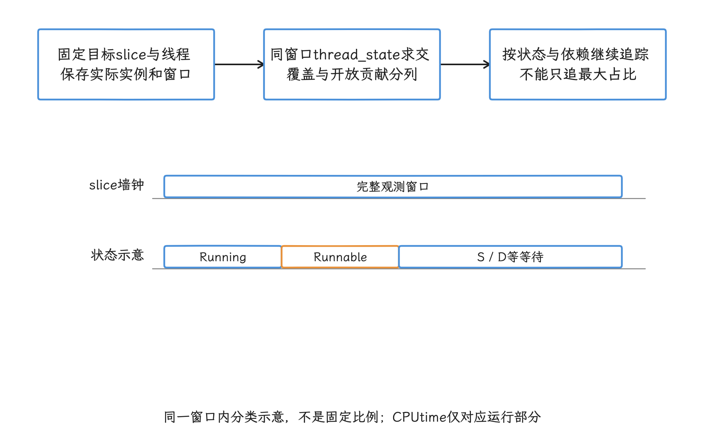

# Agent 辅助 Perfetto 分析协议

这里的 Agent 指能够读取 trace、调用 `trace_processor` 并执行 SQL 的工具型 AI。本文把“协议”用作一套可重复执行的调查流程和记录格式，与网络报文无关。它要达到的目标是可复查：人工查看 Perfetto UI 很快，但结论容易散落在截图、口头判断和临时 SQL 里，换一份 trace 或换一名分析者，就很难重放同一条推理路径。所以我们把流程固定下来：输入完整、SQL 经执行验证、证据与假设分开、报告注明版本和采集缺口。这些约束取自 `android/skills/profilers` 的固定提交和 Perfetto 官方 Agent skill 的主机侧能力边界（该 skill 由供 Agent 读取的说明文件、脚本与工具包装组成）。

<!-- gracker-diagram: ed14-11-investigation-dependencies-and-stop-loop -->


图：先固定可验证问题、Trace SHA、实例/窗口、TP/skill/SQL包等执行环境并检查schema与采集覆盖；实际SQL输出经语义检查后成为证据，局部长slice拆状态，沿flow/token/唤醒/栈等追依赖。回到同一用户可感知窗口比较竞争解释，保留原始身份、层级与缺口。当前可见证据已回答问题才带边界交付；仍有可验证候选继续查询；关键源缺失、截断或时钟不齐则停止具体归因并给补采方案。结论只约束当前Trace/窗口/schema，不承诺已找到所有不可见瓶颈，也不以最长项/最大状态/排行直接定根因。

在 14.1 节 Trace 抓取、14.7 节 Perfetto SQL 常用模板、14.10 节 BufferQueue 阻塞案例的基础上，这里聚焦 Agent 调查流程：怎样提问、怎样取证、怎样避免过早下结论。

> 源码基线：AOSP `android-17.0.0_r1`（Android 17 / API 37）；`platform/external/perfetto` 固定在提交 `ece66975738007dd0978b911d8a2077e49b8f31e`；涉及调度和内核等待时，内核用 `android17-6.18-2026-06_r6`；主机侧 SQL 在 Perfetto v57.2（提交 `da1d152cff27890903d158fe96751de3aab883cc`）的 Trace Processor 上验证，并覆盖 Android 17 标签中的标准库。

工具版本的历史也交代一句：Perfetto v57.0 引入了官方 Agent skill，v57.1 修复安装包遗漏内置 Trace Processor wrapper 的问题，v57.2 修复 Trace Processor 解析带内嵌 proto descriptor（trace 自带的 Protocol Buffers 字段定义）的部分 trace 时出现的兼容问题。

平台标签和工具版本是两条线。Android 17 标签指向的 Perfetto 目标提交时间为 2026 年 4 月 3 日，其中包含 v54.0 之后的提交，“Android 17 等于 Perfetto v54”这个简写并不成立。我们能升级的只是主机侧：新 Trace Processor 读取旧设备 trace 时，解析的仍然是 trace 已经采到的数据——表结构、标准库和分析能力可以更好，设备当时未记录的 FrameTimeline、ftrace、调用栈或厂商事件则要靠补采。


每次调查要分别记录这些版本：

| 层次 | 必须记录的内容 | 影响 |
|---|---|---|
| 设备平台 | 构建指纹、Android/API、ROM、内核版本 | 决定 trace 生产者实现与可用数据源 |
| 采集 | TraceConfig、atrace category、缓冲区、触发方式、截断情况 | 决定原始证据是否存在 |
| Trace Processor | `--version` 输出、二进制或包装脚本来源、校验值 | 决定 SQL 表结构、标准库和解析行为 |
| Perfetto UI | UI 版本或固定链接环境 | 决定界面插件和交互，不应改变保存 SQL 的字段语义 |
| Agent skill | 仓库、提交或发布版本、安装方式 | 决定 Agent 的调查步骤，不能替代 Trace Processor 版本 |
| SQL 包 | 标准库来源、额外 SQL 包、覆盖路径 | 决定模块实现，必须与查询结果一起保存 |

## 协议定位：Perfetto 教程之外的调查规范

先看这套协议从哪里来。`android/skills/profilers` 在 commit `4328beaf36f00265db107eb316f9add6b8764144` 下包含两个 skill 目录：`perfetto-sql` 负责把取数意图转换成可执行的 PerfettoSQL；`perfetto-trace-analysis` 面向开放式 trace 调查，要求 Agent 建立 scratchpad（调查过程中的工作记录）、读取 CPU / Graphics / I/O / IPC / Memory / Power 六类提示，并在结论前追踪依赖关系、检查全局时间窗。

另一套是 Perfetto 官方发布的 Agent skill，也就是导语里 v57.0 引入、v57.1 补齐 wrapper 的那个。它教 Agent 调用 `trace_processor`、编写 PerfettoSQL、录制 Android trace，并提供 Android 内存与 GPU 调查流程，安装包内含可工作的 Trace Processor 包装脚本。两套 skill 的目录结构和指令各不相同；我们从中提炼可复查原则，某个 skill 的内部文件名只当作当前版本的实现细节。

普通 Perfetto 教程讲概念、UI 操作和案例；这套协议约束的是 Agent 怎样调查、怎样留存结果。一次合格的 Agent 调查至少要留下四类材料：输入条件、查询语句、查询结果、排除过的方向。材料齐了，“主线程卡在 Binder”“GPU 阻塞”“I/O 竞争”这类结论才立得住；缺了它们，报告里剩下的只是口头判断。


对 Android 性能优化来说，这套流程主要用于三类场景：疑难 trace 复盘、批量定位 Benchmark 指标回退原因、分析真实用户设备采集的 trace 证据包。明确的小问题仍然可以直接用 UI 或 14.7 节的 SQL 模板处理；“这次启动为什么慢”“滑动为什么掉帧”“用户反馈点击后界面冻结”这类开放式问题更适合完整流程。

## 输入约束：分析前先把问题收窄

Agent 开始分析 trace 之前，我们先把问题收窄、把输入收齐。输入越含糊，后续查询越容易变成全量扫描；trace 越大，这个成本越高。

| 输入项（必填性） | 作用 | 缺失时的处理 |
|---|---|---|
| trace 文件路径或获准读取的句柄<br>（必填） | `trace_processor` 查询对象 | 无法分析 |
| 问题类型<br>（必填） | 选择启动、滑动、ANR（Application Not Responding）、I/O、内存、功耗或 GPU 分析方向 | 只能做快速概览 |
| 目标包名 / 进程名<br>（建议必填） | 限定 `process.upid`（trace 内的唯一进程 ID）与主线程 | 用 `android.startup.startups` 或进程列表查询候选 |
| Android 版本、设备、ROM<br>（必填） | 判断 FrameTimeline（帧预期/实际时间线）、Binder、DMA-BUF 共享缓冲、电源轨等轨道可用性 | 报告降低可信度 |
| 复现场景与时间窗<br>（建议必填） | 缩小 slice / counter 查询范围 | 先查全局最长 slice 和异常帧定位窗口 |
| 采集配置<br>（建议必填） | 判断缺哪些数据源 / atrace 类别 | 把缺失字段写入补采建议 |
| trace 散列值<br>（必填） | 用 SHA-256 等内容散列确认多人分析的是同一份输入 | 报告无法可靠复现 |
| skill / Trace Processor 版本<br>（必填） | 固定表结构、标准库和工具行为 | SQL 结果只能按未知工具版本解释 |
| 期望回答的问题<br>（必填） | 决定报告输出是定位、归因还是优化建议 | 先改写成可验证问题 |

可验证的问题要同时写明设备构建、目标包、复现场景、时间窗、已启用数据源和判断目标。以冷启动为例，问题应该拆成 App 主线程、系统服务、I/O 与渲染提交各自可查询的耗时；只写一句“为什么慢”，Agent 拿到的就是一个含糊目标，多半要退回全量扫描。

输入收齐后还要反向检查一遍采集质量：这份 trace 够不够回答手头的问题。想分离经过时间和 CPU 运行时间，就得先有 `sched` 调度事件；FrameTimeline 缺席时，异常帧分析只能退回到 `Choreographer#doFrame`、RenderThread 和 SurfaceFlinger 轨道；Binder 事件或 flow 关系缺了哪一样，跨进程等待都可能断在客户端。采集规划回到 14.1 节，真实用户设备的证据包回到 26.3 节。


trace 里往往带着进程名、线程名、URL、日志、文件路径和业务标记。共享报告时，我们保存散列值和权限受控存储中的文件标识；本机绝对路径、原始日志和未脱敏 SQL 结果留在内部环境。

## Scratchpad：事实和假设分开

调查过程要落在纸面上。固定提交中的 `perfetto-trace-analysis` 要求在 trace 同目录创建 scratchpad，文件名取 trace 文件名加 `_analysis.md` 后缀；团队流程还要服从权限和数据处理规则——trace 目录只读或由外部系统管理时，我们把 scratchpad 放入获准的工作目录，并记录 trace 散列值与权限受控存储中的文件标识。scratchpad 里只写已经验证的事实，“可能是”“看起来像”这类判断放到调查计划里去。

scratchpad 分成三张表：

| 表 | 必须记录的字段 | 约束 |
|---|---|---|
| 输入 | trace 散列值、平台构建、目标包、问题、复现条件、采集配置、Trace Processor、skill 与 SQL 包版本 | 任何字段未知都要显式写“未提供”，不能自行补全 |
| 已验证事实 | 证据编号、时间窗、`upid/utid`、slice/计数器/帧 token、完整 SQL、结果文件或结果摘要 | 每条记录都能由保存的命令重新执行 |
| 排除项 | 假设、执行过的查询、结果、排除范围 | 空结果只能排除“当前 trace 当前表结构下可见的证据”，不能写成机制绝对不存在 |

假设放在调查计划里，事实表保持干净：查询证实后转成已验证事实，证伪后转成排除项；证据不足时保留为待验证项，并注明缺少的数据源。

<!-- gracker-diagram: ch14-11-05-facts-hypotheses -->


图：假设经实际查询后转为事实或有范围的排除，证据不足保留待验证项。 工作记录放获准目录并绑定Trace散列；外部要求同目录不覆盖只读/正文目录约束。

## Perfetto SQL：先查表结构，再写查询

写查询之前先想清楚风险在哪：Perfetto SQL 即使语法正确，表、字段、模块版本或时间区间口径错了，同样可能给出误导性结果。所以 `perfetto-sql` 对 Agent 的约束是固定 Trace Processor 和 SQL 包，先检查当前表结构，再编写查询，并对真实输出做语义校验。


固定源码快照里的表分三类入口。`slice`、`thread_state`、`thread`、`process` 等基础表由 Trace Processor 预置；`android.startup.startups`、`slices.time_in_state` 等标准库模块要通过 `INCLUDE PERFETTO MODULE` 加载；旧版基于 trace 的 metric 由 metric 运行入口生成，不能因为加载了同名标准库模块，就认定 metric 表已经存在。

| 规则 | 操作要求 | 防止的问题 |
|---|---|---|
| 固定执行环境 | 保存 Trace Processor `--version` 输出、二进制散列值、标准库提交和完整命令；使用官方 skill 时也要记录其包装脚本与下载到的二进制 | 包装脚本或自动下载结果变化后无法重放 |
| 表结构检索 | 对实际二进制检查表和列，并对固定源码中的模块文件复核公开对象 | 根据记忆编造字段，或混用不同版本的表结构 |
| 标准库优先 | Android 17 可用 `android.startup.startups`、`android.frames.timeline`、`android.frames.per_frame_metrics`、`android.binder`、`slices.with_context`、`slices.time_in_state`、`slices.cpu_time`、`sched.with_context`、`linux.cpu.frequency`、`linux.cpu.utilization.process`；其中 `sched.with_context` 公开的是 `sched_with_thread_process` 这类调度 slice 上下文视图，不等同于 `thread_state` 的等待状态分布 | 手写复杂关联时漏掉上下文或边界 |
| CPU 频率口径 | `linux.cpu.frequency` 生成 `cpu_frequency_counters` 时间区间，`freq` 单位为 kHz；当前 v57.2 的公开 schema 用 `cpu_available_frequencies` 表示支持频点，Android17公开prelude也使用 `cpu_available_frequencies`；不能仅据表生成声明中的 `cpu_freq` 判定公开名称 | 把频点维度当成随时间变化的计数器，或把记录的 cpufreq 状态当成硬件瞬时有效频率 |
| `utid/upid` | 线程和进程 join 使用 trace 内唯一 ID | `tid/pid` 复用导致错配 |
| `dur = -1` | 对slice/线程状态可选择排除并报缺口，或显式截到trace_end作观测边界，并保留raw_dur/open标记 | 截尾估计被误当成完整完成时长；不能对所有counter区间机械套用 |
| overlap 过滤 | 时间窗查询使用区间相交条件 | 漏掉跨越窗口边界的长 slice |
| 名称匹配 | 已知全名用 `=`；需要通配时明确使用 `GLOB` 的 `*`、`?` 语义并检查转义 | 把 `LIKE` 中的 `_` 当成普通字符，或让宽泛模式混入同名事件 |
| 区间关联 | 优先使用 `slices.time_in_state` 等公开模块；直接使用 `SPAN_JOIN` 时，输入区间在每个分区内不能互相重叠，并且分区键要匹配 CPU、线程或进程语义 | 区间重复计算或跨对象错配 |
| 私有对象 | 不在项目模板里直接调用以下划线开头的表、视图或宏，例如标准库内部的 `_interval_intersect!` | 上游内部实现变化后模板失效 |
| 未闭合区间 | Android 17 的 `thread_slice_time_in_state` 只纳入 `dur > 0` 的 slice 和线程状态；需要分析 `dur = -1` 时，使用显式边界查询并标注采集结束边界 | 标准库静默排除未闭合记录后，仍把结果当成完整分布 |

下面的查询用最长有效线程 slice 提供可执行的探索目标，正式调查仍须换成已确认的 slice ID 或问题窗口。我们把开放 slice 和状态截到 `trace_end()`，保留原始 dur 和开放标记——这是已观测 Trace 边界内的估计，与事件完成时刻是两回事。查询报告状态覆盖、开放状态贡献，并保留无状态匹配行；“最长”和状态占比只是线索，归因要另找证据。

```sql
WITH candidate_slice AS (
  SELECT s.id, s.track_id, s.parent_id, s.depth, s.ts,
         s.dur AS raw_dur, s.dur = -1 AS slice_is_open,
         CASE WHEN s.dur = -1 THEN trace_end() - s.ts ELSE s.dur END AS dur,
         s.name AS slice_name, tt.utid, t.tid, t.name AS thread_name,
         t.upid, p.pid, p.name AS process_name
  FROM slice AS s JOIN thread_track AS tt ON tt.id = s.track_id
  JOIN thread AS t ON t.utid = tt.utid
  LEFT JOIN process AS p ON p.upid = t.upid
  WHERE s.dur > 0 OR (s.dur = -1 AND s.ts < trace_end())
), target_slice AS (
  SELECT * FROM candidate_slice ORDER BY dur DESC, id LIMIT 1
), state_spans AS (
  SELECT st.id AS state_id, st.utid, st.ts,
         CASE WHEN st.dur = -1 THEN trace_end() ELSE st.ts + st.dur END AS end_ts,
         st.dur = -1 AS state_is_open,
         st.state, st.io_wait, st.blocked_function
  FROM thread_state AS st
  WHERE st.dur > 0 OR (st.dur = -1 AND st.ts < trace_end())
), clipped AS (
  SELECT st.state_id, st.state, st.io_wait, st.blocked_function,
         st.state_is_open, MAX(t.ts, st.ts) AS ts,
         MIN(t.ts + t.dur, st.end_ts) AS end_ts
  FROM target_slice AS t JOIN state_spans AS st
    ON st.utid = t.utid AND st.ts < t.ts + t.dur AND t.ts < st.end_ts
), checked AS (
  SELECT *, MAX(end_ts) OVER (
    ORDER BY ts, state_id ROWS BETWEEN UNBOUNDED PRECEDING AND 1 PRECEDING
  ) AS previous_max_end FROM clipped
), coverage AS (
  SELECT t.*,
    (SELECT SUM(end_ts - ts) FROM clipped) AS covered_dur,
    (SELECT COUNT(*) FROM checked WHERE ts < previous_max_end) AS overlap_errors
  FROM target_slice AS t
), state_groups AS (
  SELECT state, io_wait, blocked_function, COUNT(*) AS segments,
         SUM(end_ts - ts) AS dur,
         SUM(CASE WHEN state_is_open THEN end_ts - ts ELSE 0 END) AS open_dur
  FROM clipped GROUP BY state, io_wait, blocked_function
)
SELECT c.id AS slice_id, c.track_id, c.parent_id, c.depth,
       c.slice_name, c.ts AS slice_ts, c.raw_dur, c.slice_is_open,
       c.dur / 1e6 AS observed_slice_ms,
       c.utid, c.tid, c.upid, c.pid, c.thread_name, c.process_name,
       c.overlap_errors,
       CASE WHEN c.overlap_errors = 0
            THEN ROUND(100.0 * c.covered_dur / c.dur, 2) END AS state_coverage_pct,
       CASE g.state WHEN 'R' THEN 'Runnable'
         WHEN 'R+' THEN 'Runnable (Preempted)'
         WHEN 'S' THEN 'Sleeping' WHEN 'D' THEN 'Uninterruptible Sleep'
         ELSE g.state END AS state_label,
       g.io_wait, g.blocked_function, g.segments,
       CASE WHEN c.overlap_errors = 0 THEN g.dur / 1e6 END AS state_dur_ms,
       CASE WHEN c.overlap_errors = 0 THEN g.open_dur / 1e6 END AS open_state_ms
FROM coverage AS c LEFT JOIN state_groups AS g ON TRUE
ORDER BY state_dur_ms DESC;
```

最长项只作为探索目标，用户问题或根因还要靠后续证据确认。`observed_slice_ms` 是闭合时长或截到 Trace 结束的观测范围，`open_state_ms` 单列来自开放状态的部分。无状态匹配时保留目标行与 NULL，把它读成 0ms 执行或 100% 睡眠都是误读。`overlap_errors>0` 时先排查合并/解析或输入模型，异常数值先挡在结论之外。覆盖率不足时报告缺口，并记录选用的截止策略。


## 六类问题方向：把开放问题改写成可执行动作

拿到“这次启动为什么慢”“滑动为什么掉帧”这类开放式问题时，我们从方向选择开始。`perfetto-trace-analysis` 把调查提示分成 CPU、Graphics、I/O、IPC（Inter-Process Communication，进程间通信）、Memory、Power 六类，下面按“触发条件 → 先查什么 → 再查什么 → 误判边界”组织，便于 Agent 执行。

表中的原名保留用于检索：IRQ 是 Interrupt Request（硬件中断请求），HWC 是 Hardware Composer（显示硬件合成抽象层），D-state 是不可中断睡眠。LMK 是 Low Memory Killer，`kswapd` 是内核内存回收线程，PSI 是 Pressure Stall Information（资源压力导致的停顿指标），RSS 是进程驻留内存。`dm-verity` 是块设备完整性校验层，DMA-BUF / `dma_heap` 用于跨设备共享并分配 buffer；UID 是系统分配的 Linux 用户 ID，常用于把数据关联到应用身份。

| 方向 | 触发与检查路径 | 常见误判 |
|---|---|---|
| CPU | 触发：主线程或 RenderThread 长耗时，`Running` / `Runnable` 占比高<br>先查：`thread_state`、`sched`、`slices.cpu_time`、`linux.cpu.frequency`<br>再查：查调度延迟、同 CPU 竞争、IRQ、cpufreq 状态、CPU 拓扑和采样栈 | 把 `Runnable` 当成 App 正在计算，或根据 cpufreq 状态推断瞬时硬件有效频率 |
| Graphics | 触发：掉帧、首帧慢、GPU 内存高、Surface 提交异常<br>先查：`android.frames.timeline`、`android.frames.per_frame_metrics`、RenderThread、可用的 GPU/图形内存轨道<br>再查：匹配 App 与 SurfaceFlinger frame token，再查 BufferQueue、fence、HWC 或 RenderEngine | 只看 App 帧，不查 SurfaceFlinger 与显示提交 |
| I/O | 触发：D-state、冷启动首轮慢、缺页事件密集<br>先查：`thread_state` 的 `D` 状态、可用的 `io_wait` / `blocked_function`、缺页与块设备事件<br>再查：查页缓存、dm-verity、块设备请求和相关内核线程 | 仅凭 D-state 就断定是存储设备慢 |
| IPC | 触发：客户端等待、Binder 调用密集、跨进程依赖明显<br>先查：`android.binder`、Binder slice、flow、服务端进程与耗时<br>再查：查服务端线程状态、慢方法和 Binder 请求洪峰 | 停在“客户端等 Binder”，不追服务端 |
| Memory | 触发：LMK、swap 上升、kswapd 活跃、图形内存异常<br>先查：已采集的内存计数器、LMK、PSI、dmabuf / dma_heap、堆图<br>再查：查进程 RSS、swap、GPU buffer、Bitmap 与持有路径 | 只看 Java heap，漏掉 native 或图形内存 |
| Power | 触发：屏灭耗电、无法 suspend、modem 或蓝牙电源轨高<br>先查：可用的电源轨、suspend、唤醒源、网络与厂商功耗轨道<br>再查：查唤醒源、UID 流量、蓝牙 / modem / thermal 事件 | 把缺失电源轨或归因字段解释成零功耗 |

这张表用来选择调查方向，提示文件中的字段名和因果句仍要逐项验证。“缺少或固定频率即 governor bug”这样的提示句只能当候选假设，频率缺口、限频、idle 和设备实现要分开确认。`PARTITIONED` 消除不了同分区输入的重叠；本书前节的 native 检查已证明符合条件的 VIEW 可作 SPAN 输入，提示文档里的 materialized 要求只是文档说法，接口层面以主机回归为准。嵌套 slice 直接 SUM 仍可能重复计数。我们按用户窗口与已验证事实选择六类方向，缺轨时写“证据不可见”，异常是否存在留待补采确认。


## Wall time 与 CPU time 必须分离

在 trace 里圈出一个长 slice 后，我们要先问：这段时间线程到底在干什么。`dur` 记录的是 wall time（经过时间），与 CPU time（CPU 运行时间）是两个量——里面可能是 CPU 执行，也可能是调度等待、Binder、锁、futex（用户态同步所用的内核等待机制）或 I/O 等待。所以 Agent 流程要求每个可疑长 slice 都查 `thread_state`，再按状态选择下一组证据。

判断顺序分五步：

1. 定位目标 slice 的 `ts`、`dur`、线程和进程。
2. 查同一时间窗内该线程与 `thread_state` 的区间相交。
3. 用 Trace Processor 的调度状态语义解释 `Running`、`R/R+`、`S`、`D` 等值，再计算各状态占比。
4. 结合状态占比、用户问题与依赖链选择后续方向；短暂但处在关键路径的状态也可能决定总延迟，最大占比之外的状态同样要照顾到。
5. 找到阻塞方后，回到全局视角检查同一用户可感知窗口中的竞争事件。

四个状态分别对应不同的后续方向：

- `Running`：线程正在 CPU 上执行，后续看子 slice、采样栈、cpufreq 状态和 CPU 拓扑。
- `Runnable`：线程可运行但尚未被调度，后续看同 CPU 竞争、IRQ、实时线程和 idle 情况。
- `Sleeping`：可能对应等事件、锁、Binder 回复或 futex。
- `Uninterruptible Sleep`：需要结合 `io_wait`、`blocked_function`、内核线程与 block 事件判断。

固定标签下的 `slices.time_in_state` 会输出 `io_wait` 和 `blocked_function`，但后两项依赖 `sched/sched_blocked_reason`；`blocked_function` 还受 userdebug 构建与符号可用性限制。

函数名出现在 slice 上，只说明线程处于该标记范围，CPU 当时是否在执行这个函数要靠其他证据。所以报告要分别给出经过时间、CPU 运行时间或调度状态分布，再用 Binder flow、锁事件、调用栈或内核证据定位等待方。

<!-- gracker-diagram: ch14-11-09-wall-versus-cpu -->


图：slice名称只表明标记范围，先分离Running、Runnable和阻塞，再查依赖。 最大状态占比不必决定关键路径；S/D不唯一对应某个锁、Binder或存储原因。

## 从局部异常到全局复核

复杂 trace 里常常同时存在好几种异常：App 主线程等待、系统服务慢 Binder、SurfaceFlinger 合成异常、后台 I/O。我们抓到其中一个，也只是证明了它存在；要归因，还要证明它与用户可感知窗口重合，并沿依赖关系找到决定总耗时的关键路径（critical path）。


全局复核至少包括四步：

- **长 slice 复核**：在目标时间窗内排序线程 slice，同时保留 `depth` 与 `parent_id`，避免把父子 slice 当成互相独立的耗时。
- **D-state 复核**：统计目标窗口内最长不可中断等待，判断 I/O 或内核等待是否被漏掉。
- **FrameTimeline / Binder 复核**：对 jank、启动、点击无响应类问题，分别确认异常帧和慢 Binder 是否与用户可感知窗口重合。
- **计数器复核**：查看可用的 cpufreq、内存、电源轨、dmabuf 等计数器是否在同一窗口发生变化，并核对单位与采样间隔。

下面仍以最长有效线程 slice 构造探索窗口，正式调查时替换 target_window。查询保留完整观测时长、窗口交集、原始 dur/open 标记、track 与 upid/utid，并明确区分嵌套层级。读结果时记住两点：开放 slice 截到 trace_end 仍只是观测边界估计；查询只列出带 thread_track 的线程 slice，内核或 GPU 工作的覆盖情况要另行确认。

```sql
WITH effective_slice AS (
  SELECT s.id, s.track_id, s.parent_id, s.depth, tt.utid, t.upid,
         p.name AS process_name, t.name AS thread_name, s.name AS slice_name,
         s.ts, s.dur AS raw_dur, s.dur = -1 AS slice_is_open,
         CASE WHEN s.dur = -1 THEN trace_end() - s.ts ELSE s.dur END AS dur
  FROM slice AS s JOIN thread_track AS tt ON tt.id = s.track_id
  JOIN thread AS t ON t.utid = tt.utid
  LEFT JOIN process AS p ON p.upid = t.upid
  WHERE s.dur > 0 OR (s.dur = -1 AND s.ts < trace_end())
), target_window AS (
  SELECT id AS window_source_id, slice_is_open AS window_source_is_open,
         ts AS start_ts, ts + dur AS end_ts
  FROM effective_slice ORDER BY dur DESC, id LIMIT 1
), candidate AS (
  SELECT e.*, w.window_source_id, w.window_source_is_open, w.start_ts, w.end_ts,
         MIN(e.ts + e.dur, w.end_ts) - MAX(e.ts, w.start_ts) AS overlap_dur
  FROM effective_slice AS e CROSS JOIN target_window AS w
  WHERE e.ts < w.end_ts AND w.start_ts < e.ts + e.dur
)
SELECT id, track_id, parent_id, depth, utid, upid,
       process_name, thread_name, slice_name, ts, raw_dur, slice_is_open,
       window_source_id, window_source_is_open, start_ts, end_ts,
       dur / 1e6 AS observed_slice_ms, overlap_dur / 1e6 AS overlap_ms
FROM candidate ORDER BY overlap_dur DESC, depth, id;
```

`observed_slice_ms` 是完整闭合时长或截尾观测范围，`overlap_ms` 是落入窗口的部分，窗口来源也保留 open 标记。排行按相交时长排序；同一线程上嵌套的父子项可能覆盖同一段时间，直接相加就会重复计时。结果里出现 `system_server`、SurfaceFlinger 或其他进程的长 slice 时，我们还要用 flow、调度或帧 token 证明关联，进程名本身说明不了依赖。内核线程未必都有 `thread_track` slice，D-state 与调度复核还需要独立查询 `thread_state`、`sched` 和 ftrace 事件。


调查可以在下列条件全部满足后停止：

- 用户提出的问题已经被改写为可验证命题，并由一组带时间关系、可重新查询的证据回答。
- 候选阻塞关系已经追到服务端、锁持有者、I/O、调度、GPU / 显示提交，或明确记录 trace 在哪一跳缺少数据。
- 与问题相关的竞争假设已经执行查询；无法验证的假设留在待验证项，结论只收已经验证的。
- 全局复核没有发现更能解释同一用户可感知窗口的可见证据。这个判断只约束当前 trace 和当前表结构。
- 每条结论都能回到保存的 SQL、结果和版本信息；查询为空时，报告说明空结果能排除的范围。

缺少关键数据源、trace 被截断、不同时间戳来源无法对齐，或依赖关系追到客户端后失去服务端数据时，我们停止归因，转而输出补采方案——继续生成看似完整的根因，就越过证据边界了。


## 输出模板：证据表、阻塞方、边界与补采建议

调查收尾时，Agent 交出的是一份可重放的工程调查记录。结构可以固定，条目数量由证据决定：

| 段落 | 内容 | 要求 |
|---|---|---|
| 输入与版本 | trace 受控标识与散列值、设备构建、内核、采集配置、Trace Processor、skill、SQL 包 | 不复制未经脱敏的本机路径或业务数据 |
| 问题窗口 | 场景、目标进程、起止时间、窗口来源 | 时间戳保留 trace 原始单位，并可附换算值 |
| 结论 | 当前 trace 能支持的判断 | 每条都引用证据编号，不规定人为条数 |
| 证据表 | SQL 编号、对象、查询文件、结果、解释 | 每条证据能在 scratchpad 中找到对应记录 |
| 依赖关系 | 主体、等待状态、下一个依赖对象、服务端或持有者 | 用 flow、token、状态重叠或调用栈连接各对象 |
| 排除项 | 已查但不解释本问题的方向 | 说明排除依据 |
| 可信度 | 证据支持程度与缺失字段 | 不用单一等级掩盖各结论差异 |
| 补采建议 | 缺失数据源、atrace 类别、采样栈、缓冲区或复现场景 | 给出缺失证据与配置字段的对应关系 |
| 优化与验证 | 可修改位置、预期改变的 trace 证据、回归方法 | 机制解释、改动建议和已验证效果分开写 |

报告中的结论按“观测 → 依赖 → 归因边界”的顺序展开：先记录目标 slice 与状态分布，再写等待关系如何连接到服务端，随后说明调用栈或符号是否足以定位代码。按这个顺序写，一张 UI 截图替代不了查询，补采计划也会与已证实的根因分开摆放。


## Trace 采集规划器

采集规划是协议的前置步骤。用户给出问题类型与复现条件后，Agent 要输出可审阅的 `TraceConfig`（数据源和缓冲区等采集参数）、atrace 类别、触发方式、缓冲区规划、采集窗口、预计开销和敏感数据风险。缓冲区大小与采集时长取决于问题持续时间、事件速率、可接受开销以及是否允许触发采集，跨设备通用的常量并不存在；参数定好后先做短时试采，检查丢包、缓冲区覆盖与 trace 截断。


| 问题类型 | 必要数据 | 建议补充 | 缺失风险 |
|---|---|---|---|
| 冷启动 / 热启动 | `sched`、cpufreq、`am`、`wm`、`view`、Binder、App trace marker | 调用栈采样、缺页与块设备事件 | 只能看到阶段耗时，难定位计算或等待方 |
| 滑动 / 掉帧 | Android 12 及以上优先 FrameTimeline；旧版本回退到 `Choreographer#doFrame`、RenderThread、SurfaceFlinger、`gfx`、`view` | GPU 计数器、BufferQueue、fence、dmabuf | 难区分 UI、RenderThread、GPU、SurfaceFlinger 与 HWC |
| ANR（Application Not Responding）/ 点击无响应 | `sched`、Binder、input、锁等待、App marker | Java / native 栈、system_server 与目标服务事件 | 依赖关系可能断在客户端 |
| I/O 卡顿 | `sched`、`sched_blocked_reason`、块设备与缺页事件 | 内核线程、dm-verity、文件映射 | D-state 无法继续归因，`blocked_function` 可能为空 |
| 内存 / OOM（Out of Memory） | 内存计数器、LMK、PSI、dmabuf / dma_heap | heapprofd、Java 堆图 | 只能看到结果，看不到分配与持有路径 |
| 功耗 | 电源轨、suspend、唤醒源、网络包 | 蓝牙 / modem / thermal 厂商轨道 | 只能得到设备总量，难归到 UID 或模块 |

采集配置还要过一遍权限与隐私复核：调用栈、日志、App marker、网络信息和文件名可能带出业务数据，线上采集按最小数据原则选择生产者、采样频率与保留范围。规划器减少的是缺字段返工；设备限制、用户授权和性能开销评估，该走的流程照样要走。

## Android 版本与厂商轨道差异

写 Perfetto SQL 模板时，我们要按“trace 来自各种设备”来设计：Pixel 与完整的 userdebug 构建只是其中一类。Android 10 到 Android 17 之间，FrameTimeline、内存分配器轨道、电源轨、`sched_blocked_reason` 和厂商 thermal / display 数据的可见性不同；厂商 ROM 还可能关闭生产者、改用自定义轨道，或因权限与构建类型省略符号。

实际调查时建议把兼容性分成三层：

- **基础表结构层**：`slice`、`sched`、`thread_state`、`counter`、`thread`、`process` 等表由 Trace Processor 暴露；表在不在是一回事，trace 里有没有对应数据要看这次采集。
- **Android 标准库层**：`android.startup.startups`、`android.frames.timeline`、`slices.time_in_state` 等模块还受采集字段限制。FrameTimeline 从 Android 12 开始可用；Android 10/11 需要回退到 UI、RenderThread、SurfaceFlinger slice 和业务 marker。
- **厂商扩展层**：显示、thermal、功耗、调度器等自定义轨道要按设备、ROM、构建和采集配置建立词典；要写成平台通用机制，就超出了证据范围。


涉及调度和内核等待时，Android 17 kernel common 锚点是 `android17-6.18-2026-06_r6`。设备仍可能使用厂商分支与不同配置，报告要同时记录运行设备的内核版本。`io_wait` 需要采到 `sched/sched_blocked_reason`，`blocked_function` 还依赖 userdebug 与符号；电源轨、GPU 计数器和厂商显示轨道也都属于可选证据。可信度应按结论逐项绑定这些条件。

## SQL 模板测试集

Perfetto SQL 模板进入团队工作流后要像代码一样测试。字段变化、标准库模块变化、空结果、`dur = -1`、跨窗口 slice、区间分区错误，都会让 Agent 生成错误结论。

一个可维护的测试集至少包含四类用例：

- **语法冒烟测试（最小执行检查）**：每条模板在固定 Trace Processor 与 Android 17 标准库组合下可以解析和执行。
- **表结构测试**：模板使用的表、视图、列与公开模块能在固定版本查到。
- **边界测试**：覆盖空结果、未闭合 slice、跨窗口相交、缺少 `sched`、缺少 FrameTimeline 等情况。
- **语义测试**：使用可审计的合成 trace 或固定 golden trace（作为预期基准的参考 trace）验证输出，例如状态区间要落在目标窗口内、父子 slice 要按嵌套关系处理，避免被误加为独立耗时。

空 trace 只能证明 SQL 在零行输入下可解析，关联、单位和归因正确与否要靠语义用例回答。Perfetto 的差分测试会把输入 trace、查询或 metric 的输出与固定预期结果比较；项目模板至少要为启动、帧、Binder、I/O 与功耗查询保留代表性 trace、预期输出、Trace Processor 版本和标准库提交。本轮示例仅在 native Trace Processor57.2/58.2 导入受控合成输入，并复用输入/依赖 SHA 未变的前节通过记录；固定 17 顶层模块与主机依赖分别注明。Android 设备录制、Framework/内核构建和性能因果实验均未执行。


## 源码与 trace 关联

Perfetto 提供事件、状态和时间关系，优化动作通常还要回到源码。Agent 报告定位到 slice、Binder 方法或 native 符号后，我们要接着建立到 AOSP 或业务代码的映射。

常见映射路径有四种：

- **slice 名称 → App trace marker**：回到产生 marker 的业务代码，确认标记范围；Java 可从 `Trace.beginSection()` 等调用点查起，native marker 则查对应 ATrace API。
- **Binder 方法 → Framework 服务**：从接口描述符（Binder 接口名）、transaction、服务名与服务端进程映射到固定标签的 AOSP 实现，再结合服务端线程状态判断阻塞点。
- **native 符号 → AOSP / vendor 模块**：用符号、build ID（二进制构建标识）、进程与调用栈定位同一次构建的二进制；缺少匹配符号时标注 vendor 闭源边界。
- **FrameTimeline / SurfaceFlinger → 图形栈章节**：队列、fence、BufferQueue、HWC 等机制回到 2.8 与 14.10；报告里点到引用即可，原理展开交给对应章节。

源码关联同样要固定版本边界：平台代码使用 `android-17.0.0_r1`，内核使用 `android17-6.18-2026-06_r6`，业务与厂商代码记录仓库提交和构建 ID。两边的分工是——trace 证据证明某个窗口里的对象、状态和依赖，源码解释这条构建路径怎样产生对应事件。缺少调用栈、符号、transaction 对应关系或业务 marker 时，trace 现象就写到现象为止，具体代码根因等证据补齐再下笔。


## 官方资料与固定版本

- [`android/skills` Perfetto profilers，commit 4328beaf](https://github.com/android/skills/tree/4328beaf36f00265db107eb316f9add6b8764144/profilers)
- [Perfetto v57.1 release notes](https://github.com/google/perfetto/releases/tag/v57.1)
- [Perfetto v57.2 release notes](https://github.com/google/perfetto/releases/tag/v57.2)
- [Using AI with Perfetto](https://perfetto.dev/docs/getting-started/using-ai)
- [Android 17 固定标签的 Perfetto SQL 标准库](https://android.googlesource.com/platform/external/perfetto/+/refs/tags/android-17.0.0_r1/src/trace_processor/perfetto_sql/stdlib/)
- [android.startup.startups](https://android.googlesource.com/platform/external/perfetto/+/refs/tags/android-17.0.0_r1/src/trace_processor/perfetto_sql/stdlib/android/startup/startups.sql)、[android.frames.timeline](https://android.googlesource.com/platform/external/perfetto/+/refs/tags/android-17.0.0_r1/src/trace_processor/perfetto_sql/stdlib/android/frames/timeline.sql)、[android.frames.per_frame_metrics](https://android.googlesource.com/platform/external/perfetto/+/refs/tags/android-17.0.0_r1/src/trace_processor/perfetto_sql/stdlib/android/frames/per_frame_metrics.sql)
- [android.binder](https://android.googlesource.com/platform/external/perfetto/+/refs/tags/android-17.0.0_r1/src/trace_processor/perfetto_sql/stdlib/android/binder.sql)、[slices.with_context](https://android.googlesource.com/platform/external/perfetto/+/refs/tags/android-17.0.0_r1/src/trace_processor/perfetto_sql/stdlib/slices/with_context.sql)、[slices.time_in_state](https://android.googlesource.com/platform/external/perfetto/+/refs/tags/android-17.0.0_r1/src/trace_processor/perfetto_sql/stdlib/slices/time_in_state.sql)、[slices.cpu_time](https://android.googlesource.com/platform/external/perfetto/+/refs/tags/android-17.0.0_r1/src/trace_processor/perfetto_sql/stdlib/slices/cpu_time.sql)
- [sched.with_context](https://android.googlesource.com/platform/external/perfetto/+/refs/tags/android-17.0.0_r1/src/trace_processor/perfetto_sql/stdlib/sched/with_context.sql)、[linux.cpu.frequency](https://android.googlesource.com/platform/external/perfetto/+/refs/tags/android-17.0.0_r1/src/trace_processor/perfetto_sql/stdlib/linux/cpu/frequency.sql)、[linux.cpu.utilization.process](https://android.googlesource.com/platform/external/perfetto/+/refs/tags/android-17.0.0_r1/src/trace_processor/perfetto_sql/stdlib/linux/cpu/utilization/process.sql)
- [Android 17 kernel common 固定标签](https://android.googlesource.com/kernel/common/+/refs/tags/android17-6.18-2026-06_r6/)
- [Trace Processor](https://perfetto.dev/docs/analysis/trace-processor)
- [PerfettoSQL standard library](https://perfetto.dev/docs/analysis/stdlib-docs)
- [SQL tables](https://perfetto.dev/docs/analysis/sql-tables)
- [Trace Processor diff tests](https://perfetto.dev/docs/contributing/testing)

## 小结

Agent 辅助 Perfetto 分析的最低要求是可复查：输入完整，scratchpad 区分事实与假设，SQL 固定执行环境并检查表结构，长 slice 分离经过时间与 CPU 运行时间，候选瓶颈经过依赖追踪和全局复核。报告写清采集缺口、版本边界与停止条件，另一名工程师就能在同一份 trace 上重放我们走过的推理路径。
