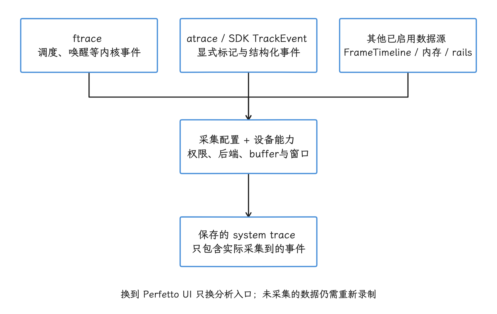
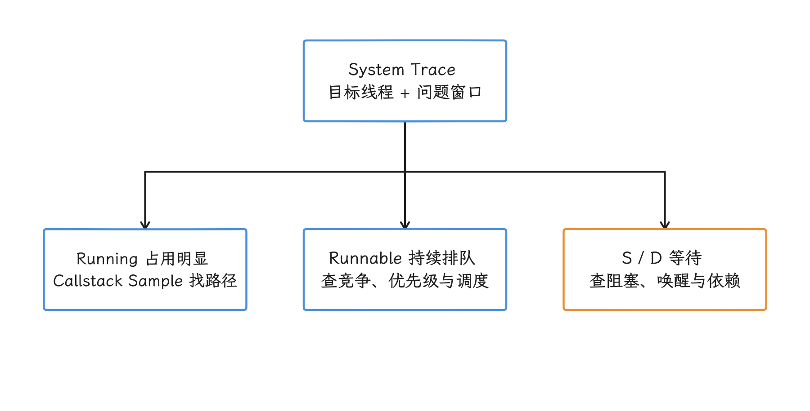
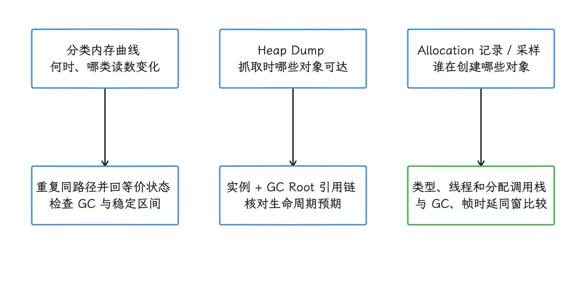
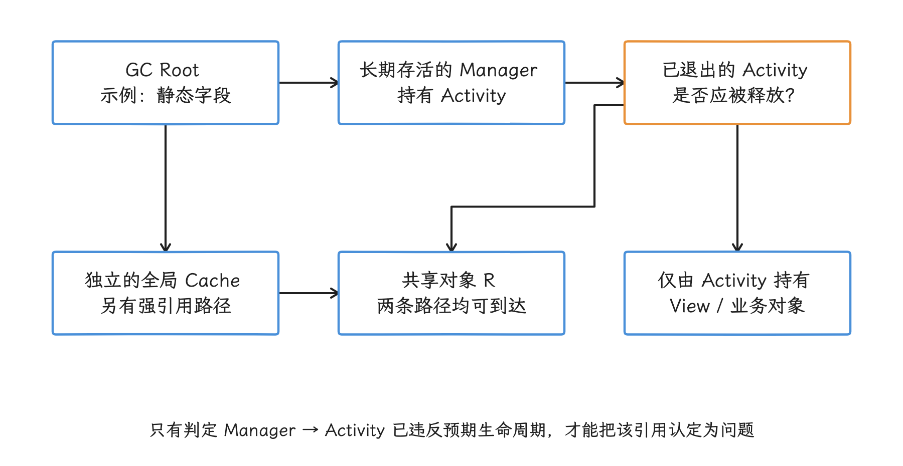
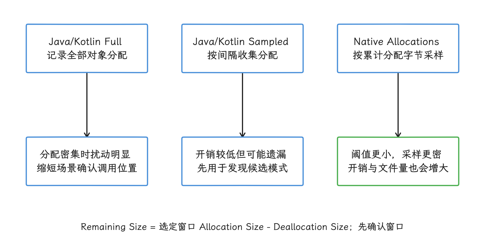

# Android Studio Profiler（性能分析器）

Android Studio Profiler 适合从应用视角快速关联 CPU、内存、网络和能耗信号，只是不同采集模式的开销和时间精度差别很大。我们用之前先按问题选对任务入口，也想清楚什么时候该转向系统级的 Perfetto。

## Profiler 解决什么问题

滑动卡顿、启动慢、内存增长、耗电异常，这些都只是现象。诊断要回答的是更具体的问题：线程当时在执行还是在等待，CPU 时间集中在哪条调用路径，对象为什么仍被引用，功耗峰值与哪段设备活动同时发生。Android Studio Profiler 把这些采集任务放进 IDE，并在同一界面提供时间轴、调用栈和源码跳转。本文说的 trace，指按时间顺序记录的一组性能事件。

> 源码基线：AOSP `android-17.0.0_r1`；平台 Android 17 / API 37；任务名称与入口核对至 2026 年 10 月 25 日。

IDE 与系统平台各自演进：升级 Android Studio 后，旧 trace 里已经采到的数据不变；升级设备系统后，IDE 未必立即支持新增的数据源。文中保留 Tasks 面板里的英文任务名，方便直接在 IDE 中搜索。

Profiler 的采集任务由几套不同的机制支撑，各自回答的问题不同，读数也要分开解读：

- System Trace 读取平台 tracing 数据；
- Callstack Sample 记录 Java/Kotlin、JNI（Java Native Interface）、虚拟机和内核栈帧，原生代码采样由 Simpleperf 支持；
- Record Java/Kotlin Methods 依赖运行时插桩，在方法进入和退出位置写入时间戳；
- 内存任务使用堆转储、分配事件或原生内存分配采样。

Profiler 的 IDE 视图围绕所选 App 展开，System Trace 本身仍可包含系统调度、CPU 核心、部分系统进程、渲染和 power rail 数据。power rail 指给某类硬件供电的电源轨，设备可按轨报告功耗。

需要跨进程浏览、用 Trace Processor 执行 SQL 查询、关联多条时间线或检查自定义数据源时，我们就把支持导出的 system trace 交给 Perfetto UI。Trace Processor 是把 trace 数据映射成表并提供 SQL 查询的分析引擎。两套界面可以读取同一份记录，展示范围和查询能力有所差异。

## 当前界面与任务入口

从 `View > Tool Windows > Profiler` 打开面板，在 Home 页选择进程，再从 Tasks 区域启动任务。录制既可以覆盖进程启动，也可以附加到已经运行的进程。任务结束后，记录会保留在当前 Android Studio 会话的 Past Recordings 中；需要跨会话保存时就显式导出，部分记录类型没有导出能力。

常用入口与问题类型如下：

| 入口 | 适合回答的问题 | 主要限制 |
|---|---|---|
| System Trace | 调度、线程状态、帧渲染、系统竞争、设备功耗活动 | 方法内部只呈现已有 tracepoint（显式写入的事件点），不能自动展开每次方法调用 |
| Find CPU Hotspots（Callstack Sample） | 哪些调用路径持续消耗 CPU | 统计采样可能遗漏短调用，百分比不等同于单次调用耗时 |
| Record Java/Kotlin Methods | 某次执行出现了哪些方法调用及其层级 | 运行时插桩会改变被测程序的时序 |
| Track Memory Consumption | 哪些调用栈产生 Java/Kotlin 或 Native 分配 | Full（全量）记录和较小的 Native sample size（采样阈值）会提高采集开销 |
| Analyze Memory Usage（Heap Dump） | 哪些 Java 对象存活、由哪条 GC Root（垃圾回收根）链持有 | 需要 debuggable App，抓取过程会扰动被测进程 |
| Power Profiler / System Trace Power Rails | 某段设备活动与哪些 power rail 同时升高 | ODPM（设备端电源轨监控器）是设备级数据，不能直接归因给当前 App |

网络请求已经移到 `App Inspection > Network Inspector`，不再与 CPU、Memory 共用 Profiler 的旧式总时间轴。当前官方文档列出的网络库是 `HttpsURLConnection` 和 `OkHttp`，使用 Retrofit 且底层为 OkHttp 时也能看到相应请求。它适合检查请求、响应和调用位置；通用 TLS（Transport Layer Security，传输层安全协议） 流量解密、任意协议解析和系统范围抓包，仍需专门的网络工具。

## CPU Profiler：三种分析模式的深度对比

排查 CPU 问题时，我们至少要区分三类信息：线程何时拿到 CPU、哪些调用路径反复出现在样本里、一次调用依次经过了哪些子方法。System Trace、Callstack Sample 和 Record Java/Kotlin Methods 分别覆盖这三类问题，它们的时间含义不同。

### System Trace（系统追踪）

Android 10（API 29）及以上的系统追踪文件采用 Perfetto 格式，更早的设备使用旧版 Systrace 格式。Perfetto 可接收多种数据源：内核调度等事件来自 ftrace（Linux 内核跟踪机制）；Framework 和 App 的标记可经 atrace（Android trace 标记通道）或 Perfetto SDK TrackEvent 写入。

TrackEvent 这一路要额外准备：目标进程接入 SDK、选择合适后端，并在采集配置中启用对应数据源。只在 IDE 中启动 System Trace 时，这些条件未必已经满足，事件有没有采到，要按接入条件确认。设备支持时，记录还可包含 FrameTimeline、进程内存和 power rail 数据。

FrameTimeline 提供 App 与 SurfaceFlinger 帧的预测、实际区间和分类，按 token 等标识关联；每个 GPU 内部阶段它独自补齐不了，从输入到面板发光的完整测量也要另外的手段。所以把 System Trace 概括成“只通过 atrace 抓点”，会漏掉大量调度方面的信息。

<!-- gracker-diagram: ch15-01-02-system-source-coverage -->

图：内核、应用标记与平台数据源共同形成 system trace。 TrackEvent 需要 SDK/后端和数据源配置；FrameTimeline 不能替代完整输入到光学测量。

System Trace 通常比全量方法插桩轻，开销却随配置浮动：启用的数据源、事件频率、缓冲区大小、自定义标记密度和设备实现共同决定成本，跨设备和配置通用的“每个事件固定耗时”并不存在。在高频循环里写入成千上万个 tracepoint，同样可能扰动调度和缓存。我们可以在相同设备、相同构建和相同操作脚本下分别运行未录制基线与录制版本，检查指标是否出现一致偏移。

它擅长回答线程状态和系统上下文。Running 表示线程正在 CPU 上执行；Runnable 表示已经具备运行条件，只是还在排队等 CPU；Sleeping（S）表示可中断睡眠，常见于等待条件、锁或事件；Uninterruptible Sleep（D）表示不可中断睡眠。状态描述的是线程当下的处境，线程是否“主动”让出 CPU、D 状态具体在等什么，要靠阻塞调用栈、唤醒与依赖事件确认，磁盘 I/O 之类的判断也一样。

状态之外，我们还可以检查任务运行在哪个 CPU 核、是否被更高优先级线程抢占，以及一帧在 App、RenderThread、GPU 和 SurfaceFlinger 各阶段花了多久。普通 Java/Kotlin 方法在这里展开的前提是埋了 tracepoint；还没埋的方法，要结合调用栈采样，或只为待查代码添加少量自定义标记。

Android 10 及以上设备的 System Trace 使用 Perfetto 格式，导出的记录可在 [Perfetto UI](https://ui.perfetto.dev/) 打开；Android Studio 也能导入它支持的既有记录。导出和导入改变的只是分析入口：采集时未启用的数据源，事后补不回来，缺事件时要修改配置后重新录制。

平台 tracing 的实现在 `android-17.0.0_r1` 的 `external/perfetto`，App 侧同步 trace 标记的入口见 `frameworks/base/core/java/android/os/Trace.java`。前者提供采集基础设施与数据源，后者是 App 和 Framework 写入同步区间标记的一条入口。

### Java Method Trace（方法追踪）

Java/Kotlin 方法记录通过运行时插桩，在每次方法进入和退出时写入时间戳。它能呈现录制窗口内的调用事件及其层级，适合回答“这次调用依次进入了哪些方法”“递归或重复调用发生了多少次”。

插桩逻辑会增加每次方法调用的工作量，并可能改变线程调度、缓存行为和运行时优化状态。方法越短、调用越密集，扰动占原始工作量的比例越高。Android 官方文档明确提示 trace 中的时间读数会偏离生产环境，并建议把录制控制在 5 秒以内。

因此，方法记录显示的绝对耗时——某次调用在时间轴上的具体毫秒数——只适合在同一录制条件下辅助排序。要判断优化有没有缩短用户可见时延，应回到无插桩的基准测试或低扰动 System Trace。社区案例给出的固定放大倍数依赖设备、代码形态和录制配置，它只对各自的案例成立，我们把它当参考就好。

录制前先把操作缩成一个可复现片段，并限制录制窗口。Android 7.1 及以下设备的采集量受配置中的 File size limit 约束；Android 8.0（API 26）及以上会忽略该上限，录制时长就更要克制：短采样间隔或密集方法调用会快速生成大文件，随后显著增加传输和解析时间。

### Callstack Sample（调用栈采样）

调用栈采样要求设备至少为 Android 8.0（API 26）。它周期性截取线程当时的调用栈，再按调用路径聚合：一个调用路径在样本中占比高，表示它在所选线程、时间窗与过滤范围内经常被命中。读数时我们分清两件事：一是 Self（仅自身）与 Total（包含子调用）的统计口径，父子 Total 直接相加会重复计算；二是样本分布回答的是命中频率，某方法的调用次数、单次墙上耗时、整个 App 的 CPU 使用率，要分别用对应的读数回答。采样给出的是统计画面；完整的调用事件流，要看 Record Java/Kotlin Methods 那一类记录。

采样省去了每个方法入口和出口的插桩，开销通常低于方法记录。短于采样间隔的调用可能完全缺席；大量短调用若累计占用 CPU，仍可能通过调用方或偶尔命中的栈表现出来，这类结果受采样时机影响，称为 sampling bias（采样偏差）。采样间隔越短，样本越密，文件增长和采集开销也越高。

Callstack Sample 适合找 CPU 热点。若主线程大部分时间在等 Binder（Android 进程间通信机制）、锁或 I/O（输入输出），CPU 样本较少说明不了路径快慢，等待时间的解释要看 System Trace 的线程状态和唤醒链。分析 Java/Kotlin 程序时，栈中还会出现 JNI、ART（Android Runtime）、`/apex/`、`/system/` 和 `[kernel.kallsyms]` 帧，隐藏这些帧只改变展示，采集结果不变。

Android Studio 对 App 的原生代码采样使用 Simpleperf，可以把它看作 App 原生栈采样的后端；Java/Kotlin 栈帧则只有部分经由这条原生代码路径生成。

### 三种模式怎么选

一个稳妥的选择顺序如下：

<!-- gracker-diagram: ch15-01-05-cpu-decision -->

图：先用 System Trace 固定线程和时间窗，再按执行、排队或等待补齐证据。 S/D 不能独自说明等待对象；只有调用顺序仍不清时，再短录方法插桩并复核时长。

1. 用 System Trace 判断问题属于执行、等待、调度、渲染还是系统竞争，并圈定线程和时间窗。
2. 时间主要消耗在 Running 状态且缺少方法级标记时，用 Callstack Sample 找高占比调用路径。
3. 只有调用顺序仍不清楚时，缩短场景后录制 Java/Kotlin Methods；耗时结论再由低扰动 trace 或基准测试复核。

| 模式 | 采集机制 | 结果含义 | 主要风险 |
|---|---|---|---|
| System Trace | Perfetto/Systrace 格式及平台数据源 | 带时间戳的系统事件、线程状态和 trace slice（带起止时间的区间事件） | 未启用或未埋点的数据不会出现；高频数据源也会有成本 |
| Callstack Sample | 周期性栈采样；Native 代码由 Simpleperf 支持 | 样本分布和调用路径 | 短调用遗漏、采样偏差、等待时间解释不足 |
| Java/Kotlin Methods | ART 运行时插桩 | 方法进入/退出事件与调用层级 | 时序扰动、文件快速增长 |

## Memory Profiler：从实时曲线到堆快照

Memory Profiler 把 Java、Native、Graphics、Stack、Code 和余下未细分的内存放在同一条时间轴上，任务侧提供 Java/Kotlin allocation、heap dump 与 Native allocation 等。我们先要弄清顶部分类统计的来源：它统计系统报告的 App 私有已提交内存页，与系统或其他 App 共享的页面不计在内，因此和完整的 RSS 或 PSS 对不上。RSS（Resident Set Size）统计进程当前驻留的物理页，PSS（Proportional Set Size）按比例分摊共享页。

Graphics 一类装的是图形缓冲区队列、GL surface、GL texture 等 CPU/GPU 共享内存，并不是独立的 GPU 显存。来源弄清之后，曲线用来发现异常时段，引用链和分配调用栈用来解释原因。

<!-- gracker-diagram: ch15-01-06-memory-evidence-types -->

图：先区分分类内存曲线、托管堆快照与分配事件，再选择解释路径。 顶部分类口径不等于 RSS/PSS；Graphics 包括共享图形内存，不能直接视为独立 GPU 显存。

### 实时内存曲线

一次跳升表示该时间段内进程持有的内存增加，下降常与 GC（Garbage Collection，垃圾回收）、对象释放或分配器行为有关。曲线持续抬高值得追，但形状本身定不了性：缓存扩容、延迟 GC、原生分配器保留空闲页、Bitmap 或图形缓冲区的生命周期，以及测试路径未回到同一状态，都可能产生相似曲线。

排查时我们固定设备和构建，重复同一段用户路径，并在每轮回到等价界面状态，关注对象数、分类内存、GC 事件和多轮操作后的稳定区间。若 Java 对象数或某类实例在多轮 GC 后仍单调增长，再抓 heap dump 检查引用链。进程 RSS 没有立即下降时，先想想堆内的空闲空间：它可能被保留给后续分配，RSS 读数和 Java 对象的存活性是两回事。

Java/Kotlin allocation 任务默认使用 Full，记录全部分配；也可以切换为 Sampled，按固定间隔抽样。Android 7.1 及以下最多保存最近 65,535 条分配记录；Android 8.0 及以上取消了这项上限——这是平台行为，LeakCanary 的专用任务属于 Android Studio 集成能力，两者是两回事。关于首发版本，当前 heap dump 指南写作 Panda，2026-07-16 的 Quail 2 发布说明则写作从 Quail 2 开始；两份官方资料表述有差异，本文不据此断定最早版本，使用时以所装 IDE 的任务列表为准。

### Heap Dump（堆快照）

`Analyze Memory Usage (Heap Dump)` 会生成 heap dump，也就是抓取时刻 Java 托管堆的对象快照。类表中的 Shallow Size 是该类全部实例自身占用的 Java 内存总量，Retained Size 是该类实例所保留内存的聚合读数；实例面板中的 Shallow Size 才是单个对象自身的 Java 内存。Retained Size 来自 dominator tree（支配树）：如果其他对象必须经过某个实例才能从 GC Root 到达，这些对象就受该实例支配。两项数值都要结合具体实例和引用图解释；父子对象的 retained 集合可能重叠，把多行 Retained Size 相加当作堆总量，重叠部分会被算两遍。抓取发生在 App 进程内，会临时增加 Java 内存并扰动执行，性能时延的评价要避开抓取的同一时段。

<!-- gracker-diagram: ch15-01-08-retained-dominance -->

图：示例中 Activity 支配其独占子图，共享对象 R 还能沿独立 Cache 路径到达。 普通强引用示意，非实测堆图；Retained 不是所有可达对象之和，父子 retained 也不能重复相加。

检查顺序可从“本应结束生命周期的对象”开始，例如退出页面后仍保留的 Activity、Fragment、View 树、`CoroutineScope`（协程作用域）、监听器或大型业务对象。多个 Activity 实例也可能来自配置变化、返回栈或多窗口，数量多寡还要结合来源看。选中实例后沿 References 追到 GC Root——它是垃圾回收器直接认定为可达的起点，例如活动线程栈、静态字段或 JNI 全局引用；只要对象仍能从这些根到达，GC 就不会回收它。最后判断这条持有关系是否符合生命周期设计。

Profiler 的 `Show activity/fragment leaks` 过滤器会列出可疑实例，帮我们缩小候选集合，引用链和复现步骤仍要人工核对。支持 LeakCanary 集成的 Android Studio 版本会把检测结果带到 Profiler 专用任务中，项目要先按 LeakCanary 的接入要求运行检测。

Android Studio 中的 Heap Dump 和 Java/Kotlin allocation 任务要求 debuggable App，也就是允许调试器和完整开发期采集能力接入的构建。若问题只在接近发布的构建中出现，可先用 profileable 构建采 System Trace、Callstack Sample 或 Native allocations——profileable 只开放受控的性能采集能力，更接近 release 的运行条件；随后再制作范围尽量小的 debuggable 构建变体复现 Java 堆问题。Android 15（API 35）起的 `ProfilingManager` 可以在真实用户设备上申请 Java heap dump，那是另一套受系统限流和隐私处理约束的生产采集接口。

### Allocation Tracking（分配追踪）

分配追踪回答“哪些调用栈在创建对象”。锯齿状曲线和密集 GC 常提示短生命周期对象很多，但还要检查分配速率、对象类型和用户可见时延是否同窗出现。

`Track Memory Consumption (Java/Kotlin Allocations)` 可显示对象类型、分配大小、线程、调用栈和释放时间。Full 模式记录全部分配，分配密集时可能让 App 明显变慢；Sampled 按间隔收集，开销较低，结果是估计值。

可先用 Sampled 观察高频模式，再对缩短后的场景使用 Full 确认对象与调用位置。采样仍可能漏掉某一类分配，高频分配也在可能漏的范围里。修复后应比较同一操作次数下的分配量、GC 次数和帧时延。

`Track Memory Consumption (Native Allocations)` 追踪 `malloc()`、`new` 等原生内存分配及其对应释放。该任务采用按累计分配字节数触发的采样阈值，当前默认值为 2,048 字节；阈值越小，快照越密，数据更精细，采集消耗也越高。Native Remaining Size 是选定窗口内分配大小减去释放大小，只描述该窗口的净变化，窗口结束后有没有泄漏，得另外确认。

<!-- gracker-diagram: ch15-01-09-allocation-coverage -->

图：Java/Kotlin 与 Native 任务的记录粒度不同，先核对采集模式再解释分配读数。 Native 默认采样阈值为累计分配 2,048 字节；选定窗口净变化与泄漏结论仍是两回事。

## 各 Profiler 模式的性能开销与适用场景

任何采集都会改变被测系统，只是程度不同。设备型号、系统版本、Android Studio 版本、构建类型、采集配置和复现脚本，我们都应记录下来。判断性能回归要保留未录制基线；评价启动、滚动这类用户路径的时延，最终数字交给 AndroidX Macrobenchmark（在独立测试进程中测量完整用户场景）或其他受控基准测试。

Android 10（API 29）加入 manifest `<profileable>`。当前 Android Studio 推荐从 release variant 构建 profileable App，以减少 debug 构建自身带来的性能成本；官方 Profiler 总览给出的推荐环境是 API 29 及以上、带 Google Play 的测试设备，并使用 Android Gradle Plugin（AGP） 7.3 及以上——这个插件把 Android 构建流程接入 Gradle。更旧的设备与旧 Studio 的能力，仍按相应版本文档判断。

两种构建类型的能力对比：

| 能力 | `profileable` release | `debuggable` |
|---|:---:|:---:|
| System Trace | 支持 | 支持 |
| Callstack Sample | 支持 | 支持 |
| Java/Kotlin methods | 支持，任务可用性仍受设备与 Studio 版本约束 | 支持 |
| Java/Kotlin allocations | 不支持 | 支持 |
| Heap dump | 不支持 | 支持 |
| Interaction timeline | 不支持 | API 26+ 支持 |

Native allocation 和 power rail 的可用性还受设备、系统及硬件数据源约束，单看 `profileable` 或 `debuggable` 判断不全，要以实际设备为准。Android Studio 菜单中的 `Profile 'app' with low overhead` 对应 profileable 路径，`Profile 'app' with complete data` 对应 debuggable 路径。

## Profiler 与 Perfetto 的互补关系

Android Studio 的优势是任务入口、App 筛选、源码跳转和较低的操作成本；Perfetto UI 更适合系统范围浏览、Track（同类事件的时间轨）分组、自定义 SQL、Trace Processor 指标和跨数据源关联。Profiler 的 System Trace 同样能展示系统活动，两者的差异主要在展示范围和查询能力。

我们可以按问题逐步升级：

1. 在 Android Studio 录制 System Trace，用 Threads、CPU Cores、Display、Process Memory 和 Power Rails 圈定时间窗。
2. App 在 Running 状态持续占用 CPU 时，补 Callstack Sample；Java 堆对象异常时，切换 Memory 任务。
3. 需要跨进程解释 Binder、SurfaceFlinger、调度或 GPU 完成事件，或需要 SQL 计算分位数和关键路径时，把 trace 导入 Perfetto UI。此处的 GPU 完成事件通常表示提交的图形工作已经执行到某个同步点。
4. 若现有 trace 缺少所需数据源，修改 Perfetto 配置并重新录制；界面切换恢复不了未采集的事件。

版本演进可作为理解旧 trace 的背景：Android 9 开始带入 Perfetto 服务基础设施，Android 10 把 Perfetto 作为平台级 tracing 工具并提供 heapprofd（Perfetto 的原生堆分析守护进程），Android 12 加入 FrameTimeline。

## Power Profiler（Android Studio Hedgehog+）

Android Studio Hedgehog 开始提供 Power Profiler。System Trace 负责记录并显示功耗数据，Power Profiler 用于浏览 On-Device Power Rails Monitor（ODPM，设备端电源轨监控器）的结果。它和旧 Energy Profiler 的数据来源与含义不同：历史估算曲线和 power rail 测量值来自两套体系，对比时要分开解读。

ODPM 把设备级功耗分成若干 rail，可能包括 CPU Big/Mid/Little、GPU、Display、Camera、Cellular、WLAN、GPS、UFS（闪存存储） 和 Memory，具体 rail 由设备实现决定。数据表示整个设备子系统的功耗，前台 App、后台进程、系统服务和硬件自身活动都可能贡献读数。

例如，App 启动窗口内 Cellular rail 升高只建立了时间相关性。我们再对照 Network Inspector、线程活动、系统网络事件和无操作基线，排除后台同步与信号环境后，才能把请求策略列为候选原因。

官方当前说明中，Power Profiler 的 ODPM 数据要求 Pixel 6 或更新的 Pixel 设备，并运行 Android 10（API 29）及以上。没有 ODPM 的设备仍可能靠电池侧的计量硬件提供容量、剩余电荷与瞬时电流：Coulomb counter（库仑计）累计电荷变化，battery gauge（电池计量器）负责电池侧的计量；可用字段以连接设备实际返回的结果为准。

## 生产设备中的受限采集入口

Android Studio Profiler 主要服务于连接设备上的交互式分析。若问题只在真实用户设备或接近发布的构建中出现，可考虑 `ProfilingManager`：Android 15（API 35）的 `requestProfiling()` 支持由 App 主动申请采集，Android 16（API 36）再加入系统事件触发器。请求会被限流，执行与否没有保证；结果类型和隐私处理要分别判断。例如，脱敏后的 system trace 保留申请进程的详细信息，其他进程的 CPU 活动则出现在 OtherProcesses 聚合轨道里，两类信息都在同一份文件中。结果回调、文件存储和隐私约束都独立于 IDE 任务。

完整的 API 35—37 演进、`requestProfiling()`、后台 system trace、触发器矩阵、结果文件管理，以及系统不支持或拒绝请求时的处理方式，统一见 [15.7 ProfilingManager](07-profiling-manager.md)。本节只保留工具选择层面的结论，避免两处维护同一套 API 细节。

## 常见问题与误区

**把 Java/Kotlin Methods 的时长当成生产时长。** 插桩已经改变执行过程。它适合看调用事件；发布性能数字要由低扰动 trace 或基准测试支撑。

**把样本百分比当成某次调用耗时。** Callstack Sample 结果描述选定窗口内的命中分布。一次短调用可能缺席，同一个方法的多次调用也已经聚合。

**看到内存曲线上升就宣布泄漏。** 曲线只提供候选时段。泄漏结论要有可重复路径、明确的生命周期预期、GC 后对象存活和 GC Root 引用链。

**把 power rail 峰值归到前台 App。** ODPM 是设备级测量。需要用对照实验和同窗 trace 逐步排除其他进程与硬件状态。

**以为 profileable 采不了什么。** 它覆盖多数低扰动任务；Java/Kotlin allocations、heap dump 和 Interaction timeline 要切换到 debuggable。

**认为 Android Studio System Trace 没有系统视角。** 它能展示调度、系统进程和渲染轨道，但 IDE 分析围绕所选 App，SQL 与跨进程深入分析更适合 Perfetto UI。

## 参考资料

- [Android Studio Profiler 总览](https://developer.android.com/studio/profile)
- [Android 系统追踪总览](https://developer.android.com/topic/performance/tracing)
- [Inspect traces](https://developer.android.com/studio/profile/inspect-traces)
- [Record a system trace](https://developer.android.com/studio/profile/cpu-profiler)
- [Sample the callstack](https://developer.android.com/studio/profile/sample-callstack)
- [Record Java/Kotlin methods](https://developer.android.com/studio/profile/record-java-kotlin-methods)
- [Record Java/Kotlin allocations](https://developer.android.com/studio/profile/record-java-kotlin-allocations)
- [Capture a heap dump](https://developer.android.com/studio/profile/capture-heap-dump)
- [Android Studio Quail 2 官方发布说明（2026-07-16）](https://developer.android.com/blog/posts/android-studio-quail-2-is-stable-multi-task-with-the-android-studio-ai-agent)
- [Record Native allocations](https://developer.android.com/studio/profile/record-native-allocations)
- [Power Profiler](https://developer.android.com/studio/profile/power-profiler)
- [Network Inspector](https://developer.android.com/studio/debug/network-profiler)
- [profileable manifest 元素](https://developer.android.com/guide/topics/manifest/profileable-element)
- [Perfetto CPU scheduling events](https://perfetto.dev/docs/data-sources/cpu-scheduling)
- [ProfilingManager 结果获取与脱敏范围](https://developer.android.com/topic/performance/tracing/profiling-manager/retrieve-and-analyze)
- [ProfilingManager API reference](https://developer.android.com/reference/android/os/ProfilingManager)
- [Android 17 `Trace.java`](https://android.googlesource.com/platform/frameworks/base/+/refs/tags/android-17.0.0_r1/core/java/android/os/Trace.java)
- [Android 17 Perfetto source tree](https://android.googlesource.com/platform/external/perfetto/+/refs/tags/android-17.0.0_r1/)
