# 内存分析、HPROF（Java 堆快照文件） 与 Heap Dump 工具

内存工具按问题域选择：Heap Dump 观察 Java 对象和引用，heapprofd 采样 Native 分配，smaps 与 meminfo 描述映射和系统统计。HPROF 与 Perfetto java_hprof 都面向 Java 堆，但采集和分析路径不同。

> 源码基线：AOSP（Android Open Source Project） `android-17.0.0_r1`；内核 `/proc`、dma-buf 与 MTE 相关说明以 `android17-6.18-2026-06_r6` 为准；较早版本只说明最低版本或行为差异。

## 按 Java、Native、图形与映射选择工具

### 先确定要测哪一种内存

拿到“应用内存上涨”这个现象，我们要先把内存分个类：Java 对象、C/C++ 分配器、匿名 `mmap`、文件映射、线程栈、Graphic Buffer、zRAM 中的换出页。每一类的采集接口和归因方式都不同；工具选错了，报告可能很完整，结论却指向另一类内存。

本文保留工具和系统接口中的英文名，方便与命令输出互相查找。`native` 指 C/C++ 代码和本地分配器一侧；ART（Android Runtime）管理 Java/Kotlin 对象。匿名 `mmap` 是没有文件作为后备存储的虚拟内存映射，Graphic Buffer 是图形管线跨组件共享的像素缓冲区，zRAM 则把换出页压缩后保存在内存中。

GC Root 是垃圾回收器遍历对象图时认定的根引用，VMA（Virtual Memory Area）是进程地址空间中属性连续的一段映射。PSS、RSS 和 USS 是三种进程页记账口径，后文会分别定义。

我们把工具按要回答的问题分成四类：

| 证据 | 能回答的问题 | 主要工具 |
| --- | --- | --- |
| Java 对象保留图 | 哪个 GC Root 仍能到达应销毁对象 | LeakCanary、Android Studio Heap Dump、MAT |
| 分配调用栈 | 哪条代码路径分配最多、当前仍保留多少采样分配 | heapprofd、ART 分配分析 |
| 进程与 VMA 记账 | PSS/RSS/USS 如何变化，内存落在哪类映射 | `dumpsys meminfo`、`showmap`、`procrank`、libmeminfo |
| 非法内存访问 | 哪里发生越界、释放后使用（use-after-free）或错误释放 | malloc debug、HWASan、MTE |

下面的决策图从症状出发，帮我们选第一件工具。

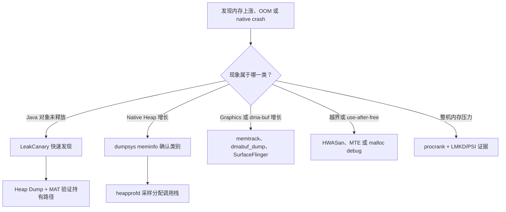

图里几个词先说清楚：OOM（Out of Memory） 是内存不足错误，native crash 指 C/C++ 代码或本地运行库中的崩溃；dma-buf 是内核中跨设备、跨进程共享缓冲区的机制，memtrack 是 Android 图形内存记账接口；LMK（Low Memory Killer，系统在内存压力下终止进程的机制）D（Low Memory Killer Daemon） 根据系统内存压力选择终止进程，PSI（Pressure Stall Information）记录任务因 CPU、内存或 I/O 资源紧张而停顿的时间。

同一个问题往往要走两步：记账工具确认“涨在哪里”，归因工具解释“由谁产生”。单次快照通常只能提出假设。

<!-- gracker-diagram: ch15-03-01-question-to-tool -->
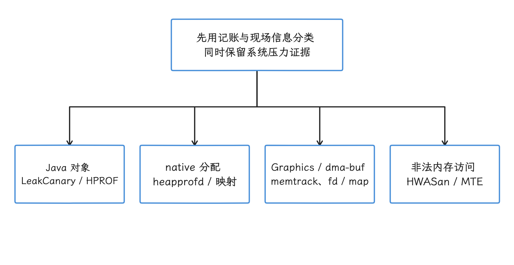

图：把进程记账、对象保留、分配调用栈和非法访问分开，再按问题取证。 单次曲线或快照只给线索；整机压力需结合 PSS、LMKD 与 PSI，不能直接归成 Java 泄漏。

### LeakCanary：发现应被回收的 Java 对象

#### 它观察的对象

LeakCanary 适合开发与测试阶段。本文使用 2.14 稳定版 API，不混用仍处于 alpha 阶段的 3.0 API。2.14 的默认观察器跟踪已经销毁的 `Activity`、`Fragment`、Fragment View 和 `Service`，以及已经执行 `onCleared()` 的 `ViewModel`；业务对象不在默认清单里时，我们可以在生命周期结束处把它交给 `ObjectWatcher`。

它判断的是“对象在等待期和 GC 后仍被保留”，还没有证明到“这个对象永远释放不掉”的程度。异步任务、动画、消息队列和测试操作尚未结束，都可能让对象暂时存活。

LeakCanary 2.14 的基础依赖应只进入 debug 构建变体。下面的配置用于避免把堆转储与分析代码带进 release APK。

```kotlin
dependencies {
    debugImplementation("com.squareup.leakcanary:leakcanary-android:2.14")
}
```

依赖合入的自动安装组件会在主进程装好默认观察器，`Application` 里无需手工初始化。AndroidX Startup 是另一种可选的安装依赖，装了基础依赖也说明不了项目正在用它。构建产物仍应通过依赖分析确认 release 变体里没有 LeakCanary。

#### 从弱引用到泄漏引用链

LeakCanary 的处理过程分为四段：

1. 生命周期观察器把应结束生命周期的对象交给 `ObjectWatcher`，后者只保留弱引用。
2. 默认等待五秒并触发 GC；弱引用仍未清除时，对象进入保留对象集合。
3. 保留对象数量达到当前阈值后，LeakCanary 调用 Android 堆转储接口。
4. Shark（LeakCanary 的堆分析器）解析 HPROF 堆快照，从 GC Root 搜索到保留对象的引用路径，并按泄漏签名聚类。

修复要看 GC Root 到目标对象的整条路径。通知里的红色可疑引用，表示 Shark 认为该边不符合生命周期预期；路径里出现一个熟悉的类名，也说明不了那个类创建了泄漏。

业务对象可在确定不再使用的位置显式观察。下面的函数要求调用方同时给出对象和生命周期结束原因，避免报告里只剩一个来历不明的类名。

```kotlin
fun watchAfterLifecycleEnd(instance: Any, reason: String) {
    require(reason.isNotBlank())
    AppWatcher.objectWatcher.expectWeaklyReachable(instance, reason)
}
```

这段代码只登记弱引用观察目标，不会延长对象生命周期。调用位置应紧邻真实的释放时点，`reason` 应写清哪个生命周期事件已经发生。

<!-- gracker-diagram: ch15-03-02-leakcanary-order -->
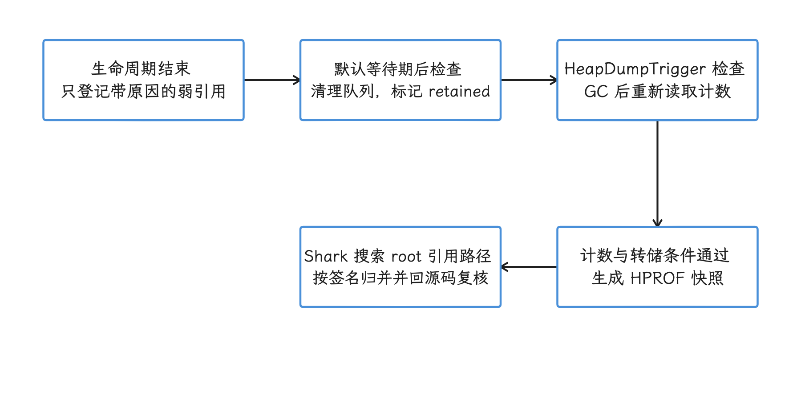

图：弱引用观察先产生 retained 候选，策略检查再 GC 复核，并在条件满足后转储分析。 固定 LeakCanary 2.14；默认等待五秒是检查延迟，不是五秒时必定产生泄漏报告。

#### 配置等待时间与触发阈值

多数项目保留默认自动安装即可。需要自定义观察器或 `retainedDelayMillis` 时，应先覆盖自动安装资源。下面的资源关闭默认安装。

```xml
<?xml version="1.0" encoding="utf-8"?>
<resources>
    <bool name="leak_canary_watcher_auto_install">false</bool>
</resources>
```

关闭之后，就要在主进程安装观察器。下面的函数把等待时间作为测试配置输入；先测得业务有更长的正常清理窗口，才有理由偏离 2.14 的五秒默认值。

```kotlin
fun installLeakWatchers(
    application: Application,
    retainedDelayMillis: Long
) {
    require(retainedDelayMillis > 0)
    AppWatcher.manualInstall(
        application = application,
        retainedDelayMillis = retainedDelayMillis
    )
}
```

应用应从主进程的 `Application.onCreate()` 调用该函数一次。等待时间越长，暂时保留造成的误报越少，反馈也越慢；稳定复现的异常引用要回到引用本身去修，延长等待时间帮不上忙。

堆转储策略属于 `LeakCanary.config`。2.14 的默认行为是：应用可见时累计五个保留对象才转储，应用不可见时等待一个 `retainedDelayMillis` 后即可转储。下面的函数允许测试基础设施传入经过验证的可见态阈值。

```kotlin
fun setVisibleHeapDumpThreshold(retainedObjectCount: Int) {
    require(retainedObjectCount > 0)
    LeakCanary.config = LeakCanary.config.copy(
        retainedVisibleThreshold = retainedObjectCount
    )
}
```

该阈值只决定何时生成堆转储，不改变对象是否被判定为保留对象。自动化测试若只收集保留对象计数而不希望暂停进程，可在测试专用配置中关闭 `dumpHeap`。

<!-- gracker-diagram: ch15-03-03-watch-versus-dump-policy -->
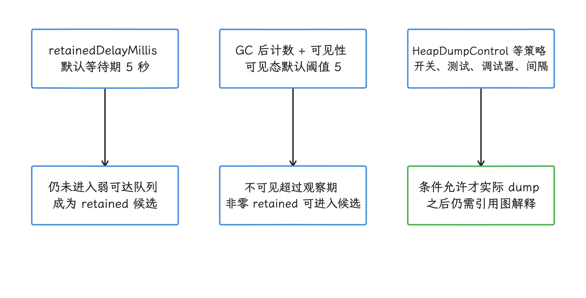

图：对象保留判定、GC 后计数和堆转储资格是三组不同条件。 提高阈值或延长等待只会改变反馈时机；异常强引用仍需在生命周期结束处修复。

#### 如何读一条报告

按以下顺序读泄漏引用链（leak trace）：

1. 确认目标对象的生命周期已经结束，复现步骤也已经完成。
2. 从 GC Root 往下看，区分静态字段、线程、JNI（Java Native Interface）全局引用和框架缓存。
3. 找到第一条生命周期不合理的强引用，核对它的写入和清理位置。
4. 修复后重复相同操作，等待保留对象消失，并确认没有换成另一条签名。

LeakCanary 的默认观察范围有限，单例、缓存和业务容器要显式观察。内存膨胀若表现为“大量仍然合法存活的对象”，就转到堆转储的 Histogram（按类汇总的对象直方图） 和 Dominator Tree（支配树） 上去找：Histogram 按类汇总对象，Dominator Tree 反映对象间的支配关系。

#### Android Studio LeakCanary task 与 CI 接入

CI（Continuous Integration，持续集成）里的泄漏检查要靠可重复的操作和明确的断言，只保存一次人工截图说明不了问题。

Android Studio 从 Quail 2 起提供专用的 LeakCanary Profiler task，官方发布公告日期为 2026-07-16：设备仍负责运行应用和生成堆现场，Shark 转到开发机分析，报告可以从可疑引用跳回工程源码。这项能力跟着 IDE（Integrated Development Environment，集成开发环境）发布线走，与 Android API 版本没有绑定关系。

几种入口的职责不同：

| 入口 | 适合的阶段 | 主要证据 | 边界 |
|---|---|---|---|
| LeakCanary 2.14 | 日常开发和手工走查 | 生命周期对象的泄漏引用链 | 默认观察范围有限，堆转储会暂停应用 |
| Android Studio LeakCanary task | 本地稳定复现后的源码定位 | Shark 报告与工程源码之间的导航 | 依赖 IDE、构建和被测 APK 版本匹配 |
| Memory Profiler Heap Dump | 对象数量、支配关系和通用 HPROF 检查 | 实例、retained size、引用关系 | 需要开发者判断生命周期是否合法 |
| 系统或线上触发 | 难以本地复现的内存限制现场 | 退出信息、受控 HPROF 或 profile | 受配额、隐私、磁盘和上传成本限制 |

LeakCanary 2.14 还提供 instrumentation 集成，即在设备上运行的 Android 仪器化测试中检查泄漏。主 APK 仍需保留基础 LeakCanary 的 debug 依赖，instrumentation 依赖只加入测试 APK。下面的配置在测试成功后执行泄漏断言：

```kotlin
dependencies {
    debugImplementation("com.squareup.leakcanary:leakcanary-android:2.14")
    androidTestImplementation(
        "com.squareup.leakcanary:leakcanary-android-instrumentation:2.14"
    )
}

@get:Rule
val detectLeaksAfterTestSuccess = DetectLeaksAfterTestSuccess()
```

JUnit 出现在运行时类路径时，LeakCanary 会禁用常规自动检测，测试应通过该规则或 `LeakAssertions.assertNoLeaks()` 触发检查。

使用 `ActivityScenarioRule` 时，规则顺序决定断言时点：把 `DetectLeaksAfterTestSuccess` 放在其外层，才能在 Activity 销毁后检查 Activity 泄漏；放在内层则在销毁前检查，可能发现随 Activity 销毁而消失的 Fragment 泄漏。需要覆盖两个时点时，应分别设置断言。

<!-- gracker-diagram: ch15-03-04-test-rule-order -->
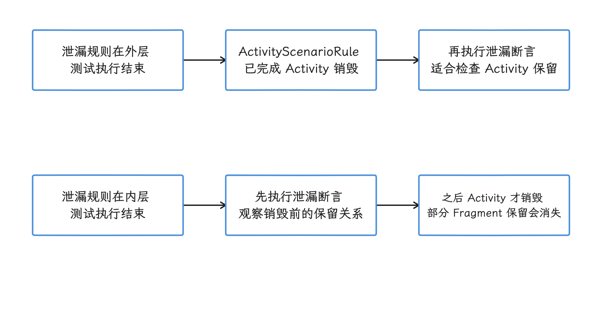

图：外层规则在 Activity 销毁后断言，内层规则可在销毁前检查保留关系。 固定 2.14 规则只在测试成功后分析，finally 清理观察表；需要覆盖两个时点时显式设置双断言。

对混淆 release 构建运行 instrumentation 测试，还要注意官方文档记录的 AGP 跨主 APK 与测试 APK 重写不一致问题；遇到相关运行时崩溃时，可按文档评估 Keeper 插件。

这类断言适合生命周期明确、操作可重复的端到端场景。测试应固定页面操作、空闲等待和后台任务清理；异步任务尚未结束时看到的保留对象，还够不上稳定泄漏。团队还可以维护少量确定性样例，例如单例保存 Activity、Fragment View binding 未清理、延迟消息、全局协程、Listener 未注销和 WebView/播放器未释放，用同一脚本同时验证“能发现”和“修复后消失”。

线上使用实验性的 release 观察能力时，至少要有远程开关、低采样率、磁盘配额、充电/空闲条件、失败恢复、访问控制与过期策略。原始 HPROF 可能包含业务对象，默认留在本地；要上传，也优先上传 leak signature（按引用路径归并泄漏的签名）、裁剪后的引用路径和不含业务值的统计字段。

### MAT：离线分析 Java 堆对象图

#### HPROF 包含什么

MAT（Eclipse Memory Analyzer）用来离线分析 HPROF。HPROF 是某一时刻的托管堆快照，包含类、对象、字段、数组、线程与 GC Root 等信息，适合回答“对象为何仍可达”“谁支配了大量 Java 对象”。它记录的只是这一刻的托管堆：历史分配时序、malloc 分配区、未映射的 dma-buf 和 GPU（Graphics Processing Unit，图形处理器） 驱动私有内存，都在它的覆盖之外。

Android Studio 的 Heap Dump 页面能直接采集与浏览 Android HPROF。MAT 的 Dominator Tree、Path to GC Roots、OQL（Object Query Language，对象查询语言）和大堆处理更适合复杂离线分析。

#### 采集与转换

`am dumpheap` 支持进程名或 PID（Process ID，进程号）；`-g` 会在 dump 前请求一次 GC。下面的命令要求调用方提供本次实测 PID，再用 PID 组成设备端和主机端文件名。

```bash
: "${APP_PID:?Set APP_PID to the target process id}"
remote_hprof="/data/local/tmp/app-${APP_PID}.hprof"
local_hprof="./app-${APP_PID}-android.hprof"

adb shell am dumpheap -g "${APP_PID}" "${remote_hprof}"
adb pull "${remote_hprof}" "${local_hprof}"
```

`-g` 能减少已经不可达却尚未回收的对象，但 GC 时机与堆状态仍会受运行时影响。转储权限由 [`ActivityManagerService.enforceDebuggable()`](https://android.googlesource.com/platform/frameworks/base/+/refs/tags/android-17.0.0_r1/services/core/java/com/android/server/am/ActivityManagerService.java#6922) 把关：面向量产设备的 user 构建只能转储 debuggable 应用，`profileable` 声明本身换不来 HPROF；userdebug/eng 这类可调试系统构建才允许转储其他目标。两个文件名带有 PID，可避免连续分析不同进程时误用旧文件。另外，采集过程会暂停应用并增加临时内存，是一次有扰动的观测。

MAT 打不开 Android HPROF 时，可用 Android SDK（Software Development Kit） Platform-Tools 的 `hprof-conv` 转为标准 Java SE HPROF。下面的命令检查 SDK 根目录和本次 PID，再转换刚才拉取的文件。

```bash
: "${ANDROID_SDK_ROOT:?Set ANDROID_SDK_ROOT to the Android SDK directory}"
: "${APP_PID:?Set APP_PID to the process id used for capture}"
input_hprof="./app-${APP_PID}-android.hprof"
output_hprof="./app-${APP_PID}-mat.hprof"

"${ANDROID_SDK_ROOT}/platform-tools/hprof-conv" \
    "${input_hprof}" \
    "${output_hprof}"
```

转换产物可交给 MAT；转换只改变 HPROF 编码，native 分配器、dma-buf 或 GPU 数据它都补不出来。Android Studio 从 Past Recordings 导出的文件是否仍需转换，以 MAT 的解析结果为准。

#### 四个概念

- **Shallow size**：对象本身在 Java 堆中占用的字节，不包含它引用的对象。
- **Retained size**：支配关系下，移除该对象后可一并变为不可达的对象大小估计。
- **Dominator**：从任意 GC Root 到目标对象的所有路径都经过的对象。
- **Path to GC Roots**：目标对象到 GC Root 的引用路径；分析泄漏时通常排除 weak、soft 和 phantom references，这三类引用不会像普通强引用那样无条件阻止对象回收。

Retained size 很大，说明该对象控制着大块对象图，这些字节却未必是它自己分配的。Histogram 中数量最多的类同样未必是泄漏源；缓存、预加载和池化对象可能有合法生命周期。

<!-- gracker-diagram: ch15-03-05-reference-and-dominator -->
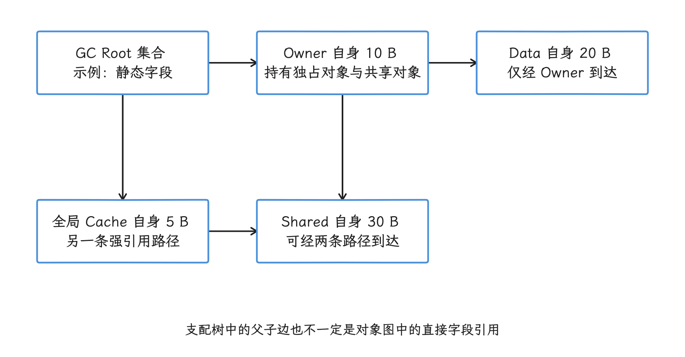

图：示例中 Owner 支配自身和 Data，共享对象仍能沿 Cache 路径到达。 示意字节，非实测；Owner retained = 10 + 20，不能加上 Shared；引用链不能还原分配调用栈。

#### 一套可复现的 MAT 流程

1. 固定应用版本、设备、测试账号和操作脚本，预热到稳定状态。
2. 执行基线操作并采集 HPROF A。
3. 重复进入和退出目标场景，等待异步清理完成，再采集 HPROF B。
4. 比较 Histogram，找出实例数与 shallow size（浅大小） 持续增加的类。
5. 在 B 中按 retained size（保留大小） 查看 Dominator Tree。
6. 对目标实例执行 Path to GC Roots，排除弱引用，找到第一条异常强引用。
7. 回到源码验证写入、移除和生命周期，修复后以同一脚本复测。

单个 HPROF 适合判断持有关系，两份或多份同条件 HPROF 才适合判断增长。对象数量上涨一次也可能来自懒加载，要用重复轮次确认它是否停止增长并趋于稳定。

<!-- gracker-diagram: ch15-03-06-repeatable-snapshots -->
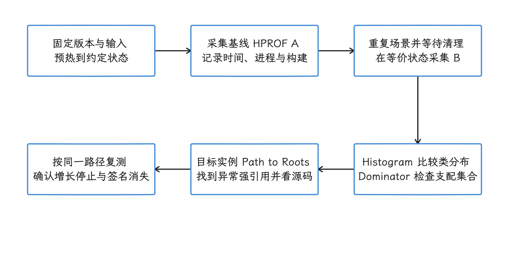

图：固定场景与清理时点，比较多份快照，再沿具体实例的 root 路径验证生命周期。 一次增长可能来自懒加载或缓存；大 retained、对象数量与分配来源需要分别解释。

#### Bitmap 的版本边界

Android 8.0 起，Bitmap 像素数据由 native 堆管理，Java `Bitmap` 对象主要保存 native 指针和元数据。MAT 能看到 Java 封装对象与引用关系；完整像素内存，靠标准 HPROF 是还原不出来的。

Android Studio Heap Dump 会为部分框架类型提供 Native Size 和 Bitmap 预览，这属于 Android Studio 的增强信息。`dumpsys meminfo` 的 `Graphics`、`Native Heap` 与 Bitmap 预览应一起看；图像数据位于 Graphic Buffer 时，还要转到 dma-buf 工具。

### heapprofd：按调用栈采样堆分配

#### Native 模式的模型

heapprofd 从 Android 10 起作为 Perfetto 数据源提供。native 模式拦截 `malloc/free`、`new/delete` 等分配器调用，对分配按字节概率采样，把寄存器、栈和分配/释放记录送给独立的 heapprofd 进程去展开和聚合。

采样间隔为 `n` 字节时，可理解为每个字节约有 `1/n` 的概率命中，工具再用统计权重估算总体。`HeapprofdConfig` 要求显式提供非零间隔，`tools/heap_profile` 代为写入的默认值是 4096 字节。间隔设为 1 表示记录每次分配，记录量与被测进程扰动也随之增加。

heapprofd 统计的是分配器请求与释放。分配器 arena（批量管理内存的预留区）、页粒度、碎片、zRAM 和 mmap 区域，会让 heapprofd 的存活分配字节、`malloc_info()` 与 Native Heap RSS 出现差异；三者各说各话，分开读就好。

<!-- gracker-diagram: ch15-03-07-allocator-versus-pages -->
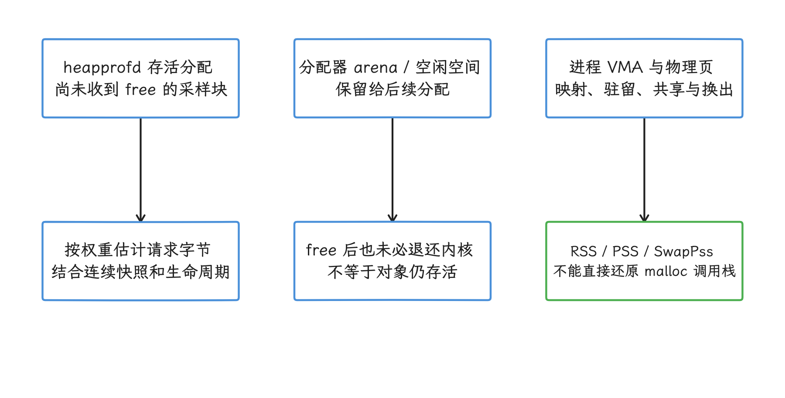

图：分配记录、分配器保留空间和内核页记账衡量不同层次的内存。 arena、碎片、独立 mmap、页粒度与 swap 都会造成差异；两种读数不能互相替代。

#### 权限与目标

user 构建只允许采样 AndroidManifest 标记为 `debuggable` 或 `profileable` 的 Java 应用。`debuggable` 开放完整调试能力，`profileable` 则只允许 shell 使用受支持的性能分析接口。release 性能构建可使用下面这份完整的清单结构开放本地 shell 分析。

```xml
<?xml version="1.0" encoding="utf-8"?>
<manifest xmlns:android="http://schemas.android.com/apk/res/android">
    <application>
        <profileable android:shell="true" />
    </application>
</manifest>
```

`<profileable>` 从 API 29 提供；`android:enabled` 从 API 30 提供且默认是 `true`。`android:shell="true"` 不会把应用改成 debuggable，也不会授权主机直接读取进程内存；工具得到的是分析器生成的调用栈和聚合统计。userdebug/eng 对普通应用和多数系统进程更宽松，但 SELinux 仍会禁止一小组关键服务。

#### 推荐命令

Perfetto 的 `tools/heap_profile` 会构造配置、启动会话、拉取原始 trace 并生成 pprof 兼容的聚合分析文件。下面的命令要求调用方提供真实进程名与连续转储间隔；会话一直运行到按下 `Ctrl-C`。

```bash
: "${PERFETTO_ROOT:?Set PERFETTO_ROOT to a Perfetto source checkout}"
: "${TARGET_PROCESS:?Set TARGET_PROCESS to the exact process cmdline}"
: "${DUMP_INTERVAL_MS:?Set DUMP_INTERVAL_MS from the test sampling plan}"

"${PERFETTO_ROOT}/tools/heap_profile" android \
    -n "${TARGET_PROCESS}" \
    -c "${DUMP_INTERVAL_MS}"
```

省略 `-i` 时，[`tools/heap_profile`](https://android.googlesource.com/platform/external/perfetto/+/refs/tags/android-17.0.0_r1/tools/heap_profile#780) 使用 4096 字节间隔；省略 `-d` 时持续到中断。结果目录中的 `raw-trace` 可直接交给 Perfetto UI。按进程名采集会匹配已经运行的进程，也会覆盖会话开始后新启动的同名进程；按 PID 只跟踪当前实例。

需要把堆数据与调度、Binder（Android 进程间调用） 或自定义 trace 放入同一会话时，可手写 TraceConfig，也就是 Perfetto 的采集配置。下面的配置使用 `tools/heap_profile` 的默认 trace 缓冲区、共享内存、采样间隔和阻塞策略，目标是 userdebug 构建上的真实平台进程 `system_server`；会话由操作者中断。

```protobuf
buffers {
  size_kb: 63488
}

data_sources {
  config {
    name: "android.heapprofd"
    heapprofd_config {
      shmem_size_bytes: 8388608
      sampling_interval_bytes: 4096
      block_client: true
      process_cmdline: "system_server"
    }
  }
}

duration_ms: 0
write_into_file: true
```

`process_cmdline` 可覆盖已运行及后续启动的匹配进程。`block_client` 在共享内存写满时会暂停目标分配线程，因此高分配率测试还要检查 trace 统计和业务时延。若要改成应用进程，应替换为设备上 `/proc/<pid>/cmdline` 的精确值，并满足前述 AndroidManifest 条件。配置字段以 [`heapprofd_config.proto`](https://android.googlesource.com/platform/external/perfetto/+/refs/tags/android-17.0.0_r1/protos/perfetto/config/profiling/heapprofd_config.proto) 为准；文本配置交给 Perfetto CLI（命令行工具） 时要使用 `--txt`。

<!-- gracker-diagram: ch15-03-08-heapprofd-data-path -->
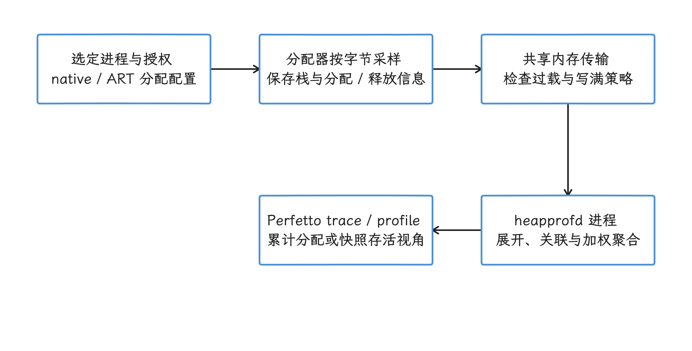

图：配置选中目标后，分配器按字节采样，将栈与分配/释放信息交给独立进程聚合。 间隔与缓冲策略会改变精度和扰动；block_client 可能在共享内存写满时阻塞目标分配线程。

#### ART（Android Runtime，Android 运行时） 分配分析

Android 12 起，heapprofd 还可选择 ART 注册的 `com.android.art` heap。它记录 Java 对象的分配调用栈、类型、累计字节和次数，用于分析频繁分配。

下面的命令要求调用方提供真实进程名，并一直采集到操作者中断。

```bash
: "${PERFETTO_ROOT:?Set PERFETTO_ROOT to a Perfetto source checkout}"
: "${TARGET_PROCESS:?Set TARGET_PROCESS to the exact app process cmdline}"

"${PERFETTO_ROOT}/tools/heap_profile" android \
    -n "${TARGET_PROCESS}" \
    --heaps com.android.art
```

`com.android.art` 是 ART 注册的 heap 名称。这个模式定位的是分配频繁的调用栈与类型；对象何时删除、被谁持有，要回到 HPROF、LeakCanary 或 MAT 去看。

#### 读火焰图

火焰图按调用栈逐层堆叠方框，方框宽度表示该视角下估算的分配字节或次数。它展示的是聚合调用路径，真实时间线不在其中。

Native 快照常见的两个视角是：

- 累计分配：时间窗内该调用栈分配过多少估算字节或次数，包含已经释放的分配。
- 快照时仍存活：到该快照尚未收到 free 记录的采样分配，适合寻找持续增长的 native 路径。

“仍存活”离泄漏还差一步：长生命周期缓存、分配器延迟释放和会话尚未覆盖释放动作，都会把数据留下来。连续快照中同一调用栈稳定增长，且业务生命周期已经结束时，把泄漏当主要怀疑对象才站得住。

#### 空报告与异常栈

- 结果为空：检查包是否 `debuggable/profileable`、目标进程名是否匹配、是否存在并发 heapprofd 会话。
- 启动阶段缺样本：运行时挂接会有延迟；按进程名启动会话通常比进程启动后按 PID 连接覆盖更早。
- 缓冲区溢出（buffer overrun）：短暂峰值可增大 `--shmem-size`；持续过载应增大 `--interval`，接受较低精度。
- native 符号缺失：提供与二进制 Build ID（构建产物的唯一标识）匹配的未剥离符号，再执行 Perfetto 符号化。
- Java 帧出现 `[DEDUPED]`：ART 的 identical code folding（ICF，相同机器码折叠）让多个方法共享代码，显示名不一定是执行的那个方法。

不要写死“heapprofd 开销低于某个百分比”。分配率、采样间隔、栈深、线程数和缓冲策略都会改变扰动，应在目标设备上对比开启前后的业务指标。

### `dumpsys meminfo`：进程内存记账快照

#### 采集方式

下面的命令要求调用方提供真实包名，分别输出默认分类、ART 细项、摘要，以及加载过该包的全部进程。

```bash
: "${APP_PACKAGE:?Set APP_PACKAGE to the installed application id}"

adb shell dumpsys meminfo "${APP_PACKAGE}"
adb shell dumpsys meminfo -d "${APP_PACKAGE}"
adb shell dumpsys meminfo -s "${APP_PACKAGE}"
adb shell dumpsys meminfo --package "${APP_PACKAGE}"
```

`-d` 增加 Dalvik/ART 子项；`-s` 只保留 App Summary；`--package` 把参数解释为包名，并输出所有已经加载该包的进程，适合核对 `:remote` 或其他辅助进程。WebView renderer 是否出现，取决于它实际加载的包，父应用包名说了不算。选项解析可在 [`ActivityManagerService`](https://android.googlesource.com/platform/frameworks/base/+/refs/tags/android-17.0.0_r1/services/core/java/com/android/server/am/ActivityManagerService.java#13030) 中核对。

#### PSS、RSS、USS 与 swap

| 指标 | 含义 | 适合回答的问题 |
| --- | --- | --- |
| RSS（Resident Set Size） | 当前驻留的共享页与私有页总和，共享页在每个进程重复计算 | 单进程驻留集如何变化 |
| PSS（Proportional Set Size） | 私有页加共享页按映射进程数分摊后的份额 | 进程对系统内存压力的近似贡献 |
| USS（Unique Set Size） | Private Clean 与 Private Dirty 之和 | 该进程独占的驻留页有多少 |
| Swap / SwapPss | 已换出页，SwapPss 对共享换出页按比例分摊 | 是否已有工作集换出到 zRAM/swap |

PSS 可以避免共享页在进程间重复记账，但把所有进程 PSS 相加，离整机全部物理内存还差一截：内核自身、未映射页、设备内存和统计时刻变化，都落在这套进程统计之外。

内核提供 SwapPss 时，`Debug.MemoryInfo.getTotalPss()` 会把按比例分摊的换出页加入总值。解析脚本应保存原始列名和系统版本，避免把 `TOTAL PSS` 与单独显示的 swap 列重复相加。

<!-- gracker-diagram: ch15-03-09-rss-pss-uss -->
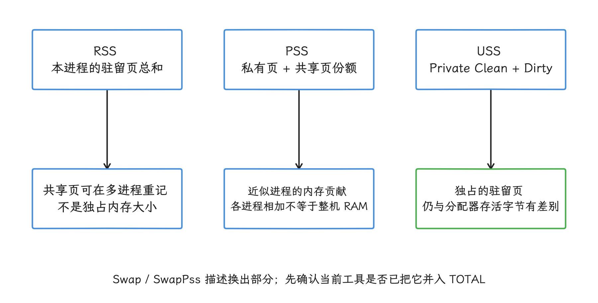

图：先区分驻留、共享分摊与独占驻留，再处理换出页的单独口径。 共享页按内核映射计数等规则分摊；Debug 总 PSS 可能已含 SwapPss，解析时保留原列名与版本。

Private Dirty 表示页面由该进程独占且内容已经改变，这类页面没法像干净文件页那样直接丢弃；匿名页和私有 COW（Copy-on-Write（写时复制），写时复制）页仍可换出到 zRAM/swap。可回写文件的共享脏页属于另一种记账，解释不了 Private Dirty。Private Clean 多为可从文件重新加载的私有页，内存压力下更容易回收。

#### 分类行与 App Summary

- `Java Heap`：ART 托管堆的私有部分以及归入 Java 堆的 ART 映射。
- `Native Heap`：默认 native 分配器对应的 Private Dirty malloc 空间。
- `Code`：`.so`、`.jar`、`.apk`、`.dex`、`.oat` 等代码与静态资源的私有部分。
- `Stack`：Java 与 native 线程栈的 Private Dirty。
- `Graphics`：Gfx、EGL（图形上下文与窗口系统接口）、GL（OpenGL 图形 API） 的 private 统计，部分数据来自 memtrack；EGL 是图形上下文与窗口系统接口，GL 指 OpenGL 图形 API。
- `Private Other`：尚未归入前述类别的 Private Clean/Dirty。
- `System`：摘要中归入系统的共享内存份额。

App Summary 不是上方每一行 PSS 的简单求和：[`Debug.MemoryInfo`](https://android.googlesource.com/platform/frameworks/base/+/refs/tags/android-17.0.0_r1/core/java/android/os/Debug.java#720) 会把 private 与 shared 部分重新归组。`Graphics` 还受图形驱动的 memtrack 报告质量影响，源码也明确保留了误报警告。

#### 如何判断“持续增长”

一轮可靠的趋势测试应固定进程状态和业务动作：

1. 冷启动或预热到约定状态，记录 PID、构建号和第一次快照。
2. 重复同一操作若干轮，每轮等待异步任务与动画结束。
3. 同时保存 `TOTAL PSS`、RSS、SwapPss、Java Heap、Native Heap、Graphics 和进程列表。
4. 观察数值是否停止继续增长并趋于稳定，必要时再抓 HPROF、heapprofd 或 dma-buf 明细。

PSS 一次没有回落，离泄漏结论还远：Java 堆会保留已提交空间，native 分配器会保留 arena（为批量管理内存而申请的内存区），图片与代码会进入缓存，线程池也可能延迟销毁。趋势、生命周期和归因调用栈要互相印证。

### `showmap`、`procrank` 与 libmeminfo

#### `showmap`：逐个 VMA 查看

`showmap` 读取 `/proc/<pid>/smaps`，按 VMA 输出 VSS（Virtual Set Size，虚拟地址范围总量）、RSS、PSS、private/shared clean/dirty、swap 等字段。下面的命令要求调用方提供真实 PID，同时显示地址并禁止合并同名 VMA。

```bash
: "${APP_PID:?Set APP_PID to the target process id}"
adb shell showmap -a -v "${APP_PID}"
```

`-a` 显示虚拟地址，`-v` 保留每个 VMA。`[anon:libc_malloc]` 变大通常指向分配器 heap；大型匿名 `mmap` 未必属于 malloc；`.so/.dex/.apk` 是文件映射。procfs 是内核导出进程和系统状态的伪文件系统，SELinux 执行强制访问控制。这条命令能不能读到目标 `/proc/<pid>/smaps`，由 user 构建、SELinux 和 procfs 权限决定，商用设备上别指望 shell 一定能查看任意进程。

`showmap` 只能报告已经映射进该进程地址空间的页。只持有 dma-buf fd（file descriptor，文件描述符）、仅由 GPU/内核引用或映射在其他进程的缓冲区，可能不会在目标 VMA 中呈现。

#### `procrank`：跨进程排序

下面的命令分别按 PSS、USS、RSS 和 swap 排序全系统进程。

```bash
adb shell procrank -p
adb shell procrank -u
adb shell procrank -r
adb shell procrank -s
```

默认排序已经是 PSS，显式参数便于保存实验脚本。`procrank` 是否被产品镜像打包、shell 能读取多少进程，都由设备构建决定；缺少命令时可在 AOSP 构建中生成对应可执行文件。

`procrank` 适合找出大进程；LMKD 下一个终止谁，它回答不了——LMKD 还会结合 PSI、thrashing（页面反复回收后又被访问的抖动）、swap、`oom_score_adj`（内核选择低内存终止对象时使用的优先级）和产品策略。`procrank -o` 展示 oom score 维度时，也只是一张当前快照。

#### libmeminfo 的源码分工

libmeminfo 是平台内部的 C++ 库，应用 SDK 里没有这个 API。实现位于独立仓库 `platform/system/memory/libmeminfo`：

| 模块 | 职责 |
| --- | --- |
| [`procmeminfo.cpp`](https://android.googlesource.com/platform/system/memory/libmeminfo/+/refs/tags/android-17.0.0_r1/procmeminfo.cpp) | 解析 `smaps`/`smaps_rollup`、`pagemap`，管理 working set（近期被访问的工作集） |
| [`androidprocheaps.cpp`](https://android.googlesource.com/platform/system/memory/libmeminfo/+/refs/tags/android-17.0.0_r1/androidprocheaps.cpp) | 把 VMA 归入 Android 堆类别 |
| [`libsmapinfo/smapinfo.cpp`](https://android.googlesource.com/platform/system/memory/libmeminfo/+/refs/tags/android-17.0.0_r1/libsmapinfo/smapinfo.cpp) | 为 `showmap`、`procrank`、`librank` 提供统计与输出 |
| [`libdmabufinfo`](https://android.googlesource.com/platform/system/memory/libmeminfo/+/refs/tags/android-17.0.0_r1/libdmabufinfo/) | 读取 dma-buf 引用、映射和逐缓冲区统计 |

`ProcMemInfo::ResetWorkingSet()` 会向 `/proc/<pid>/clear_refs` 写入 `1`。这类接口需要特权，还会改变 working-set 统计状态，常规应用采集时别直接照搬。

内核 PSS/smaps 生成逻辑可从 [`fs/proc/task_mmu.c`](https://android.googlesource.com/kernel/common/+/refs/tags/android17-6.18-2026-06_r6/fs/proc/task_mmu.c) 核对。libmeminfo 是读者与分类器，页表和映射状态仍由内核提供。

### Graphics 与 dma-buf：从 memtrack 转向缓冲区归因

`dumpsys meminfo` 的 `Graphics` 与 `showmap` 中所有 `/dev` 映射是两回事：[`android_os_Debug.cpp`](https://android.googlesource.com/platform/frameworks/base/+/refs/tags/android-17.0.0_r1/core/jni/android_os_Debug.cpp#130) 会通过图形内存记账接口 libmemtrack 获取 smaps 未覆盖的 graphics、GL 和 other PSS，再合入 `Debug.MemoryInfo`。

图形内存上涨时可按以下顺序收集：

1. 用 `dumpsys meminfo` 区分 Java Heap、Native Heap、Graphics 与 System。
2. 用 `showmap` 查找目标进程已映射的匿名区、图像映射和分配器 heap。
3. 设备包含工具且权限允许时，用 `dmabuf_dump` 查看 fd/map 引用、inode、exporter 和跨进程共享。
4. 用 `dumpsys SurfaceFlinger` 核对 layer、BufferQueue 与 surface 生命周期。
5. 用 Perfetto 把上涨时刻与应用、RenderThread、SurfaceFlinger、Camera/Codec 活动放在同一时间轴。

这里的 map 是进程建立的内存映射，inode 是用于识别同一个 dma-buf 内核对象的编号，exporter 是创建并导出缓冲区的驱动或组件。SurfaceFlinger 以 layer 为合成单元，BufferQueue 则连接图形缓冲区的生产者与消费者。

下面的第一条命令要求调用方提供真实 PID，用于查看该进程引用或映射的 dma-buf；第二条命令请求全系统逐缓冲区、exporter 与 device 统计。

```bash
: "${APP_PID:?Set APP_PID to the target process id}"
adb shell dmabuf_dump "${APP_PID}"
adb shell dmabuf_dump -b
```

带 PID 的输出只覆盖该进程持有 fd 或建立映射的缓冲区；`-b` 不接受 PID。工具可用性和可见范围取决于产品镜像、debugfs（内核调试伪文件系统）、procfs 与 SELinux。每进程总量会在共享缓冲区上重复显示，系统唯一总量要按 inode 去重。实现依据见 [`dmabuf_dump.cpp`](https://android.googlesource.com/platform/system/memory/libmeminfo/+/refs/tags/android-17.0.0_r1/libdmabufinfo/tools/dmabuf_dump.cpp)。

<!-- gracker-diagram: ch15-03-10-graphics-shared-identity -->
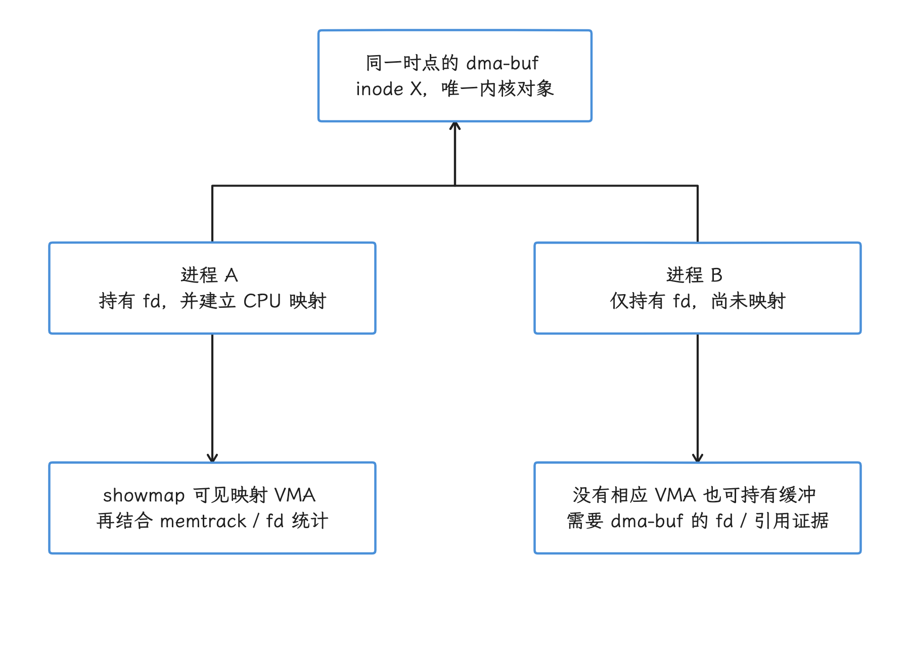

图：进程可以通过 fd 或映射持有同一个 dma-buf，VMA 只覆盖已映射的地址空间。 同一时点的系统唯一总量按 inode 去重；各进程统计可能重复显示同一共享缓冲区。

dma-buf 的内核对象、文件描述符与 attachment（设备附加到共享缓冲区后建立的关系）生命周期见 [`drivers/dma-buf/dma-buf.c`](https://android.googlesource.com/kernel/common/+/refs/tags/android17-6.18-2026-06_r6/drivers/dma-buf/dma-buf.c)。图形缓冲区的分配与跨进程共享原理参见 §2.8 [DMA-BUF 与 Gralloc](../../part1-fundamentals/ch02-rendering/08-bufferqueue-gralloc-sync-fence.md)。

### malloc debug：给分配器增加检查与记录

malloc debug 从 API 24 起提供。它在正常分配器前加入 shim（位于调用方与原分配器之间的转发层），可为 `malloc/free/calloc/realloc` 等调用增加 guard、填充值、指针校验、释放隔离区和分配调用栈。guard 是放在分配块前后的哨兵字节，用于发现越界改写；释放隔离区则暂缓复用已释放内存，以提高 use-after-free 的检出机会。

它适合可控测试，性能基准或生产常开都不合适：`backtrace`（分配调用栈记录） 会让分配显著变慢，`free_track` 会延迟释放，`guard` 会增加每次分配大小；这些选项都在改变被测进程。

#### debuggable 应用的 `wrap.sh`

没有 root 权限的应用可在 API 27 及以上按 NDK（Native Development Kit） `wrap.sh` 方式为 debuggable APK 设置环境。下面的脚本让 backtrace 初始关闭并等待信号开启，同时输出详细启用日志。

```sh
#!/system/bin/sh
export LIBC_DEBUG_MALLOC_OPTIONS="backtrace_enable_on_signal verbose"
exec "$@"
```

脚本应按 ABI（Application Binary Interface，应用二进制接口）放入 Android Studio 工程的 `src/main/resources/lib/<abi>/wrap.sh`，同时把 JNI 库的 `useLegacyPackaging` 设为 `true`，并保证 APK 是 debuggable。`wrap.sh` 是 API 27 加入的应用入口；malloc debug 自身从 API 24 提供。直接写 `wrap.<package>` 属性更适合具有 root 权限的平台调试。

Android 12 的 bionic README 还记录了 `wrap.<APP>` 属性可能失效的兼容问题：在有 root 权限的测试设备上，规避方式是把 `dalvik.vm.force-java-zygote-fork-loop` 设为 `true`，再停止并启动 Android framework。Zygote（应用进程孵化器）负责派生应用进程，该属性让它使用 Java fork loop。重启会中断正在运行的应用，执行前应保存采集现场。

#### 选择选项

| 目标 | 选项 |
| --- | --- |
| 记录分配栈 | `backtrace` 或 `backtrace_enable_on_signal` |
| 检测前后越界写 | `guard`、`front_guard`、`rear_guard` |
| 增加 use-after-free 命中机会 | `free_track` |
| 验证传给 `free/realloc/malloc_usable_size` 的指针 | `verify_pointers` |
| 只记录特定大小范围 | `backtrace_min_size`、`backtrace_max_size`、`backtrace_size` |
| 收集仍可达性之外的 native 泄漏候选 | `check_unreachable_on_signal` |

这些动作仍由 Linux 实时信号控制。下面的命令先检查真实 PID，再依次切换 backtrace、写出 backtrace heap，以及触发 API 34 起的不可达内存扫描。

```bash
: "${APP_PID:?Set APP_PID to the target process id}"

adb shell kill -45 "${APP_PID}"  # SIGRTMAX-19：切换 backtrace
adb shell kill -47 "${APP_PID}"  # SIGRTMAX-17：请求 backtrace heap dump
adb shell kill -48 "${APP_PID}"  # SIGRTMAX-16：请求 unreachable scan
```

堆转储与不可达内存扫描会等到下一次分配器调用再执行。`-47` 需要已启用 backtrace；`-48` 需要配置 `check_unreachable_on_signal`。受保护进程还可能因权限失败，这时的无输出只是没采到数据，说明不了有没有泄漏。

另一条入口是 `dumpsys meminfo --unreachable <process>`。libmemunreachable 会在 native 地址空间中做保守的可达性扫描，报告没有从已知根扫描到的分配。下面的命令要求调用方提供 PID，再请求目标进程执行扫描。

```bash
: "${APP_PID:?Set APP_PID to the target process id}"
adb shell dumpsys meminfo --unreachable "${APP_PID}"
```

没有分配调用栈时，结果可能只能说明存在不可达 native 分配，给不出有用的分配点。完整选项和信号语义以 [`malloc_debug/README.md`](https://android.googlesource.com/platform/bionic/+/refs/tags/android-17.0.0_r1/libc/memory/malloc_debug/README.md) 为准。

### malloc hooks：自定义分配器回调

hook 是可替换的函数指针，用来截获调用后记录或转发。API 28 起，Android C 库 bionic 在显式启用 hooks 时公开 `__malloc_hook`、`__realloc_hook`、`__free_hook` 和 `__memalign_hook`。这组接口属于 Android bionic 自己，不构成对 GNU/Linux 常用 C 库 glibc 接口的兼容承诺。

下面的 C++ 片段只演示在进程启动早期替换 `malloc` hook，并保存、转调 bionic 提供的原分配器。

```cpp
#include <malloc.h>

using MallocHook = void* (*)(size_t, const void*);
static MallocHook g_original_malloc = nullptr;

static void* tracking_malloc(size_t bytes, const void* caller) {
    // 此处只能写入不会分配内存、不会递归进入 malloc 的记录结构。
    return g_original_malloc(bytes, caller);
}

__attribute__((constructor))
static void install_malloc_hook() {
    if (__malloc_hook != nullptr) {
        g_original_malloc = __malloc_hook;
        __malloc_hook = tracking_malloc;
    }
}
```

只有在 `LIBC_HOOKS_ENABLE=1` 或平台属性启用 hook shim 后，初始 hook 才指向默认分配器；没有启用时，构造函数不会安装替换。回调内使用 `std::string`、日志格式化、锁的懒初始化等操作都可能再次分配并造成递归。

在支持 malloc hooks 的 API 28 及以上系统中，debuggable 应用可通过 `wrap.sh` 设置环境变量；`wrap.sh` 入口本身从 API 27 提供。下面的脚本开启 bionic malloc hooks。

```sh
#!/system/bin/sh
export LIBC_HOOKS_ENABLE=1
exec "$@"
```

hook 指针更新没有线程安全保证，应在线程并发分配前完成。没有替换的 hook 会继续指向 bionic 原实现；如果继续替换 `realloc`、`free` 或 `memalign`，每一个回调都必须保存并转调对应原函数。`malloc_usable_size` 没有独立 hook，它依赖分配器元数据仍然有效。接口细节见 [`malloc_hooks/README.md`](https://android.googlesource.com/platform/bionic/+/refs/tags/android-17.0.0_r1/libc/memory/malloc_hooks/README.md)。

多数项目应优先使用 heapprofd。malloc hooks 更适合编写专用测试器，维护成本和测量扰动都更高。

<!-- gracker-diagram: ch15-03-11-native-allocator-observation -->
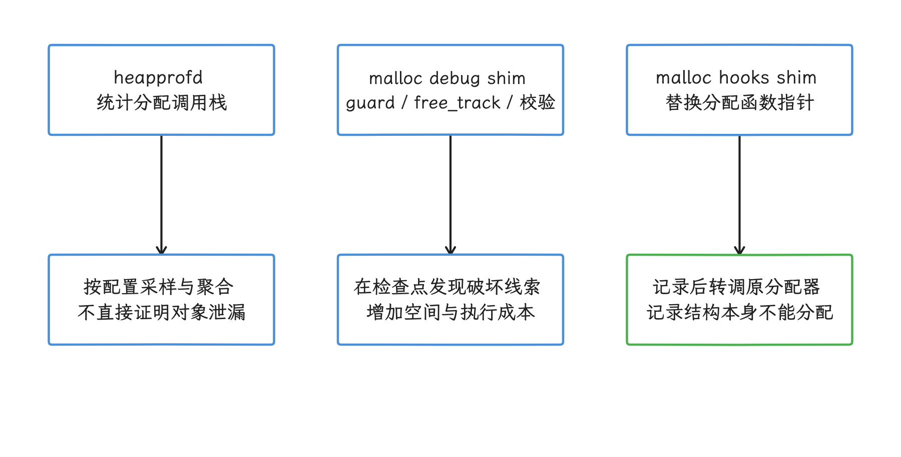

图：按需要选择分配采样、内存破坏检查或专用分配回调。 hooks 需显式启用、保存原函数并在并发前安装；回调内再分配可能递归，不能当作低扰动基准。

### HWASan 与 MTE：定位 native 内存安全错误

#### 两套标记机制

HWASan（Hardware-assisted AddressSanitizer）由编译器插入检查，并在影子内存中保存地址标记；影子内存是与被测内存分开的元数据区域。MTE（Memory Tagging Extension）则由 Arm CPU 比较指针标记和内存标记。两者都利用标记不匹配发现越界或 use-after-free，但实现位置和运行条件不同。

| 工具 | 标记与检查位置 | 设备/构建要求 | 更适合的场景 |
| --- | --- | --- | --- |
| HWASan | 编译器插桩、指针标记与影子内存 | ARM64；NDK r21+；Android 10+；目标 native 代码重编译 | 测试阶段获取错误、分配与释放栈 |
| MTE | CPU 检查指针标记与每 16 字节内存标记 | Android 12+ 平台；MTE SoC、内核与系统支持；进程显式启用 | ASYNC/ASYMM 持续检测，或 SYNC 精确复现 |

HWASan 名字中含 Hardware-assisted，但 Android 应用模式仍依赖编译器插桩与 HWASan 运行时库。它利用 AArch64（64 位 Arm 指令集状态）的地址标记能力，不要求 CPU 实现 MTE。

#### HWASan

下面的 CMake 函数接收工程里的真实构建目标名称，为该目标同时添加 HWASan 编译与链接参数。

```cmake
function(enable_hwasan target_name)
    target_compile_options(${target_name} PUBLIC
        -fsanitize=hwaddress
        -fno-omit-frame-pointer)
    target_link_options(${target_name} PUBLIC
        -fsanitize=hwaddress)
endfunction()
```

调用方应只在内存安全测试变体中，把工程已有的构建目标名称传给 `enable_hwasan`，并使用当前 NDK。使用 libc++ 时必须选择 `c++_shared`；不使用 libc++ 或选择 system STL（C++ 标准库）也可以。`c++_static` 会阻止 HWASan 接管其中缺少帧指针的 `new/delete` 实现。Android 14 至 Android 17 的 debuggable 应用可在 APK 中加入下面的 ARM64 `wrap.sh`。

```sh
#!/system/bin/sh
LD_HWASAN=1 exec "$@"
```

该路径与 `android:useAppZygote` 不兼容。Android 10 至 Android 13 虽然已有 NDK HWASan 支持，但应用运行依赖 HWASan 系统镜像或对应的平台配置；Android 14 起才可在普通系统上用这份 `wrap.sh` 启动 debuggable 应用。命中错误时进程会中止，并在 logcat 与 tombstone 中给出标记不匹配、访问栈，以及可用的分配栈和释放栈；tombstone 是 Android 保存的 native 崩溃诊断记录。

#### MTE

应用通过 `android:memtagMode` 请求堆 MTE。下面的 debug 清单覆盖文件为测试变体启用同步模式。

```xml
<manifest xmlns:android="http://schemas.android.com/apk/res/android"
          xmlns:tools="http://schemas.android.com/tools">
    <application
        android:memtagMode="sync"
        tools:replace="android:memtagMode" />
</manifest>
```

SYNC 在出错指令处触发 `SIGSEGV/SEGV_MTESERR`，诊断精度高。ASYNC 在标记不匹配后继续执行，到最近的系统调用或定时器中断等内核入口才触发 `SIGSEGV/SEGV_MTEAERR`；异步报告不记录触发错误的地址和内存访问信息。要定位出错指令，应切换到 SYNC 后复现。

启用 MTE 的应用在发布前应在支持 MTE 的设备上充分测试。原有内存安全错误可能只在这些设备上触发崩溃，不能仅凭未启用 MTE 的设备测试通过就发布。

Armv8.7-A 的 ASYMM 对读使用同步检查、对写使用异步检查。应用清单没有 `asymm` 值；应用请求 `async` 后，设备可通过 CPU 粒度的 `mte_tcf_preferred` 把执行模式升级为 ASYMM 或 SYNC。这个选择握在设备配置手里，应用不要默认所有 MTE 设备都会升级。异步请求被设备升级为 SYNC 时，故障位置会更精确，但分配器的分配栈和释放栈只在进程明确配置为 SYNC 时采集。

MTE 默认不对所有第三方应用开启。`android:memtagMode` 从 API 31 提供；设置在 `<application>` 时作用于全部应用进程，也可由单个 `<process>` 覆盖。堆 MTE 只覆盖参与标记分配的 native 堆。Android 14 QPR3（第三次季度平台更新）起，native 栈还可通过编译器插桩参与检查；下面的 CMake 函数把官方要求的编译与链接参数绑定到调用方传入的真实构建目标。

```cmake
function(enable_mte_stack target_name)
    target_compile_options(${target_name} PUBLIC
        -fsanitize=memtag
        -fno-omit-frame-pointer
        -march=armv8-a+memtag)
    target_link_options(${target_name} PUBLIC
        -fsanitize=memtag
        -fsanitize-memtag-mode=sync
        -march=armv8-a+memtag)
endfunction()
```

这组产物只能在支持 MTE 的设备上运行，应限制在 native 内存安全测试变体。清单中的 `sync` 决定堆检查模式，`-fsanitize=memtag` 则给栈增加标记与检查，两者覆盖范围不同。

<!-- gracker-diagram: ch15-03-12-tagging-coverage -->
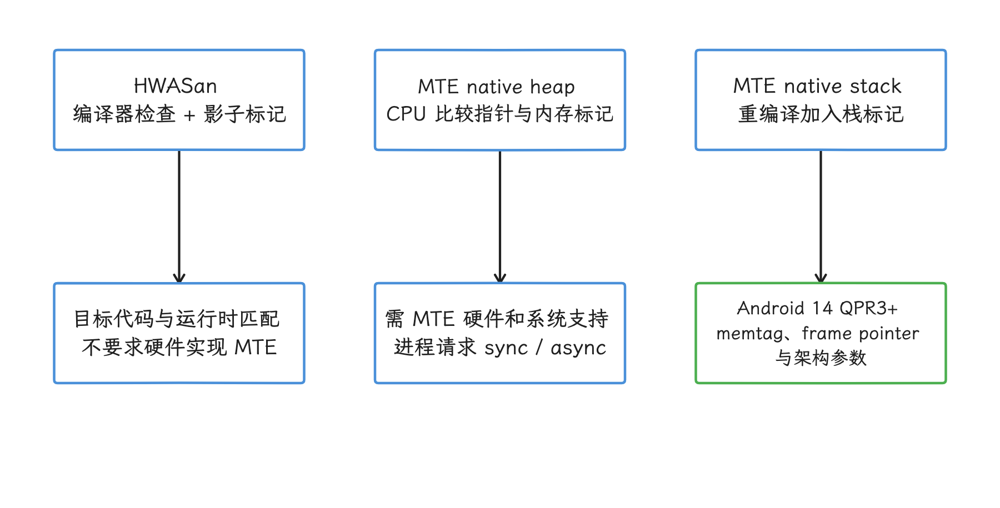

图：编译器插桩、硬件堆标记和栈标记需要不同的构建与运行条件。 标记粒度与概率限制仍在，不能覆盖所有内存错误；SYNC 精确定位，ASYNC 报告可能延后，ASYMM 不是清单值。

内核接口与标记故障处理可从 [`memory-tagging-extension.rst`](https://android.googlesource.com/kernel/common/+/refs/tags/android17-6.18-2026-06_r6/Documentation/arch/arm64/memory-tagging-extension.rst) 和 [`arch/arm64/include/asm/mte.h`](https://android.googlesource.com/kernel/common/+/refs/tags/android17-6.18-2026-06_r6/arch/arm64/include/asm/mte.h) 核对。

### 工具组合示例

#### Java 堆持续增长

1. 用 `dumpsys meminfo --package` 确认增长位于哪个进程和类别。
2. 用 LeakCanary 检查销毁组件与显式观察的业务对象。
3. 采集两份同条件 HPROF，用 MAT 比较 Histogram、Dominator Tree 与 Path to GC Roots。
4. 若对象数量主要体现短命分配，改用 Android Studio 分配记录或 heapprofd ART 模式观察频繁分配。

#### Native 堆持续增长

1. 用 `dumpsys meminfo` 看 Native Heap PSS/RSS 与 SwapPss。
2. 用 `showmap` 判断增长来自 `[anon:libc_malloc]`，还是独立匿名映射或文件映射。
3. 用 heapprofd 的连续快照查找持续增加的存活分配调用栈。
4. heapprofd 的存活字节数与 RSS 差距很大时，检查分配器内存区、碎片和独立 `mmap`。

#### Graphics 持续增长

1. 同时记录 Graphics、Native Heap、System 和进程列表。
2. 用 `dmabuf_dump`、SurfaceFlinger 与图形跟踪核对缓冲区数量、尺寸和跨进程引用。
3. 回到 Bitmap、Surface、Camera、Codec 或 WebView 的创建/释放生命周期。

#### Native 崩溃

1. 先保存 tombstone、构建 ID、ABI 和复现输入。
2. 可稳定复现时使用 HWASan 或 MTE SYNC 测试变体。
3. 错误在 `malloc/free` 等分配器检查点才显现时，选择 malloc debug 的 guard、free_track 或指针校验。
4. 通过原始错误地址和匹配符号确认修复，不用单个采样热点代替崩溃证据。

### 结果复核清单

- 采集的是 Java 堆、native 分配器、VMA、图形内存还是整机压力？
- 数据来自同一进程吗？包是否含多个进程？
- PSS、RSS、USS、SwapPss 和分配器存活字节数，是否被不加区分地混在了一起？
- 快照前后的业务状态、预热、GC、温度和后台负载是否一致？
- HPROF 是否只覆盖托管堆？Native Size 是否来自工具增强信息？
- heapprofd 使用 native 堆还是 `com.android.art`？采样间隔是多少？
- 报告是否有缓冲区溢出、缺少符号、`[DEDUPED]` 或驱动误报？
- `showmap` 是否只看到了已映射 VMA，而遗漏 fd/内核持有的 dma-buf？
- 内存安全检查器、malloc debug 或 hooks 是否改变了时序和内存行为？
- 修复后能否用相同脚本重复验证，并用另一类工具交叉印证？


## HPROF 生成、传输与引用图

工具选型确定要看 Java 对象之后，我们再来检查 dump 触发、停顿、文件传输和解析。Perfetto java_hprof 适合与时间线协同，与完整 HPROF 是两条不同的管线。

Android 上的“Java 堆转储”至少包含两类产物：

ART 负责执行应用的 Java/Kotlin 代码并管理对象内存；由 ART 分配、垃圾回收器自动回收的对象区域，就是这里的托管堆（managed heap）。HPROF 是记录类、对象及其引用关系的二进制堆快照格式。GC Root 是垃圾回收器开始可达性扫描的一组根：对象只要还能从任一 GC Root 沿引用链到达，就不会被回收。

| 产物 | 采集入口 | 主要数据 | 适合回答的问题 |
| --- | --- | --- | --- |
| 完整 ART HPROF | `am dumpheap`、`Debug.dumpHprofData()`、Android Studio | 对象、类、GC Root、引用、实例字段、基本类型数组等 | 某个字段保存了什么、对象沿哪条引用链存活、离线工具能否读取完整对象数据 |
| Perfetto ART Heap Graph | `android.java_hprof` | 类、对象大小、GC Root、引用图、可达性、部分 native size | 哪类对象增长、谁支配了大块内存、堆变化与 GC、内存压力或卡顿是否同一时段出现 |

表中的 native size 是 `NativeAllocationRegistry` 为部分 Java 对象登记的关联原生内存估算值，Android 13 起可由这条数据源采集。它覆盖的只是被登记的内存，代表不了进程的全部 native heap。

这两条管线都从 ART 的托管堆取快照，产物和暂停行为却不相同。`android.java_hprof` 这个名字容易造成误会：Perfetto 在目标进程中 fork（派生子进程）后，直接写入采用 Protocol Buffers（protobuf）编码的 `HeapGraph` 数据包，中间没有“先生成 HPROF 再解析”这一步。

§23.2 讨论泄漏模型；本文前文介绍 Android Studio Memory Profiler 与 LeakCanary。这里聚焦采集管线、各自的数据范围，以及可以对着源码核对的行为。

### 完整 HPROF：从 Shell 到 ART

#### `am dumpheap` 的参数

`ActivityManagerShellCommand.runDumpHeap()` 在 `android-17.0.0_r1` 中识别这些参数：

| 参数 | Android 17 行为 |
| --- | --- |
| `--user <ID|current>` | 指定查找进程的用户 |
| `-g` | 转储前在目标进程执行两次 `System.gc()`，中间运行对象终结器（finalization） |
| `-b <png|jpg|webp>` | 托管堆转储时包含 Bitmap（位图）像素数据，并指定编码格式；格式参数不可省略 |
| `-n` | 调用 `Debug.dumpNativeHeap()`，输出 native heap dump；native heap 指由 C/C++ 分配器管理的内存，这份产物不是 HPROF |
| `-m` | 调用 `Debug.dumpNativeMallocInfo()`，输出 `malloc` 分配信息，不是 HPROF；Android 17 的帮助文本没有列出这个解析器仍接受的选项 |

没有 `-g` 时，系统不会主动在转储前运行 GC。输出文件参数在解析器中可省略，省略后使用 `/data/local/tmp/heapdump-<时间>.prof`；自动化脚本宜显式给出设备侧路径，省得之后猜文件名。

下面的命令用于抓取一次已回收明显垃圾、且包含 PNG 编码 Bitmap 内容的完整 HPROF：

```bash
adb shell am dumpheap -g -b png \
  com.example.app /data/local/tmp/com.example.app.hprof
adb pull /data/local/tmp/com.example.app.hprof
```

`-b` 会把潜在的用户图像带进文件。文件应按敏感数据处理，分析结束后从设备和共享目录清理。

#### 调用链中每一层做什么

Android 17 的托管堆路径可以按下面的顺序阅读：

| 层 | 入口 | 职责 |
| --- | --- | --- |
| Shell | `ActivityManagerShellCommand.runDumpHeap()` | 解析参数、创建输出文件描述符（file descriptor，内核用一个整数表示已打开的文件）、等待异步回调 |
| system_server | `ActivityManagerService.dumpHeap()` | 检查权限与目标进程、临时关闭 Cached App Freezer、派发 Binder 调用 |
| 应用进程 | `ApplicationThread.dumpHeap()` | 复制文件描述符，把 `H.DUMP_HEAP` 消息送给 `ActivityThread` |
| 应用进程 | `ActivityThread.handleDumpHeap()` | 按选项运行 GC，并选择 managed、native heap 或 malloc-info 路径 |
| ART | `Debug.dumpHprofData()` → `art::hprof::DumpHeap()` | 停止托管线程，遍历堆并写 HPROF |

`system_server` 是承载 Android 核心系统服务的进程；Binder 是 Android 的跨进程调用机制。按这张表读，两个常见现象就有了出处：Shell 命令会等待目标进程异步完成；遍历堆和写文件的工作发生在目标应用进程，`system_server` 不经手这部分。

<!-- gracker-diagram: ch15-03-13-dumpheap-control-data -->
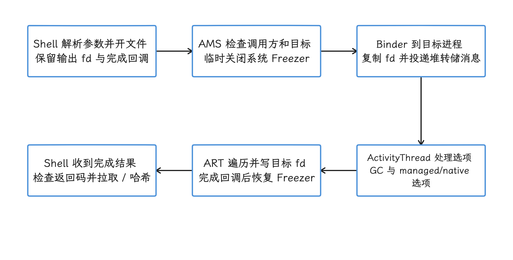

图：Shell 经 AMS 检查并传递文件描述符，真正的堆遍历和输出发生在目标进程。 图为正常成功路径；AMS 的 Freezer 开关与 ART 的托管线程暂停分别发生，采集成功后再拉取文件。

#### 权限检查和 Freezer 的含义

`ActivityManagerService.dumpHeap()` 要求调用方持有 `android.permission.SET_ACTIVITY_WATCHER`。该权限的保护级别是 `signature`，通常只授予使用平台签名的系统组件。AMS 还会调用 `enforceDebuggable()` 检查目标进程，所以别把 `am dumpheap` 当成面向任意发布应用的通用接口。

应用在自己的进程内调用公开的 `Debug.dumpHprofData()` 时，不经过 AMS 这组跨进程检查；ART 转储的停顿、I/O 和敏感数据风险照样都在。

Cached App Freezer（缓存应用冻结器）会暂停暂时不用的后台缓存进程，以减少其 CPU 活动。AMS 在请求前调用 `mCachedAppOptimizer.enableFreezer(false)`，完成回调中再调用 `enableFreezer(true)`。这段代码临时关闭的是系统范围的 Freezer，目的是防止目标进程已被冻结、接不了 Binder 请求。

目标进程的托管线程仍由更下层的 ART 在转储时暂停，这与 Freezer 的开关是两件事。

#### `-g` 在哪里生效

`ActivityThread.handleDumpHeap()` 只在 `runGc` 为 `true` 时执行以下序列：

```java
System.gc();
System.runFinalization();
System.gc();
```

该序列发生在调用 `Debug.dumpHprofData()` 之前。它能减少等待回收对象对快照的干扰，也会增加采集前的停顿；业务层已经不存在泄漏这件事，它证明不了。

随后，`handleDumpHeap()` 根据模式选择一个入口：

- managed：`Debug.dumpHprofData(path, fd, bitmapFormat)`；
- native heap：`Debug.dumpNativeHeap(fd)`；
- malloc info：`Debug.dumpNativeMallocInfo(fd)`。

因此，`-n` 和 `-m` 的产物要另找工具分析，HPROF 分析器不认这两类文件。

### ART 如何生成 HPROF

#### 停顿覆盖完整的两遍遍历

`art/runtime/hprof/hprof.cc` 的 `DumpHeap()` 先进入 `gc::ScopedGCCriticalSection`，也就是与垃圾回收互斥的临界区，再创建 `ScopedSuspendAll(..., true /* long suspend */)`。后一个作用域会停止其他托管线程，使对象和引用在遍历期间保持一致。

HPROF record 是带类型标记和长度的记录单元。`Hprof::Dump()` 在这个暂停范围内执行两遍：

1. 用计数输出器运行 `ProcessHeap(false)`，计算整体大小和最大 record 大小；
2. 清空访问状态，再由 `DumpToFile()` 或 DDMS（Dalvik Debug Monitor Service，Android 调试监控协议）路径写正式数据。

暂停覆盖计数遍历、正式遍历和文件输出，代价不止一次“扫对象”。耗时受对象数、字段与数组数据量、存储速度、Bitmap 内容和设备状态影响；“每 100 MB 几秒”这类固定数字跨不了设备，采集方案应在目标机型和目标堆规模上实测。

<!-- gracker-diagram: ch15-03-14-two-pass-pause -->
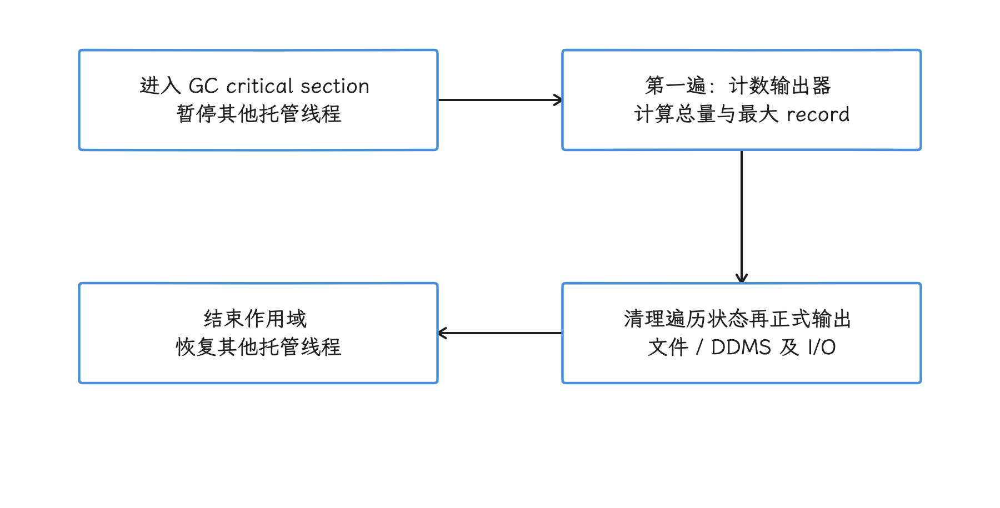

图：ART 在 GC 互斥与托管线程暂停范围内，先计数，再正式遍历并写文件。 暂停成本受对象、字段、数组、Bitmap 与 I/O 影响；不能用固定毫秒或每百 MB 经验值替代实测。

#### Android 17 HPROF 的结构

ART 写出的头部 magic（用于识别文件格式的固定字节序列）是 `JAVA PROFILE 1.0.3`，对象 ID 宽度为 4 字节。文件包含字符串与类定义、GC Root、类转储、实例转储、对象数组和基本类型数组等 record。

可以用下面的结构理解文件；写解析器时仍要按 record 的长度和 tag 读取，示意图只用来建立整体印象：

```text
Header
├── magic / identifier size / timestamp
├── STRING 与 LOAD_CLASS records
├── HEAP_DUMP_SEGMENT
│   ├── GC Root records
│   ├── CLASS_DUMP
│   ├── INSTANCE_DUMP
│   ├── OBJECT_ARRAY_DUMP
│   └── PRIMITIVE_ARRAY_DUMP
└── HEAP_DUMP_END
```

ART 的实现会在生成堆数据时收集字符串和类信息，再按分析工具需要的顺序组织输出。自行编写裁剪器时，还要处理 Android 扩展 tag（记录类型编号）、分段起止、对象 ID 和交叉引用。

<!-- gracker-diagram: ch15-03-15-hprof-record-layout -->
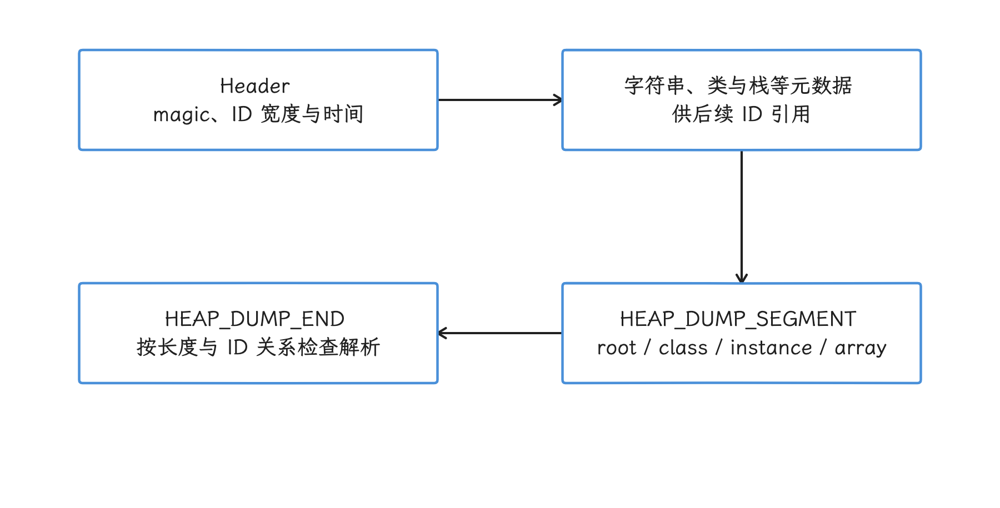

图：HPROF 通过带 tag 与长度的记录保存类、对象、root 和数组引用。 固定 A17 magic 为 JAVA PROFILE 1.0.3、对象 ID 为 4 B；示意顺序不能替代扩展 tag、分段和引用完整性校验。

<!-- gracker-diagram: ch15-03-16-direct-heap-graph-fork -->
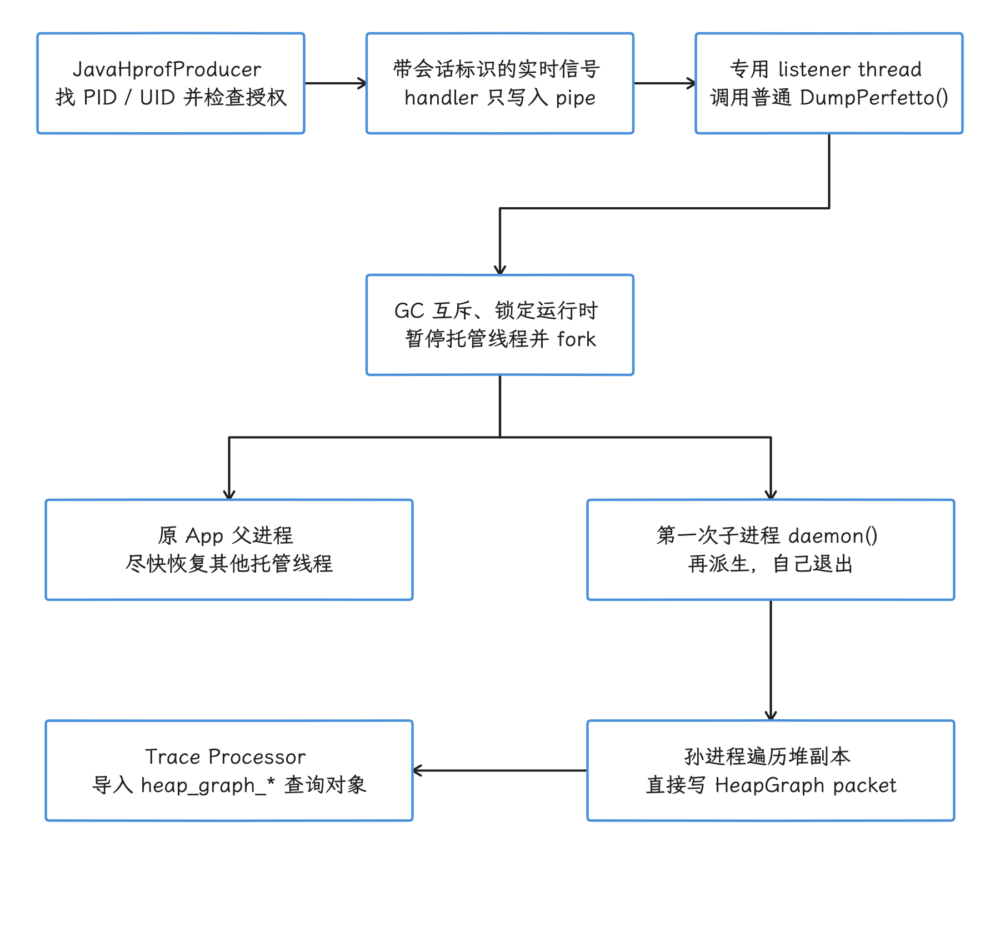

图：普通信号路径由 producer 授权与通知，ART 派生进程后直接写 HeapGraph。 图只表示普通 DumpPerfetto()；OOME 另用 DEFERRED 等待子进程，fork/COW 也不等于零成本。

#### app、zygote 与 image 只是空间归类

Android 的 `HPROF_HEAP_DUMP_INFO` record 标识对象所在的堆空间。app image 是 ART 为应用预先生成的对象镜像；Zygote space 保存从 Zygote 继承的对象；boot image space 保存核心类库预加载的镜像对象。

| 标识 | Android 17 归类规则 |
| --- | --- |
| `HPROF_HEAP_APP` | 常规应用对象，以及 app image 中的对象 |
| `HPROF_HEAP_ZYGOTE` | Zygote space 与 Zygote large-object space 中的对象 |
| `HPROF_HEAP_IMAGE` | boot image space 中的对象 |

zygote 或 boot image 对象通常不是应用泄漏的分配主体，但它们可能出现在 GC Root 路径中，相关类和字符串 record 也可能被其他对象引用。“很少是泄漏主体”和“整段可安全删除”是两回事：KOOM 一类工具会用配套的裁剪器和补全器维护文件引用关系，直接删除二进制区段，很容易得到解析不了、引用断裂的文件。

#### GC Root 和对象遍历

`Hprof::VisitRoot()` 把 ART 的 root 类型映射为标准或 Android 扩展 HPROF tag，例如 JNI global/local、Java frame、native stack、sticky class、thread object、interned string、debugger、VM internal 和 JNI monitor。它们是分析器保留的 root 分类名，用来标明引用来自原生句柄、线程栈、类表或虚拟机内部结构。

JNI 让 Java/Kotlin 代码与 C/C++ 代码互相调用；JNI global/local 是原生代码持有的全局或局部 Java 引用。

`ProcessBody()` 访问运行时 root、image root，再通过 `Heap::VisitObjectsPaused()` 访问对象。对象按类型写成 class、instance、object array 或 primitive array record。泄漏分析器会据此计算从 GC Root 到对象的路径、可达性和 dominator tree（支配树）。若从任一 GC Root 到对象 B 的路径都经过对象 A，就说 A 支配 B；单个字段引用只表示图中的一条边，推不出这种支配关系。

### Perfetto `android.java_hprof`：直接采集引用图

#### 这条链路从 Android 11 已经存在

`android.java_hprof` 支持 Android 11 及以上版本。管线由 heapprofd（Perfetto 的堆分析守护进程）中的 `JavaHprofProducer` 和目标进程中的 ART Perfetto 插件协作完成：

1. traced（Perfetto 的跟踪服务）把 `JavaHprofConfig` 交给 `JavaHprofProducer`；
2. producer 根据 `pid` 或 `process_cmdline` 找到目标，读取有效 UID（Linux 用来标识用户身份的数字）并调用 `CanProfile()`；
3. producer 用 `sigqueue()` 发送 `__SIGRTMIN + 6` 这个 Linux 实时信号，信号值携带标识本次跟踪会话的 tracing session ID（本次跟踪会话的编号）；
4. ART 插件的信号处理器只向 pipe（进程内管道） 写一个通知，专用的 listener thread（监听线程） 收到后再调用 `DumpPerfetto()`；
5. ART 进入与 GC 互斥的临界区，暂停托管线程、锁定运行时结构并执行第一次 fork；父进程随后尽快恢复托管线程；
6. 第一次 fork 出来的子进程调用 `daemon()`，再次派生并脱离原会话；最终由孙进程遍历 fork 时刻的堆副本，用 trace writer（向 Perfetto trace 缓冲区写数据的接口） 把 `HeapGraph` 数据包写进 Perfetto trace 缓冲区；
7. Trace Processor（Perfetto 的导入与 SQL 分析引擎）读取 protobuf 数据包，生成 `heap_graph_*` SQL 表。

Java producer 只负责找进程、做授权和发信号。它不会接收 HPROF 文件描述符，也没有 `ArtHprofParser` 把临时 HPROF 转成 protobuf 的步骤。

fork 把父进程的暂停范围缩到准备快照和创建子进程的阶段，图遍历由派生进程继续完成。父子进程起初共享物理内存页，某一方修改页面时才复制该页（Copy-on-Write）。因此采集仍有 fork、页表、页面复制、子进程内存和序列化开销，谈不上零成本。

#### TraceConfig 示例

textproto 是 Protocol Buffers 的可读文本写法。下面的配置会在数据源启动时立即抓一份图，30 秒后抓第一份追加快照，此后每 60 秒再抓一份：

```protobuf
buffers {
  size_kb: 65536
  fill_policy: RING_BUFFER
}

data_sources {
  config {
    name: "android.java_hprof"
    java_hprof_config {
      process_cmdline: "com.example.app"
      min_anonymous_memory_kb: 10240
      dump_smaps: true
      continuous_dump_config {
        dump_phase_ms: 30000
        dump_interval_ms: 60000
        scan_pids_only_on_start: false
      }
    }
  }
}

duration_ms: 180000
```

`StartDataSource()` 总会立即调用一次 `SendSignal()`。`dump_interval_ms` 非零时，`dump_phase_ms` 是第一次追加采集前的延迟，只延迟追加采集，开头那份快照不受影响；后续每隔 `dump_interval_ms` 再采一份。

<!-- gracker-diagram: ch15-03-17-continuous-request-times -->
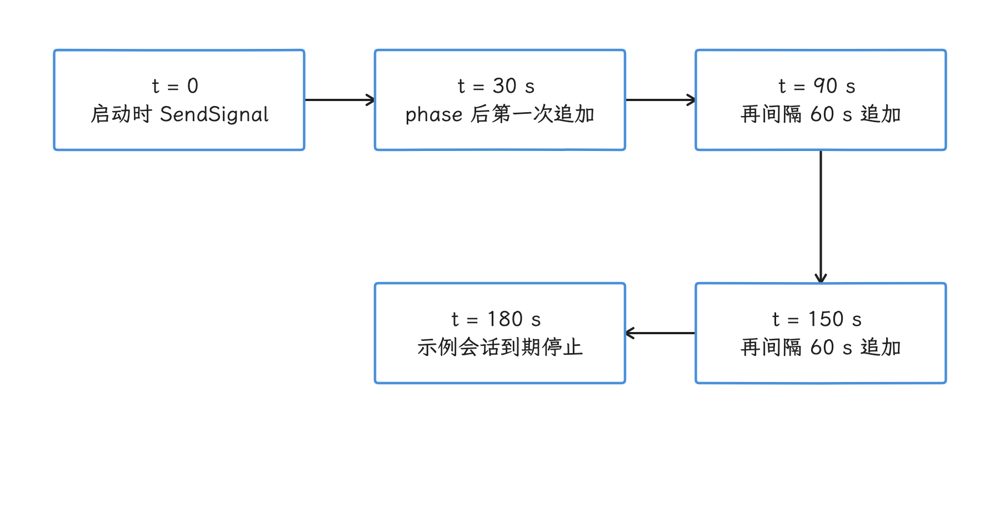

图：该配置计划在启动时请求一次，再按 phase 与 interval 追加请求。 下列时间均相对数据源启动，表示请求计划；实际图的时间、成功率和完整性以记录与日志为准。

#### 配置字段的含义

| 字段 | Android 17 语义 |
| --- | --- |
| `process_cmdline` | repeated（字段可写多次）；按 `/proc/<pid>/cmdline` 这个进程命令行伪文件匹配。Android 13 起允许一个 `*` 通配符 |
| `pid` | repeated；直接指定 PID（操作系统进程号），适合局部调试或外部触发场景 |
| `target_installed_by` | repeated；可限制为一个或多个 installer（安装来源），特殊值有 `@system`、`@product`、`@null` |
| `continuous_dump_config` | 设置追加采集的 phase（首次追加延迟）、interval（后续间隔），以及是否每轮重新扫描 PID |
| `min_anonymous_memory_kb` | 跳过 anon RSS 与 swap 之和低于阈值的进程；anon RSS 是当前驻留在物理内存中的匿名页，swap 是已换出的匿名页 |
| `dump_smaps` | 附带经过路径过滤的 `/proc/self/smaps` 内存映射统计 |
| `ignored_types` | repeated；从图中排除指定类型，可能改变引用图与 retained size 结果 |

Android 12 及更早版本默认只在数据源启动时扫描 PID；Android 13 及以上默认每轮重扫。配置文件显式写出 `scan_pids_only_on_start`，能避免同一配置在跨版本设备上表现不同。

#### `CanProfile()` 如何决定能否采集

`producer_support.cc` 按 build type（系统构建类型）、UID（系统服务使用的身份）、trace session initiator（跟踪会话发起者） 和 `packages.list` 联合判断。`packages.list` 是系统维护的已安装包及其 UID、调试和 profileable 属性清单：

- 非 `user` 构建，也就是 `userdebug` 或 `eng` 等开发构建，直接允许；
- `user` 构建上的普通应用会映射到 `packages.list`；
- 普通 Shell 发起的 session 要求目标为 `profileable_from_shell` 或 `debuggable`；
- trusted-system session 要求目标为 `profileable` 或 `debuggable`；
- 平台 UID 只允许 trusted-system initiator；
- isolated UID（隔离进程使用、映射不回应用包的临时身份）采用更保守的规则；
- 配置了 `target_installed_by` 时，installer 还要命中允许列表。

`profileable_from_shell` 表示应用允许 Shell 发起性能分析，`profileable` 表示允许受信任的系统会话分析，`debuggable` 表示应用允许调试。这组检查与 `am dumpheap` 的 `SET_ACTIVITY_WATCHER`、`enforceDebuggable()` 不是同一套权限模型。排查“抓不到图”时，应同时确认 trace 发起者、应用 Manifest 中的 profileable/debuggable 属性、目标进程 UID 和 installer 条件。

<!-- gracker-diagram: ch15-03-18-permission-models -->
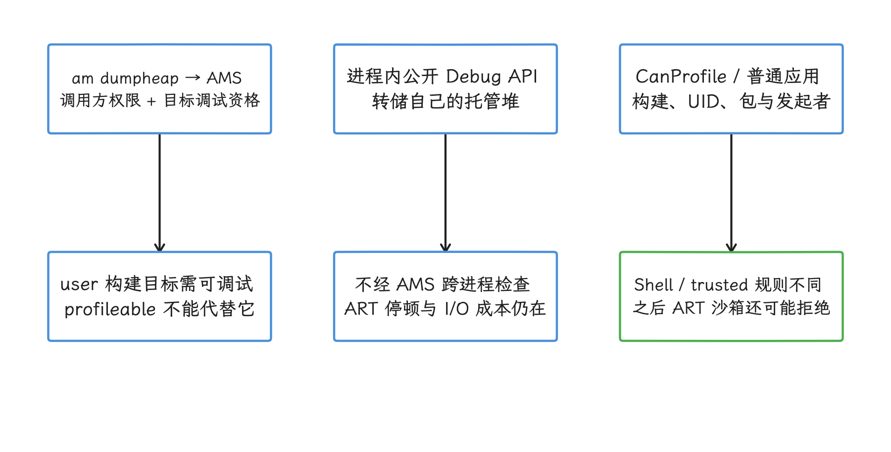

图：跨进程完整堆转储、进程内公开 API 与 Perfetto producer 使用不同授权路径。 CanProfile 还按构建、UID、发起者与包分支提前返回；installer 条件只在进入包检查的路径生效。

Android 17 的 ART 插件还会在 `DumpPerfetto()` 中检测 Chromium/WebView 的严格 seccomp（限制进程可执行系统调用的沙箱机制）沙箱。命中时会记录 `Chromium seccomp detected, skipping Perfetto heap dump` 并跳过采集，即使 `CanProfile()` 已允许目标也不会生成引用图。排查空报告时，应检查目标进程日志及沙箱类型。

### Perfetto 引用图和完整 HPROF 差在哪

Perfetto 文档把 `android.java_hprof` 的结果称为 ART Heap Dump。它记录类型、对象、大小、root 和对象间引用；实例的基本类型字段值、字符串内容、基本类型数组字节和 Bitmap 像素，要靠完整 HPROF 才带得动——所以完整 HPROF 文件更大，也更容易包含隐私数据。

Trace Processor 也能导入完整 ART HPROF，导入后填充 HPROF 专用的数据表。这是分析器多支持的一种输入格式；实时 `android.java_hprof` 采集产出的仍是 `HeapGraph` 数据包。

<!-- gracker-diagram: ch15-03-19-artifact-value-boundaries -->
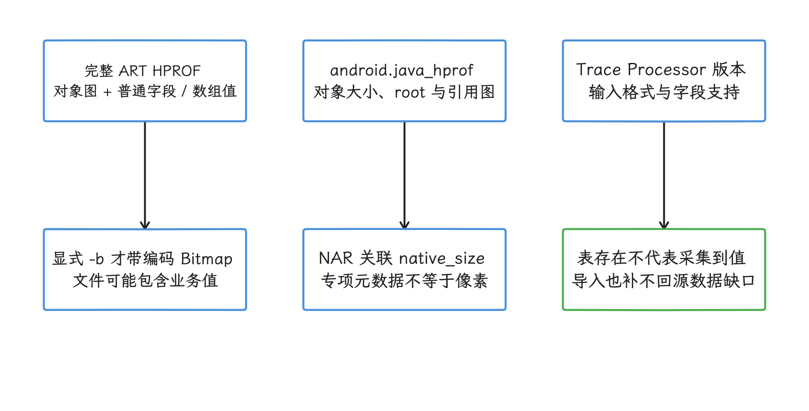

图：对象图、普通字段值和专项元数据要按采集产物与分析器版本分别判断。 Bitmap 像素需显式转储；HeapGraph 可有受 flag 控制的 Bitmap 元数据，固定 r1 导入器仍可能不消费新增字段。

| 能力 | 实时 `android.java_hprof` | 导入完整 ART HPROF |
| --- | --- | --- |
| 类、对象、root、引用关系 | 有 | 有 |
| `self_size`、`native_size`、可达性 | 有 | 有 |
| 实例基本类型字段 | 无 | 有 |
| 解码后的 `String`、基本类型数组数据 | 无 | 有 |
| 与 trace 时间轴直接对齐 | 有 | 取决于导入方式 |
| 父进程完整序列化期间保持暂停 | 否，fork 后由子进程遍历 | 是，传统 HPROF 在父进程内完成两遍 |

### Trace Processor 表与正确的 SQL 用法

#### 表结构

这些公开视图的底层表由 `profiler_tables.py` 定义：

| 表 | 关键列 | 说明 |
| --- | --- | --- |
| `heap_graph_class` | `id`、`name`、`deobfuscated_name`、`location`、`superclass_id`、`classloader_id`、`kind` | 类定义 |
| `heap_graph_object` | `id`、`upid`、`graph_sample_ts`、`self_size`、`native_size`、`reference_set_id`、`reachable`、`heap_type`、`type_id`、`root_type` | 对象；UPID 是 Trace Processor 分配的唯一进程 ID，可区分系统 PID 被重复使用的情况 |
| `heap_graph_reference` | `reference_set_id`、`owner_id`、`owned_id`、字段名与字段类型 | 对象引用 |
| `heap_graph_object_data` | `field_set_id`、字符串值、基本类型数组元数据 | 仅完整 HPROF 会填充 |
| `heap_graph_primitive` | `field_set_id`、字段名、类型和值列 | HPROF 实例的基本类型字段 |

`deobfuscated_name` 是应用反混淆映射后恢复的类名。`classloader_id` 指向加载该类的 `ClassLoader` 对象；同名类若由不同类加载器载入，仍可能是不同类型。`reference_set_id` 和 `field_set_id` 是跨表关联键，用来把对象与其引用或基本类型字段值连起来。

生成表都带隐式 `id` 主键，所以 `heap_graph_object.id` 可以与 `owner_id`、`owned_id` 关联。`profiler_tables.py` 的 `columns` 列表没有手写 `id`，SQL 表里的 `id` 一直都在。

<!-- gracker-diagram: ch15-03-20-heap-graph-join-keys -->
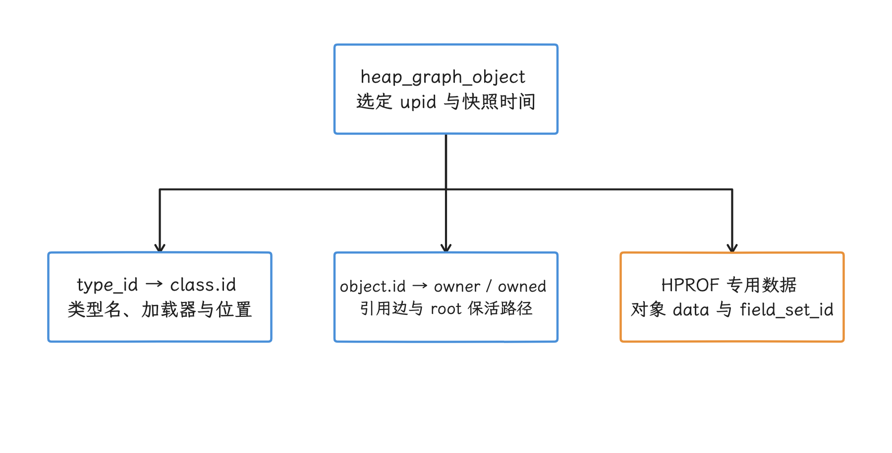

图：先选定对象的进程与快照，再用类型、对象和字段集合 ID 关联其他查询对象。 源对象地址、TP 对象行 id、type_id 与类名各有作用域；同名不同加载器的类型不能仅按名称混算。

没有一张名为 `heap_graph` 的采样元信息表。同一 `(upid, graph_sample_ts)` 的全部 `heap_graph_object` 行构成一次 dump，其中 `graph_sample_ts` 是采样时间戳。trace 中包含多次采集时，查询要同时限定进程和时间戳。

<!-- gracker-diagram: ch15-03-21-quality-before-latest -->
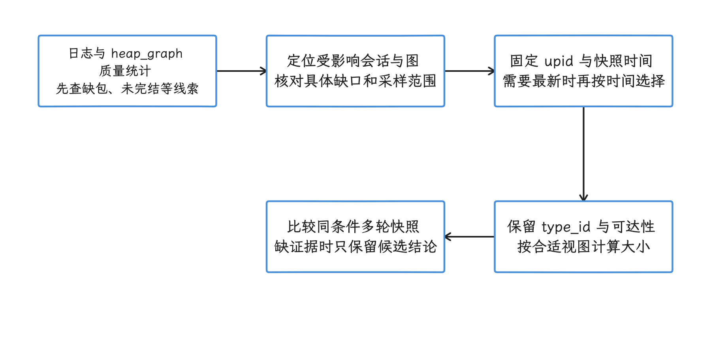

图：先检查质量并定位受影响的图，再选取目标快照并解释大小变化。 合成缺包测试仍可输出看似正常的最新行；MAX(graph_sample_ts) 不是完整性标志，不能自动恢复缺失引用。

#### 统计最新快照中各类的 shallow size

shallow size 只计算对象自身占用的 Java 堆空间。下面的查询为每个进程选取时间戳最新的一份图，再按类统计对象数与 `self_size`：

```sql
WITH latest_dump AS (
  SELECT
    upid,
    MAX(graph_sample_ts) AS graph_sample_ts
  FROM heap_graph_object
  GROUP BY upid
)
SELECT
  o.upid,
  COALESCE(c.deobfuscated_name, c.name) AS class_name,
  COUNT(*) AS object_count,
  SUM(o.self_size) AS shallow_size_bytes
FROM heap_graph_object AS o
JOIN latest_dump AS d
  USING (upid, graph_sample_ts)
JOIN heap_graph_class AS c
  ON o.type_id = c.id
WHERE o.reachable = 1
GROUP BY o.upid, class_name
ORDER BY shallow_size_bytes DESC;
```

这个结果回答“类实例自身占了多少 Java 堆”。retained size 还包括仅能通过该对象到达的被支配对象；查询没有计算这部分。

#### 用标准库计算 class-level dominated size

retained size 要基于 dominator tree。Perfetto 已提供实现，下面的查询直接使用 Android heap graph 的标准库聚合模块：

```sql
INCLUDE PERFETTO MODULE android.memory.heap_graph.heap_graph_class_aggregation;

SELECT
  upid,
  graph_sample_ts,
  type_name,
  obj_count,
  size_bytes,
  dominated_obj_count,
  dominated_size_bytes
FROM android_heap_graph_class_aggregation
WHERE reachable_obj_count > 0
ORDER BY dominated_size_bytes DESC
LIMIT 50;
```

`dominated_size_bytes` 来自 dominator tree，并按类聚合。入边指其他对象指向当前对象的引用；用“只有一个入边”推算 retained size，碰到共享引用、root、引用环和不可达对象就会得出错误结果。

#### 查看按 root 路径聚合的类树

定位某类对象经哪类 root 路径存活时，可以使用 class summary tree 模块：

```sql
INCLUDE PERFETTO MODULE android.memory.heap_graph.class_summary_tree;

SELECT
  upid,
  graph_sample_ts,
  id,
  parent_id,
  name,
  root_type,
  self_count,
  self_size,
  cumulative_count,
  cumulative_size
FROM android_heap_graph_class_summary_tree
ORDER BY cumulative_size DESC
LIMIT 100;
```

表中的 `parent_id` 组成按最短 root 路径聚合后的树，`cumulative_size` 是节点及其后代的总和。flamegraph（火焰图） 会用层级块展示这些路径及其大小；这里的类路径树与单对象 dominator tree 含义不同，阅读时不要混用。

<!-- gracker-diagram: ch15-03-22-three-size-views -->
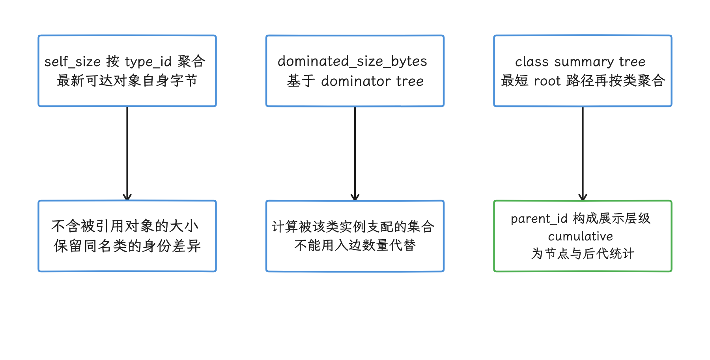

图：自身字节、dominator 聚合和按最短 root 路径形成的类树分别回答不同问题。 后两段示例按各图保留进程和时间键，但 LIMIT 是全局排名；路径树父子边不能当作支配关系。

### 工具选择与采集流程

#### 需要完整对象值

在可控的调试环境中使用 Android Studio Memory Profiler、`am dumpheap` 或进程内 `Debug.dumpHprofData()`。采集前确认：

- 目标进程是否属于预期 Android 用户或工作资料（user/profile）；
- 是否需要 `-g`，以及能否接受额外 GC；
- 是否需要 Bitmap 数据；
- 设备剩余空间和文件保存位置；
- HPROF 中是否可能出现 token、账号、文本、图片或其他用户数据；
- 分析器是否支持 Android 扩展 HPROF。

采集完成后先保留原文件的只读副本，再让转换、裁剪或脱敏工具处理副本。这样能区分“采集不完整”和“后处理破坏格式”。

#### 需要时间关联或较短的父进程停顿

使用 `android.java_hprof`，并把采集点与这些事件放在同一条 Perfetto trace 中：

- `art`/GC 事件；
- `process_stats`、内存计数器与 LMK 相关事件；
- 主线程调度、Binder 和帧时间；
- native heap 问题需要另行启用的 `android.heapprofd`。

Java heap graph 和 native allocation profile（原生内存分配采样） 是两个数据源。Java 对象的 `native_size` 只反映 `NativeAllocationRegistry` 登记给该对象的近似原生内存值，替代不了 native heap 分配采样。

#### KOOM fork-dump 的使用边界

KOOM 2.2.1 的 `ForkJvmHeapDumper` 源码执行 `suspendAndFork()`：子进程调用 `Debug.dumpHprofData(path)`，父进程走 `resumeAndWait(pid)`。`ForkStripHeapDumper` 在这条路径上安装 HPROF 裁剪逻辑，仓库同时提供用于处理裁剪产物的 `koom-fill-crop.jar`。

这些代码依赖 ART 内部实现和版本适配。入口会调用 `sdkVersionMatch()` 读取 KOOM 公共配置中的版本检查结果，不支持时拒绝转储。源码中存在 fork 设计，但据此认定 KOOM 已适配 Android 17，或者推出一个固定的毫秒级停顿，都站不住。

接入 Android 17 时，要核对 KOOM 版本、ART 私有符号与实现、目标厂商 ROM（厂商定制的系统镜像）、子进程资源占用、文件可解析性和失败回退。

<!-- gracker-diagram: ch15-03-23-koom-adaptation-gates -->
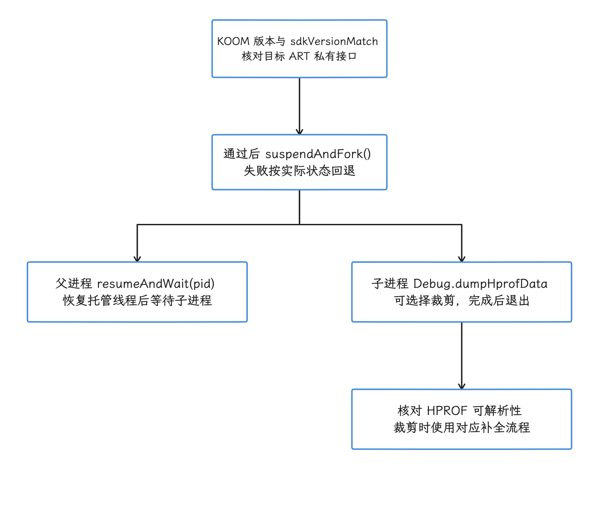

图：KOOM 固定版本先检查适配，再分别执行父进程恢复/等待与子进程堆转储。 图依据 2.2.1 源码，不证明已适配 Android 17；恢复托管线程不等于调用线程立即返回，也不保证固定停顿。

Perfetto ART Heap Graph 自身也使用 fork。只需要引用图和时间轴时，可先评估系统数据源；需要完整 HPROF、第三方告警策略或定制裁剪时，再评估 KOOM 一类方案。

### 源码核对清单

阅读或排障时，可以从这些断点逐层核对：

1. `ActivityManagerShellCommand.runDumpHeap()`：参数、默认文件名和等待回调；
2. `ActivityManagerService.dumpHeap()`：`SET_ACTIVITY_WATCHER`、`enforceDebuggable()` 与 Freezer；
3. `ActivityThread.handleDumpHeap()`：`-g` 的 GC 序列和三种 dump 分支；
4. `art::hprof::DumpHeap()`、`Hprof::Dump()`：GC critical section、long suspend 与两遍遍历；
5. `JavaHprofProducer::DataSource::SendSignal()`：PID、UID、`CanProfile()` 与 `SIGRTMIN + 6`；
6. `art/perfetto_hprof/perfetto_hprof.cc`：pipe listener、fork、父进程恢复和派生进程写 packet；
7. `profiler_tables.py` 与 `android.memory.heap_graph.*` SQL 模块：表列、采样键和 dominator 聚合。

这条清单把“命令是否发出”“目标为何拒绝”“进程在哪里停”“产物含哪些数据”“SQL 为何算错”分到对应源码层，排查时不必把所有失败都归到 HPROF 解析器。


## 版本与实现边界

| Android 版本 | 相关变化 |
| --- | --- |
| Android 11 | `android.java_hprof` 可用于 ART heap graph 采集 |
| Android 12 | `target_installed_by` 可用；`scan_pids_only_on_start` 默认 `true` |
| Android 13 | `process_cmdline` 支持一个通配符；连续采集默认每轮重扫进程 |
| Android 14—17 | 保持 fork 后写 HeapGraph 的主线；配置与权限仍应按目标 tag 核对 |
| Android 17 / API 37 | 平台源码锚点为 `android-17.0.0_r1` |

版本表用于说明行为演进。命令参数、私有 ART 入口、Perfetto proto 字段和 SQL 模块名都可能随 tag 变化，跨版本脚本应带版本检查。


## 参考资料

### 内存工具与 Native、图形内存

- [LeakCanary 工作原理](https://square.github.io/leakcanary/fundamentals-how-leakcanary-works/)
- [LeakCanary 2.14 安装](https://square.github.io/leakcanary/getting_started/)
- [LeakCanary 手动安装 API](https://square.github.io/leakcanary/api/leakcanary/-app-watcher/manual-install/)
- [LeakCanary UI tests](https://square.github.io/leakcanary/ui-tests/)
- [LeakCanary for release builds](https://square.github.io/leakcanary/leakcanary-for-releases/)
- [Android Studio Quail 2：LeakCanary Profiler task 发布说明](https://developer.android.com/blog/posts/android-studio-quail-2-is-stable-multi-task-with-the-android-studio-ai-agent)
- [Eclipse Memory Analyzer](https://eclipse.dev/mat/)
- [Android Studio Heap Dump](https://developer.android.com/studio/profile/capture-heap-dump)
- [Android Bitmap 内存版本边界](https://developer.android.com/topic/performance/graphics/manage-memory)
- [Perfetto heapprofd](https://perfetto.dev/docs/data-sources/native-heap-profiler)
- [Perfetto `heap_profile` 命令](https://perfetto.dev/docs/reference/heap_profile-cli)
- [`tools/heap_profile`（AOSP `android-17.0.0_r1`）](https://android.googlesource.com/platform/external/perfetto/+/refs/tags/android-17.0.0_r1/tools/heap_profile)
- [Android `<profileable>`](https://developer.android.com/guide/topics/manifest/profileable-element)
- [Android 进程内存指标](https://developer.android.com/topic/performance/memory-management)
- [Android `dumpsys meminfo`](https://developer.android.com/studio/command-line/dumpsys#meminfo)
- [libmeminfo（AOSP `android-17.0.0_r1`）](https://android.googlesource.com/platform/system/memory/libmeminfo/+/refs/tags/android-17.0.0_r1/)
- [bionic malloc debug（AOSP `android-17.0.0_r1`）](https://android.googlesource.com/platform/bionic/+/refs/tags/android-17.0.0_r1/libc/memory/malloc_debug/README.md)
- [bionic malloc hooks（AOSP `android-17.0.0_r1`）](https://android.googlesource.com/platform/bionic/+/refs/tags/android-17.0.0_r1/libc/memory/malloc_hooks/README.md)
- [Android NDK `wrap.sh`](https://developer.android.com/ndk/guides/wrap-script)
- [Android NDK HWASan](https://developer.android.com/ndk/guides/hwasan)
- [Android NDK MTE](https://developer.android.com/ndk/guides/arm-mte)
- [AOSP MTE 工作模式](https://source.android.com/docs/security/test/memory-safety/arm-mte)
- [内核 smaps/PSS（`android17-6.18-2026-06_r6`）](https://android.googlesource.com/kernel/common/+/refs/tags/android17-6.18-2026-06_r6/fs/proc/task_mmu.c)
- [内核 dma-buf（`android17-6.18-2026-06_r6`）](https://android.googlesource.com/kernel/common/+/refs/tags/android17-6.18-2026-06_r6/Documentation/driver-api/dma-buf.rst)

### HPROF 与 ART Heap Graph

- [ActivityManagerShellCommand.java（android-17.0.0_r1）](https://android.googlesource.com/platform/frameworks/base/+/refs/tags/android-17.0.0_r1/services/core/java/com/android/server/am/ActivityManagerShellCommand.java)
- [ActivityManagerService.java（android-17.0.0_r1）](https://android.googlesource.com/platform/frameworks/base/+/refs/tags/android-17.0.0_r1/services/core/java/com/android/server/am/ActivityManagerService.java)
- [ActivityThread.java（android-17.0.0_r1）](https://android.googlesource.com/platform/frameworks/base/+/refs/tags/android-17.0.0_r1/core/java/android/app/ActivityThread.java)
- [ART hprof.cc（android-17.0.0_r1）](https://android.googlesource.com/platform/art/+/refs/tags/android-17.0.0_r1/runtime/hprof/hprof.cc)
- [ART perfetto_hprof.cc（android-17.0.0_r1）](https://android.googlesource.com/platform/art/+/refs/tags/android-17.0.0_r1/perfetto_hprof/perfetto_hprof.cc)
- [Perfetto java_hprof_producer.cc（android-17.0.0_r1）](https://android.googlesource.com/platform/external/perfetto/+/refs/tags/android-17.0.0_r1/src/profiling/memory/java_hprof_producer.cc)
- [Perfetto JavaHprofConfig proto（android-17.0.0_r1）](https://android.googlesource.com/platform/external/perfetto/+/refs/tags/android-17.0.0_r1/protos/perfetto/config/profiling/java_hprof_config.proto)
- [Perfetto Java heap profiler 文档](https://perfetto.dev/docs/data-sources/java-heap-profiler)
- [Perfetto Heap Dump Explorer 文档](https://perfetto.dev/docs/visualization/heap-dump-explorer)
- [KOOM 2.2.1](https://github.com/KwaiAppTeam/KOOM/tree/v2.2.1)
