# dumpsys 系列命令

`dumpsys` 把各系统服务在某一时刻或一段累计周期内的内部状态打成一份文本快照，适合快速缩小排查范围，但给不了完整的时间线。我们调用每个子命令之前，先确认它的统计窗口、重置行为和字段含义，再与 trace、日志或复现步骤交叉验证。

> 源码基线：AOSP `android-17.0.0_r1`，内核 `android17-6.18-2026-06_r6`；涉及 `/proc` 记账的说明以后者为准，HWC（Hardware Composer，硬件合成器接口） 与厂商服务扩展按设备对应分支复核。

## 为什么需要 dumpsys

`dumpsys` 每次调用，都是让一个 Binder 服务在采集时刻把它对外公开的内部状态打出来：它在 ServiceManager 这张系统服务注册表里找到目标服务，调用服务的 dump 接口，不会直接扫描服务进程的内存。

所以我们常拿它回答“当前焦点在哪个窗口”“进程现在处于哪个 OOM 调整级别”“最近保留了哪些 HWUI 帧”这类快照式问题。事件先后要交给 Perfetto、Winscope 和 bugreport；一份文本快照证明不了谁先谁后。

具体到实现，[`dumpsys.cpp`](https://android.googlesource.com/platform/frameworks/native/+/refs/tags/android-17.0.0_r1/cmds/dumpsys/dumpsys.cpp) 从 ServiceManager 取得服务列表，用 `checkService()` 找到目标 Binder，再调用 `IBinder::dump()`。全量模式按服务名排序后逐项执行，单个服务的默认超时为 10 秒；超时后 `dumpsys` 只是放弃等待这份输出，服务内部可能还在继续采集。

下面的命令用于确认设备上有哪些服务，并控制一次 dump 的范围。

```bash

<!-- gracker-diagram: ch15-04-01-binder-and-output -->
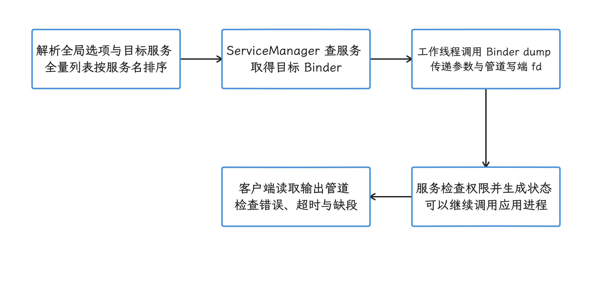

图：客户端查服务并发出 dump 请求，服务把状态写入传来的 fd，客户端在等待期限内读取。 默认每服务 10 秒；超时关闭读端不取消服务工作，退出码 0 也不能证明输出完整。

# 列出当前注册且可见的 Binder 服务
adb shell dumpsys -l

# 把单个服务的等待上限设为 3 秒
adb shell dumpsys -T 3000 activity activities

# 只查询服务所在进程的 PID
adb shell dumpsys --pid SurfaceFlinger

# 只 dump 注册为 CRITICAL 优先级的服务
adb shell dumpsys --priority CRITICAL
```

`-t` 的单位是秒，`-T` 的单位是毫秒；二者属于 `dumpsys` 的全局参数，应写在服务名之前。全量模式下，全局 `--proto` 会筛选注册时声明 `DUMP_FLAG_PROTO` 的服务，并向这些服务传入 proto 参数；指定单个服务时，要遵循该服务自己的参数顺序，例如 `dumpsys activity --proto`。proto 只表示 Protocol Buffers 编码，文本输出并不会因此变成字段稳定的 schema（结构定义）。

从 `adb shell` 发起的命令通常具备平台 `DUMP` 权限，但输出仍可能被裁剪：普通应用 UID、受限 user build、厂商服务的额外权限检查和 SELinux 策略都会起作用，SELinux 还会按进程域限制可访问的服务和文件。所以脚本应保存 build fingerprint（唯一标识这版系统构建的字符串）、命令行和采集时间；字段名称也不属于 SDK 兼容承诺。

<!-- gracker-diagram: ch15-04-02-observation-windows -->
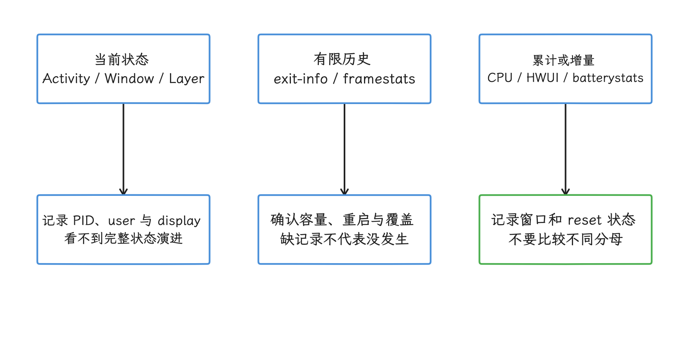

图：同一份 dump 可能包含当前状态、保留的历史或一段统计窗口，取证前先辨明来源。 各服务、各进程的输出不是全系统原子快照；命令开始时间也不等于每个字段的采样时间。

## dumpsys activity：Activity 栈、进程与 ANR 信息

排查生命周期卡住、进程退出或 ANR 时，我们要先把 Activity 栈、进程状态和退出历史拿到手。`activity` 服务覆盖 ActivityTaskManager、进程管理、Service 和退出记录几个方向，其中 ActivityTaskManager 负责 Activity 与 Task 的生命周期和层级。一次排障只请求相关子项，免得在庞大的默认输出里丢失现场。

下面的命令分别采集任务栈、进程 OOM 状态和退出历史。

```bash
# Task、ActivityRecord 与各显示器上的 resumed 状态
adb shell dumpsys activity activities

# 完整进程记录；oom 子项更适合只看 OOM 调整结果
adb shell dumpsys activity processes
adb shell dumpsys activity oom

# ApplicationExitInfo 历史与最近一次 ANR 快照
adb shell dumpsys activity exit-info com.example.app
adb shell dumpsys activity lastanr
```

`activities` 的输出按 display、TaskDisplayArea、root task 和 Task 逐层组织——从物理屏、虚拟屏这样的显示目标，到容纳任务的显示区域，再到其下 Task 的根容器。排查生命周期时，我们关注 `ActivityRecord` 的 `state`、`visible`、`finishing`、所属 `taskId`，并记录目标 display。`Resumed:` 或 `topDisplayFocusedRootTask` 描述的是 ActivityTaskManager 的任务状态，和窗口焦点是两回事，也保证不了 InputDispatcher 正向该 Activity 投递输入。

反复执行这条命令，可以观察状态是否长期卡住；拿它当启动耗时计时器并不合适——两次 shell 调用之间隔着 Binder 调度、格式化和传输开销，启动阶段的毫秒级时序应交给 Perfetto、event log 或 launch metrics。

### 读懂 OOM 调整值

OOM adjustment（简称 OOM adj）是系统交给 lmkd 的进程保护分数，衡量的是内存压力下的回收顺序，而非进程是否已经 OOM。[`psc/Constants.java`](https://android.googlesource.com/platform/frameworks/base/+/refs/tags/android-17.0.0_r1/services/core/java/com/android/server/am/psc/Constants.java) 定义了几个基准值：`FOREGROUND_APP_ADJ=0`、`VISIBLE_APP_ADJ=100`、`PERCEPTIBLE_APP_ADJ=200`，cached 区间从 900 开始。数值越大，内存压力下通常越早进入回收候选；负值留给 system、persistent 等高保护级别进程。

`processes` 详细记录中的字段要分开读：

| 字段 | 含义 |
|---|---|
| `curRaw` | 本轮计算中尚未施加部分修正的 raw adj |
| `setRaw` | 上次写入记录的 raw adj |
| `cur` | 本轮计算后的目标 adj |
| `set` | 已提交给进程/LMKD 路径的 adj |
| `adjType`、`adjSource`、`adjTarget` | 哪个组件关系抬高或降低了进程保护级别 |

可见进程还可能受 laddering 影响：系统按可见层级等信息把多个进程分配到 100—199 之间的细分值，具体行为也受设备配置控制。发现 `set` 与界面状态不符时，我们应连同 `adjType`、绑定服务、ContentProvider、前台服务和显示器可见性一起核对，别只凭一个数字判定 OOM 算错。LMK 归因还要对照 PSI（内核的内存压力停顿指标）、lmkd 日志和退出原因。

<!-- gracker-diagram: ch15-04-03-oom-evidence -->
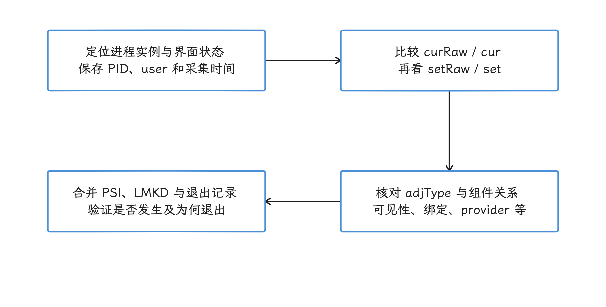

图：先分开当前计算值与上次应用记录，再联合组件关系和内存压力解释回收候选。 分数描述保护级别，不表示已经 OOM；状态字段不替代内核、LMKD 日志和退出原因。

### ANR 与退出历史

Android 11 起的 `exit-info` 来自 `ApplicationExitInfo` 历史，每条记录对应一次已经发生的进程退出，读的时候别把它当成当前进程状态。它可区分 ANR、Java/native crash、low-memory kill、用户请求和初始化失败等原因，并保留多个进程实例；[`ActivityManagerService`](https://android.googlesource.com/platform/frameworks/base/+/refs/tags/android-17.0.0_r1/services/core/java/com/android/server/am/ActivityManagerService.java) 把该子命令分发给 `AppExitInfoTracker`。

`lastanr` 是 ActivityTaskManager 保存的最近 ANR 状态，容量和生命周期都有限。两者分工明确：`exit-info` 用于确定退出类型与进程实例，ANR trace、tombstone（native 崩溃报告）、bugreport 和 Perfetto 用于解释线程阻塞位置。设备重启、历史裁剪或厂商策略都可能让旧记录消失，线上采集应尽早完成。

<!-- gracker-diagram: ch15-04-04-exit-and-blocking -->
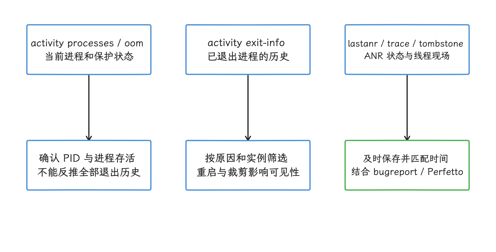

图：当前状态、退出原因与 ANR 阻塞现场由不同记录提供，需要按进程实例和时间关联。 最近 ANR 和退出历史均有保留边界；一次历史 ANR 不证明此刻仍阻塞。

## dumpsys meminfo：系统和进程内存全景

内存问题通常从一份全景开始。`meminfo` 服务由 ActivityManagerService 注册，[`MemBinder`](https://android.googlesource.com/platform/frameworks/base/+/refs/tags/android-17.0.0_r1/services/core/java/com/android/server/am/ActivityManagerService.java) 检查 `DUMP` 与 usage stats（应用使用情况访问） 权限后，进入 `dumpApplicationMemoryUsage()`。

下面的命令覆盖全局、单进程和多进程包三个采集范围。

```bash
# 全系统汇总
adb shell dumpsys meminfo

# 单个进程；-d 展开 ART/Dalvik 细项，-s 只保留 App Summary
adb shell dumpsys meminfo -d com.example.app
adb shell dumpsys meminfo -s com.example.app

# 按包名收集所有已加载该包的进程
adb shell dumpsys meminfo --package com.example.app
```

Android 17 支持 `-a/-d/-c/-s/-S/-p/--unreachable/--oom/--local/--package/--checkin/--proto/--logstats` 等选项，没有 `--slab`。内核 slab 先看 `/proc/meminfo` 的 `Slab`、`SReclaimable`、`SUnreclaim`；有足够权限时再读 `/proc/slabinfo`。

### 读数口径

| 指标 | 口径 | 适用问题 |
|---|---|---|
| RSS | 当前驻留在物理内存中的页，shared page 会在每个映射进程重复计算 | 进程驻留规模、LMKD 相关现场 |
| PSS | shared page 按映射者数量比例分摊 | 跨进程归属和版本内对比 |
| USS | private clean 与 private dirty 的合计 | 进程退出后较可能直接释放的私有页 |
| Private Dirty | 进程私有且已修改的页 | 私有匿名内存、COW（Copy-on-Write，写时复制）后的变化 |
| SwapPss | 换出页按共享关系分摊 | zRAM（在内存中压缩的交换设备）或其他 swap 参与后的进程归属 |

读这份数据时记住，PSS 是共享页的归属模型，硬件并不直接计量它。`Debug.MemoryInfo.getTotalPss()` 在内核提供 SwapPss 时，会把按共享关系分摊的换出页纳入 total；解析脚本就不要把单独的 SwapPss 列再重复加进 `TOTAL PSS`。内核的 smaps/PSS 生成路径可从固定 kernel tag 的 [`fs/proc/task_mmu.c`](https://android.googlesource.com/kernel/common/+/refs/tags/android17-6.18-2026-06_r6/fs/proc/task_mmu.c) 核对。

### 分类行的含义

分类行帮我们把问题定位到方向，进一步归因要换工具：

- `Dalvik Heap` / ART 相关行增长，可能来自存活对象、缓存、尚未执行的 GC 或分配抖动；区分对象持有与短命分配，要用 HPROF、LeakCanary 和 allocation profiling。
- `Native Heap` 主要对应 allocator 管理的 native allocation。大型独立 `mmap`（内存映射）、allocator arena（分配器管理的一组内存区） 和碎片，会让它和 heapprofd 记录的存活分配字节对不上。
- `Graphics` 依赖 graphics driver 通过 libmemtrack 上报 smaps 未覆盖的归属。GraphicBuffer、dma-buf 这类让驱动和进程共享缓冲区的机制，其内存可能分散在 `Graphics`、`GL`、设备映射及其他类别；某一行下降缓慢，单独看说明不了纹理泄漏。
- `Code`、`Stack`、`.so mmap` 等文件映射和线程相关分类，要结合进程数、ABI（应用二进制接口）、动态模块与线程数量解释。

完整的对象图、native 分配栈和 dma-buf 归因流程见 §15.3 [内存分析工具](03-memory-hprof-heapdump-tools.md)。

<!-- gracker-diagram: ch15-04-05-memory-accounting -->
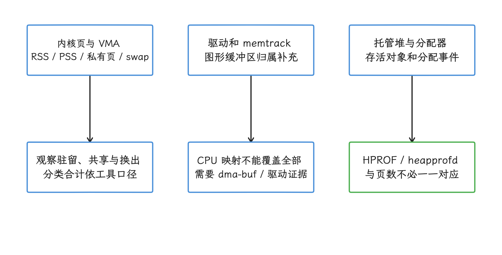

图：meminfo 的页记账和驱动归属用于分方向，再用对象图或分配栈解释持有与创建。 PSS 依内核映射计数分摊；TOTAL 可能已含 SwapPss，不能重复相加，分类行也不是泄漏证明。

### 采样趋势

判断泄漏靠的是同一工作负载下的摘要趋势，单次快照说明不了什么。下面的主机端循环用于保存这样的趋势：

```bash
for round in $(seq 1 10); do
  printf 'round=%s host_time=%s\n' "$round" "$(date +%s)"
  adb shell dumpsys meminfo -s com.example.app
  sleep 10
done
```

每轮的工作负载、前后台状态、进程 PID、设备温度和等待时间都要固定。稳定增长只构成继续取证的条件：Java 类别转 HPROF/LeakCanary，Native Heap 转 heapprofd，Graphics 转 memtrack、`dmabuf_dump` 与 SurfaceFlinger。进程重启、GC、trim、缓存上限和 zRAM 变化都会改变曲线形状。

<!-- gracker-diagram: ch15-04-06-memory-trend -->
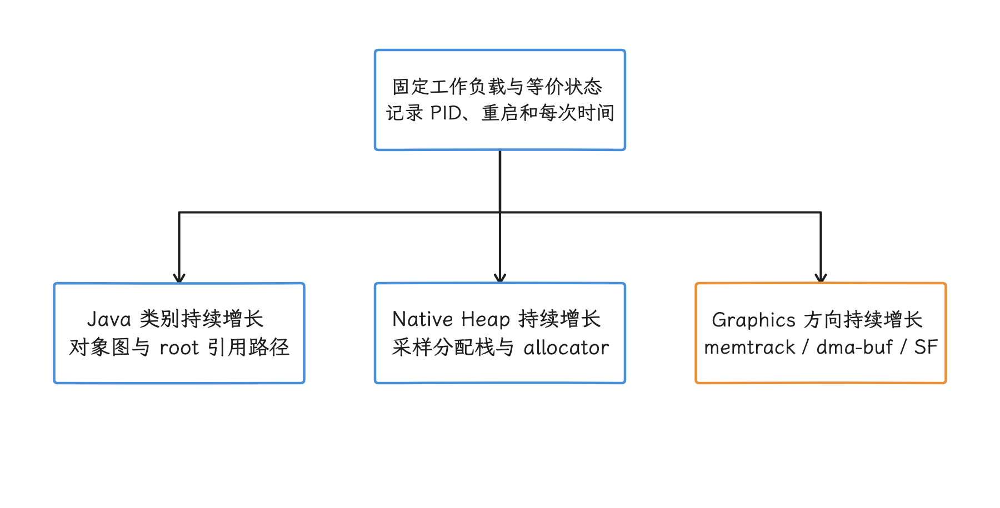

图：固定复现步骤并记录进程身份，对比等价状态下的多轮趋势，再选择深入证据。 包名不保证同一进程实例；10 秒 sleep 还要加命令耗时，增长曲线本身不能证明泄漏。

## dumpsys gfxinfo：帧渲染统计与 Jank 定位

复现掉帧之后，我们需要一段可重复的 HWUI 测试窗口来量化它。`gfxinfo` Binder 由 ActivityManagerService 注册：服务找到目标包的运行进程后，经 `IApplicationThread.dumpGfxInfo()` 进入应用进程，再由 `ThreadedRenderer` 和各 Window 的 renderer 输出 HWUI 统计；应用卡死时，这条跨进程链路也可能超时。

下面的三条命令用于划定测试窗口。

```bash
# 清空进程内保存的 HWUI 帧数据
adb shell dumpsys gfxinfo com.example.app reset

# 复现后读取聚合统计
adb shell dumpsys gfxinfo com.example.app

# 输出环形缓冲区中的逐帧列
adb shell dumpsys gfxinfo com.example.app framestats
```

[`ThreadedRenderer.dumpArgsToFlags()`](https://android.googlesource.com/platform/frameworks/base/+/refs/tags/android-17.0.0_r1/core/java/android/view/ThreadedRenderer.java) 识别 `reset` 和 `framestats`。目标包有多个进程或多个硬件加速 Window 时，输出会出现多个分段；采集脚本要保留 pid 和 Window 标题。

### 聚合统计如何生成

Android 17 的输出同时打印 deadline-aware 与 legacy 两套统计：前者使用每帧 deadline，后者保留旧版固定刷新间隔模型。当前 [`JankTracker::finishFrame()`](https://android.googlesource.com/platform/frameworks/base/+/refs/tags/android-17.0.0_r1/libs/hwui/JankTracker.cpp) 以 `GpuCompleted` 是否越过调整后的 `FrameDeadline` 记录 `Janky frames`；legacy 路径使用旧的固定间隔、swap deadline 与 triple-buffering（三缓冲队列） 修正规则。VRR/ARR（可变/自适应刷新率）场景优先读 deadline-aware 这套，再用 legacy 行观察兼容指标。

[`ProfileData.cpp`](https://android.googlesource.com/platform/frameworks/base/+/refs/tags/android-17.0.0_r1/libs/hwui/ProfileData.cpp) 输出以下分类。表中的 `Number Missed Vsync` 与三项 `Number Slow ...` 只在 `finishFrame()` 判定当前帧 deadline miss 后检查；带 `SurfaceCanvas` 标志的帧不参与这些 jank 判定，各阶段差值达到门槛且小于 10 秒才计数。同一帧可同时命中多项，不能把分类计数相加当作 jank 总数，也不能用它们统计所有帧的阶段超时次数。

| 输出 | AOSP 中的区间或判定 | 解读边界 |
|---|---|---|
| `Janky frames` | `GpuCompleted >= FrameDeadline` | HWUI deadline miss，仍需 trace 定位责任线程 |
| `Janky frames (legacy)` | 旧 fixed-interval 模型 | 供历史报表兼容，不宜用于 VRR 精确判定 |
| `Number Missed Vsync` | `IntendedVsync → Vsync` 至少相差 1 ns | App 收到帧回调已晚 |
| `Number Slow UI thread` | `Vsync → SyncStart` 达到当前 frame interval 的 50% | UI 阶段偏长，原因可能含输入、动画、traversal、draw record |
| `Number Slow bitmap uploads` | `SyncStart → IssueDrawCommandsStart` 达到当前 frame interval 的 20% | 这是保留的输出名称，不能只凭名称认定发生了图片解码 |
| `Number Slow issue draw commands` | `IssueDrawCommandsStart → FrameCompleted` 达到当前 frame interval 的 75% | RenderThread 后半段偏长，不直接区分 CPU、GPU、queue 或 fence wait |
| `Number Frame deadline missed` | 当前 deadline miss 计数 | 与 `Janky frames` 的当前口径对应 |

源码没有名为 `Number Slow RenderThread` 的固定输出。分位值来自 `IntendedVsync → FrameCompleted` 的时长直方图，bucket 就是直方图里的时间区间；99th percentile 为 50 ms，表示该统计窗口内约 1% 的已记录帧落在 50 ms 或更慢的 bucket，别把它换算成“连续丢三帧”。

跨应用通用的 5% 合格线并不存在。基线应来自相同设备、刷新率、温控状态和 workload，并配合 FrameTimeline 的 jank type、用户可见场景和业务目标判断。

<!-- gracker-diagram: ch15-04-08-jank-classification-gate -->
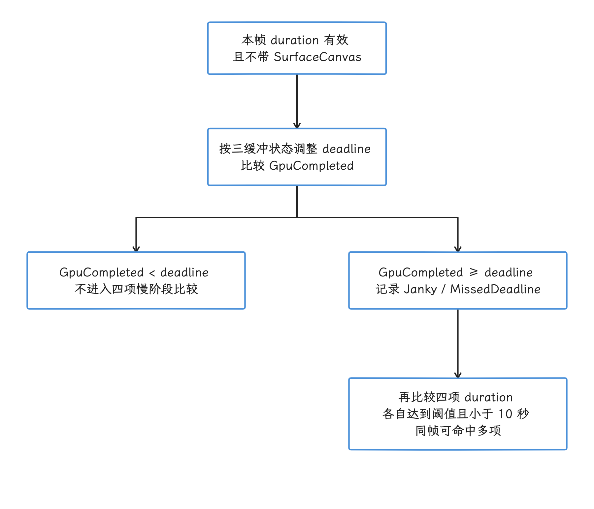

图：当前 Jank 先经过有效帧和 deadline 判断，四项慢阶段计数只在 deadline miss 分支检查。 图描述 A17 当前路径；legacy 另有规则，SurfaceCanvas 仍可能进入总帧直方图，分类不能相加当总数。

### `framestats` 的列

[`FrameInfo.h`](https://android.googlesource.com/platform/frameworks/base/+/refs/tags/android-17.0.0_r1/libs/hwui/FrameInfo.h) 包含 `IntendedVsync`、`Vsync`、`InputEventId`、`HandleInputStart`、`AnimationStart`、`PerformTraversalsStart`、`DrawStart`、`FrameDeadline`、`FrameStartTime`、`FrameInterval`、`WorkloadTarget`、`SyncQueued`、`SyncStart`、`IssueDrawCommandsStart`、`SwapBuffers`、`FrameCompleted`、`GpuCompleted` 等字段。`JankTracker` 使用固定容量为 120 项的环形缓冲区，写满后覆盖最早记录，所以这里只保留近期帧。

解析时读取 `---PROFILEDATA---` 后的 header，按列名建索引。不同 Android 版本会增加字段，按固定列号解析会把后续时间戳整体错位；未填充字段还可能使用 0、负值或最大整数哨兵，计算差值前要过滤。

几个常用区间可以帮助缩小范围：

- `Vsync → SyncStart` 覆盖 UI 线程消费帧的主要阶段。
- `PerformTraversalsStart → DrawStart` 可观察 traversal 中 draw 之前的工作，但其中不只含 measure/layout。
- `SyncQueued → SyncStart` 是 RenderThread 排队等待。
- `SyncStart → IssueDrawCommandsStart` 覆盖同步与资源上传相关阶段。
- `IssueDrawCommandsStart → FrameCompleted` 覆盖 RenderThread 发出绘制命令后的剩余工作。
- `GpuCompleted` 是 GPU 完成边界可用时的时间点，和 `FrameCompleted` 记的是不同的时间点。

<!-- gracker-diagram: ch15-04-09-raw-versus-adjusted -->
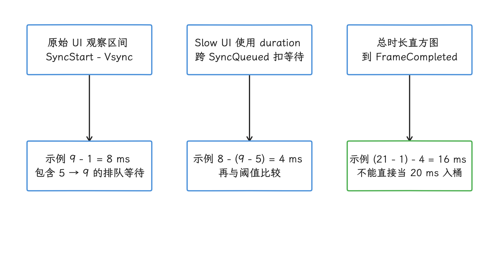

图：framestats 原始列用于观察时间线，聚合统计的 duration 还会扣除跨 SyncQueued 的正等待。 示意值：IntendedVsync=Vsync=1、SyncQueued=5、SyncStart=9、FrameCompleted=21 ms；这些不是实测数据。

这些列能标出异常区间；方法级归因还是要回到 Perfetto 的 UI Thread、RenderThread、GPU、FrameTimeline、BufferQueue 和 fence 时间线。BufferQueue 连接画面生产者与消费者，fence 表示 GPU 或显示工作何时完成，BLAST 用来协调 buffer 与 SurfaceControl transaction。App/HWUI、BLAST、SurfaceFlinger FrontEnd、CompositionEngine 与 HWC 要分层观察，单个 HWUI 行看不到显示后半段。

## dumpsys cpuinfo：CPU 占用快速排查

`cpuinfo` 输出 ActivityManager 后台维护的 `ProcessCpuTracker` 采样结果，展示的是最近两个采样点之间的增量；调用命令的时刻不一定触发一段新的测量窗口，把它当“瞬时 CPU”会高估它的时间精度。

下面的命令用于取得最近窗口，并在确定目标 PID 后切换到连续线程观察。

```bash

<!-- gracker-diagram: ch15-04-07-gfxinfo-data-path -->
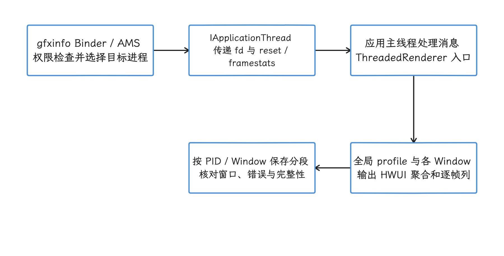

图：系统服务把请求送到目标应用，再从全局统计与各 Window renderer 取回 HWUI 数据。 保留 PID、Window 和 Stats since；目标主线程或下游阻塞会造成等待，reset 也会改变统计状态。

# 最近一个 ProcessCpuTracker 采样窗口
adb shell dumpsys cpuinfo

# 连续观察目标进程的线程
APP_PID=$(adb shell pidof com.example.app | tr -d '\r')
adb shell top -H -p "$APP_PID"
```

[`AppProfiler.CpuBinder`](https://android.googlesource.com/platform/frameworks/base/+/refs/tags/android-17.0.0_r1/services/core/java/com/android/server/am/AppProfiler.java) 直接打印 tracker 保存的 current load/state，[`ProcessCpuTracker`](https://android.googlesource.com/platform/frameworks/base/+/refs/tags/android-17.0.0_r1/core/java/com/android/internal/os/ProcessCpuTracker.java) 再用 `/proc/stat` 与 `/proc/<pid>/stat` 的增量生成各行。读这份输出时记住四点：

<!-- gracker-diagram: ch15-04-10-cpu-delta-window -->
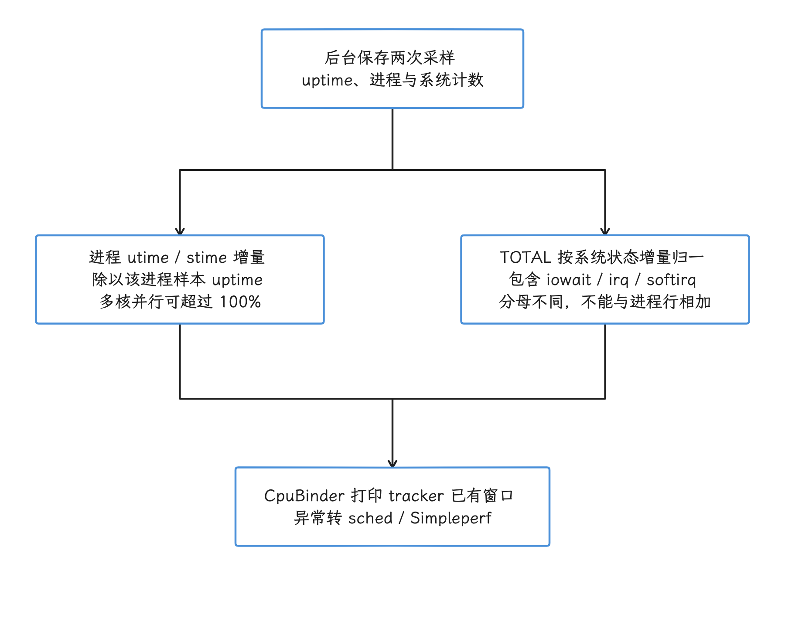

图：CpuBinder 输出 tracker 已保存的最近采样增量，进程行与 TOTAL 行使用不同分母。 进程 CPU 时间除以该进程样本 uptime 可超过 100%；TOTAL 按系统各 CPU 状态增量归一，不能直接相加。

- 进程行的 `user` 与 `kernel` 分别来自该进程的用户态、内核态 CPU 时间。
- `iowait`、`irq`、`softirq` 只在 `TOTAL` 行传入，从某个进程行推不出中断归属。
- `minor` / `major faults` 是采样窗口内的进程 fault 增量。
- 多线程进程能并行占用多个 CPU，进程百分比可能超过 100%。

page fault（缺页异常） 表示进程访问的虚拟页尚未准备好：minor fault 通常可直接从内存建立映射，major fault 通常要等存储读取；fault 次数本身并不指向故障或崩溃。

后台进程并没有一条固定的 5% 告警线，同步、媒体、定位、编译和空闲进程的合理基线差异很大。连续异常时，我们先用 `top` 或 Perfetto `sched` 轨道确认运行时间，再用 Simpleperf 定位函数；`TOTAL` 中 iowait/irq 异常则转向 block I/O、irq/softirq 与设备驱动方向。

跨设备比较 fault 次数时要记录页大小：Android 15 至 Android 17 可运行在 16 KB page-size 设备上，同样的访问范围可能产生更少的 fault。下面的命令用于保存该实验条件。

```bash
adb shell getconf PAGESIZE
```

该值只说明内核页大小；major fault 仍要结合文件映射、存储等待和回收压力解释。全局 CPU 统计的内核来源可从 [`fs/proc/stat.c`](https://android.googlesource.com/kernel/common/+/refs/tags/android17-6.18-2026-06_r6/fs/proc/stat.c) 复核。

## dumpsys window：窗口层级与焦点

窗口焦点对不上、或者窗口有焦点但触摸无响应时，我们要知道至少有三个观察者各管一段：ActivityTaskManager 管 Activity/Task，WindowManager 管 WindowState 与 display，InputDispatcher 负责选择输入事件的接收窗口。三个焦点字段相同只是一种常见稳定状态，别把“相同”本身当成结论。

下面的命令按显示器保存 WMS 与 InputDispatcher 两份现场。

```bash
# WindowState 列表、显示器状态与焦点
adb shell dumpsys window windows
adb shell dumpsys window displays

# 只做人工浏览时可缩小字段；正式附件应保留原始输出
adb shell dumpsys window displays \
  | grep -E 'DisplayContent|mCurrentFocus|mFocusedApp'

# 输入分发器当前的 focused application/window
adb shell dumpsys input \
  | grep -E 'FocusedApplication|FocusedWindow'
```

`DisplayContent.mCurrentFocus` 指向 WMS 当前聚焦的 `WindowState`；`mFocusedApp` 在 Android 17 中引用该 display 上被选中的 `ActivityRecord`。后者是服务端的 Activity 记录，对应的 Activity token（系统用来标识 Activity 的 Binder 句柄）则供跨进程引用。通知栏、IME（输入法窗口）、系统对话框、多窗口切换和 transition（窗口状态过渡） 期间，两者可能来自不同组件。多屏设备还要保留 `displayId`，只 grep 一条全局结果会混淆主屏、副屏与虚拟显示。

遇到“窗口有焦点但触摸无响应”，我们继续检查 InputDispatcher 的 focused window/application、对应 InputChannel（事件传输通道）、touchable region（可接收触摸的区域）、`FLAG_NOT_TOUCHABLE`、窗口可见性和上层 overlay。WMS 中的 Z-order（窗口前后层级） 与 InputDispatcher 的命中顺序也有不同的过滤条件，单看一个 WindowState 排在前面，断言不了它会收到触摸。

<!-- gracker-diagram: ch15-04-11-focus-and-touch -->
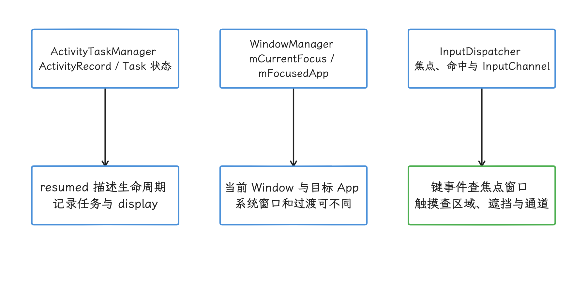

图：按 display 对照任务状态、窗口状态与输入路由，触摸还要检查坐标命中和通道状态。 焦点一致不保证触摸送达；键事件与指针事件选路不同，Z-order 也不能代替输入过滤。

dump 入口位于 [`WindowManagerService`](https://android.googlesource.com/platform/frameworks/base/+/refs/tags/android-17.0.0_r1/services/core/java/com/android/server/wm/WindowManagerService.java)，每个显示器的焦点状态位于 [`DisplayContent`](https://android.googlesource.com/platform/frameworks/base/+/refs/tags/android-17.0.0_r1/services/core/java/com/android/server/wm/DisplayContent.java)。insets 是状态栏、导航栏和 IME 等占用或覆盖的屏幕区域；需要跨帧分析窗口层级、transition、insets 和输入区域时，用 Winscope 录制代替反复 grep 文本快照。

## dumpsys batterystats：电池使用与功耗分析

`batterystats` 记录 UID、组件和系统事件在一段统计窗口内的活动及估算归属。power profile 是设备预置的功耗系数表，power stats 是平台提供的子系统能量或活动统计，两者都可能参与估算；输出并不是外接功率计的直接读数。

下面的命令用于建立测试窗口、保存历史并恢复详细 history 开关。

```bash
# 会清除当前统计和 history；执行前保存仍需使用的现场
adb shell dumpsys batterystats --reset

# 需要 userspace wakelock 时间线时临时开启
adb shell dumpsys batterystats --enable full-wake-history

# 复现后保存聚合、history 和 bugreport
adb shell dumpsys batterystats --charged > batterystats.txt
adb shell dumpsys batterystats --history > batterystats-history.txt
adb bugreport bugreport.zip

# 采集结束后恢复，避免长期放大 history
adb shell dumpsys batterystats --disable full-wake-history
```

[`BatteryStatsService`](https://android.googlesource.com/platform/frameworks/base/+/refs/tags/android-17.0.0_r1/services/core/java/com/android/server/am/BatteryStatsService.java) 明确定义了 `--charged`、`--history`、`--reset`、`--enable/--disable full-wake-history`、`--usage` 等参数。`--reset` 会清空当前统计，属于有状态操作；共享测试机上要记录执行者和时间。

一轮可比较的测试应固定：

<!-- gracker-diagram: ch15-04-12-battery-test-window -->
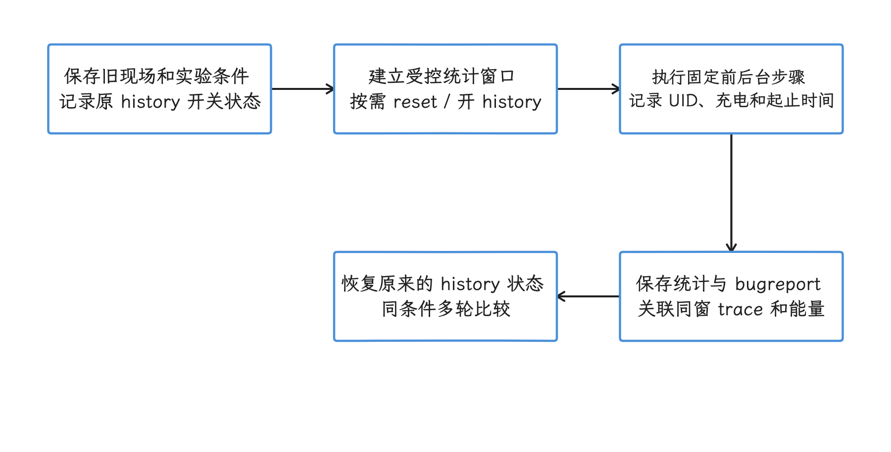

图：先保存旧现场并记录原开关状态，再建立固定实验窗口，采集聚合、history 与同时段证据。 reset 会清空当前统计；详细 history 原来已开时应保持开启，估算归属不等于单 App 实测能量。

1. build、设备、电池温度、亮度、网络类型和帐号同步状态；
2. 充电状态与测试起止时刻；
3. 前台/后台步骤、静置时长和重复次数；
4. 目标 UID、进程重启和系统更新情况；
5. 同期 Perfetto、bugreport 或 Power Profiler 证据。

### Wakelock 与功耗归因

partial wakelock 会阻止设备进入 CPU suspend，但不会强制 CPU 持续忙碌。`All partial wake locks` 给出 UID/名称维度的持有时长和次数；多个 wakelock 可以重叠，持有时长也推不出 CPU 全程运行时长。分析时对齐 Battery Historian 的 `wake_lock`、`running`、JobScheduler、alarm、network、GNSS（卫星定位） 和 screen 状态：异常名称负责定位调用方，功耗影响要由 suspend 机会、CPU 工作、radio tail（网络传输结束后无线模块继续处于高功耗态的时间） 和测得能量共同确认，其中 radio tail 指网络传输结束后无线模块继续处于高功耗态的那段时间。

[Battery Historian](https://developer.android.com/topic/performance/power/battery-historian) 已不再积极维护，适合查看 bugreport 中的系统级历史；官方当前建议优先考虑 system tracing、Macrobenchmark power metric 或 [Power Profiler](https://developer.android.com/studio/profile/power-profiler)。ODPM（On Device Power Measurement）把设备功耗按 power rail（子系统供电轨）展示，归因到单个 App 还要另外做；官方当前列出的 Power Profiler ODPM 范围是 Android 10 及以上的 Pixel 6 和后续 Pixel 设备，具体 rail 仍随机型变化。

<!-- gracker-diagram: ch15-04-13-wakelock-cpu-energy -->
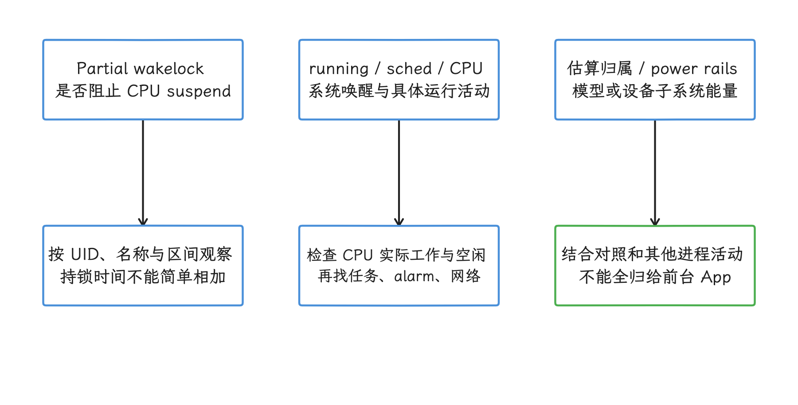

图：持锁、实际调度运行与能量读数回答不同问题，应在同一个实验窗口关联。 多个 wakelock 可重叠；持锁不要求 CPU 一直忙，power rail 是设备子系统视角。

## dumpsys SurfaceFlinger：Layer 信息与合成状态

显示缺失、present 偏晚这类显示链路后半段的问题，经常要落到 SurfaceFlinger 的文本 dump 上。SurfaceFlinger 是 Android 的系统合成器，负责把多个 Layer 组合成显示输出：每个 Layer 是应用或系统提交的一层画面，FrontEnd 计算 Layer 的状态和层级，CompositionEngine/HWC 决定并执行合成。它的文本 dump 同时包含 FrontEnd、display、scheduler 和统计模块的信息，我们先选好视角，再保存原始输出。

下面的命令覆盖排查 Layer 与 present 时间的常用入口。

```bash
# 默认快照：可见 FrontEnd 列表以及 display/HWC 等综合状态
adb shell dumpsys SurfaceFlinger

# 全部 FrontEnd snapshot、input list、主 hierarchy 与 offscreen hierarchy
adb shell dumpsys SurfaceFlinger --frontend

# Layer 精确名称和 HWC minidump
adb shell dumpsys SurfaceFlinger --list
adb shell dumpsys SurfaceFlinger --hwclayers

# 单 Layer 的历史 present 三元组
LAYER_NAME='com.example.app/com.example.app.MainActivity#123'
adb shell dumpsys SurfaceFlinger --latency "$LAYER_NAME"
adb shell dumpsys SurfaceFlinger --latency-clear "$LAYER_NAME"

# 更适合时间关联的内部统计入口
adb shell dumpsys SurfaceFlinger --frametimeline
adb shell dumpsys SurfaceFlinger --scheduler
```

[`SurfaceFlinger::doDump()`](https://android.googlesource.com/platform/frameworks/native/+/refs/tags/android-17.0.0_r1/services/surfaceflinger/SurfaceFlinger.cpp) 注册了这些参数。pacesetter display 是 SurfaceFlinger 选作调度基准的显示器，VSync period 是它的垂直同步周期；目标不存在时，`--latency` 仍可能只输出这一行周期，脚本要验证后续三列是否存在。

### Layer 列表与合成方式

在 Android 15 至 Android 17 上，`dumpsys SurfaceFlinger` 的输出已经不再是早期资料说的“默认展开每个旧 Layer 对象的全部属性”。默认路径调用 `dumpVisibleFrontEnd()` 生成可见的 `Composition list` 与 `Input list`，综合 dump 还会追加 display、HWC 和其他模块状态；snapshot 是 FrontEnd 根据请求状态算出的当前消费快照，hierarchy 是 Layer 的父子与前后层级。`--frontend` 调用 `dumpFrontEnd()`，输出全部 snapshot、主 hierarchy 与 offscreen hierarchy。

读 Layer 时先分清三个视角：

| 视角 | 命令 / 输出 | 适合回答的问题 |
|------|-------------|----------------|
| 名称列表 | `dumpsys SurfaceFlinger --list` | 当前有哪些 Layer，`--latency` 应该传哪个 layer name |
| FrontEnd 快照 | `--frontend` 或默认输出中的 `Composition list` / `Input list` | 当前 snapshot 的可见性、层级、几何、buffer 与输入状态 |
| HWC minidump | `--hwclayers` | 采集时刻 HWC/CompositionEngine 暴露的精简 layer 合成状态 |

SurfaceControl transaction 是一批原子提交的 Layer 状态变化：`RequestedLayerState` 保存客户端 transaction 合入后的请求状态，`LayerSnapshot` 是 FrontEnd 为当前状态算出的消费快照。显示缺失时，我们检查 Composition list、可见性、bounds、transform、crop、alpha、buffer 和 display/layer stack；输入缺失时切到 Input list 与 WindowManager/InputDispatcher。两个列表用途不同。

<!-- gracker-diagram: ch15-04-14-surfaceflinger-views -->
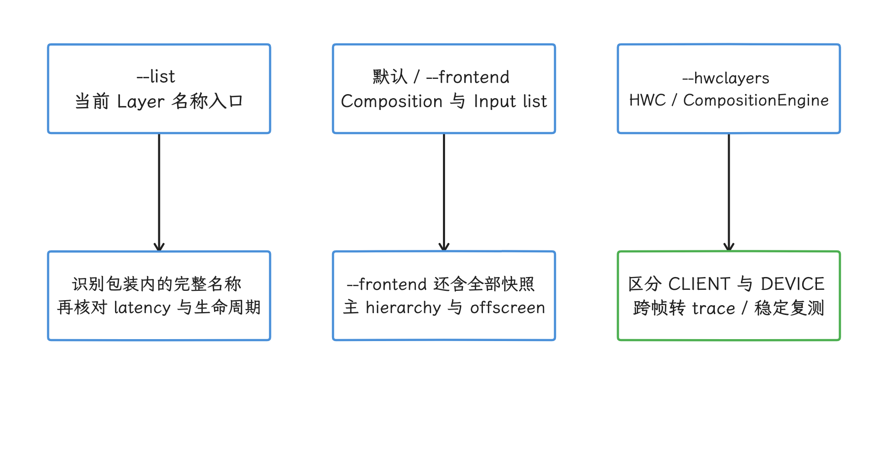

图：名称调试行、FrontEnd snapshot 和 HWC minidump 分别提供身份入口、当前层状态和合成状态。 --list 行有调试包装，latency 只接收内部完整名称；默认输出含可见 FrontEnd 与其他模块；CLIENT/DEVICE 是采集附近的选择，不能推断长期路径。

HWC minidump 中，CLIENT 通常表示 SurfaceFlinger 通过 GPU/RenderEngine 合成，DEVICE 表示交给 HWC 硬件路径处理。这些选择只代表该次采集附近的状态：overlay 资源、圆角、混合、颜色空间、受保护内容、缩放旋转、带宽和厂商策略都可能改变选择。一次 CLIENT composition 说明不了某个 App layer 长期由 GPU 合成，跨帧结论应使用 Perfetto、Winscope、HWC trace 或稳定复现实验。

### Android 15+ 的输出变化

从 Android 15 的 FrontEnd 默认路径到 Android 17，dump 的 Layer 主视角已经转向 snapshot：17 的 `Composition list` 明确标为 top-to-bottom，Input list 由 `forEachInputSnapshot()` 生成。旧资料中的 `Source Crop`、`Display Frame` 和 composition type 表格，用来读旧版本或厂商扩展还有效，直接套在 Android 17 默认文本格式上会读错。

`android-17.0.0_r1` 的 dumper map 包含 `--frontend`、`--list`、`--hwclayers`、`--latency`、`--frametimeline`、`--scheduler` 等入口，没有 `--all-layer`；厂商系统出现额外参数时，以设备输出和厂商源码为准。

显示后半段可按 FrontEnd snapshot、CompositionEngine 与 AIDL Composer/HWC 三层观察：文本 dump 负责当前状态，Winscope 负责 transaction、Layer hierarchy、可见性和输入区域的跨帧变化，Perfetto 负责 FrameTimeline、scheduler、BufferQueue、fence 与合成耗时。

### FrontEnd 架构补充（源码级）

FrontEnd dump 中的对象来自一条明确的数据转换链：

| 组件 | Android 17 源码 | 职责 |
|---|---|---|
| `RequestedLayerState` | [`RequestedLayerState.h`](https://android.googlesource.com/platform/frameworks/native/+/refs/tags/android-17.0.0_r1/services/surfaceflinger/FrontEnd/RequestedLayerState.h) | 保存 transaction 请求状态与 `Changes` |
| `LayerLifecycleManager` | [`LayerLifecycleManager.h`](https://android.googlesource.com/platform/frameworks/native/+/refs/tags/android-17.0.0_r1/services/surfaceflinger/FrontEnd/LayerLifecycleManager.h) | 管理 requested state、创建/销毁和 handle 生命周期 |
| `TransactionHandler` | [`TransactionHandler.h`](https://android.googlesource.com/platform/frameworks/native/+/refs/tags/android-17.0.0_r1/services/surfaceflinger/FrontEnd/TransactionHandler.h) | 收集 transaction，执行 readiness 过滤并 flush 可应用项 |
| `LayerHierarchyBuilder` | [`LayerHierarchy.h`](https://android.googlesource.com/platform/frameworks/native/+/refs/tags/android-17.0.0_r1/services/surfaceflinger/FrontEnd/LayerHierarchy.h) | 建立 z-order hierarchy，并表示 mirror 等共享关系 |
| `LayerSnapshotBuilder` | [`LayerSnapshotBuilder.h`](https://android.googlesource.com/platform/frameworks/native/+/refs/tags/android-17.0.0_r1/services/surfaceflinger/FrontEnd/LayerSnapshotBuilder.h) | 根据 hierarchy、display 与全局状态生成 snapshot |

这里的 handle 是外部持有 Layer 的标识；readiness 过滤会暂缓条件未满足的 transaction；flush 取出本轮已经可以应用的 transaction；mirror 表示一个 Layer 层级复用另一处内容。

`LayerHierarchyBuilder` 的类定义就在 `LayerHierarchy.h`，源码树中没有 `LayerHierarchyBuilder.h`；写源码索引时应使用当前 tag 中存在的文件名。

下面的节选用于说明 `updateLayerSnapshots()` 的锁边界，省略了 tracing、display mirror、legacy layer 与 feature-flag 分支。

```cpp
mTransactionHandler.collectTransactions();

mLayerLifecycleManager.addLayers(std::move(update.newLayers));
update.transactions = mTransactionHandler.flushTransactions();
mLayerLifecycleManager.applyTransactions(update.transactions);
mLayerLifecycleManager.onHandlesDestroyed(update.destroyedHandles);
mLayerHierarchyBuilder.update(mLayerLifecycleManager);

State drawingState(mDrawingState);
Mutex::Autolock lock(mStateLock);
applyAndCommitDisplayTransactionStatesLocked(update.transactions);
mLayerSnapshotBuilder.update(args);
```

`mStateLock` 是保护 SurfaceFlinger 核心状态的互斥锁。事务收集、requested state 应用和 hierarchy 更新位于该锁之前；display transaction 提交与 `LayerSnapshotBuilder.update()` 仍在锁内——所以“FrontEnd 整条 snapshot 路径无锁”的说法与 Android 17 实现不符。完整顺序见 [`SurfaceFlinger::updateLayerSnapshots()`](https://android.googlesource.com/platform/frameworks/native/+/refs/tags/android-17.0.0_r1/services/surfaceflinger/SurfaceFlinger.cpp)。

<!-- gracker-diagram: ch15-04-15-frontend-lock-boundary -->
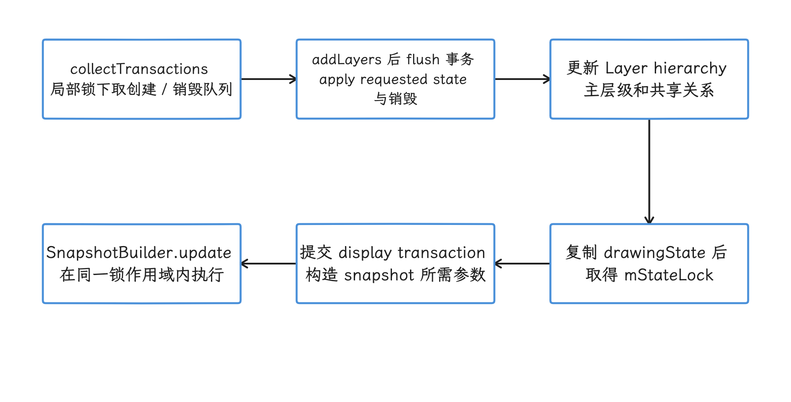

图：事务收集和 requested state/hierarchy 更新在 mStateLock 之前，display 提交与 snapshot 更新在锁内。 图示 flushTransactions 分支；锁前仍使用其他局部锁；省略 feature 分支，不能据此把整个 FrontEnd 称为无锁。

`RequestedLayerState::Changes` 在该 tag 中有 22 个 bit，下面的源码形状用于核对 dump/trace 中的变化类型。

```cpp
enum class Changes : uint32_t {
    Created = 1u << 0,
    Destroyed = 1u << 1,
    Hierarchy = 1u << 2,
    Geometry = 1u << 3,
    Content = 1u << 4,
    Input = 1u << 5,
    Z = 1u << 6,
    Mirror = 1u << 7,
    Parent = 1u << 8,
    RelativeParent = 1u << 9,
    Metadata = 1u << 10,
    Visibility = 1u << 11,
    AffectsChildren = 1u << 12,
    FrameRate = 1u << 13,
    VisibleRegion = 1u << 14,
    Buffer = 1u << 15,
    SidebandStream = 1u << 16,
    Animation = 1u << 17,
    BufferSize = 1u << 18,
    GameMode = 1u << 19,
    BufferUsageFlags = 1u << 20,
    PostProcess = 1u << 21,
};
```

`kMustComposite` 包含 `Content`、`Buffer` 与 `PostProcess` 等变化，表示该轮变化会推动合成判断。snapshot 是否必须完整遍历 hierarchy 是另一件事：`tryFastUpdate()` 先 merge 发生变化的 snapshot，只在全局变化超出 `Content | Buffer` 时退出 fast path。

```cpp
if ((args.layerLifecycleManager.getGlobalChanges().get() &
     ~(RequestedLayerState::Changes::Content |
       RequestedLayerState::Changes::Buffer).get()) != 0) {
    return false;
}
return true;
```

仅含 Content/Buffer 且没有 force/display change 时，可以跳过完整 hierarchy traversal。它缩小的是 snapshot 重算范围：既推不出本帧不会合成，也换算不成固定的性能收益；验证收益要看目标设备的 `FastPath` trace、FrontEnd 工作量与整帧 deadline。

<!-- gracker-diagram: ch15-04-16-snapshot-fast-path -->
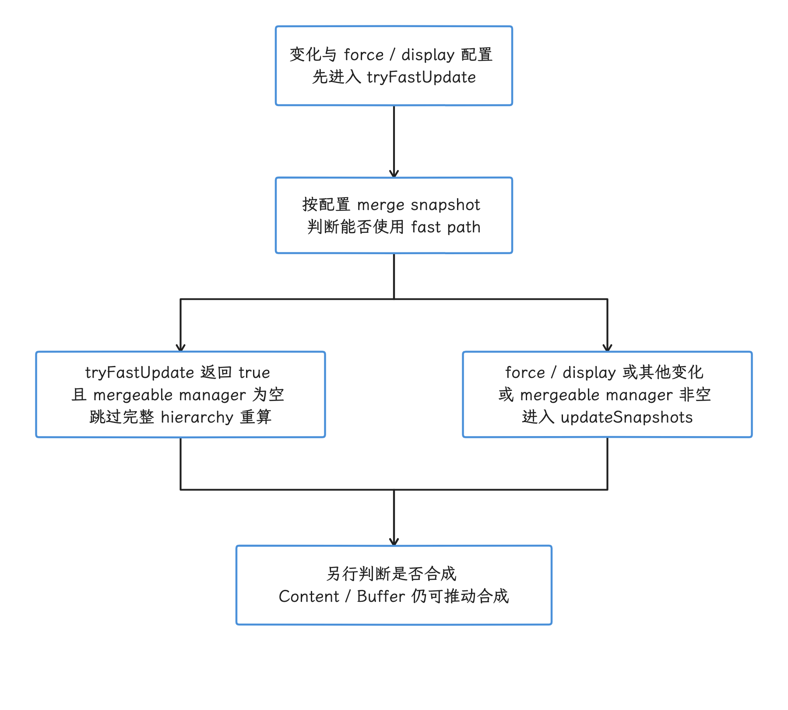

图：Content/Buffer 条件只是 fast path 的一部分，还要满足 caller 的配置门槛才能省去完整重算。 frontend_caching_v0 会改变 forceUpdate 和 manager 配置；跳过 hierarchy 遍历不表示本帧不合成。

### 帧延迟信息

`--latency` 仍是快速检查单 Layer 历史的入口：`SurfaceFlinger::dumpStats()` 先打印 pacesetter VSync period，再按精确 layer name 查找 legacy Layer 并调用 `Layer::dumpFrameStats()`。

从第二行开始，每行是一帧的三个时间戳（均为纳秒）：

| 列 | 字段 | 含义 |
|---|---|---|
| 第一列 | `desired_present_time` | 该 layer frame 的期望呈现时间 |
| 第二列 | `actual_present_time` | 系统记录的呈现时间 |
| 第三列 | `frame_ready_time` | frame-stats 路径记录的 ready 边界；不等同于 GPU completion 或 HWC present 调用时间 |

`actual - desired` 只负责标记晚呈现，归因要接着往下走：晚呈现可能来自 producer、acquire fence、transaction readiness、SurfaceFlinger 调度、client composition、HWC、present fence 或显示模式切换；`frame_ready` 较晚可把方向推向前半段，仍要用同帧 FrameTimeline 和 fence 交叉确认。

第一行来自采集时刻的 pacesetter period。VRR/ARR、多 display、layer frame-rate override 与 frame-rate divisor 场景下，它只是采集时刻的周期值，未必是每一行各自的 deadline；解析器还要过滤 0、负值和未完成哨兵，三列都有效时才计算差值。

建议按下面的顺序使用：

1. 用 `--list` 复制精确 layer name，并保存 `--latency` 原文；
2. 标记 actual 明显晚于 desired 的候选行；
3. 在 Perfetto FrameTimeline 找对应 display frame 与 surface frame；
4. 检查 App/HWUI、BLAST/BufferQueue、acquire fence、SF scheduler、CompositionEngine/HWC 和 present fence；
5. 动态 hierarchy 或输入问题转 Winscope。

这套顺序按显示通路分层，避免把显示端异常全部压到 App RenderThread。

<!-- gracker-diagram: ch15-04-17-latency-to-frame-evidence -->
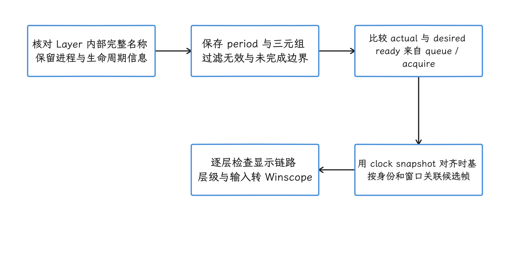

图：先验证 Layer 身份、三列数据和时基，再把晚呈现候选放回显示链路逐层检查。 首行 period 不是每行 deadline；没有 frame token 时，时间接近只能提供关联候选。

## 进阶用法

### dumpsys package / alarm / jobscheduler

后台执行问题经常要把声明、调度状态和功耗历史放在一起看。下面的命令用于保存三个服务各自的当前视角。

```bash
adb shell dumpsys package com.example.app
adb shell dumpsys alarm
adb shell dumpsys jobscheduler
```

- `package` 可核对安装用户、权限授予、组件、intent filter（组件接受哪些 action、data 和 category）、版本和 package state；Manifest 里有声明，说明不了组件此刻正在运行。
- `alarm` 可核对已注册 alarm、batch（系统合并执行的一组 alarm）、wakeup 类型与目标 UID；一次快照中的 alarm 数量，和一段时间内的实际唤醒频率是两回事。
- `jobscheduler` 可核对 pending/running job、约束和调度原因。约束包括充电、网络、空闲等执行前提；执行耗时与历史完整度由该版本输出决定，功耗结论还要对照 batterystats 与 trace。

<!-- gracker-diagram: ch15-04-18-background-service-views -->
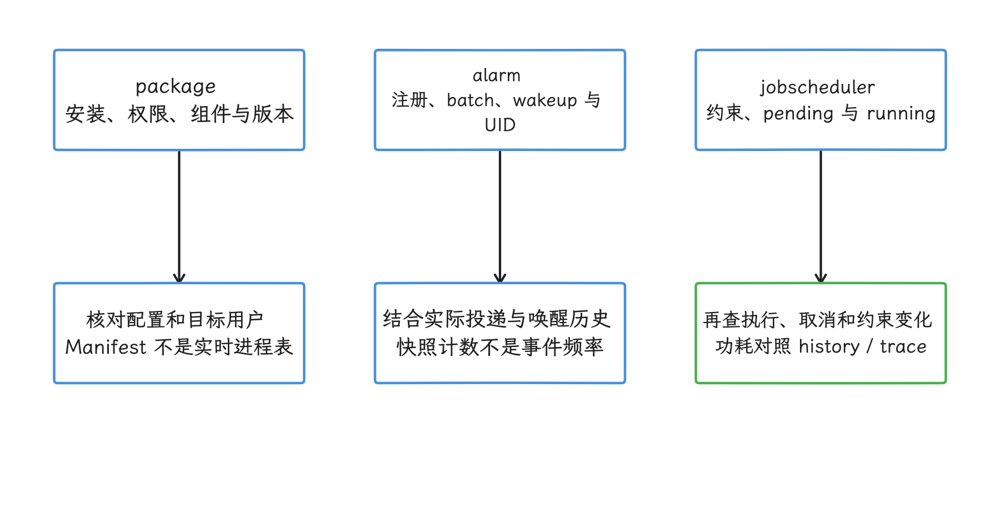

图：包状态、注册的 alarm 和 job 调度状态各自提供局部证据，需要与执行历史关联。 声明不证明运行，注册数量不证明唤醒频率，pending/running 快照也不能代替完整执行时间线。

### 自定义 Service 的 dump 接口

普通应用 Service 由 ActivityManager 管理，不会自动成为 ServiceManager 中可按名字直接查询的顶层 Binder 服务，所以别假设存在 `dumpsys <service_name>`。应用可重写 `Service.dump()`，由 ActivityManager 的 client dump 路径调用；平台 Binder 服务在有权限注册到 ServiceManager 后，可以直接响应 `dumpsys`。

下面的 Java 示例用于给一个已经运行的应用 Service 暴露有限状态。

```java
public final class SyncService extends Service {
    private final AtomicInteger pendingCount = new AtomicInteger();

    @Override
    protected void dump(
            FileDescriptor fd, PrintWriter writer, String[] args) {
        writer.println("pendingCount=" + pendingCount.get());
    }

    @Override
    public IBinder onBind(Intent intent) {
        return null;
    }
}
```

单数 `service <组件>` 会直接请求匹配 Service 的客户端 dump，无需 `-c`。批量查看 `services` 时，`-c` 控制是否请求客户端输出，须写在 `services` 之前。

```bash
adb shell dumpsys activity service \
  com.example.app/.SyncService
```

[`ActiveServices.dumpService()`](https://android.googlesource.com/platform/frameworks/base/+/refs/tags/android-17.0.0_r1/services/core/java/com/android/server/am/ActiveServices.java) 通过 `IApplicationThread.dumpService()` 把单个 Service 的请求送到应用主线程，`ActivityThread` 再调用 Service 实例；`activity -c services` 则走 `ServiceDumper.dumpWithClient()`。Service 未运行、主线程阻塞或组件过滤不匹配时，客户端内容不会出现。

<!-- gracker-diagram: ch15-04-19-application-service-dump -->
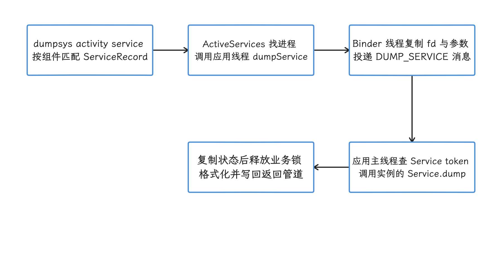

图：ActivityManager 找到运行中的 Service，经应用线程消息把 dump 请求交给实例方法。 应用 Service 不会自动注册为顶层命名 Binder 服务；主线程阻塞、实例不存在或匹配失败都会缺少客户端内容。

dump 实现应先复制少量状态，再释放业务锁并格式化输出；不要在回调中等待网络、扫描大目录、打印认证 token、帐号或用户内容，也不要持有核心锁执行长时间 I/O。面向自动化的字段要有版本号、明确单位和稳定键名；平台服务可用 `PriorityDumper` 按 CRITICAL/HIGH/NORMAL 拆分输出，或用 proto 提供机器读取入口。

## 取证时常犯的错误

- 直接执行无参数 `dumpsys`：它会顺序调用大量服务，每个服务默认可等待 10 秒，输出和扰动都很大。用 `-l` 找服务，再请求子项。
- 只保存 grep 结果：display、pid、Window 标题、统计起点和上下文一旦丢失，字段很难解释。原始输出作为附件，grep 只用于现场浏览。
- 把文本字段当稳定 API：dump 格式会随平台和厂商分支变化。脚本按 header/section 解析，支持 proto 的服务优先保存 proto，并记录 build fingerprint。
- 用一份快照证明趋势：内存、CPU、alarm、job 和 Layer 都可能瞬时波动。固定 workload，重复采样，再用时间工具确认。
- 把 `gfxinfo` 的分类名当根因：`Slow bitmap uploads` 是历史输出名，`Slow issue draw commands` 也没有区分 CPU、GPU 与 fence。两者都是 trace 入口。
- 把 `dumpsys meminfo` 与 Android Studio Memory Profiler 强行对比：前者按 OS 页和 memtrack 归组；后者会随 recording 类型呈现 Java/Kotlin allocation、native allocation 或进程内存类别。采样范围、时刻和统计方式都不同，差值本身不构成 bug。
- 把 batterystats 估算当功率计：估算归属、系统事件和 power rail（硬件子系统供电轨）s 各有适用范围，耗电回归要用同条件 A/B 与可测量能量。

## 采集复核清单

- 命令、参数顺序、采集时间和 build fingerprint 是否已保存？
- 输出对应哪个 PID、user、display、Window 或 Layer？
- 统计是当前快照、最近采样窗口、环形缓冲，还是 since-reset 累计值？
- reset、`--enable full-wake-history` 等有状态操作是否已记录并恢复？
- PSS、frame deadline、present、wakelock 和 CPU 百分比的单位与口径是否写清？
- 结论是否有第二类证据：Perfetto、Winscope、HPROF、heapprofd、bugreport、tombstone（native crash 的原生崩溃报告） 或功率测量？
- 厂商字段是否和 AOSP 字段分开标注？

<!-- gracker-diagram: ch15-04-20-evidence-workflow -->
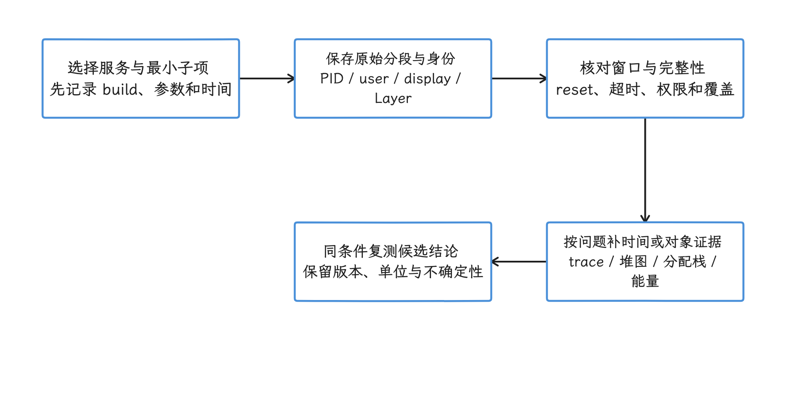

图：保存完整输出、身份与统计窗口，形成候选后用另一类时间或对象证据验证。 文本格式不是稳定 SDK；记录 build 与厂商分支，超时、缺段和有状态操作都要纳入解释。

## 参考资料

- [dumpsys 命令实现（AOSP `android-17.0.0_r1`）](https://android.googlesource.com/platform/frameworks/native/+/refs/tags/android-17.0.0_r1/cmds/dumpsys/dumpsys.cpp)
- [ActivityManagerService（AOSP `android-17.0.0_r1`）](https://android.googlesource.com/platform/frameworks/base/+/refs/tags/android-17.0.0_r1/services/core/java/com/android/server/am/ActivityManagerService.java)
- [Process OOM constants（AOSP `android-17.0.0_r1`）](https://android.googlesource.com/platform/frameworks/base/+/refs/tags/android-17.0.0_r1/services/core/java/com/android/server/am/psc/Constants.java)
- [HWUI FrameInfo](https://android.googlesource.com/platform/frameworks/base/+/refs/tags/android-17.0.0_r1/libs/hwui/FrameInfo.h)、[JankTracker](https://android.googlesource.com/platform/frameworks/base/+/refs/tags/android-17.0.0_r1/libs/hwui/JankTracker.cpp) 与 [ProfileData](https://android.googlesource.com/platform/frameworks/base/+/refs/tags/android-17.0.0_r1/libs/hwui/ProfileData.cpp)
- [WindowManagerService（AOSP `android-17.0.0_r1`）](https://android.googlesource.com/platform/frameworks/base/+/refs/tags/android-17.0.0_r1/services/core/java/com/android/server/wm/WindowManagerService.java)
- [BatteryStatsService（AOSP `android-17.0.0_r1`）](https://android.googlesource.com/platform/frameworks/base/+/refs/tags/android-17.0.0_r1/services/core/java/com/android/server/am/BatteryStatsService.java)
- [SurfaceFlinger](https://android.googlesource.com/platform/frameworks/native/+/refs/tags/android-17.0.0_r1/services/surfaceflinger/SurfaceFlinger.cpp) 与 [FrontEnd 源码目录](https://android.googlesource.com/platform/frameworks/native/+/refs/tags/android-17.0.0_r1/services/surfaceflinger/FrontEnd/)
- [Android Developers：Investigate RAM usage](https://developer.android.com/studio/profile/investigate-ram)
- [Android Developers：Slow rendering](https://developer.android.com/topic/performance/vitals/render)
- [Android Developers：Battery Historian](https://developer.android.com/topic/performance/power/battery-historian)
- [Android Developers：Power Profiler](https://developer.android.com/studio/profile/power-profiler)
- 官方文档：[SurfaceFlinger and WindowManager](https://source.android.com/docs/core/graphics/surfaceflinger-windowmanager)
