# Battery Historian 与功耗分析工具

功耗分析要处理几种不同的证据：系统事件有没有发生、某个 UID 被归因了多少电量、某条硬件电源轨累计了多少能量，以及整机从电源端取走了多少能量。UID 是 Android 为应用沙箱分配的 Linux 用户标识；电源轨（power rail）是给某类硬件供电的电气通路。这些证据的单位、时间范围，以及分配系统消耗的归因规则各不相同，不能放进同一列直接比较。

平台基线是 Android 17 / API 37 / `android-17.0.0_r1`。Battery Historian 仍能读取 bugreport（`adb bugreport` 打包的系统诊断报告），但 Google 已说明该工具不再积极维护。新问题应优先考虑 System Trace、Perfetto `android.power`、Android Studio Power Profiler 或 Macrobenchmark `PowerMetric`。

Historian 更适合回看较长时间内的 WakeLock（用来阻止设备进入休眠的锁）、JobScheduler 任务、同步、定位、网络和电池历史。

## 按问题选择证据

ODPM（On-Device Power Rails Monitor，设备端电源轨监控器）是设备端硬件功耗计量，通常由 Power Stats HAL（功耗统计硬件抽象层）向 Android framework 提供。`uWs` 表示微瓦秒，数值上等于微焦耳。`statsd` 是 Android 在后台收集结构化统计事件的系统服务。

| 要回答的问题 | 优先工具 | 数据含义 | 不能直接证明什么 |
|---|---|---|---|
| 灭屏后有哪些任务、锁和无线活动 | Battery Historian、`dumpsys batterystats` | BatteryStats 历史事件与 UID 统计 | 某一行变色消耗了多少焦耳 |
| 某次操作期间哪条 rail 的能量增加 | Perfetto `android.power`、Power Profiler | ODPM/Power Stats HAL 的系统级累计能量 | 增量全部属于目标应用 |
| 同一场景改动前后是否有功耗回归 | Macrobenchmark `PowerMetric` | 测量窗口内的系统级 power/energy/battery 指标 | 一次运行就能代表总体分布 |
| 应用代码读取设备支持的 power monitor | API 35+ `SystemHealthManager` | 设备本次开机以来的累计 `uWs`，具体指标由设备决定 | 瞬时功率或逐应用能耗 |
| 平台按 UID、组件和进程状态归因 | `BatteryUsageStats`、statsd、bugreport | BatteryStats 与功耗模型的归因结果 | 未实现硬件计量时的绝对精度 |
| 整机供电端的高精度功耗 | 外部电源分析仪 | 测量边界处的电压、电流和能量 | 没有额外业务标记时的线程归因 |

一份有用的报告应写明使用了哪种证据。例如，“WLAN rail 在 20 秒窗口增加 4.2 J”是硬件计量结论；“目标 UID 被 BatteryStats 归因 0.3 mAh”是平台归因结论。两者的原始单位和分配口径都不同。

<!-- gracker-diagram: ch15-05-01-evidence-types -->
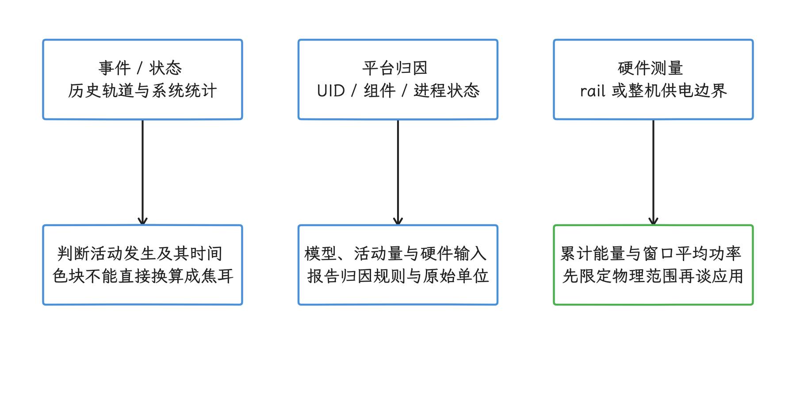

图：事件历史用于定位活动，平台统计用于归因，rail 与外部仪表用于各自边界内的测量。 J、mAh 与事件持有时间不能直接相加；系统级 rail 也不自动属于目标 UID。

## Battery Historian 还适合做什么

Battery Historian 把 bugreport 中的 BatteryStats 历史渲染成时间线，并提供系统和应用统计表。BatteryStats 是 Android 记录电池状态、系统活动和 UID 耗电归因的框架组件。时间线中的色块只表示事件或状态正在活动，无法据此读出该组件消耗了多少电量。

它适合回答这些问题：

- 屏幕关闭后，CPU running、userspace wakelock、JobScheduler 或 sync 是否仍然活跃；
- 一个 WakeLock tag（调用方为锁设置的识别名）的累计次数和持有时间是否符合业务预期；
- 后台定位、wakeup alarm（可唤醒设备的定时器）或网络活动是否集中在合理窗口；
- 两份 bugreport 的统计差异落在哪些 UID 和事件类型。

它不适合短时函数级测量，也不能从一条时间线直接计算某段代码的毫瓦数。

### 采集一份可比较的 bugreport

下面的命令用于清空当前 BatteryStats、打开完整 userspace wakelock 历史，并在测试结束后生成 bugreport。

```bash
adb shell dumpsys batterystats --reset
adb shell dumpsys batterystats --enable full-wake-history

# 断开 USB，在电池供电状态下执行固定测试场景。
# 完成后重新连接设备，再抓取报告。
adb bugreport bugreport.zip

# 不再需要完整 wakelock 历史时关闭它。
adb shell dumpsys batterystats --disable full-wake-history
```

`--reset` 会清除当前统计和历史，应在确认不需要保留现场后执行。完整 WakeLock 历史会占用更多历史缓冲区，即历史事件的有限内存空间，只应覆盖目标测试窗口。示例假设开始前该开关已关闭；若原本开启，结束时应保持原状态，不能无条件关闭来声称已经恢复。测试阶段断开 USB，是为了让 BatteryStats 进入 on-battery（电池供电）统计口径；重连后应尽快抓取报告，并核对统计起点、RESET 标记和历史覆盖范围；重启、自动 reset 或历史裁剪仍可能让窗口不完整，不能保证所有早期记录都保留。

<!-- gracker-diagram: ch15-05-02-bugreport-capture -->
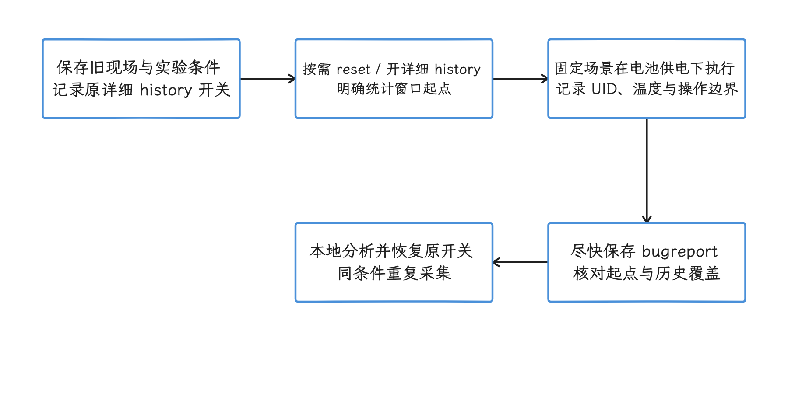

图：先保存旧现场和原开关状态，再执行固定电池供电场景，并尽快保存报告。 reset、重启、自动清零与历史裁剪会影响窗口；详细 history 应恢复原状态。

Android 7.0 及更高版本使用 zip bugreport。报告可能含账号、网络、应用、日志和设备状态等敏感信息，不应上传到不受信任的在线 Historian 服务。

### 部署边界

Google 的 `battery-historian` 仓库已于 2022 年 12 月 29 日归档并转为只读。官方 Android 文档仍给出 `stable:3.1` 容器命令，但旧镜像和旧前端依赖可能在新主机上遇到拉取失败或 CPU 架构不兼容。

下面的命令来自官方安装说明，用于尝试在本机启动归档版本。

```bash
docker run -p 9999:9999 \
  gcr.io/android-battery-historian/stable:3.1 \
  --port 9999
```

页面启动后访问 `http://localhost:9999`，上传刚生成的 bugreport。若镜像已经无法使用，应转用 `dumpsys batterystats` 文本、Perfetto 或 Power Profiler，不要为了复活旧依赖而把生产 bugreport 交给第三方站点。

## 怎样读 Historian 时间线

| 行或区域 | 表示什么 | 合理的下一步 |
|---|---|---|
| Battery level | 电池计量芯片报告的剩余百分比变化 | 长窗口观察趋势；短窗口不要依赖百分比差值 |
| CPU running | BatteryStats 历史记录的 CPU 未处于 suspend 状态；不等于某个线程持续忙碌 | 与 WakeLock、alarm、job 和 Perfetto `sched` 调度数据交叉检查 |
| Userspace wakelock | 记录到历史中的应用 WakeLock 活动 | 按 UID 与 tag 查累计次数、时长和调用代码 |
| Top app | 当时处于前台的应用 | 只用来提供场景上下文，不能当成功耗排名 |
| JobScheduler / SyncManager | job 或同步活动窗口 | 核对周期、约束、停止原因和业务触发条件 |
| Mobile radio / Wi-Fi | 无线网络相关状态与活动 | 联合请求日志、信号强度和网络类型判断 |
| GPS / sensor | 定位或传感器活动 | 核对请求方、精度、批处理与停止时机 |
| App Stats | 目标 UID 的累计统计 | 检查 CPU、网络、Wakelock、job、sensor 等分项 |

时间重叠只能建立相关性。例如，WLAN 活动与一次图片下载重叠，说明该操作值得进一步测量；它不能排除同一时刻其他进程使用 WLAN，也不能给目标应用分配该 rail 的全部能量。

### Wakelock 的判断边界

bugreport 生成时仍被持有的锁值得检查，但这不自动等于泄漏。录音、导航、媒体播放等任务可能合法持锁，应根据持锁原因、生命周期和时长是否与用户可见任务一致来判断。

Partial WakeLock 在屏幕关闭时仍可阻止 CPU suspend，但不要求 CPU 全程执行工作。Android vitals 把 24 小时内合计达到 2 小时的后台或前台服务 Partial WakeLock 视为过度使用，并排除音频、定位和 JobScheduler user-initiated API（由用户明确操作发起的任务 API）等部分场景。

过去 28 天内，若受这类过度使用影响的用户会话占比超过 5%，应用在 Google Play 上的展示可能受影响。这些阈值用于线上质量统计，不能替代本地场景的需求判断。

<!-- gracker-diagram: ch15-05-03-wakelock-evaluation -->
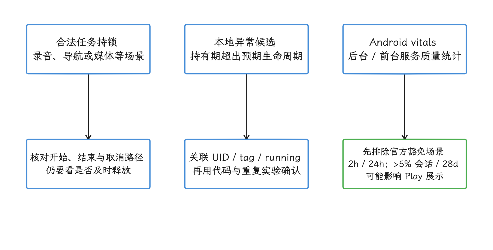

图：持锁是否合理要结合业务生命周期；本地原因调查与线上质量统计使用不同证据。 Partial WakeLock 阻止 suspend，不要求 CPU 持续忙碌；线上阈值以核对日的官方口径为准。

### `top_app` 与电池下降曲线

`top_app` 表示前台状态，不表示“耗电最多的应用”。电池百分比由 fuel gauge（电量计量芯片及其估算算法）计算后取整，短测试里可能长时间不变，也可能一次跳变。短时优化应比较 rail 能量、外部仪表或可重复的系统级指标；长时待机测试再把百分比斜率作为辅助证据。

## 直接使用 `dumpsys batterystats`

Historian 页面打不开时，BatteryStats 文本仍然可用。Android 17 的 `BatteryStatsService.dumpHelp()` 区分多种输出：human-readable 是人直接阅读的统计，history 是历史事件，proto 使用 Protocol Buffers 二进制编码，checkin 则是供程序批量解析的紧凑记录。

下面的命令用于保留不同粒度的原始证据。

```bash
# 人类可读的当前统计
adb shell dumpsys batterystats > batterystats.txt

# 当前历史
adb shell dumpsys batterystats --history > battery-history.txt

# 当前统计的 checkin 格式；-c 不采用 --checkin 的旧记录清理语义
adb shell dumpsys batterystats -c > batterystats-current-checkin.csv

# 仅查看目标包相关统计
adb shell dumpsys batterystats com.example.app > app-batterystats.txt
```

`--checkin` 在 Android 17 的帮助文本中还带有“输出并清除上一次已完成旧统计”的语义。自动化脚本若只想读取当前数据，应先确认使用 `-c` 还是 `--checkin`，不能把两者当作完全等价。

<!-- gracker-diagram: ch15-05-04-raw-output-formats -->
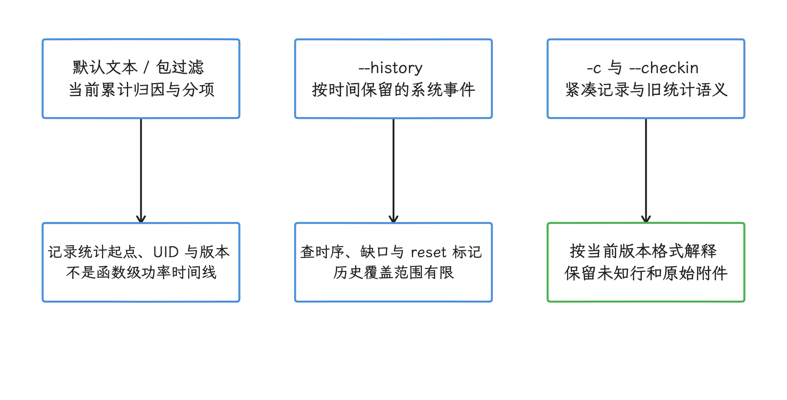

图：保留原始输出并辨明格式，当前统计、历史事件和 checkin 旧记录不是同一读取范围。 -c 读取当前 checkin；--checkin 可输出并清理旧已完成统计，脚本不能混用。

文本字段会随平台演进。解析脚本应记录 build fingerprint（唯一标识该系统构建的字符串）和 Android 版本，并对未知行保留原始内容。按固定列号切分文本，升级后可能在不报错的情况下读错数据。

## 从异常时间线走到代码

### Wakelock 持有过长

1. 从 App Stats 记录 UID、tag、次数和累计时长。
2. 确认锁是在前台、后台还是前台服务期间持有。
3. 在代码和依赖库里搜索 tag，检查超时、取消、异常和进程退出路径。
4. 用 Perfetto 加应用 trace section（通过 Trace API 写入的自定义时间片），把 `acquire`/`release` 的业务上下文与线程调度放到同一时间轴。
5. 修复后用同一场景重新采集，不用一次结果代替重复测试。

`WakeLock.acquire(timeout)` 能给异常路径设置持锁上限，但它不能修复错误的生命周期设计。WorkManager、媒体、定位等组件还可能间接持锁，未知 tag 应先查组件来源。

### Job、alarm 或同步过密

Historian 能显示运行窗口和累计次数。下一步应检查调度 API、约束、flex（允许执行的弹性时间窗口）、backoff（失败后逐步延长的重试间隔）、停止原因以及服务端推送能力。仅把周期调大可能延迟任务，却没有消除重复触发或失败重试。

对 WorkManager，可结合 `WorkInfo.getStopReason()`；对 JobScheduler，可结合 `JobParameters.getStopReason()` 和 `dumpsys jobscheduler`。需要线程级原因时，再录 Perfetto。

### CPU 活动持续

CPU running 表示 BatteryStats 记录的 CPU awake 状态，不能证明 CPU 一直忙，也不能用来替代每核 idle 或线程运行时间。要定位 CPU 时间花在何处，需要 System Trace 或 simpleperf（Android 的 CPU 采样性能工具）：

- Perfetto 的 `sched` 是 Linux 调度器事件，可查哪些线程在运行、被谁唤醒、是否被抢占；
- CPU frequency 和 idle 数据分别记录频率与空闲状态；
- simpleperf 的采样结果可定位消耗 CPU 的函数；
- Thermal 与 ADPF（Android Dynamic Performance Framework）数据可用来区分工作量增加和过热导致的 CPU/GPU 降频。

### 网络、定位和传感器

无线功耗受信号、网络制式、批处理和其他进程影响。Historian 圈定活动窗口，请求日志解释业务行为，Perfetto 或 power rail 观察系统级能量变化。定位和传感器还要核对精度、批处理延迟、前后台状态与停止时机。

<!-- gracker-diagram: ch15-05-05-events-to-code -->
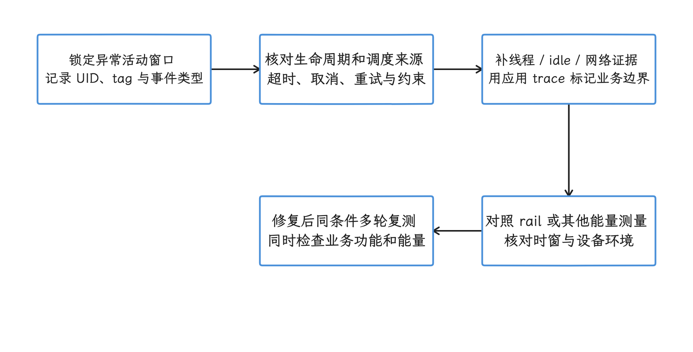

图：事件圈定窗口后，按锁、任务、CPU 或无线方向补证据，再用同条件复测检验原因。 时间重叠只建立候选关联；组件代持锁、系统后台活动和设备环境都需要核对。

## Perfetto：把 rail 与线程放进同一时间轴

Android 17 Perfetto 的 `android.power` 数据源可以轮询 battery counter（电池容量、荷电量、电流等读数），并在硬件与 HAL 支持时采集 power rail。下面的配置以 1 秒轮询开始，用来确认设备是否真正提供这些数据。

```protobuf
buffers {
  size_kb: 32768
  fill_policy: RING_BUFFER
}
data_sources {
  config {
    name: "android.power"
    android_power_config {
      battery_poll_ms: 1000
      battery_counters: BATTERY_COUNTER_CAPACITY_PERCENT
      battery_counters: BATTERY_COUNTER_CHARGE
      battery_counters: BATTERY_COUNTER_CURRENT
      collect_power_rails: true
    }
  }
}
duration_ms: 30000
```

`RING_BUFFER` 表示缓冲区写满后覆盖最旧数据。降低 `battery_poll_ms` 会提高请求轮询的频率，也会增加采集负担；A17 producer 对 0 使用默认 1,000 ms，对小于 100 ms 的值上调到 100 ms。轮询参数不代表硬件内部采样率或结果一定更新。rail 通常是设备本次开机以来的累计能量 counter，UI 或 SQL 用能量差与读数时间差得到区间能量和平均功率；应使用实际样本时间，不能把调用间隔或轮询配置当成读数间隔。设备没有 ODPM 时，trace 可能只有 battery capacity、charge、current 等读数。

<!-- gracker-diagram: ch15-05-06-perfetto-power-path -->
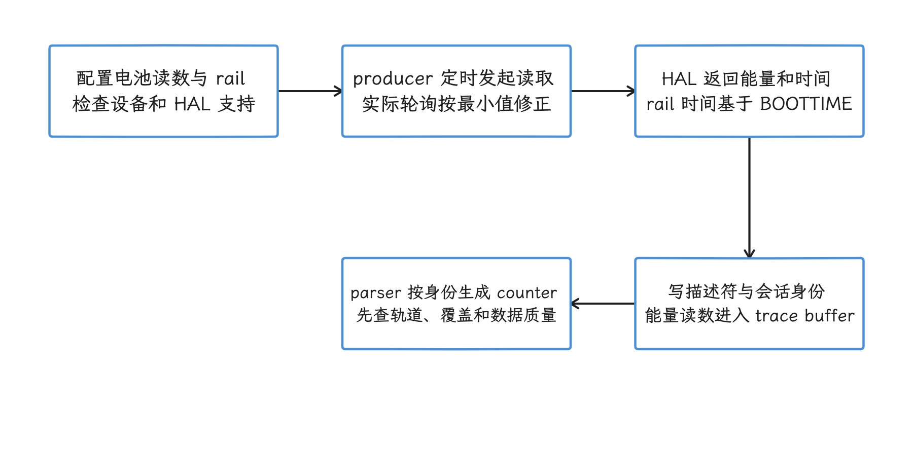

图：producer 周期请求硬件与系统计量，将累计能量和读数时间写入 trace，再由 parser 建立 rail 轨道。 轮询最小 100 ms、0 使用默认 1 秒；这不保证 HAL 更新率，ring buffer 还可能覆盖开头描述符。

Android 17 的 Perfetto SQL 标准库已经提供 `android.power_rails` 模块。下面的查询保留 track 身份，并读取每条 rail 的前向区间；排除没有下一读数和 counter 回退的区间。

<!-- gracker-diagram: ch15-05-07-backward-versus-forward -->
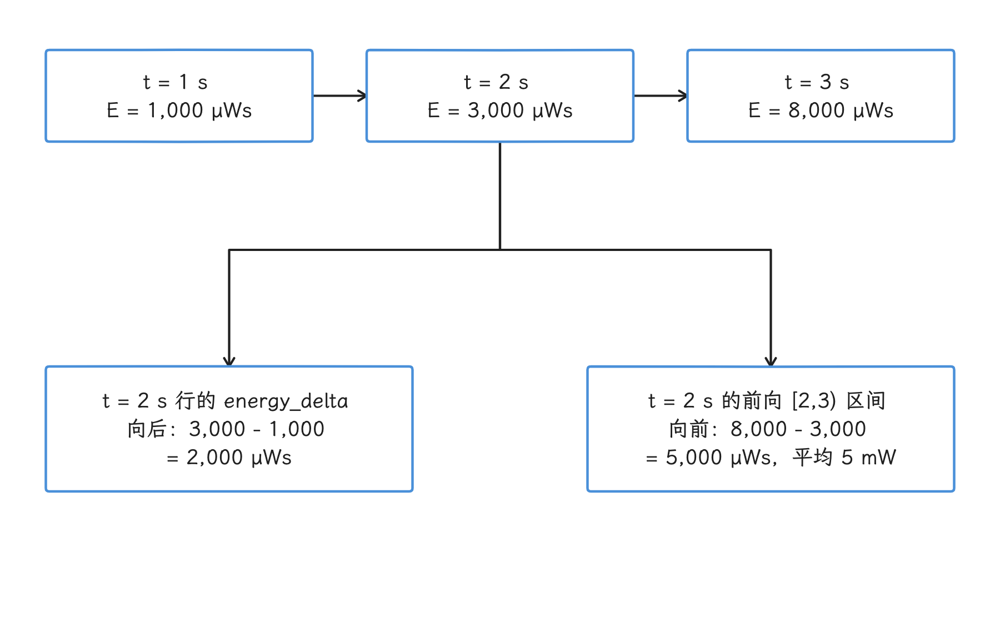

图：标准库 energy_delta 相对前值，而 average_power 使用下一读数；前向区间能量要显式用 end 减 start。 图为合成示例；57.2/58.2 真实导入均复现该区别，不能把两列直接当作同一区间。

```sql
INCLUDE PERFETTO MODULE android.power_rails;

SELECT
  track_id,
  power_rail_name,
  raw_power_rail_name,
  ts,
  dur,
  energy_since_boot_at_end - energy_since_boot AS interval_energy_uws,
  average_power
FROM android_power_rails_counters
WHERE dur > 0
  AND energy_since_boot_at_end IS NOT NULL
  AND energy_since_boot_at_end >= energy_since_boot
ORDER BY track_id, ts;
```

`ts` 是区间起点时间戳，`dur` 是纳秒时长。这里计算的 `interval_energy_uws` 是本行 `[ts, ts + dur)` 的前向能量差，单位为 `uWs`，数值上等于微焦耳；`average_power = interval_energy_uws × 10^6 / dur`，单位为 mW。库原有 `energy_delta` 列是相对前一个保留样本的差，不能拿它与本行前向平均功率配对。模块可能保留到 trace 末尾的尾部区间而使 next value 和功率为 NULL，因此查询显式过滤；重复值也可能经过区间宏合并，`dur` 不保证等于轮询配置。分析时还应同时查询目标进程、线程调度和应用 trace section，避免把系统后台活动算给目标应用。指定业务窗口时，要处理跨边界区间并说明裁剪或插值假设；不能只按起点落在窗口内就把整个区间的能量算入。被过滤的回退、缺样或覆盖不足也应单独记录，不能解释成零耗电。

<!-- gracker-diagram: ch15-05-08-rail-interval-quality -->
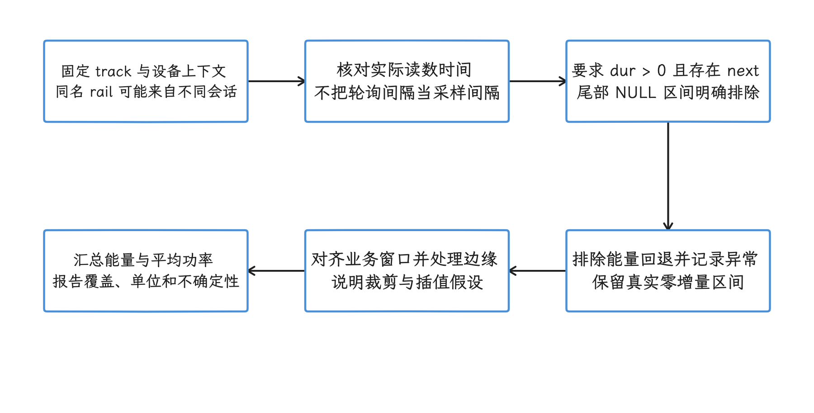

图：先固定 track 身份、有效前向区间和计数连续性，再处理业务窗口边缘并计算平均功率。 dur 使用纳秒，µWs × 10^6 / dur 得到 mW；缺样和回退不能解释成零耗电。

## Android Studio Power Profiler

Android Studio Hedgehog 起，Power Profiler 在 System Trace 中展示 ODPM 数据。官方文档给出的高精度 rail 支持范围是 Pixel 6 及后续 Pixel 设备。平台的 Power Stats HAL 允许其他厂商实现类似能力，但不能据此保证 Studio 会在任意 Android 10+ 设备上提供同样的 rail、名称或分辨率。

ODPM 测量的是电池下游某个硬件子系统或若干硬件单元的累计能量。“电池下游”指能量离开电池后流向负载的一侧，所以设备插电时仍可计量负载消耗。这些读数仍是系统级数据。CPU、GPU、Display、WLAN、Camera 等 rail 是否存在，由设备决定。

使用时应检查：

- 目标设备是否出现 Power Rails，而非只有 battery capacity/current；
- rail 名称和子系统映射是否有设备文档支持；
- 测试窗口内是否有系统更新、同步、温控或其他应用干扰；
- 改动前后是否使用同一设备、系统版本、亮度、网络和温度条件。

“硬件计量”也不等于“逐应用计量”。Power Profiler 适合把一次业务动作与设备 rail 变化建立时间相关性，应用归因仍需 BatteryStats、线程活动和受控 A/B 实验。

<!-- gracker-diagram: ch15-05-09-system-rail-attribution -->
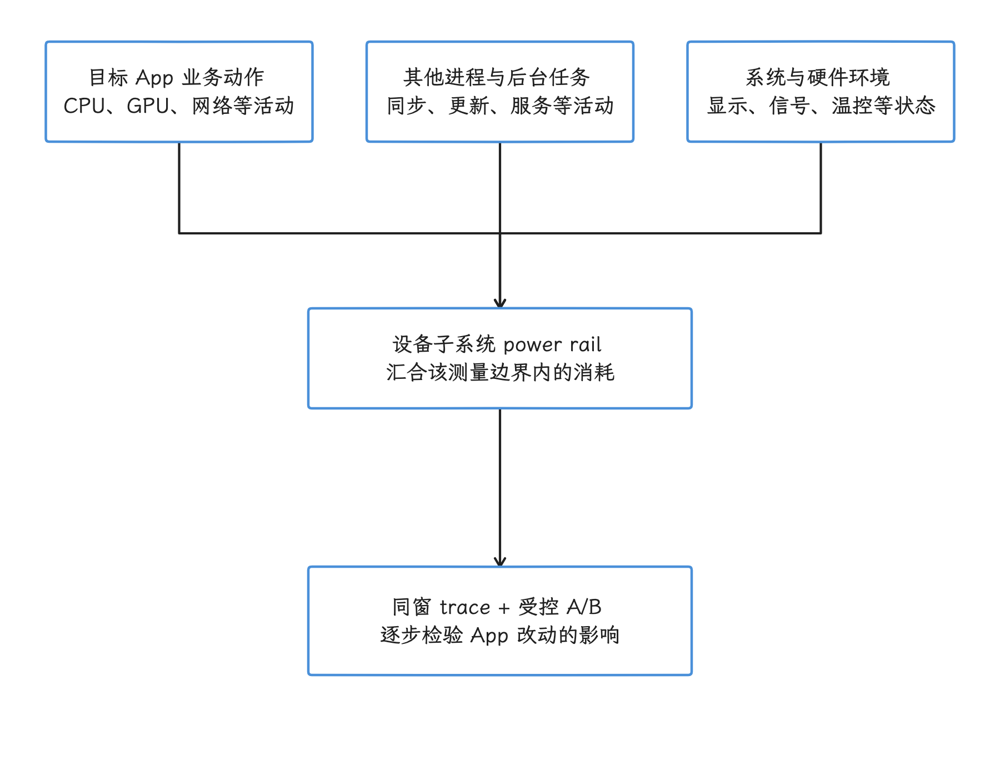

图：同一 rail 可汇合目标 App、其他进程与系统硬件活动，应用影响需要 trace 和对照实验检验。 Power Profiler 的官方 ODPM 条件是 API 29+、Pixel 6 及后续设备；具体 rail 依设备实现。

## Macrobenchmark `PowerMetric`

Macrobenchmark 是 AndroidX 在真实设备上反复运行整个应用场景的基准测试框架。`PowerMetric` 在 AndroidX Benchmark 1.2.0 加入，最低测量平台是 API 29，并且仍标记为实验 API，后续版本可能调整接口。

高精度 Power/Energy 指标的官方支持范围是 Pixel 6、Pixel 6 Pro 及后续设备，结果表示整个系统在测试窗口中的消耗。Power 是平均功率，Energy 是窗口内的能量，Battery 则基于电池计量值。

下面的基准要求 AndroidX Benchmark 1.3.0 或更新版本，因为设备能力预检方法在 1.3.0 加入；它在运行前检查高精度能力，再采集 CPU、Display 与 Network 能量。

```kotlin
@OptIn(ExperimentalMetricApi::class)
@RunWith(AndroidJUnit4::class)
class PowerBenchmark {
    @get:Rule
    val rule = MacrobenchmarkRule()

    @Test
    fun startupEnergy() {
        assumeTrue(PowerMetric.deviceSupportsHighPrecisionTracking())

        rule.measureRepeated(
            packageName = "com.example.app",
            metrics = listOf(
                PowerMetric(
                    PowerMetric.Type.Energy(
                        mapOf(
                            PowerCategory.CPU to PowerCategoryDisplayLevel.TOTAL,
                            PowerCategory.DISPLAY to PowerCategoryDisplayLevel.TOTAL,
                            PowerCategory.NETWORK to PowerCategoryDisplayLevel.TOTAL,
                        )
                    )
                )
            ),
            iterations = 10,
            startupMode = StartupMode.COLD,
        ) {
            startActivityAndWait()
        }
    }
}
```

上例各类别使用 `PowerCategoryDisplayLevel.TOTAL`，请求 category（CPU、Display、Network 等大类）的汇总；需要各 component（具体计量组件）时应选 `BREAKDOWN`。Power/Energy 结果还会提供 total、unselected 和 uncategorized 等汇总，具体输出取决于配置和设备数据。unselected 是设备支持但未被选中的类别，uncategorized 是无法映射到已知类别的读数。

`Type.Battery` 可作为没有高精度 rail 时的较粗替代，并可用 `deviceBatteryHasMinimumCharge()` 预检。两种模式的统计口径不同，不能混在同一回归序列里。

<!-- gracker-diagram: ch15-05-10-macrobenchmark-mode -->
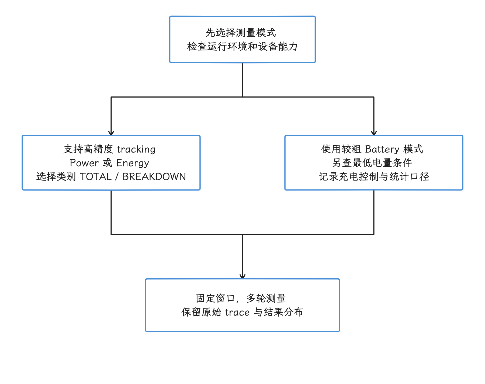

图：先按设备能力和目的选择 Power/Energy 或 Battery，再固定场景重复测量。 示例预检要求 Benchmark 1.3.0+；TOTAL 汇总类别，BREAKDOWN 展开组件；不同模式不能混成同一回归序列。

CI（持续集成）设备还需要固定系统镜像、充电控制、热状态和后台账号。功耗基准对环境比启动时间更敏感，单次结果不应直接触发发布阻断。

## API 35+ `PowerMonitor`

`PowerMonitor` 是设备通过 framework 公开的逻辑能量计。`SystemHealthManager.getSupportedPowerMonitors()` 返回当前设备可用的 monitor；设备没有实现对应能力、服务不可用或相关功能被关闭时，回调可能得到空列表。示例应运行于提供该公开 API 的 API 35+ 平台，并先检查列表，不能仅靠系统版本推定有数据。`PowerMonitor` 分两类：

- `POWER_MONITOR_TYPE_MEASUREMENT`：直接测量的 rail，名称与含义由设备定义；
- `POWER_MONITOR_TYPE_CONSUMER`：某个子系统的能量消费者，可能直接来自 rail，也可能组合、拆分或建模。

源码内部的 monitor index 只是当前开机期间的数字标识，重启后不保证稳定。应用应在当前进程中使用枚举返回的对象，不能把 index 持久化为设备协议。

下面的代码展示一次完整枚举和异步读取。它读取累计能量，不在回调里假设 monitor 名称。

```kotlin
val health = context.getSystemService(SystemHealthManager::class.java)

health.getSupportedPowerMonitors(executor) { monitors ->
    if (monitors.isEmpty()) {
        Log.i("PowerSample", "No power monitors on this device")
        return@getSupportedPowerMonitors
    }

    health.getPowerMonitorReadings(
        monitors,
        executor,
        object : OutcomeReceiver<PowerMonitorReadings, RuntimeException> {
            override fun onResult(result: PowerMonitorReadings) {
                monitors.forEach { monitor ->
                    val energyUws = result.getConsumedEnergy(monitor)
                    val timestampMs = result.getTimestampMillis(monitor)
                    Log.i(
                        "PowerSample",
                        "${monitor.name}: $energyUws uWs at $timestampMs ms"
                    )
                }
            }

            override fun onError(error: RuntimeException) {
                Log.e("PowerSample", "Power monitor read failed", error)
            }
        }
    )
}
```

`OutcomeReceiver` 通过 `onResult` 或 `onError` 异步交付结果。`getConsumedEnergy()` 返回设备本次开机以来的累计 `uWs`，重启后清零，并且包含插电与电池供电期间的能量。返回 `ENERGY_UNAVAILABLE` 表示该 monitor 本次没有可用能量读数，该值不能参与差分。

时间戳使用 elapsed realtime，即包含深度休眠时间的开机单调时钟，单位为毫秒。

两次读数的窗口平均功率按下面的单位关系计算：

```text
averagePower_mW =
    (energy2_uWs - energy1_uWs) /
    (timestamp2_ms - timestamp1_ms)
```

因为 `1 uWs / 1 ms = 1 mW`，公式不需要额外的 1000 倍换算。两次读数必须来自同一设备、同一次开机和同一枚举结果中的 monitor 身份。两端能量都必须有效，读数时间戳必须确实前进，能量回退应先诊断；不要把两次调用的墙钟间隔作为分母。选择足够长的受控窗口，并核对实际读数更新，以降低缓存、随机化与硬件采样的影响。

<!-- gracker-diagram: ch15-05-11-monitor-identity-and-delta -->
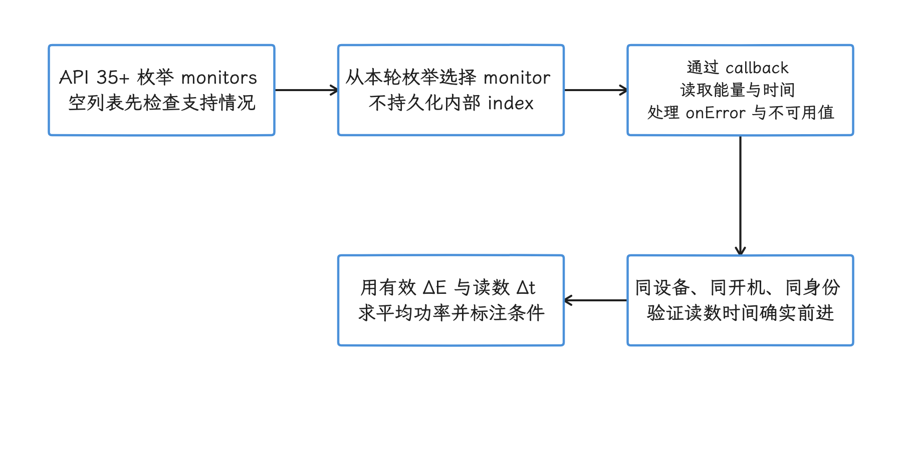

图：使用当前枚举结果读取 monitor，保留设备、开机身份、读数能量和 elapsed realtime 时间，再判断能否差分。 空列表、错误回调、无效能量、时间未前进或回退都不能硬算功率；µWs / ms 才是 mW。

### Android 17 的新鲜度与随机化

`PowerStatsService` 在 API 37 使用两组缓存：

- 普通调用方的缓存刷新尝试阈值是 20,000 ms；
- 持有 `ACCESS_FINE_POWER_MONITORS` 的调用方使用 fine 缓存，刷新尝试阈值是 250 ms。

`ACCESS_FINE_POWER_MONITORS` 是 `signature|privileged|development` 权限，并受 feature flag（平台功能开关）控制；普通线上应用不能依靠运行时权限弹窗取得它。20 秒和 250 ms 是服务端判断是否尝试刷新缓存的年龄阈值；HAL 刷新失败或仍返回旧样本时，并不保证实际读数达到该新鲜度，也不是硬件固定采样率。

<!-- gracker-diagram: ch15-05-12-cache-refresh-policy -->
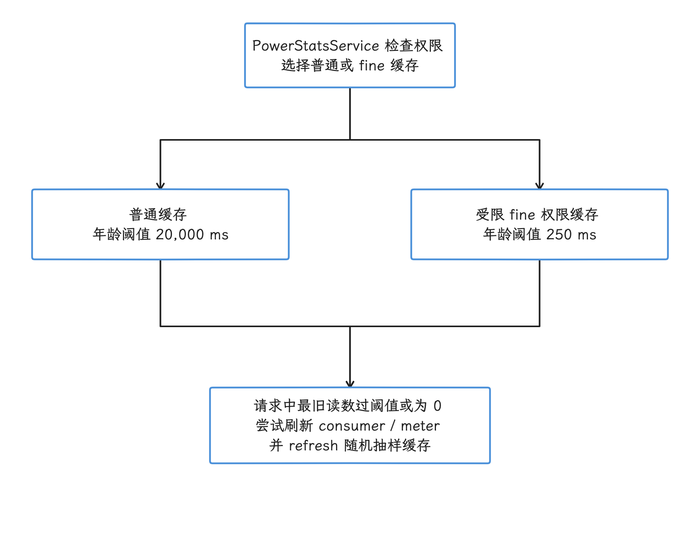

图：普通和 fine 请求选择不同缓存及年龄阈值，过期时尝试向 HAL 刷新。 阈值不保证实际样本新鲜度；HAL 失败或仍返回旧样本时，要检查结果时间戳，不能声称硬件固定频率。

返回循环只在当前和上一次缓存能量都不为 `ENERGY_UNAVAILABLE` 时调用 `IntervalRandomNoiseGenerator.addNoise()`；首次有效读数或尚无前值时会直接返回当前值。满足该条件时，Android 17 的上下界是：

```text
low  = max(previousEnergyUws, currentEnergyUws - 10_000_000)
high = currentEnergyUws
```

`10_000_000 uWs` 等于 10 J。Beta 分布是一种概率分布，取值范围限定在一个区间内；这里的参数 `alpha=50` 会让样本更靠近 high。生成器用 `UID % 17` 选择一个缓存槽；在 `refresh()` 之间复用该槽的分布抽样因子，同槽的不同 UID 也会复用因子。槽并非每 UID 独占，且服务任何一次刷新尝试都会清空抽样缓存，不能把它理解为对某个调用方永久固定的测量偏移。

这个算法既不是对称的 ±10%，也不能描述成固定 10 mWs 误差。普通或 fine 缓存都使用上述相同条件判断；fine 权限改变缓存选择和刷新阈值，并不普遍绕过随机化。首次读数直接返回的分支也不能当作长期无噪声接口。

<!-- gracker-diagram: ch15-05-13-conditional-randomization -->
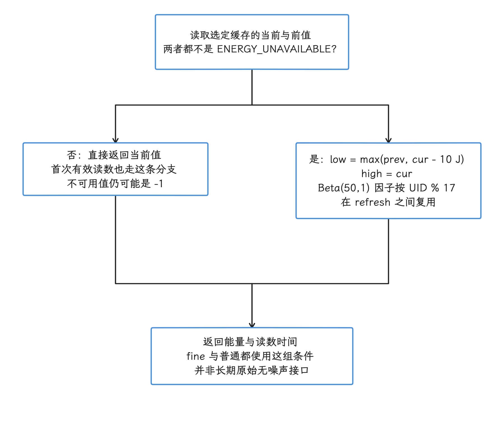

图：只有当前和前值均有效才进行有界随机化，首次有效值等分支直接返回；fine 也不普遍绕过它。 先排查计数回退；10,000,000 µWs 是 10 J；17 个槽复用抽样因子，refresh 会清空槽，不能描述为每 UID 永久固定偏移。

PowerMonitor 因此不适合作为毫秒级实时控制信号。它适合对比受控窗口内的累计能量；频繁轮询、过短的相邻样本差分和跨设备固定阈值，都会放大缓存、随机化和硬件差异的影响。

## `BatteryUsageStats` 是平台归因接口

`BatteryStatsManager.getBatteryUsageStats()` 返回按子系统和 UID 归因的结果；`BatteryStatsManager` 在 A17 源码中是 `@SystemApi` / `@hide`，不是普通应用的公开 SDK 接口，调用还需要 `signature|privileged|development` 级别的 `BATTERY_STATS`。系统或受控开发授权与普通线上应用的能力不同，不能把它当作通用线上自助功耗 API。

Android 17 的服务端流程是：

```text
BatteryStatsManager
    -> IBatteryStats.getBatteryUsageStats()
    -> BatteryStatsService
    -> 必要时同步外部统计并 collectPowerStatsSamples()
    -> BatteryUsageStatsProvider
    -> BatteryUsageStats
```

这条流程中的 `BatteryStatsService` 会等待正在进行的统计更新完成，检查数据是否过旧，必要时同步来自调制解调器、Wi-Fi 控制器等组件的外部状态并采集 PowerStats 样本，再由 `BatteryUsageStatsProvider` 生成结果。

<!-- gracker-diagram: ch15-05-14-battery-usage-attribution -->
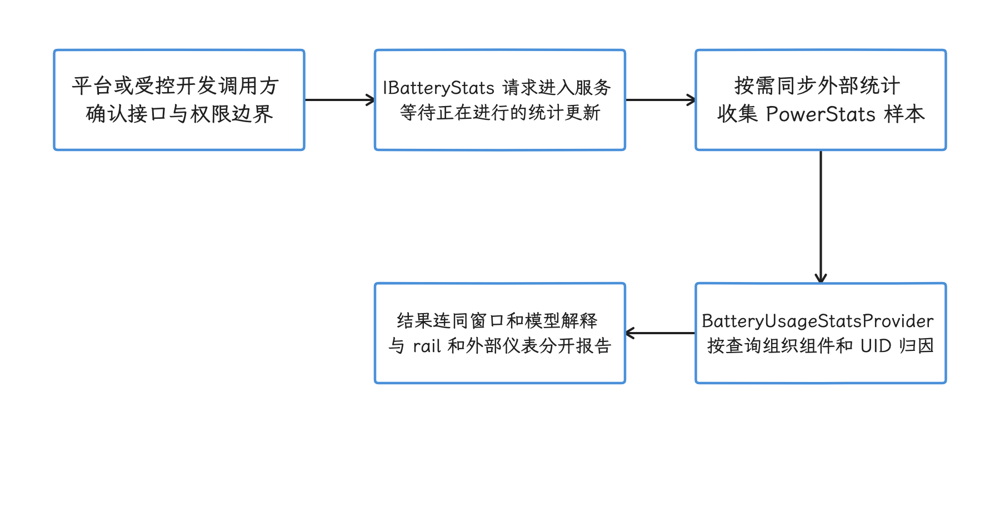

图：平台调用方经 Binder 请求统计，服务等待更新并按需要同步外部数据，再由 provider 生成归因结果。 BatteryStatsManager 是 SystemApi / hide 且受 BATTERY_STATS 限制；Historian 解析 bugreport，共用底层数据并不等于转发此 API。

Binder 是 Android 的跨进程调用机制。Historian 和该 Binder API 共用 BatteryStats 数据源，但 Historian 解析的是 bugreport，没有简单转发这项 API。

### API 37 查询项的变化

旧资料常把 `BatteryUsageStatsQuery` 写成“五个 flag”，flag 指控制查询行为的配置位，其中曾包括 `INCLUDE_POWER_MODELS`。Android 17 源码已经不符合这种说法：

- `includePowerModels()` 标记为 deprecated，方法体直接返回 builder，不再设置 flag；
- `powerProfileModeledOnly()` 也已 deprecated，但 Android 17 实现仍会设置 `FLAG_BATTERY_USAGE_STATS_POWER_PROFILE_MODEL`；
- builder 仍支持 battery history、process state、virtual UID（例如 SDK Sandbox 的虚拟 UID）、screen state、power state、累计统计和组件过滤；
- `accumulated()` 请求跨重启和大多数 BatteryStats reset 的连续累计统计，并组合 process、screen 和 power state 维度；
- `PowerStatsAggregator` 位于 `services/core/java/com/android/server/power/stats/processor/`，通过回放 BatteryStats history 聚合样本。

`BatteryConsumer.POWER_MODEL_POWER_PROFILE` 与 `POWER_MODEL_ENERGY_CONSUMPTION` 常量仍在类中，不能由此反推 `includePowerModels()` 仍会返回双列模型数据。阅读 API 演进时应同时检查 builder 实现和使用查询结果的代码。

<!-- gracker-diagram: ch15-05-15-query-evolution -->
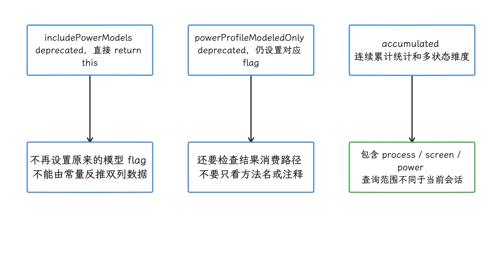

图：检查 builder 的真实实现，deprecated、常量仍存在与行为是否生效是不同问题。 includePowerModels 已空操作；modeledOnly 仍置位不代表旧双列模型继续有效；accumulated 跨重启及大多数 reset。

## 归因模型的边界

Android 功耗统计通常混合两类输入：

- Power Profile：设备的 `power_profile.xml` 为各组件配置名义电压下的平均电流，通常以 mA 表示；framework 将电流与活动时长相乘，估算电池消耗的 mAh；
- Energy consumer / rail：由 Power Stats HAL 报告的累计能量，再按 UID 活动或硬件 attribution（归因数据）分配。

`IPowerStats` AIDL（Android Interface Definition Language，Android 跨进程接口定义语言）对 EnergyConsumer、EnergyMeter Channel 和 PowerEntity 做了区分：

| HAL 数据 | 语义 | 典型用途 |
|---|---|---|
| EnergyConsumer | 子系统在设备本次开机以来的累计能量，可带 UID attribution | framework 组件与 UID 归因 |
| EnergyMeter Channel | bus（供电总线）、sense resistor（电流采样电阻）或 rail 的累计能量 | ODPM、Perfetto、PowerMonitor measurement |
| PowerEntity state residency | 子系统各状态驻留时间、次数和最近进入时间 | 功耗模型与状态诊断 |

HAL 的能量单位是 `uWs`，时间戳基于启动时钟。Channel 名称和 subsystem 字符串对 framework 是 opaque，即 framework 只传递它们，不解释厂商自定义语义。跨设备比较前，必须建立当前设备的名称与硬件映射。

<!-- gracker-diagram: ch15-05-16-hal-measurement-types -->
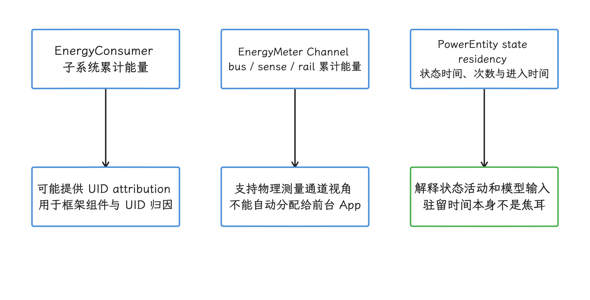

图：EnergyConsumer、EnergyMeter Channel 和状态驻留分别提供组件归因输入、物理通道能量与活动状态。 名字与 subsystem 依设备实现；累计能量、驻留时间和次数单位不同，跨设备先建立映射。

没有硬件数据时，估算模型仍可用于同设备、同版本的趋势比较。它的误差来自 `power_profile.xml`、活动时间统计和归因规则，报告里应明确写“estimated”。有 rail 数据时也不能把系统级能量无条件分给前台应用。

## A/B 功耗实验怎么做

### 固定测量边界

先定义起止事件，例如“首页首帧完成后开始，连续滚动 60 秒后停止”。两组实验都用相同的 trace section 或测试脚本标记边界。不要用手工观察电池百分比替代测量窗口。

### 控制环境

- 同一台设备、同一系统镜像和同一应用编译类型（例如都使用 release 构建）；
- 固定亮度、刷新率、音量、网络类型和信号条件；
- 记录电池温度、SoC（System on Chip，主芯片）温度、充电状态与 Thermal throttling（过热降频）；
- 关闭自动更新、云同步和不相关账号，或在报告里保留它们的活动证据；
- 让两组测试使用相同的预热、缓存、登录和数据集状态。

### 处理顺序效应

连续运行十次 A 再运行十次 B，后半段更可能受到热状态和电量变化影响。更稳妥的方式是交错 A/B 顺序，运行间恢复到相近温度，并保留每次原始 trace 与结果。

<!-- gracker-diagram: ch15-05-17-controlled-ab-experiment -->
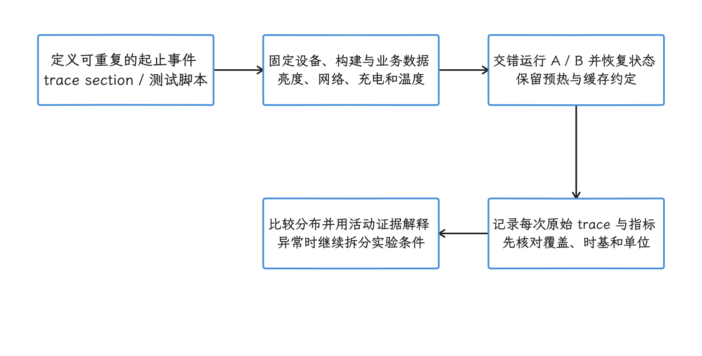

图：先固定测量边界与设备环境，交错 A/B 顺序并恢复相近状态，再比较多次结果分布。 对齐真实测量样本窗口；温度、网络、充电、缓存和后台活动都要记录，不能用一次结果替代回归分布。

### 同时保留三层证据

1. Macrobenchmark 或外部仪表给出窗口能量分布；
2. Perfetto 解释 CPU、GPU、WLAN 等 rail 和线程活动；
3. Batterystats/Historian 检查较长窗口里的 Wakelock、job、alarm 和后台归因。

若三层证据不一致，先查时间边界、系统噪声、缓存与单位，不要挑选最符合预期的一组数字。

<!-- gracker-diagram: ch15-05-18-triangulate-evidence -->
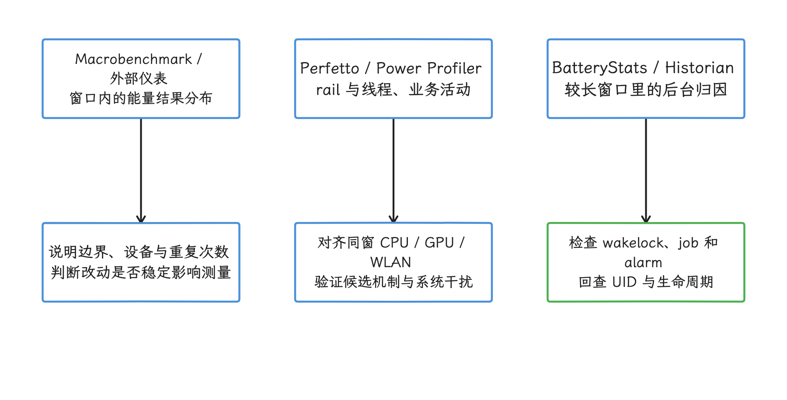

图：窗口测量给出变化幅度，trace 解释同时段活动，长期统计帮助发现后台与生命周期问题。 证据冲突先查边界、覆盖、缓存、单位和系统干扰；三层不是可以直接相加的能耗账本。

## 版本演进

| 版本或时间点 | 变化 | 使用方式 |
|---|---|---|
| Android 5.0 / API 21 | Battery Historian 支持 Lollipop 及后续 bugreport | 用于历史事件与统计回看 |
| Android 10 / API 29 | Perfetto `android.power` 与 Power Stats HAL/ODPM 能力进入平台 | rail 是否有数据由设备硬件和 HAL 决定 |
| 2022 年 12 月 29 日 | Google Battery Historian 仓库归档 | 不再把它作为新项目的默认入口 |
| Android Studio Hedgehog | Power Profiler 展示 ODPM Power Rails | 官方高精度支持以 Pixel 6+ 为准 |
| AndroidX Benchmark 1.2.0 / 1.3.0 | `PowerMetric` 加入；随后增加设备能力检查 | API 29+，高精度结果仍是系统级 |
| Android 15 / API 35 | 公开 `PowerMonitor` 枚举与读取 API | 读取设备本次开机以来的累计能量 |
| Android 17 / API 37 | fine monitor 权限、新鲜度分级和查询实现可从正式 tag 验证；BatteryUsageStats 查询项继续演进 | 结论锚定 `android-17.0.0_r1` |

## 常见误读

### “Historian 某一行持续变色，所以它就是耗电来源”

色块表示活动或状态。能量结论还要结合归因统计、rail、线程或外部测量。

### “ODPM 是硬件计量，所以数值属于目标应用”

ODPM 量的是设备 rail。应用归因要借助受控场景、线程活动和 BatteryStats。

### “PowerMonitor 返回的是瞬时功率”

返回值是设备本次开机以来的累计 `uWs`。平均功率来自两个样本的能量差和时间差。

### “250 ms 表示 Android 17 每 250 ms 采一次硬件”

250 ms 是触发 fine 缓存刷新尝试的年龄阈值，不保证硬件每 250 ms 更新或返回的读数一定足够新。HAL 与硬件内部采样方式由设备实现。

### “fine 权限会返回完全原始、无随机化的数值”

Android 17 对两种缓存都检查当前和前值是否有效，满足条件时调用有界随机化；首次有效读数等分支可直接返回当前值。fine 权限改变缓存选择和刷新阈值，不保证长期原始读数。

### “Power Profiler 在不支持 ODPM 的设备上会自动给出等价估算”

设备可能只提供 battery capacity、charge 或 current；缺少 rail 时没有等价的高精度子系统能量。界面是否展示旧估算项还取决于 Studio 与设备版本，测试程序应显式检查设备能力。

## 源码与官方文档

- [Battery Historian 使用说明与维护状态](https://developer.android.com/topic/performance/power/battery-historian)
- [Batterystats 与 Battery Historian 采集步骤](https://developer.android.com/topic/performance/power/setup-battery-historian)
- [Google Battery Historian 归档仓库](https://github.com/google/battery-historian)
- [Android Studio Power Profiler](https://developer.android.com/studio/profile/power-profiler)
- [Macrobenchmark PowerMetric API](https://developer.android.com/reference/androidx/benchmark/macro/PowerMetric)
- [本轮固定 AndroidX PowerMetric 实现](https://android.googlesource.com/platform/frameworks/support/+/d153d87ed76372ece0c99dac837ff07ab845d495/benchmark/benchmark-macro/src/main/java/androidx/benchmark/macro/Metric.kt)
- [Macrobenchmark 指标说明](https://developer.android.com/topic/performance/benchmarking/macrobenchmark-metrics)
- [Android vitals 过度 Partial Wakelock 口径](https://developer.android.com/topic/performance/vitals/excessive-wakelock)
- [Perfetto power 数据源](https://perfetto.dev/docs/data-sources/battery-counters)
- [Android 17 Perfetto PowerConfig](https://android.googlesource.com/platform/external/perfetto/+/refs/tags/android-17.0.0_r1/protos/perfetto/config/power/android_power_config.proto)
- [Android 17 Perfetto power rails SQL 模块](https://android.googlesource.com/platform/external/perfetto/+/refs/tags/android-17.0.0_r1/src/trace_processor/perfetto_sql/stdlib/android/power_rails.sql)
- [Android 17 SystemHealthManager PowerMonitor 入口](https://android.googlesource.com/platform/frameworks/base/+/refs/tags/android-17.0.0_r1/core/java/android/os/health/SystemHealthManager.java)
- [Android 17 PowerMonitor 类型与设备边界](https://android.googlesource.com/platform/frameworks/base/+/refs/tags/android-17.0.0_r1/core/java/android/os/PowerMonitor.java)
- [Android 17 PowerMonitorReadings 单位与时间戳](https://android.googlesource.com/platform/frameworks/base/+/refs/tags/android-17.0.0_r1/core/java/android/os/PowerMonitorReadings.java)
- [Android 17 PowerStatsService 缓存与随机化](https://android.googlesource.com/platform/frameworks/base/+/refs/tags/android-17.0.0_r1/services/core/java/com/android/server/powerstats/PowerStatsService.java)
- [Android 17 IntervalRandomNoiseGenerator](https://android.googlesource.com/platform/frameworks/base/+/refs/tags/android-17.0.0_r1/services/core/java/com/android/server/powerstats/IntervalRandomNoiseGenerator.java)
- [Android 17 BatteryStatsService](https://android.googlesource.com/platform/frameworks/base/+/refs/tags/android-17.0.0_r1/services/core/java/com/android/server/am/BatteryStatsService.java)
- [Android 17 BatteryUsageStatsQuery](https://android.googlesource.com/platform/frameworks/base/+/refs/tags/android-17.0.0_r1/core/java/android/os/BatteryUsageStatsQuery.java)
- [Android 17 PowerStatsAggregator](https://android.googlesource.com/platform/frameworks/base/+/refs/tags/android-17.0.0_r1/services/core/java/com/android/server/power/stats/processor/PowerStatsAggregator.java)
- [Android 17 Power Stats HAL AIDL](https://android.googlesource.com/platform/hardware/interfaces/+/refs/tags/android-17.0.0_r1/power/stats/aidl/android/hardware/power/stats/IPowerStats.aidl)
- [Power Stats HAL 官方说明](https://source.android.com/docs/core/power/power-stats-hal)

**延伸阅读**：[11.1 Android 功耗模型与系统级优化](../../part2-performance/ch11-power/01-android-power-model-system-optimization.md) · [11.2 App 耗电优化与案例](../../part2-performance/ch11-power/02-app-power-optimization-cases.md) · [11.3 WakeLock 机制与功耗分析](../../part2-performance/ch11-power/03-wakelock.md) · [15.1 Android Studio Profiler](01-as-profiler.md) · [16.3 线上性能监控](../ch16-methodology/03-performance-metrics-online-monitoring.md)
