# 自动化性能测试与 CLI Agent 工作流

自动化性能测试要解决的事可以概括成一句：把设备状态、场景、采集配置、统计方式和失败证据都固定下来，让同一组数字可以反复复查。CLI 与 Agent 擅长把这些步骤编排起来；而每一个性能判断，我们最后都要能落回命令、Trace、日志或测试结果。

## 场景、基线、重复测量与回归门禁

### 为什么要用自动化工具做性能测试

排查性能问题时，Perfetto 和 Android Studio Profiler 回答的是“时间花在哪里”，自动化基准测试回答的是“从哪次改动开始变慢”。Trace 本身是带时间戳的性能事件记录：手工抓一次，定位眼前的问题够用；要让每次提交之后都按相同条件重放启动、滚动或热点函数，就得靠自动化了。

Jetpack Benchmark 把场景、编译状态、重复次数和产物格式都写进了测试代码，CI 系统因此能保存每次运行的 JSON（结构化文本格式）结果与 Perfetto Trace，再把本次数据与同一设备上的历史数据比较。自动化解决的是重复执行这一环；构建类型、设备温度、系统版本、编译模式和操作范围，还得我们逐项固定，否则得到的数字主要是设备波动。

### Macrobenchmark 与 Microbenchmark：两种层次，两种用途

两套库面向的层级不同：Macrobenchmark 测量完整用户场景，Microbenchmark 测量可独立调用的代码片段。

先把两个词对齐：APK 是 Android 应用或测试程序的安装包；AOT（Ahead-of-Time）指运行前把字节码编译为机器码，JIT（Just-in-Time）指运行期间编译热点代码。

两套库的区别集中在进程边界和测量对象，我们逐项看：

| 维度 | Macrobenchmark | Microbenchmark |
|---|---|---|
| 测量范围 | 启动、滚动、动画等完整用户场景 | 可直接调用的函数、算法或一小段 UI 代码 |
| 运行位置 | 测试 APK 在目标应用进程之外驱动场景 | 被测代码在基准测试进程内循环执行 |
| 编译控制 | 可选择 `DEFAULT`、`Full`、`Partial`、`None`、`Ignore` | AndroidX Benchmark Gradle 插件可对基准测试 APK 做全量 AOT |
| 主要产物 | 指标 JSON；每个测量迭代一份系统 Trace | 指标 JSON 与最小系统 Trace；采集条件允许时默认再生成方法 Trace |
| 适合回答 | 一次交互整体是否回归，慢在哪个系统阶段 | 某个热点实现是否更快，分配是否减少 |

<!-- gracker-diagram: ch15-06-01-measurement-levels -->
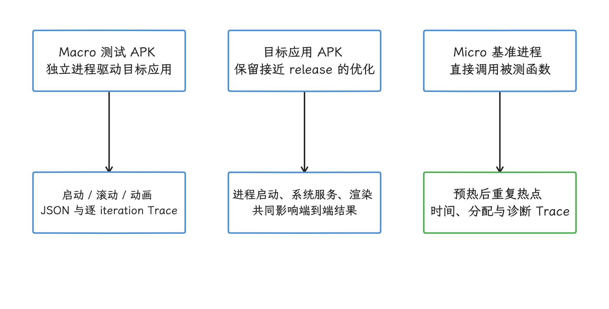

图：Macro 从外部测试进程驱动完整场景，Micro 在基准进程中循环热点代码。 两者都绑定设备与编译条件；局部热点改善需要再回到完整场景验证。

#### Macrobenchmark：端到端的用户体验测量

Macrobenchmark 从目标应用外部启动 Activity、注入手势并采集系统 Trace，测的是启动、滚动和动画这类完整交互。写测试代码时，模块和构建各有一条硬要求：代码放在独立的 `com.android.test` 模块中，目标 APK 用接近 release 的非 debuggable 构建，并保留 R8（Android 构建中的代码压缩与优化工具）的压缩和优化。Manifest 中的 `<profileable>` 则让 shell 可以对非 debuggable 应用做低干扰 Trace 采集。

入口是 `MacrobenchmarkRule.measureRepeated()`：`setupBlock` 把应用放到一致的初始状态，`measureBlock` 定义计入测量的操作。iteration 指同一次测试启动中的一次重复测量；一次 `measureRepeated()` 会执行多个 iteration，并为每个测量 iteration 保存一份系统 Trace。

<!-- gracker-diagram: ch15-06-02-macro-iteration -->
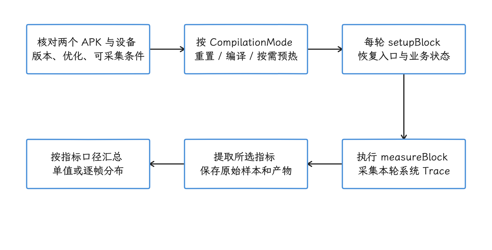

图：先按编译模式配置应用，再逐次准备场景、执行测量并保存证据。 编译和 setup 不属于 measureBlock；启动与帧指标按各自口径提取，不能把完整 Trace 长度当指标。

`StartupTimingMetric` 的汇总值是 min、median（中位数）、max；`FrameTimingMetric` 输出 P50、P90、P95、P99。P90 表示 90% 的样本不超过该值，其余分位数同理。我们按分位数读这些数字，不把它们概括成“重复 N 次取平均值”。

常用指标和各自的适用条件如下：

| 指标 | 版本边界 | 读法 |
|---|---|---|
| `StartupTimingMetric` | Macrobenchmark 支持 API 23+；`timeToFullDisplayMs` 在 API 29 之前可能不可用 | TTID（Time to Initial Display）对应首帧；TTFD（Time to Full Display）依赖应用在主要内容就绪后调用 `reportFullyDrawn()` |
| `FrameTimingMetric` | `frameOverrunMs` 仅 API 31+ | 正值表示超过该帧 deadline（应完成时间）；`frameDurationCpuMs` 是 UI doFrame 开始到对应 RenderThread DrawFrame 结束的经过时间 |
| `TraceSectionMetric` | 实验 API；依赖 Trace 中存在同名 section | section 是应用写入 Trace 的命名时间片；默认只查目标包，并选取测量区间内首次匹配 |
| `PowerMetric` | 实验 API，最低 API 29 | 高精度 power/energy 是系统总量，依赖设备 power rail（硬件供电通路）；官方限定 Pixel 6、Pixel 6 Pro 及更新机型 |

`PowerMetric` 还提供电池电量差值类型，精度低于 power rail。无论选哪一种，把功耗结果直接归因到单个应用都做不到：测试进程、系统服务、屏幕和网络活动都会进入系统总量。[AndroidX 源码](https://android.googlesource.com/platform/frameworks/support/+/androidx-main/benchmark/benchmark-macro/src/main/java/androidx/benchmark/macro/Metric.kt) 对 `PowerMetric` 标注了 `@RequiresApi(29)`，并提供 `deviceSupportsHighPrecisionTracking()` 检查设备能力。

#### Microbenchmark：代码级热点分析

Microbenchmark 直接循环调用被测代码，适合 JSON 解析、数据转换、布局 inflate（从 XML 创建 View）、`RecyclerView` item 绑定这类高频 CPU 路径。循环天然带着预热过的缓存和稳定的代码路径，结果也就接近热点代码的最佳情况；磁盘首次读取、只运行一次的初始化、跨进程交互这类场景，通常要另配手段判断。

下面的测试测量一个解析函数，并用 `BlackHole.consume()` 防止死代码删除——也就是避免 Kotlin 编译器或 R8 把没有外部用途的计算整段删掉：

```kotlin
// 省略 import；类位于 microbenchmark 模块的 androidTest 源集。
@RunWith(AndroidJUnit4::class)
class JsonBenchmark {
    @get:Rule
    val benchmarkRule = BenchmarkRule()

    @Test
    fun measureJsonParsing() = benchmarkRule.measureRepeated {
        val result = parseJson(largeJsonInput)
        BlackHole.consume(result)
    }
}
```

`measureRepeated` 负责预热、循环次数和计时，报告执行时间与分配次数。AGP 即 Android Gradle Plugin；Benchmark 1.3.0-beta01+ 配合 AGP 8.4.0+ 时，`androidx.benchmark` 插件默认对 Microbenchmark APK 做全量 AOT。想观察 JIT 行为，可在 `gradle.properties` 中设置 `androidx.benchmark.forceaotcompilation=false`。

准备输入数据或重置容器时，把不参与测量的部分放进 `runWithMeasurementDisabled {}`。旧名 `runWithTimingDisabled {}` 在 Benchmark 1.4.0 已弃用，因为它暂停的除了计时还有测量。

<!-- gracker-diagram: ch15-06-03-micro-hot-loop -->
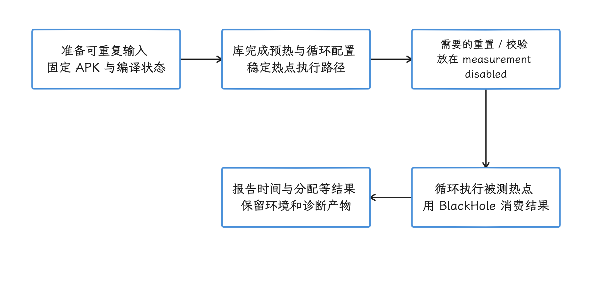

图：预热和自适应循环围绕热点代码，非测量准备与结果消费需要显式安排。 循环结果更接近预热状态；BlackHole 防止结果及其计算被删除，不能把热点数字直接当首次启动表现。

#### 什么时候用哪个？

完整交互选 Macrobenchmark，能独立调用的热点选 Microbenchmark。两者常按下面这条路径配合：

1. Macrobenchmark 记录启动或滚动回归，并保留对应 Trace。
2. Perfetto 把耗时定位到一个可隔离的函数或阶段。
3. Microbenchmark 比较候选实现，确认局部变化。
4. Macrobenchmark 回到原场景，确认端到端指标与 Trace 都得到改善。

版本上的硬条件集中在三处：Macrobenchmark 最低支持 API 23，`frameOverrunMs` 属于 API 31+ 指标，`PowerMetric` 最低支持 API 29。

<!-- gracker-diagram: ch15-06-04-local-to-global -->
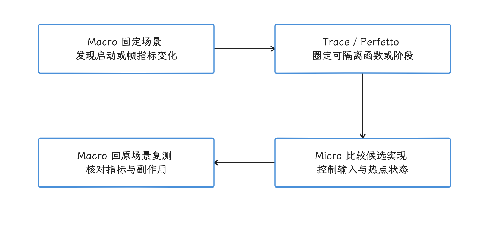

图：先以完整场景发现回归，再隔离热点比较，最后回到同一场景复测。 Trace 负责解释机制，Micro 负责隔离实验；单个函数更快不保证整体体验改善。

### 使用 Macrobenchmark 测量启动时间和滑动帧率

#### 测量启动时间

Baseline Profile 是应用交给 ART（Android Runtime）的预编译方法与类列表。下面的 Partial 冷启动示例要求 API 24+ 且目标 APK 有可安装的 Baseline Profile；API 23 需使用 Full，缺少 profile 时不能把 Partial() 当成可选安装。代码主体省略了 import：

```kotlin
// 省略 import；替换为被测应用的真实包名。
@LargeTest
@RunWith(AndroidJUnit4::class)
class StartupBenchmark {
    @get:Rule
    val benchmarkRule = MacrobenchmarkRule()

    @Test
    fun coldStartup() = benchmarkRule.measureRepeated(
        packageName = "com.example.myapp",
        metrics = listOf(StartupTimingMetric()),
        compilationMode = CompilationMode.Partial(),
        iterations = 10,
        startupMode = StartupMode.COLD,
        setupBlock = {
            pressHome()
        }
    ) {
        startActivityAndWait()
    }
}
```

`StartupMode.COLD` 会在 `setupBlock` 与 `measureBlock` 之间终止目标进程，测试无需自行执行 `force-stop`。`pressHome()` 固定启动前的可见界面，`startActivityAndWait()` 发出启动 Intent 并等待 Activity 首帧。`iterations = 10` 只是该场景的采样配置，应按本机测量波动和 CI 时长调整；通用门槛要按场景自己定，10 次来自本例。

`StartupTimingMetric` 输出 `timeToInitialDisplayMs` 和 `timeToFullDisplayMs`：前者从系统收到启动 Intent 计到目标 Activity 首帧，后者计到应用调用 `reportFullyDrawn()` 后的首个完整帧。应用没调用该 API，TTFD 就无从解释；API 29 之前还可能拿不到这个字段。报告比较以 median 为主，同时保留 min、max 和单次 Trace。

<!-- gracker-diagram: ch15-06-05-startup-boundaries -->
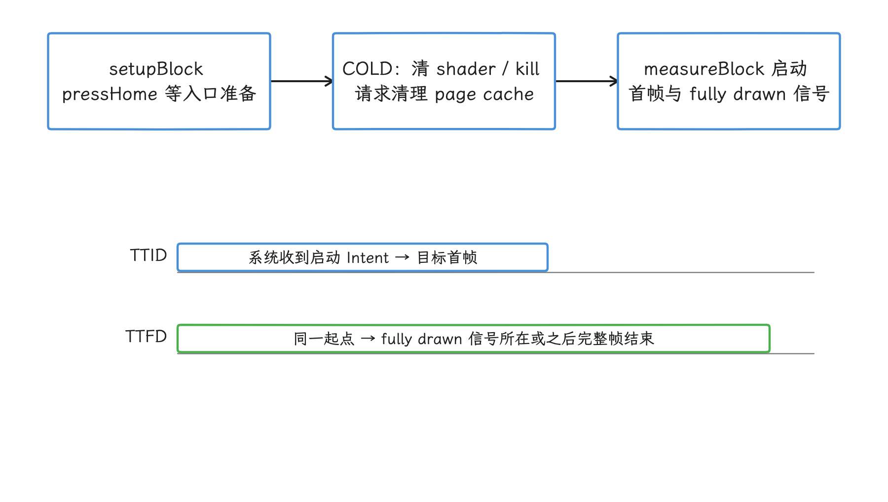

图：COLD 由库在 setup 后停止进程并处理缓存；TTID 与 TTFD 使用同一起点和不同显示终点。 轨道仅表示边界，长度不是测量值；TTFD 依赖正确 fully drawn 信号，API 29 之前可能不可用。

`StartupMode` 提供 `COLD`、`WARM`、`HOT`，三种模式改变启动前的进程和 Activity 状态，趋势曲线要按模式分开画，所以测试名称、JSON 基线和告警规则都应带上启动模式。

#### 测量滑动帧时间

写滚动测试时，我们把页面准备放进 `setupBlock`，把手势及其产生的帧留在 `measureBlock`。下面的主体代码使用 UI Automator 的稳定 API；同样选择 Partial()，因此要求 API 24+ 与可安装的 Baseline Profile：

```kotlin
@Test
fun scrollList() = benchmarkRule.measureRepeated(
    packageName = "com.example.myapp",
    metrics = listOf(FrameTimingMetric()),
    compilationMode = CompilationMode.Partial(),
    iterations = 10,
    setupBlock = {
        killProcess()
        startActivityAndWait()
        check(
            device.wait(
                Until.hasObject(By.res("com.example.myapp", "recycler_list")),
                5_000
            )
        )
    }
) {
    val list = requireNotNull(
        device.findObject(By.res("com.example.myapp", "recycler_list"))
    )
    list.setGestureMargin(device.displayWidth / 5)
    list.fling(Direction.DOWN)
}
```

`killProcess()` 与重新启动发生在测量区间之外，让每次迭代都从列表初始位置开始。`check` 让页面未准备好时直接失败，避免“没有找到列表但测试仍通过”这种假绿灯。`setGestureMargin()` 避开系统返回手势区域，`fling()` 产生可重复的滚动输入。业务场景要求固定距离时可改用 `swipe()`，并把方向、速度、距离和列表初始位置写成稳定条件。

`FrameTimingMetric` 报告 P50、P90、P95、P99。API 31+ 的 `frameOverrunMs` 使用系统为每一帧计算的 deadline，60 Hz、高刷新率和可变刷新率设备都适用；正值表示超期，负值表示仍有余量。按本轮固定 `FrameTimingQuery` 实现，`frameDurationCpuMs = (RenderThread DrawFrame.endTs − UI doFrame.ts) / 10⁶`（Trace 时间戳以 ns 计）：这是跨两个边界的经过时间，可能包含排队、阻塞或未获调度的时间，并非两个线程实际运行的 CPU 时间相加，也不等于最终呈现延迟。GPU 与合成侧问题还要回到 FrameTimeline（系统记录的预期帧与实际帧时序）、线程调度和系统 Trace 判断。FrameTimeline（逐帧预期与实际时间轨道）在后文多处会用到。

<!-- gracker-diagram: ch15-06-06-frame-elapsed-time -->
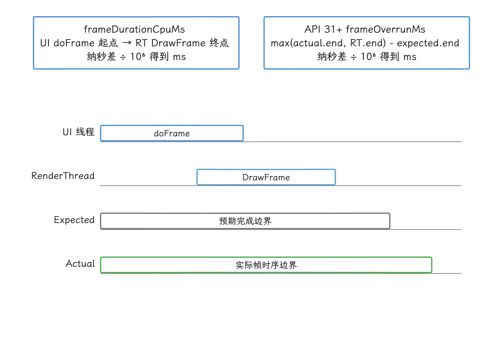

图：frameDurationCpuMs 跨 UI 起点与 RT 终点；frameOverrunMs 使用实际与预期帧的结束边界。 按固定源码公式绘制；条长仅为示意。经过时间可含阻塞与调度等待，不是实际占核时间相加，也不是直接的 FPS。

#### CompilationMode：量化编译优化效果

下面列出常用编译模式，重点看 `DEFAULT` 与 `Ignore` 各自的适用范围：

```kotlin
// 使用库的默认策略。
CompilationMode.DEFAULT

// 清除已编译代码和 profile，运行期间可继续产生 JIT 编译。
CompilationMode.None()

// 安装 Baseline Profile，并可按配置执行 warmup。
CompilationMode.Partial()

// 缺少 Baseline Profile 时让测试失败。
CompilationMode.Partial(
    baselineProfileMode = BaselineProfileMode.Require
)

// 对目标 APK 做全量 AOT。
CompilationMode.Full()

// 保留设备当前编译状态，不执行重置或编译。
CompilationMode.Ignore()
```

`DEFAULT` 在 API 24+ 使用 `Partial(UseIfAvailable)` 尝试安装 APK 中的 Baseline Profile；API 23 按系统默认行为做全量编译。`Partial()` 默认 `BaselineProfileMode.Require`，缺少或安装失败会报错；它与 `DEFAULT` 的可选安装策略不同。`None()` 观察无预编译状态，`Full()` 观察全量 AOT；全量编译会增大代码体积及指令缓存压力，不保证比 Partial 更快，不能把它称为性能上限。

<!-- gracker-diagram: ch15-06-07-compilation-contract -->
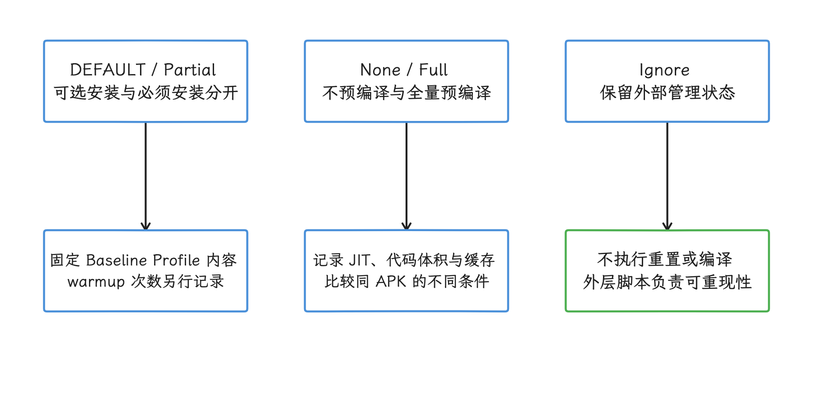

图：先明确希望观察的编译状态，再把模式与启动状态写入同一条基线。 Partial() 默认 Require；DEFAULT 在 API 24+ 是 UseIfAvailable；Full 不保证最快。API 23 仅支持全量编译。

`Ignore()` 保留设备当前编译状态，适合由外部脚本精确控制 ART 编译的场景。它目前带有 `ExperimentalMacrobenchmarkApi` 标记，调用处要用 opt-in 显式确认实验 API。

Android 14（API 34）起，Macrobenchmark 可以在重置编译状态时保留应用数据；更低版本常需要重装 APK。测试必须保留登录态或预置数据时，优先使用 API 34—37 的固定设备；旧设备可由外部脚本管理编译，再选 `CompilationMode.Ignore()`。

Baseline Profile 的收益，应由同一 APK、同一设备、同一启动模式下的 `None()` 与 `Partial()` 实测得出；跨项目引用“提升约 30%”替代不了本应用自己的数据。

### adb（Android Debug Bridge） shell am instrument：性能测试的命令行入口

无论从 Gradle、Android Studio 还是云设备平台出发，最后都汇聚到同一个入口：启动 instrumentation。这是 Android 的系统测试机制——系统启动测试 APK 中的 runner，并为它建立测试连接。ADB（Android Debug Bridge）下最直接的入口是 `am instrument`，基本语法如下：

```bash
TEST_INSTRUMENTATION="${TEST_INSTRUMENTATION:?set the registered test_package/runner_class}"
adb shell am instrument -w "$TEST_INSTRUMENTATION"
```

`<test_package>/<runner_class>` 是测试 APK 的 Manifest 中注册的 instrumentation 组件。runner 是发现并执行测试的入口类，`-w` 让 ADB 客户端等待测试结束并打印状态。Macrobenchmark 使用常规 `AndroidJUnitRunner`，下面这条命令只执行一个测试方法：

```bash
adb shell am instrument -w \
  -e class com.example.macrobenchmark.StartupBenchmark#coldStartup \
  com.example.macrobenchmark/androidx.test.runner.AndroidJUnitRunner
```

`-e class` 会写入 instrumentation 的参数 `Bundle`（一组键值对），由 `AndroidJUnitRunner` 解释为测试过滤条件。Microbenchmark 的组件 runner 则是 `androidx.benchmark.junit4.AndroidBenchmarkRunner`；两边的组件名各认各的，照抄会跑错目标。

本地跑整个 Macrobenchmark 模块或单个方法时，可以让 Gradle 一并负责构建、安装、执行和拉取产物：

```bash
./gradlew :macrobenchmark:connectedCheck

./gradlew :macrobenchmark:connectedCheck \
  -Pandroid.testInstrumentationRunnerArguments.class=\
com.example.macrobenchmark.StartupBenchmark#coldStartup
```

`connectedCheck` 是 Gradle 的连机测试任务，负责构建、安装和执行，再把 JSON 与 Trace 拉到主机。只有 CI 把构建和设备执行拆开时，才需要显式安装两个 APK 并手工调用 `am instrument`。

Benchmark 常用参数由测试库解释，不属于 `am` 内建选项：

- `-e class 包名.类名#方法名`：由 runner 过滤测试。
- `-e androidx.benchmark.dryRunMode.enable true`：用于快速验证逻辑。Microbenchmark 只跑单循环、跳过预热并不采集测量/Trace；Macrobenchmark 缩为一次 iteration，默认跳过编译，但仍可录制系统 Trace、提取指标。两者都不形成有效性能基线，不能把 Micro 的无采集语义套给 Macro。
- `-e androidx.benchmark.iterations N`：覆盖 Microbenchmark 的 measurement 数，每次 measurement 内部仍可根据预热时长运行多个循环；Macrobenchmark 的 iteration 数由测试代码中的 `measureRepeated` 参数定义。
- `-e androidx.benchmark.suppressErrors 错误名`：把指定配置错误降为警告。带错误前缀的结果只用于诊断，基线里不放。
- `-e additionalTestOutputDir 路径`：为直接 ADB 或云设备运行指定可写的产物目录。

Benchmark 1.1.0 之前要用 `androidx.benchmark.output.enable=true` 手动开启 JSON；当前版本已默认输出，这个历史参数可以放下了。

源码这一侧，[`Am.runInstrument()`](https://android.googlesource.com/platform/frameworks/base/+/android-17.0.0_r1/cmds/am/src/com/android/commands/am/Am.java) 解析 `-w`、`-e`、用户和 ABI（Application Binary Interface，native 二进制接口）等参数，把 `-e` 写入 `Instrument.args`。随后 [`Instrument.run()`](https://android.googlesource.com/platform/frameworks/base/+/refs/tags/android-17.0.0_r1/cmds/am/src/com/android/commands/am/Instrument.java) 创建结果 watcher 与 UiAutomationConnection，并通过 Binder（跨进程通信）调用 `IActivityManager.startInstrumentation()`；watcher/connection 是否创建取决于等待或 protobuf 报告模式，本例 `-w` 会启用。

[`ActivityManagerShellCommand`](https://android.googlesource.com/platform/frameworks/base/+/refs/tags/android-17.0.0_r1/services/core/java/com/android/server/am/ActivityManagerShellCommand.java) 的帮助文本也明确区分了 `am instrument` 入口。平台这一层只负责启动和传递参数，指标含义由 AndroidX Benchmark 决定。

<!-- gracker-diagram: ch15-06-08-instrument-call-chain -->
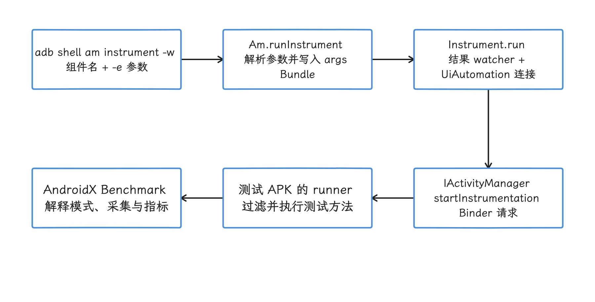

图：Am 解析测试参数，Instrument 经 Binder 建立测试，再由 runner 与 Benchmark 解释用例和指标。 -e 是参数传递，平台不定义 Benchmark 指标；本例 -w 建立结果等待及 UiAutomationConnection。

### UI Automator 与 Espresso：在性能测试中的角色

UI Automator 从应用进程外驱动完整场景，Espresso 在应用 instrumentation 环境中做功能断言：前者视角更接近用户，后者能访问目标应用内部的 View 和同步状态。两者同步方式不同，测量上的用法也要分开。

#### UI Automator：Macrobenchmark 的底层驱动

UI Automator 可以检查用户应用和系统应用的 accessibility node（无障碍服务看到的 UI 结构节点）、注入输入并跨窗口操作。目标应用不需要链接测试代码，所以它能驱动保留 release 优化的 APK，也能处理权限弹窗、桌面和系统设置。

平台把 [`UiAutomation`](https://android.googlesource.com/platform/frameworks/base/+/refs/tags/android-17.0.0_r1/core/java/android/app/UiAutomation.java) 定义为一种特殊的 `AccessibilityService` 客户端；带 `-w` 或 protobuf 报告的 `am instrument` 会在 `Instrument.run()` 中创建 `UiAutomationConnection` 并交给 instrumentation。整个过程中用户无需安装或常驻启用一个普通无障碍服务，UI Automator 在测试进程中通过这条系统连接读取节点和注入手势。

测试进程与目标应用进程分离，可以避免驱动代码计入目标进程的堆和调用栈，但两个进程仍共享 CPU、内存带宽、Binder 服务和内核调度资源，节点查询与输入注入还有 IPC（跨进程通信） 开销。想降低扰动，我们就把页面查找、登录和数据准备放入 `setupBlock`，`measureBlock` 中只保留固定输入和必要等待。

UI Automator 2.4.0 已于 2026 年 7 月 1 日稳定发布，引入了 `uiAutomator {}`、`onElement {}`、`waitForAppToBeVisible()` 等 Kotlin DSL（针对测试场景设计的调用语法），并加入内置等待、应用状态管理和截图能力。

已有 Macrobenchmark 里用 `UiDevice`、`By`、`Until` 的代码仍可维护；为了语法变化去改写已经稳定的场景，没有必要。

#### Espresso：白盒功能断言

Espresso 是白盒测试工具，测试代码可以访问目标应用内部的 View 和同步状态。每次 `onView()` 操作前，它会等需要处理的消息队列、`AsyncTask` 和已注册 `IdlingResource` 进入空闲状态；`IdlingResource` 是业务或组件向 Espresso 报告“已空闲”的同步接口。这个模型适合验证点击后的 View 状态，也适合确认性能优化没有破坏功能。

代价在时序上：同步等待会改变输入的节奏，matcher（判定 View 是否符合条件的匹配器）等测试代码还会进入目标进程的 CPU、内存和调度数据。用 Espresso 包住一段操作再读墙钟时间（真实经过时间），测到的是框架同步、断言和应用工作的总和，当不了 Macrobenchmark 指标用。

工程上常见的分工是把 Espresso 用例放在提交验证阶段、Macrobenchmark 放在固定设备阶段：前者验证页面可用，后者测量完整交互。失败证据也不同——Espresso 看断言与截图，Macrobenchmark 看 JSON 与 Trace。

#### 两套驱动的分工界限

Macrobenchmark 的自 instrumentation 测试 APK 运行在目标应用进程之外，Espresso 的 `onView()` 进不了目标应用进程当 matcher 用。跨应用操作、权限弹窗和系统界面统一交给 UI Automator；目标应用内部要暴露“主要内容已就绪”这类语义，可以调用 `reportFullyDrawn()` 或写自定义 Trace section，再由 Macrobenchmark 从 Trace 读取。按这条分工，`measureBlock` 里放的是 UI Automator 驱动。

<!-- gracker-diagram: ch15-06-09-ui-drivers -->
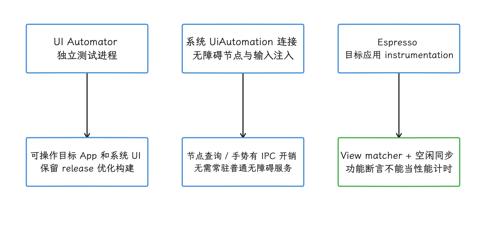

图：Macro 的独立测试进程使用 UI Automator 跨应用驱动；Espresso 用于目标应用 instrumentation 中的 View 断言。 外部驱动仍共享 CPU、调度与 Binder 资源；准备和查找尽量在 setup，测量窗口保留必要输入与等待。

### Monkey、SoloPi 与 Appium：自动化工具的另一类用途

基准测试负责回答“这次改动有没有让指标变差”；长时间运行、随机输入、跨端脚本，则是稳定性和专项测试工具的领域。

#### Monkey：低成本压力测试

`Monkey` 在设备端生成伪随机点击、滑动、按键和系统事件，适合在夜间任务里发现崩溃与 ANR（Application Not Responding，应用无响应）。seed 是伪随机数生成器的初始值，固定 seed 可以重放相同事件序列；不过页面数据、网络响应和系统弹窗仍可能让后续路径分叉。

这条命令把事件限制在单个包中，固定 seed，并监控 native crash：

```bash
adb shell monkey -p com.example.app \
  -s 20260730 \
  --pct-touch 60 --pct-motion 20 \
  --throttle 200 \
  --monitor-native-crashes \
  -v 10000
```

`10000` 是事件数，`--throttle 200` 在事件之间加入 200 ms 间隔，`--monitor-native-crashes` 额外监视 C/C++ 等 native 代码崩溃。复查现场时要保留命令、seed、应用与系统版本、logcat 日志、bugreport 诊断包与 tombstone（native 崩溃报告）。Monkey 既不固定业务边界，也不控制编译和设备状态；启动耗时、帧时间这类回归判定，交回基准测试做。

#### SoloPi：专项性能脚本和视觉拆帧

SoloPi 提供录制回放、CPU / 内存 / FPS（每秒帧数） 性能面板和启动耗时辅助工具，适合线下走查和测试同学复现长流程。它的开源仓库构建说明仍以 Target API 29、Gradle 6.1.1 与 NDK 16 为基准——NDK 是 Android 的 C/C++ 开发工具集。接到 Android 17 设备上之前，权限、无线调试、无障碍节点和厂商系统兼容性都要单独验证。SoloPi 的面板数据适合用来发现异常区间；发布门禁用的，仍是可追溯的 Benchmark JSON 与 Trace。

#### Appium：跨端业务脚本编排

Appium 3 是基于 W3C WebDriver 的模块化自动化框架：W3C WebDriver 定义查找元素、点击和创建会话等标准命令，driver 把这些命令转换为 Android、iOS 等平台的操作。这套架构适合统一 Android、iOS、WebView 和桌面端的业务脚本。

WebDriver 服务、driver、设备自动化后端和显式/隐式等待都会影响输入时序。所以 Appium 负责场景编排时，性能指标仍由设备侧 Macrobenchmark、Perfetto 或明确的系统 counter（计数器读数）采集。

<!-- gracker-diagram: ch15-06-10-stability-tool-roles -->
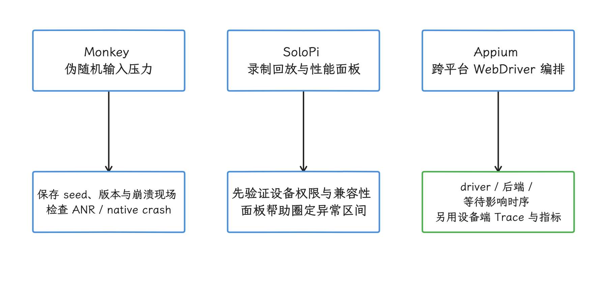

图：Monkey、SoloPi 与 Appium 各自帮助触发或重放问题，定量回归仍要使用受控测量。 固定 seed 不保证业务路径完全一致；回放面板与远程驱动等待均不能直接替代 Benchmark 的指标定义。

### 性能自动化测试的 CI/CD（持续集成与持续交付） 集成方案

CI/CD 分别指持续集成与持续交付/部署。一条可靠的性能 CI，要同时保存代码版本、APK、测试 APK、设备指纹、Benchmark JSON 和 Trace；这些材料里缺哪一项，回归曲线都很难复查。

#### 基本架构

一条可维护的流水线分五步走：构建、设备准备、执行、产物收集、回归判定。

**构建阶段**生成目标 APK 与测试 APK。目标应用采用接近 release 的 `benchmark` 变体：关闭 debuggable，保留 R8 与资源压缩配置，只把签名换成 CI 可用的密钥。这里说的 build variant（构建变体）指 build type 与可选 product flavor 的一种组合。下面是应用模块的基础配置：

```kotlin
// app/build.gradle.kts
buildTypes {
    getByName("release") {
        isMinifyEnabled = true
        isShrinkResources = true
        proguardFiles(
            getDefaultProguardFile("proguard-android-optimize.txt"),
            "proguard-rules.pro"
        )
    }

    create("benchmark") {
        initWith(getByName("release"))
        signingConfig = signingConfigs.getByName("debug")
        matchingFallbacks += listOf("release")
    }
}
```

`matchingFallbacks` 允许依赖模块没有同名 `benchmark` 变体时，Gradle 回退选择 `release`，单模块项目不一定需要。目标 APK 还要包含 `<profileable>`，并按当前 Macrobenchmark 文档接入 ProfileInstaller 1.3 或更新版本——ProfileInstaller 帮助测试环境把 APK 携带的 Baseline Profile 安装到设备上。

**设备准备阶段**固定型号、Android build fingerprint（唯一标识系统构建的字符串）、电量区间、充电方式、网络、屏幕亮度、刷新率、账号与后台应用。AndroidX Benchmark 会检查低电量、模拟器、debuggable 等配置错误，也会在 Microbenchmark 中检测热降频并暂停等待冷却。已 root 的 Microbenchmark 设备可用 `lockClocks` 锁定 CPU 频率；面向用户体验的 Macrobenchmark 则不做这种锁定。

**执行阶段**按用途分层：

- PR 冒烟：PR 即 Pull Request，冒烟测试用最小成本确认主流程能运行。使用 `dryRunMode` 或只运行少量场景，目标是发现构建、安装、权限和元素定位错误。
- 夜间趋势：固定少量物理设备，运行完整迭代并保存全部产物。
- 发布候选：在固定趋势设备之外增加一组机型，用于发现厂商系统或屏幕配置相关问题。

模拟器适合在 PR 阶段验证脚本能否执行。Benchmark 会把模拟器判为配置错误；即使通过 `suppressErrors` 继续运行，产物也只用于诊断；物理设备的性能基线，收的是真机数据。

**产物收集阶段**保存 JSON 与 `.perfetto-trace`，并把 Git commit、目标 APK 哈希、测试 APK 哈希和设备指纹写入同一次运行记录——哈希是由文件内容计算的固定长度摘要，用来确认实际测量的 APK。Macrobenchmark 每个测量 iteration 一份系统 Trace；Microbenchmark 默认生成最小系统 Trace，是否额外生成方法 Trace，取决于 profiling 配置，以及当前系统能否在不影响后续测量的前提下采集。

**回归判定阶段**比较同名测试、同名指标、同一启动/编译模式和同类设备：启动看 median，帧指标看 P50 与尾部分位，功耗看设备是否支持对应数据源。阈值要从该设备的历史方差（数据波动幅度）与业务预算推导；想拿一个固定百分比套住所有项目，是行不通的。

<!-- gracker-diagram: ch15-06-11-ci-pipeline -->
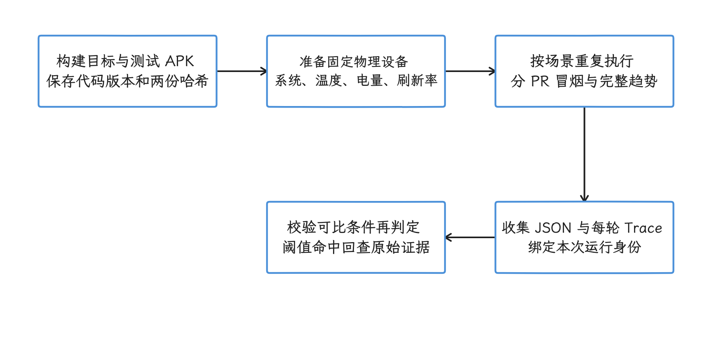

图：构建、设备准备、执行、收集与判定共同组成性能回归流水线。 同名测试、指标与条件才能比较；dry run 和错误抑制的诊断产物不能进入发布性能基线。

#### Firebase Test Lab 与 GitHub Actions

Firebase Test Lab（FTL）可以运行 instrumentation APK 并收集指定目录，但官方已宣布弃用，计划于 **2027 年 9 月 30 日关闭**，迁移目标 Developer Device Platform 当前处于 Preview。以下保留给现有 FTL 流程维护；新接入和迁移应核对[迁移指南](https://firebase.google.com/docs/test-lab/migrate)，并在平台变更后重建性能基线。可用设备与系统组合会变化，提交测试前先查当前目录：

```bash
gcloud firebase test android models list
FTL_MODEL_ID="${FTL_MODEL_ID:?set a model ID from the current device catalog}"
gcloud firebase test android models describe "$FTL_MODEL_ID"
gcloud firebase test android versions list
```

命令输出会标明型号、可用 OS、ABI 以及物理/虚拟类型。性能趋势固定在物理型号和 OS 上；云端每次可能分配同型号的不同设备实例，所以要保留设备上下文，并用多次运行估计波动。

下面的 GitHub Actions 片段省略了项目专属的权限与路径过滤，只展示构建和 FTL 提交这两步：

```yaml
name: Performance Benchmark

on:
  workflow_dispatch:
  push:
    branches: [main]

jobs:
  benchmark:
    runs-on: ubuntu-latest
    steps:
      - uses: actions/checkout@v4
      - uses: actions/setup-java@v4
        with:
          java-version: '17'
          distribution: 'temurin'

      - name: Build APKs
        run: ./gradlew :app:assembleBenchmark :macrobenchmark:assembleBenchmark

      - name: Authenticate to Google Cloud
        uses: google-github-actions/auth@v2
        with:
          credentials_json: ${{ secrets.GCP_SERVICE_ACCOUNT }}

      - uses: google-github-actions/setup-gcloud@v2

      - name: Run Macrobenchmarks on FTL
        env:
          APP_APK: app/build/outputs/apk/benchmark/app-benchmark.apk
          TEST_APK: macrobenchmark/build/outputs/apk/benchmark/macrobenchmark-benchmark.apk
        run: |
          gcloud firebase test android run \
            --type instrumentation \
            --app "$APP_APK" \
            --test "$TEST_APK" \
            --device model="${{ vars.FTL_MODEL }}",version="${{ vars.FTL_VERSION }}",locale=en,orientation=portrait \
            --directories-to-pull /sdcard/Download \
            --results-bucket "gs://${{ secrets.BENCHMARK_BUCKET }}" \
            --environment-variables clearPackageData=true,additionalTestOutputDir=/sdcard/Download,no-isolated-storage=true,androidx.benchmark.enabledRules=Macrobenchmark \
            --timeout 30m
```

APK 文件名会随 product flavor、AGP 和项目配置变化，`APP_APK`、`TEST_APK` 要按构建产物调整。`additionalTestOutputDir` 把产物写到 `/sdcard/Download`，`--directories-to-pull` 再让 FTL 把该目录收集到结果 bucket（Cloud Storage 存储桶）。

`androidx.benchmark.enabledRules=Macrobenchmark` 只启用 Macrobenchmark 规则，避免同一模块中的 Baseline Profile 规则混进本轮。`no-isolated-storage=true` 临时让 instrumentation 测试跳出 Android 10+ 的默认存储沙箱，以便写入全局目录。

该参数会改变整场测试的存储行为；scoped storage 兼容性验证，要另安排一场运行来做。

Google 的 [performance-samples FTL workflow](https://github.com/android/performance-samples/blob/main/.github/workflows/firebase_test_lab.yml) 可作为完整参考。结果路径靠 `bucket/latest/*.json` 去猜并不可靠，应读取本次 gcloud 返回的 test matrix（这次测试的设备与配置组合）信息，或由 Cloud Storage 事件处理对应结果目录。

<!-- gracker-diagram: ch15-06-12-cloud-evidence -->
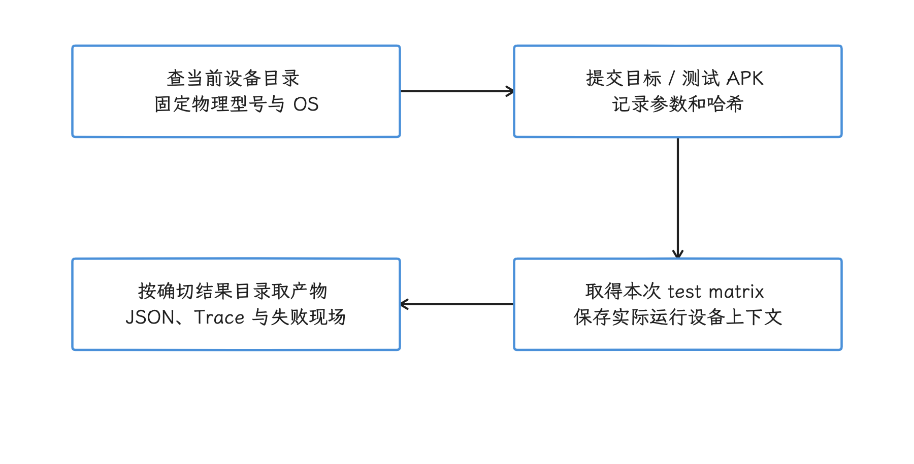

图：查询可用设备后提交两份 APK，按本次 test matrix 与结果目录收集证据。 FTL 已弃用并计划 2027-09-30 关闭，迁移目标当前 Preview；示例是现有流程维护。更换平台后重新建立基线。

#### 结果持久化与趋势追踪

JSON 的 `context` 包含设备型号、build fingerprint（构建的唯一标识字符串） 和 CPU 等运行上下文。写入趋势数据库时，这些上下文要和测试名、参数、指标数组一起保存，只取一个 median 数字是不够的。设备重刷系统、Benchmark 库升级、编译模式变化或 Baseline Profile 更新时，应建立新基线，把环境迁移和代码回归分开看。

告警可同时使用“相对近期稳定窗口”与“绝对体验预算”：前者比较近期多次稳定运行，用来发现小幅持续退化；后者是业务能接受的最大耗时或功耗，可防止历史基线本身已经过慢。命中告警后要查看对应 iteration 的 Trace：一个百分比说不出这是应用回归、温度变化、系统任务还是云设备实例差异。

平台分析以 `android-17.0.0_r1` 为准，通用内核源码对照 [`android17-6.18-2026-06_r6`](https://android.googlesource.com/kernel/common/+/refs/tags/android17-6.18-2026-06_r6/)。量产设备通常还包含厂商内核提交、调频策略和 thermal（温控）配置，同为 API 37 的两台设备，结果也要分开看，趋势库必须以设备 build fingerprint 分组。

#### 门禁统计与测量波动

不同指标用不同摘要：启动以 median 为主并保留每次 iteration 值；帧指标看 `frameOverrunMs` 的 p90/p95/p99 并保留慢帧 Trace；自定义 section 要明确取出现次数（count）、总时长（sum）还是首次匹配（first）；功耗只做同机、稳定窗口的系统级 A/B。

benchmark invocation 指一次完整的基准测试调用或进程启动。同一 invocation 内的多个 iteration 共享温度、缓存和后台状态，彼此相关；把它们当作多个独立设备样本来统计，结论就是错的。

AndroidX JSON schema（字段与类型约定）会随库版本扩展。门禁前先把原始结果转换为内部稳定结构，校验 benchmark 名、metric 名、unit、device/build fingerprint、compilation mode、iteration 数、APK hash 和实验区组——实验区组把同一设备、系统与环境条件下的运行归为一组。字段缺失时中止比较，缺失值不按 0 处理。

稳定门禁可采用配对设计：在同一设备和环境区组内，分别运行 baseline（参考构建）与 candidate（候选构建），交替或随机安排顺序；每次 invocation 先形成一个摘要，再把环境接近的 baseline/candidate 摘要组成一对。

预算同时包含业务定义的绝对增量和相对增量。样本不足时拒绝比较；置信区间（根据样本估计的效果可能范围）一旦跨越门槛，就标为 inconclusive（证据不足），待设备冷却后补充独立配对。在同一 invocation 的 iteration 里重复抽样，添不出新的独立样本。

<!-- gracker-diagram: ch15-06-13-paired-invocation-gate -->
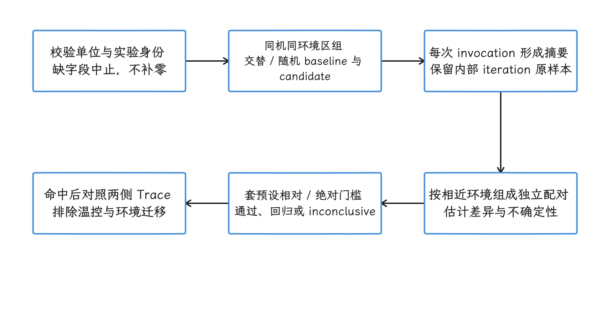

图：先校验可比条件，再以 invocation 为单位配对，按预先定义的门槛区分通过、回归和证据不足。 这是正文建议的统计协议；iteration 共享环境，不能冒充独立设备样本。置信区间跨门槛或样本不足要补独立配对。

波动控制至少记录电量与充电状态、thermal、CPU frequency/idle（频率/空闲状态）、刷新率、后台账号与每轮时间。后半段随温度单调变慢时，停止并冷却设备。网络用固定离线数据、测试服务器或录制响应，账号、缓存、A/B flag（分组实验开关）和列表内容都要固定。

`StartupMode.COLD` 会停止目标进程，默认配置还可能清理 shader cache（GPU 着色器编译缓存），并请求系统清理 page cache（内核的文件页缓存），这相当于设备重启后的部分缓存状态，而非全部：DNS 域名解析、GPU 驱动、系统服务和业务数据缓存各有生命周期。page cache 清理影响整机，所以同一台性能设备上别再并行跑其他任务，外层脚本里也别重复清理。

指标退化后，我们找到 candidate 的异常 iteration 和同设备 baseline，按相同 journey（完整用户操作路径）的时间范围比较 Trace：启动看 process start、Binder、class load（类加载）、GC（垃圾回收）、I/O（输入/输出） 和首帧；帧问题看 FrameTimeline、UI thread、RenderThread、GPU 与 SurfaceFlinger（系统显示合成服务）。

最后用版本固定的 Trace Processor SQL 查询量化同一时间窗。门禁负责发现回归，Trace 负责解释原因。

### 在 Perfetto 中的表现

Gradle 执行成功后，JSON 与 Trace 会拉到模块构建目录，下面是当前官方文档给出的主机路径：

```text
project_root/module/build/outputs/connected_android_test_additional_output/debugAndroidTest/connected/device_id/
```

`module` 是 Macrobenchmark 或 Microbenchmark 模块名，`device_id` 由 Gradle 按设备生成。Macrobenchmark 目录里每个测量 iteration 各有一份 `.perfetto-trace`，文件名包含测试、参数与 iteration 编号。

启动 Trace 的阅读顺序，我们可以固定为：

1. 在 App Startups 或启动相关 slice（Trace 中带起止时间的事件片段） 中确认 launch、TTID、TTFD 边界。
2. 沿目标进程主线程查看 `ActivityThread`、`bindApplication`、`Activity` 生命周期和首帧 `Choreographer#doFrame`。
3. 查看 RenderThread、GPU queue（提交给 GPU 的工作队列） 与 FrameTimeline，区分 UI 线程、RenderThread、GPU 和 SurfaceFlinger 侧等待。
4. 用 Binder、线程调度和 CPU frequency 轨道解释空洞或抢占，避免把所有墙钟时间都归给应用函数。

滚动 Trace 以 FrameTimeline 的 expected/actual slice 为主——它们分别表示系统预期的帧时序与实际执行时序，jank 标记表示帧未按预期时序完成。看完标记再回到主线程 `doFrame`、RenderThread 与 GPU 轨道定位原因。只拿固定的 16.67 ms 去卡 `doFrame`，在高刷新率、可变刷新率和 GPU / 合成侧超期面前容易误判。

<!-- gracker-diagram: ch15-06-14-trace-investigation -->
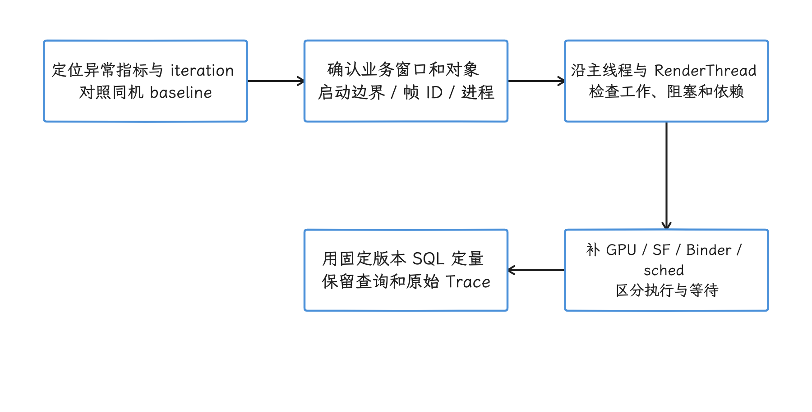

图：固定异常 iteration 和同机基线的业务窗口，再按启动或帧路径追踪工作与等待。 FrameTimeline 超期不能单独证明重组、CPU 或 GPU 原因；墙钟空洞要结合 sched 与 Binder，查询版本也要固定。


## CLI 编排、Agent 任务与证据回传

测试协议稳定之后，剩下的大头是重复步骤：CLI 和 Agent 负责执行、收集产物和生成候选结论。这里我们守一条底线：回不到原始证据的自动结论，进不了门禁。

Android CLI 在 1.0 发布时已统一环境、设备、运行与 IDE 查询；本轮 2026-10-25 命令参考还列出 `build`、`input`、`preview`、`profiler` 和 `signals` 等入口。下文按核对日的命令文档说明，实际实验仍要固定所用 CLI 版本。先约定几个词：本文所说的 agent，是能规划步骤并调用命令或其他工具的 AI 执行程序；CLI 是 command-line interface，即命令行界面；IDE 是 integrated development environment，即集成开发环境。agent 用 CLI 准备实验并重放操作路径，性能数据的采集和计算仍交给 Profiler、Perfetto、APA（Android Performance Analyzer）或 Macrobenchmark。

### Android CLI 在性能工具链里的位置

Android CLI 把项目、SDK、设备、APK、UI 状态和 IDE 查询接到同一套命令流程里；帧级测量数据和系统追踪分析，留给表里的专业工具。

| 工具 | 主要回答的问题 | 性能工作里的输出 | 边界 |
|---|---|---|---|
| Android CLI | 环境、构建部署、UI 操作、IDE 查询及 profiling 会话编排 | 项目描述、设备状态、截图、UI 树、IDE 查询、Perfetto Trace 或堆快照 | 现有 profiler 入口可采集数据；受控重复实验、指标定义与门禁统计仍要另行设计 |
| Android Studio Profiler | App 进程内 CPU、内存、网络、功耗如何变化 | CPU / Memory / Power / System Trace 数据，详见 15.1 节 | IDE 交互强，批量回归和跨 trace 对比能力有限 |
| Android Performance Analyzer | 游戏 / Vulkan 图形工作负载的 CPU、GPU 与相关系统活动 | Trace 项目、GPU counter、截图时间线，详见 15.13 节 | 当前官方定位是游戏与 Vulkan；其他应用优先使用 Android Studio Profiler |
| Perfetto UI / Trace Processor | Trace 里的线程、slice、counter、帧时间如何定量分析 | `.perfetto-trace`、SQL 查询、表格结果，详见 14.7 和 14.9 节 | 采集、场景复现和项目管理需要另行组织 |
| Macrobenchmark / Jetpack Benchmark | 同一场景在多次运行里的指标是否稳定 | 启动耗时、帧时间、Baseline Profile 验证结果 | 需要设计可重复场景和设备基线，详见 17.6 节 |

先把三个词说清：trace 是按时间记录系统与 App 事件的文件；slice 是带时间戳和持续时间的一段事件；counter 是随时间变化的数值轨道。Baseline Profile 则是帮助系统提前编译常用代码路径的规则。一次排查的顺序也就清楚了：我们先用 CLI 固定复现状态，再用 Trace 或 Profiler 采集数据，最后通过 SQL、APA 或 Benchmark 得出可复查的结果。

当前 [`android profiler systemtrace`](https://developer.android.com/tools/agents/android-cli/commands/profiler_systemtrace) 还提供 `prepare → start → stop` 会话：prepare 可先设置 profiling 状态；start 录制；stop 停止并拉取 Perfetto 文件。后台 daemon 在命令间保留会话，结束时恢复设备与应用状态；`stop --keep-session` 可保留会话继续分段，卡住时用 `android profiler session terminate` 清理。GPU counter、Vulkan 等内容仍取决于配置和设备支持。采集入口不自动建立受控重复测试、统计摘要与回归阈值；本章的门禁仍交给 Benchmark 与 CI 协议。

<!-- gracker-diagram: ch15-06-17-profiler-session -->
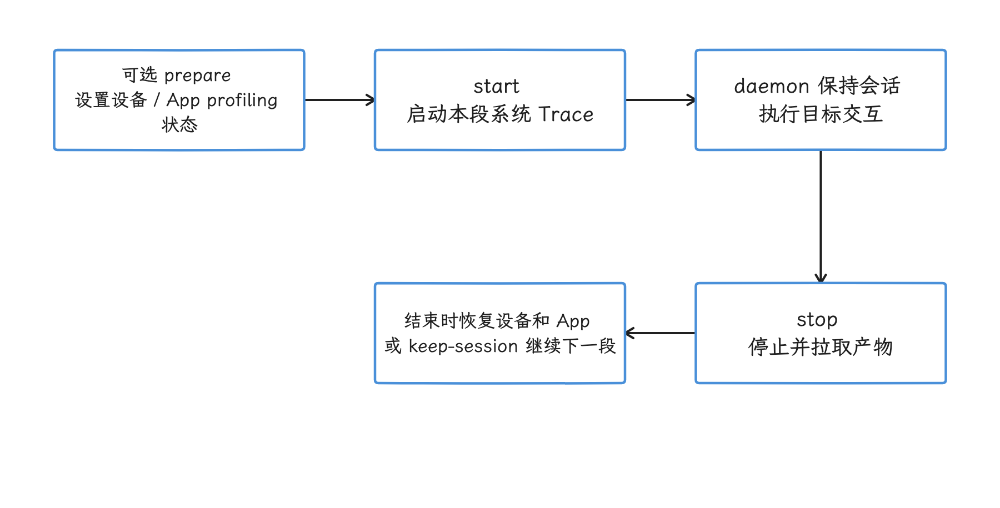

图：prepare 设置 profiling 状态，start 录制片段，stop 拉取文件；daemon 连接分开的命令并负责会话恢复。 prepare 可选；keep-session 保留会话供下一片段，卡住可 terminate。实际 GPU / Vulkan 数据依设备与配置，不自动建立回归统计。

### 源码基线与版本记录

第一件事是分清 Android CLI 的身份：它是独立发布、运行在开发机或 CI 机器上的主机工具，既不属于 `android-17.0.0_r1` framework，也没有名为“Android CLI”的 API 37 SDK 接口。所以一次实验要同时记录三组版本信息：

- Android CLI 版本：决定命令、参数、默认模板和 skill 安装行为；
- 设备 build fingerprint 与 Android 17 / API 37 平台版本：决定 framework、ART、SurfaceFlinger 合成器和 Perfetto 事件；
- 设备实际 kernel 与 vendor driver（厂商驱动） 版本：决定 scheduler tracepoint（调度器事件记录点）、CPU/GPU 能力和设备特有数据。`android17-6.18-2026-06_r6` 只能作为 Android common kernel 的源码参照，真机可能包含厂商修改。

举例来说，APA 或 Perfetto 读取的录制配置，对应 `external/perfetto/protos/perfetto/config/trace_config.proto`；调度分析使用 `include/trace/events/sched.h` 中的 `sched_switch`、`sched_wakeup` 等事件，分析真机 trace 时以该设备内核实际提供的事件为准。CLI 能启动 App、保存画面或触发测试，这些事件的含义不会因它而变。

<!-- gracker-diagram: ch15-06-15-version-coordinates -->
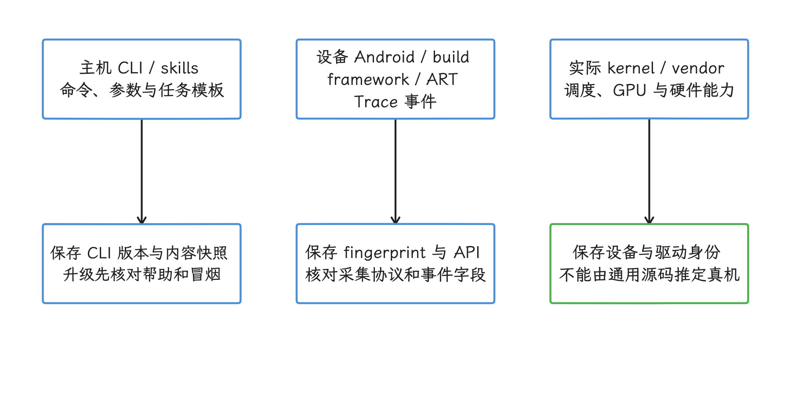

图：主机命令、Android 平台与实际内核驱动分别决定编排接口、事件语义和硬件能力。 CLI 不属于 API 37；AOSP / common kernel tag 是源码参照，设备 fingerprint 与实际 driver 不能省略。

截图、布局树和 Journey 结果只能证明“agent 看到了什么、执行了什么”；帧耗时、CPU 调度、GPU 执行和功耗结论，依据仍是 trace、benchmark metric（基准测试指标） 或硬件测量。官方 Macrobenchmark 文档不建议用模拟器产出的性能数字代表终端用户体验，并把模拟器测量视为配置错误；模拟器的长处在验证安装、页面路径和断言，发布级性能结论放到受控的物理设备上采集。

### 项目描述、SDK 与设备基线

做性能复现实验，先固定环境。`android --version`、`describe`、`info`、`sdk` 和 `emulator` 命令适合在 agent 操作前生成基线记录。这里容易混的两条命令：`android update` 更新的是 Android CLI 本身，`android sdk update` 更新的是 SDK package（SDK 软件包）。

| 命令 | 适合记录的基线 | 在性能流程里的用法 |
|---|---|---|
| `android --version` / `android update` | CLI 版本 | 保存实际运行版本；升级后先重读帮助并执行最小可运行检查 |
| `android init` | `android-cli` skill 安装状态 | 为已识别的 agent 安装基础 skill；SDK 与设备另行准备 |
| `android describe [--project_dir=...]` | 项目结构、build target、构建输出的 JSON 路径、APK 位置 | 让 agent 从结构化结果里找到 APK，无需猜测 Gradle 输出目录 |
| `android info` | 当前默认 Android SDK 路径 | 记录本轮测试使用的 SDK，避免多 SDK 环境使用不同版本 |
| `android --sdk=<path> ...` | 单次命令使用的 SDK | 在 CI 或多项目机器上显式绑定 SDK |
| `android sdk list/install/update` | 平台包、build-tools、system image 版本 | 建立 Android 平台、工具链和模拟器镜像版本基线 |
| `android emulator create/list/start/stop` | 虚拟设备 profile、设备名、serial | 先创建 AVD，再启动列表中的设备；Windows 侧 `android emulator` 命令当前被官方禁用 |
| `android docs search/fetch` | Android Knowledge Base（官方知识库）查询及返回内容 | 为 agent 提供官方文档上下文；不能替代项目源码与设备 trace |

`android describe` 输出一个 JSON 文件路径，该文件描述项目结构、build target（构建目标） 和 artifact（构建输出） 位置。命令本身不执行 Gradle 构建，调用前仍要明确 build variant（构建变体，如 `debug`、`benchmark` 或 `release`），并确认 APK 的时间戳、校验值和代码提交。这样 agent 就不必从 `app/build/outputs/` 猜文件，也不必把临时路径写死在提示词里。

SDK 和设备基线至少记录 Android SDK 路径、`platforms/android-37` package revision（软件包修订号）、build-tools / platform-tools 版本，以及设备 serial 或 emulator profile——serial 是 adb 区分设备的标识，emulator profile 是虚拟设备配置。涉及帧率、启动耗时、功耗和 GPU counter 的测试，还要保存设备型号、build fingerprint、刷新率、电池与温度状态及 GPU driver，这些内容要由测试脚本或人工补齐。

`android emulator create --profile=medium_phone` 用于创建 AVD（Android Virtual Device，Android 虚拟设备），`android emulator start medium_phone` 只能启动已经存在且名称匹配的设备。旧 CI 模板直接调用 `start`，在全新 runner（执行 CI 任务的机器）上会失败，所以虚拟设备的预先创建与配置（AVD provisioning）要在任务开始前完成，或者先用 `emulator list` 检查再按需创建。缺少 API 37 platform 或目标 system image（系统镜像） 时，先通过 `sdk list/install` 安装。

`.androidrc` 把常用全局参数保存在用户目录，例如默认 `--sdk=<path-to-sdk>`。这种配置适合个人机器；团队 CI 的必要配置直接写进任务脚本，显式传入 `--sdk` 后，构建日志也能显示本次使用的环境。

### `run`、`layout`、`screen` 在复现流程中的边界

当前 [`android run`](https://developer.android.com/tools/agents/android-cli/commands/run) 有两条路径：传入 `--apks` 或预构建 APK 路径时，部署已有文件；传入 build reference（如 `:app`）时，可以先构建再部署，并通过 `--` 把后续参数传给构建系统。本文性能示例显式使用预构建 APK，以便保存构建身份；多 APK 用逗号分隔的 `--apks`。不能再把“run 不执行构建”当成该命令的通用限制。

下面的命令演示安装单 APK、指定设备和显式启动 Activity；它们都假设 APK 已经构建完成。

```bash
# 安装并启动默认设备上的 APK；APK 路径通常来自 android describe 或 CI 产物
android run --apks=app/build/outputs/apk/debug/app-debug.apk

# 多设备并行测试时显式指定设备 serial
android run --apks=app-debug.apk --device=emulator-5554

# 明确指定要启动的 Activity
android run --apks=app-debug.apk --type=ACTIVITY --activity=.MainActivity
```

上面三条命令分别覆盖默认设备、指定 serial 和指定 Activity 三种启动方式。发布级性能测试要用接近 `release` 优化配置、同时满足 non-debuggable（不可调试） 与 profileable（允许 shell 进行低开销性能采样）的构建；`--debug` 适合断点和诊断，相关结果要和发布构建的基线数字分开存放。核对日的 `run` 参考支持 ACTIVITY 及所列 Wear 组件类型，未列出 SERVICE；不要把其他工具的 service 语法直接套入。组件能力仍按固定版本的 `android run --help` 与实机验证记录。

`android layout` 返回当前活动 App 的 UI 布局树 JSON，也就是按层级组织的界面节点数据；当前 `--diff` 已弃用且是 no-op，不再产生差异结果；需要比较时保存前后 JSON，再按稳定节点身份与业务规则计算差异。我们用它确认 agent 是否进入了正确页面、某个按钮是否出现、操作前后哪些节点改变。它回答不了帧耗时，也带不来 Layout Inspector 的完整交互能力；分析 measure / layout / draw 成本，仍要用 Perfetto、Profiler 或相关章节介绍的 View 绘制流程。

`android screen capture` 负责截屏，`--annotate` 给识别到的 UI 元素画编号框。`android screen resolve --screenshot=ui.png --string="input tap #5"` 把截图上的编号替换为该截图中编号框的中心坐标；命令只返回替换后的字符串，输入命令要由调用方执行。这组能力能留住当时的屏幕状态、说清点击坐标是怎么来的；某一帧为什么卡，则要交给 FrameTimeline、SurfaceFlinger 合成记录或 GPU counter（随时间采样的 GPU 数值）回答。

当前 `layout` 与 `screen capture` 都已公开 `--device`。多设备 CI 应在 `run`、`layout`、截图及输入命令中显式绑定同一 serial；`screen resolve` 只读取给定截图，不需要选择设备。截图编号只对对应画面有效，界面变化后应重新采集。

性能复现的完整流程：依次安装目标 APK、进入目标页面、截屏确认状态、导出布局树并执行交互，最后把 trace 或 benchmark 输出放进同一份报告。这样得到的是一组可复查的输入与结果：APK、设备、页面状态、操作坐标、trace 文件和指标数据。

<!-- gracker-diagram: ch15-06-16-ui-evidence-flow -->
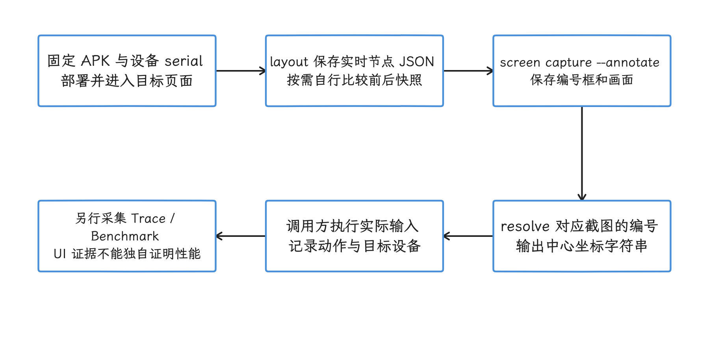

图：绑定同一 serial 部署应用，记录 UI 状态，再由对应画面或节点得到可复查的输入。 run 可接受 build reference；本文用已有 APK 固定身份。layout --diff 是 no-op；resolve 只输出坐标字符串，画面变化需重采集。

### Journeys 与关键用户路径回归

Journeys 用自然语言描述用户在 App 中要完成的路径：agent 把指令转换成界面交互，再依据设备画面判断断言是否成立——断言是对预期结果的可检查描述，例如“详情页标题已经出现”。本轮核对的官方页面（2026 年 9 月 21 日更新），Journey 仍由 agent 和 CLI 附带的 skills 创建和运行，并明确提到可接入 CI/CD。

性能场景里的 Journey，只写“打开首页并滑动列表”远远不够。一条可复现的用户路径，至少要补齐这些条件：

- 入口状态：冷启动、温启动、后台恢复、登录态、缓存是否清空。
- 页面路径：启动页、首页、列表页、详情页、返回路径，每一步都要有可观察 UI 标记。
- 交互动作：点击、输入、滚动、等待网络、横竖屏切换、返回键。
- 断言条件：目标页面出现、错误提示不出现、列表加载完成、关键按钮可点击。
- 性能采集窗口：明确从哪个动作前开始 trace、在哪个 UI 标记出现后停止，也就是界定纳入统计的时间范围。
- 失败处理：页面未出现、登录失效、网络超时、权限弹窗干扰时如何退出并保存截图。

Journey 擅长准备登录态、导航到目标页面、确认异常是否出现，并记录失败画面。它的波动来源也多：自然语言理解、视觉识别、坐标选择和 agent 模型都会带来执行差异，所以 benchmark 的计时区间交给它控制并不合适；测量窗口内的启动、滚动和动画，由 Macrobenchmark 与 UI Automator 驱动——UI Automator 是 Android 的跨 App 界面自动化框架。

<!-- gracker-diagram: ch15-06-18-journey-handoff -->
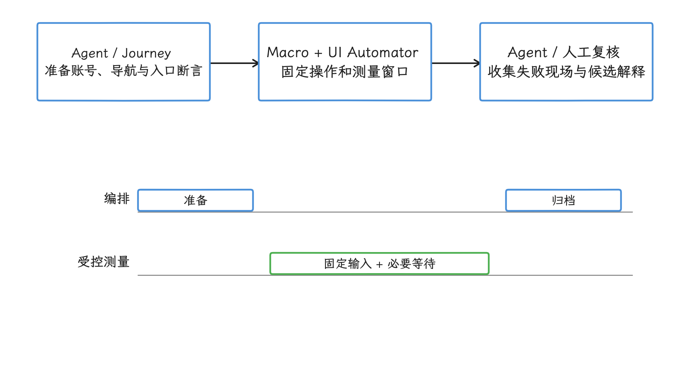

图：Journey 负责可观察状态和失败画面，测量区间交给固定 Benchmark 与 UI Automator 操作。 轨道仅表示本文建议的职责边界；自然语言、视觉与模型会引入差异，Journey 成功无法推出耗时、帧分布或功耗。

指标应来自 Macrobenchmark、Perfetto Trace、APA 或线上 APM（Application Performance Monitoring，应用性能监控）。冷启动耗时、帧时间分布、CPU 调度、GPU counter、GC（garbage collection，垃圾回收）暂停和 Binder 等待时间，从 Journey 的成功或失败里推不出来。

官方 Journey 页面没有发布固定的 `android journey ...` 子命令格式，本文也不编造这类命令。文件格式、运行步骤和 CI 接入方式，以当前 Android CLI、Journeys skill 及项目实际生成的文件为准。报告还要记录 CLI、agent、模型、skill 的版本或内容快照，避免直接比较不同执行环境得出的结果。

### Android Studio 语义命令与性能排查协作

当前 [`android studio`](https://developer.android.com/tools/agents/android-cli/commands/studio) 参考要求项目已在 **Android Studio Quail 2 或更高版本** 中打开；该页没有再把 Canary 1、Gemini 启用和登录列为这组命令的统一前提。先执行 `android studio check` 验证连接，多实例时明确 `--pid` 与 `--project`。agent 随后连接实际 IDE 执行声明、引用等语义查询；所用版本的额外要求要写入实验记录，不能沿用旧预览条件。

| 命令 | 输出 | 性能排查里的用法 |
|---|---|---|
| `android studio check` | Android Studio PID、版本、打开的项目状态 | 多 IDE 实例时选择目标项目，确认 CLI 与 IDE 已连接；PID 是进程编号 |
| `android studio analyze-file <path>` | Kotlin / Java 文件里的错误、警告、lint | 修改性能相关代码后执行 IDE 静态检查；lint 是一组静态规则检查 |
| `android studio find-declaration <symbol>` | 符号声明位置，可用 `--context-file` 消歧 | 从 trace 里的类名、方法名跳到源码定义 |
| `android studio find-usages <symbol>` | 符号引用位置 | 判断某个性能入口是否还有其他调用方 |
| `android studio open-file <path>` | 在 Android Studio 当前编辑器打开文件 | 把 agent 找到的源码、trace、报告交给人工复核 |
| `android studio render-compose-preview <path> <composable>` | Compose Preview PNG，可选语义树 JSON | 改 Compose UI 后确认画面和供无障碍、测试使用的语义节点 |
| `android studio version-lookup <artifacts...>` | Maven、AGP（Android Gradle Plugin）、Gradle、NDK（Native Development Kit）、SDK、Compose、Kotlin 等版本信息 | 核对工具链和依赖版本，减少手工查版本带来的误差 |

这组命令适合源码定位和人工复核。举例：trace 显示某段 Compose 页面在滑动时发生大量重组，即 Compose 多次重新执行相关 UI 代码。我们先用 `find-declaration` 找到相关函数，用 `analyze-file` 检查修改后的文件，再通过 `render-compose-preview --print-semantics` 为目标预览函数生成预览图和语义树；预览函数必须带 `@Preview`，通常也带 `@Composable`。release trace 里的符号已混淆或只剩地址时，还要 mapping（混淆前后名称映射）、native symbol（本地代码地址与函数名的映射）或对应源码版本协助定位。帧时间是否改善，最终仍由 trace 或 benchmark 验证。

`version-lookup` 返回仓库或工具渠道中的可用新版本，适合与否由项目自己判断，Stable、Beta、Canary 之间的选择也轮不到它替团队做——三者大致对应稳定发布、较成熟预览和早期预览。升级时仍要检查版本目录、依赖锁、AGP/Gradle 兼容表和回归测试。

<!-- gracker-diagram: ch15-06-19-ide-evidence -->
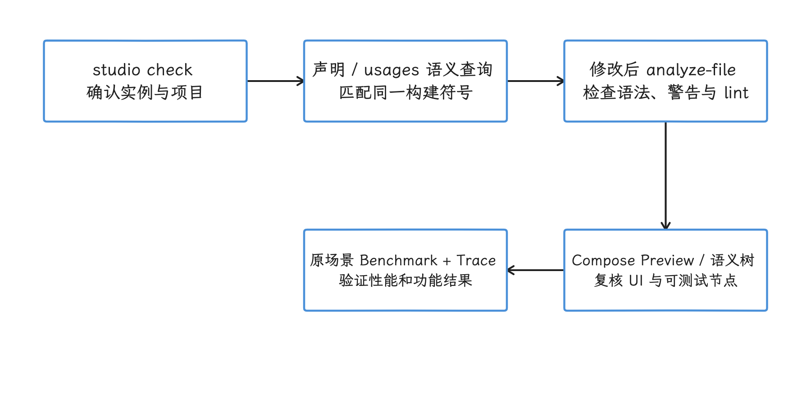

图：先验证 IDE 与项目，再定位声明、核对调用方，检查修改后回到受控实验。 当前 studio 参考要求 Quail 2+ 已打开项目；混淆与 native 地址需对应 mapping / symbols。预览与静态检查都不能证明帧时间改善。

### Android skills 与性能专项能力

Android skills 是供 AI 工具和 agent 使用的指令包：每个 skill 通常以 `SKILL.md` 说明适用任务和执行步骤，还可以附带脚本、模板与参考资料。官方文档列出的能力包括 XML 到 Compose 迁移、AGP 9 升级、Navigation 3、edge-to-edge UI（内容延伸到系统栏区域）和 R8 配置检查。skill 给 agent 提供的是特定 Android 任务的操作方法，输出仍需验证。

`android init` 是最短的初始化入口，用来安装基础 `android-cli` skill。Android CLI 还提供 `skills list/find/add/remove/update` 管理能力；当前 add/remove/update 使用位置参数 skill 名：

- `android skills list --long`：列出可用 skill、描述和已安装到哪些 agent。
- `android skills find 'performance'`：按描述搜索与性能相关的 skill。
- `android skills add SKILL_NAME --project=.`：把指定 skill 安装到当前项目；SKILL_NAME 应替换为可用名称，`--skill=` 不是当前参考的参数。仓库 README 仍描述省略名称时默认安装 `android-cli`，基础初始化则直接使用 `android init`。
- `android skills add --all`：一次安装或更新全部 Android skills。
- `android skills remove SKILL_NAME`：移除指定 skill。
- `android skills update --all`：更新已安装的全部 skills；与 `add --all` 安装全部可用 skills 的范围不同。

更新规则要写进团队规范。官方文档提醒：修改了已安装的 skill 就换一个名称保存，否则后续执行 `skills add` 时可能被最新版覆盖。项目自定义 skill 放在仓库根目录的 `.skills/` 或 `.agent/skills/` 下，每个 skill 目录都要包含大小写固定的 `SKILL.md`。团队把 Perfetto SQL 模板、R8 检查流程或启动回归脚本写入自定义 skill 时，用内部名称，并记录来源和版本。

本轮将[官方仓库固定在提交 `4ebabf2`](https://github.com/android/skills/tree/4ebabf2b0fd6c04b7150023c8b612f80592a6226)核对：`profilers/android-profiler` 覆盖 trace 录制、分析和临时 PerfettoSQL；`testing/testing-setup` 组织测试策略与基础设施；`performance/r8-analyzer` 审查 R8 keep rules（类和成员保留规则）；`jetpack-compose/jetpack-compose-performance` 调查 Compose 重组与 UI 性能。旧的 `profilers/perfetto-sql` 和 `profilers/perfetto-trace-analysis` 目录已不在该快照中。目录是技能位置，实际安装使用相应 skill ID，不能把目录当作 CLI 子命令。

安装或升级后，先检查 `SKILL.md`、附带脚本和资源，再允许 agent 执行。当前 add/update 参考均更新到最新版，所列参数没有版本锁定选项；要重复同一实验，就在记录中保存已审核内容对应的提交或归档。skill 得出的结论还要复核 trace 表结构、字段单位、编译模式和设备条件。

<!-- gracker-diagram: ch15-06-20-skill-reproducibility -->
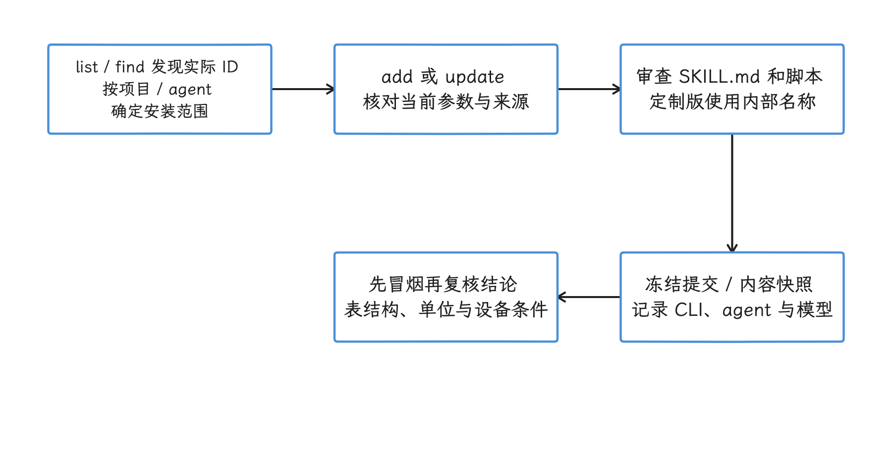

图：确认实际 skill ID 和来源后审查内容，冻结已审核快照，再验证生成的脚本与证据。 当前 add/update 面向最新版；自定义技能改名保存。固定树中 profiler 已整合为 android-profiler，目录不是 CLI 子命令。

### 与 APA / Perfetto / Macrobenchmark 的分工

把 Android CLI 加入现有工具后，可以按“环境 → 复现 → 采集 → 分析 → 回归”的顺序组织材料：

| 阶段 | Android CLI 做什么 | 其他工具做什么 | 输出 |
|---|---|---|---|
| 环境 | `android info`、`android sdk list`、`android emulator list/start` 记录 SDK 和设备 | CI 记录构建号、git commit、设备温度、电量、刷新率 | 环境基线 |
| 复现 | `android run` 安装 APK，Journey 或 screen/layout 驱动页面 | 人工确认测试账号、弱网、权限弹窗等条件 | 页面状态、截图、布局树 |
| 采集 | CLI 触发前置动作和结束动作 | Profiler / Perfetto / APA / Macrobenchmark 采集 trace 或指标 | trace、profile、benchmark JSON |
| 分析 | `android studio find-declaration/find-usages/open-file` 关联源码 | Perfetto SQL、APA、Profiler 做证据分析 | SQL、截图、源码定位 |
| 回归 | agent 准备同一入口状态；计时窗口外可用 Journey | Macrobenchmark 或 CI 阈值检查对比指标 | 趋势表、阈值判断、失败截图 |

这一层的分工是：Android CLI 准备环境、运行 App 和定位源码；15.13 节的 APA 在游戏 / Vulkan 适用范围内分析同窗系统与图形活动；14.7 节的 Perfetto SQL 从 trace 表中计算定量结果；17.6 节的 Macrobenchmark 重复执行受控场景并输出指标。设备基线、APK、操作脚本、trace 和查询共同标识一次实验，各工具的结果因此可以相互核对。

### CI 与本地 agent 工作流模板

一条最小可复现流程包含六类材料：环境记录、项目描述、设备状态、Journey 或操作脚本、trace / benchmark 输出和分析报告。下面的脚本骨架补上了 AVD 预先创建与启动完成检查。脚本中的 `release-like/profileable` 指接近 release 优化配置、同时允许低开销 profiling 的测量构建；当前 `layout` 与 `screen capture` 支持 `--device`，示例统一传入已分配的 serial。真实性能数字仍应在固定的物理设备上采集。

```bash
set -euo pipefail

PROJECT_ROOT="$PWD"
PERF_OUT_DIR="$PROJECT_ROOT/out/perf-run-$(date +%Y%m%d-%H%M%S)"
TEST_DEVICE_NAME="${TEST_DEVICE_NAME:?set TEST_DEVICE_NAME to an existing AVD name}"
TEST_DEVICE_SERIAL="${TEST_DEVICE_SERIAL:?set TEST_DEVICE_SERIAL after device allocation}"
mkdir -p "$PERF_OUT_DIR"

# 1. 记录 CLI、SDK 和项目结构
android --version > "$PERF_OUT_DIR/android-version.txt"
android info > "$PERF_OUT_DIR/android-info.txt"
android sdk list > "$PERF_OUT_DIR/android-sdk-list.txt"
android describe --project_dir="$PROJECT_ROOT" \
  > "$PERF_OUT_DIR/android-describe.txt"

# 2. AVD 只在 provisioning 阶段创建：
# android emulator create --profile=medium_phone
android emulator list > "$PERF_OUT_DIR/emulator-list.txt"
android emulator start "$TEST_DEVICE_NAME" \
  > "$PERF_OUT_DIR/emulator.log" 2>&1
# start 按当前文档阻塞至启动就绪；CI 任务外层仍应设置总超时。
# 分配器必须保证 AVD 名称与 serial 对应；再核对 adb 实际身份。
[[ "$(adb -s "$TEST_DEVICE_SERIAL" get-state | tr -d '\r')" == "device" ]] || {
  echo "allocated device is not ready" >&2
  exit 1
}
ACTUAL_AVD_NAME="$(adb -s "$TEST_DEVICE_SERIAL" emu avd name | tr -d '\r' | sed '/^OK$/d')"
[[ "$ACTUAL_AVD_NAME" == "$TEST_DEVICE_NAME" ]] || {
  echo "allocated AVD name and serial do not match" >&2
  exit 1
}
[[ "$(adb -s "$TEST_DEVICE_SERIAL" shell getprop sys.boot_completed \
  | tr -d '\r')" == "1" ]] || {
  echo "allocated device has not completed boot" >&2
  exit 1
}

# 3. 保存设备平台身份
adb -s "$TEST_DEVICE_SERIAL" shell getprop ro.build.fingerprint \
  > "$PERF_OUT_DIR/build-fingerprint.txt"
adb -s "$TEST_DEVICE_SERIAL" shell getprop ro.build.version.sdk \
  > "$PERF_OUT_DIR/api-level.txt"

# 4. 安装并启动已构建的 release-like/profileable APK
android run \
  --apks="$PROJECT_ROOT/app/build/outputs/apk/benchmark/app-benchmark.apk" \
  --device="$TEST_DEVICE_SERIAL"

# 5. 保存测量前的页面状态
android screen capture --device="$TEST_DEVICE_SERIAL" \
  --output="$PERF_OUT_DIR/before.png" --annotate
android layout --device="$TEST_DEVICE_SERIAL" --pretty \
  --output="$PERF_OUT_DIR/layout-before.json"

# 6. 计时区间由 Macrobenchmark / UI Automator 驱动；
# Journey 可用于区间外的前置导航和失败诊断。

# 7. 保存测量后的 UI 状态；trace / benchmark 由相应工具输出
android screen capture --device="$TEST_DEVICE_SERIAL" \
  --output="$PERF_OUT_DIR/after.png" --annotate
android layout --device="$TEST_DEVICE_SERIAL" --pretty \
  --output="$PERF_OUT_DIR/layout-after.json"
```

当前 `emulator start` 按文档阻塞到启动就绪；脚本再核对分配的 AVD 名、serial、adb 状态及 `sys.boot_completed=1`，不另开无限等待循环。此处是模拟器上的编排冒烟骨架，注释步骤 6 尚需项目自己的 Benchmark 执行命令，不能把只保存前后画面当成已测性能。启动就绪只说明系统可用，温度、编译状态、网络和后台任务是否满足测量条件，还要另行确认。启动回归用 Macrobenchmark；卡顿排查用 Perfetto，游戏 / Vulkan 场景还可用 APA；功耗分析还要采集电源、温度和电池数据；Compose UI 变更可以用 `android studio render-compose-preview` 检查预览结果。

<!-- gracker-diagram: ch15-06-21-smoke-workflow -->
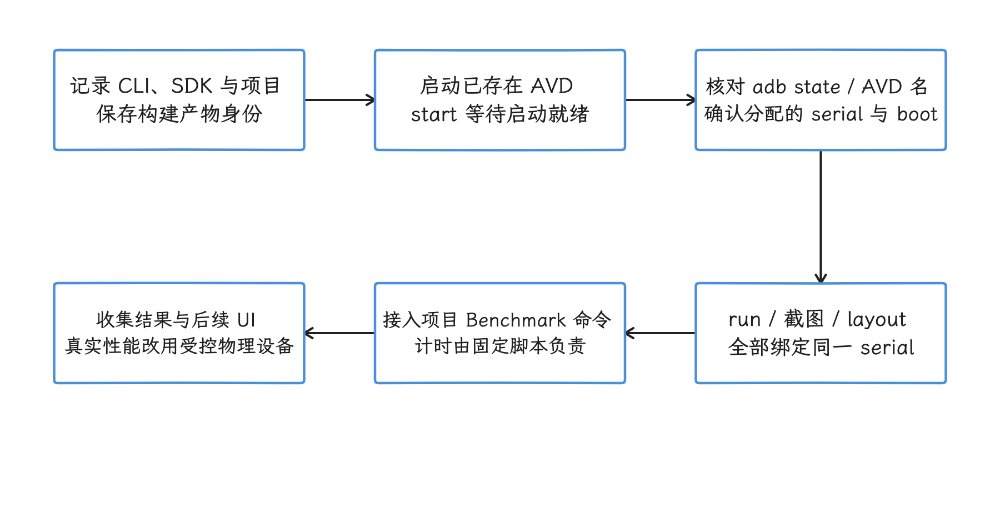

图：启动已创建的 AVD 后核对名称与 serial，再以同一设备身份部署和保存前后 UI。 当前 start 同步等待就绪；CI 外层仍设总超时。步骤 6 是待接入的项目测试命令，前后截图本身不代表已经测量性能。

### 隐私与 Telemetry（遥测）边界

Telemetry 是工具为了解使用情况和故障而发送的数据。Android CLI 官方文档写明会收集 `android` 命令与子命令、选项名称、固定枚举型系统选项值，以及匿名化处理的堆栈和异常消息；命令响应，以及用户创建的位置参数或外部标识符的值（例如 Maven 坐标——依赖的 group、artifact 与 version 标识、文件路径和自定义项目名）都不收集。官方提供 `--no-metrics` 关闭这项 CLI 数据收集；这不会代替对 agent 外发上下文或自行保存日志的管理。

企业内网使用时，报告里应单独记录三类内容：

- 命令日志：是否包含本地路径、包名、账号、设备 serial、截图或布局树里的业务数据。
- agent 上下文：是否把 trace、截图、布局树或源码片段交给外部模型。
- skill 来源：官方 skill、团队内部 skill、第三方 skill 分开管理，更新记录要可追溯。

`screen capture` 和 `layout` 直接读取设备画面与 UI 树，比 `android info` 或 `sdk list` 更容易带上业务数据；Perfetto SQL skill 还可能读取本地 trace，Journey agent 会接收自然语言步骤和设备画面。涉及用户数据、测试账号、订单页、聊天页或健康数据时，用隔离测试环境，并在报告发布前删除或遮盖可识别个人与业务的信息。

<!-- gracker-diagram: ch15-06-22-data-destinations -->
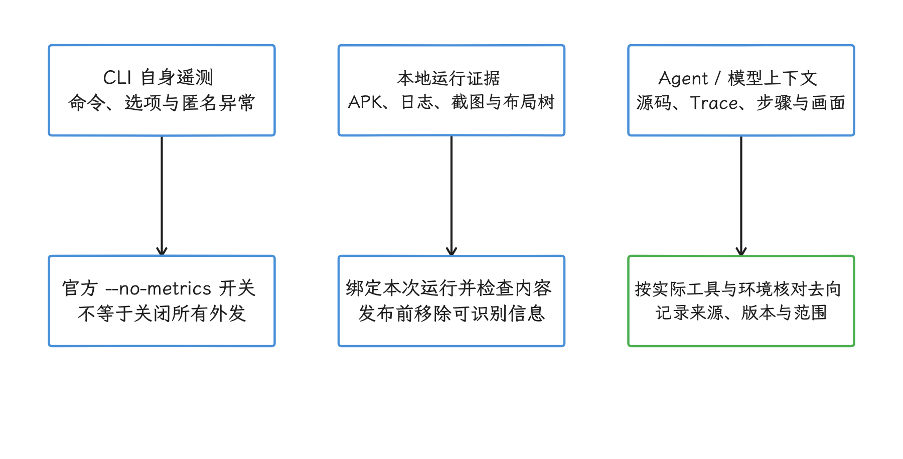

图：分别核对 CLI 自身遥测、本地证据产物和 agent 可能外发的上下文。 --no-metrics 只关闭官方 CLI 数据收集；截图、布局树、Trace 和自行记录的日志仍按各自保存与发布流程处理。


## 常见误区

**模拟器上可以跑基准测试吗？** 验证构建、安装和脚本路径可以；但 AndroidX Benchmark 会报告模拟器配置错误，抑制错误后产生的数据和物理设备没有可比性，发布门禁也不用它。

**Microbenchmark 数字更稳定，能否替代 Macrobenchmark？** 替代不了。Microbenchmark 适合循环热点，缓存与 AOT 状态接近最佳情况；启动、进程创建、系统服务和完整渲染，仍要由 Macrobenchmark 与系统 Trace 判断。

**Macrobenchmark 能否放进应用模块？** 不行。它要求独立的 `com.android.test` 模块，从目标应用进程外启动和停止应用；Microbenchmark 可放在专用 benchmark 模块中，并依赖包含被测代码的模块。

**迭代次数是否固定为 10？** 没有统一数字。短而稳定的热点可能需要更多样本，长启动场景受 CI 时长限制。先在固定设备上观察分布与热状态，再选择能稳定区分目标回归幅度的迭代数；报告保留 median、尾部分位和原始样本。

**设备温度与调度波动能否全部消除？** 消除不了。固定设备状态、等待冷却、减少账号和后台任务可以压低波动，DVFS（动态电压频率调整）、thermal 和内核调度的影响仍在。测试记录绑定 Android build fingerprint；分析通用内核行为时再对照 `android17-6.18-2026-06_r6`，通用内核标签替代不了量产机证据。

**Espresso 能否驱动 Macrobenchmark？** 驱动不了。Macrobenchmark 使用外部测试 APK，Espresso 的 View matcher 与同步机制面向目标应用 instrumentation 环境；完整性能场景用 UI Automator，Espresso 留在功能回归测试中。


## 结论

回到本文的主线：自动化性能测试要同时固定操作路径、测量窗口、设备状态和判废规则，再靠重复测量建立基线与回归门禁。Microbenchmark 负责局部工作，Macrobenchmark 负责完整用户场景；CLI 与 Agent 负责准备环境、复现操作和回传证据——截图、布局树和 Journey 成功，单独哪一项都撑不起性能结论。最终结果应绑定 APK、脚本与工具版本、设备 build fingerprint、实际 kernel 与 vendor driver，并保留指标及对应 trace；`android-17.0.0_r1` 和 `android17-6.18-2026-06_r6` 可作为对应源码的参照。


## 参考资料

### 基准测试与自动化

- [Android Benchmark 总览](https://developer.android.com/topic/performance/benchmarking/benchmarking-overview)
- [Macrobenchmark 官方文档](https://developer.android.com/topic/performance/benchmarking/macrobenchmark-overview)
- [Microbenchmark 官方文档](https://developer.android.com/topic/performance/benchmarking/microbenchmark-overview)
- [编写 Microbenchmark](https://developer.android.com/topic/performance/benchmarking/microbenchmark-write)
- [CI/CD 中的基准测试](https://developer.android.com/topic/performance/benchmarking/benchmarking-in-ci)
- [Macrobenchmark 指标](https://developer.android.com/topic/performance/benchmarking/macrobenchmark-metrics)
- [Baseline Profiles 指南](https://developer.android.com/topic/performance/baselineprofiles/overview)
- [UI Automator 文档](https://developer.android.com/training/testing/other-components/ui-automator)
- [Espresso 文档](https://developer.android.com/training/testing/espresso)
- [Monkey 文档](https://developer.android.com/studio/test/other-testing-tools/monkey)
- [Firebase Test Lab 文档](https://firebase.google.com/docs/test-lab)
- [GitHub 官方示例: performance-samples](https://github.com/android/performance-samples)
- [Android 17 `am instrument` 实现](https://android.googlesource.com/platform/frameworks/base/+/refs/tags/android-17.0.0_r1/cmds/am/src/com/android/commands/am/Instrument.java)
- [Android 17 `UiAutomation` 实现](https://android.googlesource.com/platform/frameworks/base/+/refs/tags/android-17.0.0_r1/core/java/android/app/UiAutomation.java)
- [Android 17 common kernel 锚点](https://android.googlesource.com/kernel/common/+/refs/tags/android17-6.18-2026-06_r6/)

### CLI、Agent 与系统证据

- [Android CLI](https://developer.android.com/tools/agents/android-cli)
- [Android CLI 当前命令参考](https://developer.android.com/tools/agents/android-cli/commands)
- [AndroidX Benchmark 发布记录](https://developer.android.com/jetpack/androidx/releases/benchmark)
- [本轮固定 FrameTimingQuery 实现](https://android.googlesource.com/platform/frameworks/support/+/d153d87ed76372ece0c99dac837ff07ab845d495/benchmark/benchmark-macro/src/main/java/androidx/benchmark/macro/perfetto/FrameTimingQuery.kt)
- [本轮固定 Macrobenchmark 编译模式实现](https://android.googlesource.com/platform/frameworks/support/+/d153d87ed76372ece0c99dac837ff07ab845d495/benchmark/benchmark-macro/src/main/java/androidx/benchmark/macro/CompilationMode.kt)
- [Android CLI support for Journeys](https://developer.android.com/tools/agents/android-cli/journeys)
- [Android skills](https://developer.android.com/tools/agents/android-skills)
- [Android CLI 1.0 announcement](https://android-developers.googleblog.com/2026/05/android-cli-stable-1-0-agent-development.html)
- [Android Performance Analyzer](https://developer.android.com/android-performance-analyzer)
- [Android Studio performance profilers](https://developer.android.com/studio/profile)
- [Set up the Android 17 SDK](https://developer.android.com/about/versions/17/setup-sdk)
- [Perfetto documentation](https://perfetto.dev/docs/)
- [Android 17 Perfetto `TraceConfig`](https://android.googlesource.com/platform/external/perfetto/+/refs/tags/android-17.0.0_r1/protos/perfetto/config/trace_config.proto)
- [Android 17 common kernel scheduler tracepoints](https://android.googlesource.com/kernel/common/+/refs/tags/android17-6.18-2026-06_r6/include/trace/events/sched.h)
