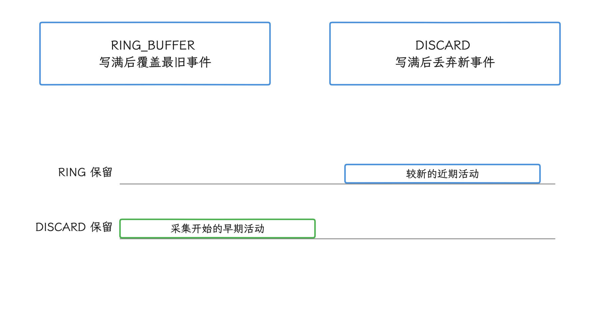
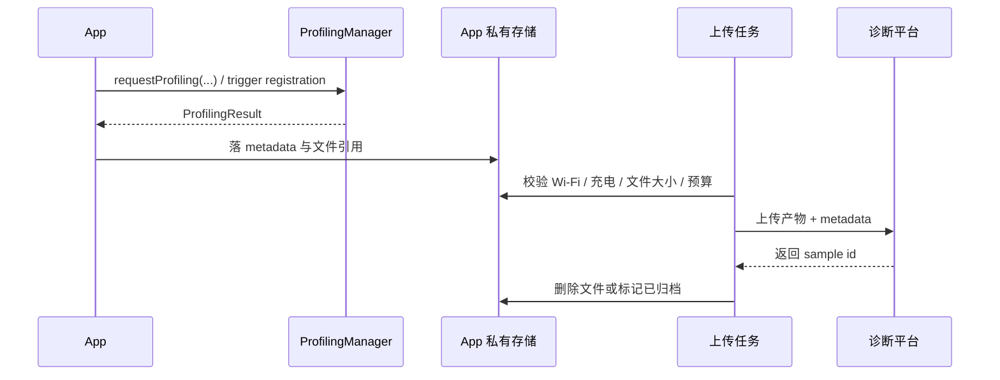
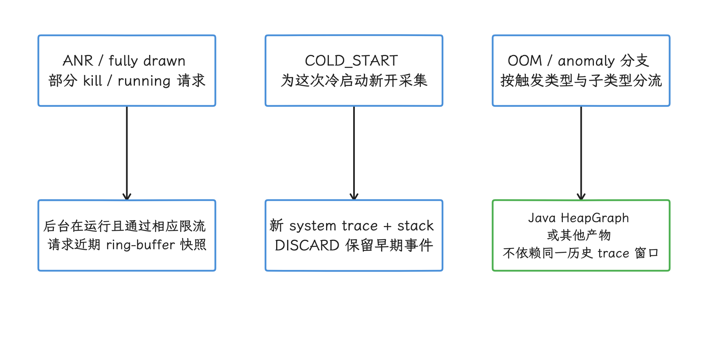
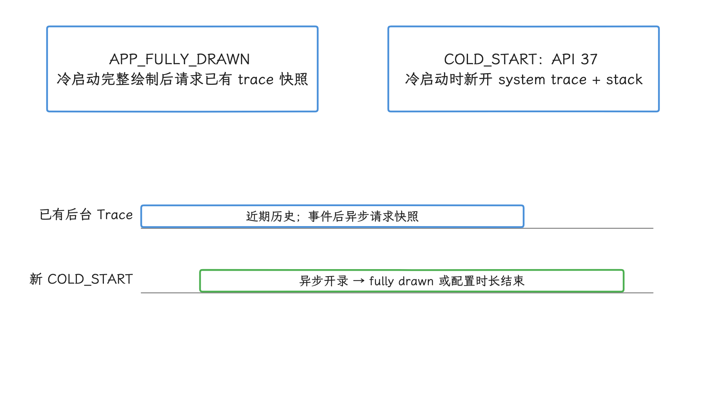
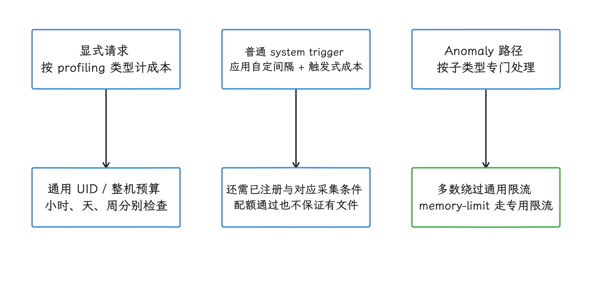
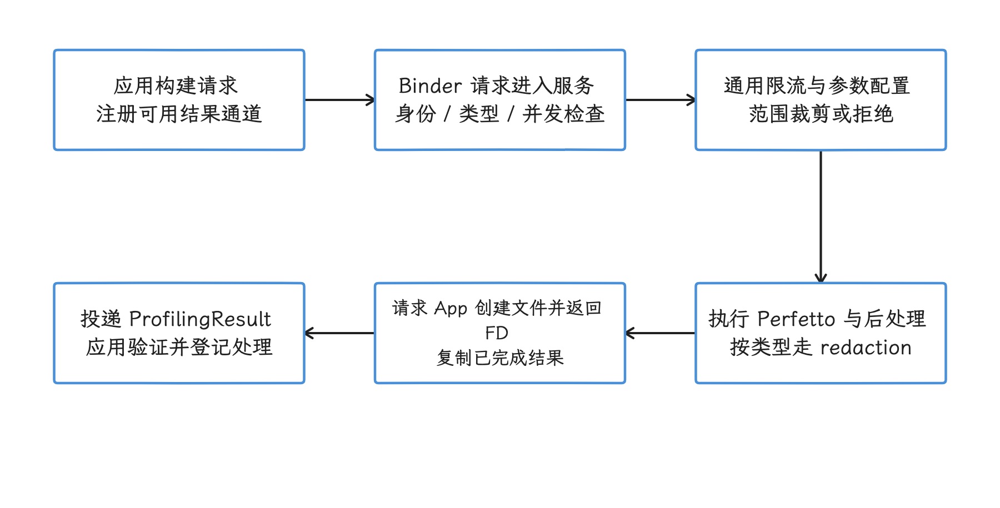

# ProfilingManager

做性能排查的人大概都遇到过这个空档：线上反馈堆里只有一句“卡了”，问题发生的那一刻没有任何分析工具开着。ProfilingManager 就是为补这个空档来的。Android 15 起，应用可以主动请求四种采集：system trace（系统时间线）、heap dump（堆快照）、heap profile（堆分配采样） 和 stack sampling（周期性调用栈采样）；Android 16 又加了 system-triggered profiling（由系统事件触发采集），让系统在 ANR、进程被杀这类事件发生时自动留下一份现场。我们接入时要分清三件事：显式请求怎么发、哪些 trigger 要哪个版本、结果从哪里收。

> 源码基线：AOSP `android-17.0.0_r1`（Android 17 / API 37）。ProfilingManager 是 Mainline（可脱离完整系统升级包单独更新的模块） 模块，可经 Google Play system update（Google Play 系统更新） 独立更新，设备上的实际行为可能与这个 AOSP tag 的源码有差异。

## 从待回答的问题选择采集类型

我们先把问题问对，采集类型自然就定了。`ProfilingManager` 的四种显式请求，AndroidX 各给了一个 builder——通过连续调用 `set*()` 方法组装参数的配置对象。四种请求共用同一套结果回调，产物和分析工具却各不相同：

| AndroidX builder | 适合回答的问题 | 产物 | builder 专有参数 | 读数边界 |
|---|---|---|---|---|
| <code>System<wbr>Trace<wbr>Request<wbr>Builder</code> | 卡顿发生在哪条线程，启动阶段被谁阻塞，Binder（跨进程调用）、调度和渲染如何交叠 | Perfetto system trace | <code>set<wbr>Duration<wbr>Ms()</code>、<code>set<wbr>Buffer<wbr>Size<wbr>Kb()</code>、<code>set<wbr>Buffer<wbr>Fill<wbr>Policy()</code> | 只记录配置允许的 Perfetto 数据源，不能直接给出 Java 对象引用链 |
| <code>Java<wbr>Heap<wbr>Dump<wbr>Request<wbr>Builder</code> | Java 对象、类型和大小如何分布，哪些对象可由 GC Root（垃圾回收根对象）到达 | Perfetto HeapGraph；固定 r1 后缀 <code>.<wbr>perfetto-java-heap-dump</code> | <code>set<wbr>Buffer<wbr>Size<wbr>Kb()</code> | 单次对象图快照，可能含不可达对象；不是普通 HPROF，也不是 native 分配时间线 |
| <code>Heap<wbr>Profile<wbr>Request<wbr>Builder</code> | 哪些调用栈持续产生内存分配，分配量如何分布 | Perfetto heap profile；固定 r1 后缀 <code>.<wbr>perfetto-heap-profile</code> | <code>set<wbr>Duration<wbr>Ms()</code>、<code>set<wbr>Buffer<wbr>Size<wbr>Kb()</code>、<code>set<wbr>Sampling<wbr>Interval<wbr>Bytes()</code>、<code>set<wbr>Track<wbr>Java<wbr>Allocations()</code> | 采样只记录部分分配，不能代替 heap dump 的完整对象关系 |
| <code>Stack<wbr>Sampling<wbr>Request<wbr>Builder</code> | 哪些调用栈频繁被采样命中，热点大致集中在哪里 | Perfetto stack sample；固定 r1 后缀 <code>.<wbr>perfetto-stack-sample</code> | <code>set<wbr>Duration<wbr>Ms()</code>、<code>set<wbr>Buffer<wbr>Size<wbr>Kb()</code>、<code>set<wbr>Sampling<wbr>Frequency<wbr>Hz()</code> | 按频率抽取的样本是统计近似值，不能当作逐方法精确 CPU 时间 |

按这张表选型：要线程时间线就采 system trace；要对象存活关系就用 Java heap dump；追持续分配问题用 heap profile；只要低开销的热点线索，就选 stack sampling。采样的用处是把范围缩小，下结论还是要回到 trace 时间线、heap 引用关系或可复现的测试上核对。


heap profile 默认采的是 native allocation（C/C++ 等原生堆分配）。想看 Java/Kotlin 对象的分配，要开 `setTrackJavaAllocations(true)`，同一请求只覆盖其中一类。

再往上看公共参数：四个 builder 都继承 `setTag()` 和 `setCancellationSignal()`。`tag` 用来标识单次采集，放短场景码合适，别指望它装下完整工单信息。持续采集可以由 `CancellationSignal` 提前叫停；时长和取消信号都可触发停止请求；取消是异步操作，不保证立即停止、精确覆盖业务边界或一定产生可用结果。Java heap dump 是某一时刻的快照，所以没有 `durationMs` 参数。

## API 层与版本判断

接入这个 API，我们第一步把版本范围搞清楚。平台类 `android.os.ProfilingManager` 是 Android 15（API 35）加入的；AndroidX Core 1.15.0 首次提供了 `androidx.core.os.Profiling` 和四个 request builder，免去了直接拼装平台参数的工作，本轮核验的稳定版 1.19.1 仍提供这些封装。注意 AndroidX 回调里的结果类型仍是 `android.os.ProfilingResult`。

显式请求只要求 API 35。系统触发能力分成 API 36、Android 16 minor release 1（36.1）、API 37 三档。36.1 属于 minor SDK release（主 API 级别内的次要 SDK 版本），不属于通过扩展版本号发布能力的 `SdkExtensions` B Extension；下面的守卫用 `SDK_INT_FULL` 把 API 37 基线和 Android 16 minor release 1 分开处理。

```java
boolean hasProfiling36_1 =
        Build.VERSION.SDK_INT >= 37
        || (Build.VERSION.SDK_INT >= 36
            && Build.VERSION.SDK_INT_FULL >= Build.VERSION_CODES_FULL.BAKLAVA_1);
```

这段守卫这样读：API 37 的设备已经包含这组接口，直接走第一个分支；Android 16 设备则要用 `SDK_INT_FULL` 查询带 minor release 序号的完整 SDK 版本。能力探测就认这套判断——版本字符串、机型名单、系统更新日期这几条捷径都到不了 minor release 这一层，编译期也要用包含相应 minor release API 的 SDK。详细的 36.1 判断见下文“System-triggered profiling 的运行方式”。


## 发起一次显式请求

我们动手发一次请求。下面的 Java 示例采集 5 秒 system trace，并允许业务场景结束时提前取消；`enqueueProfileForUpload()` 和 `recordProfilingFailure()` 代表应用自己的持久化与日志函数。

```java
CancellationSignal stopSignal = new CancellationSignal();

ProfilingRequest request = new SystemTraceRequestBuilder()
        .setBufferSizeKb(10_240)
        .setDurationMs(5_000)
        .setBufferFillPolicy(BufferFillPolicy.RING_BUFFER)
        .setCancellationSignal(stopSignal)
        .setTag("scroll-jank")
        .build();

Profiling.requestProfiling(context, request, executor, result -> {
    if (result.getErrorCode() == ProfilingResult.ERROR_NONE) {
        String path = result.getResultFilePath();
        if (path != null) {
            enqueueProfileForUpload(path, result.getTag());
        }
    } else {
        recordProfilingFailure(
                result.getErrorCode(),
                result.getErrorMessage(),
                result.getTag());
    }
});
```

类名归属先分清：`Profiling`、`ProfilingRequest`、`SystemTraceRequestBuilder` 和 `BufferFillPolicy` 来自 `androidx.core.os`，`CancellationSignal` 与 `ProfilingResult` 来自 `android.os`。平台异步执行请求，方法返回不等于采集已开始或最终会成功；服务还可能因配置、并发或配额拒绝。API 没有“已经开始录制”回调；如果目标是某段业务代码，启动要留出余量，并用 `androidx.tracing.Trace` 打上可搜索的 slice（带开始、结束时间的时间线区段），业务段结束后再调 `stopSignal.cancel()` 请求停止。


本次请求要有专用回调，必须同时提供 `executor`（回调执行器）和 request-specific listener；缺少任一项就不会建立这组专用回调，应用应事先注册全局 listener。固定 r1 在回调列表为空时会同步抛出 `IllegalArgumentException`，不能只等失败回调；显式请求推荐传入完整组合，并处理同步调用异常。回调线程里只做轻量处理，文件压缩、网络上传这类活交给受约束的后台任务。

## `BufferFillPolicy` 只有两个公开值

`BufferFillPolicy` 只在 `SystemTraceRequestBuilder` 上有，两个值我们对着场景选：

| 策略 | 缓冲区写满后的动作 | 适用窗口 |
|---|---|---|
| `RING_BUFFER` | 环形缓冲区写满后，新事件覆盖最旧事件 | 关注停止点前的滑动卡顿、输入延迟或手动结束场景 |
| `DISCARD` | 新事件被丢弃，已有事件继续保留 | 关注采集开始处的冷启动早期事件 |

选哪个策略，改动的只是保留哪一段时间线，数据源集合保持原样。`ProfilingManager` 暴露的是受控配置，builder 里有哪些参数，应用就能传哪些；缓冲区大小、时长和采样频率到了系统服务侧，还会按 `DeviceConfig`（系统可动态调整的配置项） 给出的范围裁剪。`android-17.0.0_r1` 的默认值与上限适合读源码时参考，跨设备的产品常量要另外标定。

<!-- gracker-diagram: ch15-07-04-buffer-retention -->


图：RING 保存靠近停止点的近期活动，DISCARD 优先保留采集开头。 条长为示意；策略不扩展允许的数据源，也不保证请求 buffer / 时长原值生效，服务还会按范围裁剪。

## 两类 listener 与结果再次投递

结果从哪收？平台有两条通道：request-specific listener 和 global listener（接收当前 UID 下全部 profiling 结果的全局监听器），后者由 AndroidX 的 `Profiling.registerForAllProfilingResults()` 注册，能收到当前 UID 下全部 profiling 结果（UID 即 Android 标识应用沙箱的 Linux 用户 ID）。两条通道的分工如下：

| 请求来源 | request-specific listener | global listener | `getTriggerType()` |
|---|---|---|---|
| 显式 `requestProfiling()` | 完整配置后收到 | 注册后也可收到同一结果 | API 36+ 为 `TRIGGER_TYPE_NONE`；API 35 不调用该 getter |
| system-triggered profiling | 没有此通道 | 收到 | 对应的 trigger 常量 |

两条通道一起用时，我们让 request-specific listener 负责更新本次交互状态，global listener 负责持久化结果文件。成功结果用平台返回的完整 `resultFilePath` 字符串去重即可；失败结果必须先按非成功 `errorCode` 处理，路径不能拿来读取：API 合同规定失败路径为 `null`，但固定 r1 的部分服务结果回调直接拼接 `getAppFileDir() + resultFile`，可能形成以 `null` 结尾的字符串；不能以路径非空反推成功。`ProfilingResult` 又没有唯一结果 ID，直接拿 `triggerType + tag + errorCode` 当唯一键会把两次独立失败误合并成一条。失败也要入库的话，固定一个写入通道，并把显式请求的内部 request ID 记在应用自己的请求记录里。


还有一类延迟到达的结果：采集完成前进程退出了，平台可在应用下次启动并注册全局 listener 后再次投递。所以全局 listener 要在进程启动早期注册，并在整个进程生命周期内保持可用。trigger 配置倒不用每次都加——系统服务 `ProfilingService` 会把它写入磁盘恢复；listener 属于进程内回调，每次都要重新注册。另外相同 trigger type 只保留一份配置，后添加的会替换旧的。


## 结果文件、字段与隐私

结果拿到手了，我们先看文件本身。成功时，文件位置只认 `ProfilingResult.getResultFilePath()` 返回的这一条路径，读取、上传完成后删除、重试和留存超时都围绕它实现；外部存储权限也一并省掉，`files/profiling` 之类的目录无需写进代码。

字段方面，`ProfilingResult` 在 API 35 提供 `errorCode`、`errorMessage`、`resultFilePath` 和 `tag`，`triggerType` getter 从 API 36 加入；没有 `profilingType` getter。所以显式请求的采集类型，要在提交请求时就写进应用自己的记录，trigger 结果则按 trigger 与产物的对应规则映射；文件扩展名只能区分一部分类型，剩下的靠记录补齐——多个 profile 都可能装在 Perfetto trace 容器里。

上传之前，隐私这关必须过。system trace 会移除其他应用和进程的信息，所以 PerfettoSQL（Perfetto 的 SQL 查询接口） 能查到的数据范围比本地完整 trace 小；应用自己的线程名、trace slice、Surface 名或业务 tag 仍可能保留；系统针对无关进程的 redaction 不等于对业务标注做内容脱敏。这里的 Perfetto HeapGraph 主要保留对象身份、类型、大小和引用关系，不能套用普通 HPROF 的完整字段值 / 字符串转储语义；它仍可暴露类型名、字段名、代码位置和对象结构，特定对象还有 NAR 大小、Bitmap 尺寸等专门元数据。heap profile 与 stack sampling 也可能暴露类名、方法名及调用路径。上传前按数据类型把授权、加密、访问控制、保留期限和删除策略都过一遍。

同理，`tag` 里只放不含用户含义的场景码，由服务端受控映射到内部工单；手机号、订单号、账号、Token、URL 查询参数、地理位置、明文会话标识，一个都别放进去。

### 结果文件生命周期

文件是怎么写进去的？系统先让应用进程在 `files/profiling/` 中创建目标文件，再通过文件描述符（跨进程传递已打开文件的句柄）把结果写进去。所以 `ProfilingResult.resultFilePath` 返回完整路径时，文件已经在那里了，callback 拿到路径直接用就好；应用要做的是在一次数据库事务（相关字段要么全部写入，要么全部回滚）里登记路径与业务 metadata（描述文件来源和状态的附加字段），然后交给后台任务。

整条处理链我们建议按下面的时序走：



注意三个入口——回调重复、进程重启、上传重试——都应写入同一条幂等记录；只有后端确认完整接收后才删除本地文件，上传失败的保留到应用自己的过期时间或容量上限。


metadata（描述这份文件来源和状态的附加字段） 至少包含：

- `case_id` / `session_id`
- `request_type` / `trigger_type`
- `app_version` / `build_id`（构建标识）/ `device` / `sdk_int_full`
- 页面、前后台状态、实验分组、触发原因
- `result_file_path`、文件大小、内容摘要（用于校验完整性）、上传状态和清理时间

系统侧也会做一点清理。固定 `android-17.0.0_r1` 在 `oldFilesCleanup` 功能开关启用时，`ProfilingManager` 会借用应用提供的 executor，尝试删除文件系统最后修改时间早于 5 天阈值的旧文件；频率按该 manager 实例内的 `mLastCleanupMs` 控制，通常不超过每天一次，但新实例会重置这项状态；但触发依赖相关 API 调用，服务侧另有结果重投与过期处理。这层清理我们只当后备看：调用时机、系统配置、Profiling Mainline 模块或 OEM（设备厂商） 配置都可能变，应用要控制自己的空间预算，还得自己维护容量上限和保留期——上传成功后立即删除，磁盘不足时按年龄淘汰。

回到 `tag`：平台会把它转成小写、过滤到字母、数字和连字符，再截取前 20 个有效字符写进文件名，这只约束文件名中的那一段；回调返回的原始 tag 不因这项文件名过滤而自动脱敏，所以仍只使用短场景码或随机诊断任务 ID。

### Java Heap Dump 的敏感数据风险

先辨认格式：本节 `JavaHeapDumpRequestBuilder` 在固定 r1 使用 `android.java_hprof`，由 ART 的 Perfetto 写出器生成 HeapGraph；它不是 `Debug.dumpHprofData()` 或传统 HPROF。常规对象记录类型、大小和引用，不能据此声称登录 Token、字符串正文、密钥字节或所有 primitive 字段都会原样写出。特殊类型可以额外带 NAR 大小、Bitmap 尺寸等有限元数据，具体以 protobuf 和设备实现为准。

对象图仍能暴露内部类名、引用字段名、代码位置及结构关系，与同文件中的其他数据一起可能揭示业务实现。若另行接入原始 HPROF，则必须另外评估字段、数组和字符串内容的风险；两种格式的脱敏规则与分析器不能混用。
system trace 的 redactor 不等于覆盖所有产物的数据审查，HeapGraph 与其他 heap 数据仍按真实字段和用途评估。方案按分析方式选：


1. **优先在设备上提取**：若问题能由对象计数、Retained Size（对象及其支配对象占用的内存）、类分布或少量调用栈回答，可在设备上提取诊断摘要，只上传摘要。
2. **受控后端分析**：必须上传原始 heap dump 时，使用 TLS 加密传输、服务端加密存储、独立 KMS（密钥管理系统）、最小权限、访问审计和短保留期。后端要分析文件，就必然存在受控的解密路径；“端到端加密、服务端读不到原文”和服务端直接分析，两者只能取其一。
3. **明确授权与采样范围**：隐私告知应说明性能诊断可能包含内存快照，远程开关要能关闭 heap dump，并把采样限定到必要版本和必要用户范围。
4. **备份排除**：`files/` 默认可能进入 Auto Backup。把 `files/profiling/` 同时排除在云备份和设备迁移规则之外，并兼顾旧版 `fullBackupContent` 配置。
5. **删除可验证**：上传成功、超过保留期、用户撤回同意或诊断任务关闭时，都要有可观测的删除记录。

最后，通用 trace 上传接口别直接拿来传 heap dump：两者的数据敏感度、访问人群、保留期和审计要求各不相同。

## System-triggered profiling 的运行方式

我们再看系统触发这一侧。ANR、APP_FULLY_DRAWN 及部分 kill/request-running 触发器复用周期性、随机启动的后台 ring-buffer trace；事件发生时还要检查注册与限流，且后台 trace 必须正在运行，才能请求 running trace snapshot。这个条件不能概括所有 trigger：COLD_START 新开采集，OOM 请求 Java HeapGraph，ANOMALY / APP_COMPAT 还按子类型走各自路径。注册只表达允许采样，不能保证每次事件都有文件。

<!-- gracker-diagram: ch15-07-09-trigger-dispatch -->


图：多数时序触发器复用后台 trace，COLD_START 新开采集，OOM 使用 Java HeapGraph。 每条路径都需有效注册及相应条件；anomaly / app-compat 按子类型处理，不能用后台 trace 在跑概括所有触发器。

trigger 按版本分层，下表同时列出逐项的产物与触发语义：

| 版本 | trigger | 产物与触发语义 |
|---|---|---|
| API 36 | <code>TRIGGER_<wbr>TYPE_<wbr>APP_<wbr>FULLY_<wbr>DRAWN</code> | 冷启动调用 <code>report<wbr>Fully<wbr>Drawn()</code> 后的 running system trace snapshot；不泛指每次 Activity 完整绘制 |
| API 36 | <code>TRIGGER_<wbr>TYPE_<wbr>ANR</code> | ANR（Application Not Responding，应用无响应）时的 running system trace snapshot |
| version 36.1 | <code>TRIGGER_<wbr>TYPE_<wbr>APP_<wbr>REQUEST_<wbr>RUNNING_<wbr>TRACE</code> | 应用调用 <code>request<wbr>Running<wbr>System<wbr>Trace(tag)</code> 时保存当前 running trace；此前需注册此 trigger 或全部 trigger |
| version 36.1 | <code>TRIGGER_<wbr>TYPE_<wbr>KILL_<wbr>FORCE_<wbr>STOP</code> | 用户在设置页强行停止应用时的 running trace snapshot |
| version 36.1 | <code>TRIGGER_<wbr>TYPE_<wbr>KILL_<wbr>RECENTS</code> | 用户从最近任务移除应用时的 running trace snapshot |
| version 36.1 | <code>TRIGGER_<wbr>TYPE_<wbr>KILL_<wbr>TASK_<wbr>MANAGER</code> | 用户通过任务管理界面停止应用时的 running trace snapshot |
| API 37 | <code>TRIGGER_<wbr>TYPE_<wbr>OOM</code> | Java OOM（out of memory，内存不足）对应的 Java heap dump |
| API 37 | <code>TRIGGER_<wbr>TYPE_<wbr>ANOMALY</code> | 产物随 anomaly（系统识别的异常）子类型变化，<code>tag</code> 携带子类型信息 |
| API 37 | <code>TRIGGER_<wbr>TYPE_<wbr>KILL_<wbr>EXCESSIVE_<wbr>CPU_<wbr>USAGE</code> | 因 <code>Application<wbr>Exit<wbr>Info.<wbr>REASON_<wbr>EXCESSIVE_<wbr>RESOURCE_<wbr>USAGE</code> 结束进程时的 running trace snapshot |
| API 37 | <code>TRIGGER_<wbr>TYPE_<wbr>COLD_<wbr>START</code> | 为本次冷启动新开的 system trace 与 stack sampling |
| API 37 | <code>TRIGGER_<wbr>TYPE_<wbr>APP_<wbr>COMPAT</code> | 产物随兼容性问题类型变化，<code>tag</code> 携带问题信息 |

注册入口也有版本分层：`addProfilingTriggers()` 从 API 36 可用，`addAllProfilingTriggers()` 与 `requestRunningSystemTrace()` 属于 version 36.1。trigger 结果由全局 listener 接收；普通 trigger 的 `rateLimitingPeriodHours` 是额外最小间隔，一般还受整机 / UID 配额限制。固定 r1 对 anomaly 另有分支：多数 anomaly 绕过这套通用限流，memory-limit anomaly 使用专用限流，不能把所有触发器描述为同一组配额规则。

## 两个启动 trigger 的时间窗口

启动排障最常用的是两个 trigger，我们先分清它们各自的时间窗口。`APP_FULLY_DRAWN` 在冷启动完整绘制后请求保存当时已运行的 system trace：它依赖后台 trace 恰好在跑，主要保留触发前的近期 ring-buffer 活动，适合看启动尾段；快照请求异步执行，结束点应以实际 trace 时间为准，不保证恰好等于事件时刻。

`COLD_START` 正相反，它是 API 37 为这次冷启动新开的一份 system trace，同时做 stack sampling：应用调用 `reportFullyDrawn()` 时停止，没调用就默认约 5 秒停止；它的 system trace 用 `DISCARD`，为的是留下采集开头。还要记得启动 trace 自身可能给启动带来延迟，做性能阈值判断时把这部分开销算进去。

两个 trigger 的采集来源、起点、停止点和产物都不同，所以分析启动问题时，样本记录里要保留 trigger type，两类时间窗口各算各的分位数（如 P50、P95）。

<!-- gracker-diagram: ch15-07-10-startup-trigger-windows -->


图：APP_FULLY_DRAWN 取已有记录的近期窗口，COLD_START 尝试为本次启动新开采集并保留早期事件。 条长不是实测；两者都可能有延迟。冷启动默认时长约 5 秒且可配置，不保证覆盖启动最早指令，两种样本分开统计。

## 三类排障场景

### 交互卡顿

落到具体场景。滑动掉帧、输入延迟和动画停顿，可以采 3～5 秒 system trace；若用户操作结束时取消采集，`RING_BUFFER` 有利于留下结束点之前的线程活动。Perfetto 里我们检查主线程、`RenderThread`（渲染线程）、Frame Timeline（逐帧生命周期与卡顿标记）、Binder（Android 的跨进程通信机制）、CPU 调度与自定义业务 slice，把掉帧时刻与调用栈或锁等待对上。

### 冷启动与 ANR

冷启动回归可以把 `COLD_START`、`APP_FULLY_DRAWN` 与手动 system trace 结合起来，样本必须按 trigger type 分组。ANR trigger 用于补充现场，完整的事件记录仍要靠 Play Console、`ApplicationExitInfo`、ANR trace 与业务日志，它自己则受后台 trace 和限流约束；延迟到达和进程重启后再次投递的文件，由全局 listener 接住。

### 内存持续增长

内存持续增长的排查分两步：分配来源未知时先用 heap profile 找高频分配栈，再用 Java heap dump 检查存活对象和 GC Root。API 37 的 `TRIGGER_TYPE_OOM` 只覆盖 Java OOM，`LMKD`（low memory killer daemon，系统低内存杀进程机制） 和 native OOM（C/C++ 等原生堆耗尽） 要另走排查路径。另外，应用装了自定义 `UncaughtExceptionHandler`（未捕获异常处理器） 的话必须继续调用默认 handler，否则 OOM trigger 没法按平台预期完成处理。


## 覆盖全部失败结果

失败结果我们也要全部接住。`android-17.0.0_r1` 的 `ProfilingResult` 定义了八种失败码，成功码是 `ERROR_NONE`：

| 错误码 | 表示的阶段 | 应用侧处理 |
|---|---|---|
| `ERROR_FAILED_RATE_LIMIT_SYSTEM` | 系统配额拒绝本次采集 | 记录为未采样，退避（逐步拉长重试间隔）；不要在前台循环请求 |
| `ERROR_FAILED_RATE_LIMIT_PROCESS` | 应用 UID 预算耗尽（名称仍叫 PROCESS） | 降低主动请求频率，并复核 trigger 的间隔配置 |
| `ERROR_FAILED_PROFILING_IN_PROGRESS` | 已有 profiling 任务运行 | 对主动请求做串行调度，稍后重试一次 |
| `ERROR_FAILED_EXECUTING` | 底层 profiler 启动或执行失败 | 保存系统版本、类型、tag 和消息，按版本聚合 |
| `ERROR_FAILED_POST_PROCESSING` | 采集后的处理或文件准备失败 | 文件不可用，按版本与 profile 类型聚合 |
| `ERROR_FAILED_NO_DISK_SPACE` | 没有足够空间写出结果 | 清理已处理文件，设置磁盘剩余空间阈值后再请求 |
| `ERROR_FAILED_INVALID_REQUEST` | 参数组合或请求内容无效 | 停止重试，修正 builder 参数或版本分支 |
| `ERROR_UNKNOWN` | 未归入以上类别的失败 | 保存 `errorMessage` 与运行环境，限制重试次数 |

失败日志至少保存应用自己的 request ID、profile 类型、`triggerType`、`tag`、`errorCode`、`errorMessage` 和平台版本。先以 `errorCode == ERROR_NONE` 再检查文件路径及可读性；失败路径即使非空也不使用。系统触发未满足注册、后台窗口或限流等条件时，还可能直接不产出应用结果回调，不能要求每次事件都对应这张错误码表。


关于限流，再多说两句。次数、时长上限和缓冲区上限来自可更新模块与 `DeviceConfig`；这些服务端配置并不是普通应用可以依赖读取的公开能力，产品应使用保守本地策略，并处理实际拒绝或裁剪结果。实验设备用 `adb shell device_config list profiling` 看当前配置；`adb shell device_config put profiling_testing rate_limiter.disabled true` 在通用 RateLimiter 中只为显式请求绕过限流。系统 trigger 的测试包开关 `system_triggered_profiling.testing_package_name` 会强制其后台 trace，并对该包绕过通用系统限流，但普通 trigger 的应用自定间隔仍另行检查；memory-limit anomaly 还有特殊分支。设置时使用实际包名。修改前记录相关 key 的原值及是否存在，结束后按原值恢复，原本不存在的 key 才删除，不能一律置 false 当作恢复。


限流比“每小时几次”这个印象细得多：通用限流对显式请求按 profiling 类型计成本，对 system-triggered 请求使用触发式成本；再检查小时、天、周窗口以及应用 UID 与整机预算，任何一项预算见底都可能拒绝请求。应用侧的对策是设更保守的本地冷却时间、保证同类采集串行——额度花完只能等窗口重置，循环重试刷不回来。

<!-- gracker-diagram: ch15-07-13-quota-paths -->


图：通用配额按成本和小时、天、周检查 UID 与整机预算，普通 trigger 再加应用自定间隔。 固定 r1 的多数 anomaly 绕过通用策略，memory-limit anomaly 另有限流；不能把三条路径画成同一固定次数门槛。

## 与其他工具的边界

选型之外还要看分工：`ProfilingManager` 和几件常用工具各在哪一环，我们对着下表过一遍：

| 工具 | 使用位置 | 能力边界 |
|---|---|---|
| ProfilingManager | 量产设备、线上回归、系统事件采样 | 受完整平台 SDK 版本、后台 trace 是否运行和限流约束 |
| Android Studio Profiler | 开发机交互分析与即时验证 | 很难覆盖用户现场和系统事件发生前的窗口 |
| adb / Perfetto CLI | 实验室压测、定制数据源、自动采集 | 普通应用无法在量产用户设备上任意执行 |
| APM（Application Performance Monitoring，应用性能监控）SDK | 业务指标、崩溃信息、长期统计 | 是否包含 system trace、heap 数据取决于 SDK，数据责任由接入方评估 |

`ProfilingManager` 生成诊断材料，触发策略、样本元数据、传输、访问权限、留存和删除仍由监控系统负责；线上指标异常用来定位样本，profile 用来解释某次现场，这是两种数据，别混在一起。

## 设备验证与旧版本降级

最后我们看上线后的验证。Mainline 模块、厂商 Perfetto data source（数据源）、系统负载、存储与后台 trace 抽样都会影响成功率，所以设备覆盖表至少要记录 build fingerprint（精确标识系统构建的字符串）、完整 SDK 版本、Profiling 模块版本、请求或 trigger 类型、错误码、文件大小和可查询 schema（表与字段结构）。某一品牌成功率偏低时，先按这些字段聚合，再判断是不是 OEM 差异；单次没产出文件，先把当时的后台 trace、配额和限流查一遍，再怀疑 trigger 本身。

测试设备上，官方 `profiling_testing` DeviceConfig 开关可以维持目标包的后台 trace、关闭 rate limiter（限流器） 或保留临时未裁剪结果——它们只服务隔离测试，实验结束必须恢复，生产代码对这些开关零依赖。分析量产环境的 redacted（已脱敏） system trace 时记得标记来源：跨进程表或 SQL 为空，可能是采集窗口没覆盖到，也可能是 redactor（脱敏器） 删掉了无关进程。


低版本怎么办？Android 8—14 没有等价的线上 profile API，降级的目标是保住可比较指标和复现线索：启动/帧耗时用应用计时、FrameMetrics/JankStats 与 Android vitals，业务慢操作用名称稳定、低基数的 Trace slice，API 30+ 的崩溃/ANR 可用 `ApplicationExitInfo` 配合诊断平台；Android 8—10 需保留应用自有记录与其他可用诊断线索，本地重现再上 Perfetto、Profiler、heap dump 或 Macrobenchmark。注意 `Trace.beginSection()` 只写事件，本身不会启动或保存 system trace。


### 源码调用链核对

`android-17.0.0_r1` 中可以沿以下路径核对关键行为：

| 源码位置 | 可验证的行为 |
|---|---|
| <code>framework/<wbr>java/<wbr>android/<wbr>os/<wbr>Profiling<wbr>Manager.<wbr>java</code> | 双层 listener、无 listener 时丢弃请求、<code>files/<wbr>profiling/<wbr></code>、重投提示、旧文件清理 |
| <code>framework/<wbr>java/<wbr>android/<wbr>os/<wbr>Profiling<wbr>Trigger.<wbr>java</code> | API 37 trigger 语义、冷启动 5 秒边界、OOM 默认 handler 要求、应用侧限流 |
| <code>framework/<wbr>java/<wbr>android/<wbr>os/<wbr>Profiling<wbr>Result.<wbr>java</code> | 错误码、路径字段、<code>tag</code> 与 <code>trigger<wbr>Type</code>；失败路径为 null 是 API 合同，实际回调还需核对 Manager 的拼接实现 |
| <code>service/<wbr>java/<wbr>com/<wbr>android/<wbr>os/<wbr>profiling/<wbr>Configs.<wbr>java</code> | 参数裁剪、默认范围、Perfetto 数据源和缓冲区策略 |
| <code>service/<wbr>java/<wbr>com/<wbr>android/<wbr>os/<wbr>profiling/<wbr>Profiling<wbr>Service.<wbr>java</code> | 限流、执行与后处理、脱敏、文件后缀、结果复制和回调 |

把调用链串一遍：应用侧 request 经 Binder 进入 `ProfilingService`，服务依次检查并发状态、限流与参数，再启动 Perfetto。采集完成后，system trace 与受开关控制的 stack sampling 按路径经过 redaction（删除或合并其他进程的信息）；服务请求应用进程创建目标文件，并取得可写文件描述符，复制临时结果后发送 `ProfilingResult`。可回传的失败映射为错误码，但同步异常、未命中的 trigger 或部分拒绝不保证都有结果回调；调用返回也不是采集成功的证明。

<!-- gracker-diagram: ch15-07-17-service-pipeline -->


图：应用请求进入服务后先检查身份、类型、并发与配额，再按配置采集和处理产物，最后复制到应用文件。 图示为主要显式请求路径；system trace 和受开关控制的 stack sampling 按路径脱敏，部分异常或 trigger 拒绝不保证应用回调。

## 上线前检查清单

- API 35、API 36、version 36.1、API 37 的代码路径分别受运行时能力保护。
- 显式请求成对提供 executor 与 listener，或确保全局 listener 已注册。
- 全局 listener 在进程启动早期注册，并能处理重投和重复成功回调。
- 成功文件按 `resultFilePath` 去重；失败只由一个通道持久化。
- profile 类型在提交请求时记录，不从 `ProfilingResult` 或扩展名猜测。
- `tag` 使用短场景码，不含用户标识和业务明文。
- 上传、删除、磁盘水位、退避和保留期限都有可测试策略。
- system trace 的脱敏范围、heap 数据风险和用户授权已经过隐私评审。
- trigger 命中率按采样能力解释，不把“无文件”直接当作“事件未发生”。

## 参考资料

1. [App-driven profiling：显式请求、回调与取消](https://developer.android.com/topic/performance/tracing/profiling-manager/how-to-capture)
2. [Trigger-based capture：后台 trace、触发与调试](https://developer.android.com/topic/performance/tracing/profiling-manager/trigger-based-capture)
3. [Retrieve and analyze：结果文件与应用侧处理](https://developer.android.com/topic/performance/tracing/profiling-manager/retrieve-and-analyze)
4. [Querying profiles：脱敏 trace 的查询边界](https://developer.android.com/topic/performance/tracing/profiling-manager/querying-profiles)
5. [`androidx.core.os.Profiling` API](https://developer.android.com/reference/androidx/core/os/Profiling)
6. [`android.os.ProfilingManager` API](https://developer.android.com/reference/android/os/ProfilingManager)
7. [`android.os.ProfilingTrigger` API](https://developer.android.com/reference/android/os/ProfilingTrigger)
8. [`android.os.ProfilingResult` API](https://developer.android.com/reference/android/os/ProfilingResult)
9. [本轮固定 AndroidX `Profiling.kt` 源码](https://android.googlesource.com/platform/frameworks/support/+/d153d87ed76372ece0c99dac837ff07ab845d495/core/core/src/main/java/androidx/core/os/Profiling.kt)
10. [AOSP Profiling 模块：`android-17.0.0_r1`](https://android.googlesource.com/platform/packages/modules/Profiling/+/refs/tags/android-17.0.0_r1/)
11. [AOSP `ProfilingManager.java`：结果回调与旧文件清理](https://android.googlesource.com/platform/packages/modules/Profiling/+/refs/tags/android-17.0.0_r1/framework/java/android/os/ProfilingManager.java)
12. [AOSP `ProfilingResult.java`：字段与错误码](https://android.googlesource.com/platform/packages/modules/Profiling/+/refs/tags/android-17.0.0_r1/framework/java/android/os/ProfilingResult.java)
13. [AOSP `ProfilingTrigger.java`：trigger 版本与产物](https://android.googlesource.com/platform/packages/modules/Profiling/+/refs/tags/android-17.0.0_r1/framework/java/android/os/ProfilingTrigger.java)
14. [AOSP `ProfilingService.java`：trigger 与结果持久化](https://android.googlesource.com/platform/packages/modules/Profiling/+/refs/tags/android-17.0.0_r1/service/java/com/android/os/profiling/ProfilingService.java)
15. [Perfetto 文档](https://perfetto.dev/docs/)
16. [`Build.VERSION.SDK_INT_FULL`：minor release 版本判断](https://developer.android.com/reference/android/os/Build.VERSION#SDK_INT_FULL)
17. [A17 HeapGraph protobuf：对象、引用与专门元数据](https://android.googlesource.com/platform/external/perfetto/+/android-17.0.0_r1/protos/perfetto/trace/profiling/heap_graph.proto)
18. [A17 ART Perfetto HeapGraph 写出器](https://android.googlesource.com/platform/art/+/android-17.0.0_r1/perfetto_hprof/perfetto_hprof.cc)

## 相关章节

- [14.1 Perfetto 入门、Trace 抓取与可靠性](../ch14-perfetto/01-perfetto-intro-capture-reliability.md)：trace 容器、UI 与基础分析概念
- [16.3 性能指标体系与线上监控](../ch16-methodology/03-performance-metrics-online-monitoring.md)：采样预算、上传和告警
- [9.1 ANR 机制、类型与触发条件](../../part2-performance/ch09-anr/01-anr-mechanism-types-triggers.md)：ANR 信号、trace 与归因边界
- [18.6 Android 系统启动耗时优化与 bootanalyze](../../part4-system/ch18-aosp/06-system-boot-time-optimization.md)：系统启动 trace 与应用冷启动 trace 的边界
