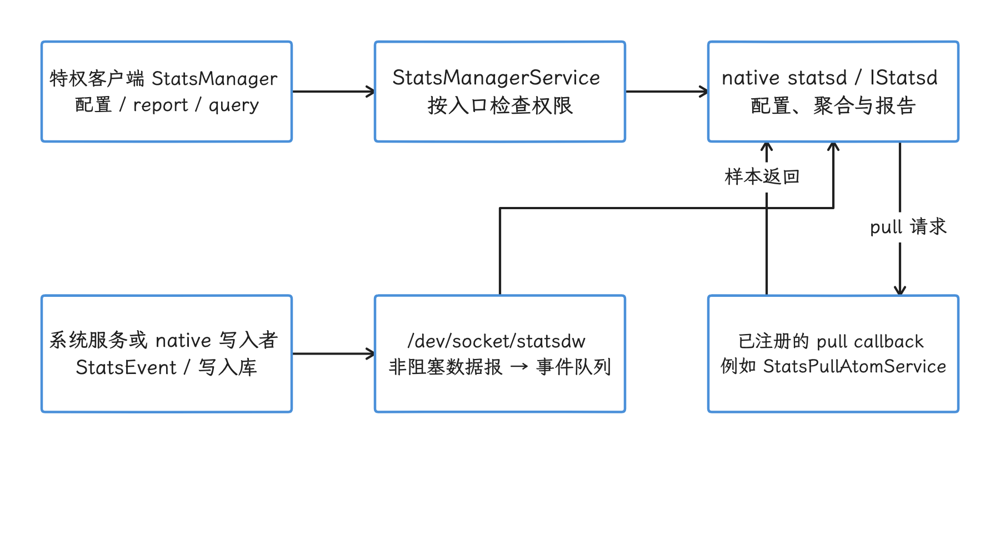
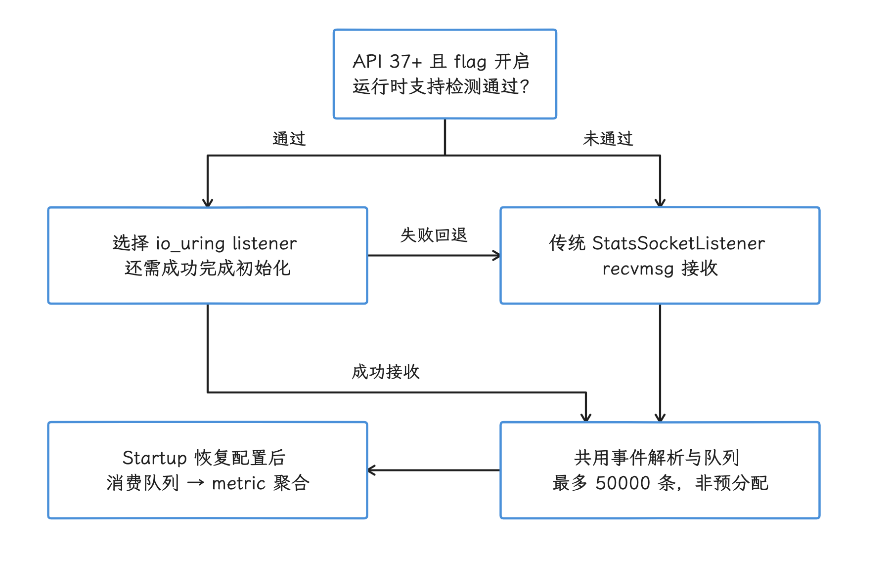
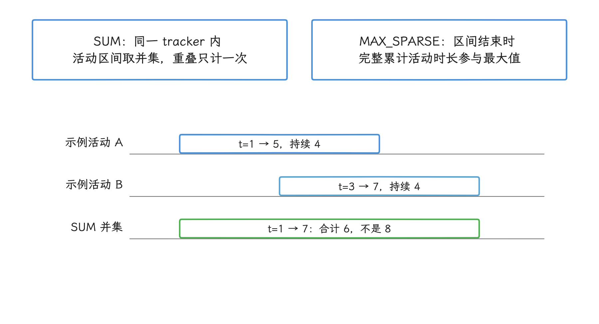
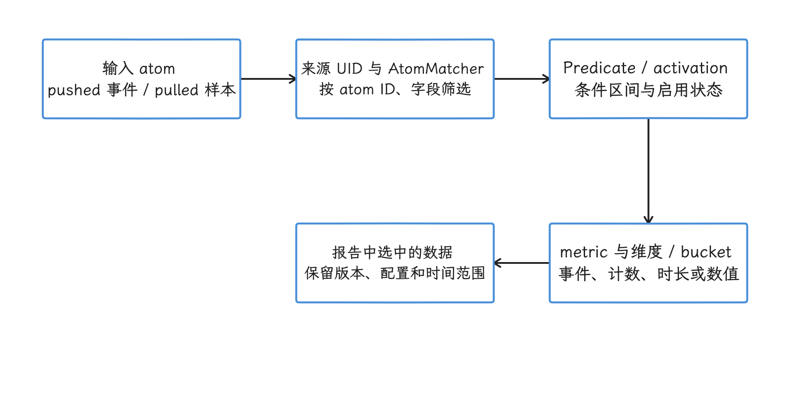
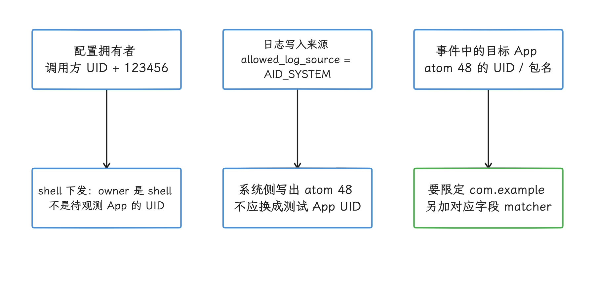
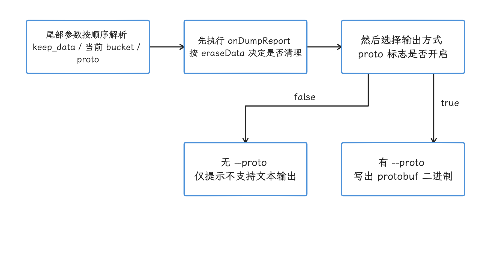

# statsd 与系统级指标采集

Android 平台的系统级指标，除了 Perfetto Trace 还有一条独立通道：平台会把 ANR（Application Not Responding，应用无响应）、LMK（low memory kill，低内存杀进程）、JobScheduler 状态、启动、功耗和网络统计等信号写成 atom；atom 是由 Protocol Buffers（protobuf）schema（数据结构定义）描述的结构化事件或状态记录。statsd 再按配置把 atom 聚合成 metric（指标）报告。

本章说明 statsd 在系统观测中的位置、atom 和 metric 的建模方式、本地调试流程，以及它和 Perfetto、logcat、dumpsys（输出系统服务当前状态的命令）的分工。线上出现系统事件而 Trace 缺少完整时序时，应先判断需要补充哪类信号。

## statsd 适合回答什么问题

判断手上缺哪类信号时，我们先要弄清 statsd 在系统观测里的位置。statsd 是 Android 平台侧的指标守护进程。AOSP 文档把 Statsd 模块定义为两部分：后台运行的 native（C++）服务 statsd，以及运行在 `system_server`（Android 核心 Java 进程）中的 Java 服务 `StatsCompanionService`。

该模块以 APEX（可独立更新的系统组件容器）形式发布，模块名为 `com.android.os.statsd`，Android 11 及以上设备可用；Android 12 起，StatsD 相关源码从 `frameworks/base/cmds/StatsD`、`frameworks/base/apex/StatsD` 和 `system/core/libstats` 迁移到 `packages/modules/StatsD`。

statsd 把系统事件和状态样本按配置聚合成 metric 报告；逐线程、逐调度事件的完整时序，则由 Perfetto 负责。Perfetto 回答“这段时间内线程和内核事件按什么顺序发生”，statsd 回答“某类事件是否发生、发生多少次、按 UID、包名或状态切分后的分布如何”。UID 是 Android 用来标识应用身份的数字，同一应用的多个进程通常共享 UID。

几个组件的分工如下：

| 组件 | 位置 | 职责 | 排障时提供的信息 |
| --- | --- | --- | --- |
| <code>statsd</code> | <code>packages/<wbr>modules/<wbr>Stats<wbr>D/<wbr>statsd/<wbr>src/<wbr></code> | 接收 atom、维护配置、聚合 metric、生成报告 | 事件计数、状态持续时间、拉取样本、异常触发 |
| <code>Stats<wbr>Manager</code> / <code>Stats<wbr>Manager<wbr>Service</code> | <code>packages/<wbr>modules/<wbr>Stats<wbr>D/<wbr>framework/<wbr>java/<wbr>android/<wbr>app/<wbr>Stats<wbr>Manager.<wbr>java</code>、<code>packages/<wbr>modules/<wbr>Stats<wbr>D/<wbr>service/<wbr>java/<wbr>com/<wbr>android/<wbr>server/<wbr>stats/<wbr>Stats<wbr>Manager<wbr>Service.<wbr>java</code> | 管理特权客户端的配置、报告、query、pull atom callback 注册和权限检查 | 配置是否注册、报告/query 是否允许读取、statsd 重启后是否重新注册客户端回调 |
| <code>Stats<wbr>Companion<wbr>Service</code> | <code>packages/<wbr>modules/<wbr>Stats<wbr>D/<wbr>service/<wbr>java/<wbr>com/<wbr>android/<wbr>server/<wbr>stats/<wbr></code>，历史路径在 <code>frameworks/<wbr>base/<wbr>services/<wbr>core/<wbr>java/<wbr>com/<wbr>android/<wbr>server/<wbr>stats/<wbr></code> | 作为 <code>system_<wbr>server</code> 内的辅助服务，处理 alarm（包括 pull 定时通知）、UID 映射和 statsd ready 通知；实际 pull 数据由注册的 callback 提供 | 定时通知、UID 映射、ready / death 与系统服务侧状态 |
| <code>Stats<wbr>Log</code> / <code>Framework<wbr>Stats<wbr>Log</code> | 通用写入封装 / 由 proto 生成的框架日志 API | 平台代码写入 pushed atom（事件发生时主动发送的 atom） | 某个系统事件发生的事实和字段 |
| <code>atoms.<wbr>proto</code> | <code>frameworks/<wbr>proto_<wbr>logging/<wbr>stats/<wbr>atoms.<wbr>proto</code> | 用 Protocol Buffers schema 定义 atom ID、字段和 pushed / pulled 分类 | 字段含义、版本差异、模块归属 |
| <code>statsd_<wbr>config.<wbr>proto</code> | <code>packages/<wbr>modules/<wbr>Stats<wbr>D/<wbr>statsd/<wbr>src/<wbr>statsd_<wbr>config.<wbr>proto</code> | 定义 metric、matcher（匹配规则）、predicate（条件区间）、alert 等配置 | 采集什么、按什么条件聚合、何时上报 |

表格列的是组件的静态职责；串成数据流看，配置和查询经 `system_server`，事件写入走专用 socket，重启恢复由 `StatsCompanionService` 通知客户端重新注册。

具体 pulled atom 通过已注册的 pull callback 提供；例如 `system_server` 中的 `StatsPullAtomService` 在系统服务就绪等阶段调用 `StatsManager.setPullAtomCallback()` 注册 CPU、内存等数据源。`StatsCompanionService` 的 pulling alarm 到点后只负责提醒 native statsd 该拉取了，数据仍由各个已注册的 callback 自行读取。

配置、report、query 这条 Java API 路径绕开 `StatsCompanionService`，走的是另一头：`StatsManager` 调用 `system_server` 中的 `StatsManagerService`，后者按入口检查 `DUMP` + `PACKAGE_USAGE_STATS`、`REGISTER_STATS_PULL_ATOM` 或 `READ_RESTRICTED_STATS` 等特权权限，再通过 `IStatsd` 的 Binder（Android 跨进程调用机制）接口与 native statsd 通信。

<!-- gracker-diagram: ch15-08-01-three-paths -->


图：配置和查询经权限检查与 Binder，pushed atom 经专用 socket，pulled atom 由已注册 callback 返回。 StatsCompanionService 提供 alarm、UID 和 ready 桥接；不是全部事件和 pull 数据的中转站。

statsd 重启后，`StatsCompanionService.statsdReady()` 会调用 `StatsManagerService.statsdReady(IStatsd)`。`sayHiToStatsd()` 随后向新进程重新注册五类客户端入口：pull callback、data-fetch operation、active-config-changed operation、broadcast subscriber、restricted-metrics-changed operation；这些 operation 和 subscriber 通过 `PendingIntent` 通知客户端。

注册时源码先在锁保护下复制注册列表，再释放锁执行 Binder 调用，避免跨进程调用长时间占锁。`registerAllPullers()` 完成后还调用 `allPullersFromBootRegistered()`；puller 是向 statsd 提供 pulled atom 的数据源回调。这条路径恢复的只有客户端注册：配置的恢复由 native `ConfigManager` 负责，它会把 `StatsdConfig` 保存下来并在 `Startup()` 时从磁盘读回，`StatsManagerService` 里并没有一份缓存下来、可供重放的配置副本。Java 注册恢复与 native 配置恢复是两件事；崩溃前尚未持久化的 metric 数据是否完整，恢复流程本身给不了保证。


pushed atom 的写入走的是第三条路，同样绕开 `StatsCompanionService`：生成的 `FrameworkStatsLog` 构造 `StatsEvent`，通过 `StatsLog.write()`、JNI 和 socket 写入库 `libstatssocket` 发送。socket 上跑的 payload 是 stats event 编码；顶层 `Atom` protobuf 留在 schema 与报告生成的环节，两种格式各管各的层。`statsd_writer.cpp` 创建 non-blocking Unix datagram socket（不会等待缓冲区腾空的 Unix 数据报套接字），连接 `/dev/socket/statsdw`，再用 `writev()` 一次写入多个内存片段。

这条 socket 路径也要考虑 statsd 过载：发送端可能收到 `EAGAIN`（暂时无法写入）；源码明确说明写入可能丢失但不会阻塞，并维护 drop 计数供后续上报。

接收端在 Android 17 的 native `main.cpp` 里新增了一个分支：带 API 37 门槛的 io_uring listener。`io_uring` 是 Linux 的异步 I/O 接口；feature flag（运行时功能开关）开启且 `IOUringSocketHandler::IsIouringSupported()` 检测通过时，statsd 使用 `StatsSocketListenerIoUring` 监听 socket，其余情况使用 `StatsSocketListener`；即使入口选择了 io_uring，后续初始化或 buffer 注册等失败时也会回退到原 listener。

两条接收路径在解析层汇合：共用同一套消息解析与 `LogEventQueue`。队列上限为 50000 条，空间按需分配，满时拒绝新事件并记录 overflow，定位是有界缓冲。socket 会尽早开始读取，消费线程则要等 `StatsService::Startup()` 初始化配置后才启动；事件已接收、已入队，也只是走完采集这段路，能否进入 metric 报告还要看后面的筛选与聚合。对应的 Android 17 common kernel tag `android17-6.18-2026-06_r6` 包含 `io_uring/` 实现；设备实际走哪条 listener，仍由平台 flag、运行时检测和产品配置共同决定。

<!-- gracker-diagram: ch15-08-03-socket-queue-pressure -->


图：接收端在 API、flag 与支持检测后选择 listener，io_uring 初始化失败仍可回退；两条路径共用有界队列。 发送端 EAGAIN 和接收队列满都可能丢事件；入队不是报告成功的保证，内核目录存在也不证明设备启用。

AOSP 的 `atoms.proto` 说明 `Atom` 定义 raw stats log events，也就是尚未聚合的原始统计事件；`stats-log-api-gen` 在构建期生成日志常量和方法。顶层 `Atom` 消息承担的是 schema 容器角色，随系统编入的是这些构建期产物；statsd 按 `atoms.proto` 与 `stats_log.proto` 的格式生成 protobuf 数据。

因此，报告中的 ANR 或 LMK 条目表明对应 atom 被 statsd 接收，并按该 metric 的条件与抽样规则进入报告。这类条目是线索本身，现场还原要靠 ANR trace、tombstone、Perfetto trace 或 dumpsys；报告里没有条目，同样说明不了事件从未发生。

## Atom 模型：事件、拉取样本和 metric 配置

statsd 的输入是 atom，输出是 metric 报告。atom 负责描述平台事件或状态样本，metric 配置负责描述如何筛选、切分和聚合；我们读配置和报告时，也按这两层分开对应。

`atoms.proto` 把 atom 分成两类：

- pushed atom：由系统服务或 native 组件在事件发生时写入。例如 `ScheduledJobStateChanged`、`WakelockStateChanged`、`AppCrashOccurred`、`ANROccurred`、`LmkKillOccurred`、`AppStartOccurred` 都属于 pushed atom。事件通过 stats log API 和专用 socket 送到 statsd，再由 matcher、predicate 与 metric 配置决定是否保留和如何聚合。
- pulled atom：statsd 按配置或命令向系统数据源请求当前状态。例如 `KernelWakelock`、`CpuTimePerUid`、`CpuTimePerUidFreq`、`ProcessMemoryState`、`SystemElapsedRealtime` 等位于 pulled 区间。AOSP 中 pulled atom 的 field number（同时也是 atom ID）从 10000 开始。

metric 配置定义在 `statsd_config.proto`。这一层只回答“哪些 atom 算命中、怎么聚合、报告里保留哪些字段”；系统怎么产生事件，是 atom 那一层的事。常用对象包括：

| 配置对象 | 作用 | 典型用途 |
| --- | --- | --- |
| <code>Atom<wbr>Matcher</code> | 按 atom ID 和字段条件匹配事件 | 只收集某类 ANR、某个 UID 的 JobScheduler 状态 |
| <code>Predicate</code> | 用 start / stop atom 表示条件区间 | 统计前台期间 wakelock 持续时间 |
| <code>Event<wbr>Metric</code> | 记录命中的事件 | 保留 ANR、LMK、启动事件明细 |
| <code>Count<wbr>Metric</code> | 按 bucket（聚合时间窗口）计数 | 统计某类事件每小时次数 |
| <code>Duration<wbr>Metric</code> | 统计状态持续时间；<code>SUM</code> 累计条件满足的活动时间，同一 tracker 的并发重叠只计一次；<code>MAX_<wbr>SPARSE</code> 在结束所在 bucket 记录完整区间的最大累计活动时长，可跨 bucket 起点 | 统计 wakelock、前台服务、Job 运行时长 |
| <code>Gauge<wbr>Metric</code> | 对 pulled atom 或触发事件做采样 | 周期性采集 CPU 时间、内存状态、电量相关样本 |
| <code>Value<wbr>Metric</code> / <code>Kll<wbr>Metric</code> | 对数值字段做聚合；<code>Kll<wbr>Metric</code> 用 KLL quantile sketch（紧凑的分位数摘要）估计分布 | 统计耗时、大小、数量等数值指标 |

`StatsdConfig` 把这些对象组合在同一个 protobuf 配置里：`event_metric`、`count_metric`、`value_metric`、`gauge_metric`、`duration_metric`、`kll_metric`、`atom_matcher`、`predicate`、`alert`、`subscription` 等字段都在这个 proto 中定义。

<!-- gracker-diagram: ch15-08-05-duration-aggregation -->


图：同一 SUM tracker 的重叠活动只累计一次；MAX_SPARSE 选结束在该 bucket 的完整累计活动时长最大值。 示例假设条件恒真且无丢事件，时间单位相同；MAX_SPARSE 本例为 4，未结束区间可跨 bucket 保留，裁剪时只取本 bucket 重叠长度会丢掉这部分时长。

排障时要把 atom 和 metric 分开看。atom 描述原始事件或状态样本，metric 描述筛选、切分和聚合规则。同一个 atom 可以被多个 metric 以不同维度聚合。

<!-- gracker-diagram: ch15-08-04-atom-config-report -->


图：atom 定义事件或状态字段，matcher 筛选，predicate / activation 控制条件，metric 再按维度与规则输出。 同一 atom 可服务多个 metric；pushed 传输 payload 与 protobuf 配置 / 报告是两种格式，各有各的编码方式。

报告缺少条目时，我们按顺序检查：


- `allowed_log_source`（允许写入该配置的来源）是否匹配
- matcher / predicate 是否命中
- metric activation（控制 metric 何时启用）是否生效
- 当前未结束的 bucket 是否被包含
- 报告是否已被导出并清除
- pull 是否超时
- socket 或队列是否发生丢失

## 性能排障中的常见 atom 入口

在性能排障里，我们把 statsd 当“线索表”用：它提供跨版本相对稳定的系统事件索引，线索的验证再交给 Perfetto、logcat、dumpsys 或问题专项工具。

| 场景 | 常见 atom / 字段入口 | 能回答的问题 | 不能替代的证据 |
| --- | --- | --- | --- |
| ANR | <code>ANROccurred</code>、<code>ANRLatency<wbr>Reported</code> | 哪个 UID / 进程发生 ANR，reason 字段如何，ANR 处理各阶段耗时是否异常 | traces.txt、Perfetto 主线程和 Binder 时序、ActivityManager 日志 |
| 崩溃 | <code>App<wbr>Crash<wbr>Occurred</code>、<code>App<wbr>Died</code> | 崩溃是否发生，进程和错误来源字段是什么 | Java / native crash 堆栈、tombstone（系统生成的 native 崩溃转储）、崩溃平台聚合 |
| LMK / 低内存 | <code>Lmk<wbr>Kill<wbr>Occurred</code>、<code>Low<wbr>Mem<wbr>Reported</code>、<code>Process<wbr>Memory<wbr>State</code> | 哪个进程被杀、系统是否报告低内存、拉取到的内存状态样本 | lmkd 日志、<code>Application<wbr>Exit<wbr>Info</code>、Perfetto memory counter，详见 10.x 与 23.x 相关章节 |
| JobScheduler | <code>Scheduled<wbr>Job<wbr>State<wbr>Changed</code>、<code>Deferred<wbr>Job<wbr>Stats<wbr>Reported</code>、<code>Device<wbr>Wide<wbr>Job<wbr>Constraint<wbr>Changed</code> | Job 状态变化、约束变化、是否存在延迟执行迹象 | <code>dumpsys jobscheduler</code>、WorkManager 日志，详见 5.3 节 |
| 启动 | <code>App<wbr>Start<wbr>Occurred</code>、<code>App<wbr>Start<wbr>Canceled</code>、<code>App<wbr>Start<wbr>Fully<wbr>Drawn</code>、<code>App<wbr>Start<wbr>Memory<wbr>State<wbr>Captured</code> | 启动事件、fully drawn（界面已完整绘制）、启动期间内存快照 | Macrobenchmark、Perfetto app startup 切片，详见 21.x |
| 功耗 | <code>Wakelock<wbr>State<wbr>Changed</code>、<code>Kernel<wbr>Wakelock</code>、<code>Battery<wbr>Saver<wbr>Mode<wbr>State<wbr>Changed</code>、<code>Cpu<wbr>Time<wbr>Per<wbr>Uid<wbr>Freq</code> | wakelock（阻止设备休眠的锁）、CPU 时间、节电状态变化 | Batterystats、Battery Historian、Perfetto power rail（电源轨采样），详见 25.x |
| 游戏与帧相关 | <code>Game<wbr>Mode<wbr>Changed</code>、<code>Game<wbr>Mode<wbr>Configuration<wbr>Changed</code>、<code>Input<wbr>Event<wbr>Latency<wbr>Reported</code> | 游戏模式和输入延迟相关事件是否出现 | FrameTimeline、SurfaceFlinger、GPU counter，详见 22.x |
| UprobeStats / eBPF | <code>Uprobe<wbr>Stats<wbr>Internal<wbr>Error</code>、<code>Uprobe<wbr>Stats<wbr>Invocation</code>、<code>Uprobe<wbr>Stats<wbr>Bpf<wbr>Attached</code>、<code>Uprobe<wbr>Stats<wbr>Bpf<wbr>Map<wbr>Polled</code> | 用户态探针 uprobe 是否挂载、eBPF（内核中的受限程序）是否运行、eBPF map（内核与用户态共享的数据结构）是否被读取，或是否出现内部错误 | eBPF 程序、Perfetto trace、UprobeStats 模块日志，详见 15.16 节 |

`atoms.proto` 会随平台版本演进，同名 atom 的字段语义、可见范围、模块归属都有变动风险，所以把表里的字段搬进长期看板时，要同时记录 Android 版本、构建指纹、atom ID、字段版本，并保留配置文件的版本号。

## adb / cmd stats 本地调试流程

本地验证 statsd 采集，我们通常走四步：准备二进制 StatsdConfig、下发配置、触发场景、拉取报告。`cmd stats` 的 shell 命令入口在 `StatsService::handleShellCommand()` 中实现，只允许 root 或 shell UID 调用。

下面是一份只收集 `AppStartOccurred`（atom ID 48）的最小 textproto，也就是便于人阅读和编辑的 protobuf 文本格式。matcher ID 与 metric ID 只需在该配置内唯一；这里把 config 内的 `id` 和命令行配置 ID 都设为 `123456`，便于复查。

```protobuf
id: 123456
allowed_log_source: "AID_SYSTEM"

atom_matcher {
  id: 1001
  simple_atom_matcher {
    atom_id: 48
  }
}

event_metric {
  id: 2001
  what: 1001
}
```

在 AOSP 根目录可用与该 tag 匹配的 `statsd_config.proto` 编码；下面假设 `protoc` 已在 `PATH` 中。

```bash
protoc -I packages/modules/StatsD/statsd/src \
  --encode=android.os.statsd.StatsdConfig \
  statsd_config.proto < config.textproto > config.pb
```

`allowed_log_source` 限制的是事件写入者的 UID。`AID_SYSTEM` 对应写出 `AppStartOccurred` 的 system 侧；待观察 App 的 UID 在 atom 字段里，这份配置的拥有者是下发命令的调用方——三个身份各在各的位置，下面这张图把它们摆在了一起。配置按 `(调用方 UID, 命令行配置 ID)` 标识。这个最小 matcher 只选 atom 48、未限定包名，会收集符合来源条件的多个 App 启动；需要限定测试 App 时，再按目标版本 schema 增加字段 matcher。换 atom 时要同时核对 ID、实际 log source 和字段含义，只替换数字容易采错对象。

<!-- gracker-diagram: ch15-08-07-three-uid-identities -->


图：配置由调用方 UID 与命令行 ID 标识；allowed_log_source 检查写入者，atom 字段中的目标 App UID 是另一层身份。 例中 shell 拥有配置，AID_SYSTEM 写出 atom 48，事件字段才包含 App UID / 包名；最小 matcher 会收多个符合条件的 App 启动。

下面这组命令展示最小调试路径。这里假设 `config.pb` 已经是 wire-encoded `StatsdConfig`（按 protobuf wire format 编码的二进制数据），`123456` 是数字配置 ID。AOSP 源码要求 `config update` 从 stdin（标准输入）读取配置，并把 `NAME` 解析成 int64 配置 ID。

```shell
# 下发或更新配置；省略 UID 时使用调用方 UID
adb shell cmd stats config update 123456 < config.pb

# 触发待观察场景，例如启动 App、制造测试 Job、执行压测脚本
adb shell am start -n com.example/.MainActivity

# 拉取二进制报告；调试时常保留数据并包含当前 bucket
adb shell cmd stats dump-report 123456 --keep_data --include_current_bucket --proto > report.pb

# 清理该配置
adb shell cmd stats config remove 123456
```

这套流程里有四个容易踩的点：


- 下发的 `config.pb` 必须是二进制 proto，文本 proto 要先编码一次。命令帮助里也写明配置通过 stdin 传入 wire-encoded protobuf。
- 省略 UID 时使用当前调用方 UID；显式传自己的 UID 允许；任意跨 UID 读取或写入通常限 eng / userdebug（工程或调试构建），固定 r1 还特许 root 代 shell。量产 user 构建不要把任意跨 UID 调试当成可用能力。
- `dump-report` 默认会清除已导出的数据；调试时加 `--keep_data`，否则下一次拉取可能拿不到同一批样本。固定 r1 的非 proto 文本输出尚不支持，但解析成功后仍先执行导出；省略 `--proto` 看到的提示出现时，导出多半已经完成，数据是否保留取决于有没有带 `--keep_data`。
- Android 17 的参数解析从命令尾部依次识别 `--proto`、`--include_current_bucket`、`--keep_data`，按示例顺序书写最稳妥。`config remove` 同时省略 UID 与 NAME 会删除内存和磁盘中的全部配置，清理脚本必须传入明确的配置 ID。

<!-- gracker-diagram: ch15-08-09-dump-flags-clear -->


图：固定 r1 先按参数导出报告，之后才输出二进制或不支持文本的提示。 默认 eraseData 为 true；无 --proto 的提示不回滚导出。调试保留样本时按正文顺序显式传 --keep_data --include_current_bucket --proto。

`cmd stats` 还提供一些辅助命令：

```shell
# 查看 UID 到包名、版本的映射
adb shell cmd stats print-uid-map

# 拉取某个 pulled atom 的当前输出，适合验证 puller 是否工作
adb shell cmd stats pull-source 10009

# 打印 statsd 自身统计，必要时输出 proto
adb shell cmd stats print-stats
adb shell cmd stats print-stats --proto

# 打开或关闭 stats log 打印；源码帮助注明需要 root 权限
adb shell cmd stats print-logs
adb shell cmd stats print-logs 0
```

`10009` 在 Android 17 的 `atoms.proto` 中对应 `CpuTimePerUid`。`pull-source` 请求对应 puller，返回可能来自 cooldown 缓存；它能验证 puller 是否工作，周期采集是否正常还要以 metric 报告为准。`print-logs` 需要 root 权限，开启后还会关闭 pushed event 的解析过滤和 socket logging control，以便打印完整事件；它会改变采集开销，开着它采到的数据，解读时要把这份影响算进去。


这些命令适合做本地验证；放进量产自动化之前要先过一道确认。量产环境的 statsd 配置、隐私约束、上报路径通常由系统镜像、GMS（Google Mobile Services）、厂商平台或内部分发机制控制，普通 App 也拿不到平台级配置的下发权。

## 与 Perfetto、logcat、dumpsys 的交叉验证

statsd 和 Perfetto 经常出现在同一次排障里，两者证据类型不同：statsd 给聚合后的指标和事件报告，Perfetto 给时间轴。我们可以按下面的顺序把它们和 logcat、dumpsys 串起来：

1. 用 statsd 查找已采到的事件线索（空报告不能排除事件）：查报告中的 atom、UID、包名、reason、bucket、次数和状态持续时间。
2. 用 Perfetto 还原事件附近的时序：查主线程、`RenderThread`（渲染线程）、Binder、调度、memory counter（内存数值轨道）、FrameTimeline（逐帧生命周期轨道）。Perfetto 采集基础设施详见 14.6 节，SQL 分析详见 14.7 节。
3. 用 logcat 和 dumpsys 补系统状态：ActivityManager、JobScheduler、PowerManager、lmkd、SurfaceFlinger 等日志或 dump 能解释 statsd 字段背后的状态。
4. 用专项工具复核指标定义：功耗看 Batterystats / Battery Historian，内存看 heapprofd / meminfo，渲染看 FrameTimeline / SurfaceFlinger，APM（Application Performance Monitoring，应用性能监控）上报看 26.1 节。

用一个 ANR 例子说明分工：`ANROccurred` 给出哪个进程、哪个组件、reason 字段和是否前台；Perfetto 还原 ANR 前主线程处于 runnable（可运行）、blocked（阻塞）还是 Binder 等待；logcat 还原 ActivityManager 的 ANR 判定路径；`traces.txt` 是记录各线程调用栈的 ANR 现场文件。这几类证据合在一起，结论才站得住。

LMK 是同样的结构。`LmkKillOccurred` 记录的是“哪个进程被杀”；要回答“为什么内存压力升高”，还要查 `lmkd`（low memory killer daemon，低内存杀进程守护进程）日志、PSI（Pressure Stall Information，资源压力造成的停顿时间）、进程 PSS（按共享比例分摊后的内存占用）、zRAM（以内存压缩设备承载的交换空间）、adj（进程被回收的优先级分值）和前后台状态，必要时再回到 10.x 和 23.x 的内存章节。


## 权限、版本与 OEM 边界

statsd 位于系统侧，权限边界比普通 App 埋点严格。AOSP `StatsService` 对 shell 命令入口检查 root / shell UID，跨 UID 配置和报告操作又受 eng / userdebug 构建限制。`StatsManager` 是 `@SystemApi`（供系统组件和获授权应用使用的 API）；`addConfig()`、`removeConfig()`、`getReports()` 要求 `DUMP` + `PACKAGE_USAGE_STATS`，对于带 packageName 的客户端调用，服务端还检查 usage-stats AppOp（权限之外的运行时操作授权）；`setPullAtomCallback()` 要求 `REGISTER_STATS_PULL_ATOM`；`query()` 与 restricted-metrics operation 要求 `READ_RESTRICTED_STATS`。

版本边界也要写进排障手册：

- Android 11 及以上设备通过 `com.android.os.statsd` APEX 分发 StatsD 模块；Android 12 起源码结构迁移到 `packages/modules/StatsD`。
- `atoms.proto` 的 pushed atom 从 field 2 开始，pulled atom 从 field 10000 开始，但具体 atom 是否存在、字段是否相同，要按目标版本源码确认。
- 官方模块文档注明 Statsd APEX 不支持产品侧定制。atom 命名空间另有扩展约定：field 100000–199999 留给 non-AOSP/OEM（设备厂商），300000–349999 用于 pushed generic vendor atom，350000–399999 用于 pulled generic vendor atom。厂商应使用规定的扩展路径；模块本身的修改或替换仍受同一句“不支持产品侧定制”的限制。
- 隐私相关字段可能被 hash（转换为摘要值）、截断或过滤。配置中的 `hash_strings_in_metric_report` 默认开启，`allowed_log_source` 限制来源，`uid_fields` 则位于各 metric 子消息；它们各覆盖自己的范围，报告字段仍按目标 atom、metric 与实现解读。

团队手册里，我们可以把 statsd 定位成“系统事件索引”。每个指标旁边写清三件事：atom ID 和字段来自哪个 Android 版本，metric 配置如何聚合，遇到异常后用哪类 trace、日志或 dump 复核。


## Tradefed / CTS 中的 statsd collector

AOSP Trade Federation（Android 测试执行框架）提供 `com.android.tradefed.util.statsd.ConfigUtil`，官方参考文档把它定义为“创建、交互和推送 statsd 配置文件的工具类”。它支持推送二进制 statsd 配置、按 event atom ID 生成事件型配置、删除配置，并返回新配置 ID。

这类能力适合做回归测试的发布判定：我们在测试开始前下发配置，测试过程中执行固定场景，测试结束后拉取报告，再用脚本判断事件次数、耗时分布或状态持续时间是否超阈值。在相同 Android 版本和配置内，statsd 的字段含义明确，便于跨设备聚合；报告里只包含配置选中的 atom，遗漏的现场在测试结束后补录不回来。

CTS（Compatibility Test Suite，兼容性测试套件）也依赖 statsd 验证平台 atom 和 StatsD 功能。AOSP Statsd 官方文档写明，CTS 会验证 statsd 功能以及发布管理依赖的 atom。ROM 或系统模块团队需要把这些 atom 的兼容性纳入发布验证。


## statsd 报告与线上 APM 的边界

线上 APM 负责 App 内部事件：页面、用户操作、业务 trace、网络请求、缓存命中、实验分组。statsd 负责系统侧事件和状态样本：进程生命周期、ANR、LMK、Job、wakelock、CPU 时间、电量状态。两者粒度和权限不同，各守各的维度。

在 App 性能平台里，我们可以把分工定清楚：APM 负责用户会话和业务维度，statsd 或系统指标负责平台事件维度。有合法系统侧数据来源时，后端按时间窗口、版本、设备及事件发生时的 UID / 包名映射关联，并保留原始来源字段；bucket 聚合或时间截断的数据只支持对应粒度的关联，逐请求的因果链要靠逐请求粒度的数据来回答。这样既能知道“用户这次页面卡了”，也能知道“同一窗口系统侧有没有 LMK、CPU 限频、输入延迟或 Job 约束变化”。


26.1 节已经讲过性能指标定义和上报规则。这里补一条工程约束：APM 能稳定采到的数据不必改由 statsd 采集；只有系统侧才知道、App 无权限拿到、或者需要跨进程统一定义的事件，才值得引入 statsd。

## 自定义 Atom 与厂商扩展风险

厂商 atom 的长期兼容取决于 atom ID、字段编号、字段含义、隐私处理和模块归属。某个 OEM 在 Android 15 上增加的 vendor atom（厂商扩展 atom），到 Android 17 可能改变字段，也可能由新的平台 atom 取代。

做长期看板时，我们遵守四条规则：

- 固定配置版本：每次变更 `StatsdConfig` 都记录版本号、变更说明和逐步放量范围。
- 固定字段约定：看板字段绑定 atom ID + field number + Android 版本，不只绑定字段名。
- 固定验证样本：每个版本保留一份触发脚本和预期报告，发版前跑一轮 userdebug 设备验证。
- 固定降级策略：目标设备没有对应 atom、权限不足或报告为空时，明确回退到 Perfetto、dumpsys、logcat 或 App 侧指标。

做到这四点后，statsd 才适合作为长期排障索引；跨版本比较报告之前，先核对字段契约与版本记录。


## 参考资料

- [AOSP Statsd 模块说明](https://source.android.com/docs/core/ota/modular-system/statsd)
- [Android 17 `statsd/src/main.cpp`](https://android.googlesource.com/platform/packages/modules/StatsD/+/refs/tags/android-17.0.0_r1/statsd/src/main.cpp)
- [Android 17 `StatsService.cpp`](https://android.googlesource.com/platform/packages/modules/StatsD/+/refs/tags/android-17.0.0_r1/statsd/src/StatsService.cpp)
- [Android 17 `statsd_config.proto`](https://android.googlesource.com/platform/packages/modules/StatsD/+/refs/tags/android-17.0.0_r1/statsd/src/statsd_config.proto)
- [Android 17 `statsd_writer.cpp`](https://android.googlesource.com/platform/packages/modules/StatsD/+/refs/tags/android-17.0.0_r1/lib/libstatssocket/statsd_writer.cpp)
- [Android 17 `StatsManager.java`](https://android.googlesource.com/platform/packages/modules/StatsD/+/refs/tags/android-17.0.0_r1/framework/java/android/app/StatsManager.java)
- [Android 17 `StatsManagerService.java`](https://android.googlesource.com/platform/packages/modules/StatsD/+/refs/tags/android-17.0.0_r1/service/java/com/android/server/stats/StatsManagerService.java)
- [Android 17 `StatsCompanionService.java`](https://android.googlesource.com/platform/packages/modules/StatsD/+/refs/tags/android-17.0.0_r1/service/java/com/android/server/stats/StatsCompanionService.java)
- [Android 17 `atoms.proto`](https://android.googlesource.com/platform/frameworks/proto_logging/+/refs/tags/android-17.0.0_r1/stats/atoms.proto)
- [Android 17 common kernel `io_uring/`, `android17-6.18-2026-06_r6`](https://android.googlesource.com/kernel/common/+/refs/tags/android17-6.18-2026-06_r6/io_uring/)
- [Tradefed `ConfigUtil`](https://source.android.com/reference/tradefed/com/android/tradefed/util/statsd/ConfigUtil)
- [A17 平台 pull callback 注册](https://android.googlesource.com/platform/frameworks/base/+/android-17.0.0_r1/services/core/java/com/android/server/stats/pull/StatsPullAtomService.java)
- [A17 配置落盘与启动恢复](https://android.googlesource.com/platform/packages/modules/StatsD/+/android-17.0.0_r1/statsd/src/config/ConfigManager.cpp)
- [A17 有界事件队列](https://android.googlesource.com/platform/packages/modules/StatsD/+/android-17.0.0_r1/statsd/src/logd/LogEventQueue.cpp)
- [A17 io_uring 初始化回退](https://android.googlesource.com/platform/packages/modules/StatsD/+/android-17.0.0_r1/statsd/src/socket/StatsSocketListenerIoUring.cpp)
- [A17 SUM 活动区间合并](https://android.googlesource.com/platform/packages/modules/StatsD/+/android-17.0.0_r1/statsd/src/metrics/duration_helper/OringDurationTracker.cpp)
- [A17 MAX_SPARSE 区间结束与跨 bucket](https://android.googlesource.com/platform/packages/modules/StatsD/+/android-17.0.0_r1/statsd/src/metrics/duration_helper/MaxDurationTracker.cpp)
- [A17 pull cooldown 缓存](https://android.googlesource.com/platform/packages/modules/StatsD/+/android-17.0.0_r1/statsd/src/external/StatsPuller.cpp)
- [A17 启动 atom 的写入者](https://android.googlesource.com/platform/frameworks/base/+/android-17.0.0_r1/services/core/java/com/android/server/wm/ActivityMetricsLogger.java)
