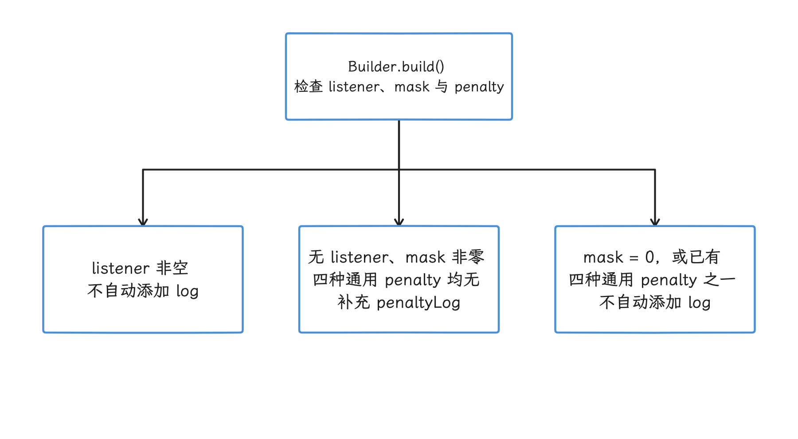
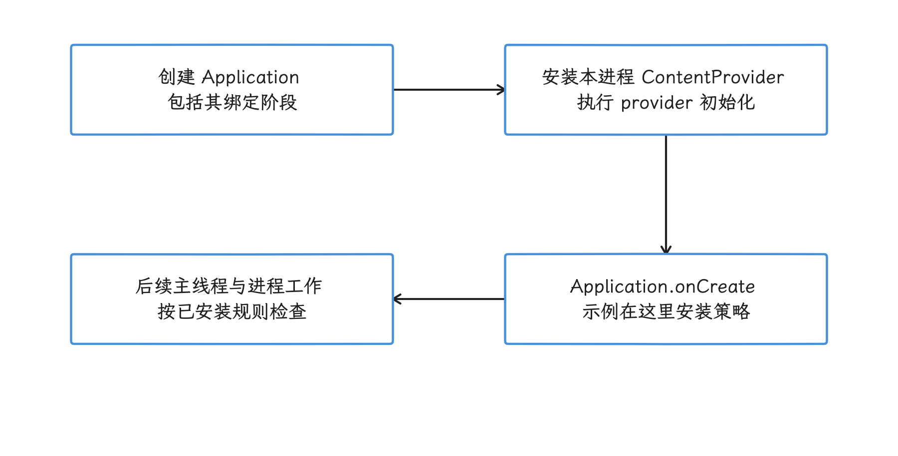
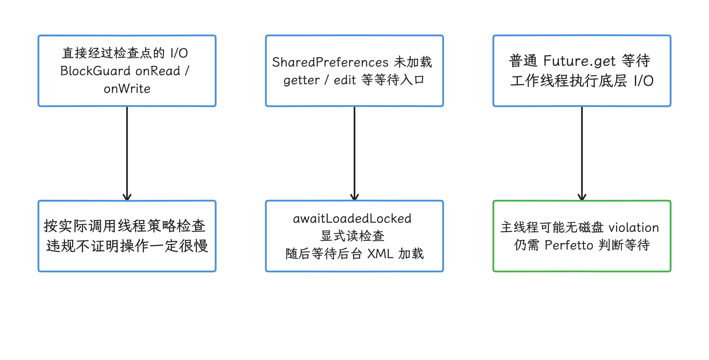
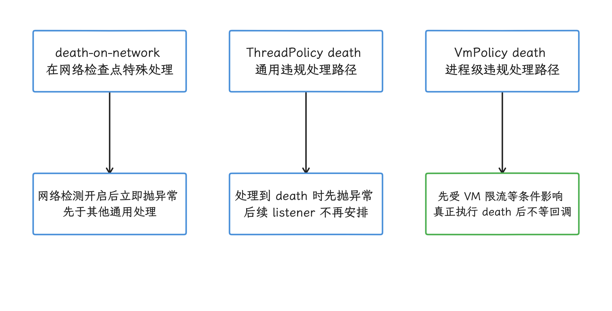
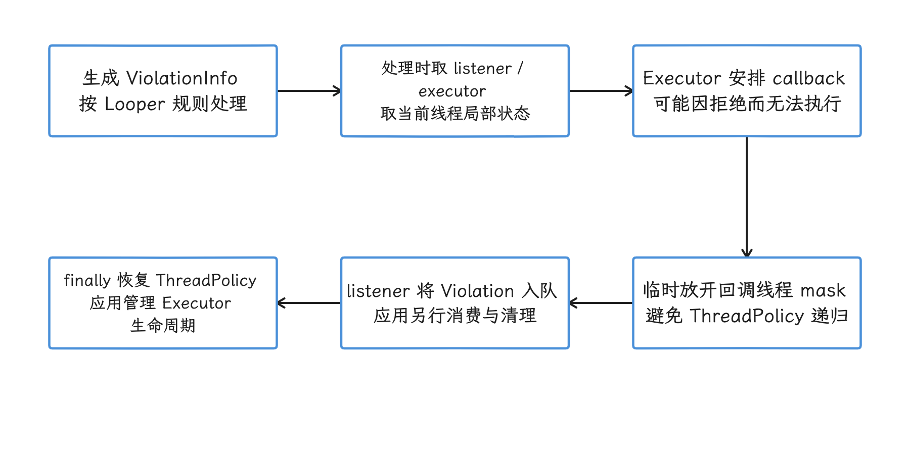
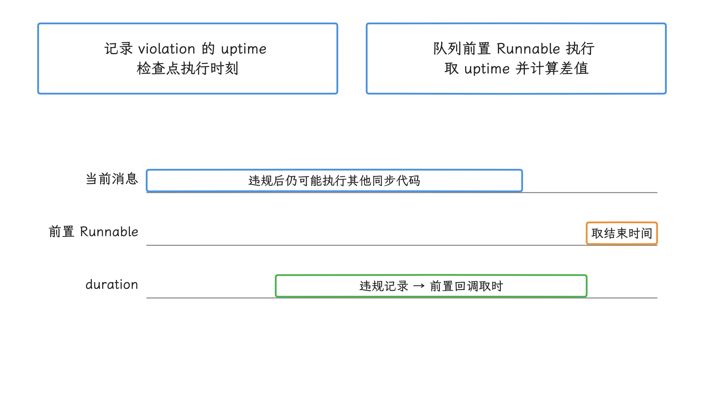
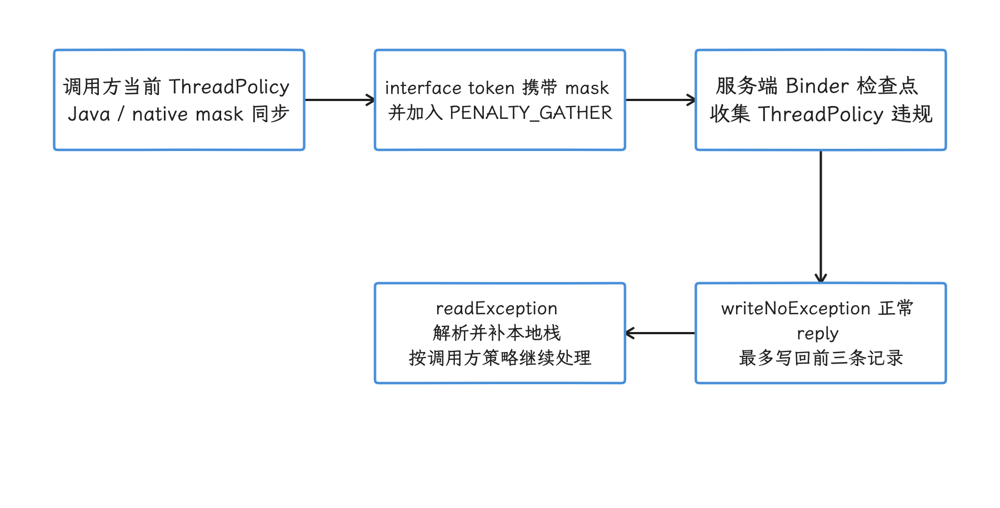
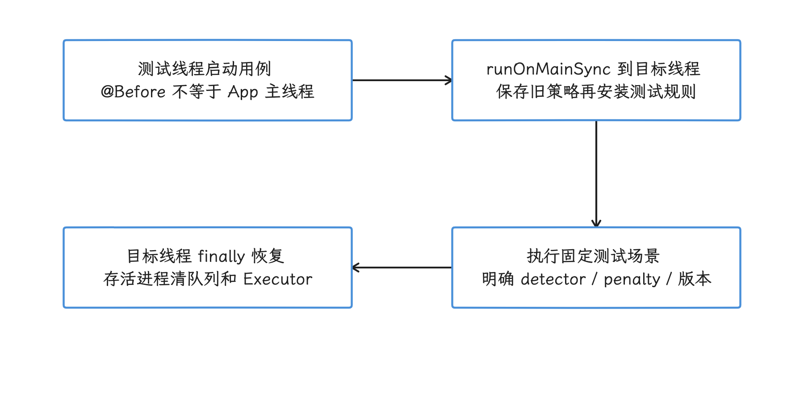

# StrictMode 性能检查与开发期诊断

StrictMode 是一组埋在 framework 里的运行时检查规则。Android framework 或 libcore（Android 核心 Java 库）在关键路径上预埋了检查点，代码途经时，detector（检测项）会识别磁盘读写、网络访问、显式 GC（garbage collection，垃圾回收）、资源未关闭和若干安全问题，penalty（处理方式）再决定是记录、回调还是终止进程。开发、自动化测试和平台集成阶段，它适合用来把可疑行为先暴露出来。

它能给的是 violation（规则违规）信号，把可疑路径圈出来；完整的性能采样要交给别的工具——它拦不到每一个系统调用，也不会自动判断某段业务代码是否超过 16 ms。要看精确耗时、CPU 调度、Binder（Android 跨进程调用）等待或块 I/O（存储设备读写）时，我们还是回到 Perfetto。

> 源码基线：Android 17 / API 37 / AOSP `android-17.0.0_r1`。

## 先分清 ThreadPolicy 和 VmPolicy

| 策略 | 生效范围 | 典型检查 |
| --- | --- | --- |
| <code>Thread<wbr>Policy</code> | 调用 <code>Strict<wbr>Mode.<wbr>set<wbr>Thread<wbr>Policy()</code> 的当前 OS 线程 | 磁盘读、磁盘写、网络、自定义慢调用、资源类型不匹配、未缓冲 I/O、显式 GC |
| <code>Vm<wbr>Policy</code> | 当前进程 | Activity/Closeable/SQLite/注册对象泄漏、非 SDK API、明文网络、URI 与 Intent 安全问题 |

`ThreadPolicy` 的生效单位是调用它的那条 OS 线程。应用通常在 `Application.onCreate()` 里设置它，而 `onCreate()` 恰好运行在进程主线程，于是常见用法只覆盖主线程——这也是它常被当成“主线程策略”的原因。线程池、Binder 线程和手工创建的线程不会自动继承这份 Java 线程策略，要覆盖就在对应线程上各自设置。

`VmPolicy` 的生效单位则是整个进程：由 `StrictMode.setVmPolicy()` 安装到进程级静态状态，进程内各线程触发对应检查点时都受它约束。


每次 `setThreadPolicy()` 或 `setVmPolicy()` 都是整体替换现有策略。Builder 靠连续调用配置方法来组装一份策略；固定 r1 的 `build()` 只在没有 listener、mask 非零，且 log / death / DropBox / dialog 这组 penalty 都未设置时补上 `penaltyLog()`。只设置 listener 时不会自动附加日志；只设置 flash 或 death-on-network 时仍可能补日志。

<!-- gracker-diagram: ch15-09-02-builder-default-log -->


图：没有 listener、mask 非零且四种通用 penalty 都没有时，固定 r1 才自动补日志。 listener-only 不自动 log；flash 或 death-on-network 没有单独满足这组通用 penalty 条件，仍可能补 log。

## 一份可解释的 API 34+ Debug 配置

下面这份 Java 代码在每个应用进程的主线程安装显式规则。显式列出 detector 的好处，是覆盖范围不再随 target SDK（应用声明的目标 API 级别）、compat change（控制特定应用兼容行为的平台开关）和 feature flag（运行时功能开关）漂移。版本门槛也要留意：`detectExplicitGc()` 从 API 34 才可用，这段代码原样适用于 API 34–37；API 28–33 上没有这个方法，必须省略该调用，或在组装 Builder 时用 `Build.VERSION.SDK_INT >= 34` 单独保护。

```java
public final class App extends Application {
    @Override
    public void onCreate() {
        super.onCreate();

        if ((getApplicationInfo().flags & ApplicationInfo.FLAG_DEBUGGABLE) == 0) {
            return;
        }

        StrictMode.setThreadPolicy(
                new StrictMode.ThreadPolicy.Builder()
                        .detectDiskReads()
                        .detectDiskWrites()
                        .detectNetwork()
                        .detectCustomSlowCalls()
                        .detectResourceMismatches()
                        .detectUnbufferedIo()
                        .detectExplicitGc()
                        .penaltyLog()
                        .build());

        StrictMode.setVmPolicy(
                new StrictMode.VmPolicy.Builder()
                        .detectActivityLeaks()
                        .detectLeakedClosableObjects()
                        .detectLeakedSqlLiteObjects()
                        .detectLeakedRegistrationObjects()
                        .detectNonSdkApiUsage()
                        .penaltyLog()
                        .build());
    }
}
```

这段配置的生效窗口跟进程结构和启动时序都有关。Android 会为应用的每个进程分别创建 `Application` 实例，于是同一个 `Application` 类的 `onCreate()` 会各自运行一遍：上面的 `ThreadPolicy` 落在各进程主线程，`VmPolicy` 落在各自进程，两者都停留在本进程内。再看时序，普通应用绑定流程会先创建 Application 并安装 ContentProvider，之后才调用 `Application.onCreate()`，所以这份配置赶不上更早的 provider 初始化——要观察更早阶段，我们得单独设计测试初始化入口，并核对实际生命周期顺序。

<!-- gracker-diagram: ch15-09-03-startup-install-window -->


图：普通绑定流程先创建 Application、安装 providers，再执行 Application.onCreate；示例策略自安装后才生效。 示例显式 GC detector 需 API 34+，并以 debuggable 限定；onCreate 赶不上之前的 provider 初始化，早期入口需单独验证。

团队可以从少量 detector 起步，确认日志能够及时处理后再逐项增加。`detectNonSdkApiUsage()` 宜尽早安装：启用前发生的访问，可能没有补报的机会。

## ThreadPolicy：检查的是操作类别

### 磁盘读写

看磁盘检查，我们先从 `BlockGuard` 说起：它是 libcore 提供的线程操作检查接口，已接入检查点的文件系统与 Android framework 代码会在 I/O 前触发这些检查点。`detectDiskReads()` 和 `detectDiskWrites()` 做的事，就是让当前线程的 `BlockGuard.Policy` 接住 `onReadFromDisk()`、`onWriteToDisk()` 回调。

用这套检查前，先把四件事弄清楚。其一，检查点认路径：直接从 native（C/C++）代码发起、没有经过对应检查点的 syscall（系统调用）可能绕过检测。其二，报告只登记“发生过”：检测到磁盘访问，说明不了这次访问一定慢。其三，报告跟线程走：主线程通过 `Future.get()` 等待后台 I/O 时，磁盘检查点发生在工作线程，主线程不会自动因此拿到 `DiskReadViolation`。其四，策略认线程：第三方库若在后台线程读写，而后台线程没有安装策略，主线程策略就看不到那次操作。

拿 `SharedPreferences` 举例时要多想一步：直觉上会以为“XML 在后台加载，主线程就该没有读盘违规”，实际顺序要复杂一点。`SharedPreferencesImpl.awaitLoadedLocked()` 发现尚未加载完成时，会在当前调用线程显式执行 `BlockGuard.onReadFromDisk()`，随后才等待；于是主线程 getter / edit 等路径可能报告 `DiskReadViolation`，哪怕真实文件读取发生在另一条线程。纯粹的 `Future.get()` 等待通常没有这项额外检查，是否报告仍取决于实际入口；要把等待时间定位出来，我们还要看 Perfetto。

写接口这边，`commit()` 会等待本次持久化结果，常见路径也可能在调用线程执行写入；`apply()` 把写盘排入后台，但生命周期收尾仍有等待的可能。固定 r1 的 `QueuedWork.waitToFinish()` 会处理待完成工作，并在处理 pending work 时暂时放开当前线程的磁盘读写策略——所以日志里没有写盘报告，这条路径的等待或工作照样可能发生过。

<!-- gracker-diagram: ch15-09-04-io-and-wait-checkpoints -->


图：StrictMode 按检查点归属报告，既可能检测真实 I/O，也可能由 framework 为等待路径显式上报。 SharedPreferences 尚未加载时在调用线程显式 note read；普通 Future 等待未必有同类检查，apply 收尾还可能放开磁盘策略。

### 网络

`detectNetwork()` 由 `BlockGuard.Policy.onNetwork()` 触发：Java socket 和基于它的常见 HTTP 客户端会经过这类检查点，native socket 代码是否进入同一检查则没有保证。

`penaltyDeathOnNetwork()` 是一个特殊 penalty：启用 `detectNetwork()` 后，它会在其他 penalty 之前抛出 `NetworkOnMainThreadException`。这个名字容易带偏：异常在命中网络检查点的实际线程抛出，哪怕把该策略安装到工作线程，抛出的仍是这个类型——判断违规线程，我们看实际抛出位置，异常类的名字不作数。若只需记录，配置 `penaltyLog()` 就够了，无需再叠加这个提前终止 penalty。

### 自定义慢调用

`detectCustomSlowCalls()` 打开的是 `StrictMode.noteSlowCall(name)` 这条通道。当前线程启用该 detector、且未受本轮违规数量上限等条件拦截时，`noteSlowCall()` 会产生 `CustomViolation`。慢的标准由我们自己定：detector 没有内建耗时阈值，也不会自动包围并测量后续方法。

下面的写法用于标记一条团队认定要避开主线程的同步路径：

```java
StrictMode.noteSlowCall("decode-startup-config");
decodeStartupConfig();
```

日志里的名字只帮我们辨认检查点；要知道 `decodeStartupConfig()` 花了多少时间，还得给它添加 trace section（带开始、结束时间的跟踪区段），再在 Perfetto 里读对应的 slice（时间线片段）。

### 资源不匹配、未缓冲 I/O 与显式 GC

剩下三个 detector 各管一类操作：

- `detectResourceMismatches()`：例如用 `TypedArray.getInt()` 读取 String 类型资源，转换可成功但会报告类型不匹配；
- `detectUnbufferedIo()`：由已接入检查点的 I/O 实现调用 `BlockGuard.onUnbufferedIO()`，用于发现逐字节等没有缓冲批处理的访问；
- `detectExplicitGc()`：由显式 `Runtime.gc()` / `System.gc()` 检查点报告。`detectAll()` 是否自动包含它还受 compat change 控制，显式调用 Builder 方法更稳定。

这组 detector 管到操作类别为止：分配抖动、系统触发 GC、GPU 工作或普通 CPU 密集计算，都在它们的覆盖之外。


## VmPolicy：资源生命周期、API 与安全检查

### 资源泄漏类检查

| 方法 | Android 17 行为 |
| --- | --- |
| <code>detect<wbr>Activity<wbr>Leaks()</code> | 跟踪预期 Activity 实例数；快速计数超限后执行 GC/finalization（垃圾回收与终结清理），再用 <code>VMDebug.<wbr>count<wbr>Instances<wbr>Of<wbr>Class()</code> 复核 |
| <code>detect<wbr>Leaked<wbr>Closable<wbr>Objects()</code> | 启用 <code>Close<wbr>Guard</code> reporter；接入资源在清理等路径调用 <code>warn<wbr>If<wbr>Open()</code> 且尚未关闭时才有报告机会 |
| <code>detect<wbr>Leaked<wbr>Sql<wbr>Lite<wbr>Objects()</code> | 接收 <code>SQLite<wbr>Cursor</code> 等 SQLite 对象在未关闭却进入终结清理时的专用报告 |
| <code>detect<wbr>Leaked<wbr>Registration<wbr>Objects()</code> | 在 <code>Context</code> 清理时报告未注销的 <code>Broadcast<wbr>Receiver</code> 或 <code>Service<wbr>Connection</code> |
| <code>set<wbr>Class<wbr>Instance<wbr>Limit()</code> | 为指定类设置上限，主 Looper 的 idle 检查可触发 <code>Instance<wbr>Count<wbr>Violation</code>；listener-only 是否注册检查还受兼容变更控制 |

`detectLeakedClosableObjects()` 的报告范围跟着接入走：它并不对所有实现了 `Closeable` 的对象做全堆扫描，资源类必须接入 `CloseGuard`（跟踪资源是否显式关闭的 libcore 辅助机制），在获取资源时 `open()`、显式关闭时 `close()`，清理检查时调用 `warnIfOpen()`，而上报用不着三个方法都调用过。时间上也有限制：检测启用前已获取的资源可能没有分配堆栈，后来才启用策略，也未必能补录全部分配现场。

Activity 实例检查的动作更重，会主动 GC 和遍历堆，测试时可能带来明显扰动；加上它依赖对象回收与生命周期时序，把一次异步出现的日志直接当成稳定的单元测试断言，风险不小。


### API、网络与组件安全类检查

`VmPolicy.Builder` 里还有这些检查：

- `detectNonSdkApiUsage()`：ART（Android Runtime）把非 SDK API 使用消息交给 StrictMode；底层访问限制仍由 ART 自己执行；
- `detectCleartextNetwork()`：通过 UID 明文网络策略与 `netd`（系统网络守护进程）协作，记录模式和拒绝模式的行为不同；
- `detectUntaggedSockets()`：报告未用 `TrafficStats` 添加流量分类标签的 Java socket，native socket 不在当前保证范围；
- `detectFileUriExposure()`、`detectContentUriWithoutPermission()`：检查跨应用 URI 使用；
- `detectUnsafeIntentLaunch()`：检查外部来源 Intent 被继续转发时可能产生的组件与 URI 授权风险；
- `detectCredentialProtectedWhileLocked()`：用户尚未解锁时访问 credential-protected storage（解锁后才能读取的凭据保护存储）路径；
- `detectIncorrectContextUse()`：例如从不关联显示区域的非 visual Context 获取 `WindowManager` 等 UI 服务。

这组 detector 混合了性能、资源和安全检查。看到 `VmPolicy` 违规时，我们按 violation 类型分派给对应负责人；“卡顿”只覆盖其中一类。

### 受 flag 控制的 API 36/37 detector

`android-17.0.0_r1` 里还定义了两个受 feature flag 或 compat change 控制的 Builder API。`@FlaggedApi` 记录的是 API 发布相关的功能开关，单凭注解推不出所有运行时分支。固定 r1 的下列显式 Builder 方法本身只设置检测位；`detectAll()` 会不会自动加入它们、系统会不会产生对应报告，要分别核对 target / compat / 平台路径：

| 方法 | 报告内容 | API 与使用限制 |
| --- | --- | --- |
| <code>detect<wbr>Blocked<wbr>Background<wbr>Activity<wbr>Launch()</code> | 应用发起的后台 Activity 或 PendingIntent 启动被系统阻止 | API 36；标注 <code>FLAG_<wbr>BAL_<wbr>STRICT_<wbr>MODE_<wbr>RO</code>；显式启用位后还需系统侧注册与触发路径，<code>detect<wbr>All()</code> 自动加入另受 flag / target 条件控制 |
| <code>detect<wbr>Implicit<wbr>Uri<wbr>Permission<wbr>Grant()</code> | Intent 未携带显式 grant flag，系统仍向应用授予 URI 访问权限 | API 37；显式 Builder 设置检测位；<code>detect<wbr>All()</code> 自动加入受 security flag 与 compat change 控制 |

`detectImplicitUriPermissionGrant()` 可复核的作用，是暴露“未显式携带授权 flag 却获得 URI 权限”的路径。团队若把它用于跨版本迁移排查，就要在目标平台上重新核对当期兼容变更、feature flag 和官方 API 文档。

`detectAll()` 加不加入这些检测，由 target SDK 和设备开关决定。面向多版本设备的测试若依赖某个明确 violation，我们就显式启用它，并先判断 API/flag 可用性。


## Penalty 的执行语义

| penalty | 行为与边界 |
| --- | --- |
| <code>penalty<wbr>Log()</code> | 通过 StrictMode logger 输出 violation；默认 logcat logger 路径按指纹限流，自定义 logger 的该限流分支不同 |
| <code>penalty<wbr>Death()</code> | ThreadPolicy 在 penalty 处理末尾抛 <code>Runtime<wbr>Exception</code>；VmPolicy 调用 <code>kill<wbr>Process()</code> 并退出 |
| <code>penalty<wbr>Death<wbr>On<wbr>Network()</code> | ThreadPolicy 网络检查点立即抛 <code>Network<wbr>On<wbr>Main<wbr>Thread<wbr>Exception</code> |
| <code>penalty<wbr>Listener(executor, listener)</code> | 把可投递的 <code>Violation</code> 交给 Executor；参数必填，但限流、death、队列上限或 Executor 拒绝均可影响投递 |
| <code>penalty<wbr>Drop<wbr>Box()</code> | 经 ActivityManager 写入 DropBox（系统诊断记录存储），源码定位是平台集成与 beta 现场采集 |
| <code>penalty<wbr>Dialog()</code> / <code>penalty<wbr>Flash<wbr>Screen()</code> | 面向交互式平台调试，受系统服务和限流约束 |

通用 penalty 覆盖该 Builder 的全部 detector，但最终哪一种真的执行，要看执行顺序和限流：ThreadPolicy 的 `penaltyDeath()` 在 listener 投递之前抛出，VmPolicy 的 death 同样先于 listener——同一次违规里“先回调再崩溃”的顺序是等不来的。若某类违规只想记录、另一类要让测试失败，我们可以在不同测试阶段替换策略，或用 listener 分类后交给测试框架做断言。

<!-- gracker-diagram: ch15-09-08-penalty-execution-order -->


图：通用 penalty 作用于同一策略的 detector，但执行顺序和限流决定最终可见结果。 同一次违规里“先投递 listener 再终止”的顺序没有保证；默认 logger 的 VM 限流可能在全部后续 penalty 前返回，回调数量与发生总数是两回事。

### 正确使用 penaltyListener

下面的代码把回调放到专用 Executor，避免在发生违规的线程里执行日志 I/O：

```java
ConcurrentLinkedQueue<Violation> violationQueue = new ConcurrentLinkedQueue<>();
ExecutorService strictModeExecutor = Executors.newSingleThreadExecutor();

StrictMode.setThreadPolicy(
        new StrictMode.ThreadPolicy.Builder()
                .detectDiskReads()
                .detectDiskWrites()
                .penaltyListener(
                        strictModeExecutor,
                        violation -> violationQueue.add(violation))
                .build());
```

回调执行期间，`onThreadPolicyViolation()` 会临时放开回调线程的 ThreadPolicy，这样 listener 内部的日志等操作就不会再次触发 listener、形成递归。示例里剩下的部分——队列消费、`strictModeExecutor.shutdown()` 和测试清理——由应用自己负责。还有一个时序细节：Looper 延迟处理时，固定 r1 从当前线程局部状态读取 listener / executor，若在处理前替换了策略，接收者可能变、投递可能消失；临时策略的恢复与回调完成，我们要当作两个时刻看待。

VmPolicy listener 的放行范围则到进程级：回调期间临时把进程级 `sVmPolicy` 设为 LAX，完成后恢复，放开的是整个进程。所以两类 listener 的放行范围要分开记，别混着套用。

<!-- gracker-diagram: ch15-09-09-thread-listener-delivery -->


图：ThreadPolicy 的延迟处理读取当时的 listener / executor，再在回调任务内暂时放开当前线程策略。 中途替换策略可能改变接收者；示例专用 Executor 与并发队列只做收集。VmPolicy callback 的 LAX 是进程级，作用范围不同。

回调里适合做的只有轻量收集：同步上传网络、写文件或执行重型符号化（把地址解析成函数名和源码位置），都放到回调之外去做。堆栈、路径与明文网络数据还可能包含敏感信息，发布环境采集前要做数据评审。

### Looper 上的 duration 代表什么

线程带 Looper（Android 的消息循环）时，StrictMode 先记下 violation 时刻，再把处理任务插到消息队列前部。固定 r1 的算法是：队列前置 Runnable 执行时的 `SystemClock.uptimeMillis()` 减去 violation 记录时刻，差值就是 `durationMillis`。它通常要等当前消息返回，中间可能掺进违规操作之后的其他同步代码与调度等待；旧注释虽然还提到 idle / epoll_wait，实际实现并没有等待队列真正 idle 的保证。所以这个数值当近似区间看就好，磁盘 syscall 或网络请求的精确耗时要从别处拿。

没有 Looper，或 penalty mask 仅为 death 的快捷路径跳过这段计时，`durationMillis` 直接给 -1。同一批待处理的 Looper 违规最多记录 10 条；日志、Dialog、DropBox 与 VM violation 另有各自限流，固定默认 logger 的 VM 限流甚至可以直接跳过全部后续 penalty。读日志条数时，我们心里要过一遍这几层限流：条数和违规实际发生次数是两回事。

<!-- gracker-diagram: ch15-09-10-looper-duration-window -->


图：durationMillis 是违规记录到队列前置回调执行时的 uptime 差，可能包含后续同步工作和调度等待。 条长为机制示意；它与磁盘 syscall、网络请求的精确耗时是两回事，队列 idle 也没有保证。无 Looper 或 death-only 快捷路径为 -1，每批待处理记录有上限。

## 跨 Binder 的 ThreadPolicy 传播

StrictMode 的策略还能跟着同步 Binder 调用走一段；这段机制的核心是 `setThreadPolicyMask()` 里的 mask——把多个检测项和 penalty 编码到一个整数里的位集合。它会同步更新两个线程局部状态：

1. libcore `BlockGuard` 的 Java policy；
2. Binder native 层保存的 StrictMode policy mask。

发起同步 Binder 调用时，mask 可以随事务到达服务端 Binder 线程；服务端触发 ThreadPolicy 违规后，`PENALTY_GATHER` 把 `ViolationInfo` 放进 `gatheredViolations` ThreadLocal（每条线程独立的存储槽）。

违规再沿返回路径回传：`Parcel.writeNoException()` 最多把前三条违规写进 reply Parcel（返回给调用方的序列化数据容器）；调用方的 `Parcel.readException()` 随后进入 `readAndHandleBinderCallViolations()`，补上本地调用栈，交给调用方当前策略处理。

于是我们会看到那种看起来反常的日志：应用源码里没有读文件，堆栈里却有 `DiskReadViolation`——违规可能发生在 `system_server` 或其他 Binder 服务里，顺着同步 IPC（inter-process communication，进程间通信）间接执行了 I/O，再回传到应用。定位这类间接执行的 I/O 时，它是有用的线索。

这条链路有明确的适用范围：它描述的是经过标准 interface token / enforceInterface 与 reply 解析路径的同步调用。固定 native `Parcel` 对 one-way 调用把接收线程 StrictMode mask 设为 0，也没有 reply 回传违规，同一套回传流程走不到这里；标准 `Parcel.writeException()` 还会清除 gathered 记录，返回异常时这些违规未必还跟着回来。

最后是两个限度：这套传播只处理 ThreadPolicy violation，远端进程的 `VmPolicy` 仍属于远端进程；返回的违规信息里，也读不到 Binder 调用本身花了多少时间。

<!-- gracker-diagram: ch15-09-11-binder-roundtrip -->


图：标准同步 Binder 在 token 中携带 mask + gather，远端收集违规，正常 reply 回传有限记录，调用方再补本地栈处理。 最多前三条且 gather 去重；one-way 接收端 mask 为 0，没有同样的 reply 回传，异常 reply 也不保证携带违规；VmPolicy 不随之传播。

## 临时放行要精确恢复

少量同步 I/O 确认迁不走、产品又能接受它的延迟时，我们可以在最小作用域内放行。下面的代码只在读取配置期间移除当前线程的 disk-read detector：

```java
StrictMode.ThreadPolicy oldPolicy = StrictMode.allowThreadDiskReads();
try {
    readSmallBootConfig();
} finally {
    StrictMode.setThreadPolicy(oldPolicy);
}
```

返回值是放行前的完整策略，必须在 `finally` 中恢复；异常、提前返回和嵌套调用都不该让线程永久停留在宽松状态。

两个 API 的位操作不同：

- `allowThreadDiskReads()` 只清除 disk-read 检测；
- `allowThreadDiskWrites()` 同时清除 disk-write 与 disk-read 检测，因为写文件通常伴随读取元数据。

放行提不了速，也换不来“这段 I/O 适合主线程”的结论。注释里应写明数据量上限、调用阶段和无法异步化的原因，并留下可搜索的问题单 ID，方便后续迁移。


## 自动化测试怎样安装策略

### setThreadPolicy 的安装线程

Instrumentation（设备端测试框架）测试的 `@Before` 通常运行在测试线程。在这里调用 `setThreadPolicy()`，改到的只有测试线程，应用主线程仍在原策略下运行。

下面的 Kotlin 片段把策略安装动作切到应用主线程：

```kotlin
val instrumentation = InstrumentationRegistry.getInstrumentation()

instrumentation.runOnMainSync {
    StrictMode.setThreadPolicy(
        StrictMode.ThreadPolicy.Builder()
            .detectDiskReads()
            .detectDiskWrites()
            .detectNetwork()
            .penaltyDeath()
            .build()
    )
}
```

这样一来，主线程违规会变成进程异常，测试运行器通常把它记为失败。收尾分两种情况：存活进程内的用例，在 finally 中把旧策略恢复到原 OS 线程，避免污染后续测试；death 已终止进程的，该进程里的清理已经没有执行者。

另一种做法是把安装挪到 debug/test 专用 `Application` 里。它通常比测试 `@Before` 更早，覆盖各应用进程运行初始化后的主线程；放在 `Application.onCreate()` 的老限制依然在——更早初始化的 ContentProvider 仍在其覆盖之外。需要检查线程池时，我们在工作线程初始化处单独设置 `ThreadPolicy`。

### CI 结果的稳定性

哪些违规适合直接让 CI 失败？通常是有确定触发点的那类：主线程网络、明确的同步磁盘访问、代码主动调用的 `noteSlowCall()`。依赖 finalization、GC、系统服务时序或 feature flag 的 VmPolicy 违规则相反，更适合的节奏是先收集证据，再设计带等待和清理步骤的测试。

Gradle JVM 的 `-D` 属性不会自动出现在设备端应用进程。要让 CI 选择 log/listener/death 模式，我们通过 test manifest、instrumentation argument、BuildConfig 字段或设备端可读取的配置传递，并限制在测试构建。

<!-- gracker-diagram: ch15-09-13-instrumentation-thread -->


图：测试线程与应用主线程分别看待；把安装和恢复操作显式调度到目标线程。 在存活进程内恢复旧策略并等待需要的回调；death 终止进程后，finally 里的恢复没有了执行者。宿主 Gradle -D 不会自动成为设备进程配置。

## 与协程、Compose 和多进程配合

### 协程与 Compose 使用执行线程的策略

协程在 StrictMode 眼里没有独立身份，策略跟着实际执行的 OS 线程走：`Dispatchers.Main` 上的协程用主线程策略，切到 `Dispatchers.IO` 后，用的是线程池中实际执行它的那条 OS 线程的策略。把 I/O 移到 `Dispatchers.IO` 能让检查点离开主线程；但后台任务有没有造成任务排队、锁竞争，或切回主线程时的等待，主线程 StrictMode 给不了答案。

Compose 也一样：composition（界面组合阶段）、`LaunchedEffect` 和事件回调只要运行在主线程并经过检查点，就和 View 代码受同一套 ThreadPolicy 约束；`AndroidView` 中的 `onMeasure()`、`onLayout()` 或回调走的也是这套规则。

### 每个进程分别安装

`android:process` 创建的是另一个 Linux/ART 进程。系统会在那个进程内创建应用的 `Application`，再调用其 `onCreate()`——同一份配置代码会再跑一遍，策略状态和违规限流表与主进程相互独立。

ThreadPolicy mask 只在一次 Binder 调用期间传播，远端进程的长期配置仍要远端自己装。


## StrictMode 没覆盖什么

| 问题 | StrictMode 能给出的信息 | 后续工具 |
| --- | --- | --- |
| 主线程命中磁盘/网络检查点 | violation 类型和调用栈，Looper 场景带近似区间 | Perfetto <code>sched</code>（CPU 调度事件）、Binder、文件系统与自定义 slice |
| 主线程等待后台任务 | 常常没有磁盘 violation | Perfetto 线程状态、锁与工作线程轨道 |
| Binder 调用慢 | 可能回传远端的 ThreadPolicy 违规；没有 IPC 精确耗时 | Perfetto Binder 轨道 |
| GPU/RenderThread 慢 | 无对应 detector | Perfetto GPU/Frame Timeline、AGI（Android GPU Inspector）、Winscope |
| 分配抖动与系统 GC | 可报告显式 GC；不能刻画分配率和系统 GC 原因 | Android Studio Profiler、Perfetto ART 事件 |
| native 代码直接 I/O | 可能绕过 Java/libcore 检查点 | Perfetto/ftrace（内核函数跟踪）、native tracing |
| 完整资源泄漏证明 | 只覆盖接入的 detector，且部分依赖 GC | LeakCanary、HPROF（Java 堆快照）、Perfetto ART Heap Graph |

StrictMode 适合把“这条路径不该做这类操作”变成看得见的信号；发生时间、持续区间、调度等待和跨线程因果，再交给 Perfetto 回答。

下面的 trace section 用于给已经由 StrictMode 定位的同步路径增加时间轴标记：

```java
Trace.beginSection("decode-startup-config");
try {
    decodeStartupConfig();
} finally {
    Trace.endSection();
}
```

然后在 Perfetto 里检查这个 slice 与主线程 running/runnable/sleeping（正在执行/等待 CPU/休眠）状态、Binder transaction（一次跨进程调用）和 I/O 事件的重叠——时间花在 CPU、锁、IPC 还是存储，答案就在这个重叠里。


## 排障清单

遇到“没有报”“报错线程不对”或“日志数量对不上”时，我们按这个顺序排查：

1. `setThreadPolicy()` 是在哪条 OS 线程调用的；
2. 后续代码是否替换过策略，或临时放行后没有恢复；
3. 目标操作是否经过 `BlockGuard`、`CloseGuard` 或 framework 检查点；
4. Builder 是否包含对应 detector，是否依赖 `detectAll()` 的 target/flag 判断；
5. penalty 是否被限流，Looper 是否还没处理队列中的 violation；
6. 堆栈是否包含 Binder 远端违规和调用方补上的本地栈；
7. 多进程场景中，出问题的进程是否运行过初始化代码；
8. flagged API 在设备构建与运行时配置中是否启用。


## 参考源码与文档

- [StrictMode.java（android-17.0.0_r1）](https://android.googlesource.com/platform/frameworks/base/+/refs/tags/android-17.0.0_r1/core/java/android/os/StrictMode.java)
- [Parcel.java（android-17.0.0_r1）](https://android.googlesource.com/platform/frameworks/base/+/refs/tags/android-17.0.0_r1/core/java/android/os/Parcel.java)
- [ActivityThread.java（android-17.0.0_r1）](https://android.googlesource.com/platform/frameworks/base/+/refs/tags/android-17.0.0_r1/core/java/android/app/ActivityThread.java)
- [BlockGuard.java（android-17.0.0_r1）](https://android.googlesource.com/platform/libcore/+/refs/tags/android-17.0.0_r1/dalvik/src/main/java/dalvik/system/BlockGuard.java)
- [CloseGuard.java（android-17.0.0_r1）](https://android.googlesource.com/platform/libcore/+/refs/tags/android-17.0.0_r1/dalvik/src/main/java/dalvik/system/CloseGuard.java)
- [Android Developers：StrictMode](https://developer.android.com/reference/android/os/StrictMode)
- [SharedPreferences 等待中的显式读盘检查](https://android.googlesource.com/platform/frameworks/base/+/android-17.0.0_r1/core/java/android/app/SharedPreferencesImpl.java)
- [QueuedWork 收尾与临时放行](https://android.googlesource.com/platform/frameworks/base/+/android-17.0.0_r1/core/java/android/app/QueuedWork.java)
- [Handler 队列前置投递](https://android.googlesource.com/platform/frameworks/base/+/android-17.0.0_r1/core/java/android/os/Handler.java)
- [native Parcel 的同步 / one-way 策略处理](https://android.googlesource.com/platform/frameworks/native/+/android-17.0.0_r1/libs/binder/Parcel.cpp)
- [Binder 接收线程原策略恢复](https://android.googlesource.com/platform/frameworks/native/+/android-17.0.0_r1/libs/binder/IPCThreadState.cpp)
- [ThreadPolicy.Builder API 版本](https://developer.android.com/reference/android/os/StrictMode.ThreadPolicy.Builder)
- [VmPolicy.Builder API 版本](https://developer.android.com/reference/android/os/StrictMode.VmPolicy.Builder)
