# GPU 调试与 AGI 单帧分析

GPU 调试工具大致分四类：API 调用捕获、单帧重放、计数器分析和系统时间线。AGI Frame Profiler 通过 GraphicsSpy 捕获图形调用并重建帧，适合定位资源和命令问题，代价是捕获开销和兼容性都要额外控制。

## API 捕获、计数器与系统 Trace 选型

### 显示时间线与数据来源

> 源码基线：AOSP `android-17.0.0_r1`，内核 `android17-6.18-2026-06_r6`，对应 Android 17 / API 37。商业设备可能包含更新或厂商修改，报告仍要记录设备实际 build、kernel 和 GPU driver（GPU 驱动）。

我们先明确数据从哪里来。GPU producer（向 Perfetto 注册数据源并写入 GPU 数据的组件） 和用户态驱动、内核 GPU 驱动大多由厂商提供，所以两台设备即使都是 API 37，能采集的数据源、counter（“GPU utilization”“shader core active”“ALU busy”“external memory read”） 和驱动事件也可能不同。

一次 draw API（记录或发起绘制工作的图形接口）返回，只说明这次 CPU 侧调用返回；例如 Vulkan draw 先记录到 command buffer，尚不等于已经执行 queue submit：GPU 可能还在队列里工作，承载图像内容的 buffer 可能还在等 SurfaceFlinger latch（本轮合成选中该 buffer）、HWC（Hardware Composer） 合成或 display present。所以要判断 GPU 瓶颈，我们就把下面这些节点放进同一帧里看：

1. 应用何时开始逻辑与录制命令；
2. CPU 何时 submit（提交） GPU 工作；
3. GPU 工作何时开始和完成；
4. producer 何时向 BufferQueue（向消费者传递 buffer） 提交 buffer，acquire fence 何时 signal；
5. SurfaceFlinger 何时 latch，是否进入 RenderEngine client composition；
6. HWC 和显示端何时 present。

这些是要关联的检查点，不是一条必须串行完成的时间线。Producer 可以把带有尚未 signal 的 acquire fence 的 buffer 先交入 BufferQueue；SurfaceFlinger 的 latch 表示本轮采用该 buffer，受策略允许时也可能早于 fence signal。真正读取 buffer 的 Consumer 必须遵守写入完成 fence。RenderEngine client composition 会生成 client target，再交 HWC 与其他图层一起 present；latch、GPU 完成与 display present 是三个不同边界。

<!-- gracker-diagram: ch15-11-01-async-display -->
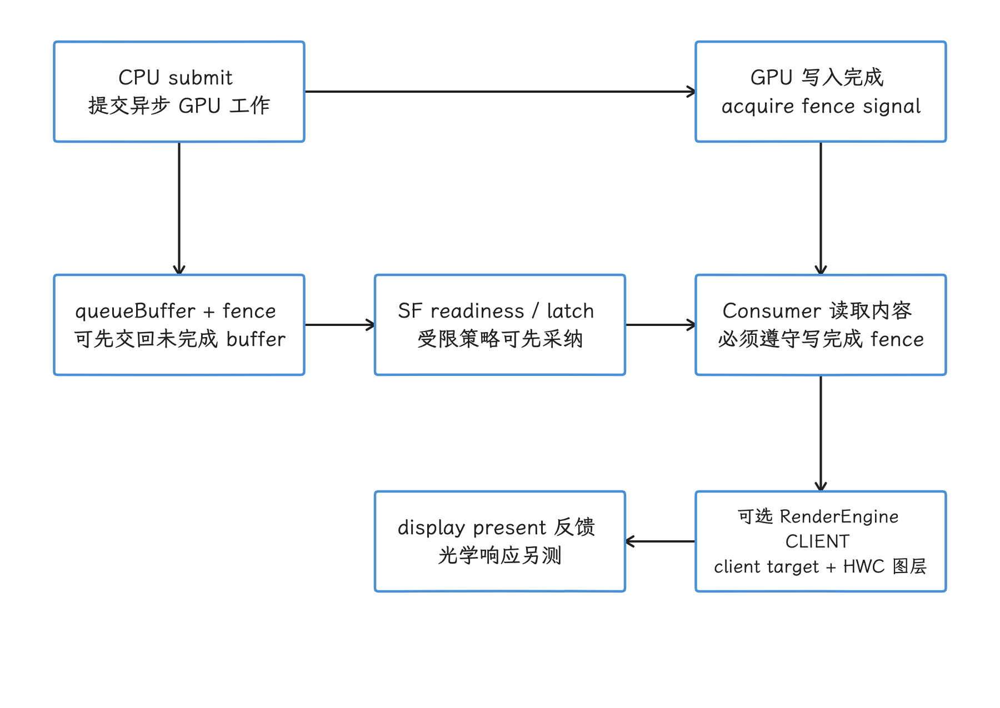

图：入队与 latch 可早于 GPU 完成；读取、合成与呈现继续遵守同步依赖。 图中连线表示依赖，不表示固定耗时；受限 latch-unsignaled 与面板光学边界分别核对。

接下来我们按这些节点分层观察显示路径。标准 HWUI（Android UI 硬件加速渲染库） 窗口通常从主线程和 `RenderThread` 开始；SurfaceView、游戏、Camera、视频和自建的 Vulkan render loop（持续录制并提交帧的渲染循环），则要先找到实际承载画面的 Surface 与 producer 线程——只盯着宿主 Activity 的 FrameTimeline，容易漏掉独立 Surface 上的画面。

### 工具按证据深度分层

| 层级 | 适合回答的问题 | 工具 | 主要限制 |
|---|---|---|---|
| 系统时间线 | 哪一帧晚，CPU、GPU、SurfaceFlinger、HWC 谁先偏离预算 | Perfetto、Android Performance Analyzer（APA） | 设备未暴露 GPU producer 时，GPU 轨道可能为空 |
| 系统级 GPU | GPU 频率、render stage、计数器与 CPU 调度如何关联 | APA、AGI System Profiler、厂商 system profiler | counter 名称与语义依赖 GPU 和驱动 |
| 单帧捕获与重放 | render pass 成本或 draw、pipeline、shader、资源问题 | APA canary Frame Profiler（性能）、AGI Frame Profiler、RenderDoc、Arm Frame Advisor | APA 抓帧为实验性功能；图形调试与逐 pass 测量各有覆盖，不能拿来测正常帧率 |
| 多帧捕获 | 间歇性 pipeline/state 变化、连续帧资源与 shader 差异 | Sokatoa | 面向 Vulkan，要求 Android 13+，注入 layer 需要 debuggable APK 或 root |
| 微架构分析 | ALU、纹理、tile、cache、带宽、occupancy 受限在哪里 | Arm Streamline、Snapdragon Profiler、厂商工具 | 结论只能绑定对应 GPU 架构与 counter 文档 |

表里这些词后文会反复出现，先把含义说清。在 GPU 侧，render stage（渲染执行阶段） 是 GPU 工作的一个执行阶段；render pass 定义一组 attachment（渲染输入/输出图像） 及其处理过程；pipeline（各渲染阶段的配置） 把着色器与固定功能状态组合成一套渲染配置；shader 就是跑在 GPU 上的程序。再往微架构走一层，ALU 是算术逻辑单元，tile 是分块渲染中的小块区域，occupancy 表示执行资源被并行工作占用的程度——具体怎么算，仍由厂商定义。

我们通常先用系统 Trace 找到异常时间窗，再做单变量实验缩小资源类型，最后用帧捕获或厂商 counter 解释原因。要是跳过系统时间线直接抓一帧，既可能抓到正常帧，也可能把 SurfaceFlinger 或 BufferQueue 的等待误判成应用的 shader 开销。

<!-- gracker-diagram: ch15-11-02-evidence-depth -->
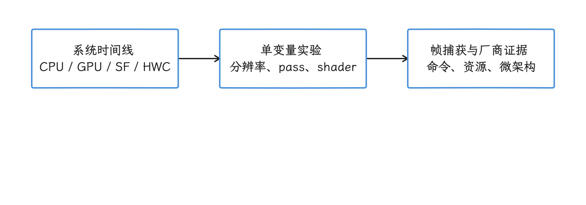

图：先在系统时间线找到异常帧，再用对照实验和命令资源证据解释原因。 捕获单帧可能改变时序，GPU counter 的解释仍需设备与厂商文档。

### Perfetto 的 GPU 数据源

Perfetto 的 GPU 能力由多个数据源组成，每个数据源回答不同问题。`linux.ftrace` 是 Linux 内核事件追踪数据源；其余 GPU 数据源通常由系统或厂商 producer 提供。

<!-- gracker-diagram: ch15-11-03-gpu-data-sources -->
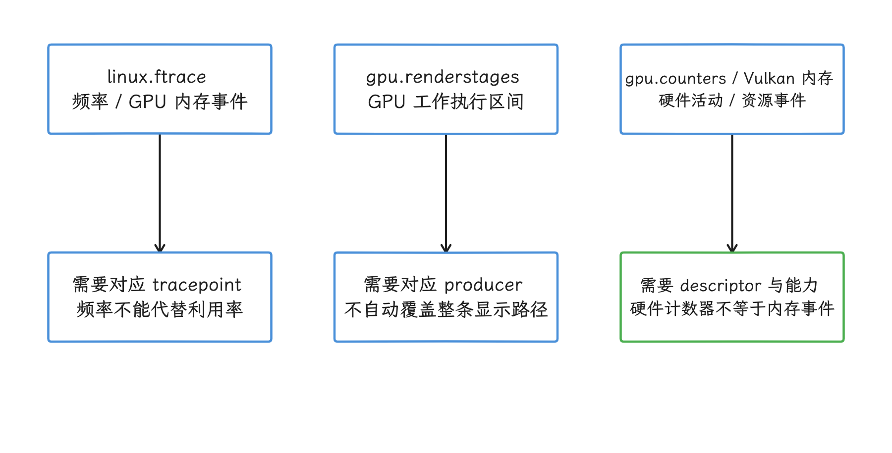

图：先区分内核事件、执行阶段和图形内存事件，再检查设备注册的 producer。 统一数据结构不保证目标设备有数据，也不统一厂商计数器含义。

| 数据源 | Android 17 中的用途 | 不能直接推出的结论 |
|---|---|---|
| <code>linux.<wbr>ftrace</code> 的 <code>power/<wbr>gpu_<wbr>frequency</code> | GPU 频率变化 | GPU 利用率、shader 耗时 |
| <code>linux.<wbr>ftrace</code> 的 <code>gpu_<wbr>mem/<wbr>gpu_<wbr>mem_<wbr>total</code> | GPU 内存总量事件 | 带宽、完整对象归属或泄漏 |
| <code>gpu.<wbr>counters</code> | 周期采样设备 producer 暴露的硬件计数器 | 跨厂商统一阈值 |
| <code>gpu.<wbr>renderstages</code> | graphics/compute submission 的 GPU 活动时间线 | 每个 draw 的完整 pipeline state |
| <code>vulkan.<wbr>memory_<wbr>tracker</code> | Vulkan 内存分配（allocation）与绑定（bind）事件 | GLES 和驱动私有内存的完整视图 |
| <code>gpu.<wbr>log</code> | GPU producer 提供的调试消息 | 所有厂商的卡死（hang）、访问或执行故障（fault）与 GPU 重置（reset） |

Perfetto 的录制配置叫 TraceConfig（Perfetto 录制配置）。下面的配置展示 Android 17 tag（发布标签） 中 GPU frequency、GPU memory 和 render stages 的请求方式；设备也可能只注册带厂商后缀的名字，例如 `gpu.renderstages.mali`。所以录制前我们先查询 data-source descriptor（数据源能力描述），即 producer 上报的数据源能力说明，确认设备上实际叫什么名字。

```textproto
buffers {
  size_kb: 32768
  fill_policy: RING_BUFFER
}

data_sources {
  config {
    name: "linux.ftrace"
    ftrace_config {
      ftrace_events: "power/gpu_frequency"
      ftrace_events: "gpu_mem/gpu_mem_total"
    }
  }
}

data_sources {
  config {
    name: "gpu.renderstages"
    gpu_renderstages_config {
      low_overhead: true
    }
  }
}
```

这段配置只说明要请求哪些数据。内核 tracepoint（内核事件记录点）、GPU producer、数据源名称、应用 Graphics API、权限、驱动支持，任何一项缺位，轨道就可能为空。`low_overhead` 请求支持它的 producer 把 render stages 合并成一个 workload stage，以更少细节换取更低扰动；proto 中该选项默认关闭，实际是否支持和如何执行仍取决于 producer；只有短窗口需要分开观察 load/store stage 时才关掉它。

<!-- gracker-diagram: ch15-11-04-config-to-producer -->
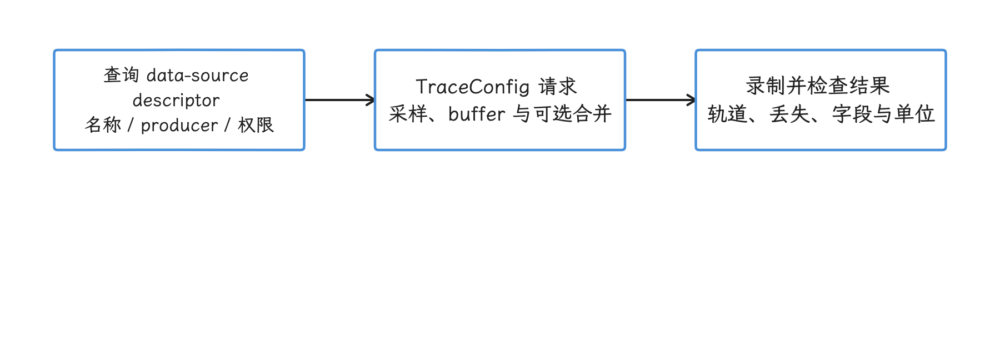

图：查询能力、请求字段并检查实际数据，三步都通过才有可用轨道。 low_overhead 默认关闭；单 workload stage 是支持该选项的 producer 的执行请求。

#### `gpu.counters` 的正确配置

`GpuCounterConfig` 包含 `counter_period_ns`、`counter_ids`、`instrumented_sampling` 和 `fix_gpu_clock`。常规周期采样只需要前两个字段。`counter_ids` 是 repeated（可重复） 字段，在 TextProto（Protocol Buffers 的文本格式） 里要逐项重复书写；`instrumented_sampling` 会在 GPU command buffer 中插入采样，`fix_gpu_clock` 会请求固定 GPU 频率，两者都会改变采集方式或运行条件，基线采集默认都不开。

下面的 counter ID 只用于展示配置结构，必须替换为目标设备 counter descriptor（计数器能力清单）中公布的 ID。

```textproto
data_sources {
  config {
    name: "gpu.counters"
    gpu_counter_config {
      counter_period_ns: 1000000
      counter_ids: 1
      counter_ids: 3
    }
  }
}
```

`android-17.0.0_r1` 的 `GpuCounterEvent` 支持两类 descriptor。Android OEM producer 按 CDD/CTS（Android 兼容性定义与兼容性测试套件） 要求使用全局 counter ID 的 `GpuCounterDescriptor`；`InternedGpuCounterDescriptor` 的 ID 只在一条数据序列内有效，面向多 producer、多 GPU 这类复杂用途。也就是说，两种模式改变的只是 descriptor 传输方式和 ID 作用范围；各家 counter 的名称、单位和计算方法，仍由厂商自己定义。

#### 频率、利用率和带宽怎么读

GPU frequency 反映 DVFS（Dynamic Voltage and Frequency Scaling，动态电压频率调节） 当前的频点。高频可能来自持续负载、响应性策略或固定性能模式；低频可能来自轻载、温控、功耗限制或 governor（频率调节策略） 的选择。所以频率只回答“现在跑在哪个频点”；GPU 是否占满，要结合下面的 counter 才看得出。

“GPU utilization”“shader core active”“ALU busy”“external memory read”这类 counter，分母、采样窗口和包含的等待状态都由厂商定义。我们分析时按这个顺序来：

1. 找到目标帧对应的 GPU stage；
2. 读取同一时间窗内的 counter；
3. 以同一设备、同一画质和相近热状态的基线比较；
4. 每轮只改变分辨率、pass、shader、纹理或 draw 组织中的一个变量；
5. 用该 GPU 的 counter 文档解释变化。

“ALU 超过 80%”“单帧超过多少 draw”这类通用阈值并不存在，判断要回到对照实验。draw 数量增加既可能拖慢 CPU 侧的驱动提交，也可能推高 GPU 工作量；我们结合调用栈、GPU stage 和硬件 counter 来区分这两种情况。

<!-- gracker-diagram: ch15-11-05-counter-scope -->
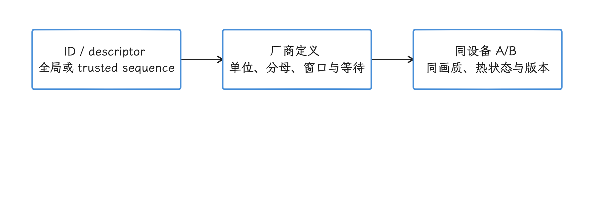

图：按 descriptor 作用域选 ID，再按同一设备的指标定义和同条件基线比较。 OEM 全局 ID 与序列内 interned ID 分别处理；统一传输不能产生通用阈值。

### 从 Trace 判断瓶颈方向

用下表之前，我们先把几个 fence 相关的词理清。一帧必须完成的时间点叫 deadline，安排帧生成与提交节奏叫 frame pacing；队列方向上，backpressure（背压） 指下游队列已满、反过来阻塞上游。剩下的三个 fence 各管一个时刻：completion fence 在 GPU 工作完成后发出信号，release fence 通知 producer 何时可以重新使用 buffer，present fence 提供 Android 显示栈的 present 时间反馈；它不直接测量面板逐行扫描、像素光学响应或用户感知。

| 观察到的证据 | 候选方向 | 下一步 |
|---|---|---|
| CPU 录制或 submit 已晚，GPU stage 随后正常完成 | CPU、锁、调度、资源加载、driver CPU 开销 | 看 CPU 调度事件（sched）、调用栈、锁、Binder IPC 与命令录制 |
| CPU submit 按时，应用 GPU completion fence 越过 deadline | 应用提交的 GPU 工作量 | 降分辨率或关闭一个 pass，再进入帧 profiler |
| producer 长时间卡在 acquire、dequeue 或 swap，GPU stage 不长 | BufferQueue backpressure、release fence、frame pacing | 看队列深度、release fence、present 间隔 |
| 应用 buffer 按时，SurfaceFlinger 的 client composition 或 present 晚 | RenderEngine、HWC、显示端 | 看合成类型（composition type）、RenderEngine、HWC 与 present fence |
| GPU track 空白 | 数据源或设备支持缺失，也可能没有覆盖该 API | 查 descriptor、trace config、驱动与权限 |
| GPU frequency 高，frame 正常 | 当前 DVFS 状态 | 不单独作为性能缺陷 |

FrameTimeline 的 `GPU Composition` 只说明 SurfaceFlinger 是否用了 GPU/client composition；应用内容是不是 GPU 生成的，要另外确认。游戏 Surface 可以由应用 GPU 渲染，随后由 HWC 直接扫描输出，这时应用仍然可能 GPU bound（GPU 工作决定帧耗时），而 DisplayFrame（SurfaceFlinger 把多个 layer 合成后的屏幕帧） 上看不到 client composition 标记。

Perfetto 官方文档也说明 SurfaceView 不受标准 FrameTimeline 支持。遇到游戏、Camera、视频或独立 native Surface，我们要结合 SurfaceFlinger layer name（图层名）、buffer frame number、`android.surfaceflinger.frame`、acquire/release fence、HWC 和 display present 把显示路径还原出来。

### Android Performance Analyzer（APA）

截至 2026 年 10 月 25 日，APA 仍以 Perfetto 为系统追踪基础，并支持自定义 TraceConfig；当前首页明确主要面向游戏与 Vulkan 图形，其他应用先使用 Android Studio Profiler。System Profiler 的 CPU、GPU、内存和功耗能力还受设备 producer 限制。另须区分发布通道：官方发布说明已在 `0.10.0-canary`（2026 年 9 月）加入实验性 Frame Profiler，不能再把 APA 概括成只有系统时间线。

APA 和 Perfetto 的差别主要在入口和分析体验：

- APA 提供独立桌面应用、项目管理、截图、轨道整理、标注和 GPU counter 浏览；当前首页还展示了 Vulkan render pass debug marker 和多 trace A/B 对比；
- Perfetto CLI（命令行工具） 与 Trace Processor 适合固定配置、批量采集、SQL 回归和自动化；
- 两者都受目标设备 GPU producer 与驱动数据限制。

AGI quickstart 仍把 APA 列为 system profiling 的推荐工具，已有 AGI 流程也可继续使用。现在应再分两条逐帧路径：APA canary 的 [Frame Profiler](https://developer.android.com/android-performance-analyzer/frame-profiler) 将 API、参数和相关 GPU 内存记入 GFXR，重放测量 render pass 与 GPU counter；AGI `v3.3.3` 则使用 GraphicsSpy、`.gfxtrace` 与 GAPIS/GAPIR。两种文件与执行链不能互换。

<!-- gracker-diagram: ch15-11-06-apa-tool-paths -->
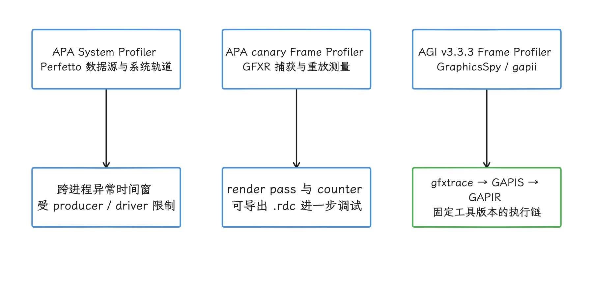

图：系统时间线、APA canary GFXR 和 AGI gfxtrace 是不同的数据与执行链。 APA Frame Profiler 当前主要支持 Android12+、Pixel6起多数机型与 Vulkan；AGI另查设备验证。

APA 的实验性测量会先用 compute workload 把 GPU 拉到最高频，再最多重复 100 次取平均、过滤受其他应用 GPU 活动污染的样本；这些是重放实验结果，不是原应用正常运行的一帧。要检查命令、资源与状态，可按 [导出说明](https://developer.android.com/android-performance-analyzer/frame-profiler/export)生成 `.rdc`，交给 RenderDoc 深入调试。

<!-- gracker-diagram: ch15-11-07-apa-replay-measurement -->
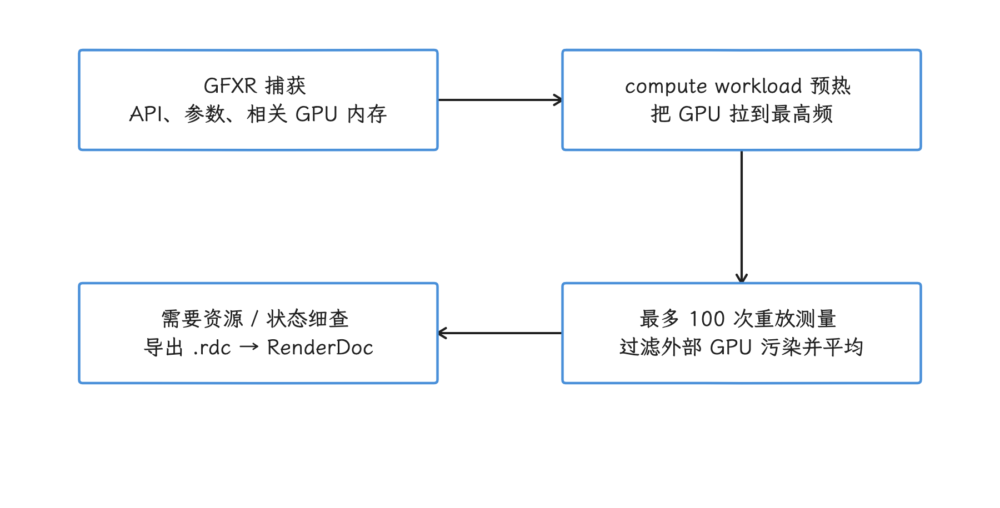

图：APA 先记录 GFXR，再以受控 GPU 频率和重复重放测量逐 pass 性能。 最高频预热、最多100次平均与过滤污染属于实验流程；结果不代表正常运行一帧。

APA Frame Profiler 的[当前兼容说明](https://developer.android.com/android-performance-analyzer/frame-profiler/compatibility)要求 Android 12+，重点支持 Pixel 6 起的大多数 Pixel；其他设备即使通过验证也可能不兼容。图形 API 为 Vulkan，GLES 需经 ANGLE；Vulkan 采集按文档设置 debuggable。不要把系统分析的覆盖、发布版功能与 canary 抓帧的支持范围合并。

### Android GPU Inspector（AGI）

AGI 运行在 Android 11+ 的受支持真机上，首次连接以及 Android 或 GPU driver 变化后都会重新做兼容性验证。官方列出的 System Profiler GPU 包括 Qualcomm Adreno、Arm Mali 和 Imagination PowerVR。设备验证失败或 counter 缺失，说明的是当前设备、系统与驱动这个组合没通过 AGI 的要求。

AGI 有两种主要模式：

| 模式 | 数据 | 使用位置 |
|---|---|---|
| System Profiler | CPU/GPU/内存/电池、GPU counter、系统时间线 | 找到长时间运行中的异常窗口 |
| Frame Profiler | Vulkan API call、framebuffer、mesh draw、内存、pipeline、state、shader、texture | 检查单帧命令与资源 |

AGI quickstart 要求目标应用设置 `android:debuggable="true"`。原生 Vulkan 应用还要启用 validation layer（检查 Vulkan API 使用是否合法的验证层），先修完已有的 validation error 再采集 profile。AGI 会管理自身的捕获流程；如果手工配置全局 Vulkan layer，要严格按当前 AGI 文档给出的包名、ABI（Application Binary Interface，应用二进制接口） 和清理命令来，避免把验证层与捕获层写进同一项配置。

#### OpenGL ES（GLES） on ANGLE

AGI Frame Profiler 的类型选择是 `Vulkan` 或 `OpenGL on ANGLE`，后者由 ANGLE 把 GLES 命令翻译成 Vulkan。GLES 应用经这条路径捕获后，我们看到的是翻译生成的 Vulkan command、pipeline 和 shader，而 backend 已经换成了另一个实现。若问题只在设备原生 GLES driver 上出现，这份 capture 已改变 backend，必须同时保留原生路径的 Perfetto、日志和厂商数据。

<!-- gracker-diagram: ch15-11-08-native-gles-angle -->
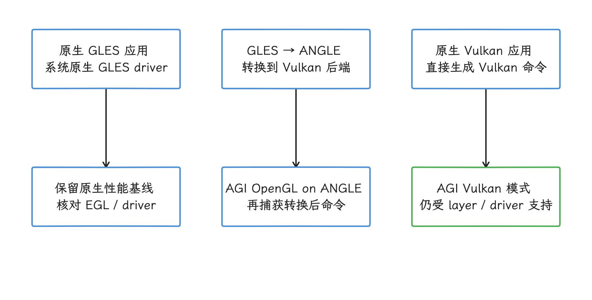

图：GLES 经 ANGLE 变成 Vulkan 后，捕获描述的是转换后的 workload。 原生 GLES driver 的时序、调用序列与缺陷不能由 ANGLE 捕获自动等价复现。

Android 15+ 提供按包测试 ANGLE 的入口。Android 17 又允许 game 在 AndroidManifest.xml（应用配置清单）中表达“优先使用 ANGLE”的请求：

```xml
<application android:appCategory="game">
    <meta-data
        android:name="com.android.graphics.driver.prefer_angle"
        android:value="true" />
</application>
```

这项 metadata 只是请求信号，最终是否选择 ANGLE，由设备配置、graphics driver 包、应用兼容性和厂商策略共同决定。默认 backend 要按这些条件逐台确认：系统即使是 Android 17，GLES 应用也未必默认运行在 ANGLE 上。

对照 native GLES 与 ANGLE 时，我们用官方测试命令设置 `angle_gl_driver_selection_pkgs` 和 `angle_gl_driver_selection_values=angle`，重启目标进程后检查 EGL vendor/renderer、进程加载的 library、Graphics Driver 日志和 `gpu.angle` trace event。这两个 global setting 重启后仍会保留，测试结束必须删除，免得影响后续基线。

### RenderDoc：图形状态与资源调试

RenderDoc 可以逐项检查帧内的 API event、pipeline state、texture、buffer、framebuffer 和 shader，适合定位渲染错误、资源绑定错误与状态配置问题：展开一个 draw，就能看到这一帧渲染用的颜色、深度等图像集合，以及该 draw 生效的管线配置。它面向图形调试，通用 capture 未必包含目标移动 GPU 的全部微架构 counter；API replay（在设备上重放已捕获工作） 的耗时，也要和正常运行时的帧耗时分开看。

Android 捕获通常要求 debuggable 应用、ADB 连接和受支持的 Vulkan driver，具体 API 与 extension（图形 API 扩展） 能力以所用 RenderDoc 版本为准。Arm Performance Studio 提供 RenderDoc for Arm GPUs，补充部分 Arm/Android 特性、设备兼容处理、Vulkan ray tracing 与 ray query 调试；这些能力来自 Arm 的发行版，upstream RenderDoc（主项目版本） 的每个版本未必都有。

要判断性能开销来自哪里，可以先用 AGI 或厂商 profiler 找到慢 render pass，再用 RenderDoc 检查该 pass 的 attachment（render pass 绑定的颜色或深度图像）、pipeline、descriptor、texture 和 shader。要调查画面错误，就从错误帧逐个 event 检查 framebuffer 的变化。

### Sokatoa：Vulkan 多帧视角

Sokatoa 由 Samsung Austin Research Center 发起，并与 Google、LunarG 协作，面向 Android Vulkan 应用提供 system 与 frame 两种视角的多帧捕获、Vulkan API/pipeline/shader 分析和设备端 replay。

项目当前文档列出的使用条件是：

- Android 13 或更高；
- 注入 GFXR（GFXReconstruct 捕获与回放层）和 Sokatoa Vulkan layer 时，需要 debuggable APK 或已取得 root 权限的设备；
- performance view 支持 Xclipse、Mali、Adreno 和 PowerVR；
- 当前可免费下载；本轮固定 README 的下载线为 `v1.1.0`，开源承诺写作“near future”，没有再承诺具体的 2026 年底日期。

多帧捕获适合调查间歇性 pipeline 创建、状态变化、资源生命周期和异常帧前后的差异。capture replay 仍受 API feature、extension、格式、driver 和 GPU 能力约束：记录的虽然是标准 Vulkan API，换一台 GPU 未必还能等价回放。

### 厂商工具的适用范围

| GPU | 工具 | 适合的数据 | 使用时的限制 |
|---|---|---|---|
| Arm Mali / Immortalis | Arm Performance Studio：Streamline、Frame Advisor、Mali Offline Compiler、RenderDoc for Arm GPUs | CPU/GPU 联合 timeline、Mali counter、单帧几何与 API、shader 静态分析 | 支持范围按 GPU 世代、driver 和工具版本确认 |
| Qualcomm Adreno | Snapdragon Profiler，配合 APA/AGI | Adreno counter、GPU driver instrumentation（驱动插桩数据）、系统资源、frame snapshot（单帧快照） | 设备与功能覆盖按 Qualcomm 文档确认 |
| Samsung Xclipse | Sokatoa，配合 APA/Perfetto 与 Samsung 扩展 | 多帧 Vulkan、Xclipse performance view、系统时间线 | 扩展与设备支持仍在演进，报告要记录版本 |
| Imagination PowerVR | AGI、Sokatoa 与 Imagination 工具 | PowerVR counter、系统与帧分析 | counter 名称和可用性依设备 producer |

Arm Streamline 能在未 root 的受支持 Android 设备上采集 CPU、GPU、内存、调度和硬件 counter；Frame Advisor 面向问题帧的 API 与几何分析；RenderDoc for Arm GPUs 偏重图形调试；Mali Offline Compiler 不运行 App，而是估算 shader 在不同 Arm GPU 上的指令、寄存器和周期成本。这四个工具用途各不相同，报告里我们要写出具体用的哪一个，别把它们混在“Arm profiler”一个名字下。

厂商 counter 要保留原名称、单位、采样方式、GPU 型号、driver 和文档版本。Adreno 的 busy、Mali 的 shader core active 与 Xclipse 的相似名称一旦放进同一张跨机型排行榜，数值就很容易失去可比性。

### `profileable`、`debuggable` 与 root

`<profileable>` 从 API 29 引入，是 `<application>` 的子元素，`android:enabled` 属性在 API 30 加入。设置 `android:shell="true"` 后，本地 shell profiling 工具可以分析 release 构建，只是能访问的数据限于平台允许的范围；和 debuggable 构建相比，这种方式的时序扰动通常更小。debuggable 允许调试器和图形 layer 注入，root 则表示设备取得系统超级用户权限：这是三种不同的授权，别混用。

`profileable` 并不自动带来 `gpu.counters`、`gpu.renderstages` 或厂商内核事件：GPU 数据源由系统 producer、驱动、设备配置和调用权限决定。一个 profileable 包得到空 GPU 轨道时，排查方向就包含 data-source descriptor 与厂商支持。

帧捕获通常需要把 Vulkan layer 加载进目标进程，或替换 graphics backend：

- AGI quickstart 要求 debuggable 应用；
- RenderDoc Android capture 通常要求 debuggable 应用；
- Sokatoa 要求 debuggable APK 或 rooted device（已取得 root 超级用户权限的设备）；
- 厂商工具各有设备、包类型和权限条件。

debuggable 会改变运行时优化与安全检查，捕获 layer 还会记录命令、资源和内存。我们的做法是用 profileable/release 包采集低扰动基线，再用 debuggable 包做短窗口详细诊断；两类结果的绝对帧时间要分开解读。

<!-- gracker-diagram: ch15-11-09-profiling-access -->
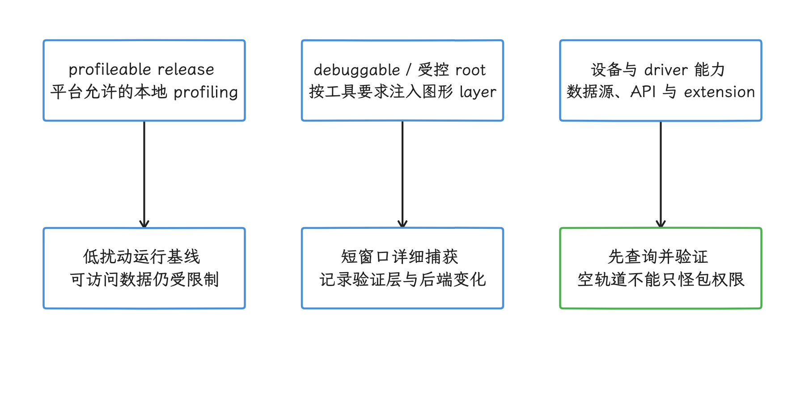

图：包权限、图形 layer 注入和 GPU producer 支持是需要分别核对的条件。 profileable 不自动授予抓帧能力；root 也不能补齐未实现的数据源或重放特性。

### 瓶颈定位的对照实验

#### 怀疑 fragment、overdraw 或带宽

光栅化之后进入片元着色阶段的候选像素叫 fragment，同一屏幕位置被重复绘制就是 overdraw。怀疑这两个方向时，我们在同一设备上降低渲染分辨率，或停用一个全屏 pass：如果 GPU stage 与外部内存相关 counter 同步下降，接着再检查 overdraw、blend（颜色混合）、render-target format（渲染目标格式）、attachment load/store、texture sampling（纹理采样） 和 SurfaceFlinger client composition。

Android View 的开发者选项 overdraw overlay 适合查找 UI 重复覆盖；游戏和 native renderer 则用帧 capture 与厂商 counter。Tile-based GPU 会把画面分块，并在片上 tile memory 中处理部分中间结果，所以“画了 N 次”换算不出 N 倍外部内存带宽。

#### 怀疑 shader ALU 或纹理

先固定画面、分辨率与 pipeline state，再只替换一个 shader 变体或关闭一个纹理采样分支，结合 shader duration、instruction、occupancy、texture/cache（资源缓存） 与 external memory counter 判断变化。某个 counter 很高，只能描述该架构上的活动状态；改动和结果的关系仍要靠 A/B 对照实验确认，也就是每次只改一个变量。

#### 怀疑 draw call 或 driver CPU 开销

先查 render/RHI（Render Hardware Interface） 线程调用栈、`vkQueueSubmit()` 前的命令录制、pipeline/descriptor churn 和 driver ioctl——RHI 是引擎对图形 API 的抽象层，churn 指 pipeline 或 descriptor 被频繁创建、切换，ioctl 是用户态通过系统调用向内核驱动发送控制请求。合批之后我们看两条线：CPU submit 提前而 GPU stage 基本不变，收益来自 CPU 或驱动开销下降；GPU stage 也跟着缩短，才说明 GPU 工作组织同时得到了改善。

#### 怀疑 queue-stuffing

持续尽快 present 可能塞满 BufferQueue，这就是 queue stuffing。随后 render thread 会在 acquire、dequeue、swap 或 present 路径等待，CPU 与 GPU 时间线都可能出现空白，但输入仍排在较早的 in-flight frame（已提交、尚未完成显示的帧） 里。这时要检查队列深度、release fence、present 间隔、输入采样点和 frame pacing；等待函数本身说明不了 shader 变慢。

#### 怀疑热限制

把 thermal status（温控状态）、thermal headroom（距离进一步触发温控限制的余量）、CPU/GPU frequency、帧时间、画质和持续运行时间放进同一份记录。固定性能模式适合隔离 DVFS 变量，却代表不了用户环境；优化验证要从相近初始温度开始重复多轮，比较温度和频率都稳定后的阶段。

<!-- gracker-diagram: ch15-11-10-bottleneck-experiments -->
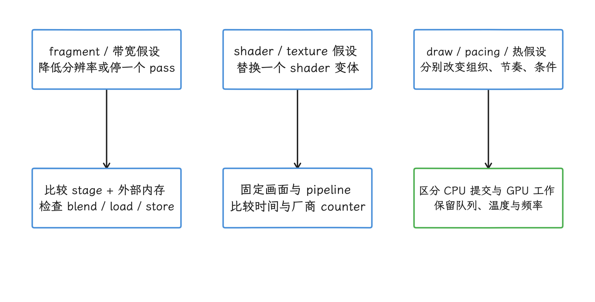

图：每次固定设备、场景与热条件，只改变一个变量，再关联 CPU、GPU 与显示证据。 箭头表示要比较的实验记录，不表示观测到高 counter 就已经证明原因。

### 捕获扰动与报告要求

system trace、counter sampling、frame capture 和 replay 都会扰动被测程序，程度取决于采样频率、数据量、driver 与工具。报告里至少记录：

- 工具与版本、TraceConfig、设备 build、GPU 和 driver；
- 应用包类型、Graphics API、ANGLE/native driver 选择；
- 分辨率、刷新率、目标帧率、画质与场景；
- 温度、供电、持续运行时间和固定性能模式；
- 捕获是否注入 layer、替换 backend 或启用 validation；
- 原始 Trace/capture，以及每次 A/B 对照只改变的变量。

帧 capture 用来检查命令、状态与资源，产品帧率基准要从别的运行里来：性能数字取自未注入 capture layer 的低扰动运行，帧 capture 负责解释慢帧的结构。

<!-- gracker-diagram: ch15-11-11-baseline-capture-replay -->
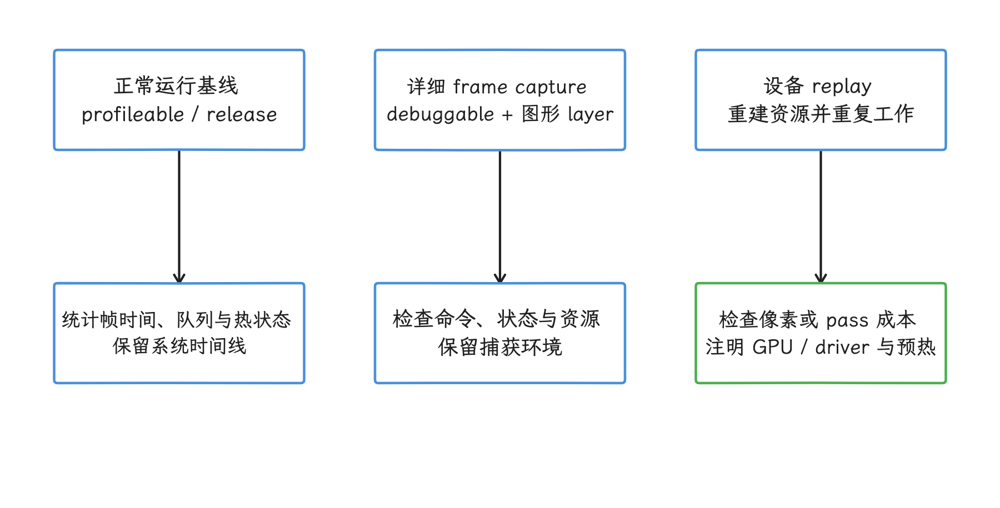

图：低扰动基线评估产品表现，详细捕获解释内容，重放回答可重复的图形实验。 包类型、ANGLE、validation、注入与频率条件改变后，绝对帧耗时不能直接混比。

### 执行清单

1. 记录设备、GPU/driver、build、分辨率、刷新率、画质、温度与包类型。
2. 确认主体 Surface 和 producer 线程，不把宿主窗口当作独立 Surface 的主体。
3. 用 APA/Perfetto 找到目标帧和 CPU submit、GPU completion、queue、latch、composition、present。
4. 查询设备 data-source descriptor，确认 GPU producer 名字、counter ID 和单位。
5. 用分辨率、pass、shader、HWC/client composition 或 frame pacing 做单变量实验。
6. 依据问题选择 AGI、RenderDoc、Sokatoa 或厂商 profiler。
7. 分开保存低扰动性能基线与注入 layer 后的调试 capture。
8. 优化后在相近热状态重复多轮，保留原始数据和工具版本。
9. 报告按“证据、推断、对照结果”书写，设备特有结论不要写成 Android 通用规则。

### 相关章节

- [2.7 GPU 渲染与图形 API 选型](../../part1-fundamentals/ch02-rendering/07-gpu-rendering-graphics-api.md)：GPU pipeline、tile、带宽、shader，以及 GLES / Vulkan / ANGLE 的版本边界
- [14.2 Perfetto UI、状态轨道与版本边界](../ch14-perfetto/02-perfetto-ui-state-tracks.md)：Trace UI 与时间线操作
- [15.1 Android Studio Profiler](01-as-profiler.md)：profileable/debuggable 与低扰动 profiling
- [13.1 Android View 渲染管线与分析方法](../../part2-performance/ch13-rendering-pipelines/01-android-view-pipeline-analysis.md)：Surface、BufferQueue、SurfaceFlinger、HWC 与 display present
- [13.4 OpenGL ES、EGL 与 ANGLE](../../part2-performance/ch13-rendering-pipelines/04-opengl-egl-angle.md)：EGL/GLES 提交与 native/ANGLE backend
- [13.5 Vulkan 原生管线与 HWUI 多队列](../../part2-performance/ch13-rendering-pipelines/05-vulkan-hwui-multi-queue.md)：swapchain、submit、present 与 frame pacing


## AGI 捕获、重放与单帧分析

选定工具类型后，我们沿 AGI 的捕获链继续往下查：注入、调用序列、资源快照、重放设备。捕获成功之后能拿到什么、哪些性能数字还能用，这一节按链路顺序讲清楚。

### 版本边界：分别确定 Android 平台与 AGI 工具版本

AGI 是独立维护的开发工具，并不随 `android-17.0.0_r1` 平台源码发布——该 `tag` 的 AOSP `manifest` 里找不到 `external/android-gui`、`gapii` 或 `gapis` 这些 `project`（仓库项目） 条目，它维护在独立的 [`google/agi`](https://github.com/google/agi) 仓库和发布渠道中。所以“Android 17 上使用 AGI”包含两条要分别核验的版本基线：

- 设备侧 Vulkan layer 发现、加载和安全条件，以 AOSP `android-17.0.0_r1` 为准；
- gapii、gapis、gapir、gapidapk 与 `.gfxtrace` 的工具实现，以明确的 AGI release（发布版本）或 commit（提交快照）为准。

截至 2026 年 10 月 25 日，GitHub Releases 仍将 AGI `v3.3.3` 标为 Latest，该 release tag 指向 commit `5f97b4fd99a9459320b782203ce2de5351a1e661`，发布资产日期为 2025 年 1 月 20 日。工具内部实现以这个固定提交为准，当前支持流程以更新至 2026 年 5 月 19 日的 Android Developers 文档为准。AGI 安装包版本和 Android OS 版本互相独立，复现实验时我们把二者都记下来。

当前 AGI 官方 quickstart 要求受支持设备运行 Android 11 或更高版本，配套的 supported devices 页面明确排除 Android Emulator。历史上 AGI release 对 Android 10 的兼容记录代替不了当前工具验证；Android 17 设备同样要过 AGI 的 device validation（设备兼容性校验），支持状态由 OS、GPU 和 driver 共同决定。

<!-- gracker-diagram: ch15-11-12-platform-tool-version -->
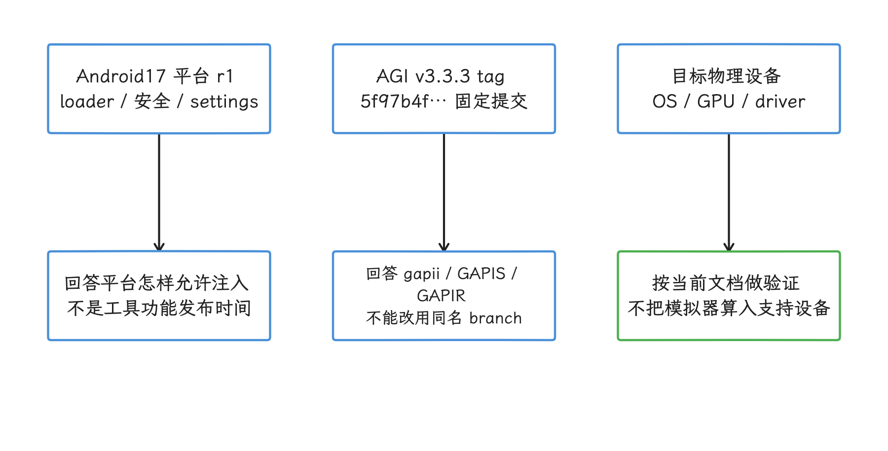

图：AOSP tag、AGI release commit 和当前设备支持文档分别固定并记录。 AGI v3.3.3 同名 branch 与 tag 不同提交；Android17不能保证当前设备通过 AGI 验证。

### System Profile 与 Frame Profile 的分工

AGI 提供 System Profile 与 Frame Profile，两者的数据来源和分析尺度不同。

| 模式 | 设备侧主要机制 | 输出关注点 | 适合回答的问题 |
| --- | --- | --- | --- |
| System Profile | Perfetto，以及系统和厂商 producer（向 trace 写入事件的数据源） | CPU 调度、GPU queue（命令队列）、频率、counter（硬件计数器）、内存和功耗等时间线 | 某段卡顿期间 CPU、GPU 与系统服务怎样互相影响 |
| Frame Profile | GraphicsSpy Vulkan layer、gapii、gapis、gapir | 一帧附近的 API 调用、资源、pipeline state（渲染管线状态）、framebuffer（帧缓冲）与 render pass（渲染通道）性能 | 某个 draw、shader、纹理或 render pass 为什么昂贵或结果异常 |

gapii 承担 Frame Profile 的 API 拦截链路。它要进入目标进程、记录 API 参数和 memory observation（API 调用可能读写的内存快照），还可能序列化捕获开始时的完整 Vulkan 状态，开销远高于常规 Perfetto trace，所以长时趋势、调度关系和整机 GPU counter 优先用 System Profile；要看命令级状态与资源时，再上 Frame Profile。

Android Developers 建议新的系统分析优先评估 APA；APA 还已在 canary 中增加 GFXR Frame Profiler。因此本节后续的 gapii / `.gfxtrace` / GAPIS / GAPIR 仅描述固定 AGI `v3.3.3`，不代表 APA 的逐帧内部实现。两者都可面向受支持的 native Vulkan 应用。

先明确四个容易混淆的缩写：

- GAPIC：Graphics API Client，即 AGI 的图形界面；
- GAPIS：Graphics API Server，负责主机端解析与重放编排；
- GAPII：Graphics API Interceptor，源码目录和库名写作 `gapii`，负责进程内拦截；
- GAPIR：Graphics API Replayer，负责设备端重放。

下面的关系图把 Frame Profile 的主机端和设备端组件放在同一条链路中：

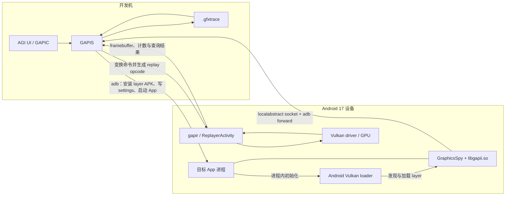

图中 GraphicsSpy 与 `libgapii.so` 都加载在目标 App 进程内，GAPIC 和 GAPIS 位于开发机，GAPIR 在 Android 设备上执行重放。主机负责解析并生成 replay payload（重放指令及其资源引用），重放本身由目标设备的驱动执行。

<!-- gracker-diagram: ch15-11-13-host-device-architecture -->
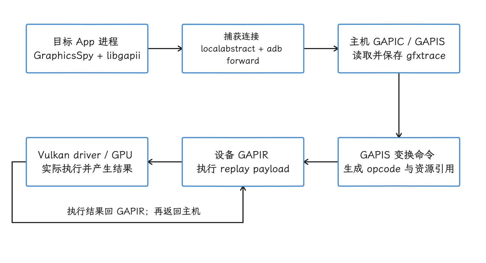

图：捕获器在目标 App 内运行，GAPIS 在主机编排，GAPIR 在设备 driver 上重放。 配置与结果通信不是 GPU driver 直接跨进程调用主机；原 Mermaid 保留并同步校正。

### GraphicsSpy 怎样进入目标进程

#### Android 的 global settings（Settings Provider 保存的全局配置项） 注入路径

桌面 Vulkan loader（负责发现、加载并连接 layer 与驱动） 常通过环境变量 `VK_LAYER_PATH` 搜索 layer；Android 走的是另一条路。AGI `gapii/client/adb.go` 先安装与目标 ABI（应用二进制接口，这里对应进程的 CPU 架构） 匹配的 gapid APK，再由 `core/os/android/layers.go` 写入四个 global settings：

```shell
adb shell settings put global enable_gpu_debug_layers 1
adb shell settings put global gpu_debug_app com.example.game
adb shell settings put global gpu_debug_layer_app com.google.android.gapid.arm64v8a
adb shell settings put global gpu_debug_layers GraphicsSpy
```

这四个键分别负责：开启调试 layer、限定目标 package（应用包名）、指定提供 layer 的 APK、选择 layer 名。AGI 在正常清理路径会删除这些设置，并不自动恢复采集前的旧值。异常退出后先检查残留，再依据采集前快照恢复；只有原本未设置且无其他任务使用时才删除，避免后续启动继续加载 layer。

AOSP 的 `frameworks/native/vulkan/libvulkan/layers_extensions.cpp` 列出了可以使用调试 layer 的条件：

- 目标 App 可调试；
- 或系统为可 root 的 userdebug（可调试系统构建变体）构建；
- 或 targetSdk 不低于 30 的 App 在 manifest 中声明 `com.android.graphics.injectLayers.enable=true`。

AGI 官方支持流程仍要求目标 App 设置 `android:debuggable="true"`；平台侧留出的其他入口只放宽了系统条件，AGI 受支持的抓帧仍以 debuggable 应用为对象。

#### GraphicsSpy 是 wrapper（薄封装层），拦截实现位于 libgapii

AGI 源码中的 `GraphicsSpyLayer.json` 描述 layer 名 `GraphicsSpy` 及其函数映射，供按 JSON manifest（JSON 格式的 layer 描述文件） 识别 layer 的 loader 环境使用。Android 的 gapid APK 同时打包 `libVkLayer_GraphicsSpy.so` 与 `libgapii.so`：AOSP loader 从 layer APK 的 native library path（原生库搜索路径） 发现前者，按 layer 名解析 `GraphicsSpyGetInstanceProcAddr` / `GraphicsSpyGetDeviceProcAddr`；这个 wrapper 再以 `dlopen()` 动态加载同目录的 `libgapii.so`，把 Vulkan 函数地址查询转交给 `gapid_vkGetInstanceProcAddr` 与 `gapid_vkGetDeviceProcAddr`。

<!-- gracker-diagram: ch15-11-14-layer-injection -->
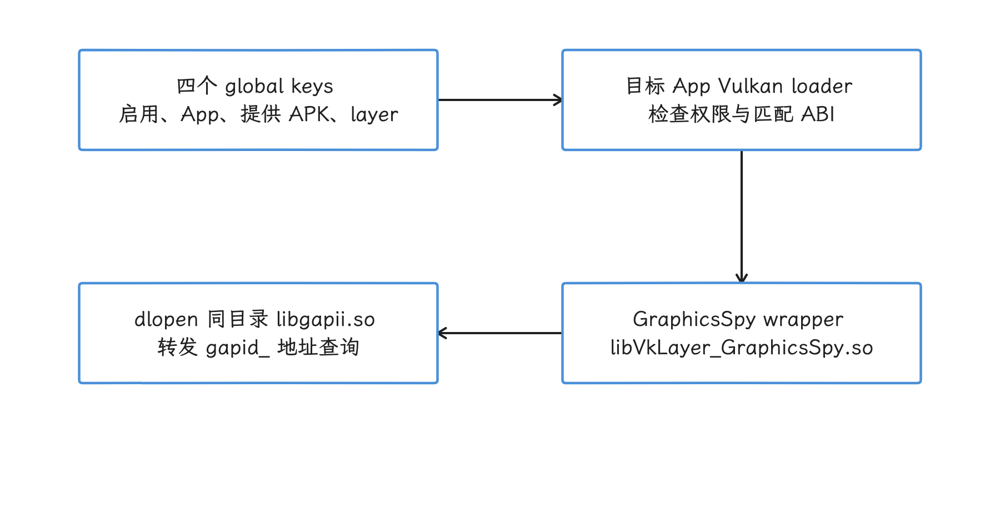

图：global settings 选包与 layer，进程内 loader 发现 wrapper，再装载真正的拦截库。 Android ABI 与注入条件先核对；JSON 中 gapid 导出映射与 Android wrapper 名称分开读。

这条路径解释了两个常见现象：

- layer APK 的 ABI 必须与目标进程 ABI 匹配；
- App 能启动但没有捕获数据时，要分别检查 layer 是否被 loader 发现、`libgapii.so` 是否加载、gapii 是否建立 socket。

#### `debug.agi.procname` 的进程过滤

layer 设置以 package 为单位，而某些游戏会在包内启动独立的渲染进程，所以 AGI 用私有系统属性 `debug.agi.procname` 指定要捕获的进程名。`Spy::Spy()` 读出当前进程名与该属性比较：属性为空时接受任意进程；名称不匹配时创建 `NullWriter`（丢弃输出的空 writer） 直接丢弃输出，不与主机建立抓帧连接。

package、进程名和 PID（进程 ID） 在这条链路里各管一段：package 由 `gpu_debug_app` 选择，进程由 `debug.agi.procname` 进一步过滤，PID 只用于 AGI 在启动后确认进程已经出现。

<!-- gracker-diagram: ch15-11-15-package-process-pid -->
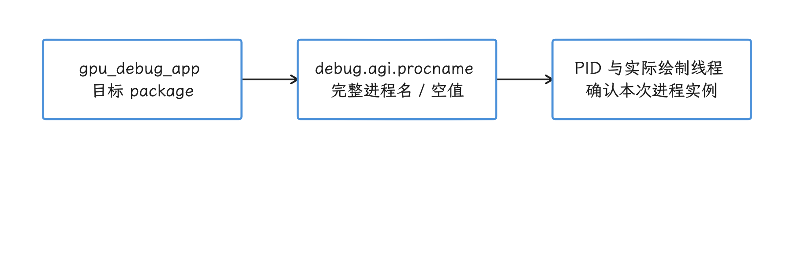

图：先按 package 选择注入对象，再用完整进程名过滤捕获连接，PID用于现场确认。 空 debug.agi.procname 接受任意进程；进程名不匹配会用 NullWriter，不建立捕获连接。

### gapid APK 的组件与职责

AGI 为不同 ABI 准备独立 package，例如：

- `com.google.android.gapid.arm64v8a`
- `com.google.android.gapid.armeabiv7a`

公开源码中的 gapid APK 包含以下角色：

| 组件 | 职责 |
| --- | --- |
| <code>lib<wbr>Vk<wbr>Layer_<wbr>Graphics<wbr>Spy.<wbr>so</code> / <code>libgapii.<wbr>so</code> | 作为 Vulkan layer 注入目标 App 并捕获调用 |
| <code>Replayer<wbr>Activity</code> + <code>libgapir.<wbr>so</code> | 在设备上承载 GPU replay |
| <code>Device<wbr>Info<wbr>Service</code> | 通过 local abstract socket（Linux 抽象命名空间中的本地 socket，不对应磁盘文件）向主机返回设备信息 |
| <code>Package<wbr>Info<wbr>Service</code> | 枚举可捕获 package、activity、ABI 等信息 |
| <code>Vk<wbr>Sample<wbr>Activity</code> | AGI 自带的 Vulkan 验证样例 |

`DeviceInfoService` 与 `PackageInfoService` 是前台 `IntentService`（启动时显示通知、按 Intent 处理任务的服务），分别做设备探测和 package 枚举。抓帧数据并不经过名为 `com.google.android.gapid` 的 AIDL（Android Interface Definition Language，Android 跨进程接口定义） capture service：gapii 在目标进程内监听 local abstract socket，开发机用 adb forward（把主机端口转发到设备 socket） 连上来。

“AI 压缩算法、GPU 数据加密存储、动态采样率或 GPU 访问审计日志”这类描述，源码里找不到任何支持。安全上能依据的，仍然是 Android 的 debuggable 状态、Vulkan layer 注入条件、adb 授权、layer package 与目标 package 选择这几项。

### 一帧捕获从连接到结束发生了什么

AGI 开发文档把 Vulkan Frame Profile 的主要步骤写得很具体，我们按链路顺序过一遍：

1. GAPIS 安装 gapid APK、设置 Vulkan layer、配置 `debug.agi.procname`，然后启动目标 activity。
2. 目标进程加载 GraphicsSpy 与 `libgapii.so`。gapii 在 Android local abstract namespace 监听 `gapii` socket，并发送五字节握手 `"gapii"`。
3. GAPIS 经 adb forward 连接该 socket，校验五字节握手后发送 version 4 的 connection header（固定字段的连接头）。连接头由固定字段组成，多字节字段使用小端序，低位字节先传；内容除 `spy0` magic（协议标识） 之外，还包括观察频率、起始 frame、捕获 frame 数、API bitmask（用不同 bit 选择 API），以及延迟开始、关闭 buffering（内存缓冲）、记录时间戳等 flags（用 bit 组合的选项）。
4. 手动模式下，gapii 先保持 suspended（暂停捕获）；用户点击 Start 后，GAPIS 发出 start message。
5. gapii 等当前 frame 结束，在捕获边界序列化 Vulkan 初始状态与 GPU buffer，随后记录目标 frame 的 API 调用和相关 memory observation。
6. frame 结束时 gapii 发送 end message，GAPIS 停止写入 `.gfxtrace`。

<!-- gracker-diagram: ch15-11-16-capture-handshake -->
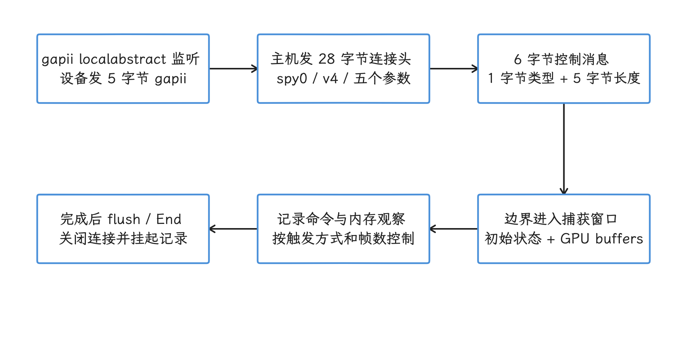

图：设备握手与主机参数头完成后，在帧边界保存状态，再记录并结束捕获。 五字节 gapii、28字节 spy0 连接头和6字节消息头是不同层；边界切换不冻结所有线程。

官方 UI 还提供 Beginning、Manual、Time 与 Frame 等启动方式，分别从启动后的第一帧、手动点击、指定秒数后或指定帧号开始捕获。它们只决定何时进入捕获窗口。

#### Buffering 选项的取舍

默认 buffering 会先在目标进程内暂存数据再批量写出。`Disable Buffering` 让数据更及时地离开目标进程，崩溃前已经序列化的数据更有机会保留下来，适合排查采集期间崩溃，代价是更高的运行期开销。所以普通抓帧保留 buffering，遇到“抓帧导致 App 崩溃且文件为空”时再用该选项缩小问题范围。

#### 多线程捕获与 race 复现

`.gfxtrace` 里可以有多线程的 API 调用，ProtoPack object group（带父子关系的消息组） 也可能交错。捕获器会记录调用和内存快照，但未显式同步的 race 未必都能稳定复现。所以 Vulkan 应用在抓帧前应先过一遍 validation layer（验证层），资源生命周期、host memory（CPU 可访问内存） 修改和 queue 同步都要符合 API 约束。

### `.gfxtrace` 的内容与边界

正确扩展名是 `.gfxtrace`。AGI `v3.3.3` 用自定义 ProtoPack v2 容器封装 protobuf（Protocol Buffers） message，整个文件由容器内的一串内容组成，不是单个 protobuf message 文件。

ProtoPack 头部 magic 为：

```text
ProtoPack\r\n2.0\n\0
```

后面是变长 chunk（记录块），可以是类型定义，也可以是带 parent 回指关系的对象实例；类型定义会先于对应对象出现，读取端因此可以从文件内取得 protobuf 类型描述。至于随机访问、差分编码、压缩块或损坏恢复，这个结构都不自动提供；要给它加上这些属性，得先拿出源码证据。

<!-- gracker-diagram: ch15-11-17-protopack-container -->
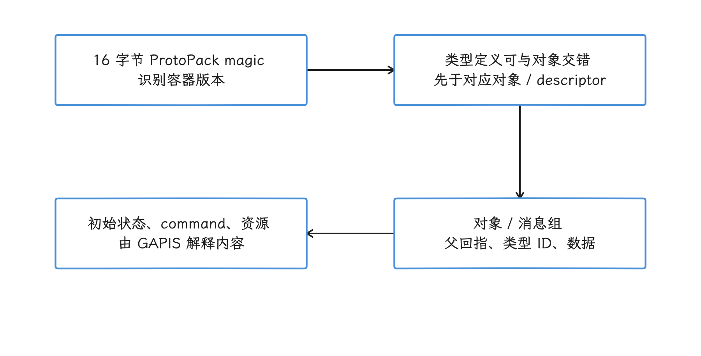

图：gfxtrace 由 ProtoPack v2 组织类型描述与对象，父回指保存消息组关系。 16字节 magic 后并非单个 protobuf；容器结构本身不保证压缩、随机访问或损坏恢复。

一份 Vulkan `.gfxtrace` 通常包含：

- trace `Header` protobuf：格式版本、设备、ABI 与捕获开始时间；
- 捕获开始时的 `GlobalState`（图形 API 全局状态）和初始内存快照；
- Vulkan command 及参数、返回值；
- driver 在命令前可能读取、命令后可能写入的 memory observation；
- buffer、texture 等资源 bytes；
- 捕获期间产生的 trace message。

AGI 自带的命令行工具 `gapit` 可以把 ProtoPack 内容展开检查。下面的命令先验证当前版本能否解析这份文件：

```shell
gapit unpack -verbose capture.gfxtrace
```

输出按 ProtoPack 对象树列出 header、global state、resource、observation 和 command group，适合验证文件结构；GPU 时间线或 render pass 成本的问题，这份输出回答不了，要靠其他数据。

#### `.gfxtrace` 的跨设备重放边界

Android Developers 的 Vulkan 工具页写有“trace 不可跨设备移植”的警告。这句话位于 GFXReconstruct 小节，我们把它当作 GFXReconstruct 自己的边界；直接套到 AGI `.gfxtrace` 上并不成立。

AGI `v3.3.3` 的开发文档写明了与本节直接相关的限制：主机可以演算 API state，但 draw 对 render target（渲染目标图像） 的真实像素影响仍要在设备上重放，结果取决于重放设备及其 driver。所以对 `.gfxtrace`，我们采用保守结论：跨 OS、芯片组或驱动版本的稳定重放要逐台验证，先别当作默认能力。分享问题时同时保存：

- AGI 版本与 `.gfxtrace`；
- Android build fingerprint（标识一次系统构建的字符串）、API level；
- GPU 型号与 driver 版本；
- 目标 App 版本、ABI、所用 Vulkan extension；
- 捕获时是否经 ANGLE、是否启用 validation layer。

### GAPIS 与 GAPIR 各自负责什么

#### GAPIS：解析、状态演算与 replay 生成

GAPIS 运行在开发机，把 `.gfxtrace` 解析为 `GraphicsCapture`，其中包含 header、initial state、command 列表和 memory observation。它可用生成的 `mutate`（按命令更新 API 状态） 逻辑在 CPU 上演算某条命令后的 Vulkan API state；我们想看“此时绑定了哪个 pipeline、有哪些 image”时，不一定要启动 GPU replay。

状态演算回答不了 draw call 对 framebuffer 的像素影响。需要图像、指定 draw 后的 render target 或 GPU 性能数据时，GAPIS 会：

1. 选取并变换要执行的命令，例如只保留目标 draw 之前所需的命令；
2. 为重建初始状态生成必要命令；
3. 把命令转为 GAPIR 虚拟机的 opcode（操作码）；
4. 把待执行的 opcode 序列和资源引用交给设备侧 GAPIR。

#### GAPIR：在目标设备 driver 上执行

GAPIR 是面向图形 replay 的栈式虚拟机，操作数主要从栈中取得。Android 上 `ReplayerActivity` 加载 `libgapir.so`，GAPIR 按 opcode 调用 Vulkan driver，再把 framebuffer、查询或 profiling 结果返回给 GAPIS。

<!-- gracker-diagram: ch15-11-18-mutate-versus-replay -->
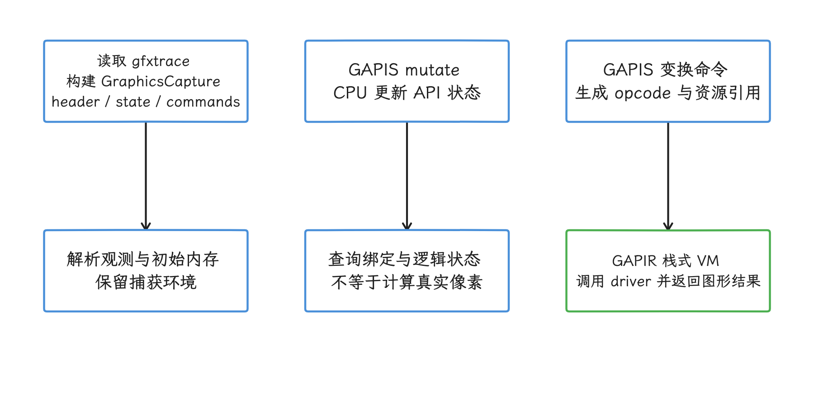

图：API 状态可在主机演算，framebuffer 像素等结果需要设备图形执行。 mutate 不模拟所有 GPU 像素效果；replay 的结果仍依赖目标设备与 driver。

资源也不会一次性全塞进 replay payload（待执行的操作码序列）：GAPIR 按需向 GAPIS 请求 resource，并在设备端维护 cache。这样重复 replay 时，同一纹理和 buffer 经 adb 传输的次数更少，这种按需传输不能保证不会耗尽内存；最终重建的图形资源、GPU allocation 和缓存仍须符合重放设备预算。

<!-- gracker-diagram: ch15-11-19-replay-resource-budget -->
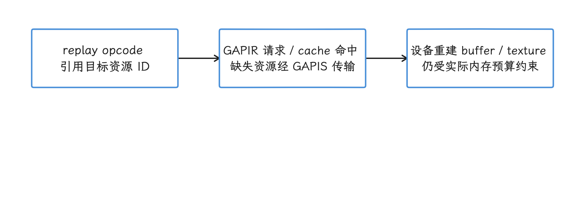

图：GAPIR 按需请求并缓存资源，减少重复传输，同时仍要满足设备内存预算。 cache 不能保证不耗尽内存；重建后的纹理、buffer、进程缓存与 GPU allocation 都要计算。

#### `replay2` 与 GFXReconstruct 的定位

AGI `v3.3.3` 的 `replay2/` 目录里有 handle remapper（句柄映射器）、memory remapper（内存地址映射器）、replay context（重放上下文） 等基础模块，但公开源码没把它描述成 Frame Profiler 的完整执行引擎；AGI 的 `DEVDOC.md` 仍把生产链路写成 GAPIS 生成 opcode、GAPIR 执行。

GFXReconstruct 则是另一个开源 capture/replay 项目。AGI 当前公开文档和上述源码都没把它列为 `.gfxtrace` 的采集器，也找不到“GFXReconstruct 生成命令流、replay2 在主机端执行”的链路证据。我们排查代码时，别把三个项目的名词混在一起。

### OpenGL ES 通过 ANGLE 进入 Frame Profile

AGI 官方 Frame Profile 入口区分：

- Vulkan：直接捕获应用的 Vulkan 调用；
- OpenGL on ANGLE：走 AGI 提供的 custom ANGLE（把 OpenGL ES 调用翻译到另一图形后端的兼容层） 兼容层，先把调用转换成 Vulkan，再捕获转换后的 Vulkan 命令。

所以 OpenGL on ANGLE 的 trace 描述的是 ANGLE 生成的 Vulkan workload（实际提交的图形工作序列），适合观察转换后的 render pass、pipeline、resource 与 GPU 成本；原始 GLES driver 的调用序列在这份 trace 里已经看不到了，而且 ANGLE 自身的 API 转换、shader translation（着色器转译） 和状态管理开销也进入了被测路径。

当前 AGI 源码文档写明工具主线只支持 Vulkan，这与官方 UI 的 OpenGL on ANGLE 说明一致。“gapii 直接替换全部 GLES 2.0/3.x 函数”“ANGLE D3D11 on Vulkan”这类 Android 描述都没有证据支持：Android 上的 ANGLE 后端是 Vulkan 方向，D3D11 属于其他平台语境。

### Frame Profiler 的视图与分析路径

官方 Frame Profiler UI 提供 Commands、Framebuffer、Geometry、Memory、Performance、Pipeline、Shader、State、Textures 与 Report 等视图。这些视图来自 capture state、resource 和必要的设备 replay。Commands 显示 API 调用树；Framebuffer 与 Geometry 检查像素和网格；Pipeline、Shader、State 与 Textures 检查绑定状态和资源；Performance 显示 replay 得到的 GPU 数据；Report 汇总捕获或 replay 错误。

分析时可按以下顺序缩小范围：

1. 在 Commands 与 frame timeline（帧内命令时间线）找到耗时 render pass 或 draw。
2. 检查 render target 尺寸和 attachment 数量；attachment 是 render pass 绑定的颜色或深度图像。再看 load/store/resolve 如何处理 attachment 的进入、保留与多重采样解析。
3. 查看 pipeline、blend、depth/stencil（深度与模板测试）、vertex input（顶点数据布局） 与 descriptor；其中 depth/stencil 管深度与模板测试，vertex input 决定顶点数据布局，descriptor 是 shader 的资源绑定表。
4. 核对 shader、纹理尺寸、采样方式和资源生命周期。
5. 结合目标 GPU 的 counter 判断瓶颈更接近算术、纹理、带宽或几何阶段。
6. 回到 System Profile 验证该帧是否同时受到 CPU 提交、调度、频率或其他进程干扰。

<!-- gracker-diagram: ch15-11-20-frame-investigation -->
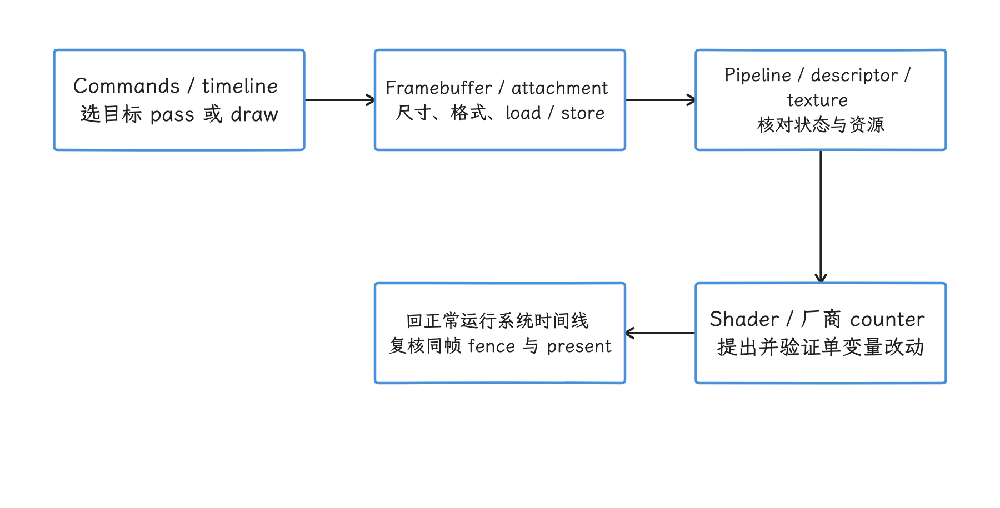

图：先定位帧内工作，再逐层检查 attachment、状态、资源和 shader，最后回到系统验证。 相邻时间区间不自动证明因果；图中的分析顺序不承诺任意设备都支持相同 counter。

#### Frame Profile 的覆盖终点

Frame Profile 可以记录应用的 `vkQueuePresentKHR()`，但这条 API 调用仍位于 Producer 侧，也就是向 BufferQueue 提交 buffer 的应用一侧。调用返回以后，GPU 工作可能尚未完成。后续显示路径是：

Producer 的 `queueBuffer` 携带 acquire fence（此时 GPU 写入可以尚未完成）→ SurfaceFlinger readiness / latch（按策略可能先 latch 未 signal 的 buffer）→ Consumer 读取前遵守 fence → HWC / 可选 RenderEngine CLIENT 合成 → display present 反馈。

`.gfxtrace` 的命令和资源足以重放应用 GPU 工作；一次真实显示周期里的 SurfaceFlinger layer、HWC plane（硬件显示平面） 分配和 present fence，未必都包含在内。

<!-- gracker-diagram: ch15-11-21-capture-coverage -->
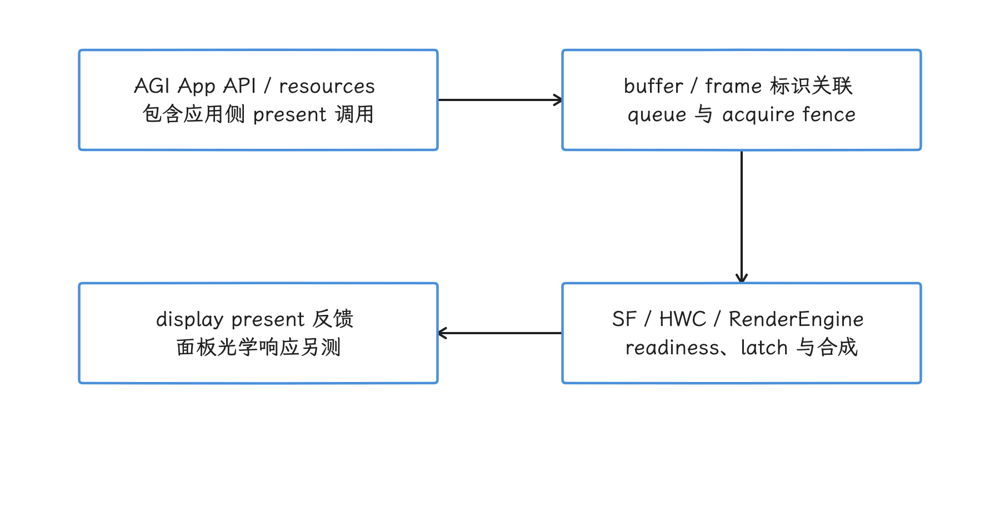

图：应用图形捕获解释 Producer 工作；同一显示周期还需连接 buffer、latch、合成与 present。 vkQueuePresentKHR 返回不代表 GPU 或显示已完成；acquire fence 同步依赖并非强制位于 queue 前。

这几类信息在一次完整诊断里各自负责什么，见下表：

| 证据 | 覆盖范围 | 不能替代的后续证据 |
| --- | --- | --- |
| AGI Commands / Pipeline / Shader / Texture | App graphics API、pipeline state、资源与 replay 结果 | GPU 完成、buffer 被系统采用、display present |
| AGI Performance | replay 设备上被分析的 render event 与 GPU 性能数据 | 原始运行时的 CPU 调度、其它进程和整屏 HWC 条件 |
| Producer completion fence、<code>queue<wbr>Buffer</code> | App buffer 何时可供 Consumer 读取及何时进入队列 | SurfaceFlinger 是否在目标周期选择该 buffer |
| layer trace、FrameTimeline、composition type | buffer/layer 选择、App/SF 时序，以及 DEVICE（HWC 合成）/CLIENT（RenderEngine 合成）决策 | draw 内部的 shader、pipeline 和资源原因 |
| present fence | Android 显示栈的一次 present 边界 | panel 光学响应和用户视觉感知 |

显示路径还有两个使用限制：

- 游戏可能已有多帧处于 in-flight 状态。抓到的 API frame 很重，也未必就是用户看到的那一帧；要用 frame id、present id、buffer、latch 与 present 建立对应关系。
- SurfaceFlinger 把目标 layer 改为 CLIENT composition 时，RenderEngine 会在应用 GPU 工作之外增加 client target 工作；client target 是 RenderEngine 把多个 layer 合成后交给 HWC 的中间 buffer。单看应用 `.gfxtrace` 会漏掉这段系统 GPU 成本。

我们把顺序定成这样：先用 System Profile、Perfetto 或 APA 锁定异常 display frame 和目标应用 Surface，确认瓶颈落在应用 GPU 区间后，再抓相同场景的 Frame Profile；改完 shader、render pass 或资源，回到系统时间线验证 producer fence、latch 与 present 是否一起改善。OpenGL on ANGLE 还要保留“转换后的 Vulkan workload 与原 GLES driver 路径不同”这个实验变量。

Frame Profile 给我们的是单帧内部的数据；跨设备通用的阈值，要靠对照实验自己建立。公开资料里还查不到可核验的 Android 17“机器学习性能预测、AI 异常检测或云端趋势分析”能力，`Sokatoa` 在上述 AGI 与 AOSP 来源中也没有对应组件或扩展定义——遇到这类描述，先拿到独立产品文档、版本和可复现实验再说。

### 常见失败怎样定位

#### App 启动后没有 gapii 连接

按链路逐项检查：

- 目标 App 是否 debuggable；
- `gpu_debug_app` 是否为正确 package；
- `gpu_debug_layer_app` 是否安装且 ABI 匹配；
- `gpu_debug_layers` 是否包含 `GraphicsSpy`；
- 实际绘制发生在哪个进程，`debug.agi.procname` 是否写成完整进程名；
- `adb forward` 与 local abstract `gapii` socket 是否建立；
- logcat（Android 系统日志） 是否出现 Vulkan loader、`GraphicsSpy`、`libgapii.so` 的加载错误。

#### 能连接但抓帧为空

先检查选择的 API 模式：原生 Vulkan 用 Vulkan，GLES 用 OpenGL on ANGLE。再确认触发窗口内确有 present/frame boundary（一帧结束标记），且目标进程没有在 Start 前退出。

#### replay 与原画面不同或崩溃

检查：

- validation layer 是否报告错误；
- trace 使用的 extension 是否受 AGI 支持；
- replay 设备、OS、GPU driver 是否与 capture 环境一致；
- App 是否依赖未记录的外部资源、竞态或未声明同步；
- ANGLE 路径是否改变了原 GLES workload。

Frame profiling overview 把该选项写作 `Include Unsupported Extensions`，troubleshooting 页面也使用过 `Include Unknown Extensions`；两者都表示允许应用继续暴露 AGI 未支持的 Vulkan extension。这个选项只会允许继续尝试，官方文档明确提示启用后 replay 仍可能出现细微错误或崩溃。

<!-- gracker-diagram: ch15-11-22-capture-failure-chain -->
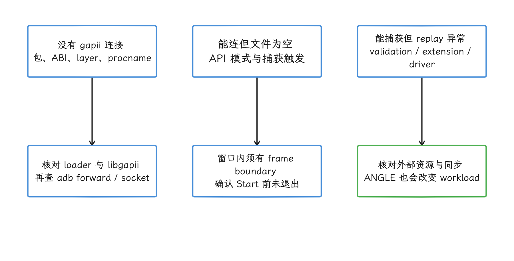

图：连接失败先查注入与进程，空捕获查触发窗口，重放异常查 API、资源与设备环境。 允许 unsupported extension 只允许继续尝试；不能据此保证结果正确或不崩溃。

#### 清理残留设置

先保存测试前的 global settings 和属性值；已有其他工具配置时应恢复原值，不能无条件删除共享设置。手工调试或 AGI 异常退出后，只有这些键原本未设置、且没有其他采集任务使用时，才按下面示例清理：

```shell
adb shell settings delete global enable_gpu_debug_layers
adb shell settings delete global gpu_debug_app
adb shell settings delete global gpu_debug_layer_app
adb shell settings delete global gpu_debug_layers
adb shell settings delete global angle_debug_package
adb shell settings delete global angle_gl_driver_selection_values
adb shell settings delete global angle_gl_driver_selection_pkgs
adb shell 'setprop debug.agi.procname ""'
```

这三个 `angle_*` 键只与 OpenGL on ANGLE 抓帧有关；原生 Vulkan 抓帧通常不会设置它们。清理后重启目标 App，再用 `settings get global ...` 和 `getprop debug.agi.procname` 确认没有残留。global settings 会跨重启保存，遗留的 layer 或 ANGLE 配置可能继续影响同包进程。

<!-- gracker-diagram: ch15-11-23-restore-debug-settings -->
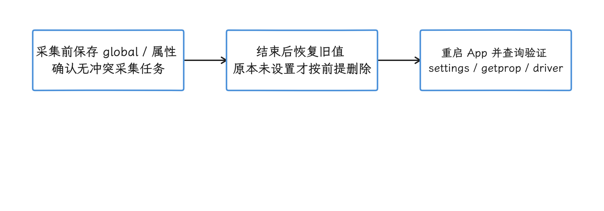

图：采集前保存共享配置，结束后按原值恢复，再重启 App 检查实际后端。 删除示例仅适用于原本未设置且无其他任务使用；空属性值必须保留到设备 shell。

### 源码与官方文档索引

#### Android 17 平台侧

- [AOSP `android-17.0.0_r1` manifest](https://android.googlesource.com/platform/manifest/+/android-17.0.0_r1/default.xml)
- [Vulkan layer 发现、注入条件与 global settings](https://android.googlesource.com/platform/frameworks/native/+/android-17.0.0_r1/vulkan/libvulkan/layers_extensions.cpp)

#### AGI `v3.3.3` 工具侧

- [AGI `v3.3.3` release](https://github.com/google/agi/releases/tag/v3.3.3)

仓库里同时存在名为 `v3.3.3` 的 branch（可继续前进的分支指针） 和 tag，两者当前指向不同提交。下面的源码链接固定到 release tag 对应的完整 commit，避免短引用被解析到同名 branch：

- [AGI 开发文档：Life of a gfxtrace](https://github.com/google/agi/blob/5f97b4fd99a9459320b782203ce2de5351a1e661/DEVDOC.md)
- [Android 抓帧启动与 `debug.agi.procname`](https://github.com/google/agi/blob/5f97b4fd99a9459320b782203ce2de5351a1e661/gapii/client/adb.go)
- [Android Vulkan layer settings 写入与清理](https://github.com/google/agi/blob/5f97b4fd99a9459320b782203ce2de5351a1e661/core/os/android/layers.go)
- [GraphicsSpy layer manifest](https://github.com/google/agi/blob/5f97b4fd99a9459320b782203ce2de5351a1e661/gapii/vulkan/vk_graphics_spy/cc/GraphicsSpyLayer.json)
- [GraphicsSpy wrapper 加载 `libgapii.so`](https://github.com/google/agi/blob/5f97b4fd99a9459320b782203ce2de5351a1e661/gapii/vulkan/vk_graphics_spy/cc/layer.cpp)
- [gapii 进程选择、socket 与 capture 初始化](https://github.com/google/agi/blob/5f97b4fd99a9459320b782203ce2de5351a1e661/gapii/cc/spy.cpp)
- [gapii 主机连接与 capture protocol](https://github.com/google/agi/blob/5f97b4fd99a9459320b782203ce2de5351a1e661/gapii/client/capture.go)
- [`.gfxtrace` 解析与导出](https://github.com/google/agi/blob/5f97b4fd99a9459320b782203ce2de5351a1e661/gapis/capture/graphics.go)
- [ProtoPack v2 文件格式](https://github.com/google/agi/blob/5f97b4fd99a9459320b782203ce2de5351a1e661/core/data/pack/README.md)
- [GAPIR replay VM](https://github.com/google/agi/blob/5f97b4fd99a9459320b782203ce2de5351a1e661/gapir/README.md)
- [gapid APK manifest](https://github.com/google/agi/blob/5f97b4fd99a9459320b782203ce2de5351a1e661/gapidapk/android/apk/AndroidManifest.xml.in)
- [`replay2` 公开源码目录](https://github.com/google/agi/tree/5f97b4fd99a9459320b782203ce2de5351a1e661/replay2)

#### 使用与边界

- [AGI quickstart](https://developer.android.com/agi/start)
- [AGI supported devices](https://developer.android.com/agi/supported-devices)
- [Frame profiling overview](https://developer.android.com/agi/frame-trace/frame-profiler)
- [分析高成本 render pass](https://developer.android.com/agi/frame-trace/renderpasses)
- [AGI troubleshooting](https://developer.android.com/agi/troubleshooting)
- [Android Vulkan 工具与 trace 可移植性说明](https://developer.android.com/games/develop/vulkan/tools-and-advanced-features)


## 常见误区

### RenderThread 短与 GPU 瓶颈的关系

RenderThread 可能只负责异步提交。要判断这一帧受 GPU 工作限制，得让 GPU stage、completion fence、FrameTimeline 和单变量实验共同指向 GPU 才行。

### GPU utilization 与 shader 复杂度

GPU busy 可能来自 fragment、纹理、带宽、compute、copy、driver queue 或 SurfaceFlinger client composition。需要结合不同 stage 和对应 counter 继续区分。

### `gpu.counters` 统一了什么

Android 17 统一了 Perfetto 的传输结构和 Android OEM descriptor 要求，没有统一每家 GPU 的微架构指标。

### Android 17 与 ANGLE 的选择关系

Android 17 提供 manifest 请求信号，ANGLE 选择仍受设备与系统策略控制。AGI 的 OpenGL on ANGLE capture 只能说明本次捕获使用了 ANGLE。

### `profileable` 的适用范围

AGI、RenderDoc、Sokatoa 等帧捕获会注入 graphics layer，通常要求 debuggable 或 root。`profileable` 主要服务低扰动 profiling。

### GPU 时间与显示路径的关系

GPU 写入完成由 acquire fence 表达，buffer 入队和受限的 SurfaceFlinger latch 可以更早发生；读取与合成必须遵守同步依赖。判断何时呈现要继续对应 HWC / RenderEngine 与 present 反馈，面板光学响应还需外部测量。


## 结论

- Android 17 提供 Vulkan debug layer 的发现与安全机制；AGI 是独立版本化的开发工具，它的功能要记在 AGI 自己的版本上，与平台新增项分开写。
- System Profile 走 Perfetto，Frame Profile 走 GraphicsSpy、gapii、`.gfxtrace`、GAPIS 与设备侧 GAPIR。
- Android 注入使用 `enable_gpu_debug_layers` 等 global settings；`VK_LAYER_PATH` 是桌面 loader 语境。
- gapii 在目标 App 进程捕获 Vulkan 调用，gapid APK 的前台 service 只负责设备和 package 信息。
- `.gfxtrace` 是 ProtoPack 封装的 protobuf object stream，包含初始状态、命令、资源和内存观察。
- GAPIS 在主机解析和生成 replay opcode，GAPIR 在 Android 设备 driver 上执行；`.gfxtrace` 的 replay 结果依赖设备与 driver，跨 OS、GPU 和 driver 的稳定复现要另行验证。
- OpenGL ES Frame Profile 经 custom ANGLE 转成 Vulkan，分析结果对应转换后的 workload。
- Frame Profile 停在应用图形 API 与 replay 范围内，producer fence、SurfaceFlinger latch、HWC composition 与 display present 的运行时证据仍需另外采集。
- 公开主链路没有 GFXReconstruct、完整 replay2 引擎、Sokatoa 或 Android 17 AI 诊断功能的证据。


## 参考资料

- [Android Performance Analyzer](https://developer.android.com/android-performance-analyzer)
- [APA 发布说明：0.10.0-canary](https://developer.android.com/android-performance-analyzer/release-notes)
- [APA Frame Profiler 与 GFXR 重放测量](https://developer.android.com/android-performance-analyzer/frame-profiler)
- [APA Frame Profiler 设备与 API 兼容范围](https://developer.android.com/android-performance-analyzer/frame-profiler/compatibility)
- [Introducing Android Performance Analyzer](https://developer.android.com/blog/posts/introducing-android-performance-analyzer-the-next-evolution-in-profiling-for-android)
- [Android GPU Inspector](https://developer.android.com/agi)
- [AGI quickstart](https://developer.android.com/agi/start)
- [AGI Frame profiling overview](https://developer.android.com/agi/frame-trace/frame-profiler)
- [Perfetto GPU data sources](https://perfetto.dev/docs/data-sources/gpu)
- [Perfetto FrameTimeline](https://perfetto.dev/docs/data-sources/frametimeline)
- [Android 17 `gpu_counter_config.proto`](https://android.googlesource.com/platform/external/perfetto/+/refs/tags/android-17.0.0_r1/protos/perfetto/config/gpu/gpu_counter_config.proto)
- [Android 17 `gpu_renderstages_config.proto`](https://android.googlesource.com/platform/external/perfetto/+/refs/tags/android-17.0.0_r1/protos/perfetto/config/gpu/gpu_renderstages_config.proto)
- [Android 17 `gpu_counter_event.proto`](https://android.googlesource.com/platform/external/perfetto/+/refs/tags/android-17.0.0_r1/protos/perfetto/trace/gpu/gpu_counter_event.proto)
- [Android 17 `FrameTracer`](https://android.googlesource.com/platform/frameworks/native/+/refs/tags/android-17.0.0_r1/services/surfaceflinger/FrameTracer/)
- [Android Vulkan and ANGLE overview](https://developer.android.com/games/develop/vulkan/overview)
- [`<profileable>` manifest element](https://developer.android.com/guide/topics/manifest/profileable-element)
- [Sokatoa project and current requirements](https://github.com/sarc-acl/sokatoa)
- [Arm Performance Studio](https://developer.arm.com/Tools%20and%20Software/Arm%20Performance%20Studio)
- [Arm Streamline](https://developer.arm.com/tools-and-software/streamline-performance-analyzer)
- [RenderDoc for Arm GPUs](https://developer.arm.com/tools-and-software/renderdoc-for-arm-gpus)
- [Snapdragon Profiler](https://developer.qualcomm.com/software/snapdragon-profiler)
- [Android 17 common kernel devfreq](https://android.googlesource.com/kernel/common/+/refs/tags/android17-6.18-2026-06_r6/drivers/devfreq/)
- [Android 17 common kernel dma-fence](https://android.googlesource.com/kernel/common/+/refs/tags/android17-6.18-2026-06_r6/drivers/dma-buf/dma-fence.c)
