# GPU Counter、内存与 GpuService 可观测性

> GPU Counter 与 GPU memory 的信号都在 trace 里，但要回答不同的问题：counter（计数值） 记录某个 GPU 随时间变化的指标样本，内存事件记录某个时间点全局或各进程的 GPU 内存总量。这两种信号各有自己的采集链路和解释规则，把它们混在一起，是分析中最常见的错误来源。本文沿着两条链路各走一遍：我们先看 `external/perfetto` 里 GPU counter、GPU memory 事件和 Trace Processor 的导入实现，再看 `frameworks/native/services/gpuservice` 里 GPU 内存采集、驱动统计和各自的消费接口。
>
> 源码基线：AOSP `android-17.0.0_r1`；内核 `android17-6.18-2026-06_r6`。跨厂商性能阈值、Ray Tracing（光线追踪）、NPU（神经网络处理器）/ML（机器学习） 协同、远程 GPU 调试与完整 AGI 工作流不在讨论范围内。

下文沿用 Perfetto 源码名称。counter 是按时间记录的 GPU 指标样本；producer 是向 Perfetto 声明数据源并写入事件的实现；descriptor 是解释 counter ID、名称、单位和采样能力的元数据；Trace Processor 把 trace packet（追踪数据包） 解析成可查询的表与时间轨道。

GPU 可观测信号分为执行计数器、频率/利用率、内存当前量和分配时间线。Perfetto、GpuService、eBPF 与 statsd（Android 系统统计守护进程） 各管一段，覆盖的对象和时间粒度都不一样。所以我们动手查数据前，先把要回答的问题定下来，再选对应的那条链路。

<!-- gracker-diagram: ch15-12-01-signal-semantics -->
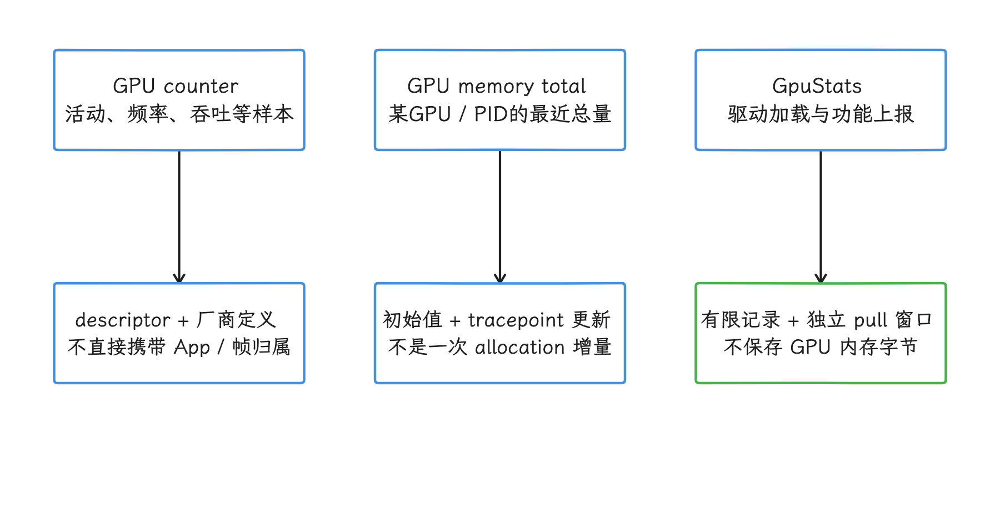

图：先确定要回答负载、内存还是驱动路径问题，再选择对应信号。 数值变化、总量变化与加载统计没有可互换的单位或归因范围。

## GPU Counter、频率与内存事件

### 要点

1. `GpuCounterDescriptor` 提供 counter 的协议级元数据：语义分组、度量单位、counter spec（单项指标说明）与硬件 counter block 容量约束。
2. `GpuCounterEvent` 有 descriptor 直挂与 interned descriptor 两种事件写入模式。interning 会把 descriptor 存入同一 packet（trace 数据包） 序列的数据表，后续事件只引用其 ID；多 producer / 多 GPU 场景可借此避免协调全局 counter ID。Android OEM 走 CDD（Android 兼容性定义文档）/CTS（兼容性测试套件） 合规路径时则必须使用直挂 descriptor。
3. Trace Processor 在 `gpu_event_parser.h/.cc` 中维护 GPU counter track（时间序列轨道）与上一条 counter row（样本行）的状态，并把回看式采样值写回上一行；`android-17.0.0_r1` 不包含 `gpu_counter_sequence_state.h`。
4. `gpu_counter_span_view.sql` 用 `LEAD() OVER (PARTITION BY track_id ORDER BY ts)` 将 counter 采样点转为 span（带起止范围的区间），适合按 GPU track 计算持续时间。
5. `GpuMemTotalEvent` 位于 `protos/perfetto/trace/android/gpu_mem_event.proto`，由 Android `GpuService` 生成；`pid（进程 ID）=0` 表示全局总量，其余 pid 表示进程归属。
6. `GpuCounterEvent` 不携带 pid、tid（线程 ID）、layer、FrameTimeline token（帧关联标识） 或 GPU submission ID（GPU 提交批次标识）。单条 counter track 只能直接说明某个 `gpu_id` 上的设备级变化；要归因到 App、SurfaceFlinger 或某一显示帧，还得拿其他时间线证据来对。

### `GpuCounterDescriptor`：协议层的描述结构

`protos/perfetto/common/gpu_counter_descriptor.proto` 把单个 counter spec、共享硬件资源的 counter block，以及 producer 的采样能力放在同一个 descriptor 中。

#### 语义分组

`GpuCounterGroup` 的枚举值如下：

```text
UNCLASSIFIED = 0
SYSTEM       = 1
VERTICES     = 2
FRAGMENTS    = 3
PRIMITIVES   = 4
MEMORY       = 5
COMPUTE      = 6
RAY_TRACING  = 7
```

`GpuCounterSpec.groups` 若被 producer 填写，只能从该枚举取值；若未填写，Trace Processor 会按未分类 counter 处理。分组是 producer 对 counter 语义的自我声明；跨厂商的同组 counter 是否等价，要以厂商自己的声明为准，分组本身给不出这个保证。

#### 度量单位

`MeasureUnit` 的 wire value 从 `NONE = 0` 延伸到 `INSTRUCTION = 40`，覆盖 `BIT`、`BYTE`、`HERTZ`、`SECOND`、`VERTEX`、`PIXEL`、`TRIANGLE`、`PRIMITIVE`、`FRAGMENT`、`MILLIWATT`、`WATT`、`JOULE`、`VOLT`、`AMPERE`、`CELSIUS`、`PERCENT`、`INSTRUCTION` 等。`next id: 41` 只是提醒维护者从 41 分配下一个枚举编号（wire value），并不是协议字段。派生单位由可重复出现的 `numerator_units` 和 `denominator_units` 组合，例如 `PIXEL / SECOND` 表示每秒像素。

#### Counter spec 的字段

字段如下：

```text
counter_id
name
description
reserved 4  // deprecated MeasureUnit unit 的旧 tag，本版本不再作为可写字段
oneof peak_value {
  int_peak_value
  double_peak_value
}
numerator_units
denominator_units
select_by_default
groups
```

`reserved 4` 对应早期已弃用的 `MeasureUnit unit` tag，Trace Processor 只按 `numerator_units` 与 `denominator_units` 生成单位字符串。`oneof peak_value` 表示整数峰值与浮点峰值最多选一种。这个版本的 `GpuCounterSpec` 没有 `value_direction` 字段，Perfetto 上游后续设计或其他分支里的字段，要进入本标签之后才算这条基线里的协议字段。

#### Counter block 容量约束

`GpuCounterBlock { block_id, block_capacity, name, description, counter_ids }` 描述共享同一硬件计数资源组（block）的 counter，以及它们能同时启用的数量上限；`block_capacity` 未设置时表示不设上限。所以我们写自动化脚本或 UI 选 counter 时，先按 `block_id` / `block_capacity` 校验容量，再决定启用哪些；只按名称一列就全开，很容易撞上这层约束。超限后怎么处理，proto 没有规定：producer 可能拒绝、可能轮转采样，也可能不提示地丢弃部分选择，协议层面给不出统一答案。

<!-- gracker-diagram: ch15-12-02-descriptor-and-capacity -->
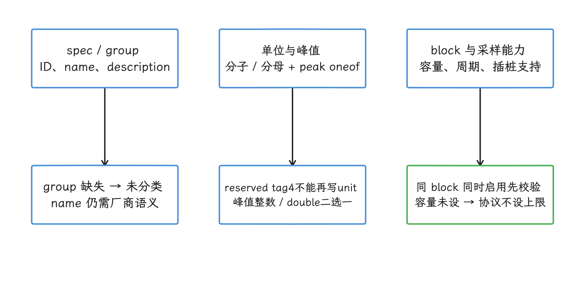

图：同一 descriptor 分别描述指标含义、结构化单位和同时采集能力。 同组 counter 不保证跨厂商等价；超容量时 producer 如何处理不由 proto 统一规定。

### `GpuCounterEvent`：descriptor 直挂与 interned descriptor

`protos/perfetto/trace/gpu/gpu_counter_event.proto` 中的核心结构如下：

```proto
message GpuCounterEvent {
  oneof desc {
    GpuCounterDescriptor counter_descriptor = 1;
    uint64 counter_descriptor_iid = 4;
  }

  message GpuCounter {
    optional uint32 counter_id = 1;
    oneof value {
      int64 int_value = 2;
      double double_value = 3;
    }
  }

  repeated GpuCounter counters = 2;
  optional int32 gpu_id = 3;
}
```

`oneof desc` 表示直挂 descriptor 与 `counter_descriptor_iid` 最多出现一种；嵌套的 `oneof value` 同样最多携带整数值或浮点值中的一种。`iid` 是 interned ID，也就是查找已存 descriptor 的编号。源码注释区分了两种事件写入模式：

- **Mode 1：descriptor 直挂**。`counter_descriptor = 1` 直接随事件发送。源码注释要求 Android OEM 用这条路径满足 CDD/CTS 测试；每次 trace session（一次录制会话） 的首个 packet 必须声明 descriptor。该模式的 counter ID 是全局编号，多 producer 必须自行协调。
- **Mode 2：interned descriptor**。`counter_descriptor_iid = 4` 引用 trusted sequence（Perfetto 可信 packet 序列）中的 `InternedGpuCounterDescriptor`，适合多 producer / 多 GPU 场景。descriptor 存在 `InternedData` 中，`sequence-scoped` 表示其 ID 只在该序列内有效；事件随后只传 `iid`，不再重复整份 counter spec。固定解析器在该模式下直接读取 interned descriptor 的 `gpu_id`，不回退到 event 外层；interned 字段未填写时使用 proto2 默认值 0。

数据源配置入口在 `protos/perfetto/config/data_source_config.proto`：

```proto
optional GpuCounterConfig gpu_counter_config = 108 [lazy = true];
```

该字段对应的数据源名是 `gpu.counters`。`[lazy = true]` 是 protobuf 字段的延迟解码选项，只影响消息何时解析；GPU data source 的启动时机和常驻状态，从这一项是读不出来的。采集行为由 `GpuCounterConfig` 的以下字段表达：

- `counter_period_ns`：期望采样周期；descriptor 若声明了 `min_sampling_period_ns` 与 `max_sampling_period_ns`，配置应落在该 producer 支持的范围内；
- `counter_ids`：要采集的 counter id，含义以本次 producer descriptor 为准；
- `instrumented_sampling`：请求在 GPU command buffer（命令缓冲区）中插入计数器采样操作，使用前应检查 descriptor 的 `supports_instrumented_sampling`；
- `fix_gpu_clock`：请求在 trace 期间固定 GPU 时钟，会改变动态调频条件；这样采到的数据要单独当一份基线看，与日常运行数据分开比较。

<!-- gracker-diagram: ch15-12-04-config-requests -->
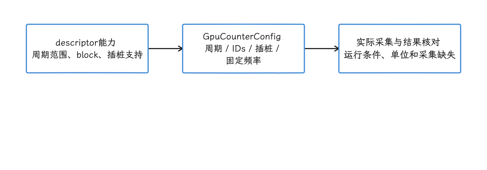

图：先核对 descriptor 能力，再选择周期与 ID，并标明插桩和固定频率的条件。 instrumented_sampling 和 fix_gpu_clock 是请求；实际执行受 producer 支持限制。

### Trace Processor 如何导入事件

在这条源码基线里，GPU counter 事件的导入实现位于 `src/trace_processor/importers/proto/gpu_event_parser.h/.cc`。每个 track 保存一串按时间排列的样本，`last_id` 指向该轨道上一条 counter row。我们在头文件里能看到两类记录方式：

```cpp
struct GpuCounterState {
  TrackId track_id;
  std::optional<tables::CounterTable::Id> last_id;
};
base::FlatHashMap<uint32_t, GpuCounterState> gpu_counter_state_;

// Track-level last_id for the interned counter_descriptor_iid path.
base::FlatHashMap<TrackId, std::optional<tables::CounterTable::Id>>
    gpu_counter_last_id_;
```

由此得到两个结论：

1. legacy inline（旧版内联）`counter_descriptor` 路径按全局 `counter_id` 维护 `GpuCounterState`。
2. interned `counter_descriptor_iid` 路径先从当前 packet sequence 查到 `InternedGpuCounterDescriptor`，再按 track 维护 `last_id`。

ID 作用域和 track 身份还要分开：固定版本的 `InternGpuCounterTrack()` 用 GPU 维度与 counter `name` 建轨，`counter_id`、单位和描述没有进入 track dimensions。同一 GPU 上同名的 spec 可能落到同一 track；序列内 ID 独立不代表 Trace Processor 自动为每个 producer 隔离轨道。

<!-- gracker-diagram: ch15-12-03-descriptor-modes -->
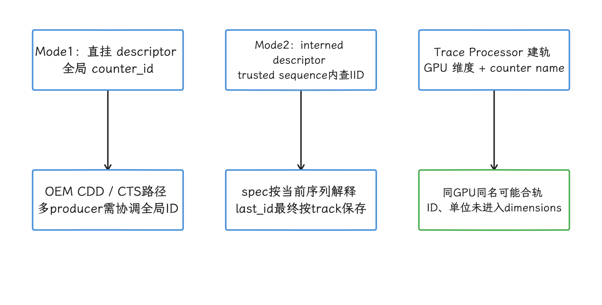

图：直挂与 interned 分别解析 ID，但实际 counter track 还由 GPU 维度与 name 决定。 interned ID 独立不保证 producer 轨道隔离；该路径 GPU ID 取 interned 字段，未设为0。

`android-17.0.0_r1` 不包含 `gpu_counter_sequence_state.h`；相关行为应以 `gpu_event_parser.h/.cc` 为准。

`PushGpuCounterValue()` 的写入顺序会影响 trace 首尾的解释。第一条数值事件建立当前时间戳的 0 占位行，其报告的回看值因为没有上一行而无法保存；下一条事件到达后，把该事件报告的 value 写到上一行，同时新建当前时刻的 0 占位行。trace 结束前的末行因此可能仍是占位值。所以我们分析短 trace 或低频采样时，要先检查首尾样本；这个 0 多半只是解析器留下的占位值，单凭它还判断不了 GPU 是否空闲。

<!-- gracker-diagram: ch15-12-05-backwards-looking-values -->
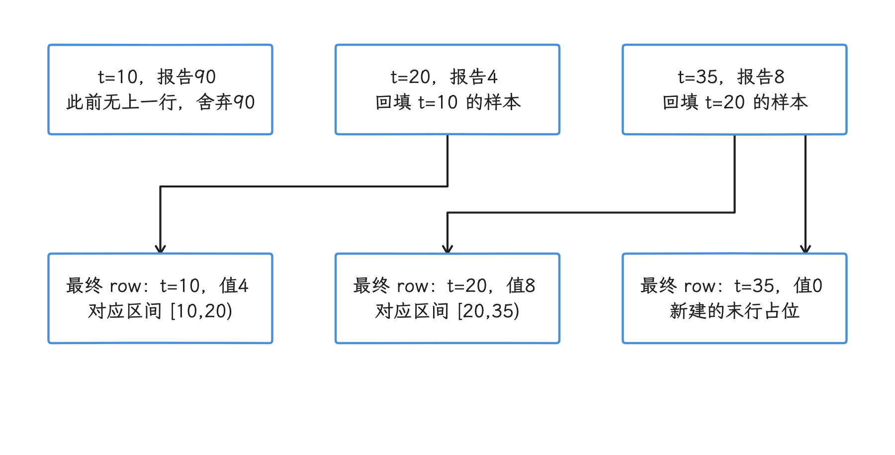

图：每次先在当前时间戳放0，再把当前报告值写到上一行。 示例时刻和数值是合成输入；首条报告缺少左边界，末行0也可能只是占位。

### SQL span 视图：从采样点到区间

`src/trace_processor/metrics/sql/android/gpu_counter_span_view.sql` 先删除同名旧视图；其中负责创建区间视图的 `CREATE VIEW` 片段如下：

```sql
CREATE PERFETTO VIEW {{table_name}}_span AS
SELECT
  ts,
  LEAD(ts, 1, trace_end()) OVER (PARTITION BY track_id ORDER BY ts) - ts AS dur,
  gpu_id,
  value AS {{table_name}}_val
FROM counter c JOIN gpu_counter_track t
  ON t.id = c.track_id
WHERE name = '{{counter_name}}' AND gpu_id IS NOT NULL;
```

这段 SQL 的关键点是：

- `{{counter_name}}` 在 metric（Perfetto 指标查询）编译时替换为具体 counter 名。
- `LEAD()` 是 SQL 窗口函数；`PARTITION BY track_id` 让每条轨道分别计算，`ORDER BY ts` 再按时间排序。下一条采样点时间减去当前时间，就是当前 counter 值对应的持续区间。
- `gpu_id IS NOT NULL` 过滤掉非 GPU counter track。

这个视图片段只生成区间，不改变导入解析器已写入的 value。末行会延伸到 `trace_end()`；它若仍是解析器留下的 0 占位值，做求和、均值等聚合计算前，我们应按采样语义决定要不要剔除这一行。

<!-- gracker-diagram: ch15-12-06-counter-spans -->
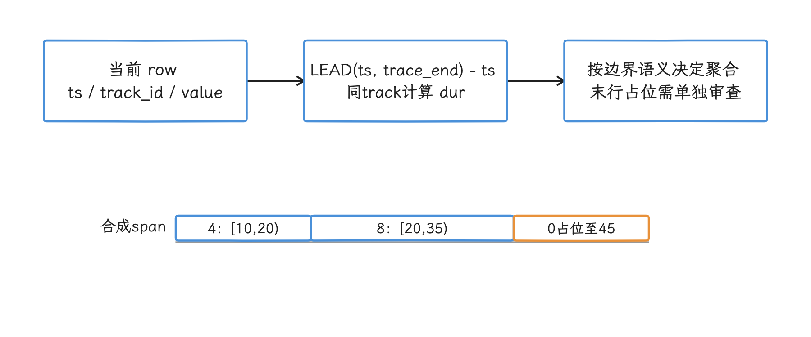

图：按 track 排序后用下一时间戳计算区间长度，末行延伸到 trace_end。 合成示例沿用上图；SQL不会修复占位值，也不能按 value=0 删除所有真实零值。

`test/trace_processor/diff_tests/parser/graphics/gpu_counter_specs.textproto` 展示了测试使用的 counter 名与单位组合，例如：

- `GPU Frequency`：`denominator_units: SECOND`，即频率类 counter。
- `Fragments / vertex`：`FRAGMENT / VERTEX`。
- `Fragment / Second`：`PIXEL / SECOND`。
- `Triangle Acceleration`：`TRIANGLE / (MILLISECOND · MILLISECOND)`。

这些是解析器的合成测试输入，拿来验证名称、单位和 group 的导入结果正合适；设备的 counter 清单和跨厂商性能基准，从合成输入这里外推不出来。其中 `Fragment / Second` 的名称使用 Fragment，结构化单位却写成 `PIXEL / SECOND`。所以分析真实 trace 时，我们把名称和单位一起保存；二者冲突时就标记 descriptor 数据不一致，别自行补成某个设备语义。

### GPU memory event：Android 平台 producer

`protos/perfetto/trace/android/gpu_mem_event.proto` 定义：

```proto
// Generated by Android's GpuService.
message GpuMemTotalEvent {
  optional uint32 gpu_id = 1;
  optional uint32 pid = 2;
  optional uint64 size = 3;
}
```

注释明确该事件由 Android 系统的 `GpuService` 生成。Trace Processor 的 `ParseGpuMemTotalEvent()` 按 `gpu_id` 建立 GPU 维度：`pid == 0` 时写入全局 GPU memory counter，其他 pid 则关联进程并写入进程 GPU memory counter。`size` 是该时间点的总量值，读的时候要记得它是快照，而非一次内存分配的增量。

<!-- gracker-diagram: ch15-12-07-gpu-memory-event -->
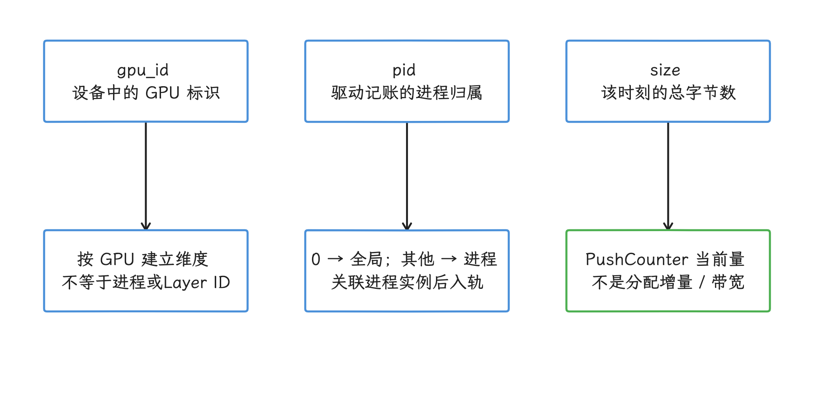

图：GpuMemTotalEvent 用 GPU、进程归属和当前总量定位内存轨道。 pid0是全局总量，其他PID进入进程轨道；共享buffer不能由此推断单进程独占物理页。

这条平台事件让我们能观察全局或进程归属的 GPU 内存总量；带宽、shader throughput（着色器处理吞吐量）、缓存命中率、功耗阈值这类量，仍要回到厂商 GPU counter 上去拿。事件里的 pid 归属也要多想一层：它只说明驱动把总量记在这个进程名下，物理页未必只有该进程持有；跨进程共享 buffer、驱动保留和显示系统引用，要结合 `GpuService`、dma-buf（Linux 跨设备共享 buffer 的机制） 与厂商工具一起解释。

### 把 counter 放回 Android 显示路径

#### 设备级 counter 与帧归属

`GpuCounterEvent.GpuCounter` 只有 `counter_id` 和一个数值，外层事件只增加 descriptor 与 `gpu_id`。协议里没有 pid、tid、SurfaceFlinger layer ID、BufferQueue frame number、FrameTimeline token 或 GPU submission ID。Trace Processor 因此创建的是设备级 GPU counter track；counter span 与某个 App、某个显示帧的关联，要靠我们自己拿着其他时间线去建立。

这条限制会直接决定结论能下多硬。我们先把几个术语统一，再逐条核对：submission 是一次提交到 GPU queue 的工作批次，slice 是时间线上带开始和结束的事件。producer completion fence（表示生产者对该 buffer 的写入何时完成的同步对象） 在 producer 完成 buffer 写入后发出信号，传到 consumer 一侧时就是读取该 buffer 前等待的 acquire fence；release fence 通知 producer 何时可以安全复用旧 buffer；present fence 是一轮 display present 的系统时间锚点。

| 证据 | 可以确认 | 不能单独确认 |
| --- | --- | --- |
| GPU counter span | 某个 <code>gpu_<wbr>id</code> 在该区间的频率、吞吐、利用率或厂商定义事件值发生变化 | 哪个进程、layer 或 command buffer 造成变化 |
| GPU render-stage / submission 事件 | 已被 producer 标注的 GPU 工作区间与提交关系 | 未标注工作属于哪个业务帧，或该帧已经显示 |
| App / RenderThread slice | CPU 何时准备、提交或等待 GPU 工作 | GPU 何时完成，SurfaceFlinger 是否采用该 buffer |
| producer completion / acquire fence | 对应 buffer 何时可由 consumer 安全读取 | 该 buffer 是否赶上目标 display present |
| FrameTimeline、layer 与 present | App/SF 帧、buffer/layer 选择及显示时序 | counter 峰值由哪条 shader、纹理或硬件单元产生 |

归因时，我们先用时间重叠缩小候选范围，再用 submission、buffer、fence、layer 和 frame token 把关系建立起来。“counter 峰值与卡顿同时出现”提供时间相关线索，还够不上因果结论；既不能直接定责，也不能仅据此断言两者只是巧合。

<!-- gracker-diagram: ch15-12-08-counter-causal-evidence -->
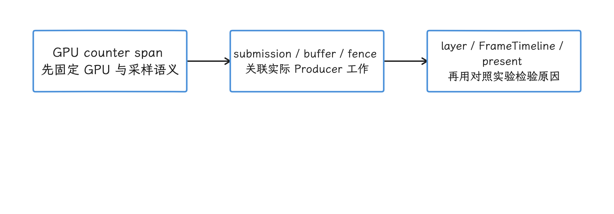

图：时间重叠缩小候选后，继续用提交、buffer、fence 与 layer 建立同帧关系。 counter 没有PID、TID或帧token；时间相关不足以定责，也不能直接定性为巧合。

#### 不同出图路径的 counter 判读

下面的判读表按本书的显示模型整理。表中的“GPU counter”均指设备级轨道；厂商若提供更细的 context（GPU 执行上下文）、queue 或 stage 事件，可以在此基础上继续细分。

先统一系统合成术语：SurfaceFlinger（SF）是 Android 系统合成器，layer 是它接收的一项独立合成输入，latch 表示 SF 选中该 layer 的新 buffer 参与当前合成。HWC（Hardware Composer） 负责与显示硬件协商逐层合成；`DEVICE` 表示该 layer 由 HWC 的硬件能力处理，`CLIENT` 表示 SF 用 RenderEngine/GPU 合成。被分配为 CLIENT 的 layers 会先合成到一个结果 buffer，这块 buffer 叫 client target，再交给 HWC 与其他 DEVICE layers 一起完成显示。`BufferTX - <layerName>` 是 SF 侧待处理 buffer transaction 的计数轨道；BLAST child 是 SurfaceView 中实际承载内容 buffer 的子 layer。

各类 producer 还有自己的中间节点：HWUI/Skia 是 Android UI 的硬件加速绘制栈，`DeferredLayerUpdater` 是其 RenderThread 取得并更新 TextureView 最新 buffer 的组件；ISP（Image Signal Processor，图像信号处理器） 处理相机像素；codec 是媒体编解码器；blitter 是做图像复制或格式转换的硬件单元；RHI（Render Hardware Interface） 是游戏引擎对 OpenGL ES（GLES）、Vulkan 等图形 API 的抽象层。

| 出图路径 | 可能进入同一 GPU counter 的工作 | 需要同时核对的证据 | 常见误判 |
| --- | --- | --- | --- |
| 标准 View / Compose App Window | HWUI/Skia 绘制 App buffer；发生 CLIENT composition 时还包含 SurfaceFlinger RenderEngine | MainThread、RenderThread、GPU stage、App completion fence、宿主 <code>Buffer<wbr>TX</code>、SF composition type、present | 把 RenderThread duration 当成 GPU duration，或把所有 GPU 峰值算给 App |
| TextureView | 外部 producer 可能使用 GPU；宿主 HWUI 还要 acquire、采样外部 image 并写 App Window | 外部 BufferQueue 与 fence、<code>Deferred<wbr>Layer<wbr>Updater</code>、宿主 GPU、宿主 layer、最终 composition | 只看到宿主 counter 变高，就断定外部视频、相机或地图 producer 变慢 |
| SurfaceView / 独立 Surface | 游戏或自研 renderer 的 GPU 工作；若该 layer 或同屏其它 layer 转为 CLIENT，还会增加 RenderEngine 工作 | 独立 BLAST child、producer fence、per-layer composition type、client target、release/present fence | <code>Surface<wbr>View</code> 一定不占 GPU，或 DEVICE composition 等于 producer 没有 GPU 成本 |
| Camera / 普通视频 Surface | 主体像素可能由 ISP、codec、blitter 或其它硬件产生；TextureView、自研滤镜、CLIENT composition 才会额外引入可见 GPU 工作 | Camera/codec result、buffer timestamp、acquire fence、承载方式、HWC 逐层合成决策、present | GPU counter 低就表示预览/播放链路没有瓶颈 |
| 本地游戏 | engine submit、GPU queue execution、可能的 SurfaceFlinger CLIENT composition | Input、Game/Render/RHI、submission、producer fence、queue depth、latch、present | submit 返回等于 GPU 完成，或 FPS 稳定等于输入延迟低 |
| 混合出图 | 多个 producer、宿主采样与 RenderEngine 可能共享同一个 <code>gpu_<wbr>id</code> | 每个 Surface/BufferQueue、目标 display 的可见 layer 集合、DEVICE/CLIENT 变化、各自 fence | 用一条全局 GPU track 给某个 layer 定责 |

TextureView 与独立 Surface 的差异尤其容易被 counter 隐藏。TextureView 输入进入宿主 HWUI 后，HWC 通常只看到最终 App Window；独立 Surface 保留单独 layer，HWC 可以逐层选择 DEVICE 或 CLIENT。某次 DEVICE→CLIENT 变化可能让 GPU counter 上升，但触发条件也许来自同屏 layer、透明度、变换、HDR（High Dynamic Range，高动态范围）、protected usage（受保护内容的 buffer 使用标记），或多个 layer 竞争有限的 HWC hardware plane（硬件叠加层资源）。这时只盯着目标 App 的 shader 查，很容易漏掉上面这些触发条件。

<!-- gracker-diagram: ch15-12-09-host-versus-surface -->
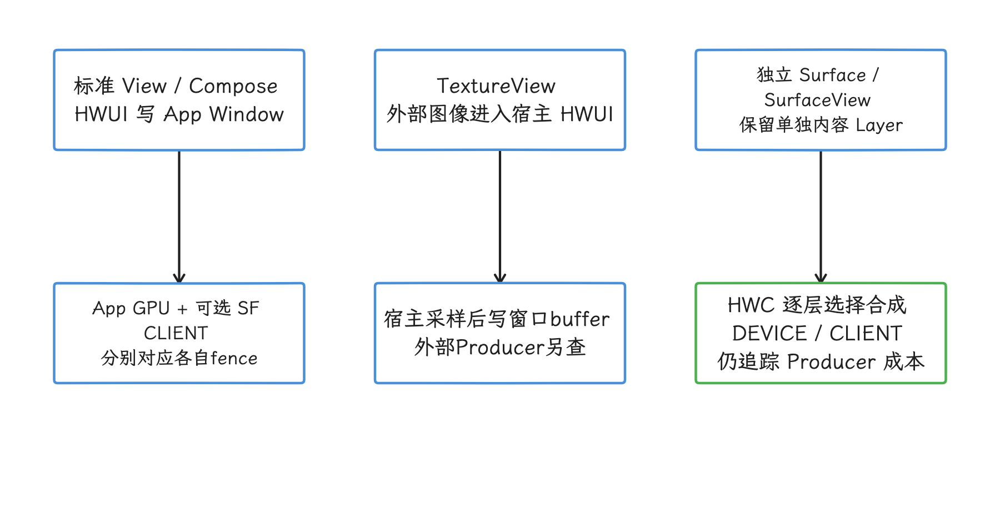

图：从内容承载拓扑解释哪些 GPU 工作可能混入同一设备 counter。 DEVICE 说明本轮合成路径，不能推出 Producer 没有GPU成本；同屏图层变化也可触发CLIENT。

Camera 和视频还存在相反情况：主体内容通过 ISP、codec 与 HWC 路径完成，GPU counter 可能保持很低，画面仍会因 HAL（Hardware Abstraction Layer，硬件抽象层） 或 codec 输出晚、acquire fence 晚、requested present timestamp（producer 请求的显示时间）、HWC 或 display driver 延迟而错过显示。这些硬件阶段都落在 GPU counter 的覆盖范围之外。

<!-- gracker-diagram: ch15-12-10-mixed-hardware-work -->
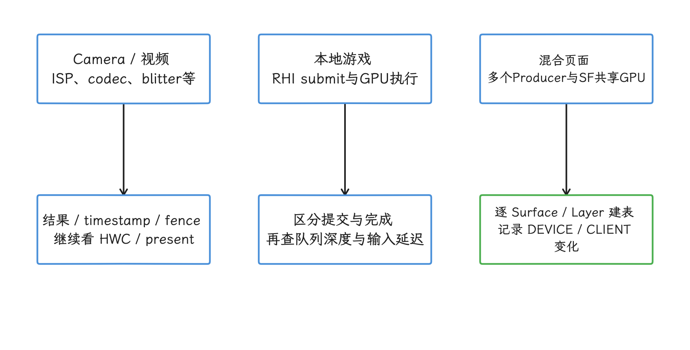

图：同一个 GPU counter 不能覆盖所有 Producer 硬件或区分多个共享 GPU 的来源。 ISP、codec、HWC与显示驱动的迟到可能发生在低GPU活动时；高峰值也不能独立指向目标App。

#### 一次可复用的关联顺序

1. 从异常的 display present 或 FrameTimeline actual frame（实际发生的帧时间线记录）选定时间窗口，记录 `display_frame_token`（关联 SurfaceFlinger DisplayFrame 的标识）、目标 layer 和 present 时间。
2. 按标准窗口、TextureView、独立 Surface、Camera/Video、Game 或混合页面建立 producer—BufferQueue—layer 对象表。
3. 沿目标 buffer 反查 producer CPU 工作、GPU submission/render stage、completion/acquire fence、`queueBuffer`、SF latch 与 composition type。
4. 在已经确定归属的 GPU 工作区间内读取 counter span，使用 descriptor 的名称、单位、group、采样周期和 block 配置解释数值。
5. 对比相同设备、相同 counter 配置、相同温度和显示模式下的基线。跨厂商、跨驱动或不同 counter 组合不直接比较绝对值。

<!-- gracker-diagram: ch15-12-11-frame-association-order -->
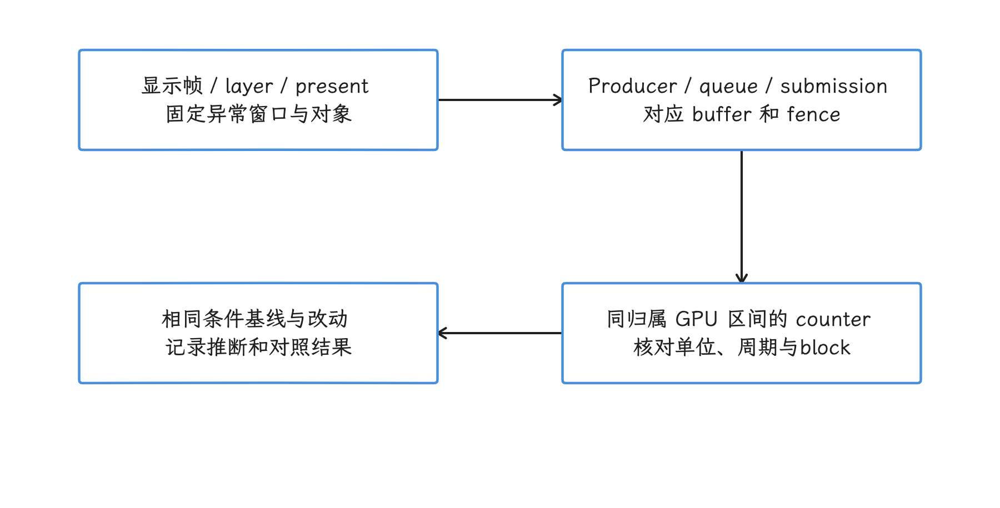

图：从异常显示帧反查 Producer 与同步链，最后解释属于该区间的 counter。 跨设备、热状态或counter组合改变后不能直接比较绝对值。

这套顺序把 counter 放在逐帧时间线之后：先有对象和同步关系，再读数值。counter 能回答“已定位的 GPU 区间为什么变重”；“谁让这一帧卡了”这种问题，要回到逐帧时间线上解决。

### 采集与分析建议

1. **先看 descriptor，再解释数值**：分析 counter value 前，应先确认 `counter_id` 对应的 `name`、`numerator_units`、`denominator_units` 与 `groups`。
2. **尊重 block capacity**：批量启用 counter 时，应按 `GpuCounterBlock.block_capacity` 检查是否超出同一硬件 block 的同时采样能力。
3. **区分平台事件与厂商 counter**：`GpuMemTotalEvent` 是 Android 平台 GPU memory 事件；GPU 频率、fragment、triangle 等 counter 仍要靠 GPU counter producer 暴露。
4. **记录出图拓扑**：同一 counter 峰值在标准 HWUI、TextureView、独立 Surface 与视频 overlay 等场景中的来源不同；这里的视频 overlay 指独立视频 layer 由 HWC 直接合成的路径。采集说明至少要记下 Surface 类型、layer、graphics API、HWC composition 与显示模式，否则两次采集之间没法对比。
5. **不要强行跨厂商比较**：仅凭同属 `MEMORY`、`FRAGMENTS` 或 `COMPUTE` 分组不足以证明 counter 可比。若要建立跨设备基准，必须记录厂商 producer、counter 名称、单位和采样频率；若用不同名称作为同类指标，还要写明映射依据。
6. **控制 trace 体积**：样本数量近似为 `counter 数 × 采样频率 × 时长`，但 protobuf 的 `int_value` 用 varint（按数值大小改变字节数的整数编码） 编码，字节数随数值大小变化；`double_value`、嵌套 message（嵌套消息）、packet framing（数据包边界信息）、descriptor 与 interning 引用也各有额外成本。所以我们不按固定的“每项 12 bytes”推算容量，而是先做一次短时采集，测出生成 trace 的 bytes/s，再为目标时长设置 buffer 和采样周期。

<!-- gracker-diagram: ch15-12-12-trace-volume -->
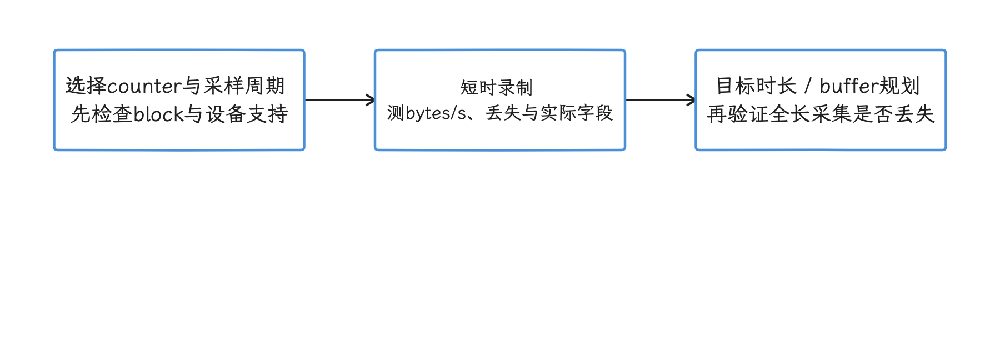

图：先用短采集测量实际 bytes/s，再按目标时长与采样配置估算 buffer。 counter数×频率×时长只是样本数估计；整数varint、double、descriptor与packet都有不同开销。

### 范围外主题

下列主题需要另行补充 Android 17 基线下的一手材料或可复现实验后再写入正文结论：

- Adreno / Mali / PowerVR / Xclipse 的厂商 counter 私有命名表与等价映射。
- UI 渲染、游戏、视频、计算摄影等工作负载下的正常 / 警告 / 异常阈值。
- Vulkan Ray Tracing 管线开销与 Android 17 设备支持边界。
- NNAPI（Android 神经网络 API）、厂商 NPU / ML 加速器与 GPU 渲染负载之间的调度影响。
- `profileable`、权限、SELinux（Android 强制访问控制机制） 访问控制或生产采集策略对 GPU counter 可见性的影响。
- AGI Frame Capture、Layer Override（图形 layer 替换）、GAPID 到 AGI 迁移等完整工具工作流。

### 信息源

所有源码引用均按 AOSP `android-17.0.0_r1` 中 `external/perfetto` 路径复核：

- [`protos/perfetto/common/gpu_counter_descriptor.proto`](https://android.googlesource.com/platform/external/perfetto/+/android-17.0.0_r1/protos/perfetto/common/gpu_counter_descriptor.proto)
- [`protos/perfetto/trace/gpu/gpu_counter_event.proto`](https://android.googlesource.com/platform/external/perfetto/+/android-17.0.0_r1/protos/perfetto/trace/gpu/gpu_counter_event.proto)
- [`protos/perfetto/config/gpu/gpu_counter_config.proto`](https://android.googlesource.com/platform/external/perfetto/+/android-17.0.0_r1/protos/perfetto/config/gpu/gpu_counter_config.proto)
- [`protos/perfetto/config/data_source_config.proto`](https://android.googlesource.com/platform/external/perfetto/+/android-17.0.0_r1/protos/perfetto/config/data_source_config.proto)
- [`protos/perfetto/trace/android/gpu_mem_event.proto`](https://android.googlesource.com/platform/external/perfetto/+/android-17.0.0_r1/protos/perfetto/trace/android/gpu_mem_event.proto)
- [`src/trace_processor/importers/proto/gpu_event_parser.h`](https://android.googlesource.com/platform/external/perfetto/+/android-17.0.0_r1/src/trace_processor/importers/proto/gpu_event_parser.h)
- [`src/trace_processor/importers/proto/gpu_event_parser.cc`](https://android.googlesource.com/platform/external/perfetto/+/android-17.0.0_r1/src/trace_processor/importers/proto/gpu_event_parser.cc)
- [`src/trace_processor/metrics/sql/android/gpu_counter_span_view.sql`](https://android.googlesource.com/platform/external/perfetto/+/android-17.0.0_r1/src/trace_processor/metrics/sql/android/gpu_counter_span_view.sql)
- [`test/trace_processor/diff_tests/parser/graphics/gpu_counter_specs.textproto`](https://android.googlesource.com/platform/external/perfetto/+/android-17.0.0_r1/test/trace_processor/diff_tests/parser/graphics/gpu_counter_specs.textproto)


## GpuService 数据源、时间线与驱动统计

通用计数器描述负载趋势；再要进程或驱动侧的内存信号，就进入 `frameworks/native/services/gpuservice/` 这一层。这里承载多条 GPU 观测路径，“可观测性”指把驱动上报的数值和事件提供给诊断工具；GpuService 本身不承担这些内存的管理职责，buffer 的分配、复用与回收仍由 gralloc（系统与厂商之间的图形 buffer 分配接口）、图形实现和厂商驱动负责。

当前量、事件时间线和累计统计各有各的语义，我们分析时要先分清手头的数据属于哪一种，再选查询入口。

GPU 内存路径从 `gpu_mem_total` tracepoint（内核或驱动预先定义的静态追踪事件） 开始：`gpuMem.c` 中的 BPF 程序读取事件，把每个 GPU 与进程最近上报的当前总量写入 map；`GpuMem` 再读取 map，通过 dumpsys 和 Perfetto 暴露结果。`GpuStats` 是另一条路径，记录 GL、Vulkan、ANGLE 驱动加载和图形功能使用信息，并通过 dumpsys 与 statsd 输出，其中没有 GPU 内存字节。

设备可能使用其他内核分支；Android 12 至 Android 16 在后文只用于说明能力演进。

### 三条并列的观测链路

GpuService 中与 GPU 内存和驱动状态相关的主体分为三条链路。前两条描述 GPU 内存当前总量及其时间变化，第三条描述驱动加载和功能使用，我们先用一张表把它们总览一遍：

| 链路 | 组件 | 输入 | 输出 / 消费方 | 适合回答的问题 |
| --- | --- | --- | --- | --- |
| 当前总量 | <code>Gpu<wbr>Mem</code> + <code>gpu<wbr>Mem.<wbr>c</code> BPF 程序 | GPU 驱动发出的 <code>gpu_<wbr>mem/<wbr>gpu_<wbr>mem_<wbr>total</code> tracepoint | <code>dumpsys gpu --gpumem</code>、<code>traverse<wbr>Gpu<wbr>Mem<wbr>Totals()</code> | 每个 <code>(gpu_<wbr>id, pid)</code> 最近上报的当前总量是多少？ |
| Perfetto 时间线 | <code>Gpu<wbr>Mem<wbr>Tracer</code> + ftrace | BPF map 起始值；驱动后续发出的 tracepoint | Perfetto 的初始 <code>gpu_<wbr>mem_<wbr>total_<wbr>event</code> 与持续 <code>gpu_<wbr>mem/<wbr>gpu_<wbr>mem_<wbr>total</code> 更新 | trace 开始时占用多少，随后怎样变化？ |
| 驱动统计 | <code>Gpu<wbr>Stats</code> | GL / Vulkan / ANGLE 驱动加载与功能使用上报 | statsd pull atom、<code>dumpsys gpu --gpustats</code> | 驱动加载是否成功、耗时多久、使用了哪些图形功能？ |

表里出现的三个术语分别是：

- BPF map：内核 BPF 程序与用户态共享的键值表；
- ftrace：把内核 tracepoint 事件写入 trace 的追踪机制；
- statsd pull atom：statsd 在采集时向数据提供方主动拉取的结构化记录。

`GpuMem` 持有只读 BPF map，`GpuMemTracer` 通过 `GpuMem::traverseGpuMemTotals()` 遍历它，Perfetto 的 ftrace 更新来自驱动的同一个 tracepoint ABI（事件字段与布局约定）。所以我们排查 GPU 内存增长时，占用趋势看 GpuMem 与 Perfetto 这两条，驱动选择和失败模式的信息再找 GpuStats 补充。

<!-- gracker-diagram: ch15-12-13-three-service-paths -->
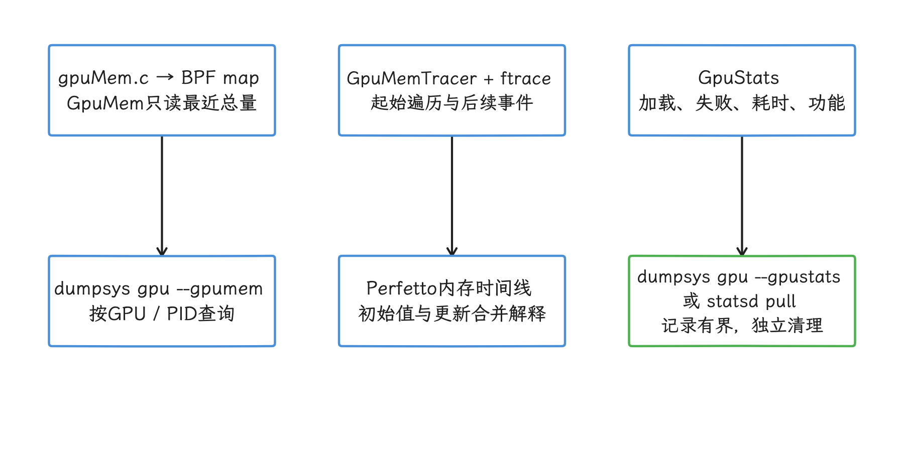

图：GpuMem 当前量、Perfetto 时间变化与 GpuStats 驱动统计分别回答不同问题。 GpuService不拥有这些分配；读当前量与累计加载统计不能画成单向管理链。

### GpuService 的启动与初始化

`GpuService.cpp` 的构造函数同步创建核心对象，然后把可能阻塞的 BPF 初始化放到独立线程里。BPF 在这里指由内核校验后执行、用于处理 tracepoint 事件的小程序。我们在源码里能看到两条初始化线程：

```cpp
GpuService::GpuService()
    : mGpuMem(std::make_shared<GpuMem>()),
      mGpuWork(std::make_shared<gpuwork::GpuWork>()),
      mGpuStats(std::make_unique<GpuStats>()),
      mGpuMemTracer(std::make_unique<GpuMemTracer>()),
      mFeatureOverrideParser(kConfigFilePath) {
    mGpuMemAsyncInitThread = std::make_unique<std::thread>([this] {
        mGpuMem->initialize();
        mGpuMemTracer->initialize(mGpuMem);
    });
    mGpuWorkAsyncInitThread = std::make_unique<std::thread>([this] {
        mGpuWork->initialize();
    });
}
```

这段代码给我们三个信息：

1. `GpuMem → GpuMemTracer` 是串行依赖：`GpuMemTracer::initialize()` 要求传入的 `GpuMem` 已经初始化成功，否则读不到 BPF map 里的起始 counter。
2. `GpuWork` 独立并行：GPU work period（GPU 工作时长区间） 的 BPF 聚合与 GPU memory total 的 BPF 聚合是两条互补链路，这里只把 GpuWork 作为旁路观测来源。
3. 主服务构造不等待 BPF attach：attach 指把 BPF 程序挂到 tracepoint，使事件发生时执行该程序。`mGpuMem->initialize()` 会等待 bpfloader（系统 BPF 加载器），并可能等待 GPU tracepoint 出现；独立线程让构造函数先返回。

析构期会给 GpuMem 与 GpuWork 设置停止标志，再用 `join()` 等待两条初始化线程退出。成员对象随后析构，`GpuMem::~GpuMem()` 调用 `bpf_detach_tracepoint()`。

`stop()` 只会让 attach 重试循环退出。已经启动的 `GpuMemTracerThread` 是 detached thread（与创建者分离、不能再 `join()` 的线程），创建者这边没有 `join()` 的入口，源码也没有为它定义独立停止协议。gpuservice 通常与所在进程同寿命，这段实现要按同寿命的常驻服务来读，当成可反复创建和销毁的通用组件模板会出问题。

<!-- gracker-diagram: ch15-12-14-service-startup -->
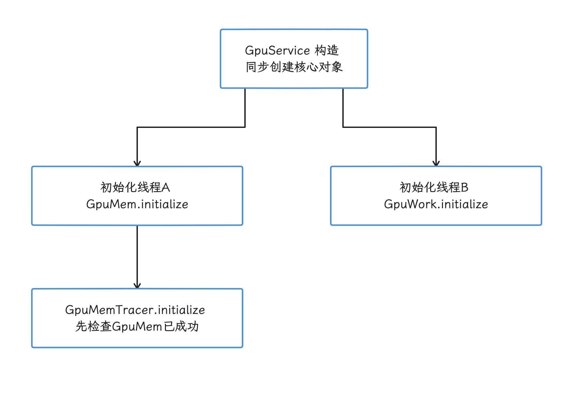

图：GpuMem 与 tracer 在同一初始化线程内先后执行，GpuWork 在另一线程独立初始化。 析构stop并join两条初始化线程；tracer常驻工作线程已detach，不能当作通用可反复销毁组件。

### GpuMem：基于 eBPF 的进程级 GPU 内存快照

`GpuMem.h` 定义了 tracepoint，以及 pinned program 和 map 的路径。pinned object 是绑定到 BPF 文件系统路径的 BPF 对象，用户态进程可通过该路径重新打开它。初始化直接用到这几个常量：

```cpp
static constexpr char kGpuMemTraceGroup[]      = "gpu_mem";
static constexpr char kGpuMemTotalTracepoint[] = "gpu_mem_total";
static constexpr char kGpuMemTotalProgPath[]   =
    "/sys/fs/bpf/prog_gpuMem_tracepoint_gpu_mem_gpu_mem_total";
static constexpr char kGpuMemTotalMapPath[]    =
    "/sys/fs/bpf/map_gpuMem_gpu_mem_total_map";
static constexpr int  kGpuWaitTimeout          = 30;  // seconds
```

我们顺着 `GpuMem::initialize()` 把工作顺序过一遍：

1. 调 `bpf::waitForProgsLoaded()` 等待系统 BPF 程序加载完成；
2. 从 `/sys/fs/bpf/prog_gpuMem_tracepoint_gpu_mem_gpu_mem_total` 取出 pinned BPF program 的 fd（文件描述符）；
3. 调 `bpf_attach_tracepoint(fd, "gpu_mem", "gpu_mem_total")` 绑定 GPU 驱动 tracepoint；
4. 如果 attach 失败且 `mStop` 未置位，每次失败后等待 1 秒再试；累计等待约 30 秒后，下一次 attach 仍失败便结束初始化，用来覆盖 GPU 驱动晚于 gpuservice 启动的窗口；
5. 用只读包装 `bpf::BpfMapRO<uint64_t, uint64_t>(kGpuMemTotalMapPath)` 打开 map，成功后把 `mInitialized` 置为 true。

用户态使用 `BpfMapRO`，表示 GpuService 只读；附着在 tracepoint 上的 BPF 程序负责更新；pinned object 的文件权限和 SELinux 规则仍参与访问控制，`BpfMapRO` 本身也不去校验驱动上报的内容。

<!-- gracker-diagram: ch15-12-15-bpf-attach-and-map -->
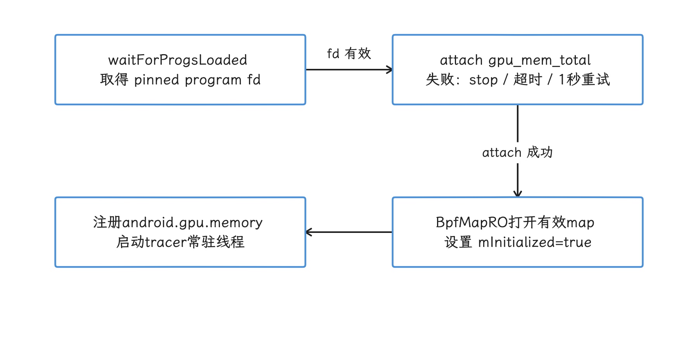

图：等待加载、获取程序、attach成功并打开只读map后，GpuMem才标记初始化完成。 attach失败时才检查stop与重试上限；约30秒后停止该实例初始化，tracer不会在失败时注册。

#### BPF key 编码与 map 更新语义

内核 `android17-6.18-2026-06_r6` 的 `gpu_mem_total` tracepoint 规定了四件事：

- `pid == 0` 表示该 GPU 的全局总量；
- 正 PID 表示进程总量；
- `size` 是更新后的总字节数，不是本次分配的增量；
- 驱动在 GPU 可寻址空间发生 allocate、free、import 或 unimport 后发出事件；GPU 可寻址空间指已经映射、可由 GPU 访问的内存范围。

GpuService 的 BPF 程序把事件保存到 map。下面是删减后的片段，用中文注释省略了实际的 delete/update 语句，只展示容量、key 和零值删除语义：

```c
#define GPU_MEM_TOTAL_MAP_SIZE 1024

DEFINE_BPF_MAP_GRO(gpu_mem_total_map, HASH, uint64_t, uint64_t,
                   GPU_MEM_TOTAL_MAP_SIZE, AID_GRAPHICS);

struct gpu_mem_total_args {
    uint64_t ignore;
    uint32_t gpu_id;
    uint32_t pid;
    uint64_t size;
};

DEFINE_BPF_PROG("tracepoint/gpu_mem/gpu_mem_total", AID_ROOT, AID_GRAPHICS,
                tracepoint_gpu_mem_gpu_mem_total)
(struct gpu_mem_total_args* args) {
    uint64_t key = ((uint64_t)args->gpu_id << 32) | args->pid;
    uint64_t cur_val = args->size;
    /* cur_val == 0 时删除 key；否则 update / insert size */
    return 0;  // 本删减片段省略 map 操作，不能作为实际采集程序
}
```

key 是 `uint64_t = (gpu_id << 32) | pid`：高 32 位放 `gpu_id`，低 32 位放 `pid`。value 保存该 GPU / PID 组合最近一次上报的总字节数。`cur_val == 0` 时 BPF 程序删除 entry（map 中的一条键值记录）；只要驱动完整遵守 tracepoint ABI，条目消失就说明该组合已归零。

<!-- gracker-diagram: ch15-12-16-bpf-map-updates -->
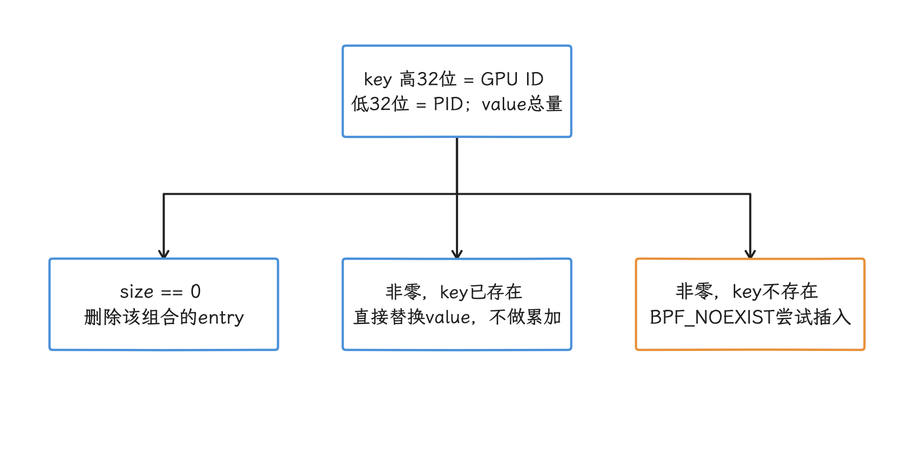

图：用高32位GPU ID和低32位PID定位组合，零值删除，非零值替换最近总量。 map最多1024个组合含PID0；新键插入返回值未检查，满表时新组合可能缺失。

这里还有三个容易漏掉的限制：

1. tracepoint payload（事件携带的字段） 只有 `gpu_id`、`pid`、`size`，没有 DMA-BUF inode、fd、buffer handle 或 allocation callsite。DMA-BUF 是 Linux 跨设备共享 buffer 的机制，inode 是内核对象标识，callsite 是触发分配的代码位置；
2. `GPU_MEM_TOTAL_MAP_SIZE = 1024` 限制的是 `(gpu_id, pid)` entry 数，pid 0 的全局 entry 也占一个位置；
3. 新 key 使用 `BPF_NOEXIST`（仅当 key 不存在时插入），程序没有检查插入返回值。map 填满后，新组合可能没有进入统计。

`dump()` 和 `traverseGpuMemTotals()` 通过 `getFirstKey()` / `getNextKey()` 逐项读取 map。遍历期间驱动仍可更新 map，因此输出是 best-effort（尽力而为、不同 entry 可能取自相邻时刻） 快照，跨 entry 没有原子一致性；中途的 value 或 next-key 读取错误还会提前结束遍历。

<!-- gracker-diagram: ch15-12-17-non-atomic-snapshot -->
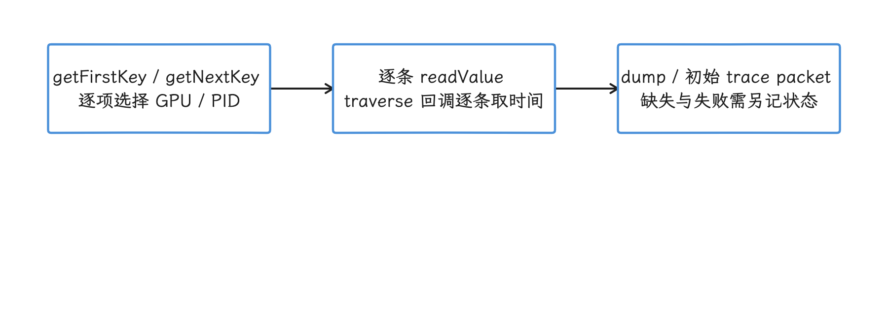

图：遍历时分别读取每个组合，输出是驱动持续更新下的尽力快照。 跨entry不原子，value/next-key错误会提前结束；first-key错误也可能显示为空map。

到这一步，我们能用 GpuMem 回答驱动最近上报的进程总量；再往下问“哪一个 DMA-BUF 或 BufferQueue slot（队列中复用 buffer 的槽位） 占用最大”，它就答不上来了，那要靠后文的 DMA-BUF 数据源。

### `dumpsys gpu`：即时查询入口

C++ 组件名是 `GpuService`，注册到 ServiceManager（Binder 系统服务注册表） 的服务名是 `gpu`：`GpuService::SERVICE_NAME = "gpu"`。`dumpsys` 按 Binder 服务名查找目标，因此命令入口是 `dumpsys gpu`。

`GpuService.cpp::doDump()` 对 shell / dump 权限调用方开放，调用方需要满足 `uid == AID_SHELL` 或持有 `android.permission.DUMP`。常用命令如下：

| 命令 | 触发模块 | 用途 |
| --- | --- | --- |
| <code>dumpsys gpu</code> | dumpAll=true，全部模块输出 | 一次性查看 GameDriverInfo、GpuMem、GpuStats、GpuWork |
| <code>dumpsys gpu --gpumem</code> | <code>m<wbr>Gpu<wbr>Mem-&gt;dump()</code> | 只看 <code>(gpu_<wbr>id, pid)</code> GPU 内存快照 |
| <code>dumpsys gpu --gpustats</code> | <code>m<wbr>Gpu<wbr>Stats-&gt;dump()</code> | 只看 GL / Vulkan / ANGLE 驱动加载统计 |
| <code>dumpsys gpu --gpudriverinfo</code> | GameDriverInfo | 查看 <code>ro.<wbr>gfx.<wbr>driver.<wbr>*</code> 相关驱动信息 |
| <code>dumpsys gpu --gpuwork</code> | <code>m<wbr>Gpu<wbr>Work-&gt;dump()</code> | 查看按 UID / GPU 聚合的 work period 统计 |

`GpuMem::dump()` 中的两个边界输出很适合排查启动问题：

<!-- gracker-diagram: ch15-12-18-dumpsys-routing -->
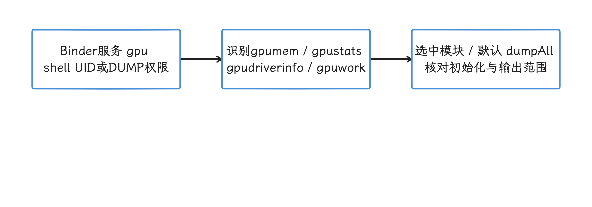

图：dumpsys按服务名找到gpu，权限通过后由四种已识别模块标志选择输出。 无已识别模块标志时回退全部模块；空map输出不等于证明无占用或无采集错误。

- `Failed to initialize GPU memory eBPF`：`mInitialized` 为 false 或 BPF map 无效，通常意味着 BPF 程序、tracepoint attach 或初始化时序未完成；
- `GPU memory total usage map is empty`：源码在 `getFirstKey()` 返回任意错误时输出这句话。常见情况是 GPU 驱动尚未上报非零条目或当前没有活跃占用，但该字符串没有区分空 map 与其他 key 枚举错误。未识别的模块选择参数还会令 `dumpAll` 保持 true；拼错 `--gpumem` 可能输出全部模块，不能按输出量猜测选项已生效。

排查建议：别用单次 dumpsys 判断泄漏。`--gpumem` 是瞬时快照，应在场景前、中、后多次采样，关注同一 pid 的 `size` 是否随场景退出归零或回落。

### GpuMemTracer 与 ftrace：初始值加后续更新

`GpuMemTracer` 把同一份 `GpuMem` map 作为 Perfetto 初始状态。下面的常量是注册的数据源名，配置时必须逐字匹配：

```cpp
static constexpr char kGpuMemDataSource[] = "android.gpu.memory";
```

该名称是 `android.gpu.memory`，下划线形式 `android.gpu_mem` 不对应这份源码。

初始化后，GpuMemTracer 向 system backend（系统 Perfetto tracing service） 注册 data source，并启动分离的 `GpuMemTracerThread`。Perfetto 调用 `OnStart()` 时，将共享布尔标志 `sTraceStarted` 置为 true 并唤醒线程；线程看到标志后执行 `traceInitialCounters()`，结束后再清为 false。这里不是逐次 Start 的请求队列；`OnStop()` 为空，也不会停止常驻线程或追补快照。遍历到的每个 map entry 会形成一个 `GpuMemTotalEvent`：

```cpp
auto* event = packet->set_gpu_mem_total_event();
event->set_gpu_id(gpuId);
event->set_pid(pid);
event->set_size(size);
packet->set_timestamp_clock_id(
    perfetto::protos::pbzero::BUILTIN_CLOCK_MONOTONIC);
packet->set_timestamp(ts);
```

这段代码给 trace 提供起始基线。`traverseGpuMemTotals()` 在遍历每个 entry 时分别调用 `systemTime()`，所以各 packet 的时间戳可能略有差异，整组数据同样不是原子快照。

后续变化由 ftrace 的 `gpu_mem/gpu_mem_total` 事件提供。我们要想拿到从起点开始的时间序列，Perfetto 配置就得同时启用初始 data source 和 ftrace 事件。下面是这两项的最小配置片段：

```textproto
data_sources {
  config {
    name: "android.gpu.memory"
    target_buffer: 0
  }
}

data_sources {
  config {
    name: "linux.ftrace"
    target_buffer: 0
    ftrace_config {
      ftrace_events: "gpu_mem/gpu_mem_total"
    }
  }
}
```

`android.gpu.memory` 写入 trace 启动时已有的非零 entry；`linux.ftrace` 记录会话期间驱动发出的更新。只启用前者会得到一次起始遍历，只启用后者可能缺少首次变化之前的基线。该链路由事件触发，没有固定周期 polling（定时读取）；驱动没有发出 tracepoint 时，轨道就不会变化。

<!-- gracker-diagram: ch15-12-19-initial-plus-live-updates -->
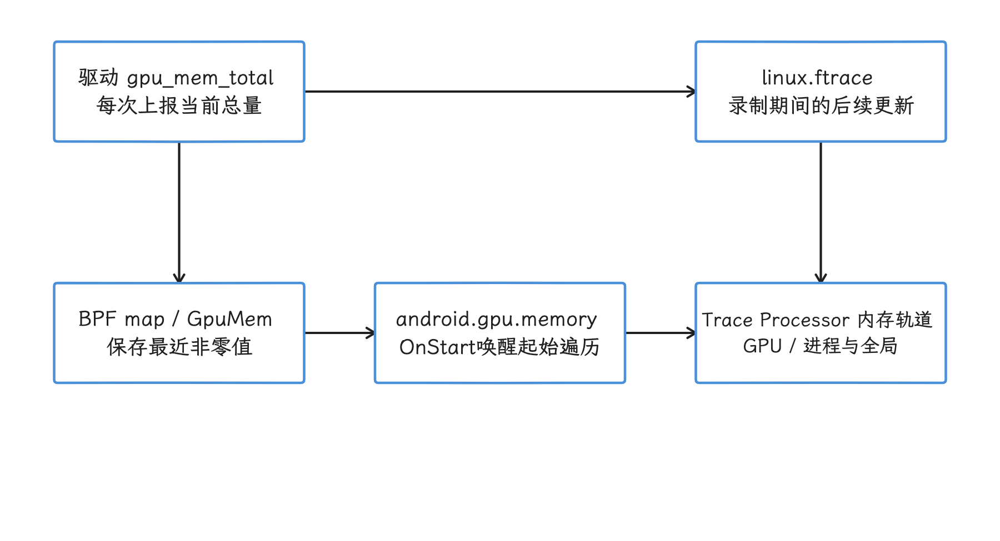

图：初始数据源读取map，ftrace记录驱动后续事件，两者共同构成可解释的时间序列。 起始遍历不原子；没有事件不会定时变化，单独开启任一条链都可能缺少一部分时间证据。

### GpuStats：statsd 驱动加载与功能使用统计

`GpuStats` 保存图形驱动加载和功能使用信息，不保存 GPU 内存字节数。GpuStats 通过 pull atom 在 statsd 请求时生成结构化统计记录。`GpuStats.h` 为自身内存占用设置了以下上限：

```cpp
static const size_t MAX_NUM_LOADING_TIMES = 16;
static const size_t MAX_NUM_APP_RECORDS   = 100;
static const size_t APP_RECORD_HEADROOM   = 10;
```

每条 App 记录的键是包名与 `driverVersionCode` 的字符串拼接，该记录的 GL、Vulkan 和 ANGLE loading-time（驱动加载耗时）数组各自最多保留最先收到的 16 个样本；后续样本不会滚动替换旧值。新增键且已有 100 条记录时，`purgeOldDriverStats()` 按 `lastAccessTime` 排序删除最旧的 10 条，再插入新记录。这里的 100 是记录数，不能当作 100 个互异 App。源码注释给出的目标是让 GpuStats 内存占用低于约 10KB。

<!-- gracker-diagram: ch15-12-20-stats-record-capacity -->
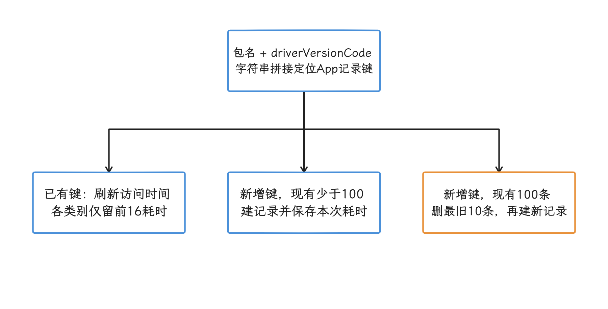

图：按包名与驱动版本构造记录键，各加载类别保留前16样本，新键满表时淘汰旧记录。 100是App记录数，GL/Vulkan/ANGLE分别计16；它们都不是完整历史或滚动采样窗口。

ANGLE 在 GpuStats 里是独立的驱动类别，下面的分支累计它的全局加载次数和失败次数：

```cpp
case GpuStatsInfo::Driver::ANGLE:
    outGlobalInfo->angleLoadingCount++;
    if (!isDriverLoaded) outGlobalInfo->angleLoadingFailureCount++;
    break;
```

应用维度用 driver enum（驱动类别枚举值） 或包名识别本次报告是否使用 ANGLE：

```cpp
appInfo.angleInUse =
    driver == GpuStatsInfo::Driver::ANGLE || driverPackageName == "angle";
```

现有记录再次收到 `insertDriverStats()` 时，`angleInUse` 会被这次判断覆盖，因此它当不了只增不减的历史标志。`angleLoadingCount` 与 `angleLoadingFailureCount` 可以帮助解释驱动路径差异，但它们与 GPU 内存泄漏没有证明关系。

GpuStats 在第一次收到驱动或目标统计时，才向 statsd 注册 `GPU_STATS_GLOBAL_INFO` 与 `GPU_STATS_APP_INFO` 两个 pull callback（由 statsd 拉取时调用的回调）。每次 pull 成功返回后，对应的 `mGlobalStats` 或 `mAppStats` 都会被清空。

因此两类 atom 各自反映本类 pull 窗口内仍被保留的记录，拉取 GLOBAL 不会同时清空 APP，反之亦然。16 样本截断、记录淘汰与显式 `--clear` 还可能进一步减少数据；它既不是开机累计值，也不是窗口内全部事件的完整历史。

<!-- gracker-diagram: ch15-12-21-stats-pull-and-clear -->
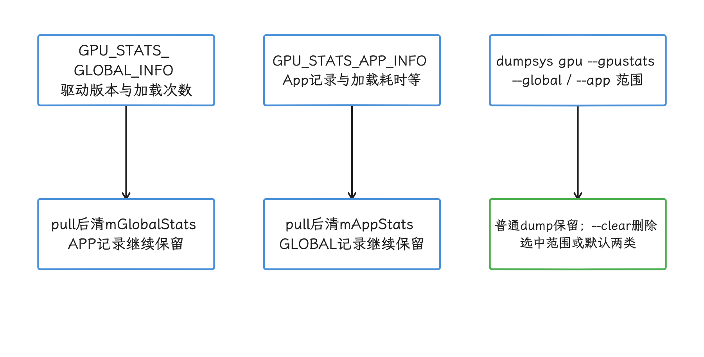

图：GLOBAL和APP各自保留与清空记录，普通dump查看，显式clear会改变后续证据。 两类pull互不代清；截断、淘汰和clear都会缩减窗口内记录，不能当作全事件全集。

`dumpsys gpu --gpustats --global` 与 `--app` 可以限定输出；追加 `--clear` 会清除所选统计。`--clear` 会改变后续 dumpsys 和 statsd pull 的结果，采集证据前先别用它。

`toggleAngleAsSystemDriver(enabled)` 只允许 appId 为 `AID_SYSTEM` 且持有 `android.permission.ACCESS_GPU_SERVICE` 的调用方切换，开启时尝试写入持久系统属性 `persist.graphics.egl=angle`。

`/system/etc/angle/feature_config_vk.binarypb` 是另一条配置路径，其中 `binarypb` 表示二进制 protobuf 文件。`FeatureOverrideParser` 在 GpuService 构造期间解析一次并缓存，文件后续变化不会自动重载。系统驱动属性、feature override（功能覆盖配置） 与 GpuStats 彼此有关联，但源码没有把它们实现成单向的三阶段处理链。

<!-- gracker-diagram: ch15-12-22-angle-independent-roles -->
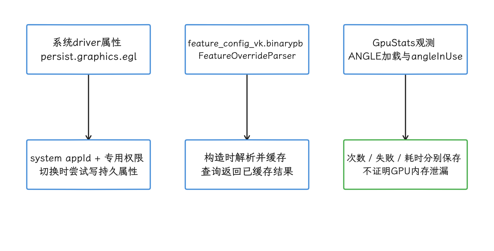

图：切换系统驱动、读取feature配置和记录使用统计各有独立入口与生命周期。 构造时配置缓存不自动热重载；angleInUse会被最新上报覆盖，不能充当永久历史标志。

### 从进程总量走到 DMA-BUF

到这一步，我们已经能回答“哪个进程的 GPU 内存涨了”。但 GpuMem 只有进程总量，没有 DMA-BUF 标识，要再往下定位到具体 buffer，就得补充其他数据源：

| 数据源 | 统计口径 | 能回答的问题 |
| --- | --- | --- |
| <code>dumpsys gpu --gpumem</code> | 驱动上报的 <code>(gpu_<wbr>id, pid)</code> 当前总量 | 哪个进程的 GPU 可寻址内存增长？ |
| <code>dumpsys meminfo &lt;pid&gt;</code> / memtrack HAL | Framework 内存核算中的 GL 与 Graphics | 未进入 smaps 的 GPU private 和 DMA-BUF PSS 有多少？ |
| <code>dmabuf_<wbr>dump &lt;pid&gt;</code> | 进程持有或映射的 DMA-BUF | 哪些 DMA-BUF inode 被该进程引用？ |
| <code>dmabuf_<wbr>dump -b</code> | 每个 buffer、exporter 和 device 的统计 | 大 buffer 来自哪个 exporter 或设备？ |
| <code>dumpsys Surface<wbr>Flinger</code> / <code>--list</code> | 当前 layer 与合成状态 | 哪些 layer 与当前 buffer 状态可关联？ |
| Perfetto GPU memory | 初始总量和 tracepoint 更新 | 增长发生在哪个业务时间窗？ |

memtrack HAL 是厂商实现的设备内存核算接口，`dumpsys meminfo` 会使用其数据。`/proc/<pid>/smaps` 是按进程内存映射列出核算信息的内核接口，PSS（Proportional Set Size） 把共享内存按引用者比例分摊。GPU private 指厂商 memtrack 按 GL 类别报告、未计入 smaps 的 GPU 私有分配，它不一定有 DMA-BUF identity。inode 是 DMA-BUF 的内核对象标识，exporter 是创建并导出该 DMA-BUF 的驱动或子系统。

`IMemtrack.aidl`（memtrack 的稳定 AIDL 接口定义）对核算口径有明确约束：

- `MemtrackType::GRAPHICS` 与 `FLAG_SMAPS_UNACCOUNTED` 应报告 CPU-mapped 与 GPU-mapped DMA-BUF 的 PSS，并去掉两组之间的重叠；
- `MemtrackType::GL` 与 `FLAG_SMAPS_UNACCOUNTED` 应报告指定 PID 下未计入 `/proc/<pid>/smaps` 的 GPU private allocation；
- PID 0 的 GL 查询应返回全局 GPU-private memory；PID 0 配合其他 type 应返回 0；
- 同一块内存至多计入一个 memtrack type。

GpuMem、memtrack 与 DMA-BUF 统计的数字因此不要求相等：它们覆盖的对象、共享内存分摊方式和去重规则各不相同。严谨的表述是“多种口径同时增长”或“某口径没有同步回落”，逐字节守恒是要求不出来的。

<!-- gracker-diagram: ch15-12-23-memory-accounting -->
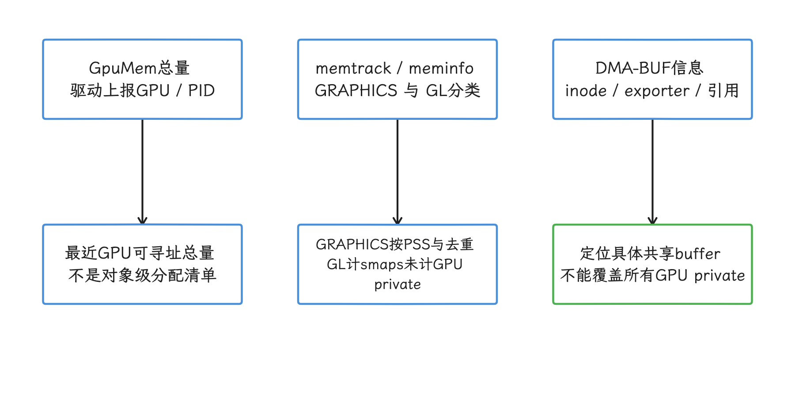

图：三种数据覆盖不同对象与共享核算规则，要并列解释变化。 GPU private不一定有DMA-BUF标识，共享PSS也不能与驱动可寻址总量逐字节守恒。

`dmabuf_dump` 来自 `system/memory/libmeminfo`。在 6.18 及更新内核上，VTS（Vendor Test Suite，供应商接口测试） 要求 DMA-BUF BPF iterator 可用；iterator 是由 BPF 实现的内核对象遍历接口。

较早内核还可能通过 `CONFIG_DMABUF_SYSFS_STATS` 提供 per-buffer（逐 buffer）统计。这个 BPF iterator 与 GpuMem 的 `gpu_mem_total_map` 是两套独立机制。

<!-- gracker-diagram: ch15-12-24-two-bpf-mechanisms -->
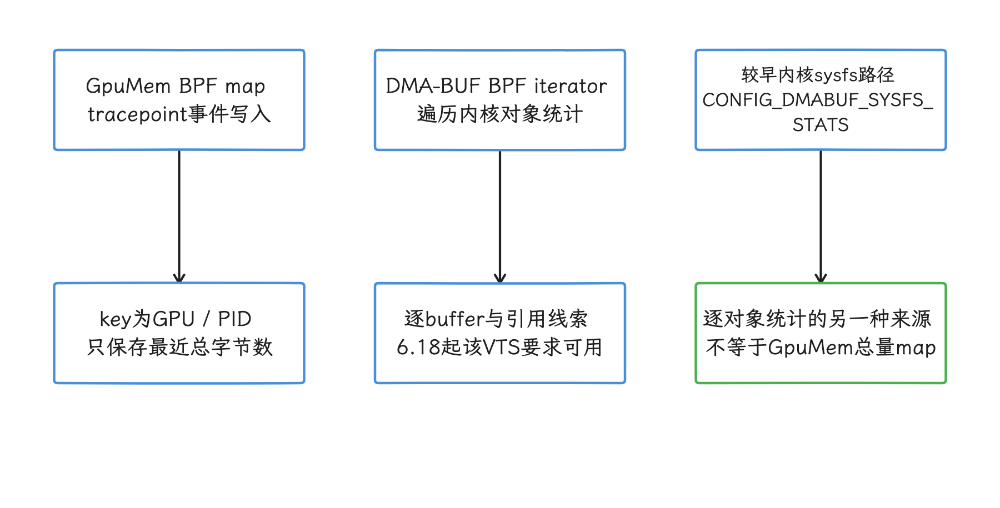

图：总量map和DMA-BUF逐对象遍历是独立机制，不能把一个的可用性当作另一个已启用。 固定VTS要求6.18起支持DMA-BUF iterator；较早内核可有sysfs统计，仍需核对工具与权限。

我们用下面这组命令先找增长进程，再查该进程引用的 DMA-BUF，最后结合 SurfaceFlinger layer 缩小范围。`dmabuf_dump` 读取其他进程和内核对象时通常需要 userdebug/eng（可调试的系统构建变体）环境与 root 权限。

```bash
#!/usr/bin/env bash
set -euo pipefail
app_process=com.example.game
read_target_pid() {
  local target_pid
  target_pid=$(adb shell pidof -s "$app_process") || {
    printf '%s\n' '目标进程不存在或 PID 查询失败' >&2
    return 1
  }
  target_pid=${target_pid//$'\r'/}
  [[ "$target_pid" =~ ^[1-9][0-9]*$ ]] || {
    printf '%s\n' '目标 PID 不是单个正整数，停止采集' >&2
    return 1
  }
  printf '%s\n' "$target_pid"
}
pid=$(read_target_pid)
adb shell dumpsys gpu --gpumem
adb shell dumpsys meminfo "$pid"

# userdebug / eng 设备；确认 adbd 实际以 root 运行
adb root
adb wait-for-device
device_uid=$(adb shell id -u)
device_uid=${device_uid//$'\r'/}
[[ "$device_uid" == "0" ]] || {
  printf '%s\n' 'adbd 未取得 root，停止 DMA-BUF 采集' >&2
  exit 1
}
pid=$(read_target_pid)
adb shell dmabuf_dump "$pid"
adb shell dmabuf_dump -b

adb shell dumpsys SurfaceFlinger --list
adb shell dumpsys SurfaceFlinger
```

示例用 `com.example.game` 演示进程名，运行时把 `app_process` 改成目标进程的完整名称；多进程应用应选择执行图形工作的进程。脚本要求 Bash，PID 查询或 root 校验失败会停止；请先让目标进程运行。这组命令的分工是：`dumpsys gpu` 定位进程总量，meminfo 核对 Framework 内存分类，`dmabuf_dump` 给出 inode 与 exporter 线索，SurfaceFlinger 输出用于关联 layer。

`adb root` 会重启 adbd（设备侧 adb 守护进程），所以示例在 `adb wait-for-device` 后重新读取 PID。Android 17 的 `SurfaceFlinger::doDump()` 命令表里没有 `--bufferstats`，排查时别指望这个参数；默认的 SurfaceFlinger dump 只提供当前合成与 layer 上下文，做不了完整的 DMA-BUF 引用跟踪。

<!-- gracker-diagram: ch15-12-25-memory-investigation -->
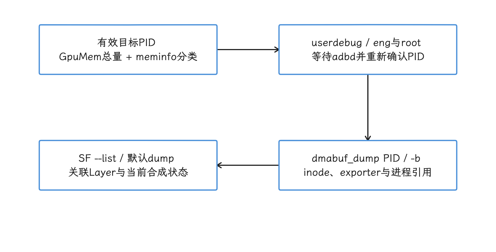

图：先取有效PID和总量，再核对root与新PID，最后结合对象引用和Layer上下文缩小范围。 Bash示例只在PID和root校验通过后继续；SurfaceFlinger没有本基线的--bufferstats选项。

#### 一次增长排查的时间顺序

1. 记录包名、PID、进程启动时间、GPU ID 和场景起止 marker（写入 trace 的阶段标记）；
2. 在场景前保存一次 `--gpumem`、meminfo 与 DMA-BUF 数据；
3. Perfetto 同时启用 `android.gpu.memory` 和 `gpu_mem/gpu_mem_total`；
4. 执行固定输入的场景，保留峰值和退出后的稳定窗口，即数值不再明显变化的一段时间；
5. 重复快照，确认增长来自 GPU private、DMA-BUF，或两者都有；
6. 用 DMA-BUF inode、exporter、进程引用与 SurfaceFlinger layer 缩小持有者范围；
7. 进程退出后核对旧 PID entry 是否删除，避免 PID 复用造成误判。

进程总量在场景结束后没有立即归零，先别急着定性为泄漏：驱动缓存、对象延迟销毁、异步 fence 和进程仍存活都可能让内存暂时保留。下结论前，我们把稳定窗口、多轮重复和对象生命周期一起纳入判断。

<!-- gracker-diagram: ch15-12-26-leak-evidence -->
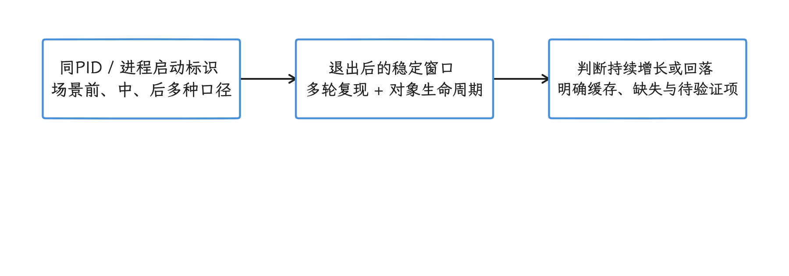

图：对齐场景前后总量、对象引用与生命周期，重复观察稳定窗口再判断异常保留。 缓存、延迟销毁和异步fence可暂时保留内存；缺失entry与PID复用也不能当作确定释放证据。

### 各组件的职责分工

- `GpuService / GpuMem`：读取驱动上报的全局与进程 GPU 内存总量，不拥有这些 allocation（内存分配对象）。
- `GpuMemTracer / Perfetto ftrace`：提供 trace 起始值和会话内更新，用于观察时间变化。
- `GpuStats / statsd`：保存驱动加载、失败、耗时和图形功能使用信息；pull 后相应累计值清空。
- `memtrack HAL / dumpsys meminfo`：按 Framework 规则核算 GL、Graphics 和其他设备专属内存。
- `dmabuf_dump`：读取 DMA-BUF identity（对象标识）、exporter、device 与进程引用，是 buffer 级排查的主要补充。
- `SurfaceFlinger dump`：提供 layer 与合成状态；DMA-BUF 引用分析要靠 `dmabuf_dump`。
- `gfxinfo / GraphicsStats`：报告帧耗时与 jank（掉帧或卡顿事件），不提供 GPU 内存总账。

§10.4 讨论应用与图形内存症状，§15.11 介绍 GPU 调试工具，§15.16 展开 eBPF 观测范围。本文只覆盖 GpuService、GPU memory tracepoint、GpuStats 和 DMA-BUF 对账之间的接口关系。

### 失败模式与结论强度

#### GpuMem 初始化失败

初始化失败可能发生在 pinned program 获取、tracepoint attach 或 map 打开阶段。attach 会在约 30 秒内重试；超时后该 GpuMem 实例不会在后台无限重试，GpuMemTracer 也因 `isInitialized() == false` 而不注册数据源。

设备晚加载驱动时，要结合 logcat（Android 系统日志）、tracefs（内核追踪文件系统） event 与 pinned object 状态判断具体停在哪一步。

#### map 为空

空 map 可能表示当前没有非零 entry，也可能表示驱动没有实现或没有完整发出 tracepoint。内核头文件只定义 ABI，厂商 GPU 驱动是否在 allocate、free、import、unimport 后准确上报，需要查看对应驱动源码或真机验证。

#### Perfetto 只有起始快照

若配置只启用 `android.gpu.memory`，只有启动遍历符合预期。若同时启用 ftrace 后仍没有变化，应确认 tracefs 中存在 `gpu_mem/gpu_mem_total`，并检查场景期间驱动是否发出事件。

#### 数值不一致

GpuMem、memtrack 和 DMA-BUF 的口径不同；先按各自定义解释，再判断差异是否异常。GPU private allocation 可能没有 DMA-BUF identity，共享 DMA-BUF 又会按 PSS 分摊。没有厂商实现证据时，只能把差异记录为待验证项。

#### 可发布的结论

以下结论可由 Android 17 与 6.18 固定 tag 的源码直接支持：

- GpuMem map 保存驱动上报的 `(gpu_id, pid) → total bytes`；
- pid 0 代表全局总量，size 0 会删除 entry；
- `android.gpu.memory` 负责 Perfetto 初始值，ftrace 负责后续变化；
- GpuStats 不保存 GPU 内存字节，statsd pull 会清空相应累计值；
- memtrack、DMA-BUF 与 GpuMem 使用不同核算口径；
- Android 17 SurfaceFlinger 没有 `--bufferstats` dump 选项。

厂商 tracepoint 是否完整上报、设备权限是否满足、Perfetto UI 怎样展示、HAL 对账是否准确以及缓存何时回收，这些都要以实机证据为准。


## 参考资料

- [AOSP android-17.0.0_r1：GpuService.cpp](https://android.googlesource.com/platform/frameworks/native/+/refs/tags/android-17.0.0_r1/services/gpuservice/GpuService.cpp)
- [AOSP android-17.0.0_r1：GpuMem.cpp](https://android.googlesource.com/platform/frameworks/native/+/refs/tags/android-17.0.0_r1/services/gpuservice/gpumem/GpuMem.cpp)
- [AOSP android-17.0.0_r1：gpuMem.c](https://android.googlesource.com/platform/frameworks/native/+/refs/tags/android-17.0.0_r1/services/gpuservice/bpfprogs/gpuMem.c)
- [AOSP android-17.0.0_r1：GpuMemTracer.cpp](https://android.googlesource.com/platform/frameworks/native/+/refs/tags/android-17.0.0_r1/services/gpuservice/tracing/GpuMemTracer.cpp)
- [AOSP android-17.0.0_r1：GpuStats.cpp](https://android.googlesource.com/platform/frameworks/native/+/refs/tags/android-17.0.0_r1/services/gpuservice/gpustats/GpuStats.cpp)
- [Android common kernel android17-6.18-2026-06_r6：gpu_mem tracepoint](https://android.googlesource.com/kernel/common/+/refs/tags/android17-6.18-2026-06_r6/include/trace/events/gpu_mem.h)
- [AOSP android-17.0.0_r1：IMemtrack.aidl](https://android.googlesource.com/platform/hardware/interfaces/+/refs/tags/android-17.0.0_r1/memtrack/aidl/android/hardware/memtrack/IMemtrack.aidl)
- [AOSP android-17.0.0_r1：dmabuf_dump.cpp](https://android.googlesource.com/platform/system/memory/libmeminfo/+/refs/tags/android-17.0.0_r1/libdmabufinfo/tools/dmabuf_dump.cpp)
- [AOSP android-17.0.0_r1：6.18 DMA-BUF BPF iterator VTS](https://android.googlesource.com/platform/system/memory/libmeminfo/+/refs/tags/android-17.0.0_r1/libdmabufinfo/vts/vts_dmabufinfo_test.cpp)
- [AOSP android-17.0.0_r1：SurfaceFlinger dump 命令表](https://android.googlesource.com/platform/frameworks/native/+/refs/tags/android-17.0.0_r1/services/surfaceflinger/SurfaceFlinger.cpp)
- [Perfetto：GPU memory data source](https://perfetto.dev/docs/data-sources/gpu)
