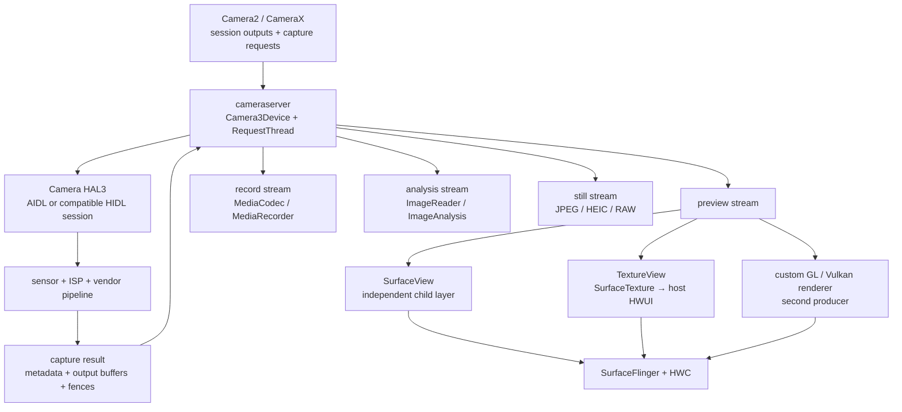
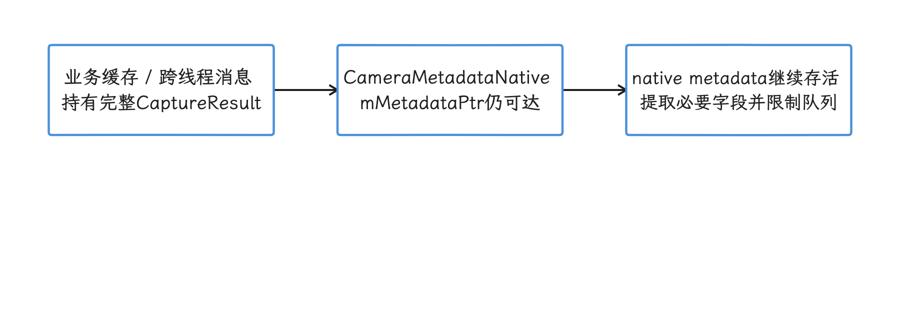
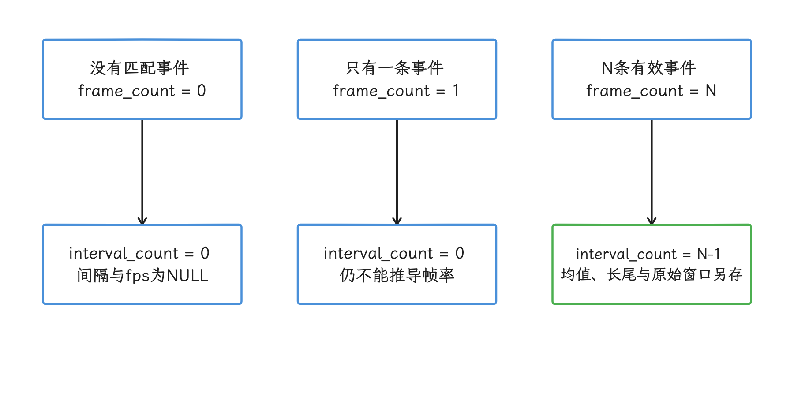
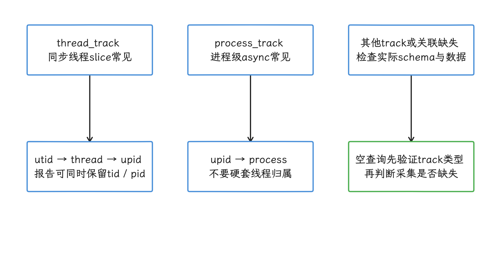
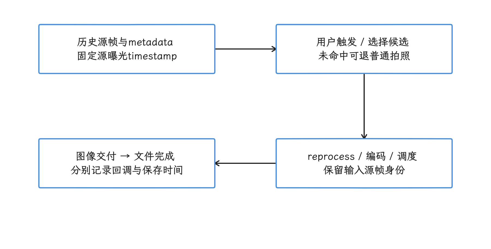
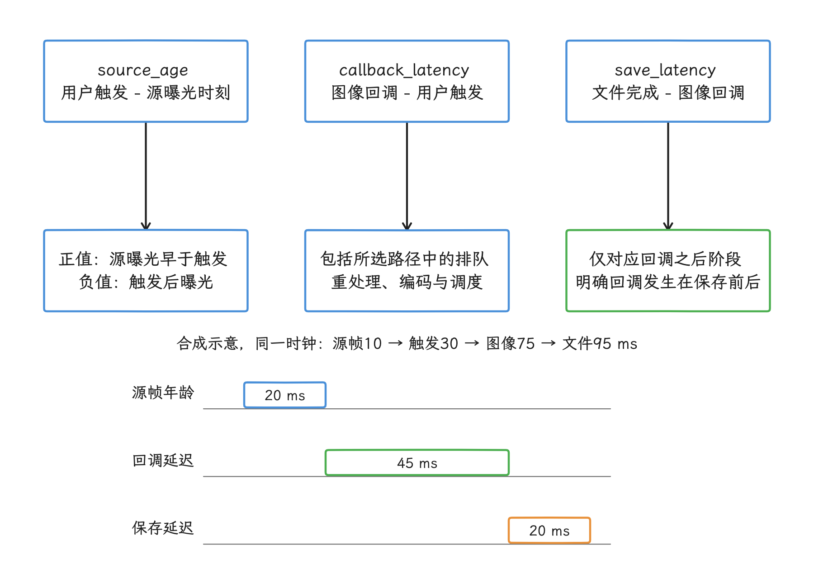
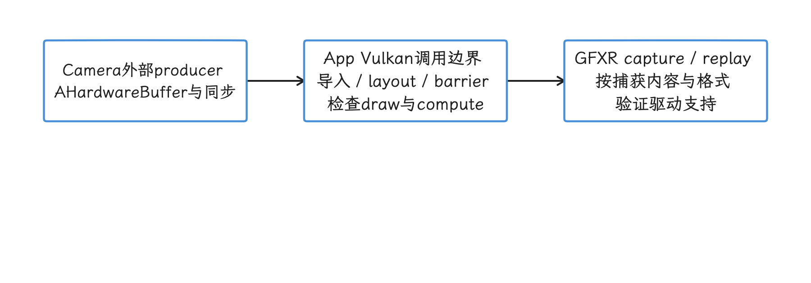

# Camera 性能分析工具：Perfetto、SQL 与 GFXReconstruct

Camera 性能问题通常横跨 App、Framework、HAL（Hardware Abstraction Layer，硬件抽象层）、内核驱动和显示系统。预览卡顿、拍照慢、录像丢帧、内存上涨，要看的位置各不相同：有的看 `cameraserver` 和 HAL 的 slice，有的看 BufferQueue（图形缓冲队列），还有的要看 `CameraMetadataNative` 的引用保留和 native allocation（Java 对象关联的本地内存）。

这篇文章先把这些问题拆成可排查的类别，再梳理管线里的 Buffer 流转，最后用 Perfetto Trace Processor（把 trace 转成可用 SQL 查询数据的分析引擎） 把对应指标量化。预览、拍照、录像和内存问题分别对应不同的 SQL、Track（时间轴） 与补充工具，我们逐个来看。

## 基线、设备边界与四类问题

> 源码基线：Android 17 / API 37，AOSP `android-17.0.0_r1`；内核 `android17-6.18-2026-06_r6`。CameraX 机制按已发布的 `1.6.1` source artifacts 核对；它独立于平台发布，实际实验仍记录所用库版本。GFXReconstruct 的动态 dev 文档仅代表本轮取回内容，复现时固定工具构建。

Camera provider（向 framework 枚举并打开相机设备的 HAL 服务）、sensor driver（传感器驱动）、ISP（Image Signal Processor，图像信号处理器） 固件、算法库和 vendor tracepoint（厂商自定义追踪点） 都由设备厂商提供，这几部分的行为要以目标设备为准。AOSP 定义的是 framework 与 HAL 之间的公共接口；接口以内是什么样，还要靠目标设备上的实测来回答。

一次 Camera session（从配置一组输出到关闭的会话） 可能同时包含 preview（预览）、record（录像）、analysis（图像分析） 和 still capture（静态拍照） 四类输出。它们可由同一组 capture request（捕获请求） 驱动，但各有自己的 stream（输出流）、buffer pool（缓冲池）、consumer（消费方） 和归还节奏。所以预览稳定，录像或分析流未必就稳定：某一路 consumer 过慢时，压力还可能顺着共享的 ISP 处理阶段、有限的 buffer 和内存带宽传到其他输出。


| <span style="white-space:nowrap">现象</span> | 测量边界 | 容易混入的其他耗时 |
|---|---|---|
| <span style="white-space:nowrap">预览卡顿</span> | camera frame ready → preview carrier（预览承载路径）→ SF latch（SurfaceFlinger 取得待合成缓冲）→ display present（显示栈呈现反馈） | 宿主 UI、TextureView 采样、HWC（Hardware Composer，硬件合成器）、显示节奏 |
| <span style="white-space:nowrap">拍照延迟</span> | 点击/业务触发 → request → shutter（快门时刻通知）→ image buffer → 编码/保存 | 3A（自动对焦、曝光和白平衡）、长曝光、ZSL（Zero Shutter Lag，零快门延迟）、多帧算法、存储 |
| <span style="white-space:nowrap">录像丢帧</span> | camera record stream → encoder input → 编码输出 → muxer（封装器）/storage | codec（编解码器）、码率、热限制和 I/O |
| <span style="white-space:nowrap">内存压力</span> | stream buffer、HAL cache、中间图、metadata（捕获元数据）与业务队列 | dma-buf（Linux 设备间共享缓冲框架）、native heap、Java 可达对象和 vendor pool |

这类问题的合格线要逐项来定：目标 fps、显示刷新率、曝光时间、timestamp base（时间戳所在的时钟域） 和产品交互预算共同决定 deadline（最晚完成时间），“帧间隔超过 40 ms 即 Camera 故障”或“标准差超过 5 ms 即用户可见”这样的固定判据，换一台设备、换一个场景就未必成立。30 fps 只给出约 33.33 ms 的名义周期；看到某个间隔偏长，我们还要判断下一帧有没有补回、显示端有没有重复上一帧，以及问题发生在哪一路 output（输出）。

拍照延迟要分段记录，只记总数定位不到慢的那一段。按下快门到 shutter、shutter 到图像可读、图像可读到编码或保存完成，分别对应控制、sensor/ISP、consumer 和 I/O。Night（夜景多帧）、HDR（High Dynamic Range，高动态范围）、Ultra HDR（带 gain map 的 HDR 静态图）、RAW14（14 bit 紧凑 RAW） 与 ZSL 各有自己的处理流程，“普通拍照耗时范围”这样的固定数字，很快就失去参考价值。

## 分析所需的最小 Camera Buffer 模型

HAL3（Camera HAL 的 request/result 模型） 把相机建模为多笔 request 在途的异步流水线。`CaptureRequest` 携带控制参数与目标 `Surface`；HAL 经 sensor 和 ISP 生成结果，再通过 `processCaptureResult()` 分批返回 metadata 和 output buffer。同一个 frame number（帧编号） 的 partial metadata（分段元数据）、final metadata（最终元数据） 和各路 buffer 可以在不同时刻到达，所以“result 到了”离“这帧完全就绪”可能还有距离。

下面的图用于区分四类 consumer 以及预览的三种 carrier。



图中不同 output 通常对应不同 stream buffer。HAL 可以复用曝光或 ISP 中间结果，每个 consumer 仍需独立完成自己的 acquire（取得）、处理和 release。


### `cameraserver` 与 Camera3 stream

Camera2/CameraX 的调用经 Binder（Android 跨进程通信机制） 进入 `cameraserver`。在这里，`Camera3Device` 维护 request、in-flight（已提交但尚未完成） 状态与 stream，`RequestThread` 把 buffer 和 metadata 准备好，再走 HAL session 的 `processCaptureRequest` 路径。

从 Android 13 起，Camera HAL 接口开发转向 AIDL（Android Interface Definition Language），framework 仍支持 HIDL（HAL Interface Definition Language） 实现。Android 13 及之后新增的 Camera HAL 特性只通过 AIDL 提供，升级设备要用这些特性就得迁移。线程名和 transport（AIDL/HIDL 传输路径） 要从目标设备确认。

每个 output 会映射到 Camera3 stream。`Camera3OutputStream` 负责把 HAL 返回的有效 buffer 送回对应的 `ANativeWindow` consumer；`ANativeWindow` 就是 native 层向 BufferQueue 生产缓冲用的接口，路径上还保留 HAL release fence（同步栅栏）。preview、record、analysis 和 still stream 的消费速度可以不同，每一路的完成时间都要分别确认，读数时认准对应那一路的 callback。

### Buffer ownership（当前持有者）与三类 fence

我们先明确两个词：Buffer ownership 回答某一时刻由谁持有、读写或归还缓冲区，fence 回答上一次异步读写何时完成。

| 同步对象 | 表示的边界 | 常见等待方 |
|---|---|---|
| framework 交给 HAL 的 acquire fence | output buffer 何时可供 HAL 写入 | HAL、ISP 或 vendor GPU |
| HAL 随 result 返回的 release fence | 图像写入何时完成，consumer 可以开始读取 | BufferQueue、ImageReader、codec、App GPU |
| SF/HWC 对 preview layer 的 release fence | 显示 consumer 何时不再读取该 buffer | BufferQueue 与后续 producer |

display present fence 提供一轮显示帧的呈现时间反馈，描述的是呈现这一步的结果；提交调用的返回时刻、光学测得的像素点亮时刻是另外两件事，读数时分开对待。analysis、record 和 still buffer 可能始终不上屏，这类流上也就缺对应的 display present fence。所以分析时我们把 HAL release fence 和 display present fence 分开记，合并成一个事件会把 SurfaceFlinger/HWC 之后的等待藏起来。


### HAL buffer management 与每路的 buffer 数量

Camera HAL3 buffer management（HAL 缓冲管理） 从 Android 10 起允许 request 先进入 HAL，HAL 在即将写入时才通过 `requestStreamBuffers()` 向 framework 申请 output buffer。正常完成的 buffer 仍随 `processCaptureResult()` 返回；HAL 额外预取、又没有绑定到已提交 request 的 buffer，才通过 `returnStreamBuffers()` 归还。

`HalStream.maxBuffers` 由 HAL 在 stream 配置结果中逐流给出，表示 HAL 对该流同时持有且尚未归还的 buffer 上限，要按本次配置逐流读取。`SESSION_CONFIGURABLE` 模式还允许按 session 决定是否使用 HAL buffer management，所以要查看本次 session 配置结果。诊断时区分：

- framework-managed 模式下，RequestThread 可能在提交 HAL 前等待 stream buffer；
- HAL-managed 模式下，HAL 的 `requestStreamBuffers()` 可能因首次分配、请求数量、consumer 持有或 buffer limit 变慢；
- `ImageReader.maxImages` 是 App 同时 acquire 且尚未 close 的图像上限，和 HAL 的 `maxBuffers` 是两个量；
- vendor HAL 和算法还可能维护额外的 pool；估算内存时要把它们一并算进去，只拿固定的 buffer 数相乘会低估。


### SurfaceView、TextureView 与自研预览

`SurfaceView` 让 camera preview 进入独立 child Surface（宿主窗口的子图层）。SurfaceFlinger 同时看到 preview layer 与宿主 App Window；HWC 再依据格式、缩放、alpha（透明度）、crop（裁剪）、色彩空间和 plane（硬件合成平面） 资源选择 composition（由 HWC 硬件合成） type（合成类型）。独立 layer 省掉了宿主每帧采样相机纹理的工作，但每帧是否走 `DEVICE` composition，要看当次的合成结果。

`TextureView` 先让 camera buffer 进入 `SurfaceTexture`（把 BufferQueue 图像作为 GPU 外部纹理的 consumer），宿主 HWUI（Android View 的硬件加速渲染器） 在 View draw 中获取纹理，再把采样结果写进 App Window，于是形成 camera → SurfaceTexture 与 host HWUI → App Window 两段 BufferQueue。camera buffer ready 之后，还要等宿主 `Choreographer`（UI 帧节拍调度）、traversal（View 测量/布局/绘制遍历）、`RenderThread`（HWUI 渲染线程）、GPU 和窗口提交。这条路径的额外代价依分辨率、变换、GPU、画面覆盖和设备策略而变化，给不出固定的 5–10 ms。

滤镜、分割、畸变矫正或 AR 常把 camera buffer 导入 OpenGL ES/Vulkan，再输出到另一个可见 Surface。HAL 是第一生产者，自研 renderer 同时是中间 consumer 与第二生产者。这时我们要在 trace 里分开测三段：camera release fence、App GPU 完成和 output Surface present。


### ImageReader 与 CameraX ImageAnalysis 的回压（backpressure）

回压就是 consumer 处理速度低于产帧速度时，未归还的 buffer 向上游传导形成的阻塞。

`ImageReader.acquireNextImage()` 保留顺序，consumer 跟不上时容易占满 `maxImages`；只关心最新结果时，`acquireLatestImage()` 可以丢掉旧帧。两个接口都要求持有者在处理结束后调用 `Image.close()`。 `acquireLatestImage()` 要有至少两个可 acquire 的余量（`maxImages - currentAcquiredImages >= 2`）才能按预期丢弃旧图；余量不足或图像被长期持有时，队列里可能仍压着旧图，要以实际 acquire/close 计数为准，接口名代表的只是丢旧策略。

CameraX `ImageAnalysis` 的 `STRATEGY_KEEP_ONLY_LATEST` 使用 latest-only（只保留最新帧） 的非阻塞策略；`STRATEGY_BLOCK_PRODUCER` 会在队列满时阻塞 camera device 范围内的其他 use case。`ImageProxy.close()` 才是把底层图像归还 CameraX 的接口，不要直接关闭包装对象中的 `Media.Image`。

扩大队列换来的是更多缓冲时间和内存，处理吞吐还是要跟上产帧速率；长期跟不上时，应减少分析分辨率、降低分析频率、缩短持有时间或选择丢旧帧策略。


### metadata 也会跟随 Java 引用生存

`CameraMetadataNative` 仍持有 native 指针 `mMetadataPtr`，private `close()` 由 `finalize()` 调用；`updateNativeAllocation()` 会向 `VMRuntime` 登记这块 native allocation 的大小，让运行时在 GC 决策中考虑 Java heap 外的内存。这个 private `close()` 没有对外暴露，metadata 何时具备清理条件仍由 Java 对象可达性决定，native 内存的释放时机也就跟着 Java 引用走，`finalize()` 给不出确定的时间点。

大量长期保留的 `TotalCaptureResult`、`CaptureResult` 或带 result 的业务消息，会让对应 native metadata 一起存活。处理时我们可以把实际需要的字段提取到轻量对象，避免把完整 result 无上限地放入缓存或跨线程队列。内存结论还要结合 Java heap、native heap、dma-buf 与 vendor pool 一起看，RSS（Resident Set Size，进程常驻物理内存） 增长有多少该记在 metadata 头上，要分开算。

<!-- gracker-diagram: ch15-14-07-metadata-lifetime -->


图：长期保留完整CaptureResult会同时延长其native metadata生存期。 VMRuntime登记帮助GC感知native分配，finalize不提供确定释放时刻；dma-buf与vendor池另行核算。

## 在 Perfetto 中分析 Camera 性能

### 抓取配置

采集前先记录 camera id、logical/physical（逻辑多摄与实体摄像头）关系、所有 output 的 format/size/fps range、dynamic range（动态范围配置）、stream use case（输出流的长期用途提示）、timestamp base、CameraX 版本、preview carrier、ZSL/Extensions（CameraX 对厂商增强拍照模式的封装） 状态和 thermal（设备热状态） 条件。缺了这些信息，同一条 trace 就很难解释目标周期和 consumer 拓扑。

下面的 textproto（Perfetto 文本配置格式） 配置用于抓取 30 秒 Camera 诊断基线。把 `com.example.camera` 替换成目标包名；vendor HAL 有自己的 trace category（ATRace 类别） 或 ftrace event（内核追踪事件） 时，再按设备文档添加。

```textproto
buffers {
  size_kb: 65536
  fill_policy: RING_BUFFER
}

data_sources {
  config {
    name: "linux.ftrace"
    ftrace_config {
      ftrace_events: "sched/sched_switch"
      ftrace_events: "sched/sched_waking"
      ftrace_events: "power/cpu_frequency"
      ftrace_events: "binder/binder_transaction"
      ftrace_events: "binder/binder_transaction_received"
      atrace_categories: "camera"
      atrace_categories: "gfx"
      atrace_categories: "view"
      atrace_categories: "hal"
      atrace_apps: "com.example.camera"
    }
  }
}

data_sources {
  config {
    name: "linux.process_stats"
    process_stats_config {
      scan_all_processes_on_start: true
    }
  }
}

data_sources {
  config {
    name: "android.surfaceflinger.frametimeline"
  }
}

duration_ms: 30000
```

该配置覆盖 AOSP camera ATrace（用户空间追踪标记）、线程调度、Binder 与 SurfaceFlinger frame 数据；ISP、SOF/EOF（Start/End of Frame，帧起始/结束时刻）、IOMMU（设备 I/O 内存管理单元）、内存带宽和 vendor pipeline node（厂商处理节点） 要靠设备专用的 Perfetto producer（追踪数据源） 或厂商 tracepoint 补充。长时间高帧率场景还要按事件量调整 buffer，防止 ring buffer（环形缓冲区） 覆盖掉问题复现的时段。


### 关键 Track 和 Slice（时间区间）

Perfetto 里，我们把同一个对象或数据源的事件归入同一个 Track，一段工作是一个 Slice，随时间变化的数值由 Counter（计数器） 来记。

AOSP 侧常用的搜索线索包括：

| 线索 | 源码语义 | 不能替代的边界 |
|---|---|---|
| <code>connect<wbr>Helper</code> | CameraService 接入与 client 初始化范围 | App 点击到 Binder 到达、预览首帧 |
| <code>configure<wbr>Streams</code> / <code>begin<wbr>Configure</code> / <code>end<wbr>Configure</code> | stream 配置与 HAL configure | 首个 request 和首帧显示 |
| <code>send<wbr>Requests<wbr>Batch</code> | RequestThread 调入 HAL 提交一批 request | sensor/ISP 完成 |
| <code>frame capture</code> | 以 frame number 为 cookie 的提交至 framework 完成条件区间 | 单个 preview stream 的上屏时间 |
| <code>still capture</code> | still intent 对应 request 的异步区间 | JPEG/HEIC 保存完成 |
| <code>Stream N: first full buffer</code> | 某 stream 首次有效 output buffer 进入 consumer 入队尝试前的标记 | SF latch 与 display present |
| <code>Preview<wbr>Spacer-&lt;stream<wbr>Id&gt;</code> | 固定帧率预览可能使用的显示节奏线程 | 所有设备的稳定 ABI |

`frame capture` 的异步 begin 位于 `sendRequestsBatch()` 内、调用 HAL 批量提交之前。成功请求在 metadata、shutter 和全部 input/output buffer 返回条件满足时结束；失败请求可走错误通知与跳过 metadata 的分支。这里的 buffer 返回仍可携带未完成的 release fence，不能理解成像素已可读或 consumer 已消费完。`still capture` 的 begin 出现得更早，位于 still intent 的请求准备阶段；把它和 `frame capture` 当成同一起点，分段就会算错。`Stream N: first full buffer` 的短 `ATRACE_NAME` 位于首次有效 buffer 的 consumer 入队尝试之前，可用的是这个尝试的时间戳；queue 是否成功、fence 是否完成、图像是否上屏，都要沿后续事件继续追。


CamX/CHI（高通 Camera 软件栈常见的实现名）、MtkCam 及 P1/P2（联发科管线常见的阶段名）、ISP、JPEG 等 vendor 名称只能当作目标设备线索，它们不在 Android 公共 ABI（Application Binary Interface，二进制接口） 里。我们先把 frame number、sensor timestamp、request id、stream id、buffer id 与 AOSP slice 对齐，再去解释 vendor node。

SurfaceFlinger 的 `BufferTX - <layer>` counter 表示 server 收到 pending buffer update（待处理缓冲更新） 的变化，把它当作到达信号就好，latch 和 present 要另查。官方 FrameTimeline 文档明确列出 SurfaceView 不受支持的限制，独立 preview layer 上有没有可用的 App FrameTimeline，要以实际 trace 为准。我们继续追 BufferQueue、layer、fence、composition type 与 display present；某设备出现相关轨道时，仍须确认其实际覆盖对象。

### SQL：先发现 Track，再算指标

同名的 slice 可能来自不同进程、线程或 async track（异步时间轴）。所以我们先用下面的查询列出 Camera 相关 slice 所在的 track，避免把 vendor 与 AOSP 事件混在一起。

```sql
SELECT
  s.track_id,
  COALESCE(t.name, '') AS track_name,
  s.name AS slice_name,
  COUNT(*) AS samples,
  MIN(s.ts) / 1e9 AS first_ts_s,
  MAX(s.ts) / 1e9 AS last_ts_s
FROM slice AS s
JOIN track AS t ON t.id = s.track_id
WHERE LOWER(s.name) GLOB '*camera*'
   OR LOWER(s.name) GLOB '*capture*'
   OR LOWER(s.name) GLOB '*request*'
   OR LOWER(s.name) GLOB '*queuebuffer*'
   OR LOWER(s.name) GLOB '*first full buffer*'
GROUP BY s.track_id, t.name, s.name
ORDER BY samples DESC, s.track_id;
```

查询结果用于选择“每个目标帧恰好出现一次”的事件。`frame capture` begin timestamp 描述 request 提交节奏；preview `queueBuffer` 或目标 layer 的 buffer update 才接近预览交付节奏。两类事件回答不同问题。


### SQL：量化帧间隔

下面以 track id `1234` 为示例。把它改成上一条查询确认的单一 preview 事件 track；把示例的精确 `name = 'queueBuffer'` 改成发现查询中的实际事件名；同名事件仍涉及多路输出时，还要按 stream/layer 等身份进一步拆分；通用线程 track 里可能混着多路输出，直接当单路预览用，会把几路算到一起。

```sql
WITH ordered AS (
  SELECT
    ts,
    ts - LAG(ts) OVER (ORDER BY ts, id) AS gap_ns
  FROM slice
  WHERE track_id = 1234
    AND name = 'queueBuffer'
)
SELECT
  COUNT(*) AS frame_count,
  COUNT(gap_ns) AS interval_count,
  1e9 / NULLIF(AVG(gap_ns), 0) AS average_fps,
  AVG(gap_ns) / 1e6 AS average_gap_ms,
  MIN(gap_ns) / 1e6 AS min_gap_ms,
  MAX(gap_ns) / 1e6 AS max_gap_ms
FROM ordered;
```

`average_fps` 只有在所选事件与目标 preview buffer 一一对应时才成立。空集合返回 `frame_count=0`、`interval_count=0`，只有一个事件时帧数为1而间隔指标为NULL；这两种情况下先补样本，再谈帧率。重复时间戳或多流混合应先检查事件选择。报告保留 gap 分布和原始时间窗，平均值会隐藏长间隔与随后补帧。

<!-- gracker-diagram: ch15-14-11-frame-count-edge-cases -->


图：对全部匹配事件计帧数，对非空gap计间隔数，保留无样本和单样本结果。 只有事件与目标buffer一一对应时才可解释成预览帧率；重复与多流混合先排查。

### SQL：定位 Event 所属进程和线程

同步 slice 常落在 thread track，`frame capture` 这类进程级异步事件可能落在 process track。下面两段查询使用同一个示例 track id，分别处理两种归属。

```sql
SELECT
  s.ts,
  s.dur,
  s.name,
  p.pid,
  p.name AS process_name,
  th.tid,
  th.name AS thread_name
FROM slice AS s
JOIN thread_track AS tt ON tt.id = s.track_id
JOIN thread AS th USING (utid)
JOIN process AS p USING (upid)
WHERE s.track_id = 1234
ORDER BY s.ts;

SELECT
  s.ts,
  s.dur,
  s.name,
  p.pid,
  p.name AS process_name
FROM slice AS s
JOIN process_track AS pt ON pt.id = s.track_id
JOIN process AS p USING (upid)
WHERE s.track_id = 1234
ORDER BY s.ts;
```

一条查询返回空结果时再试另一条。PID/TID（进程/线程号） 会被系统复用，跨表关联请用 Perfetto 的 `upid`/`utid`（trace 内部唯一进程/线程 ID）；对外报告可以同时保留原始 pid/tid，方便对着设备日志查。

<!-- gracker-diagram: ch15-14-12-track-ownership -->


图：同步线程事件与进程级异步事件使用不同归属表，关联时保留内部唯一ID。 pid/tid可复用；没有某种归属的结果不等于事件不存在。

### SQL：观察 request-to-result

下面的查询按已发现的目标 track 汇总 AOSP `frame capture` 或 `still capture` 已闭合区间。替换 `1234`，分别选择各自 track；正常与错误请求须结合日志/参数分类，事件名只标出区间类型，成败要从日志和参数里读。

```sql
SELECT
  name,
  COUNT(*) AS sample_count,
  AVG(dur) / 1e6 AS average_ms,
  MIN(dur) / 1e6 AS min_ms,
  MAX(dur) / 1e6 AS max_ms
FROM slice
WHERE track_id = 1234
  AND name IN ('frame capture', 'still capture')
  AND dur >= 0
GROUP BY name;
```

`frame capture` 量的是 HAL 批量提交前到 framework 请求移出 in-flight 的条件区间；`still capture` 还包含更早的 still 请求准备。这两个区间都到 framework 请求闭合为止，但两者都不能代替 HAL release fence 完成、consumer 处理结束、preview present 或文件保存时间，后者要另行测量。回压可能影响请求提交和 buffer 归还路径，归因时把 consumer 侧的影响也列入候选。跨场景比较前，我们要保持 output 组合、曝光、算法模式和热状态一致。


### Python SDK 自动化分析

下面的脚本从命令行接收 trace 与 track id，输出相邻事件的间隔分布。它走 Perfetto Python 包绑定的 Trace Processor，适合在相同采集配置下批量回归。

```python
import argparse
import math
from statistics import mean

from perfetto.trace_processor import TraceProcessor

parser = argparse.ArgumentParser()
parser.add_argument("trace")
parser.add_argument("track_id", type=int)
parser.add_argument("slice_name", help="发现查询确认的精确事件名")
args = parser.parse_args()

sql_name = args.slice_name.replace("'", "''")
tp = TraceProcessor(trace=args.trace)
try:
    rows = tp.query(
        f"""
        SELECT ts
        FROM slice
        WHERE track_id = {args.track_id}
          AND name = '{sql_name}'
        ORDER BY ts, id
        """
    )
    timestamps_ns = [row.ts for row in rows]
finally:
    tp.close()

if len(timestamps_ns) < 2:
    raise RuntimeError("所选 track 与事件名少于两个样本，无法计算帧间隔")
if any(right <= left for left, right in zip(timestamps_ns, timestamps_ns[1:])):
    raise RuntimeError("事件时间戳未严格递增，先排除重复事件或多流混合")

gaps_ms = [
    (right - left) / 1e6
    for left, right in zip(timestamps_ns, timestamps_ns[1:])
]
ordered = sorted(gaps_ms)
p95_index = max(0, math.ceil(len(ordered) * 0.95) - 1)

print(f"events={len(timestamps_ns)}")
print(f"average_gap_ms={mean(gaps_ms):.3f}")
print(f"p95_gap_ms={ordered[p95_index]:.3f}")
print(f"max_gap_ms={ordered[-1]:.3f}")
```

脚本默认事件已经选对，事件选择的把关要靠我们；接入自动化回归前，先在 Perfetto UI 里抽查该 track，确认精确事件名的每个样本都对应同一路 preview buffer。命令行依次传入 trace、track id 和完整事件名。输出的 p95 是帧间隔的第 95 百分位，用来观察长尾，合格线仍要按设备与产品预算另定。Trace Processor 版本也要随报告记录；升级 Python 包可能同时升级 SQL 引擎。


## Camera 预览卡顿分析

### 预览帧率不达标

排查预览帧率时，我们先把一帧的来路按五段过一遍，找到变慢的那一段：

1. App/CameraX 是否持续提交 repeating request（持续重复的预览/录像请求），session 是否反复重配；
2. RequestThread 提交节奏是否稳定，`sendRequestsBatch` 是否长时间阻塞；
3. sensor timestamp、曝光时间和 HAL result 间隔是否符合目标 fps；
4. preview stream 是否按期 queue，HAL release fence 是否拖延；
5. carrier、SurfaceFlinger、HWC 和 display present 是否按期更新。

| Trace 证据 | 优先检查 |
|---|---|
| request 提交已经出现长间隔 | App 控制线程、CameraX bind/unbind、Binder、RequestThread、buffer 获取 |
| request 稳定，sensor timestamp 变慢 | AE（Auto Exposure，自动曝光）fps range、长曝光、sensor mode、HAL/ISP、thermal |
| sensor/result 稳定，preview queue 变慢 | output stream、release fence、consumer 或 HAL buffer management |
| SurfaceView preview 已 queue，display 未更新 | layer acquire、SF latch、geometry、composition、HWC/present |
| TextureView input 已到，host window 晚 | SurfaceTexture acquire、主线程、RenderThread、GPU、host queue |
| preview 正常，record 或 analysis 掉帧 | 对应 stream consumer、codec 或 ImageAnalysis 回压 |

`CONTROL_AE_TARGET_FPS_RANGE` 是请求范围，实际 sensor cadence（传感器出帧节奏）还受曝光与设备策略影响。暗光下曝光时间增长、帧率随之走低，可能正是相机控制的正常结果；这时要结合 `SENSOR_EXPOSURE_TIME`、`SENSOR_FRAME_DURATION`、sensor timestamp 和 result metadata 来判断。


### Buffer 耗尽与 consumer 回压

看到 `dequeueBuffer`、stream buffer request 或 fence wait 变长，先检查本次 configure 返回的 `maxBuffers`、HAL buffer management 模式、ImageReader `maxImages`、CameraX backpressure strategy 和 vendor cache；buffer 有几块以这次配置为准，“Camera 只有三块 buffer”是常见误设。

常见的组合有：

- `ImageReader`/`ImageAnalysis` acquire 后长时间没有 close：App consumer 持有；
- encoder 消费 record stream 变慢：检查 MediaCodec 与后续 muxer/storage；
- SurfaceView layer release fence 延迟：显示 consumer 仍在读取；
- TextureView 的 SurfaceTexture buffer 已到，但 host draw 晚：宿主消费慢；
- `requestStreamBuffers()` 在 HAL 侧变长：可用 buffer、首次分配、请求批量或 framework 调度；
- 多路输出同时恶化：共享 ISP、内存带宽、thermal 或 session 级 pipeline stall（管线停顿）。

修复要从当前持有 buffer 的 owner 下手。缩短 Image 持有、改用 latest-only 策略、稳定 session 配置、降低某一路分辨率或帧率、调整编码参数，都可能有效；单纯增大 queue depth（队列深度） 往往只是把卡顿推迟，还把内存抬上去。


### Camera 启动性能的分段测量

Camera 启动建议按下面的时间点分段：

| 阶段 | 起点 | 终点 | 说明 |
|---|---|---|---|
| 交互到 API | App 自定义点击/业务 marker（trace 标记） | <code>open<wbr>Camera</code> 调用或 Binder flow（跨进程调用链） | 业务与主线程 |
| service open | CameraService <code>connect<wbr>Helper</code> 入口 | <code>connect<wbr>Helper</code> 返回 | 权限、仲裁、provider/HAL open、client 初始化 |
| session configure | App 创建 session | HAL configure 返回 | stream negotiation（输出组合协商）、buffer 与 pipeline 配置 |
| first request | configure 完成 | 首次 <code>send<wbr>Requests<wbr>Batch</code> | App/CameraX 控制与 RequestThread |
| first stream buffer | 首次 request | <code>Stream N: first full buffer</code> | sensor/ISP/HAL 与 output stream |
| first visible preview | first buffer | SF latch → HWC/display present | preview carrier 与显示 |

产品定义的“启动”起点很难从系统 slice 里看出来，应用要主动写入点击、open、session configured、first capture result 和 preview streaming marker。

`CameraService::connectHelper()` 在入口记录 `systemTime()`，成功接入路径返回前计算 `openLatencyMs` 并交给 `CameraServiceProxyWrapper::logOpen()`；早退的错误路径不一定产生这条成功 open 统计。这个值覆盖的是 service 入口到返回这一段，App 点击到 Binder 到达、session configure 和首帧都在它外面，对照分段表时要把这几段另外补上。

`Camera3OutputStream` 的 `Stream N: first full buffer` 标记出现在首个有效 output buffer 的 consumer 入队尝试之前；SurfaceFlinger 有没有 latch、display 有没有 present，要接着往下追：SurfaceView 追独立 layer，TextureView 追宿主 HWUI 和 App Window。


### AOSP 内部统计怎样解释

有些量 AOSP 已经替我们记好了。`SessionStatsBuilder` 按 stream 记录 requested frame（已请求帧）、dropped frame（丢弃帧）、capture latency histogram（捕获延迟直方图），以及第一个未 drop request 的 capture latency。这里的 capture latency 由 request time 到 `stream->returnBuffer()` 返回后的 framework 时间差计算，直方图的固定 bin（分箱边界） 为 100、200、300、400、500、700、900、1300、2100 ms。

这些 bin 只是平台统计结构，体验合格线要另外定义。`mStartLatencyMs` 是该统计窗口内首个未 drop buffer 的 request-to-buffer latency，量的是另一段路径；点击到首帧显示有多快，要按启动分段的口径另算。设备进入 idle（当前捕获已处理完） 时，这组统计经 listener（回调接收方） 上报；能否直接查看、怎么导出，依系统组件、权限和设备实现而定。 `incCounter()` 还会把 dropped 样本写入同一 histogram，部分错误归还可用0ms计数；直方图里因此混着成功与 dropped 两类样本，读数时分开口径。

RequestThread 还用 `mRequestLatency` 记录 `sendRequestsBatch()` 调入 HAL 的耗时，并以 `ProcessCaptureRequest latency histogram` 标签 dump。它量的是 `sendRequestsBatch()` 同步调用范围，包含 HAL 批量提交和函数内的后处理；完整的 sensor/ISP 执行节奏要回到 sensor timestamp 与 HAL result 间隔这些证据上看，而且其中等待可能与设备流水线重叠。`dumpsys media.camera` 里的 histogram 可以辅助判断 HAL 入队调用有没有长尾；阈值应来自同设备正常基线与产品预算。


### 拍照与 ZSL 的耗时分段

拍照报告至少分四段：

1. 触发到 request 提交；
2. request 到 shutter/sensor timestamp；
3. shutter 到 still buffer 可读；
4. still buffer 到编码、回调或文件落盘。

`CONTROL_ENABLE_ZSL` 允许 device 使用历史帧生成 still result，但不保证每次命中。应用自管 ZSL 则需要 reprocessable session（可重处理会话）、input stream（送回历史图像的输入流）与候选帧 buffer。CameraX 的 ZSL 封装和 fallback（回退到普通拍照） 条件受库版本、flash（闪光灯）、Extensions、`VideoCapture` 与设备 capability（能力集） 影响。callback 到达顺序和采集顺序是两回事，对齐要用 frame number 和 source sensor timestamp。

<!-- gracker-diagram: ch15-14-19-zsl-reprocessing -->


图：历史图像选择、reprocess与图像交付分别记录，保留源帧timestamp身份。 device ZSL允许使用历史帧但不保证命中；CameraX fallback受版本、capability、flash与用例组合约束。

#### `source_age`、`callback_latency` 与 `save_latency`

建议分别统计下面三个量；变量名保留英文，便于直接用于日志和分析脚本：

```text
source_age = user_trigger_time - source_sensor_timestamp
callback_latency = image_callback_time - user_trigger_time
save_latency = file_complete_time - image_callback_time
```

这里的 `user_trigger_time` 是应用记录的按键/业务触发时刻，`image_callback_time` 是图像交付回调进入时刻，二者都用 `elapsedRealtimeNanos()`；`source_sensor_timestamp` 来自最终图像对应的源帧。`source_age > 0` 表示源曝光早于用户触发，负值则表示触发后曝光。HAL shutter/`onCaptureStarted()` 的 timestamp 对普通请求表示曝光开始，对 reprocess 请求表示输入图像的曝光开始，对照用户按键时刻时要留意这一差别。`callback_latency` 量触发到图像交付，可能含重处理、编码、排队和调度；`save_latency` 才量该回调之后到文件完成的阶段。API 的回调本来就发生在文件保存之后时，这个差值就不能再解释成完整保存耗时。

只有 `SENSOR_INFO_TIMESTAMP_SOURCE_REALTIME` 才能把 `SENSOR_TIMESTAMP` 直接与 `elapsedRealtimeNanos()` 比较。时间戳来源为 `UNKNOWN` 时，两者可能不在同一个时钟域，要先在设备上完成校准，才能把它与应用触发时刻相减。REALTIME 只解决时钟域对齐这一件事；相减前还要确认，用的是所选历史源帧的 timestamp——换成另一帧、或用转换过 timestamp base 的预览 buffer，算出的源帧年龄就是错的。

<!-- gracker-diagram: ch15-14-20-zsl-time-definitions -->


图：以真实业务触发为基准区分历史源帧年龄、图像交付延迟与后续保存阶段。 先确认同一时钟域和同一源帧；HAL shutter timestamp并非按键时刻，保存后回调不能再量完整保存耗时。 时间轨道为同一时钟下的合成ZSL示例，非实测时长或通用预算。

## Camera 功耗优化

Camera 功耗来自 sensor、ISP、内存带宽、CPU 控制与分析、GPU 预览、encoder、显示和存储，优化前我们先确认哪一部分随场景变化。

- **帧率与分辨率**：按产品显示与分析需求配置每一路 output。降低 preview 分辨率可减少 ISP、buffer 和 TextureView/App GPU 工作，但设备可能选择不同 sensor mode，收益要实测。
- **Sensor 与 stream use case**：`OutputConfiguration.setStreamUseCase()` 向 HAL 表达 preview、video、still 等长期用途。它是逐流提示，延迟收益随设备而定。读取 characteristics（相机静态能力描述） 与 mandatory stream combination（设备必须支持的输出组合），再验证 session。
- **输出数量**：不用的 analysis、RAW、high-resolution still 或并发 record stream 应从 session 移除。隐藏但仍绑定的 use case 可能继续占用 ISP、buffer 和带宽。
- **Consumer 处理**：分析只保留需要的格式与频率，关闭 Image，避免重复 YUV→RGB 和逐帧大对象分配。CameraX 请求 RGBA 时会执行格式转换，也应计入 App 侧成本。
- **预览 carrier**：CameraX `PreviewView` 的 `PERFORMANCE` 模式会尽量使用 SurfaceView，必要时回退 TextureView；`COMPATIBLE` 使用 TextureView。用 layer tree 和实际 View 类型确认路径。
- **热稳定态**：同时记录 thermal status、CPU/GPU/内存频率、sensor mode、亮度、运行时间和供电。短冷机数据代表的是冷机时段，持续录像或视频通话要按热稳定后的数据评估。

功耗度量优先使用设备 power rail（供电域的功率或能量读数）、Android Studio Power Profiler、Perfetto power/thermal 数据或实验室电源。CPU time 只反映处理器活动；sensor、ISP、DDR（系统内存）、GPU 和显示的总能量，我们要靠上面这些手段去量。


dma-buf、sync_file（把 fence 封装为文件描述符的内核机制）、调度、reclaim（内存回收） 和 PSI（Pressure Stall Information，资源压力停顿指标）这些机制，查文章开头基线对应的内核源码就能解释；vendor camera/ISP 的 job、频率与带宽 tracepoint 由各厂商自定义，要结合目标设备驱动和 HAL。

## 与其他机制的关系

- [2.8 BufferQueue、Gralloc 与 Sync Fence](../../part1-fundamentals/ch02-rendering/08-bufferqueue-gralloc-sync-fence.md)：BufferQueue、GraphicBuffer 与 fence 基础；
- [4.2 ART Heap、GC 与后台维护调度](../../part1-fundamentals/ch04-memory/02-art-heap-gc-maintenance.md)：Java 可达性、native allocation 与 GC；
- [11.2 App 耗电优化与案例](../../part2-performance/ch11-power/02-app-power-optimization-cases.md)：功耗实验与归因；
- [14.7 Perfetto SQL、SPAN_JOIN 与 Jank CUJ](../ch14-perfetto/07-perfetto-sql-span-join-jank-cuj.md)：Track、slice、counter 和 SQL；
- [13.10 Android Camera 平台管线：HAL3、Buffer、ZSL 与显示](../../part2-performance/ch13-rendering-pipelines/10-camera-pipeline.md)：多流、ZSL、timestamp base、secure path 与显示拓扑；
- [13.3 SurfaceView 与 TextureView 渲染管线](../../part2-performance/ch13-rendering-pipelines/03-surfaceview-textureview-pipelines.md)：两种 preview carrier 的显示路径。

## Camera2 与 CameraX 的性能差异

Camera2 是平台 API，App 直接管理 device、session、request、Surface 和 callback。CameraX 是独立发布的 Jetpack 库，在 Camera2 之上提供 lifecycle（按 Activity/Fragment 生命周期管理相机） 管理、use case binding（绑定 Preview、ImageAnalysis 等用例）、分辨率协商、quirk（针对特定设备的兼容规则）与 `PreviewView`。两者最终仍进入 Camera service 与 HAL3。

CameraX 的开销随配置浮动，写不成固定的“多 80–150 ms”：差异取决于库版本、首次初始化、`ProcessCameraProvider` 获取、use case 数量、分辨率协商、设备 quirk（针对特定设备问题的兼容规则）、Extensions 和 session 重配。比较时，我们要保持 camera id、output 组合、format、size、fps range、dynamic range、carrier、预热状态与启动定义一致。


| 维度 | Camera2 | CameraX |
|---|---|---|
| session 控制 | App 直接配置，能力与错误处理工作较多 | 库管理 use case 与生命周期 |
| preview carrier | App 明确提供 SurfaceView、TextureView 或自研 Surface | <code>Preview<wbr>View</code> 按 implementation mode 与兼容条件选择 |
| analysis 回压 | App 管理 ImageReader 与线程 | 提供 KEEP_ONLY_LATEST / BLOCK_PRODUCER |
| 设备兼容 | App 维护 capability 与 workaround | CameraX quirk 和版本参与 |
| 诊断记录 | 平台 build 与 App 配置 | 还要记录 CameraX artifact 版本与实际 carrier |

本轮核对的 Android 17 公开变更与 CameraX 发布说明没有给出本章场景通用的 CameraX 最低版本；该结论限于这些资料和场景。就算平台固定在 API 37，CameraX 行为仍随库版本变化；所以报告中要记录实际 artifact（Maven 库构件） 版本，库升级后重跑启动、预览、拍照与分析回归。

## HAL3 管线延迟的深度分析

一次 request 的公共路径可以写成：

1. App/CameraX 构建并提交 capture request；
2. cameraserver RequestThread 准备 settings 与 output buffer；
3. HAL session 接收 `processCaptureRequest`；
4. sensor 曝光/readout（像素曝光与读出），ISP 与 vendor algorithm（厂商算法）处理；
5. HAL 分批返回 shutter、metadata 和 output buffer；
6. framework 把各 buffer 送往 Surface、ImageReader、codec 或 App GPU；
7. consumer 处理并归还 buffer，preview 继续进入 SF/HWC/display。

流水线允许多帧重叠。曝光时间、frame duration（一帧的传感器周期）、pipeline depth（同时在途的管线深度）、partial result 和多路 output 加在一起，让 callback 顺序比线性调用复杂。我们分析单帧时至少保留：

- frame number、request id 与 request type；
- sensor/readout timestamp 和对应 time base；
- shutter、partial/final metadata；
- 每个 stream 的 buffer id、status、HAL release fence；
- consumer acquire/release；
- preview layer、SF latch、composition type 和 present。

`frame capture` 是跨线程的异步请求区间，多笔请求还可重叠。区间变长时，我们分别定位提交阶段的 `RequestThread`、provider/HAL 与 result/buffer 回调线程，检查各段的 Running、Runnable 和等待；RequestThread 当时处理的可能已是另一笔请求，它的线程状态要按请求边界拆开，再归给对应的帧。同步 `sendRequestsBatch` 区间较长，候选原因包括 HAL Binder/AIDL 调用和 HAL 入队；调用很短但 result 晚，候选原因转向 sensor/ISP/vendor queue、曝光、算法和 output buffer；result 按时但画面晚，就到 consumer 或显示端去找。

厂商 slice 的 node 名与拓扑不在 Android ABI 范围内。高通 CamX/CHI（高通 Camera 软件栈中常见的实现名）、MTK P1/P2（联发科管线中常见的阶段名） 或其他 ISP stage 要用 frame number、SOF、request/result 与 buffer 对齐。缺 vendor ATrace 时，Binder flow、thread state、fence、dma-buf、HAL dump 和 camera event log 仍能划出时间范围。


### Android 17 的版本边界

Android 17 / API 37 与 Camera 性能相关的公开变化包括：

- `ImageFormat.RAW14`：兼容 sensor 可输出单 plane（单平面）、每 4 像素紧凑打包为 7 字节的 14-bit RAW；在现有 session 中增加 RAW14 stream，会增加该路输出数据和后处理工作；
- vendor-defined camera extensions（厂商自定义相机扩展）：OEM 可以提供自定义 extension type，使用前通过 `isExtensionSupported()` 查询支持，并查看可用的 request/result key（请求与结果字段）；
- `CameraCharacteristics.INFO_DEVICE_TYPE`：区分 built-in（内置）、external（外接）、virtual（虚拟） 与 unknown（未知） 图像源。这个值可能在 session 中变化，在意数据来源的 App 还要检查 capture result，别只缓存 open 前的 characteristics。

这些能力影响的是 capability、stream 配置和工作量；HAL3 request-result、buffer ownership 与 consumer 回收的主线没有变。旧文中的 `CAMERA_PROCESS_PRIORITY_TYPE`、vendor `PerformanceHintManager` camera 通道和 `CameraPerformanceAttestation` 没有对应的 API 37 公开接口或 `android-17.0.0_r1` 源码依据，本书也就不采用这些名称。


## GFXReconstruct 辅助检查花屏和 YUV 帧问题

GFXReconstruct 在 Android 上通过 `VK_LAYER_LUNARG_gfxreconstruct` 这个 Vulkan layer（夹在 App 与驱动之间的拦截层）捕获和回放 Vulkan API 调用。它适用于自研 Vulkan 预览，或 camera `AHardwareBuffer`（Android 跨组件共享的 native 图形缓冲）已进入 Vulkan 的阶段，可以检查 image import（外部图像导入）、format、layout（Vulkan image 布局）、barrier（GPU 同步屏障）、descriptor（shader 资源绑定） 和 draw/compute 调用。

它的视野是 Vulkan API 调用，OpenGL ES、sensor、ISP、Camera HAL 或 SurfaceView 直送 SF/HWC 的内部工作，要换别的工具去看。外部 producer 写入的 `AHardwareBuffer` 内容、protected memory（不允许普通 CPU/工具读取的内存）和厂商 extension 还会限制回放。`gfxrecon-convert --include-binaries` 导出 capture 中记录的二进制参数，并在 JSON 中引用相应文件；Camera HAL 的 YUV plane 要走 HAL 侧的 dump 途径。GFXReconstruct 还支持重放时的资源 dump，按命令、对象和 aspect 选择资源，能转成 32-bit RGBA 的输出图像，其余可用 `.bin` 输出。外部 Camera producer 的每一帧像素是否都被捕获到，同样要单独确认；protected memory、格式、同步和工具/驱动支持仍要分别验证。

<!-- gracker-diagram: ch15-14-25-vulkan-capture-boundary -->


图：图形capture从App的Vulkan调用观察导入、同步和采样，外部Camera像素另行验证。 不覆盖sensor、ISP或SurfaceView直送内部；捕获层会改变性能，先保留无layer基线。

花屏排查按怀疑的位置选工具：

| 怀疑位置 | 工具 |
|---|---|
| sensor/ISP/HAL 输出已经错误 | vendor YUV/RAW dump、HAL log、sensor test pattern（传感器测试图案）、metadata |
| ImageReader plane/stride/crop 处理错误 | 受控保存原始 plane、校验 row/pixel stride（相邻行/像素在内存中的跨距）与 format |
| Vulkan 导入、layout 或 shader 采样错误 | validation layer（Vulkan 规范校验层）、GFXReconstruct、RenderDoc/AGI（Android GPU Inspector） |
| SurfaceView 预览晚或错位 | Perfetto、layer tree（SurfaceFlinger 图层树）、fence、SF/HWC |
| TextureView 宿主合成错误 | SurfaceTexture、HWUI/RenderThread、GPU frame capture |

捕获 layer 会带来额外记录开销，因而改变时序和内存。我们先用未注入 layer 的 Perfetto 建立性能基线，再用短窗口图形 capture 检查 API 与资源状态。


## 常见问题与误区

| 误区 | 修正方法 |
|---|---|
| <code>frame capture</code> 的频率就是预览显示 fps | 它描述 request 完成；继续查目标 preview stream、carrier 与 display |
| <code>first full buffer</code> 表示首帧已经上屏 | 继续查 Surface/SurfaceTexture、SF latch、HWC 与 present |
| Camera preview 固定使用 3–4 个 buffer | 读取 HAL configure 的 <code>max<wbr>Buffers</code>、session 模式、consumer 与 vendor pool |
| SurfaceView 一定走 HWC overlay | 查看当前整组 layer 的 composition type |
| TextureView 每帧把 YUV 从 CPU 上传到 GL | 常见路径由 SurfaceTexture/GLConsumer（外部纹理 consumer）直接采样；自定义 CPU 转换要另行确认 |
| <code>Image.<wbr>close()</code> 只影响内存 | 它决定 consumer buffer 能否归池，可能反压整个 session |
| CameraX 自动选择的配置一定最快 | 记录库版本和协商结果，在同设备做等价配置对照 |
| Binder 调用固定只耗 1–2 ms | 用 sched（线程调度）与 binder flow 测目标设备，不写固定延迟 |
| <code>on<wbr>Capture<wbr>Completed()</code> 表示所有 output 都已消费 | metadata 与 buffer 可分批返回，consumer 处理和显示仍在后面 |
| <code>Camera<wbr>Metadata<wbr>Native</code> RSS 增长只能等 GC | 查 result 引用队列、native allocation、dma-buf 与 vendor pool |
| GFXReconstruct 可以抓 Camera 的任意 YUV | 它面向 Vulkan API；HAL/SurfaceView 与外部像素内容有明确边界 |
| Android 17 新 Camera API 会自动改善延迟 | 公开变化主要扩展能力发现与格式，性能仍由配置和设备实现决定 |

## 参考资料

- [Android 17 release notes](https://developer.android.com/about/versions/17/release-notes)
- [Android 17 Camera API diff](https://developer.android.com/sdk/api_diff/37/changes/pkg_android.hardware.camera2)
- [Camera2 package](https://developer.android.com/reference/android/hardware/camera2/package-summary)
- [Camera HAL](https://source.android.com/docs/core/camera/camera3)
- [Camera HAL3 request/result](https://source.android.com/docs/core/camera/camera3_requests_hal)
- [Camera HAL3 buffer management](https://source.android.com/docs/core/camera/buffer-management-api)
- [CameraX Preview](https://developer.android.com/media/camera/camerax/preview)
- [CameraX Image Analysis](https://developer.android.com/media/camera/camerax/analyze)
- [Perfetto Trace Processor SQL](https://perfetto.dev/docs/analysis/perfetto-sql-getting-started)
- [Perfetto Trace Processor Python](https://perfetto.dev/docs/analysis/trace-processor-python)
- [Android 17 `Camera3Device.cpp`](https://android.googlesource.com/platform/frameworks/av/+/refs/tags/android-17.0.0_r1/services/camera/libcameraservice/device3/Camera3Device.cpp)
- [Android 17 `Camera3OutputUtils.cpp`](https://android.googlesource.com/platform/frameworks/av/+/refs/tags/android-17.0.0_r1/services/camera/libcameraservice/device3/Camera3OutputUtils.cpp)
- [Android 17 `Camera3OutputStream.cpp`](https://android.googlesource.com/platform/frameworks/av/+/refs/tags/android-17.0.0_r1/services/camera/libcameraservice/device3/Camera3OutputStream.cpp)
- [Android 17 `SessionStatsBuilder.cpp`](https://android.googlesource.com/platform/frameworks/av/+/refs/tags/android-17.0.0_r1/services/camera/libcameraservice/utils/SessionStatsBuilder.cpp)
- [Android 17 `CameraMetadataNative.java`](https://android.googlesource.com/platform/frameworks/base/+/refs/tags/android-17.0.0_r1/core/java/android/hardware/camera2/impl/CameraMetadataNative.java)
- [Android 17 Camera HAL AIDL](https://android.googlesource.com/platform/hardware/interfaces/+/refs/tags/android-17.0.0_r1/camera/device/aidl/android/hardware/camera/device/)
- [GFXReconstruct Android usage](https://github.com/LunarG/gfxreconstruct/blob/dev/USAGE_android.md)
- [GFXReconstruct resource dumping](https://github.com/LunarG/gfxreconstruct/blob/dev/vulkan_dump_resources.md)
- [GFXReconstruct convert tool](https://github.com/LunarG/gfxreconstruct/blob/a20d3dbf83df4f8e02d52e42f19f0ea060708237/tools/convert/README.md)
- [Kernel `dma-buf.c`](https://android.googlesource.com/kernel/common/+/refs/tags/android17-6.18-2026-06_r6/drivers/dma-buf/dma-buf.c)
- [Kernel `sync_file.c`](https://android.googlesource.com/kernel/common/+/refs/tags/android17-6.18-2026-06_r6/drivers/dma-buf/sync_file.c)
