# R8 Configuration Analyzer 与 keep 规则体积归因

R8 体积问题常由多条 keep 规则叠加造成，只看最终 APK，回答不了是哪条配置留下了哪些符号。Configuration Analyzer 把每条规则和它保留的类、字段、方法对上，方便按功能正确性和体积收益逐条收窄。

## 为什么需要单独看 R8 Configuration Analyzer

[APK（Android 应用安装包）体积排查](../../part5-app/ch25-power-size/10-apk-r8-resource-optimization.md)通常先用 APK Analyzer 看 `classes.dex`（DEX，Android 运行时执行的字节码格式）、`resources.arsc`、`res/`、`lib/` 哪一块在增长，再判断该调整 R8、资源、图片还是 native（C/C++ 本地代码）库。它能回答“结果变大在哪里”。

哪条 keep 规则让 R8 放弃了哪些处理，APK Analyzer 看不出来。R8 是 Android 构建中的代码缩减与优化器，keep 规则用于声明哪些类或成员必须保留，以及能否删除、改写或重命名。Configuration Analyzer 回答的就是这个问题：它把最终合并后的配置映射到类、字段和方法，给出 shrinking（删除不可达代码）、optimization（内联、类合并等代码改写）、obfuscation（缩短名称）三类分数，并列出影响最大的规则和被其它规则覆盖的规则。

只读 `proguard-rules.pro` 不够，因为最终生效的配置不止这一份：AGP（Android Gradle Plugin，Android 构建插件）默认规则、App 自定义规则、AAR（Android Library 的发布包）携带的 consumer rules（交给使用方 App 的规则），以及部分工具生成的规则都会合并进来。只看自己写的那份规则文件，不知道这些来源各自留下了什么。

<!-- gracker-diagram: ch15-17-02-merged-rule-inputs -->
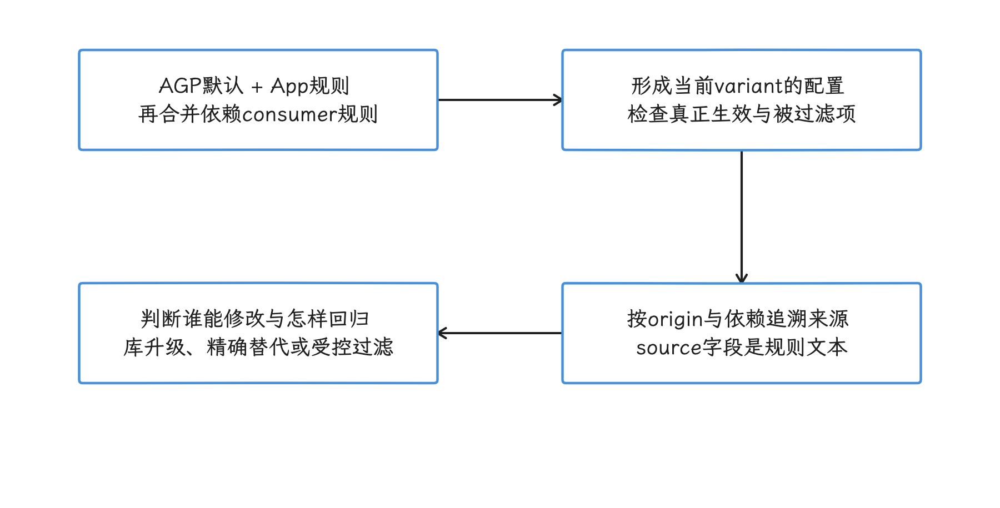

图：App、库consumer与AGP默认规则合并后共同限制优化，需要按来源追踪。 新增窄规则不能抵消仍生效的宽规则；序列化source是规则原文，来源由origin等信息关联。

Analyzer 的 score（分数）与 rule impact（规则影响范围）统计的是哪些类、字段、方法仍允许被处理，它们算不出单条规则对应多少 DEX 字节，也不预测启动耗时变化。跑分析的独立任务（standalone task）不生成 APK 或 AAB（Android App Bundle，供应用商店生成设备 APK 的发布包）；要归因体积，仍得把报告与同一次完整构建的 APK Analyzer 结果、mapping（混淆映射）和 benchmark（基准测试）配对。

<!-- gracker-diagram: ch15-17-01-three-evidence-scopes -->
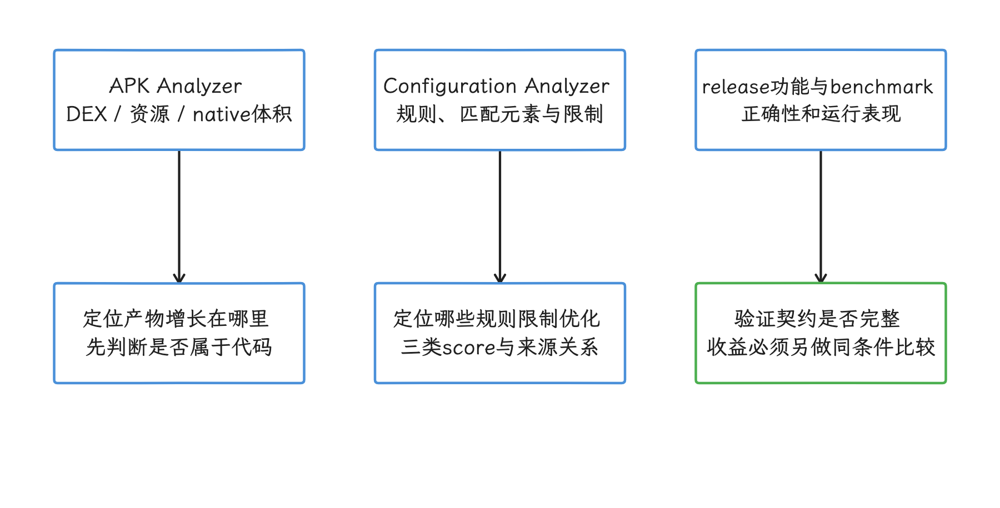

图：包体构成、keep规则约束和运行性能分别使用对应证据，再按同一构建关联。 score与rule impact按元素数量统计，不等于单条规则节省的字节，也不预测启动收益。

## Android 17 与构建工具版本边界

R8 和 Configuration Analyzer 运行在构建主机，发布周期独立于 Android 平台。`android-17.0.0_r1` 不包含这个 AGP 分析工具，`android17-6.18-2026-06_r6` 也不参与 keep rule 合并、whole-program analysis（把 App 与依赖放进同一程序图分析）或分数计算。

Android 17 / API 37 在这里有两个作用：

- `compileSdk=37` 时，R8 把 API 37 的 `android.jar` 作为 platform library（平台库输入），再结合 `minSdk`（最低运行 API）、程序类和依赖建立分析图；
- 优化后的 release artifact（发布制品）要在 Android 17 实机或模拟器上覆盖反射、JNI（Java Native Interface，Java/Kotlin 与 C/C++ 的调用边界）、序列化、组件启动和动态加载路径。

报告应同时记录 AGP、R8、JDK、Gradle、`compileSdk=37`、`minSdk`、variant（构建变体，如 `release`）、依赖锁和代码提交。只写“已在 Android 17 验证”无法复现 Analyzer 结果；升级 R8 后，分数的统计实现也可能变化。

<!-- gracker-diagram: ch15-17-03-version-and-reproduction -->
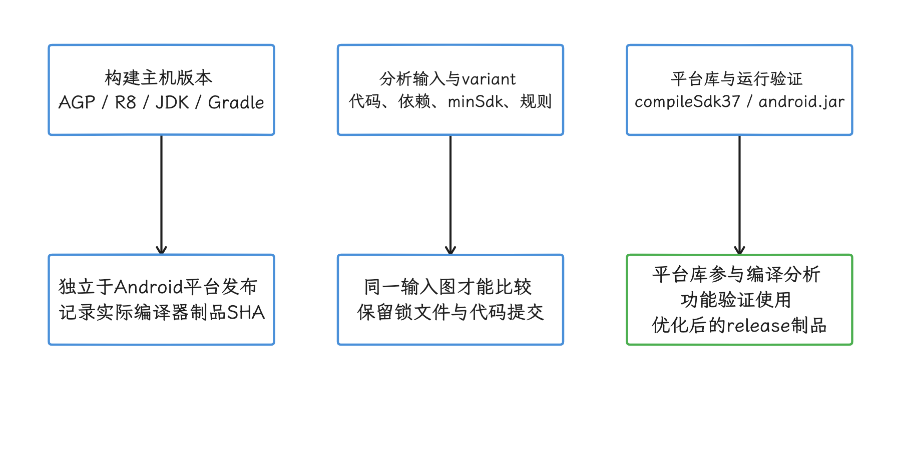

图：固定构建工具和输入图，平台库与Android运行验证分别记录。 Android17平台tag不提供AGP分析任务；升级R8后先建立新score基线。

## 三条报告生成路径

拿到报告有三条路径：AGP 9.3.0 及以上的独立任务、完整 release 构建的自动报告，以及旧 AGP 配合替换版 R8 的系统属性。三条路径的前提相同，官方只给出两种准入方式：用 AGP 9.3.0 及以上，或把旧 AGP 内置的 R8 替换为 9.3.7-dev 及以上。Configuration Analyzer 最早随 AGP 9.3.0-alpha05 预览，当前文档按 AGP 9.3.0 正式版本描述。

AGP 9.3.0 及以上提供一个独立任务，适合本地迭代 keep 规则：

```bash
./gradlew :app:analyzeReleaseR8Config
```

这个任务跳过 APK/AAB 生成，供人查看的报告写入 `app/build/reports/r8/r8-config-analyzer-release.html`。当前官方 `r8-analyzer` 工作流还引用同目录的 `r8-config-analyzer-release.pb`，把 Protocol Buffers（protobuf，二进制结构化数据）转换成 JSON 后做定量汇总；这是该工作流描述的处理路径，转换入口和 schema 仍需版本核验。HTML 和这份 JSON 都只反映规则影响，拿不到最终包体，也做不了运行时验证。

启用 R8 的完整 release 构建会自动生成报告：

```bash
./gradlew :app:assembleRelease
```

默认路径是 `app/build/outputs/mapping/release/configanalyzer.html`；模块名和 variant 改变时，路径中的 `app`、`release` 也随之改变。若确有需要，可以用 `android.experimental.r8.enableR8ConfigurationAnalyzer=false` 关闭完整构建的自动报告。

AGP 9.2 及更早版本把内置 R8 替换为 9.3.7-dev 或更新版后，用下面的系统属性生成 HTML。系统属性只负责请求报告，不会升级 R8，替换步骤仍要按 R8 官方说明做：

```bash
mkdir -p /tmp/r8analysis

./gradlew :app:assembleRelease \
  -Dcom.android.tools.r8.dumpkeepradiushtmltodirectory=/tmp/r8analysis
```

`dumpkeepradiushtmltodirectory` 是 R8 系统属性，不是 AGP 9.3 那个独立任务的别名。CI（Continuous Integration，持续集成）使用前应固定替换版 R8 的下载来源和校验值，避免 `-dev` 制品在版本字符串不变时被换成另一次构建。

<!-- gracker-diagram: ch15-17-04-three-report-paths -->
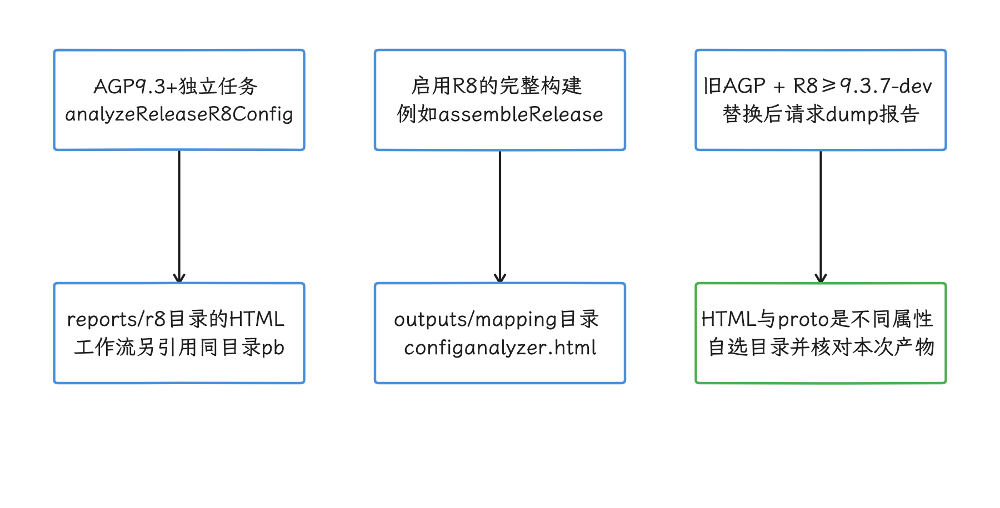

图：AGP独立任务、完整R8构建和旧AGP替换编译器使用不同入口与输出路径。 系统属性只请求报告，不负责升级R8；独立任务不生成APK/AAB，报告不能替代release回归。

### AGP 9.3 的 optimization DSL

AGP 9.3 及以上改了优化开关和 App keep 规则的存放位置：用 `optimization.enable` 同时开启代码和资源优化，App keep 规则放在 `src/<variant>/keepRules/` source set（按构建变体组织的源码目录）下，文件名以 `.keep` 结尾。下面的 Kotlin DSL（构建配置语法）用于 release variant：

```kotlin
android {
    buildTypes {
        release {
            optimization {
                enable = true
            }
        }
    }
}
```

例如公共规则可以放在 `src/main/keepRules/app.keep`。AGP 9.3 默认规则等价于 `proguard-android-optimize.txt`。旧版 AGP 继续使用 `isMinifyEnabled=true`、`isShrinkResources=true` 和 `proguardFiles(...)`。AGP 9.3 仍支持这套旧 DSL，`keepRules` source set 也能与旧 DSL 配合使用；采用新 `optimization` DSL 时，App 规则必须放在上述 `.keep` source set 中。

<!-- gracker-diagram: ch15-17-05-optimization-dsl-and-rules -->
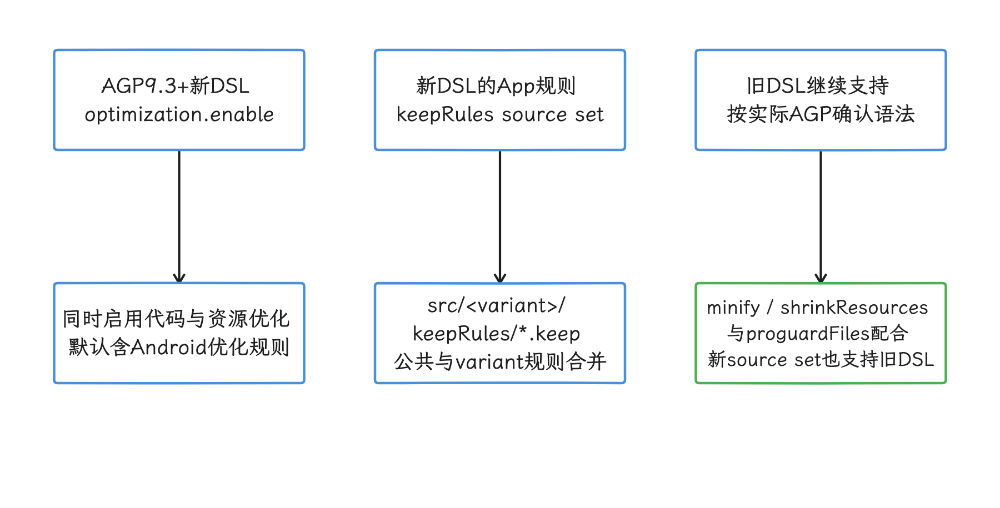

图：选择对应AGP版本的优化DSL，规则放入受支持的variant输入位置。 新optimization DSL同时启用代码与资源优化；旧DSL仍支持，版本语法不能混用猜测。

## 报告里哪些字段该看

报告首页的三类分数衡量“仍允许 R8 处理的类、字段和方法占比”，不能当作已经获得的字节或性能收益，也不能跨 R8 版本直接比较绝对值。以本次核对的 R8 9.4.14 HTML 为例，overall 分母是分析时的 live class、field、method 个数之和，每项权重均为 1；同一元素只要被任一规则施加对应限制就计入受限数，多条规则约束同一元素不重复累加。分数按 `100 × (1 - 受限元素数 / live元素数)` 解释，适用于分母大于 0 的情况；全局 `-dont*` 选项会把对应能力的分数置为 0。它统计的是分析图中的元素数量，不是最终 DEX 字节，也不是已删除代码的比例。

<!-- gracker-diagram: ch15-17-06-score-counting -->
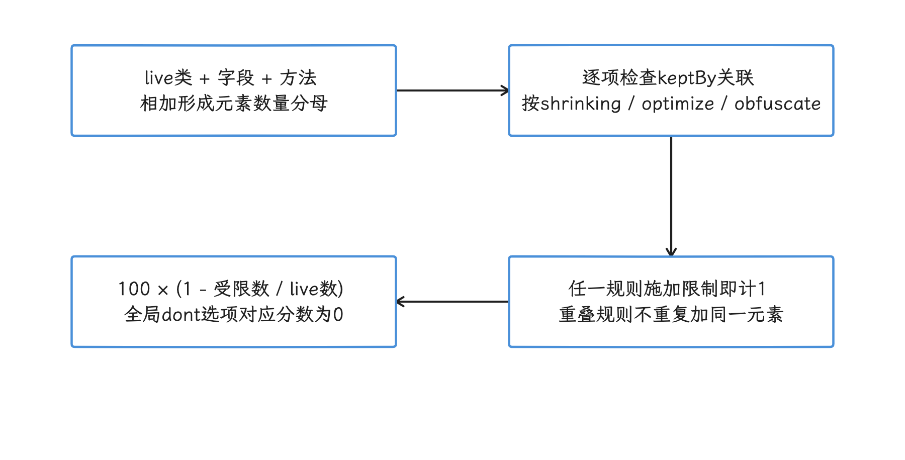

图：在固定R89.4.14实现中，按live元素个数和对应受限元素数解释overall分数。 每个类/字段/方法各计1项；任意规则限制即受限，同一元素不因多条规则重复计数；分母须大于0。

表格里的 full mode 指 R8 full mode（完整模式）：AGP 8.0 起默认启用的优化模式，它允许 R8 做更积极的全程序分析与代码改写。

| 指标 | 它衡量什么 | 分数下降时先看哪里 |
| --- | --- | --- |
| Shrinking score | 类、字段、方法中仍允许被删除的比例 | 包级 keep、<code>-dontshrink</code>、过宽的 <code>-keep class ** { *; }</code> |
| Optimization score | 仍允许被内联、类合并、访问级别调整等优化处理的比例 | <code>-dontoptimize</code>、未加 <code>allowoptimization</code> 的宽规则、为兼容 full mode 添加的临时宽规则 |
| Obfuscation score | 仍允许被重命名的比例 | <code>-dontobfuscate</code>、协议字段名和反射类名被整包固定 |

这三个分数要结合规则列表读。shrinking score 下降，原因可能是 App 新增了一条宽规则，也可能是第三方 SDK 更新后扩大了 consumer rules 的匹配范围。可通过报告里的来源文件和依赖信息区分 App 规则、library consumer rules 和 AGP 默认规则。不要把序列化数据的 `source` 当作文件或 Maven 坐标：在已核对的 R8 9.4.14 中，它保存规则原文，来源另经 `origin`、文件表和 Maven 信息关联。处理顺序是：App 规则能直接改；库规则应优先通过升级 SDK 或反馈库作者处理；AGP 默认规则只做识别，不应直接修改。另要区分规则是否真正生效：AGP 9.0+ 会过滤 library consumer rules 中的全局选项，例如 `-dontobfuscate`；App 自己声明的全局规则仍需检查，不能把库中已被过滤的声明当成当前优化受限的原因。

多条 keep 规则的限制会叠加：App 再添加一条窄规则，抵消不了 AAR 已经带入的宽规则。必须临时验证潜在收益时，AGP 8.4 及以上可通过 `optimization.keepRules.ignoreFrom("group:artifact")` 过滤指定 Maven 坐标的依赖规则，再由 App 补回确有运行时需要的部分；AGP 7.3～8.3 的旧接口名是 `ignoreExternalDependencies()`。过滤会改变库作者声明的运行时契约（反射、JNI 等路径依赖的名称、成员和元数据约束），只适合隔离实验和有完整回归覆盖的受控构建。

`impactful rules`（高影响规则）按每条 keep 规则涉及的类、字段和方法数量聚合，用来排优先级。先看影响范围最大的规则，再确认它是否对应真实的反射、JNI 或动态加载入口。

`subsumed rules` 要结合当前工具的比较条件理解。已复核的 R8 9.4.14 只有在两条规则的 modifiers（例如 `allowoptimization`）相同，且类、字段、方法三组匹配集合都分别被包含时，才报告对应的 subsumed 关系；仅凭包名模式更宽或匹配数量更多，不能断定报告一定会标成 subsumed。典型例子是同一个包里同时存在下面两条声明：

```proguard
# 规则 A：保留整个包
-keep class com.example.package.** { *; }

# 规则 B：保留包内一个类
-keep class com.example.package.MyClass
```

规则 A 已经覆盖了规则 B，报告会把这种重叠关系暴露出来。处理时先确认 A 是否过宽：如果只有 `MyClass` 需要保留，应收窄 A；如果整包都要保留，再考虑 B 是否冗余。

<!-- gracker-diagram: ch15-17-07-subsumption-and-constraints -->
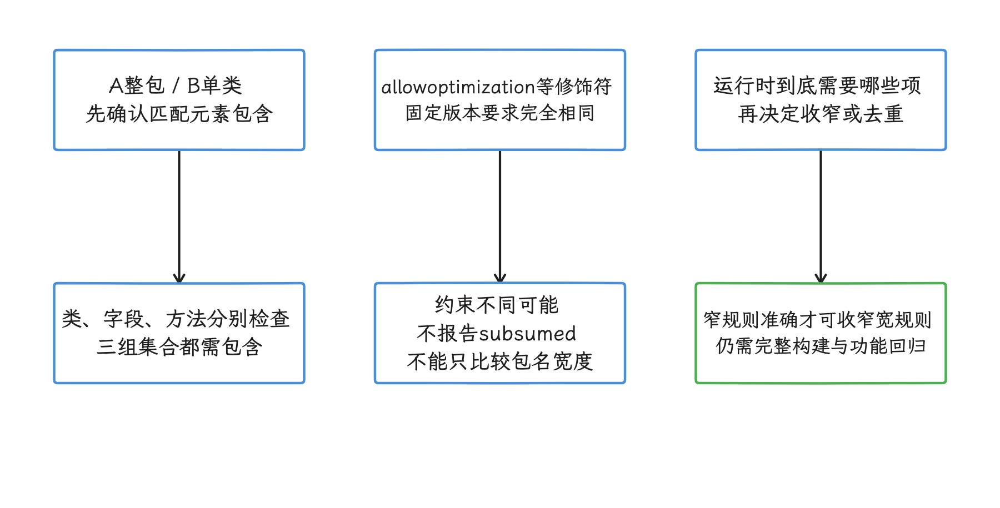

图：宽窄规则先比较三组元素集合，再核对修饰符和真实运行时契约。 固定R89.4.14要求modifiers相同；包名更宽或数量更多并不保证报告认定subsumed。

报告还会列出两类配置噪声：

- unused rule：当前构建没有匹配任何类、字段或方法；删除前要确认它是否用于其它 flavor（产品变体）、dynamic feature（按需交付模块）或可选依赖；
- identical rule：同一文件或多个配置来源中存在相同声明；移除副本不会改变当前匹配集合，但仍应通过完整构建确认。

unused、identical 和 subsumed 都只描述当前 variant 的配置关系，不能直接当成所有构建变体通用的删除清单。

<!-- gracker-diagram: ch15-17-08-current-variant-rule-noise -->
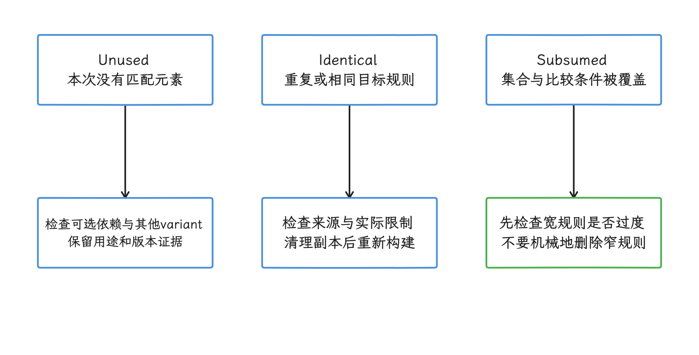

图：三类配置关系用于当前variant的候选筛选，分别检查覆盖和限制。 当前构建未匹配不代表其他flavor、动态feature或可选依赖也不需要该规则。

## keep 规则的代价分级

评估一条 keep 规则的代价，不能只看“删不删”。同一条规则可能同时影响四件事：是否允许删除、是否允许重命名、是否允许优化、是否保留 class file attribute。规则越宽，R8 能处理的空间越小。

| 规则影响 | 常见触发方式 | 典型后果 | 修正方向 |
| --- | --- | --- | --- |
| 阻止 shrinking | <code>-keep class com.<wbr>foo.<wbr>** { *; }</code>、<code>-dontshrink</code> | 未使用类和成员留在 DEX 中 | 改成精确类、接口实现、注解匹配或成员级规则 |
| 阻止 obfuscation | 直接 <code>-keep</code> 类名或字段名 | DEX 字符串池保留较长名称，短名压缩空间减少 | 确认运行时是否依赖名字；不依赖就加 <code>allowobfuscation</code> |
| 阻止 optimization | 宽规则未放开 optimization、<code>-dontoptimize</code> | 方法内联、类合并、访问级别调整受限 | 不用全局禁用；对安全范围加 <code>allowoptimization</code> |
| attribute 保留不足 | full mode 下只写 <code>-keepattributes Signature</code> | 反射框架读不到泛型、内部类或注解等 class file attribute（类文件元数据） | 同时 keep 关联类、字段或方法，并尽量放开混淆和优化 |

`allowshrinking`、`allowobfuscation`、`allowoptimization` 分别允许 R8 删除、重命名或改写匹配项。是否能加这些修饰符，取决于运行时契约依赖什么：

- 如果框架拿到的是 `Class` 对象，不依赖字符串类名，类名通常允许混淆。
- 如果对象只在某个功能路径使用，功能不用时允许删除，规则可以加 `allowshrinking`。
- 如果反射只要求成员存在，不要求调用点形状和访问级别不变，可以考虑 `allowoptimization`，但要用 release 包跑覆盖测试。
- 如果 JSON 协议、JNI 查找或服务端下发类名依赖原始名字，不能放开对应的 obfuscation。

<!-- gracker-diagram: ch15-17-09-modifiers-follow-runtime-contract -->
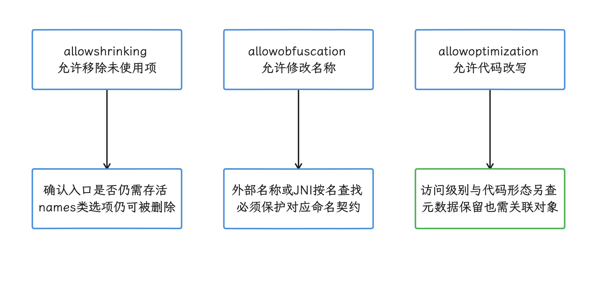

图：是否允许删除、改名和优化，取决于运行时真实依赖的能力。 Class对象、字符串名字和元数据是不同契约；只加一个allow修饰符不会放开所有能力。

下面的规则展示怎样缩小 JNI 保护范围：只保留 native 方法和 C/C++ 回调需要的 Java/Kotlin 成员，避免固定整个包。

```proguard
# 默认优化规则已覆盖 Java/Kotlin 调 native 的 downcall 场景。
-keepclasseswithmembernames,includedescriptorclasses class * {
    native <methods>;
}

# native 层按固定签名回调 Java/Kotlin 时，保留成员及描述符类型。
-keepclassmembers,includedescriptorclasses class com.example.bridge.NativeBridge {
    public void onNativeEvent(com.example.bridge.NativePayload);
}
```

第一条是默认优化规则中的 JNI downcall（Java/Kotlin 调 C/C++）保护。`-keepclasseswithmembernames` 仍允许 shrinking，不能独自保住完全未被使用的 native 类或方法；它保护最终仍存活的匹配类、成员及相关描述符类型的命名契约；未添加 `allowoptimization` 时，还会限制对应优化。第二条面向 upcall（C/C++ 回调 Java/Kotlin），前提是 `NativeBridge` 已由 Java/Kotlin 代码实例化并在该构建中保留。`-keepclassmembers` 不会单独保留桥接类；如果桥接类本身也只从 native 侧访问，还需单独保留该类，并保护 native 按名查找的构造函数或成员。

`includedescriptorclasses` 会把方法 descriptor（参数与返回值组成的 JVM 签名）中的应用类型一并纳入保护。若 native 代码还按名字访问 `NativePayload` 的构造函数或字段，这些成员需要单独规则。遗漏 native 查找的类或成员可能导致 `UnsatisfiedLinkError` 或 `NoSuchMethodError`，应使用启用 R8 的 release 包覆盖这些调用。二者都比 `-keep class com.example.bridge.** { *; }` 窄。

<!-- gracker-diagram: ch15-17-10-jni-liveness-and-descriptors -->
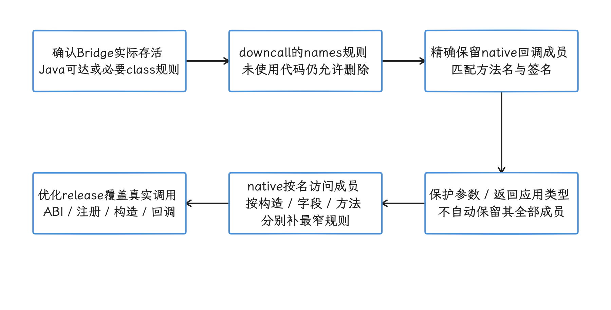

图：先证明Bridge存活，再精确保留upcall成员、描述符类型和native实际访问的成员。 keepclassmembers不独自保活Bridge；保护描述符类不等于保留其构造函数或全部字段。

## 高风险规则的排查顺序

规则排查不要从“删规则”开始。更稳的顺序是：先根据 APK Analyzer 或 DEX size diff（体积差异）找增长包，再用 Configuration Analyzer 找规则影响范围，随后回到代码确认运行时入口。

1. **包级宽规则**：优先处理 `-keep class ** { *; }`、`-keep class com.company.** { *; }`、`-keep class * { *; }`。这类规则会同时压低三类分数，常见来源是迁移 R8 full mode 时添加的临时兼容配置。
2. **反射框架规则**：Gson、Moshi、Jackson、反射式路由、插件化框架要区分“依赖类名”“依赖字段名”“依赖泛型签名”三种契约。只读字段名就保字段；读泛型就保 `Signature` 和相关类型；不要保留整个数据模型包。
3. **代码生成与自带规则的库**：Room、Hilt、Moshi codegen（代码生成）通过注解处理器或 KSP（Kotlin Symbol Processing）让 R8 看见静态引用；Gson 2.11.0+、Retrofit 2.10.0+ 自带关键 consumer rules。App 新增大范围临时规则前，先看库版本、AAR 内容和最终 `configuration.txt`。
4. **JNI 入口**：Java/Kotlin 调 native 的 `native <methods>` 通常由默认优化规则覆盖；native 回调 Java/Kotlin 的 upcall 才需要项目补规则。规则要精确到 bridge（桥接）类或方法签名。
5. **ServiceLoader 和可选依赖**：先判断 R8 能否识别并改写服务加载路径。固定 R8 9.4.14 的 rewriter 支持受限的双参数形式，例如 `ServiceLoader.load(Service.class, Service.class.getClassLoader())`，并结合打包的 `META-INF/services/` 建立 provider 引用；可见的标准路径不一定需要额外 keep。动态 class loader、外部 provider、动态 feature 等路径另查；只有 R8 无法推导的加载契约才按实际需求保留 provider、构造函数和名称，不能看到 ServiceLoader 就保整包。
6. **注解和泛型签名**：R8 full mode 下，attribute 是否保留与被 keep 的类、字段、方法有关。只写 `-keepattributes` 可能不够，必须确认读取 attribute 的对象也被规则匹配。

排查时同步查看 `build/outputs/mapping/<variant>/` 下的四个文件：`configuration.txt` 是最终合并配置，`mapping.txt` 记录改名前后的对应关系，`seeds.txt` 列出被规则阻止删除的元素，`usage.txt` 列出被删除的元素。只有四个文件和 Analyzer 报告来自同一次构建，才能判断规则收窄之后包体有没有变小。

<!-- gracker-diagram: ch15-17-11-risk-priority-investigation -->
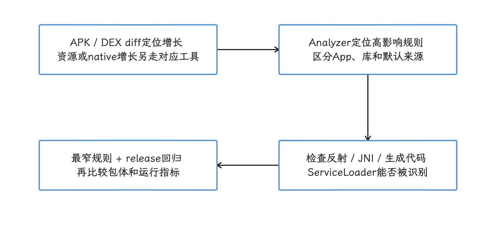

图：先定位DEX增长，再找到规则来源和所需动态入口，最后验证收窄效果。 高impact只用于排优先级；mapping、配置、seeds、usage和包体必须来自同次构建。

## 与 R8 full mode 迁移的配合

在 full mode 下，R8 会做更积极的类合并、方法内联、属性裁剪和访问级别调整。迁移失败时，常见补救动作是往 `proguard-rules.pro` 里加宽规则，甚至在 `gradle.properties` 里保留 `android.enableR8.fullMode=false`。这能让崩溃暂时消失，但会长期限制优化空间。

Configuration Analyzer 适合放在 full mode 迁移后的第二轮：第一轮先让 release 包跑完 smoke test（关键路径的基础冒烟测试），第二轮再检查临时宽规则的影响。报告里排名靠前的规则，常来自迁移期间为了先恢复功能而添加的配置。处理时把运行时契约分成可单独验证的单元：

- Gson `TypeToken` 依赖 `Signature` 与关联类型；Gson 2.11.0+ 已内置这部分 full mode consumer rules。模型字段还要符合规则的匹配条件，例如使用 `@SerializedName`；升级库并不意味着所有未注解模型、构造与自定义反射路径都自动受保护，仍需补 App 特有契约。
- 反射构造只需要无参构造函数时，保构造函数，不要保整个类的所有字段和方法。
- 注解扫描只需要运行时注解时，保 `RuntimeVisibleAnnotations` 和被扫描成员，不要把包内所有类都固定。
- native upcall 只需要固定被 native 查找的方法签名时，保 bridge 方法，不要禁用整包混淆和优化。

<!-- gracker-diagram: ch15-17-12-full-mode-metadata-contracts -->
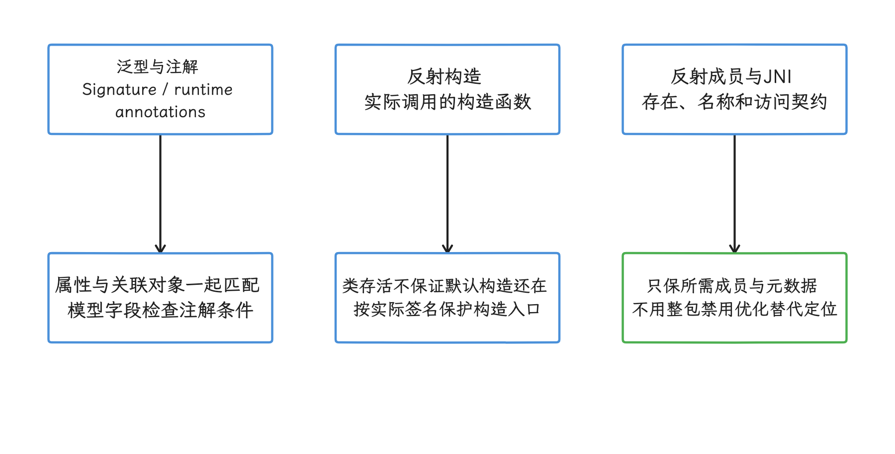

图：泛型签名、反射构造和成员访问各自保留最小必要对象与元数据。 TypeToken内置规则不保护所有模型；新库版本、注解匹配与App自定义动态路径仍需分别核对。

如果必须临时关闭 full mode，要把它当作定位开关，并给恢复 full mode 设截止时间。长期方案是用 Analyzer 找出压低分数的宽规则，再用 release 回归覆盖序列化、登录、支付、推送、deep link（深链）、插件加载和 JNI 路径。

## CI 与回归治理

R8 Configuration Analyzer 更适合做趋势门禁，即比较同一项目相邻构建是否变差；不适合把某个绝对分数当成所有项目通用的红线。不同 App 的反射、动态加载和 SDK 结构差异很大，同样 80% 的 optimization score，在纯 Compose App 和插件化 App 中含义不同。

基线与候选构建必须使用相同的 AGP、R8、JDK、Gradle、variant、依赖图和 Analyzer 生成路径。升级编译器时先建立新基线，不把分数变化直接归因到业务 keep rule。

CI 里至少归档这些产物：

| 产物 | 建议路径 | 用途 |
| --- | --- | --- |
| analyzer HTML | <code>build/<wbr>reports/<wbr>r8/<wbr>r8-config-analyzer-&lt;variant&gt;.<wbr>html</code>、<code>build/<wbr>outputs/<wbr>mapping/<wbr>&lt;variant&gt;/<wbr>configanalyzer.<wbr>html</code> 或手动输出目录 | 查看三类分数及 impactful、subsumed、unused、identical rules |
| <code>configuration.<wbr>txt</code> | <code>build/<wbr>outputs/<wbr>mapping/<wbr>&lt;variant&gt;/<wbr>configuration.<wbr>txt</code> | 追踪最终合并后的规则来源 |
| <code>mapping.<wbr>txt</code> | <code>build/<wbr>outputs/<wbr>mapping/<wbr>&lt;variant&gt;/<wbr>mapping.<wbr>txt</code> | 判断 obfuscation 是否生效，支持 crash 还原 |
| <code>seeds.<wbr>txt</code> | <code>build/<wbr>outputs/<wbr>mapping/<wbr>&lt;variant&gt;/<wbr>seeds.<wbr>txt</code> | 查看被 keep 的类、字段、方法 |
| <code>usage.<wbr>txt</code> | <code>build/<wbr>outputs/<wbr>mapping/<wbr>&lt;variant&gt;/<wbr>usage.<wbr>txt</code> | 查看被删除的类、字段、方法 |
| APK / AAB size diff | CI artifact（持续集成归档制品） | 对照 DEX、resources、native 体积变化 |

独立任务不生成 APK、AAB、mapping、seeds 或 usage；表中的编译产物来自完整 R8 build，并且必须和被比较的 APK/AAB 属于同一次构建。mapping 会被后续构建覆盖，发布时应按制品校验值归档。

<!-- gracker-diagram: ch15-17-13-same-build-artifact-evidence -->
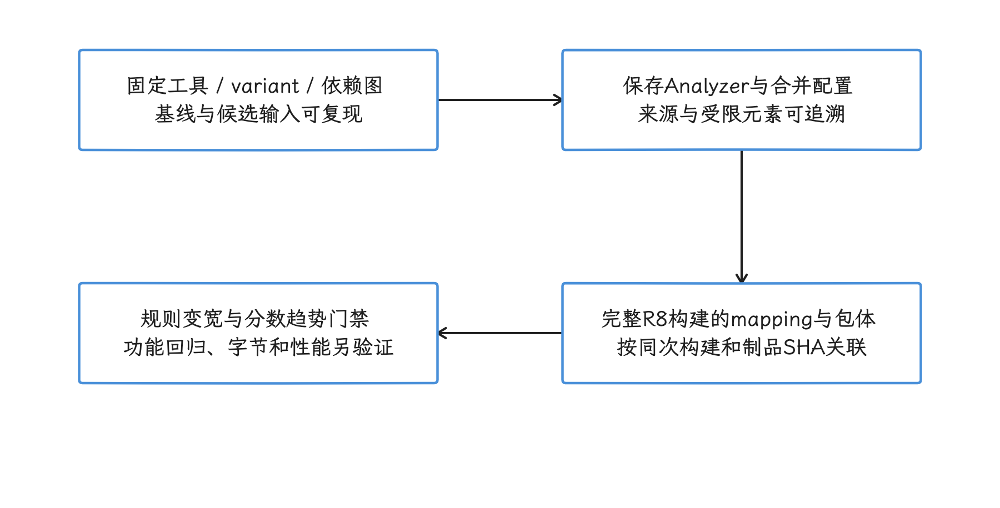

图：基线与候选固定工具和输入，并把规则报告与完整构建制品按校验值对应。 独立报告不生成mapping/seeds/usage或包体；编译器升级先重建基线，绝对分数不作跨项目门槛。

标准开发者工作流把 HTML 作为供人阅读的报告。最新官方 `r8-analyzer` skill 还会读取 protobuf：AGP 9.3 路径使用独立任务生成的 `.pb`，旧 AGP + R8 9.3.7-dev 及以上路径使用 `dumpkeepradiustodirectory`，随后转换成 JSON。该流程服务于 skill 的分析脚本，官方没有把其中的 protobuf/JSON schema（字段结构契约）承诺为稳定的外部 CI API。团队若复用这些数据，应固定 R8 与 skill 版本，为转换和解析脚本加契约测试，格式变化时停止门禁并转人工检查。

门禁规则建议按“变宽”定义，避免把低分本身当作失败。可执行的评审条件包括：

- 新增或修改的 keep 规则进入团队基线定义的高影响集合。
- shrinking、optimization、obfuscation 任一分数相比主干基线下降超过团队约定阈值。
- `configuration.txt` 出现新的包级 `-keep class xxx.** { *; }` 或全局 `-dontshrink`、`-dontobfuscate`、`-dontoptimize`。
- DEX 体积增长和 Analyzer 分数下降同时出现，且增长集中在同一个业务包或 SDK 包。
- 新版 SDK 带入 consumer rules 后，subsumed rules 数量明显增加。

当前仓库的官方 `r8-analyzer` 文档元数据为 2026-09-22，它分成三条路径：AGP 9.3.0 及以上运行独立任务；旧 AGP 搭配 R8 9.3.7-dev 及以上生成定量数据；更旧 R8 只做启发式规则审查。该工作流定位是生成摘要和候选清单，不修改 keep 规则。但当前仓库只有 `SKILL.md` 和 `references/`，文档引用的 `scripts/convert_pb_to_json.py` 与 `scripts/analyze.py` 未随目录提供；不能直接承诺这些命令可执行。参考文件包含内嵌转换和统计示例，其中转换入口存在缩进问题，自动选择 proto 也只是按文件名排序，不能作为“最新构建”的可靠判据。复用时应从已固定版本的明确输入文件开始，先校验转换器、schema 与统计输出，再接入 CI。规则背后是运行时契约，反射、JNI、序列化和插件化路径仍要由工程师确认覆盖。

<!-- gracker-diagram: ch15-17-14-workflow-and-schema-validation -->
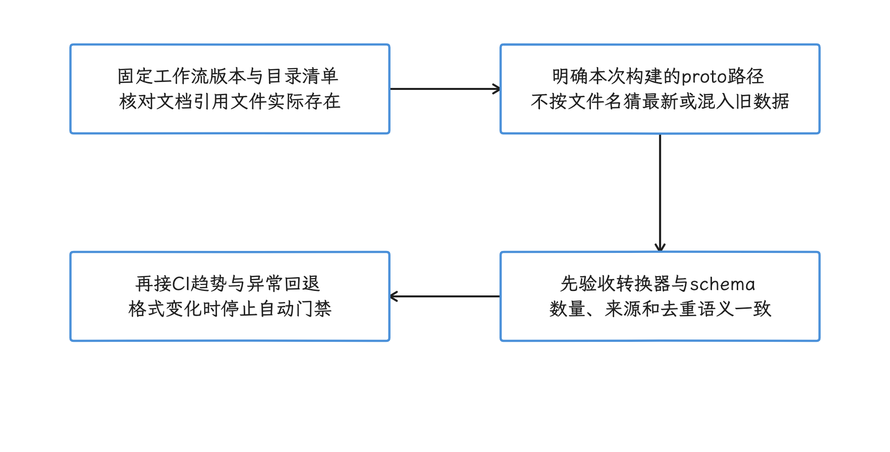

图：使用工作流前先检查入口文件、明确proto输入，再校验schema和统计结果。 当前引用的两个scripts文件未随目录提供；参考示例有缩进问题，文件名排序不能证明是最新构建。

## 与 APK Analyzer / apkanalyzer 的边界

体积排查可以固定成两步：[APK Analyzer](../../part5-app/ch25-power-size/10-apk-r8-resource-optimization.md) 或命令行 `apkanalyzer` 看产物结果，R8 Configuration Analyzer 看 keep 规则原因。

APK Analyzer 适合回答：

- `classes.dex`、`resources.arsc`、`res/`、`lib/` 哪一类变大。
- 哪个包、哪个资源目录、哪个 ABI 贡献了主要体积。
- 两个 APK / AAB 构建之间有哪些文件级差异。

R8 Configuration Analyzer 适合回答：

- 哪条 keep 规则阻止了最多类、字段、方法被 shrink、optimize 或 obfuscate。
- App 规则、consumer rules、默认 AGP 规则各自贡献了哪些影响。
- 哪些规则互相覆盖，哪些宽规则可以收窄。
- full mode 迁移后，哪些临时宽规则仍在限制优化。

两者合用时，先用 APK Analyzer 确认 DEX 体积异常，再用 Analyzer 找规则原因；如果异常在图片、字体或 native 库，R8 报告不会提供直接答案，应回到 [25.10 应用体积分析与优化：DEX、Native SO 与资源](../../part5-app/ch25-power-size/10-apk-r8-resource-optimization.md)。

## 框架规则评审表

通用“框架 keep 模板”很容易随库升级失效。评审时先识别运行时契约，再选择规则：

| 运行时契约 | 需要保护的内容 | 可以尝试放开的能力 | 验证重点 |
| --- | --- | --- | --- |
| 无法被 R8 静态识别的 <code>Class.<wbr>for<wbr>Name()</code> 名称 | 按实际契约保护类名、类及反射调用的成员 | 能被 R8 解析的字面量调用可能被改写，不必一概固定名字 | 外部下发名称、动态注册、插件入口、可选实现 |
| 代码直接传递 <code>Class</code> 对象 | 被反射调用的构造函数或成员 | <code>allowobfuscation</code>；未使用实现可 <code>allowshrinking</code> | 每个实现类与低频分支 |
| 按字段名序列化 | 对应字段名和字段 | 未被协议读取的成员仍可 shrink/optimize | 旧数据、缺省值、混淆后协议兼容 |
| 读取泛型或注解 | <code>Signature</code>、运行时注解及其关联类/成员 | 不依赖名字的对象可 obfuscate | 泛型返回值、匿名 <code>Type<wbr>Token</code>、suspend 接口 |
| Room、Hilt、Moshi codegen | 生成代码和静态引用 | 通常不需要 App 侧保留整个包 | 生成器版本、增量构建、consumer rules |
| JNI upcall | 被回调成员、descriptor 中的应用类型、native 按名访问的成员 | 只放开 native 不依赖的名称和成员 | ABI（二进制接口）、注册方式、构造函数、回调签名 |

Gson 2.11.0+ 与 Retrofit 2.10.0+ 已携带关键 consumer rules。官方示例用于解释语法，不应无条件复制到项目。先检查依赖版本和 AAR 中的规则，再补 App 特有的数据模型或接口契约。

## Agent 评审的安全边界

R8 Analyzer skill 可以汇总分数、影响较大的规则和重叠关系，也可以标出全局 `-dont*` 选项。它适合生成候选清单，不能自动删除 keep rule。建议把 agent 工作限制为以下步骤：

1. 读取 Gradle、AGP、R8、variant 和依赖锁；
2. 生成或读取 Analyzer 报告，不修改规则；
3. 把候选规则映射到 source file、依赖坐标和受影响元素；
4. 提出更窄规则与必须覆盖的运行时路径；
5. 由工程师批准变更并运行 release 构建、功能回归、体积对比和性能测试；
6. 把失败样本、mapping 和最终规则归档。

第三方登录回调、支付、push receiver（推送接收组件）、dynamic feature、JNI crash 上报和旧数据反序列化通常不在日常 smoke test 中。没有这些路径的用例时，保留规则并记录证据缺口。

<!-- gracker-diagram: ch15-17-15-review-to-release-regression -->
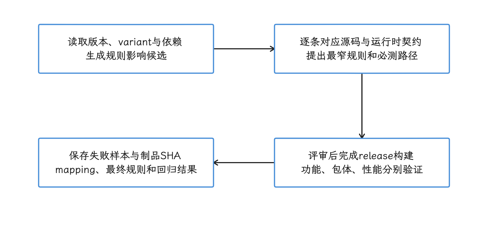

图：候选规则连接到动态入口和必测路径，再完成优化后的release验证与归档。 登录、支付、推送、动态feature、JNI和旧数据反序列化等低频路径不能只靠日常smoke test覆盖。

## 参考资料

- [R8 Configuration Analyzer](https://developer.android.com/topic/performance/app-optimization/r8-configuration-analyzer)
- [Enable app optimization with R8](https://developer.android.com/topic/performance/app-optimization/enable-app-optimization)
- [Use R8 in full mode](https://developer.android.com/topic/performance/app-optimization/full-mode)
- [Add keep rules](https://developer.android.com/topic/performance/app-optimization/add-keep-rules)
- [Keep rule use cases and examples](https://developer.android.com/topic/performance/app-optimization/keep-rule-examples)
- [Choose libraries wisely](https://developer.android.com/topic/performance/app-optimization/choose-libraries-wisely)
- [Troubleshoot R8 optimization](https://developer.android.com/topic/performance/app-optimization/troubleshoot-the-optimization)
- [Analyze a build with APK Analyzer](https://developer.android.com/studio/debug/apk-analyzer)
- [R8 source and AGP replacement instructions](https://r8.googlesource.com/r8/+/dd02d74abc0747a05914a5c32b9aaf4f4d7454a4/README.md)
- [R8 9.4.14 subsumption 实现：相同 modifiers 与三组集合包含](https://r8.googlesource.com/r8/+/b1e20dd52788b7a226f83e24d49d0a53108bc84a/src/main/java/com/android/tools/r8/keepradius/KeepRuleSubsumptionAnalysis.java)
- [R8 9.4.14 ServiceLoader 改写条件](https://r8.googlesource.com/r8/+/b1e20dd52788b7a226f83e24d49d0a53108bc84a/src/main/java/com/android/tools/r8/ir/optimize/ServiceLoaderRewriter.java)
- [R8 9.4.14 可解析反射的改写](https://r8.googlesource.com/r8/+/b1e20dd52788b7a226f83e24d49d0a53108bc84a/src/main/java/com/android/tools/r8/ir/optimize/ReflectionOptimizer.java)
- [R8 9.4.14 官方预构建制品](https://storage.googleapis.com/r8-releases/raw/9.4.14/r8lib.jar)
- [Official r8-analyzer skill](https://github.com/android/skills/blob/main/performance/r8-analyzer/SKILL.md)
- [Configuration Analyzer data generation](https://github.com/android/skills/blob/main/performance/r8-analyzer/references/CONFIGURATION-ANALYZER.md)
- [Android 17 platform manifest](https://android.googlesource.com/platform/manifest/+/refs/tags/android-17.0.0_r1/default.xml)
- [Android 17 common kernel 6.18 Makefile](https://android.googlesource.com/kernel/common/+/refs/tags/android17-6.18-2026-06_r6/Makefile)
