# 如何区分系统问题和 App 问题

“系统问题”与“App 问题”不是互斥标签：应用可能触发系统等待，系统压力也可能放大应用关键路径。归因应从同一延迟窗口出发，用线程状态、Binder、内存回收和显示证据确定控制权与可修复边界。

## 归因不能停在“系统”或“App”

“系统问题”和“App 问题”适合用于分派工作，却不足以描述一条性能因果链。一次输入延迟可能经过 App 主线程、Binder 跨进程服务、CPU 调度器、驱动和硬件；即使 SurfaceFlinger（系统显示合成服务）错过 deadline（帧呈现时限），待合成的 Layer（图层）也可能由 App 提交。过早贴标签，会把直接原因和改动责任混在一起。

一份可复查的归因报告应分四层：

| 层次 | 要回答的问题 | 示例 |
|---|---|---|
| 观测事实 | Trace（系统运行时序记录）中发生了什么 | 主线程在目标窗口内有较长 Runnable 区间 |
| 直接原因 | 延迟花在哪种状态或组件 | 唤醒后未及时获得 CPU；同一 cpuset（限定可用 CPU 的控制组）内存在竞争 |
| 所有者 | 哪段代码、配置或工作负载制造了条件 | App 后台线程、另一个进程、system_server（承载主要 Java 系统服务的进程）、vendor（设备厂商）调度配置 |
| 改动责任 | 哪一侧能以最低风险修复 | App 减少工作、Framework 限制后台负载、vendor 调整策略，或多侧配合 |

线程处于 Runnable 只能证明它可运行但尚未获得 CPU。这个事实不自动指向系统缺陷；竞争者可能来自同一 App。主线程正在 Running 也不自动指向 App 代码；它可能执行 Android Framework（平台框架层）、系统调用或共享库。归因需要继续追踪调用栈、唤醒关系、跨进程事务和全局资源。

<!-- gracker-diagram: ch16-02-01-four-attribution-layers -->
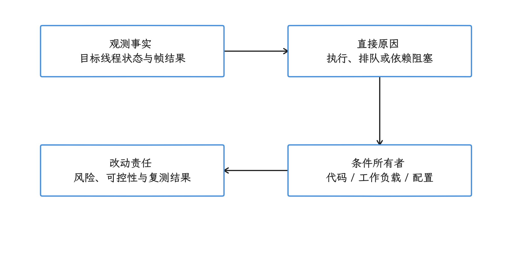

图：把同一窗口中的事实、直接原因、条件所有者和改动责任逐层连接。 运行状态与进程名称只提供起点；同一问题可以需要App、Framework和vendor共同修复。

## 平台与内核锚点

平台源码锚点是 Android 17 / API 37 / `android-17.0.0_r1`。调度与内存回收部分以 Android common kernel（Android 维护的通用内核基线）`android17-6.18-2026-06_r6` 为参考：

- `include/trace/events/sched.h` 定义 `sched_waking`、`sched_wakeup`、`sched_switch` 等 tracepoint（内核跟踪事件点），Perfetto 由这些事件重建 Running、Runnable 与线程切换关系。
- `mm/vmscan.c` 包含 direct reclaim（分配线程自行回收内存页）、`balance_pgdat()`、`kswapd()`（后台内存页回收线程）和 `wakeup_kswapd()` 等路径。
- Android userspace（用户空间）的进程回收策略位于 `system/memory/lmkd/lmkd.cpp`。`lmkd` 是 low memory killer daemon（低内存进程回收守护进程）；Android 17 实现会读取 PSI（Pressure Stall Information，资源压力停顿信息）、内存统计和 `oom_score_adj`（影响候选进程优先级的分数）后选择回收对象。

量产设备的 kernel、调度参数、thermal HAL（温控硬件抽象层）、GPU 驱动和 lmkd 配置可能含有厂商修改。common-kernel 源码用于解释基线机制；设备结论还要记录 build fingerprint（系统构建指纹）、kernel release、模块版本和厂商配置。

## 从目标延迟窗口开始

### 固定起点与终点

归因前先确定用户旅程（CUJ）和问题窗口。滑动卡顿可从目标 vsync（垂直同步信号）或输入事件开始，到对应帧的显示栈 present 反馈边界结束；present fence 不是面板像素发光的光学测量。启动过程可从进程创建或 launch Intent（启动请求）开始，到 TTID（首帧显示）/TTFD（应用报告内容已完整显示）结束；如需“可交互”，另定义业务信号。ANR（应用无响应）则要记录类型、timeout（超时计时）起点和相关线程状态。

不要先看整份 Trace 的 CPU 排行。问题窗口可能只有几十毫秒，整段录制中的后台下载或编译会稀释局部竞争。Perfetto UI 选择、SQL 查询和截图应使用同一时间范围。

### 把 Wall 时间按线程状态分开

先把同一线程的状态区间裁剪到目标 Slice 的起止窗口，并检查未结束区间、丢包和 Trace 边界。数据完整且状态区间不重叠时，wall duration（经过的总时间）可按下面的互斥类别拆分；跨线程、进程和 GPU 阶段则可能并行，不能套用同一加法。

> Running + Runnable（含 R+ 抢占后等待）+ S + D + 其他已知状态 + 未知/Trace 缺口

在该窗口内汇总 `sched_slice` 与窗口相交的区间，可估算线程被调度到 CPU 上的 Running 时间；这不等于所有界面上名为 CPU time 的字段都来自同一个算法。`slice.thread_dur` 还可来自启用了 thread timestamp 的 TrackEvent。报告应记录实际字段、来源、单位和缺失范围；IRQ/softirq 等执行上下文要另查。Wall time 与所选 CPU 时间的差值只是调查入口，不能直接等同于“系统耗时”。

| `thread_state` 表现 | 能确认的事实 | 下一步 |
|---|---|---|
| `Running` | 线程正在某个 CPU 上执行 | 看调用栈、slice 嵌套、系统调用与 CPU 频率 |
| `R` / `R+`（被抢占） | 线程已可运行，正在等待调度 | 看 wakeup（线程变为可运行的事件）、目标 CPU、同 cpuset 竞争者、优先级、affinity（允许使用的 CPU 集合）、uclamp（调度利用率上下限）与 capacity（CPU 算力容量） |
| `S` / Interruptible Sleep | 线程在可中断睡眠状态，等待事件 | 看 Binder flow（跨进程事务关联线）、futex（用户态同步需要阻塞时的内核等待）/锁、epoll（I/O 事件等待）、条件变量和对端线程 |
| `D` / Uninterruptible Sleep | 线程处于不可被普通信号打断的等待 | 看 <code>blocked_<wbr>function</code>、I/O、page fault（内存页缺失异常）、驱动、fence（图形任务同步信号）或内核栈；不能只写成“磁盘慢” |
| 状态缺失 | 当前 Trace 无法还原这段时间 | 检查内核 ftrace 缓冲区、启用的数据源、丢包与采集起止位置 |

Perfetto UI 的颜色会随版本和主题改变，报告应记录 state 值和时间，不依赖“浅绿色”“蓝色”这类描述。`blocked_function` 是采集到的内核阻塞函数信息，只有相关事件可用、被采集并能解析时才会出现；它不是所有线程切出的通用调用栈，也不一定代表上层业务等待原因。

<!-- gracker-diagram: ch16-02-02-window-state-partition -->
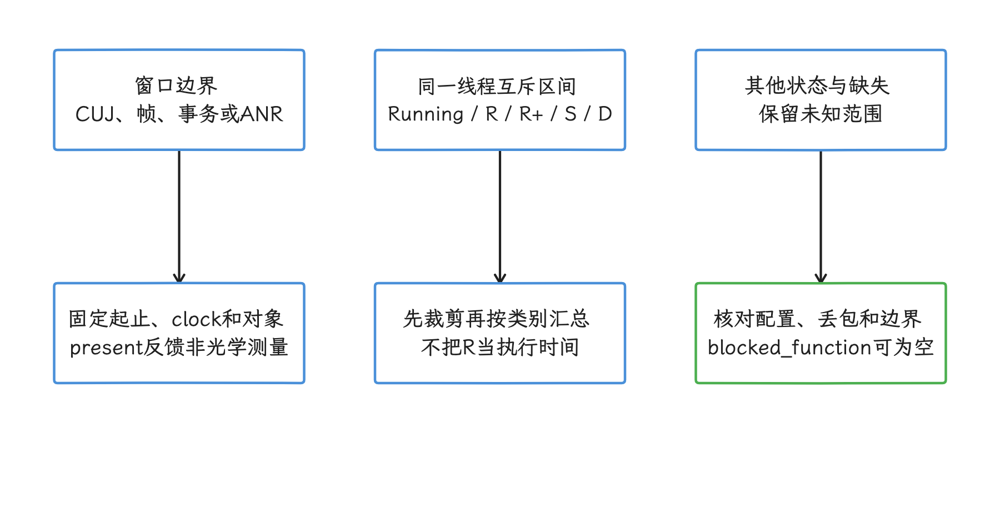

图：先固定CUJ起止边界，再裁剪同一线程的互斥状态区间并记录未知范围。 sched区间汇总与slice.thread_dur来源不同；跨线程、GPU和Binder服务端时间可能重叠。

## CPU 与调度延迟

### Runnable 时间怎样归因

对一次从睡眠唤醒的样本，可量从所选 `sched_waking`/`sched_wakeup` 事件到后续首次 Running 的间隔；两个事件所处唤醒阶段不同，必须固定口径。直接汇总 `thread_state` 中 R/R+ 区间则是在量可运行但未上 CPU 的时间；被抢占后的 R+ 可以没有新 wakeup。判断责任时依次检查：

1. 唤醒是否晚。定时器、Binder 回复或生产者本身晚到，会让线程更晚进入 Runnable。
2. 唤醒后是否存在可用 CPU。还要考虑 affinity、cpuset、online CPU（当前在线的核心）、异构 CPU capacity，以及 RT/DL（实时/截止时间调度类）任务，不能只看整机平均利用率。
3. 谁在目标 CPU 或可选 CPU 上运行。区分本进程后台线程、其他 App、system_server、内核线程和 IRQ（硬件中断）。
4. 频率、uclamp 与 thermal 是否限制执行速度。频率低影响 Running 阶段；调度等待与执行变慢应分开统计。
5. 相同条件下是否存在回归。单次延迟可能是正常竞争，版本对比才能支持“策略回归”。

以下组合更接近 App 内部竞争：目标进程贡献了主要 CPU 时间，后台线程与主线程处于相同可用 CPU 集合，减少 App 并行任务后 Runnable 分布恢复。

以下组合更接近系统或设备策略：多个前台 App 在相同 build 上出现类似延迟，竞争来自系统服务或不可控进程，或目标线程长期受 cpuset/uclamp/thermal/affinity 限制。即使如此，也要区分“策略按设计工作但资源不足”和“调度配置错误”。

<!-- gracker-diagram: ch16-02-03-waking-runnable-running -->
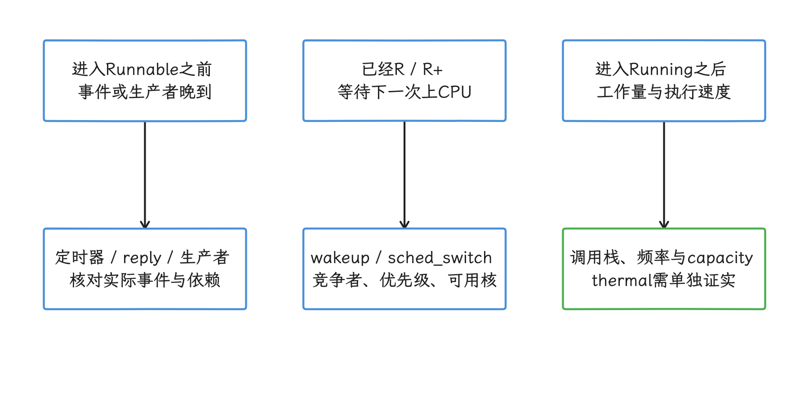

图：把生产者晚到、Runnable等待和Running执行成本分开，分别寻找证据。 R+可以没有新wakeup；固定所选唤醒事件口径，IRQ上下文不能直接归给被打断的业务线程。

### “全核满载”只是系统背景

CPU 全核有任务运行，说明算力供给紧张，但还不能确定谁制造了用户可见延迟。需要同时回答：

- 满载持续多久，是否覆盖问题窗口？
- 目标线程可以运行在哪些 CPU？
- 竞争者属于哪个进程和调度类别？
- IRQ、softirq（延后处理的中断工作）或内核线程占比是否异常？
- 目标线程获得 CPU 后，Running 时间是否也超过预算？

若满载主力是 App 自己的线程池，App 是主要工作量所有者。若竞争来自另一个 App，系统侧可评估后台限制，目标 App 仍可评估关键路径余量。两侧改动可以同时成立。

### 低总利用率也可能有调度延迟

异构 CPU、affinity、cpuset、RT 任务、idle balance（空闲核负载均衡）和容量约束会让“整机还有空闲核”与“目标线程无法立即获得 CPU”同时出现。报告需要展示目标线程的 allowed CPU（允许运行的核心）、wakeup target（唤醒时选择的目标核心）、实际运行 CPU 和同时间窗竞争者，不能用一个总利用率百分比结束分析。

<!-- gracker-diagram: ch16-02-04-allowed-cpu-competition -->
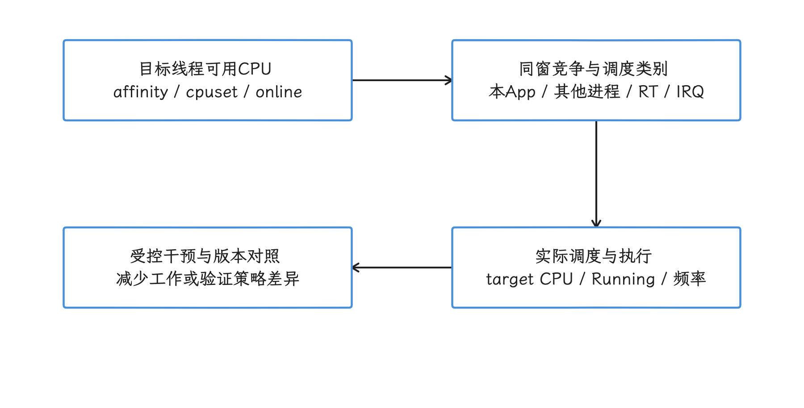

图：从目标线程的可用CPU集合出发，检查同窗竞争与实际调度，再用干预区分条件。 整机空闲不保证目标线程立即运行；图中检查顺序不表示已经证明系统策略错误。

## Binder 与跨进程等待

客户端线程在 Binder ioctl（进入 Binder 驱动的控制调用）附近 Sleep，还不能确认它正在等某次同步事务的回复；空闲 Binder 服务线程也会在驱动中等工作。先确认未完成的同步 transaction、对应服务端和 reply，再沿 transaction/flow（事务及其跨轨关联）分解：

1. 记录客户端发起事务、进入等待和收到回复的时间。
2. 找到服务端 Binder 线程接收该事务的时间，区分 Binder 队列等待与服务端执行。
3. 在服务端再分解 Running、Runnable、锁等待、下游 Binder 和 I/O。
4. 核对调用频率、oneway（无需同步回复的异步事务）队列与线程池是否饱和。
5. 把客户端等待、服务端处理和全局 CPU 放在同一时间窗中。

可能得到的结论包括：

- 客户端在主线程发起了可避免的同步调用；
- 客户端调用频率过高，制造了服务端队列；
- 服务端代码或锁竞争耗时；
- 服务端本身长时间 Runnable，系统竞争是共同条件；
- Binder 只是中间一跳，延迟来自更下游的服务或驱动。

wakeup arrow 表示 Trace 记录的唤醒执行上下文，不等于它制造了此前全部等待。结合 `irq_context` 区分进程和中断上下文；中断发生时被打断的线程不能仅因成为记录中的当前线程就被视为业务发起者。Binder transaction、reply 和服务端状态比单独的唤醒箭头更有解释力。

<!-- gracker-diagram: ch16-02-05-binder-dependency-chain -->
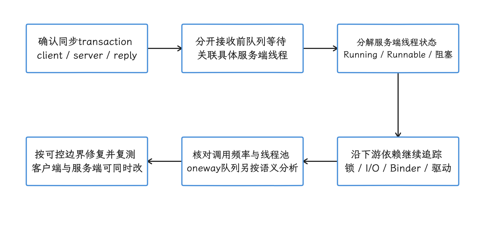

图：先确认同步事务和reply，再沿服务端排队、执行状态及下游等待建立完整依赖链。 ioctl附近Sleep可能是空闲服务线程；客户端等待包含远端耗时，不能把两者重复相加。

## 内存压力、kswapd 与 lmkd

### kswapd 活跃能证明什么

`kswapd` 运行说明后台内存页回收被唤醒。Android 17 common-kernel 的 `vmscan.c` 会根据 watermark（空闲内存页水位阈值）、reclaim（内存页回收）进展和分配需求控制其工作。它不能单独证明：

- 目标 App 正在使用 swap（换出内存）；
- 主线程的 `D` 状态来自页换入；
- lmkd 已经或即将杀进程；
- ART（Android Runtime，Android 运行时）GC（垃圾回收）由系统内存压力触发；
- 增加物理内存是唯一修复。

继续检查 PSI memory `some`/`full`：分别表示被测范围内至少部分任务、所有非空闲任务同时因该资源停顿的时间占比；记录读的是系统级还是 cgroup 级。再结合 direct reclaim、major fault、zRAM（内存中的压缩交换设备）、进程 RSS（驻留物理内存）/swap、lmkd kill 事件与 `oom_score_adj`。Major fault 是内核缺页计数口径，可能涉及文件页或 swap；swap 后端也可能是 zRAM，不能直接推导物理磁盘 I/O。Perfetto 是否包含这些内存事件和进程计数器，还取决于采集配置和设备权限。

### GC 要按 App heap 证据分析

GC 频率主要与分配速率、heap（堆）容量、对象存活和 ART 策略相关。系统内存压力可能改变进程生存和回收背景，但“kswapd 活跃，所以 App 频繁 GC”缺少中间证据。应核对 GC slice、分配速率、Java heap、native heap（C/C++ 等原生代码的堆内存）和对象保留关系。

若 App 的 RSS 或 heap 持续增长，它可能是系统压力的贡献者；若 App 内存稳定而 PSI 与其他进程 RSS 同时上升，系统侧资源管理更值得调查。lmkd 的候选选择还受 `oom_score_adj`、策略与 vendor 配置影响，不能把一次 kill 简化成“内存最大的进程被杀”。

<!-- gracker-diagram: ch16-02-06-memory-evidence-paths -->
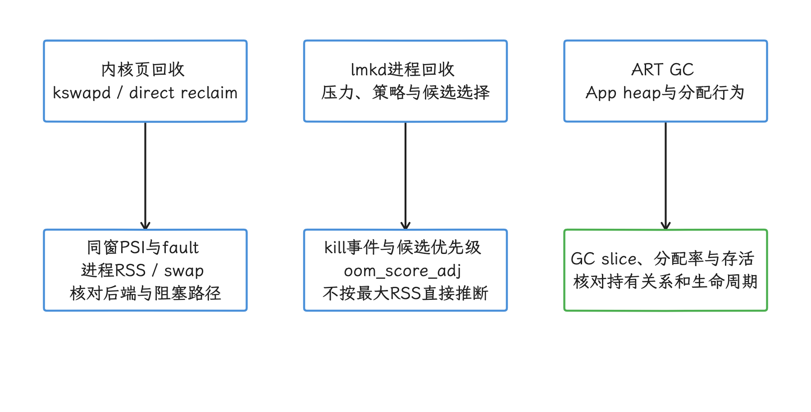

图：后台页回收、lmkd决策和ART GC属于不同机制，各自需要对应的时间与对象证据。 kswapd活跃不能串联推出swap、kill或GC；PSI明确系统/cgroup范围，major fault不等于磁盘读。

## 渲染：App、RenderThread、SurfaceFlinger 与 GPU

### App 主线程

`Choreographer#doFrame`（帧回调）与 `performTraversals`（View 测量、布局和绘制遍历）或 Compose 对应阶段长时间 Running，且调用栈落在 App 逻辑，是 App 关键路径工作量的直接证据。Android 12（API 31）及以上可以结合 FrameTimeline（预期与实际帧时间线）的 deadline、prediction 和 present 信息判断；固定的 16.67 ms 或 8.33 ms 不能覆盖可变刷新率和平台预测。Android 8–11 的 Trace 需组合 Choreographer、SurfaceFlinger、fence 和 CPU/GPU 轨道。Perfetto 指南仍提示 SurfaceView 支持限制；实际分析先核对目标 Layer 是否有可关联的 token 和完整 expected/actual，不能拿宿主窗口的帧代表独立 Surface。缺失时用该 Layer 的 buffer/fence、Producer 和 SurfaceFlinger 证据补齐。

特定操作稳定触发同一 App slice，也能加强 App 归因。操作相关性本身不充分：点击可能触发同步 Binder、存储、shader（GPU 着色程序）编译或系统窗口变化，仍需沿时间线继续追踪。

### RenderThread 与 GPU

RenderThread 的 `DrawFrame` 变长可能包含渲染状态同步、准备和绘制命令提交，也可能等待 GPU、buffer、fence 或驱动；View 的 display list 通常在 UI 绘制阶段记录，不能把全部录制工作都算到 RenderThread。App 提交过重的 display list（绘制命令列表）、纹理上传或 shader（GPU 着色程序）是一类来源；GPU 竞争、驱动行为和 thermal 限制是另一类。仅凭 RenderThread slice 长度不能决定由 App 组或系统组修改。

<!-- gracker-diagram: ch16-02-07-rendering-work-and-wait -->
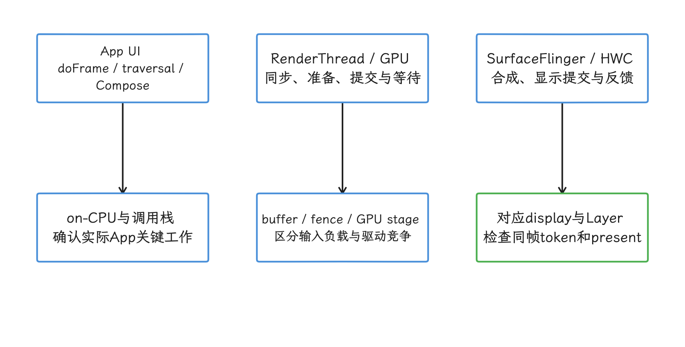

图：沿同一帧分别检查UI工作、RenderThread/GPU和系统显示栈，区分执行与等待。 各轨可并行；RT长slice不能单独决定责任，独立Surface需要单独核对Layer与token覆盖。

### SurfaceFlinger

Android 17 的 `SurfaceFlinger.cpp` 明确保留 `commit()`、`composite()` 与 FrameTimeline 交互。分析时应同时查看：

- App 与 SurfaceFlinger 的 expected/actual timeline（预期/实际时间线）；
- `jank_type`（卡顿分类）、`on_time_finish`（是否按时完成）、present type（早/准时/晚显示）和 App/SF（SurfaceFlinger）帧 token（关联标识）关系；
- `commit`（提交状态）、`composite`（执行合成）、HWC（Hardware Composer，硬件合成器）/GPU 工作与 present fence；
- Layer 数量、分辨率、刷新率和 client/device composition（GPU 客户端合成/显示硬件合成）；
- 同设备、同场景的正常帧。

SurfaceFlinger 侧的 jank 表示显示栈相对预测时序出现了偏差，需继续区分 CPU/GPU deadline miss、DisplayHAL、PredictionError 等分类；Actual 区间不等于 SurfaceFlinger 线程一直在 CPU 上执行。工作量或延迟仍可能来自 App Layer、系统 UI、HWC、GPU 竞争、驱动或预测偏差。多个 App 同时出现 jank 能增强共享条件的证据，但共享显示链路上的单帧晚到也可能只影响一个可见 Surface。

<!-- gracker-diagram: ch16-02-08-frame-classification-boundary -->
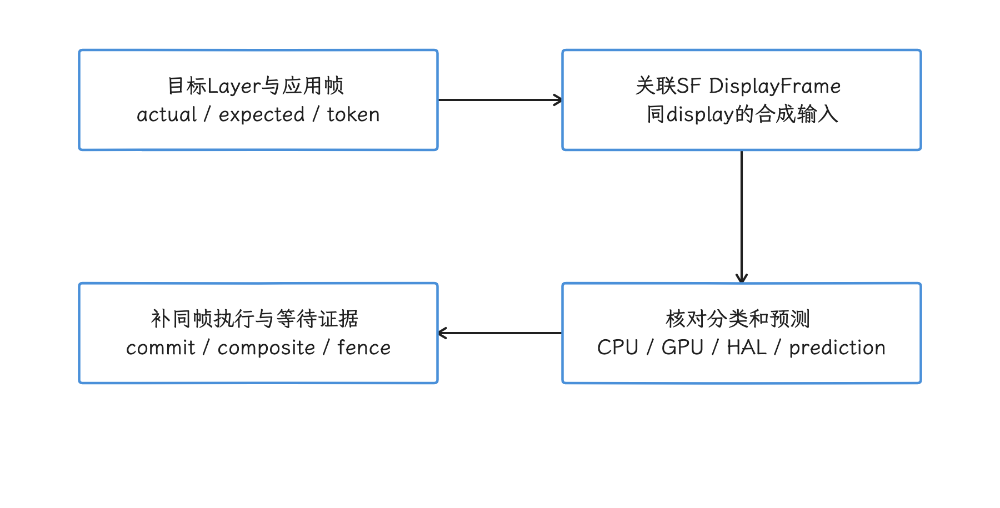

图：先关联目标Layer的SurfaceFrame与DisplayFrame，再把jank分类落实到同帧阶段证据。 SF Actual不等于线程持续占CPU；PredictionError也需区分，分类与颜色不能独自证明代码所有者。

## Thermal 与频率限制

CPU frequency 下降不等于 thermal throttling（因温度限制性能）。Governor（频率调节器）可能因负载、idle、能效策略或 uclamp 选择较低频率。确认 thermal 影响需要组合 thermal status/trace、频率上限或 capacity 变化、温度/冷却设备事件和对照实验。

<!-- gracker-diagram: ch16-02-09-thermal-evidence -->
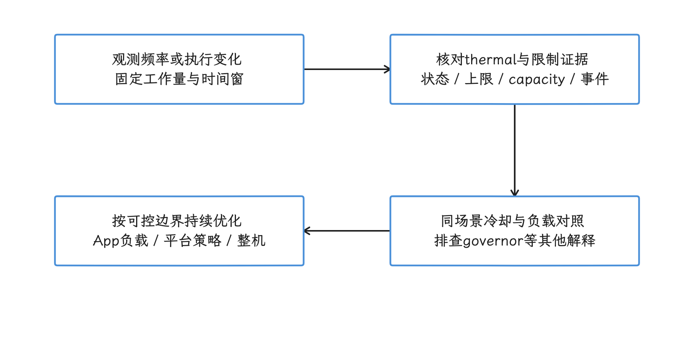

图：低频先作为现象，结合温控状态、限制与同条件对照验证影响，再讨论多侧改动。 温控API表达设备热状态或预测；不能从单个低频值推导throttling或精确到某个CPU原因。

thermal 条件成立后，改动责任仍可能分布在多侧：

- App 降低持续 CPU/GPU 工作量、帧率或后台活动；
- Framework/vendor 调整 power hint（向电源策略传递的负载提示）、thermal policy 或错误配置；
- 硬件与整机侧改善散热和功耗设计。

不要用假设的“3.0 GHz 降到 1.5 GHz”代替设备证据，也不要把物理限制写成任何一侧都无法改善。

## ANR 的归因

ANR 是系统判定某类响应条件在规定窗口内未满足，并不等于 App 主线程独自消耗了整个窗口。输入分发、无焦点窗口、Service 执行和 Broadcast 等类型有不同的计时起点、完成信号及相关线程；异步广播还要追踪工作线程与 `finish()`。部分阈值受 DeviceConfig（运行时系统配置）或厂商配置影响。前台服务问题也要先分事件：shortService 未及时停止可触发 ANR；未及时调用 `startForeground()` 和部分限时 FGS 未停止则走异常/崩溃路径，不能把所有 FGS 超时都归为 ANR。

Android 17 的 `ActivityManagerConstants.java`、`ActiveServices.java` 和 `BroadcastConstants.java` 是核对平台配置的源码入口。分析时至少展示：

- ANR 类型与 timeout 起点；
- 相关线程各状态的时间分布，以及堆栈抓取是否晚于超时现场；
- 同步 Binder 的服务端状态；
- 系统 CPU、I/O、内存与 thermal 背景；
- App 在可控条件下能否稳定完成同一工作。

完整阈值与组件行为见第 9 章。方法论章节不复制一张会随 DeviceConfig 和版本变化的固定数字表。

<!-- gracker-diagram: ch16-02-10-anr-event-classification -->
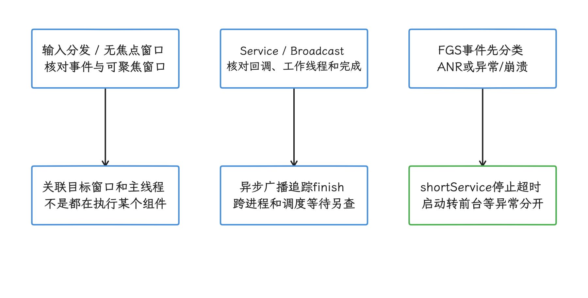

图：先按报告识别输入、组件或FGS事件，再重建各自的计时起点、完成信号与相关线程。 shortService ANR与FGS启动/部分限时服务异常分开；超时后才抓到的堆栈不能代表整个窗口。

## 多 App 共存时怎样归因

跨进程分析按资源类型进行：

| 资源 | 观察内容 | 容易发生的误判 |
|---|---|---|
| CPU | 问题窗口内各进程 Running 时间、调度类、cpuset 与 wakeup | 整段 Trace 的 CPU top 不能代表问题窗口 |
| Binder | 客户端事务、服务端排队/执行、下游调用 | 客户端 Sleep 不能直接证明 system_server 逻辑慢 |
| 内存 | PSI、reclaim、每进程 RSS/swap、lmkd 事件 | kswapd 活跃不能指出压力制造者 |
| GPU/显示 | App/RenderThread、GPU stage、SF timeline、HWC composition | SF jank 不能自动归因给 GPU 厂商 |
| I/O | 发起者、block/device latency（块设备延迟）、page fault、`fsync`（把待写数据同步到存储） | `D` 状态不能自动归因给磁盘 |

优先比较问题窗口与相邻正常窗口。另一个进程 CPU 很高，只能说明它是竞争者；要证明它影响了目标 App，还需展示时间重叠、目标线程 Runnable 变化和关闭/限制该进程后的对照。

<!-- gracker-diagram: ch16-02-11-multi-app-attribution -->
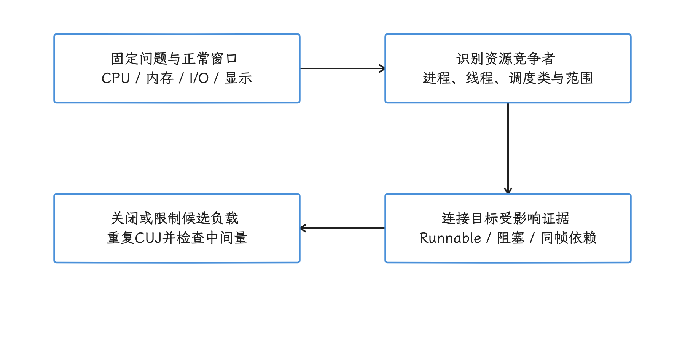

图：先按资源识别同窗竞争者，再连接目标线程或帧的变化，最后用受控干预验证影响。 另一个进程CPU高只是候选条件；需要时间重叠、资源依赖和重复对照支持。

## 系统版本回归的 A/B 方法

### 固定可控变量

A/B 指只改变待验证因素的对照实验。比较系统升级前后时，应使用同一 App 构建、账户数据、操作脚本、设备型号、刷新率、编译状态和 thermal 区间，并记录：

- `ro.build.fingerprint` 与安全补丁级别；
- ART、Profiling、AdServices 等相关 Mainline（可独立更新的系统组件）模块版本；
- kernel release、common-kernel 基线与 vendor patch（厂商补丁）标识；
- GPU 驱动、vendor image（厂商系统分区镜像）和 power/thermal 配置；
- Perfetto 版本、TraceConfig（采集配置）和丢包情况。

同一台设备无法在同一时刻运行两个系统版本。若使用两台同型号设备，要先量化个体差异；若刷机往返，要控制数据恢复、dexopt（DEX 优化与编译）、缓存和后台初始化。

### 比较阶段，不只比较总时间

在同一 CUJ 窗口比较 App 的 Running/Runnable、Binder 等待、I/O、RenderThread/GPU 和 SurfaceFlinger 证据，并沿实际依赖找关键路径。这些跨线程阶段可以重叠；Binder 客户端等待还会包含服务端执行和下游时间，不能把所有阶段时长直接相加。总时长回退可能来自不同位置，只有阶段差异稳定出现，才能继续映射到具体源码或配置变更。

### 用源码差异验证假设

若怀疑调度策略，比较 kernel/vendor config、cpuset、uclamp、EAS（Energy Aware Scheduling，能耗感知调度）与 power hint；若怀疑 Framework 服务，比较对应 AOSP（Android Open Source Project，Android 开源项目）tag 和 DeviceConfig；若怀疑显示链路，比较 SurfaceFlinger、HWC、GPU 驱动与 Layer 输入。版本号相关性只能提出假设，不能代替源码或实验。

<!-- gracker-diagram: ch16-02-12-system-ab-regression -->
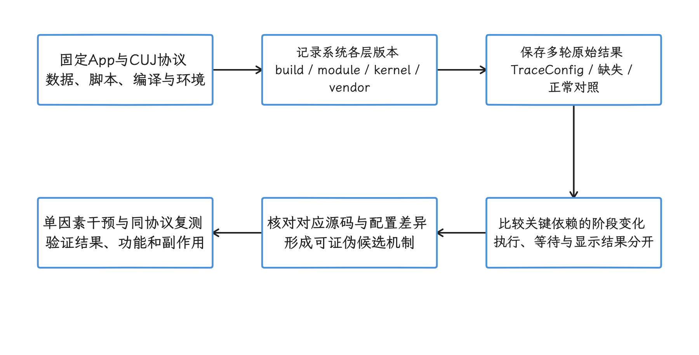

图：固定App和实验协议，记录系统各层版本，先确认稳定的阶段变化再验证源码或配置假设。 跨轨阶段不能直接求和；两台设备量化个体差异，往返刷机控制恢复、编译、缓存和初始化。

## 归因速查表

| 观察事实 | 候选方向 | 必须补充的证据 |
|---|---|---|
| App 主线程长时间 Running | App/Framework 执行工作 | 调用栈、slice 所有者、频率、deadline |
| App 主线程长时间 Runnable | CPU 调度等待 | wakeup、allowed CPU、竞争者、cpuset/uclamp/thermal |
| 客户端等待 Binder | 跨进程同步等待 | transaction、服务端排队/执行、下游依赖 |
| 线程处于 `D` | 内核不可中断等待 | blocked function、内核栈、I/O/page fault/fence/driver |
| kswapd 活跃 | 后台内存回收 | PSI、direct reclaim、RSS/swap、lmkd、压力来源 |
| RenderThread 长 slice | 渲染后半段或等待 | GPU stage、fence、driver、App 绘制输入 |
| SurfaceFlinger 侧 jank | 显示栈相对预测偏差 | jank 分类、prediction、token、commit/composite、HWC/GPU、Layer |
| 多个 App 同版本回退 | 系统/vendor 共同条件 | 受影响面、A/B、build/module/kernel/vendor 差异 |
| 单一 CUJ 稳定复现 | 与该操作相关 | App slice、Binder、I/O、GPU/SF 的完整时间线 |

## 报告模板

一次归因可以按下面的顺序交付：

1. **现象**：CUJ、设备、系统/App 版本、出现频率和用户影响。
2. **时间窗口**：起止时间、对应帧/事务/ANR 事件。
3. **观测事实**：线程状态、进程/CPU、Binder、内存、渲染与 thermal。
4. **因果路径**：哪些事实有 flow、token、调用栈或 A/B 支持。
5. **未排除项**：缺失的数据源、无法观察的厂商内部实现、样本限制。
6. **改动建议**：App、Framework、vendor 各自可做什么，以及验证协议。

报告应直接写清主要工作量由谁产生、哪些背景条件由多方共享，以及哪一侧能先缓解。这样的描述比一句“系统问题”更准确，也更容易推动跨团队修复。

<!-- gracker-diagram: ch16-02-13-report-to-handoff -->
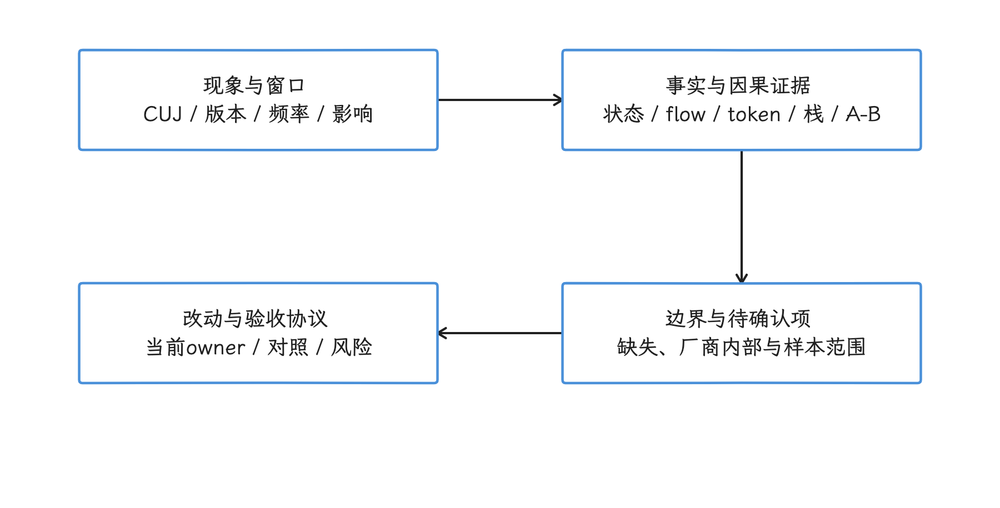

图：报告把用户现象、同窗证据、已验证依赖和改动方案连接起来，并保留未排除项。 这是本章建议的交接流程；责任分派不代替因果证据，修复可以由多侧协同完成。

## 常见误区

### Runnable 长就归给系统

同一 App 的后台线程也会抢占主线程。先按进程和线程拆竞争者，再检查调度配置。

### CPU 利用率低就排除调度

affinity、cpuset、异构容量和 RT 任务可能限制目标线程可用 CPU。整机平均值缺少目标线程视角。

### `D` 状态就归给存储

不可中断等待还可能来自 page fault、驱动、fence 和其他内核等待点。需要 blocked function 或内核栈。

### ANR 就归给 App

系统负责计时与报告，超时路径可能跨越 App、Binder 服务、调度、I/O 和 vendor 组件。App 仍需避免主线程同步长任务，但报告要给出完整时间分布。

### SurfaceFlinger 晚到就归给 GPU 厂商

App Layer、系统 UI、HWC 选择、GPU 竞争、driver 与 display pipeline（显示链路）都可能参与。FrameTimeline 指出阶段，进一步证据才能指出所有者。

## 参考资料

- [Perfetto：CPU Scheduling events and thread states](https://perfetto.dev/docs/data-sources/cpu-scheduling)
- [Perfetto：Android Jank detection with FrameTimeline](https://perfetto.dev/docs/data-sources/frametimeline)
- [Perfetto：Memory counters and events](https://perfetto.dev/docs/data-sources/memory-counters)
- [AOSP：Low memory killer daemon](https://source.android.com/docs/core/perf/lmkd)
- [Android Developers：Diagnose and fix ANRs](https://developer.android.com/topic/performance/anrs/diagnose-and-fix-anrs)
- [AOSP android-17.0.0_r1：SurfaceFlinger.cpp](https://android.googlesource.com/platform/frameworks/native/+/refs/tags/android-17.0.0_r1/services/surfaceflinger/SurfaceFlinger.cpp)
- [AOSP android-17.0.0_r1：lmkd.cpp](https://android.googlesource.com/platform/system/memory/lmkd/+/refs/tags/android-17.0.0_r1/lmkd.cpp)
- [AOSP android-17.0.0_r1：ActivityManagerConstants.java](https://android.googlesource.com/platform/frameworks/base/+/refs/tags/android-17.0.0_r1/services/core/java/com/android/server/am/ActivityManagerConstants.java)
- [AOSP android-17.0.0_r1：ActiveServices.java](https://android.googlesource.com/platform/frameworks/base/+/refs/tags/android-17.0.0_r1/services/core/java/com/android/server/am/ActiveServices.java)
- [AOSP android-17.0.0_r1：BroadcastConstants.java](https://android.googlesource.com/platform/frameworks/base/+/refs/tags/android-17.0.0_r1/services/core/java/com/android/server/am/BroadcastConstants.java)
- [Android common kernel android17-6.18-2026-06_r6：sched tracepoints](https://android.googlesource.com/kernel/common/+/refs/tags/android17-6.18-2026-06_r6/include/trace/events/sched.h)
- [Android common kernel android17-6.18-2026-06_r6：vmscan.c](https://android.googlesource.com/kernel/common/+/refs/tags/android17-6.18-2026-06_r6/mm/vmscan.c)
- [Android Developers：前台服务故障排查](https://developer.android.com/develop/background-work/services/fgs/troubleshooting)
- [Android Developers：Thermal API](https://developer.android.com/games/optimize/adpf/thermal)
- [AOSP android-17.0.0_r1：thread_state/sched 表](https://android.googlesource.com/platform/external/perfetto/+/android-17.0.0_r1/src/trace_processor/tables/sched_tables.py)
- [AOSP android-17.0.0_r1：slice 与 thread_dur 字段](https://android.googlesource.com/platform/external/perfetto/+/android-17.0.0_r1/src/trace_processor/tables/slice_tables.py)
- [Android common kernel：PSI 作用域与统计口径](https://android.googlesource.com/kernel/common/+/refs/tags/android17-6.18-2026-06_r6/Documentation/accounting/psi.rst)
- [Gracker：Android Perfetto 系列——CPU](https://androidperformance.com/2025/11/12/Android-Perfetto-09-CPU/)
- [Gracker：如何分析 Perfetto Trace](https://androidperformance.com/2024/05/21/Android-Perfetto-03-how-to-analysis-perfetto/)
