# 设备分级性能策略实战

设备分级要回答的问题很具体：一次具体的工作，该给多大的资源预算。图片解码关心像素尺寸、格式及内存域：本章适用的 Android 10+ 中，普通软件 Bitmap 的像素通常在 native heap，Java 包装对象仍占堆；硬件 Bitmap 使用图形内存，共享 Bitmap 还涉及共享页。视频播放关心编解码能力，复杂动画关心 GPU、刷新率和当前温控状态。这些维度并不重合；压成一个“高、中、低”总分，容易让某项能力强、另一项弱的设备收到错误策略。

> 源码基线：Android 17 / API 37，AOSP `android-17.0.0_r1`；公开接口版本和当前指南按 2026-10-26 核对。源码用于解释契约，实际支持度、资源预算与收益仍需在目标设备验证。

普通应用判断整机性能时，隐藏的 `SystemProperties`、私有 `DeviceConfig` 命名空间和内核节点全部绕开——这些接口不属于公开 SDK，访问权限和字段语义都可能变化，应用策略只依赖公开 Android API。

## 先拆成三类信息

开始拆分之前，我们先约定几个词。“能力画像”是一组各自有明确含义的设备信号，可以看成一个能力向量，用来替代“高、中、低”这类笼统标签：low-RAM 是系统声明的内存受限标记，ABI（应用二进制接口）决定设备与应用可使用的指令集等约定，“会话期”指用户当前这次前台使用过程。一套可维护的性能策略至少包含三层：

| 层次 | 典型内容 | 生命周期 | 用途 |
| --- | --- | --- | --- |
| <span style="white-space: nowrap">稳定能力</span><br>画像 | low-RAM 标记、常规应用堆等级、Media Performance Class、ABI、明确的硬件特性 | 安装、系统升级或配置版本变化时重算 | 判断某项功能有没有稳定的资源基础 |
| <span style="white-space: nowrap">工作负载</span><br>策略 | 图片缓存预算、预取条数、视频规格、特效复杂度 | 随应用版本和远端策略版本变化 | 把能力映射到某个业务场景 |
| <span style="white-space: nowrap">会话期压力</span><br><span style="white-space: nowrap">与运行结果</span> | 温控状态、省电模式、内存压力、丢帧率、启动耗时 | 运行期间变化 | 临时收缩或恢复工作量；结果指标需先核对窗口和分母 |

这三层各用各的信号：`isLowRamDevice()` 适合影响缓存和预加载，Media Performance Class 适合辅助选择媒体体验；热节流（系统因温度升高而限制性能）和省电模式只描述此刻的运行条件。一次发热带来的收缩，等压力过去就该解除，设备本身保持原样。

策略名称也应描述约束，例如 `memory_constrained`、`media_enhanced`、`render_reduced`。`low`、`middle`、`high` 看似省事，几个月后很难解释每一档究竟约束了 CPU、内存还是媒体能力。策略数量宜少，但“三档”只是习惯，平台并没有这条规则；一项业务只有两个有效配置时，保留两个配置更容易验证。

<!-- gracker-diagram: ch16-04-01-three-policy-lifecycles -->
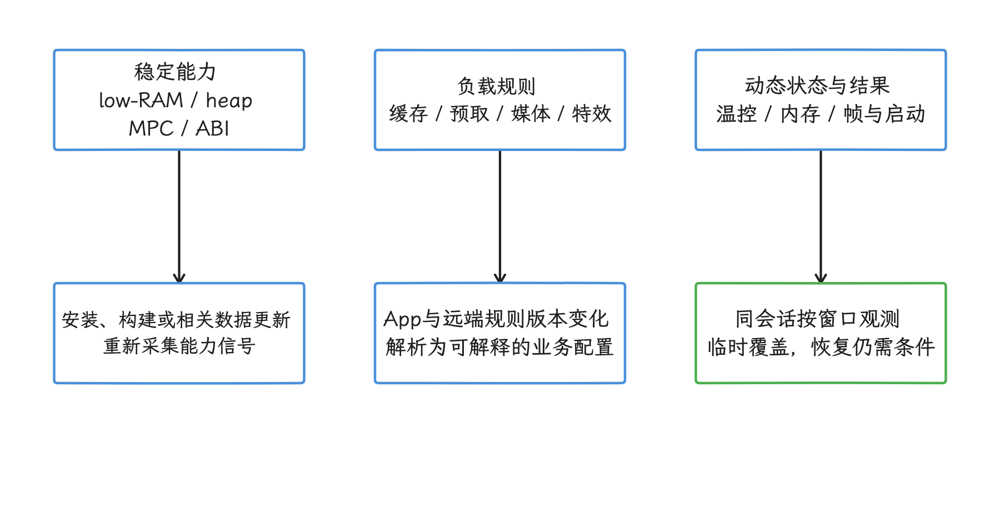

图：能力画像描述资源基础，规则映射业务预算，动态信号控制临时收缩。 三者生命周期不同；启动/帧时长是结果信号，不是稳定机型身份。

## 公开 API 能告诉应用什么

这一节我们逐个过一遍公开 API 能给出的信号，看它们各自回答什么问题。

### Media Performance Class

Media Performance Class（MPC，媒体性能等级）由各 Android 版本的兼容性定义文档 CDD（Compatibility Definition Document，兼容性定义文档） 规定。`Build.VERSION.MEDIA_PERFORMANCE_CLASS` 从 API 31 开始公开；framework 源码从只读设备属性取得该值，返回 `0` 表示设备或当前系统构建没有声明等级。

截至 2026-10-26，官方 Performance class 页面分别列出 MPC 30、31、33、34、35，没有定义 MPC 32。平台字段在一次开机期间不变；厂商 OTA（系统更新）可能提高它，平台版本升级后等级也未必跟着提高。`0` 表示当前设备与构建未声明等级，不能反推它缺少所有高级媒体能力；仍可按具体特性查询。

Media Performance Class 覆盖媒体、相机、显示、编解码和部分通用要求，适合辅助选择 CDD 保证的体验；它不是任意 App CPU/GPU 吞吐的整机跑分。官方建议用 Jetpack Core Performance 读取平台声明或 Google Play services 补充的等级；本章代码仅读取平台字段，不能把结果当作 Play services 补全后的值。

<!-- gracker-diagram: ch16-04-02-mpc-guarantee-boundaries -->
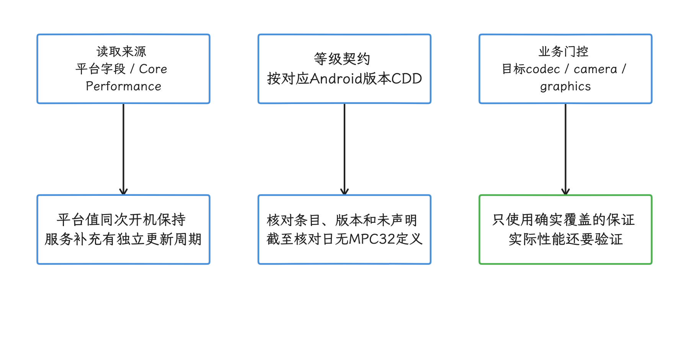

图：先区分平台声明和服务补充，再用对应CDD条目选择体验，并查询具体特性。 MPC 0表示未声明；系统版本升级不保证等级升级，等级不能代替任意负载跑分。

### 内存信号

`ActivityManager.isLowRamDevice()` 是面向应用的稳定提示，通常来自设备配置，调试构建还可能被开发设置强制启用。`getMemoryClass()` 返回常规应用近似的 Java 堆等级，单位 MB；请求 large heap 的应用还需区分 `getLargeMemoryClass()`，当前虚拟机上限可查询 `Runtime.maxMemory()`。这些都不是整机 RAM 或 native/图形/共享内存的独立配额。

`ActivityManager.MemoryInfo` 中几个字段的语义不同：

- `totalMem` 从 API 16 提供，表示内核可访问的总内存，不含基带、TEE（可信执行环境）等内核不可访问的固定保留区。
- `advertisedMem` 从 API 34 提供，更接近零售规格标称的物理内存，可能与 `totalMem` 不同。
- `availMem` 是当前可用内存估计，`lowMemory` 是系统的低内存判断，`threshold` 是该判断相关的阈值配置；应作为运行时上下文读取。`availMem` 不是应用可放心分配的额度，`threshold` 也不是整套 lmkd 选择/杀进程策略。
- `freeMem` 从 API 37 提供，只统计未使用 RAM，不含可回收页。Linux 会主动用闲置内存做文件页缓存，单看 `freeMem` 很容易误判压力。

所以缓存预算要同时受 Java 堆、native/图形/共享页等实际内存域、在用资源峰值和回收信号约束。`memoryClass` 可作保守的策略输入，却不是 native Bitmap 或 GPU 的独立配额；按整机 `totalMem` 固定取百分比也会漏掉进程限制和其他开销。

<!-- gracker-diagram: ch16-04-03-memory-domain-budget -->
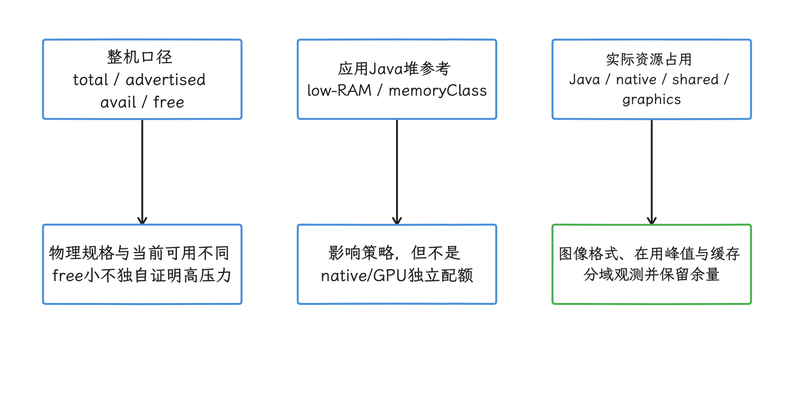

图：把整机容量、Java堆参考和实际分配域分别纳入预算，并保留运行时回收空间。 totalMem或memoryClass的固定百分比都不能保证native/graphics不超限。

### CPU、SoC（片上系统）、GPU 与屏幕

`Runtime.availableProcessors()` 返回调用当时 Java 虚拟机可用的处理器数量，Java API 明确允许该值在同一进程生命周期内变化。它给出的只是这一个数字，完整 SoC 拓扑、大小核性能、调度容量和当前频率都不在其中；并发策略依赖该值时，应在非关键路径偶尔重读，把每次结果当作当时的快照。

`Build.SOC_MANUFACTURER` 和 `Build.SOC_MODEL` 从 API 31 提供，可以帮助按机型定位异常；型号取值很多，还存在厂商命名差异，不适合单独映射为分档。

Vulkan 版本、扩展和编解码器能力适合做功能门控，即只在所需接口存在时开放对应功能。支持某个 Vulkan 特性，说明接口可用；着色器吞吐够不够撑住某个场景，要靠实测回答。实验室里我们用输入与操作流程都固定的负载测量 GPU、CPU 和存储；线上冷启动阶段则要避开微基准——它会延长启动、增加发热，产生的样本还深受后台负载影响。

屏幕分辨率和刷新率同时代表能力与负载。120 Hz 对应名义周期约 8.33 ms，但实际 App 帧 deadline 还受显示模式、目标节奏和平台预测影响，不能把面板最大刷新率当作每帧实际预算。更高分辨率通常增加像素处理与带宽负载；渲染策略应结合当前窗口尺寸、实际模式与逐帧数据。

<!-- gracker-diagram: ch16-04-04-feature-versus-budget -->
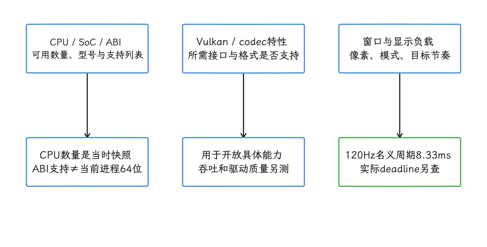

图：用公开特性决定接口可用性，用实际窗口和同条件负载确定预算。 CPU数量、SoC型号、64位ABI和120Hz规格都不能独自证明场景吞吐。

## 采集一份稳定能力画像

示例只收集公开、成本相对低且含义可解释的信号，适合在后台初始化后缓存。`availableProcessors` 是采集时快照；`has64BitAbi` 只表示设备支持某个 64 位 ABI，不代表当前 App 进程正以 64 位运行，后者应查询 `Process.is64Bit()`：

```kotlin
data class StableDeviceSignals(
    val mediaPerformanceClass: Int?,
    val isLowRamDevice: Boolean,
    val appHeapClassMb: Int,
    val kernelVisibleMemoryBytes: Long,
    val availableProcessors: Int,
    val has64BitAbi: Boolean,
    val socManufacturer: String?,
    val socModel: String?,
)

fun collectStableDeviceSignals(context: Context): StableDeviceSignals {
    val activityManager =
        context.getSystemService(ActivityManager::class.java)
    val memoryInfo = ActivityManager.MemoryInfo().also {
        activityManager.getMemoryInfo(it)
    }

    val mediaClass = if (Build.VERSION.SDK_INT >= Build.VERSION_CODES.S) {
        Build.VERSION.MEDIA_PERFORMANCE_CLASS.takeIf { it != 0 }
    } else {
        null
    }

    val socManufacturer = if (Build.VERSION.SDK_INT >= Build.VERSION_CODES.S) {
        Build.SOC_MANUFACTURER.takeUnless { it == Build.UNKNOWN }
    } else {
        null
    }
    val socModel = if (Build.VERSION.SDK_INT >= Build.VERSION_CODES.S) {
        Build.SOC_MODEL.takeUnless { it == Build.UNKNOWN }
    } else {
        null
    }

    return StableDeviceSignals(
        mediaPerformanceClass = mediaClass,
        isLowRamDevice = activityManager.isLowRamDevice,
        appHeapClassMb = activityManager.memoryClass,
        kernelVisibleMemoryBytes = memoryInfo.totalMem,
        availableProcessors = Runtime.getRuntime().availableProcessors(),
        has64BitAbi = Build.SUPPORTED_64_BIT_ABIS.isNotEmpty(),
        socManufacturer = socManufacturer,
        socModel = socModel,
    )
}
```

这份数据仍是“信号集合”，要按具体负载映射为策略。除 `availableProcessors` 应按需重读外，可将平台信号连同 `Build.FINGERPRINT`（系统构建指纹）、App 与规则版本缓存，在相关版本变化时重新采集/解析；使用 Play services 补充等级时还需遵守该数据源自己的更新周期。当前窗口、显示模式和压力数据另行更新，不能随静态画像永久缓存。

若应用最低版本低于示例中的 API 门槛，应保留版本判断。适用范围从 Android 10 开始，`isLowRamDevice`、`memoryClass` 与 `totalMem` 均已可用。

<!-- gracker-diagram: ch16-04-05-signal-cache-lifecycle -->
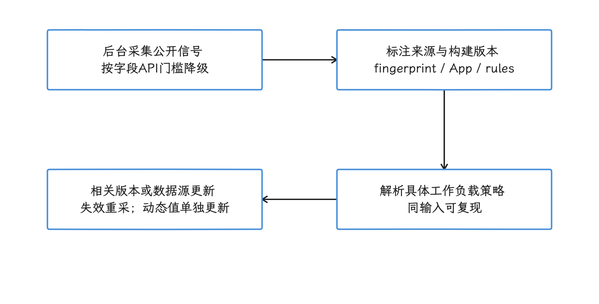

图：后台按公开API采集平台画像，带构建和规则版本缓存，再按各数据源生命周期更新。 示例的CPU数量是快照；窗口、压力和服务补充等级不能永久随静态画像缓存。

## 从能力向量生成工作负载策略

同一台设备可以同时得到“内存受限”和“媒体能力较强”两个判断。策略解析器按业务维度读取这组能力向量，把每个判断直接送到对应的业务上；先算通用总分再分配功能，会把互相独立的能力搅在一起。

代码展示的是一种可测试的映射方式；阈值只用于说明结构，实际项目要用自己的线上分布和基准数据校准：

```kotlin
enum class MediaPreset {
    COMPATIBLE,
    CDD_ENHANCED,
}

data class WorkloadPolicy(
    val decodedImageCacheFraction: Double,
    val feedPrefetchItems: Int,
    val mediaPreset: MediaPreset,
)

data class PolicyRules(
    val constrainedHeapMb: Int = 192,
    val enhancedMediaClass: Int = 35,
)

fun resolvePolicy(
    signals: StableDeviceSignals,
    rules: PolicyRules,
): WorkloadPolicy {
    val memoryConstrained =
        signals.isLowRamDevice ||
            signals.appHeapClassMb < rules.constrainedHeapMb

    val mediaEnhanced =
        (signals.mediaPerformanceClass ?: 0) >= rules.enhancedMediaClass

    return WorkloadPolicy(
        decodedImageCacheFraction = if (memoryConstrained) 0.08 else 0.16,
        feedPrefetchItems = if (memoryConstrained) 1 else 3,
        mediaPreset = if (mediaEnhanced) {
            MediaPreset.CDD_ENHANCED
        } else {
            MediaPreset.COMPATIBLE
        },
    )
}
```

这里的内存判断只影响缓存和预取，媒体等级只影响媒体预设。`decodedImageCacheFraction` 是项目自定比例；即使用 Java 堆等级换算参考字节数，也还要结合实际 Bitmap 分配域、在用图片峰值、命中率和硬上限校准，不能据此保证不发生 OOM。选中 `CDD_ENHANCED` 后仍要查询目标编解码器、相机或图形特性，因为业务所需能力未必属于该 MPC 等级的保证范围。

映射函数应保持纯函数特征，也就是相同的信号、规则版本和应用版本总会得到相同结果。这样既能写单元测试，也能在故障报告里复现用户收到的策略。

<!-- gracker-diagram: ch16-04-06-independent-policy-mapping -->
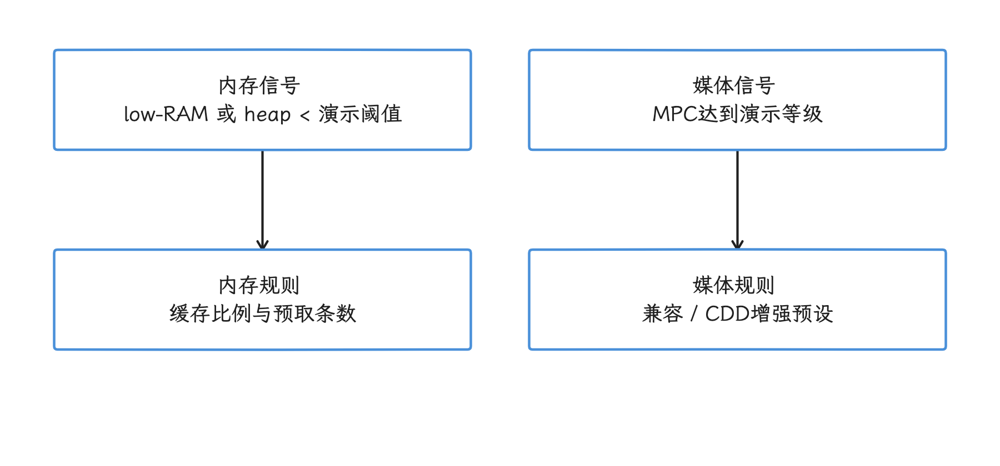

图：同一能力向量按内存与媒体两个独立分支生成负载策略，避免通用总分抹平差异。 192MB、MPC35和缓存比例都是演示规则；native/graphics预算与所需媒体特性仍要单独校准。

## 会话期压力单独处理

Android 10 / API 29 起可通过 `PowerManager.getCurrentThermalStatus()` 读取热状态；`isPowerSaveMode()` 自 API 21 提供。API 30 增加 `getThermalHeadroom(forecastSeconds)`，预测范围 0～60 秒，`0` 表示当前值；`1.0` 对应严重热节流阈值，值可超过 1.0，但超过后的数值不直接对应更高状态枚举。设备不支持、调用过快或其他暂时不可用情况可能返回 `NaN`（没有有效数值），不能把它补成 0。

该接口跟踪皮肤温度等慢变化传感器。固定 A17 API 注释说约每秒以上频率没有收益，明显更快可能返回 `NaN`；当前 ADPF 指南给出更保守的“不超过每 10 秒一次”建议，应集中调度查询以避免多个调用方叠加。最初几秒若温度样本不足，传入未来秒数也可能只返回当前值；部分设备的热状态更新不完整，需结合 headroom 与目标设备验证。

Android 16 / API 36 的 `android.os.health.SystemHealthManager` 增加 CPU/GPU headroom API，估算近期可用性能余量，较适合持续且强度足够的负载。计算偏重历史使用，不保证查询后仍有相同容量，也不是长期机型跑分。它与 thermal headroom 的方向不同：CPU/GPU headroom 接近 0 表示可追加容量少；thermal headroom 接近或超过 1.0 表示接近或超过严重热阈值。固定 A17 源码和公开契约还规定：

- 有效结果范围为 0～100，`0` 表示没有更多容量可供分配；暂时不可用时可能返回 `Float.NaN`。
- 不支持该接口的设备会抛出 `UnsupportedOperationException`；即使 API 级别足够也要处理不支持。自定义参数还可能触发参数、线程归属或亲和性校验错误，不能一律当作 `NaN`。
- 每次有效查询至少包含一次同步 Binder 跨进程调用，耗时可能超过 1 ms；这类等待要放在主线程、渲染线程等关键线程之外。
- 调用方应读取 `getCpuHeadroomMinIntervalMillis()` 或 `getGpuHeadroomMinIntervalMillis()`，遵守最小轮询间隔；过快可能得到缓存值，不能把相同结果当成独立新测量。

这些 headroom 值描述当前工作负载还能获得多少容量，参与会话期调节正合适；稳定的机型分档、首帧前的同步读取，交给更合适的信号去做。

<!-- gracker-diagram: ch16-04-07-headroom-directions -->
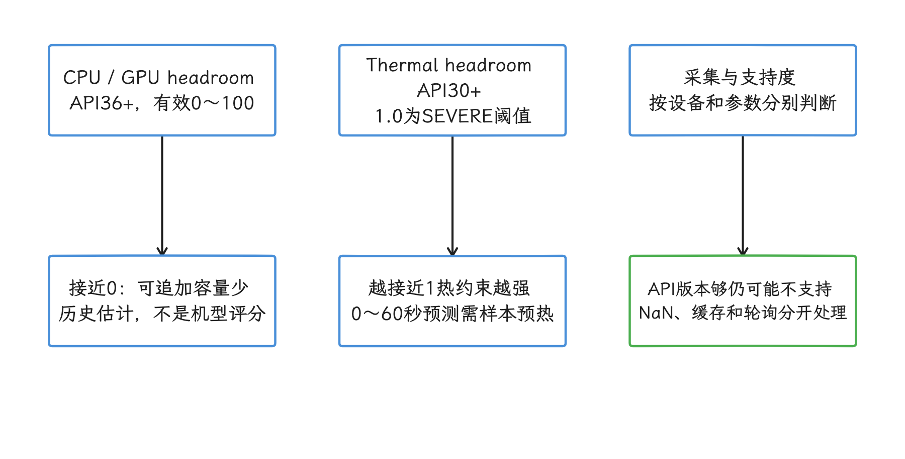

图：CPU/GPU headroom反映近期可追加容量；thermal headroom反映热包络占用或预测。 二者方向不同、都不保证未来性能；无效结果保持未知，查询避开关键线程。

动态质量控制要防住来回振荡：为降级和恢复设置不同阈值，再给常规切换设置最短驻留时间。严重热状态应允许立即降级，不能被刚恢复后的驻留时间挡住。下面只演示 `NORMAL`/`REDUCED` 两态，不替代系统热保护；调用需串行化，`nowMillis` 使用同次开机的单调时钟（如 `SystemClock.elapsedRealtime()`），丢帧比来自明确且足量的观测窗口：

```kotlin
enum class RenderQuality {
    NORMAL,
    REDUCED,
}

class RenderQualityController(
    private val minDwellMillis: Long = 30_000,
) {
    init {
        require(minDwellMillis >= 0)
    }

    private var quality = RenderQuality.NORMAL
    private var lastChangeMillis: Long? = null

    fun update(
        nowMillis: Long,
        thermalStatus: Int,
        missedFrameRatio: Double,
    ): RenderQuality {
        val ratio = missedFrameRatio.takeIf {
            it.isFinite() && it in 0.0..1.0
        }
        val thermalEmergency =
            thermalStatus >= PowerManager.THERMAL_STATUS_SEVERE
        val dwellElapsed = lastChangeMillis?.let {
            nowMillis >= it && nowMillis - it >= minDwellMillis
        } ?: true

        // 严重温控降级可以绕过驻留；普通降级与恢复仍受驻留约束。
        val next = when {
            quality == RenderQuality.NORMAL && thermalEmergency ->
                RenderQuality.REDUCED
            !dwellElapsed -> quality
            quality == RenderQuality.NORMAL &&
                ratio != null && ratio >= 0.10 -> RenderQuality.REDUCED
            quality == RenderQuality.REDUCED &&
                thermalStatus <= PowerManager.THERMAL_STATUS_LIGHT &&
                ratio != null && ratio <= 0.03 -> RenderQuality.NORMAL
            else -> quality
        }
        if (next != quality) {
            quality = next
            lastChangeMillis = nowMillis
        }
        return quality
    }
}
```

示例中有效丢帧比达到 10% 可降级，不高于 3% 且热状态不高于 LIGHT 才可恢复；常规切换至少间隔 30 秒，严重温控降级可立即发生。`NaN`、无穷或超出 [0,1] 的比例不参与切换，也不作为恢复证据。阈值和观测窗口需按场景校准；两态示例没有实现多级渐进恢复，生产中还应限制恢复斜率，并处理后台暂停、观测缺失和状态重建。

<!-- gracker-diagram: ch16-04-08-quality-hysteresis -->
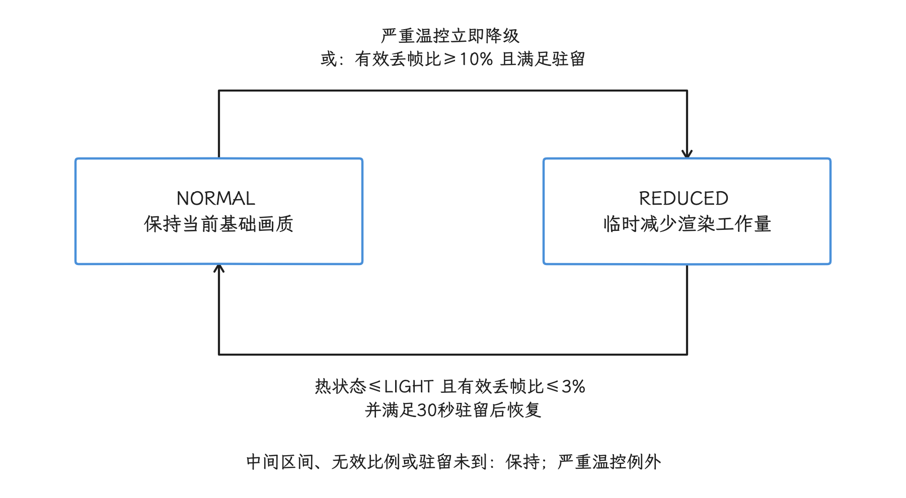

图：以单调时间执行迟滞与常规驻留，严重温控可绕过驻留立即进入降级态。 这是两态演示；比例需有足量窗口，NaN不作为恢复证据，多级渐进恢复仍需另行实现。

内存回收可结合 `onTrimMemory()`、`MemoryInfo.lowMemory` 和业务占用/命中率处理。API 34 起不再发送 `TRIM_MEMORY_RUNNING_*`、`MODERATE`、`COMPLETE`，不能靠旧级别还原实时压力阶梯；当前应重点处理 `UI_HIDDEN`（界面不可见）和 `BACKGROUND`（进入可被回收的后台状态），它们也包含生命周期含义，不能当压力百分比。按文档用 `>=` 比较所处理级别，不保证未来枚举变化对业务毫无影响；`onLowMemory()` 自 API 34 也不再调用。

<!-- gracker-diagram: ch16-04-09-memory-callback-lifecycle -->
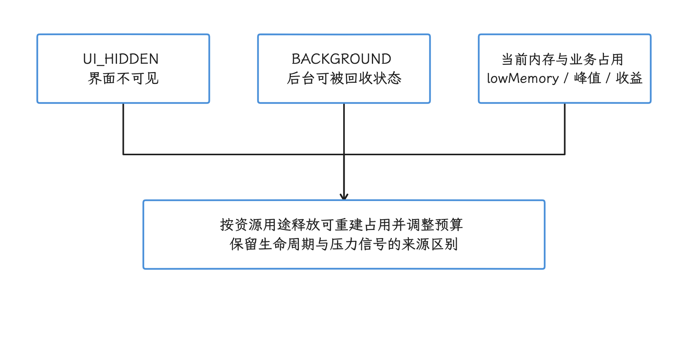

图：按UI隐藏和后台状态释放可重建资源，再结合实际占用与系统信号调整预算。 API34后旧运行压力级别与onLowMemory不再通知；现存回调也不是连续压力百分比。

网络质量属于另一条动态轴：图片规格和预取策略跟着计量网络、Data Saver（系统的数据节省模式）、请求时延和吞吐走，设备等级在这一轴上插不上手。

## 各类策略如何收缩

具体到每一类策略，收缩的动作各有侧重。

### 启动

- 保留 Baseline Profile 和 Startup Profile。前者帮助常用方法更早获得 AOT（ahead-of-time，预先） 编译，后者改善启动代码的 DEX 字节码文件布局；较慢设备通常更容易从减少启动工作中受益。
- 只有 trace（性能时间线记录） 证明并发初始化发生 CPU 争用、锁竞争或 I/O 拥塞时，才减少并发任务；线程少，启动未必更快。
- 把非首屏依赖移出启动关键路径，为初始化任务设置明确的触发条件和超时。
- 不在冷启动期间探测 CPU 峰值、存储吞吐或 GPU 跑分。

### 渲染

- 根据目标帧预算、窗口像素数和实测帧时间调整模糊半径、粒子数、阴影层级或动画采样率。
- 矢量图未必比 PNG 慢；PNG 也可能增加包体、解码内存和缩放成本。应针对具体资源测量。
- `RGB_565` 只评估用于不需要 alpha 透明通道、且可接受色彩精度损失的内容；低内存设备上也按内容逐项评估，避免全局一刀切的开关。
- 对质量变化使用迟滞、最短驻留时间和渐进过渡，避免用户看到频繁跳变。

### 内存

- 图片缓存按应用堆预算、平均对象大小和命中收益设计，并响应 `onTrimMemory()`。
- 缩短列表预取窗口前，应测量占用与滚动命中率；过度收缩会增加重复解码和网络请求。
- native、GPU、共享内存和 Java 堆要分别观测，`getMemoryClass()` 只约束其中一部分。

### 媒体

- 用 Media Performance Class 选择 CDD 已覆盖的体验，再用 `MediaCodecList`、Camera2 characteristics（相机能力属性） 或图形能力查询确认业务所需特性。
- 编解码器初始化耗时、掉帧与温控表现应进入实验设备组合——厂商驱动质量的差异，靠这些实测来覆盖。

<!-- gracker-diagram: ch16-04-10-workload-specific-actions -->
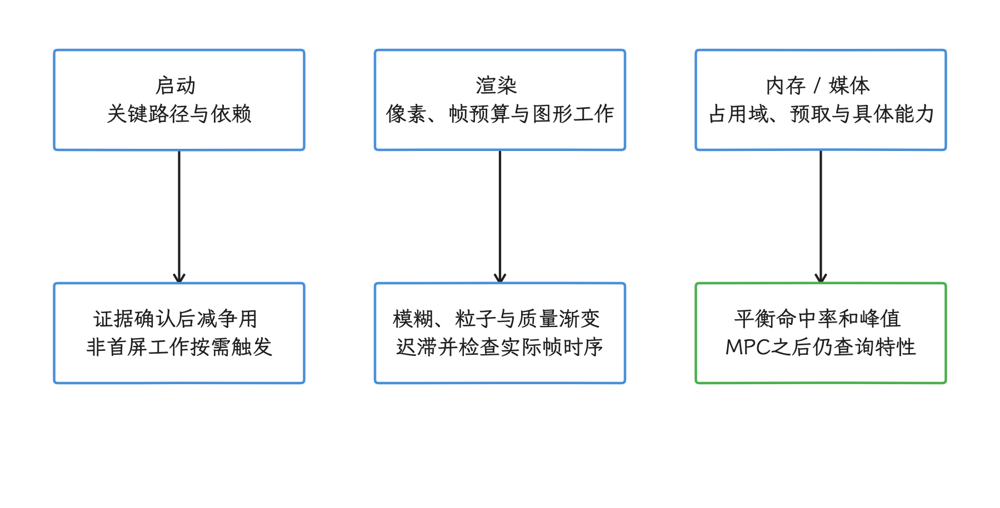

图：启动、渲染与内存/媒体各沿已确认的成本采取动作，并用对应体验护栏验证。 缩短预取、减并发或降低格式都可能引入代价；Baseline/Startup Profile不因设备慢而关闭。

### 网络与后台任务

- 图片规格应综合容器像素、屏幕密度、网络策略和缓存，不按 SoC 型号固定。
- 低带宽或计量网络可以减少预取；设备 CPU 慢，网络未必慢。
- App 无权修改 JobScheduler 的系统配额。可以减少任务数量、延长周期，并使用充电、空闲、网络类型等约束，让系统选择执行时机。

<!-- gracker-diagram: ch16-04-11-network-and-job-axes -->
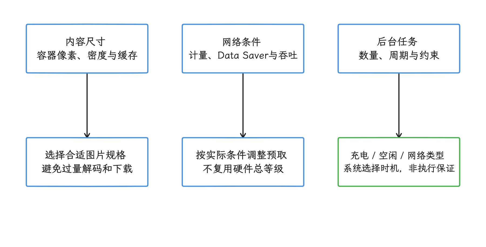

图：网络规格按容器、计量与实测质量调整，后台任务通过公开约束交由系统调度。 SoC慢不等于网络慢；App可配置任务和约束，不能修改JobScheduler系统配额。

## 远端策略必须能离线启动

远端配置适合修正规则、控制灰度发布的范围，冷启动路径则要避开对它的网络依赖——灰度发布指只向一部分稳定分组逐步开放新策略。实施前先定一份明确的数据契约，把配置字段、版本、校验和失效方式写清楚：

- APK 内置经过验证的安全默认值。
- 本地保存上一份通过校验且仍在有效期/适用版本内的配置；拉取失败时优先复用它，已过期或不兼容则回到 APK 安全默认值，避免把过期规则永久续命。
- 配置带 `schemaVersion`（格式版本）、`policyRevision`（规则修订号）、适用应用版本、过期时间和各项边界。
- 未识别字段按兼容规则忽略，越界值拒绝生效。
- 高风险开关配独立的 kill switch；客户端收到且通过校验后切到约定的安全配置。离线设备不能保证及时收到；需要立即收缩的安全边界由本地规则保护。
- 常规规则在一个前台会话内保持稳定，新版本先校验、暂存，下一会话再切换；紧急 kill switch 和会话期压力覆盖可按事先定义的安全规则即时收缩，并记录切换原因。
- 分别记录随机分配、配置版本、实际曝光、未生效与失败事件。“曝光”表示策略实际应用；总体发布决策应保留按随机分配分析的视角。仅分析曝光者可能漏掉生效前失败或引入选择偏差；触发/曝光分析需使用两组对称且预先定义的条件，单列覆盖率与分母。

<!-- gracker-diagram: ch16-04-12-offline-config-rollout -->
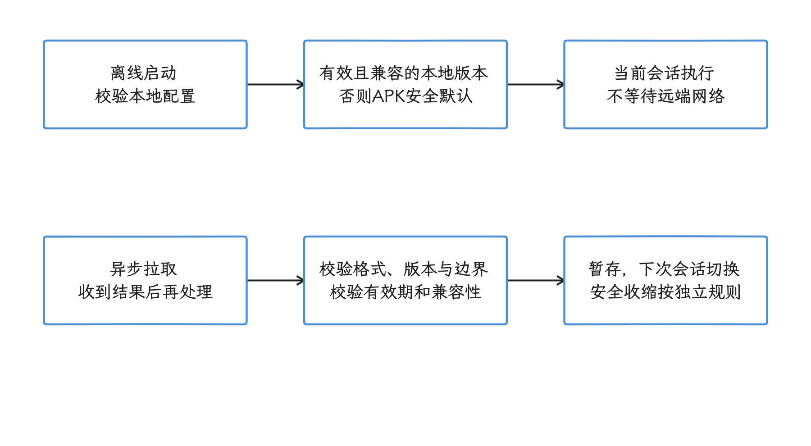

图：冷启动从有效本地版本或APK默认值选择配置，远端更新异步校验后按约定时机生效。 过期不兼容配置回退默认；kill switch依赖投递，离线安全边界由本地规则保护。

灰度分组应使用符合隐私规则的稳定标识做确定性散列，使同一用户或安装实例稳定进入同一组；不要读取 IMEI、序列号等硬件标识。随后在能力画像或机型群内随机分配实验组——直接比较“高端组”和“低端组”，用户、系统版本、地区和业务行为的差异都会混进结论。汇总数据还可能出现辛普森悖论：各设备层内都变好，合计结果却因流量构成改变而变差。

<!-- gracker-diagram: ch16-04-13-randomization-and-exposure -->
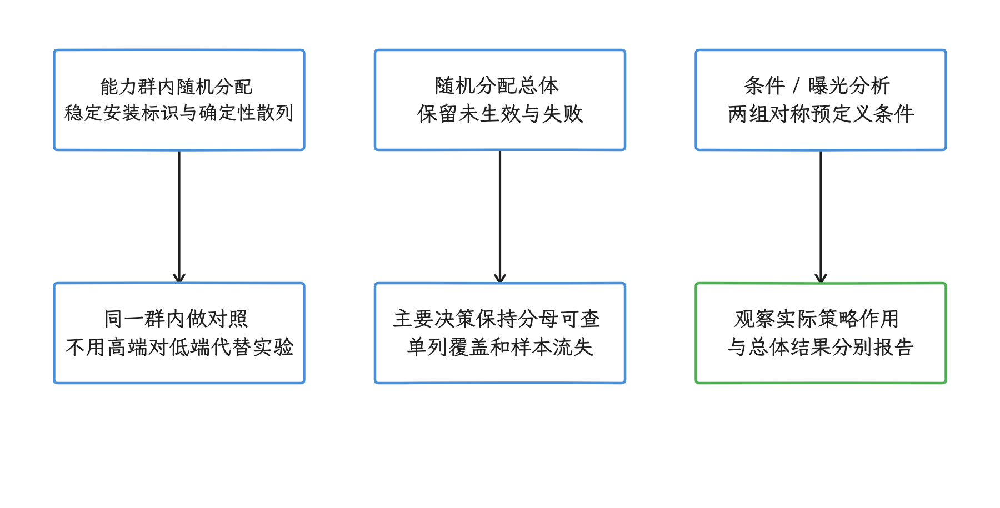

图：在能力群内稳定随机分组，保留分配总体及实际曝光，用预先定义的分母评估结果。 只分析曝光者会受生效前失败和选择影响；跨设备层流量权重改变也可能反转合计趋势。

设备等级承担不了安全职能：客户端参数可以被篡改，服务端授予权限、跳过风控或信任内容的依据都要另找。

## 设备老化与厂商模式

设备会老化，但公开 Android SDK 没有一个通用 API，能够可靠给出“电池老化百分比 + 存储健康度”，再转换为设备性能等级。电量、充电状态、剩余空间和单次 I/O 延迟各自只解释一个局部现象。对普通应用，更可靠的做法是观察当前会话的帧时间、解码耗时、启动耗时、内存压力和温控状态，并在压力持续存在时临时收缩工作量。

厂商的游戏模式、性能模式和私有系统属性缺少跨设备契约，通用策略绕开它们。面向持续渲染负载的应用可以检查 `PowerManager.isSustainedPerformanceModeSupported()`，再按公开 API 使用 `Window.setSustainedPerformanceMode()`；该模式追求长时间稳定输出，和通用“高性能模式”说的往往不是一回事。

历史上的 Facebook Device Year Class 把若干规格映射成“年份”，其分解信号的思路可帮助理解早期设备分组。GitHub 仓库当前已归档、只读，今天的产品策略不应把它当作仍在维护的现成实现。

<!-- gracker-diagram: ch16-04-14-aging-and-vendor-boundaries -->
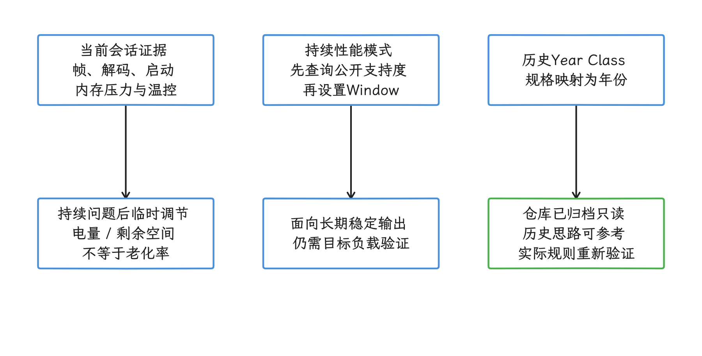

图：当前体验可触发临时收缩；持续性能模式按公开支持度使用，历史Year Class仅作背景。 普通SDK没有通用老化总评分；持续性能模式不承诺最高峰值，归档库不能直接代替当代策略。

## 验证分级有没有收益

验证时，我们先给每条策略定一个主要指标和一组护栏指标——护栏就是实验中一旦明显恶化就把实验拦下来的副指标。例如，减少列表预取的主要指标可以是内存峰值，护栏包括滚动卡顿、图片等待时间、网络请求数和用户操作成功率。只看平均 FPS（每秒帧数） 或平均启动时间，会掩盖长尾和受影响最重的设备。

验证流程可按以下顺序执行：

1. 用 trace 或 heap（堆内存） 数据确认瓶颈归属，明确策略要减少哪类成本。
2. 在代表性的设备组合上跑 Macrobenchmark（端到端基准）或场景基准，覆盖冷、温、热启动以及关键交互。
3. 在能力群内随机分组，同时记录分配与曝光；按预设口径保留生效前失败，检查各组覆盖与样本流失。
4. 分别检查 P50、P90、P95、P99 等分位数；例如 P95 表示 95% 的样本不超过该值。失败率、功耗和内存护栏也要同时检查。
5. 上线后结合 Android vitals（Play Console 提供的稳定性与性能指标） 和自有遥测数据，按应用版本、系统版本、策略版本和设备群观察。
6. 规则失效或护栏恶化时回退配置，并保留可复现的配置快照。

实验设备要覆盖低 RAM、不同 MPC、主流 SoC 家族、不同屏幕负载和主要系统版本。机型型号用于定位异常就够用；给每个型号长期维护一份手写策略，分支会迅速多到验证不过来。

<!-- gracker-diagram: ch16-04-15-policy-verification-loop -->
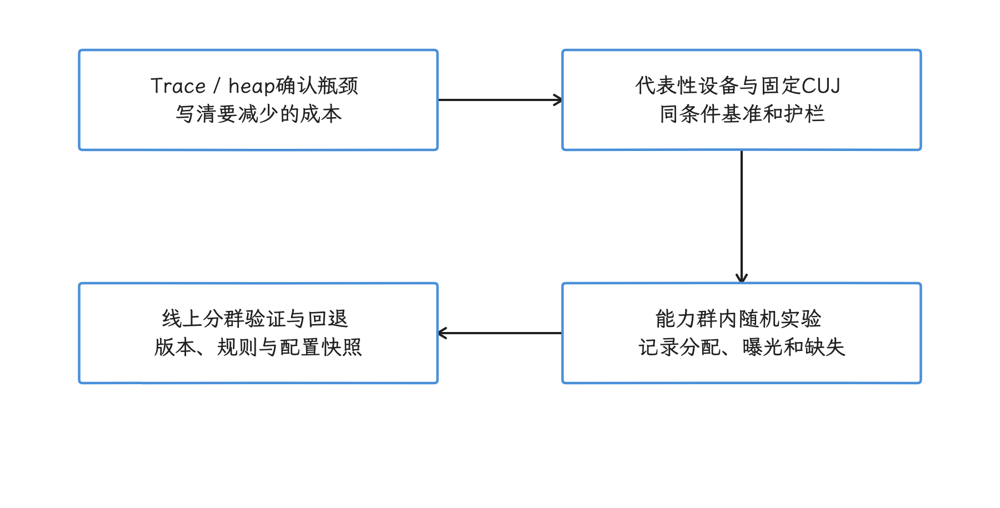

图：先确认瓶颈，在代表设备验证，再于同能力群随机发布并同时检查主指标和护栏。 这是本章建议的验证流程；分位数、覆盖和失败需同合同，护栏恶化要可回退且可复现。

## 检查清单

- [ ] 能力画像、业务策略、会话期压力分别建模。
- [ ] 只使用公开 API；没有读取隐藏 `SystemProperties` 或私有 `DeviceConfig`。
- [ ] 没有通用加权分数，也没有在用户冷启动期间跑微基准。
- [ ] Media Performance Class 只用于其 CDD 覆盖的能力，并处理 `0`。
- [ ] `memoryClass`、`totalMem`、`availMem`、`freeMem` 的含义没有混用。
- [ ] CPU/GPU headroom 查询避开关键线程，并遵守最小轮询间隔。
- [ ] 动态控制含迟滞和常规驻留，严重温控可立即降级；渐进恢复另行实现并验证。
- [ ] Baseline Profile 与 Startup Profile 未因设备较慢而关闭。
- [ ] 网络策略依据网络与内容尺寸，未复用硬件等级。
- [ ] JobScheduler 只设置任务和约束，没有假设 App 能调整系统配额。
- [ ] 远端配置具有本地默认、上一有效版本、版本校验、过期和回退能力。
- [ ] 实验按能力群随机，记录分配、曝光与缺失，预定义分析分母，并检查分位数与护栏。

## 小结

设备分级的做法，是把稳定能力、具体工作负载和会话期压力分开建模，整机的高、中、低总分留在外面。策略只依赖公开且可解释的信号，本地安全默认值保证离线可用，收益靠按能力群随机的实验验证，主指标和护栏一起看；温控、内存或帧压力触发的都是临时收缩，设备身份保持原样。

## 源码与文档

- [Android 17 `SystemHealthManager.java`](https://android.googlesource.com/platform/frameworks/base/+/android-17.0.0_r1/core/java/android/os/health/SystemHealthManager.java)：CPU/GPU headroom 的 Binder 调用、返回值和轮询间隔。
- [Android 17 `PowerManager.java`](https://android.googlesource.com/platform/frameworks/base/+/android-17.0.0_r1/core/java/android/os/PowerManager.java)：温控状态、thermal headroom 与持续性能模式。
- [Android 17 `ActivityManager.java`](https://android.googlesource.com/platform/frameworks/base/+/android-17.0.0_r1/core/java/android/app/ActivityManager.java)：low-RAM、应用堆等级和 `MemoryInfo`。
- [Android 17 `Build.java`](https://android.googlesource.com/platform/frameworks/base/+/android-17.0.0_r1/core/java/android/os/Build.java)：SoC 标识与 Media Performance Class 的来源。
- [Performance class](https://developer.android.com/topic/performance/performance-class)：MPC 的等级、CDD 范围和 Jetpack Core Performance 用法。
- [Android Developers：Bitmap 与内存](https://developer.android.com/topic/performance/memory/guide/bitmaps)：软件、共享和硬件 Bitmap 的分配域。
- [Android Developers：Thermal API](https://developer.android.com/games/optimize/adpf/thermal)：调用频率建议与设备限制。
- [`Process.is64Bit()`](https://developer.android.com/reference/android/os/Process#is64Bit())：当前进程位宽，与设备 ABI 支持列表分别读取。
- [Startup Profiles](https://developer.android.com/topic/performance/baselineprofiles/dex-layout-optimizations)：构建期 DEX 布局优化。
- [`SystemHealthManager` API](https://developer.android.com/reference/android/os/health/SystemHealthManager)：API 36 headroom 接口契约。
- [`PowerManager` API](https://developer.android.com/reference/android/os/PowerManager)：温控与省电公开 API。
- [`ActivityManager.MemoryInfo` API](https://developer.android.com/reference/android/app/ActivityManager.MemoryInfo)：各内存字段的 API 版本与语义。
- [`Runtime.availableProcessors()` API](https://developer.android.com/reference/java/lang/Runtime)：返回值含义与进程存活期间可能变化的契约。
- [`ComponentCallbacks2` API](https://developer.android.com/reference/android/content/ComponentCallbacks2)：`onTrimMemory()`、API 34 起不再发送的级别与比较方式。
- [`JobScheduler` API](https://developer.android.com/reference/android/app/job/JobScheduler)：系统配额、运行约束与延后原因。
- [Baseline Profiles](https://developer.android.com/topic/performance/baselineprofiles/overview)：AOT 优化与 Startup Profile 的适用方式。
- [Macrobenchmark（端到端性能基准）](https://developer.android.com/topic/performance/benchmarking/macrobenchmark-overview)：跨设备场景基准。
- [Device Year Class archive](https://github.com/facebookarchive/device-year-class)：已归档的历史分级实现。
