# 性能测试最佳实践

性能测试测量的是一个分布：设备、温度、后台负载和数据状态都在影响结果，任何一次读数都只代表当时的状态。我们先把场景、环境、采样和测试合同写清楚，回归门禁才能把真实劣化和测量噪声分开。

## 性能测试测量的是分布

功能测试通常一个断言就能判定一次执行。性能测试不一样：调频、缓存、GC（Garbage Collection，垃圾回收）、调度、I/O（输入输出）、温度和网络都在制造随机波动，任何单次结果都只说明那一次执行。要得到可比较的性能结论，我们需要同时固定三件事：

- 工作负载：入口、数据、手势、终止条件和正确性断言；
- 设备状态：硬件、系统镜像、电量、温度、显示、网络和后台活动；
- 统计协议：预热、编译状态、迭代、排除规则、聚合与回归判定。

工具能降低测量成本，测试合同仍要我们自己写。以 Macrobenchmark（跨进程测量完整用户流程的 Jetpack 基准测试库） 为例：它跨进程驱动完整用户流程，如果用例里缺少设备状态和工作负载断言，生成的数字可能来自错误页面、空列表，甚至一次已经失败的启动。

## 先写测试合同

我们把“测试合同”定义为团队预先固定、可复核的测量约定。每个 benchmark（基准测试用例） 在代码和报告中都要能回答下面这些问题：

| 项目 | 要写清的内容 |
|---|---|
| 目标 | 要保护的用户路径或代码单元 |
| 指标 | TTID（首次画面显示时间）、TTFD（完整画面显示时间）、`frameOverrunMs`、CPU time、内存分配量等 |
| 方向 | 越小越好、越大越好或比率 |
| 范围 | 测量从哪里开始，到哪个可验证状态结束 |
| 状态 | app data（应用数据）、登录、缓存、编译、进程和 Activity 状态 |
| 环境 | 设备、系统 fingerprint（构建指纹）、显示、温度、电量、网络 |
| 重复 | 预热方式、测量迭代、独立测试运行次数 |
| 判定 | 产品 SLO（Service Level Objective，服务质量目标）、允许回归、噪声下限和排除规则 |
| 证据 | 原始 JSON、每轮 trace（系统时间线记录）、日志和构建产物摘要 |

测试块末尾要断言目标状态已经出现，比如列表加载完成、目标控件可见、视频开始播放。少了这一步，应用崩溃后快速返回一个错误页，也可能贡献出一组“更快”的结果。

<!-- gracker-diagram: ch16-05-01-test-contract -->
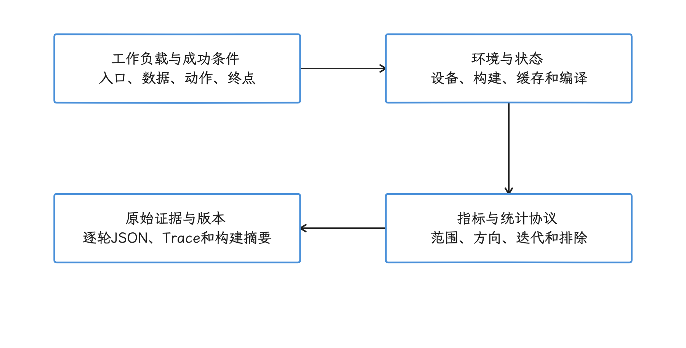

图：工作负载、设备条件与统计协议共同形成可复现的测试合同，成功条件先于数值解释。 目标页面失败或错误页不能因耗时短就被当作性能改善。

## 测试环境标准化

环境标准化要解决的问题是：让每一轮测量发生在可复现的设备状态上。我们从设备、存储、温度、供电、显示到网络逐项过一遍，说清每一项要固定什么。

### 设备：固定参考机与用户分层

CI（Continuous Integration，持续集成） 回归闸门要跑在专用物理设备上。模拟器的结果受宿主机、虚拟化、GPU 和存储的影响，Android 官方也不建议拿它做性能判定；它和 Gradle Managed Devices（Gradle 托管的虚拟设备）适合检查 benchmark 能否安装、启动和产出文件。

参考设备应固定：

- 设备序列号和硬件 revision（修订版）；
- Android 版本、build fingerprint（系统构建指纹） 和安全补丁；
- bootloader、vendor image 与可独立更新的 ART Mainline 模块版本；
- 电池健康、存储介质状态和实验室散热方式；
- 测试账号、区域、语言、字体缩放和无障碍设置。

用户设备分层按线上机型、SoC（System on Chip，系统级芯片）、RAM 和 Android 版本的分布取样，用于周期性兼容验证。PR（Pull Request，代码合并请求） 级的细微回归，我们尽量在同一台参考设备上比较基线与候选版本；跨设备的结果，不直接做百分比差值。

系统镜像选量产配置的 user 构建，或经过验证、保留了调试能力的 userdebug 构建。面向平台开发的 eng 构建、debuggable 目标包、代码覆盖率和 method tracing（逐方法记录调用轨迹） 都会改变执行路径，被测目标里要把它们排除在外。

Macrobenchmark 的目标应用要尽量接近 release：`debuggable=false`；启用 `profile（热点代码记录）able`，让 shell 工具在不打开调试模式时也能采集性能数据；R8 代码优化和资源压缩配置与发布保持一致；再带上 ProfileInstaller，负责安装 Baseline Profile（随安装包提供的热点方法和类规则清单）。

### 存储与数据状态

存储剩余空间会影响文件系统回收、数据库、安装和 dexopt（ART 对 DEX 字节码的验证与编译优化）。Android 没有适用于所有设备的统一“至少空闲百分比”，测试池要通过试运行确定自己的拒测线；报告里同时保存可用字节、总容量，以及当时有没有明显的后台 I/O。

<!-- gracker-diagram: ch16-05-02-reference-environment -->
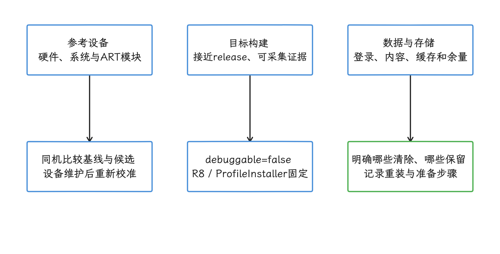

图：在参考设备上固定发布构建、数据与存储协议，再按代表用户的设备层补充覆盖。 模拟器用于流程检查；跨机型原始毫秒和不同构建状态不能直接当同机回归百分比。

以下状态要分别定义，一句“清缓存”覆盖不了：

- app data 是否清除；
- HTTP、图片、数据库和业务缓存是冷还是热；
- APK 是否重装；
- ART 编译与 profile 状态；
- 进程、Activity 与 task 是否存在；
- 测试数据是否固定并完成准备。

`StartupMode.COLD` 只为冷启动终止应用进程；app data、业务缓存的清除和全新安装的模拟，都由测试用例自己准备。`CompilationMode.None()` 同样只重置编译状态，离 fresh install（全新安装） 还很远。

<!-- gracker-diagram: ch16-05-03-reset-data-boundary -->
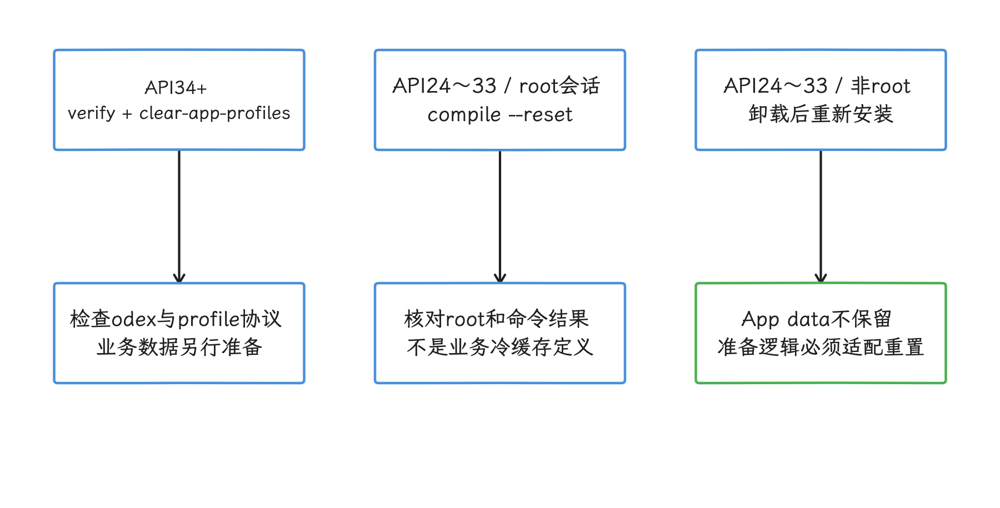

图：先按固定库和平台版本确认编译重置路径，再重新准备测量需要的数据与缓存。 1.4.1在API24～33非root会卸载重装；None不是禁用JIT，也不是只改编译且保留数据的保证。

### 温度状态门控

不同设备暴露的 thermal zone（内核温度传感器区域）各有差异：传感器位置、厂商策略都不一样，`/sys/class/thermal/thermal_zone*/temp` 在量产设备上甚至可能读不到。想用一个固定的摄氏度阈值跨机型代表同一种性能状态，是做不到的。

参考机要建立自己的冷机基线：

1. 记录室温、设备位置和散热配置；
2. 从 `dumpsys thermalservice`、厂商可读传感器和 Perfetto（Android 系统时间线分析工具） 记录热状态；
3. 运行试验确定进入降频前的状态范围；
4. 超出门控条件时暂停并冷却，样本标记为环境无效；
5. 保存每次运行的起止热状态与冷却时间。

`cmd thermalservice override-status` 覆盖的只是 `ThermalManagerService` 向 Framework 暴露的 thermal status（热状态等级）；Thermal HAL（Framework 与厂商温控的接口）、内核 cpufreq、GPU 降频和厂商 thermal engine 都照常工作。所以我们拿它测试应用的 thermal callback 是合适的，想借它造出“未降频”的基准则行不通。

### 峰值路径与热稳定态

启动、短滑动这类短路径，通常关心冷机或受控的初始状态；游戏、直播、相机和长时间列表交互还必须测热稳定态。两者的前置条件和报告字段不同：

| 类型 | 前置条件 | 测量开始 | 报告重点 |
|---|---|---|---|
| 短路径回归 | 冷却到参考状态，缓存与编译状态固定 | 环境门控通过后 | 每轮时长、分布、起止热状态 |
| 持续负载 | 运行目标工作负载，直到温度与性能进入稳定区间 | 预热区间结束后 | 稳态时长、帧/功耗分布、频率与热状态曲线 |

持续负载的“稳定”要由预先定义的滑动窗口条件来判定：在连续的固定窗口里检查温度与性能波动是否收敛。曲线跑完再临时挑一段看起来平的区间，这样的“稳态”说服力存疑。预热数据要保留，单独存放，与稳态统计分开。

<!-- gracker-diagram: ch16-05-04-thermal-protocols -->
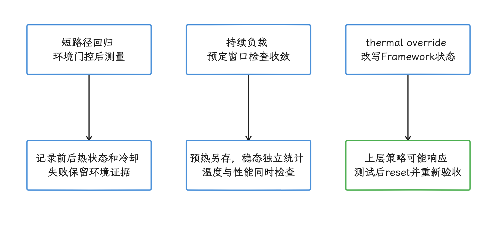

图：短路径固定初始热状态，持续负载按预定窗口进入稳态，状态覆盖只用于特定行为验证。 override不会取消真实热控制；不能事后挑平坦区间或用覆盖后的状态证明设备未降频。

### 电量与供电

AndroidX Benchmark 会把低电量设备标成 `LOW-BATTERY` 错误，CI 闸门要让它照常失败。原因是低电量策略在接通电源后仍可能限制大核，而充电本身又会带来发热。

供电协议要在测试池内固定下来，比如在规定电量范围内断电跑一组测试，或使用带充电控制的设备架。协议本身可以各选各的，但基线与候选版本必须遵循同一套，并保存：

- 测试前后电量；
- 是否充电、充电功率状态；
- Battery Saver（系统省电模式） 与厂商省电模式；
- 运行中是否发生充电状态切换。

“充满后一直插电”也未必等于恒定供电：厂商充电策略、电池温度和旁路供电能力都不一致。

### 显示模式、亮度与主题

60 Hz、90 Hz、120 Hz 和动态刷新率对应不同的 deadline（帧完成时限）。比较性能回归时要固定同一显示策略，至少也要记录每帧的实际 deadline。`DisplayModeDirector` 会综合系统 setting（设置项）、应用声明的期望帧率、功耗和 thermal 条件来选 mode；写入了 `peak_refresh_rate` 和 `min_refresh_rate`，厂商也未必采用我们指定的模式。

改 setting 前先保存原值，改完用 `dumpsys display` 和 Perfetto 的 expected FrameTimeline（系统期望帧时间线） 验证是否生效。报告里同时记下 requested mode（请求模式） 和 observed mode（实测模式），两者对不上就拒绝比较。

亮度、自动亮度、主题和显示内容同样要保持一致。OLED 上切换深浅主题既改变显示功耗，也改变被测 UI，为散热把生产场景换成另一套主题不可取。测动画或转场时保留发布配置的 animation scale（动画时长缩放）；系统动画一关，被测路径就变了。

### 本地路径与网络路径的测试方案

本地 UI、布局和滚动 benchmark 用预置数据或受控的 fake backend（返回固定响应的测试后端），把公共网络波动挡在结果之外。网络性能测试则要固定：

- 服务端版本、region（部署区域） 和测试账号；
- 网络类型、延迟、带宽、抖动、丢包和代理配置；
- DNS（域名解析）、TLS session（加密会话）、HTTP cache（响应缓存） 与连接复用状态；
- 每轮请求数据大小及服务端处理时间。

飞行模式、关 Wi-Fi、代理限速都会改变系统与应用的路径，要写进测试合同。拿真实生产接口当回归闸门，客户端改动与服务端、CDN（内容分发网络） 或公网的变化会搅在一起，很难分清责任。

<!-- gracker-diagram: ch16-05-05-power-display-network -->
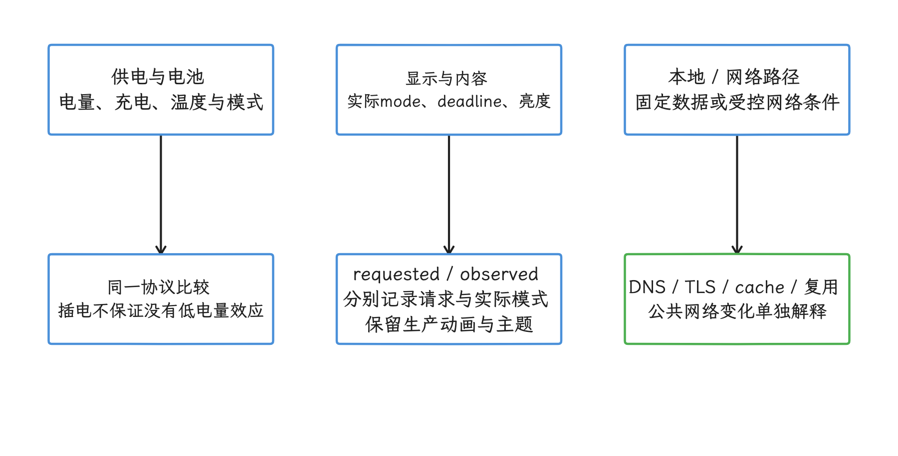

图：基线与候选使用相同供电、显示和网络协议，并保存请求状态与实际观测。 写入刷新设置不保证生效；关闭动画或替换主题可能改变被测路径。

## 消除测试干扰

环境固定之后，剩下的干扰来自设备上的无关活动：后台任务、全局设置、系统自己的维护工作。我们把它们逐个隔离。

### 专用设备与全局设置

一揽子关闭定位、同步、动画和所有后台应用的通用脚本，问题在于这些设置可能改变待测路径，也容易污染后续测试。更稳妥的隔离方式包括：

- 使用无个人账号、无消息推送的专用用户或专用设备；
- 固定安装清单和系统更新窗口；
- 在每个用例中 `force-stop` 目标应用并准备明确状态；
- 串行运行性能任务，禁止同设备并行测试；
- 记录 `top`、I/O、thermal 和异常系统任务作为数据质量证据；
- 所有变更都有 tear-down（测试后的恢复动作），设备重启后重新验收状态。

`adb shell am kill-all` 只处理符合条件的后台进程；系统服务、前台服务和维护任务它一概不动，“设备已经干净”要靠上面的隔离清单和数据质量记录来证明。

### AndroidX SideEffectRunListener

当前 Benchmark 文档提供了可选的 `SideEffectRunListener`，用来在 benchmark 运行期间减少无关后台工作。AndroidX 源码里，这个 JUnit listener（JUnit 运行监听器） 会配置 `DisablePackages` 和 `DisableDexOpt`，测试结束时再把改动过的系统状态恢复回去。

CI 里通过 instrumentation（插桩测试运行） argument（插桩测试参数）启用：

```bash
./gradlew :macrobenchmark:connectedBenchmarkAndroidTest \
  -Pandroid.testInstrumentationRunnerArguments.listener=androidx.benchmark.junit4.SideEffectRunListener
```

这条命令的作用是让 Benchmark listener 管理它支持的那些后台干扰项。Gradle task 名随 module 和构建变体变化；CI 要保存完整命令、Benchmark 版本和 listener 日志，确认 setup（准备） 和 tear-down（测试结束后的恢复步骤） 都成功。

### 后台 dexopt 的手动控制

实验室脚本要独立控制后台 dexopt 时，公开的 shell 入口是：

| 操作 | 命令 | 语义 |
|---|---|---|
| 取消当前任务 | `adb shell pm bg-dexopt-job --cancel` | 发出取消请求后立即返回，不等待任务结束 |
| 暂停 JobScheduler 启动 | `adb shell pm bg-dexopt-job --disable` | 取消已由 JobScheduler（系统任务调度器）启动的任务，并停止后续调度 |
| 恢复调度 | `adb shell pm bg-dexopt-job --enable` | 重新调度后台 dexopt |

`cancel-bg-dexopt-job` 只是 `bg-dexopt-job --cancel` 的废弃别名。`--disable` 的状态在 `system_server`（承载多数系统服务的进程） 退出后会丢失，也拦不住所有系统内部启动路径。测试脚本必须检查输出，并在 tear-down 里执行 `--enable` 把调度恢复回来。

Android 17 中，`PackageManagerShellCommand` 只保留 ART Service 命令的兼容分发列表，处理代码在 `art/libartservice/.../ArtShellCommand.java`，调度与执行由 `BackgroundDexoptJob*` 和 `ArtManagerLocal` 完成。旧版 `BackgroundDexOptService` 路径不必再依赖；`setprop`（修改系统属性的命令） 这类权限和恢复行为都确认不了的写法，也换成上面这些命令更稳妥。

<!-- gracker-diagram: ch16-05-06-isolation-and-restoration -->
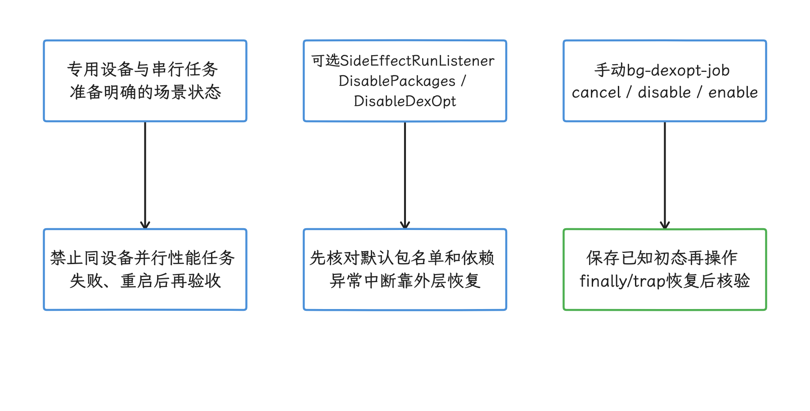

图：在专用设备执行有边界的隔离，记录初态、实际操作、恢复结果与环境复验。 1.4.1 listener重启用预置包而非完整快照恢复；dexopt disable只约束调度路径，取消也非同步完成。

### 锁频的适用范围

Android 官方 CI 文档为 Microbenchmark（在目标进程内测量小段代码的 Jetpack 基准测试库） Gradle plugin 提供了 `lockClocks`/`unlockClocks`，要求 rooted（已取得 root 权限） 设备，并且明确说明锁频只在 Microbenchmark 场景需要。

Macrobenchmark 测的是完整应用路径，DVFS（动态电压频率调节）、调度和 thermal 响应本来就是用户设备行为的一部分。直接写死 CPU0 的 sysfs governor（内核频率策略） 或频率，跨 SoC 复用不了，还可能改变线程迁移、GPU、内存和功耗行为。真要分析硬件上限，就用设备专用、可恢复的实验配置，并把结果标成实验室上限，与用户代表性基线分开存放。

### Microbenchmark 与 Macrobenchmark 的稳定化差异

Microbenchmark 用 `AndroidBenchmarkRunner`，这个 run（单次运行）ner（插桩测试运行器） 连同它的 `IsolationActivity`、亮度控制和设备能力相关逻辑，只服务于 Microbenchmark 自己的稳定化；Macrobenchmark 由独立测试进程驱动目标应用，官方 CI 文档要求用常规 `AndroidJUnitRunner`。

所以才有了 `MacrobenchmarkRule`。但离温度、网络、目标数据和后台任务的标准化还差一步：SideEffectRunListener、专用设备、状态准备和数据质量检查，仍要我们显式配置。

<!-- gracker-diagram: ch16-05-07-micro-macro-stabilization -->
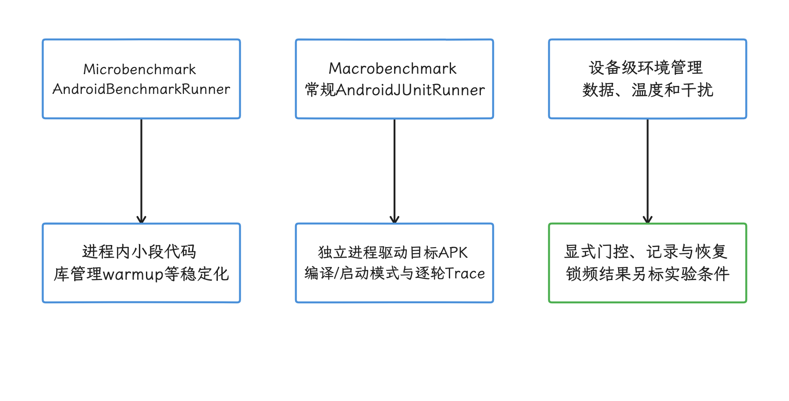

图：Microbenchmark和Macrobenchmark使用各自运行器，前者稳定小段代码，后者保留完整应用行为。 锁频是有root和场景边界的实验配置；Macro中的DVFS与热响应不能无条件抹除。

## 数据采样策略

采样要回答两个问题：一轮测试跑多少次，以及结果怎么聚合、怎么解释。我们先看次数从哪来。

### 迭代次数由噪声与最小可检测回归决定

官方 API 要求设置 `iterations`，示例里也给了具体次数；固定下限要按工作负载自己找——短启动、长滚动、数据库迁移和持续视频，单轮成本与方差差异很大。

确定次数时，我们可以按这个流程来：

1. 在参考设备上重复运行候选工作负载；
2. 分离一次 instrumentation 内的迭代波动与多次 CI job（独立 CI 任务） 之间的波动；
3. 确定团队需要发现的最小回归幅度；
4. 选择能让置信区间（总体值可能落入的估计范围）窄于该幅度的迭代与独立 job 数；
5. 版本化这份采样协议。

样本少的时候，P90/P95（第 90/95 百分位）会紧贴极值，估计很不稳定；十次启动算出的 P90，也代表不了线上 90% 用户的体验。线上分位数来自不同设备和会话，实验室分位数来自同一台设备的重复运行，两者分母本来就不一样。

<!-- gracker-diagram: ch16-05-08-sampling-hierarchy -->
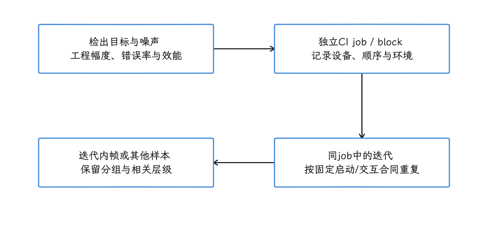

图：先区分独立CI运行、单次运行中的迭代和迭代内样本，再设计检出目标与不确定性评估。 十次启动P90不代表线上用户P90；相邻帧不能一律当成独立实验重复。

### Macrobenchmark 两类指标的聚合方式

当前 Macrobenchmark 官方文档给出两种常见输出语义：

| Metric | 数据层次 | 官方输出 |
|---|---|---|
| `StartupTimingMetric` | 每次启动一个值 | min、median、max，并在 JSON 的 `runs` 保存逐轮原始值 |
| `FrameTimingMetric` | 多轮中的帧样本池 | P50、P90、P95、P99 |

`StartupTimingMetric` 的 JSON 里没有现成的 P90 字段，需要启动尾部分位时，从 `runs` 按版本化算法自己算，并保证足够的独立启动样本。`FrameTimingMetric` 的 P90/P95/P99 来自帧样本池，写成“10 次滑动的 P90”时，务必说明这 10 轮的帧是怎么合并的。

API 31+ 优先看 `frameOverrunMs`：正值说明错过 deadline，负值说明还有预算富余。`frameDurationCpuMs` 只统计 UI 线程和 RenderThread（承担部分渲染工作的线程） 的 CPU 生产时长，GPU 与 SurfaceFlinger（负责图层合成与呈现的系统服务） 的完整路径不在它的统计范围内。

<!-- gracker-diagram: ch16-05-09-metric-aggregation -->
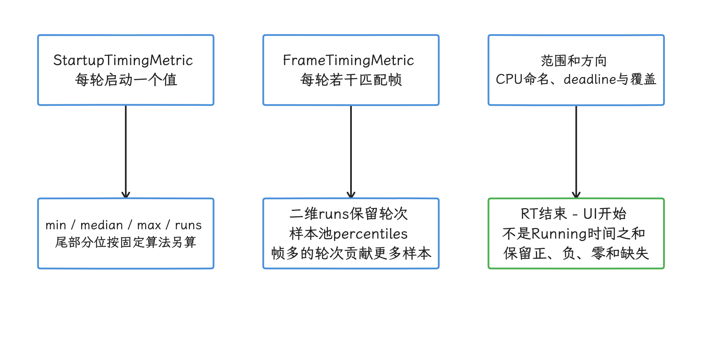

图：启动按轮保留单值，帧指标保留每轮样本并按固定实现合并，数值范围与方向分别解释。 frameDurationCpuMs是跨UI/RT经过时间，overrun也受匹配过滤影响，二者都不是自动根因结论。

### 中位数、尾部与指标方向

中位数适合描述典型运行，只是对偶发长尾不敏感；尾部分位适合描述慢启动或长帧，但必须带上样本量和估计方法。

指标方向也要保持一致：

- latency、duration、overrun、慢帧占比：数值越小越好，关注高分位；
- FPS、throughput：数值越大越好，关注低分位；
- rate：同时说明分子、分母和统计单元。

帧体验优先用 `frameOverrunMs`、慢帧率或每轮帧时长分布来描述；平均 FPS 会掩盖少量冻结帧，也容易受静止画面和帧率上限影响。

### Warm-up（预热） 有三种不同含义

Warm-up 在不同工具里改变的状态并不相同。JIT（Just-In-Time） 是运行时即时编译，AOT（Ahead-Of-Time） 是运行前预编译；ART profile 记录运行中出现的热点代码，`speed-profile` 再按这些热点做预编译。

| 类型 | 目的 | 是否进入测量 |
|---|---|---|
| Microbenchmark warmup | 让 JIT、缓存和循环达到库的稳定判定 | 不进入正式统计 |
| `CompilationMode.Partial.warmupIterations` | 运行工作负载、收集 ART profile，再以 `speed-profile` 编译 | 发生在测量前 |
| 持续负载预热 | 让温度、频率和工作负载进入定义好的稳态 | 单独保存，不并入稳态统计 |

这三种 warm-up 各管各的状态，要分开对待。尤其 `warmupIterations` 改变的是目标应用的编译状态，本身就是测试条件的一部分。

<!-- gracker-diagram: ch16-05-10-three-warmups -->
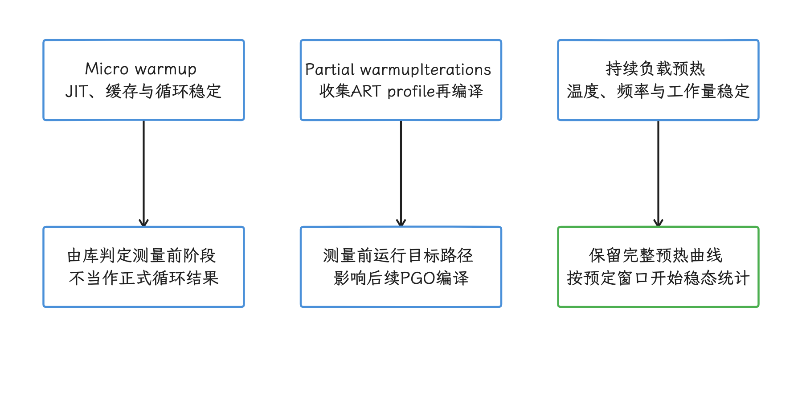

图：Micro稳定化、编译profile收集和持续负载稳态预热分别服务不同状态。 这三类预热不进入对应正式统计，但会改变后续条件，必须分别记录。

### AndroidX Benchmark 1.4.1 的 CompilationMode

截至 2026-08-14，AndroidX Benchmark 1.4.1 仍是稳定版，1.5.0-rc01 还是预发布。本文按 1.4.1 说明 `CompilationMode`，下表不混入预发布行为：

| 模式 | 语义 | 使用建议 |
|---|---|---|
| `DEFAULT` | API 24+ 等价于 `Partial(UseIfAvailable)` | 接近安装器可使用 Baseline Profile 的默认状态，但 profile 缺失不会失败 |
| `Partial(Require, 0)` | 要求 APK 中的 Baseline Profile 成功安装并做 `speed-profile` 编译 | Baseline Profile 回归闸门 |
| `Partial(Disable, N)` | 运行 N 次收集 profile，再做 `speed-profile` 编译 | 模拟由工作负载形成的 profile-guided 状态 |
| `None()` | 清除 profile/编译状态并测无预编译路径 | 模拟无预编译的最差场景；不等于清数据或全新安装 |
| `Full()` | `speed` 模式做完整 AOT 方法编译 | 用于减少 JIT 波动；不代表性能上限，代码体积增大时可能比 `Partial` 更慢 |
| `Ignore()` | 不重置也不编译 | 只用于外部已精确控制 ART 状态的测试 |

下面的测试验证 APK 里的 Baseline Profile 能否被安装。代码中的迭代数只演示参数位置，实际值要靠项目自己试运行确定：

```kotlin
@get:Rule
val benchmarkRule = MacrobenchmarkRule()

@Test
fun coldStartupWithRequiredBaselineProfile() {
    benchmarkRule.measureRepeated(
        packageName = "com.example.app",
        metrics = listOf(StartupTimingMetric()),
        compilationMode = CompilationMode.Partial(
            baselineProfileMode = BaselineProfileMode.Require,
            warmupIterations = 0,
        ),
        iterations = 10,
        startupMode = StartupMode.COLD,
        setupBlock = { pressHome() },
    ) {
        startActivityAndWait()
        device.wait(Until.hasObject(By.res("com.example.app", "home_ready")), 5_000)
        check(device.hasObject(By.res("com.example.app", "home_ready")))
    }
}
```

`home_ready` 是这个示例的业务完成断言。项目里要换成稳定的 resource ID（控件资源标识） 或可访问性条件，并把超时当作用例失败处理，把错误页和空页面挡在启动统计之外。

`Partial(Require, warmupIterations > 0)` 会先安装 Baseline Profile，再跑 warmup，然后按新收集的 profile 再做一次 profile-guided（由运行热点 profile 引导） 编译。想单独量化 Baseline Profile 与运行时 profile 各自的作用，就用不同测试分别配置，让两种 profile 分开出结果。

<!-- gracker-diagram: ch16-05-11-compilation-mode-choices -->
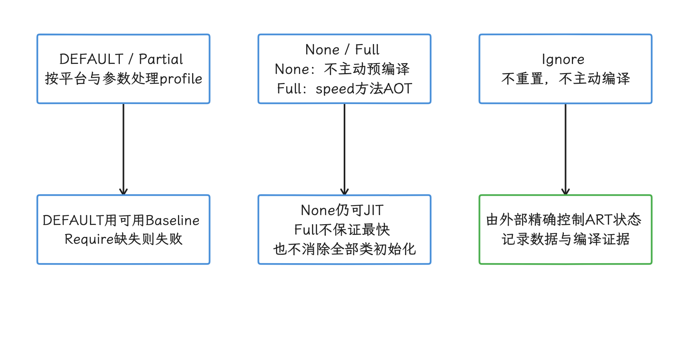

图：先固定库版本，再按Profile来源和预编译目标选择模式，所有重置仍需核对平台分支。 本章解释1.4.1；当前稳定版已为1.5.0，升级后需核对实现和噪声。

<!-- gracker-diagram: ch16-05-12-partial-profile-flow -->
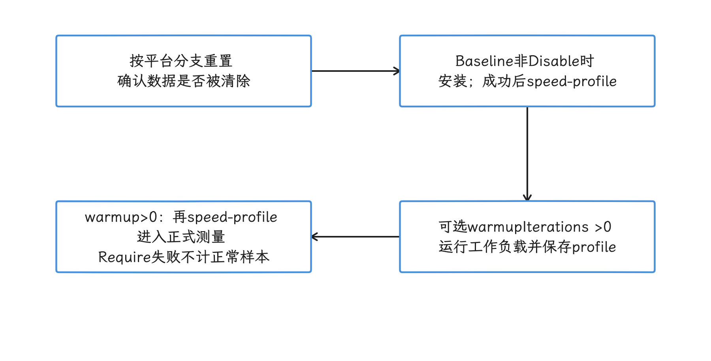

图：固定Partial可先安装Baseline并编译，再可选运行工作负载收集profile并再次编译。 Require验证安装前提，不证明规则覆盖或收益；要隔离两类profile作用需分别配置对照。

### 启动模式控制的状态范围

Macrobenchmark 的 `StartupMode` 控制启动前的进程/Activity 状态：

- `COLD`：测量前终止目标进程；
- `WARM`：保留进程，重新创建或启动 Activity；
- `HOT`：保留进程和 Activity，恢复到前台。

<!-- gracker-diagram: ch16-05-13-startup-mode-contracts -->
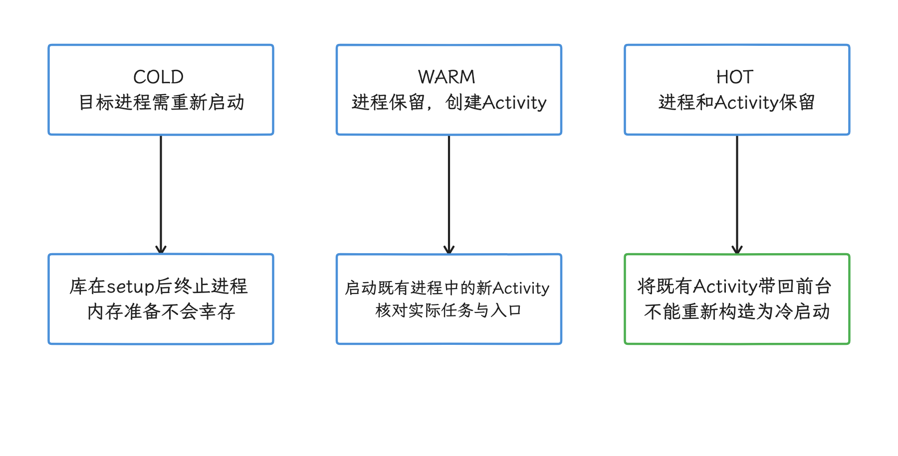

图：COLD、WARM、HOT分别定义进程与Activity前提，数据、缓存与业务入口另按合同准备。 不能每轮额外force-stop后还声称保留了WARM/HOT状态；TTID/TTFD与业务等待终点也不同。

数据、账号、缓存和入口 Intent（启动请求） 仍要测试自己控制。`setupBlock` 在每轮测量前运行，而冷启动模式会在 setup 与 measure 之间终止进程。凡是必须留在目标进程内存里的准备，都要赶在进程被终止前完成——进程一终止，这部分状态就没了。

<!-- gracker-diagram: ch16-05-14-cold-setup-order -->
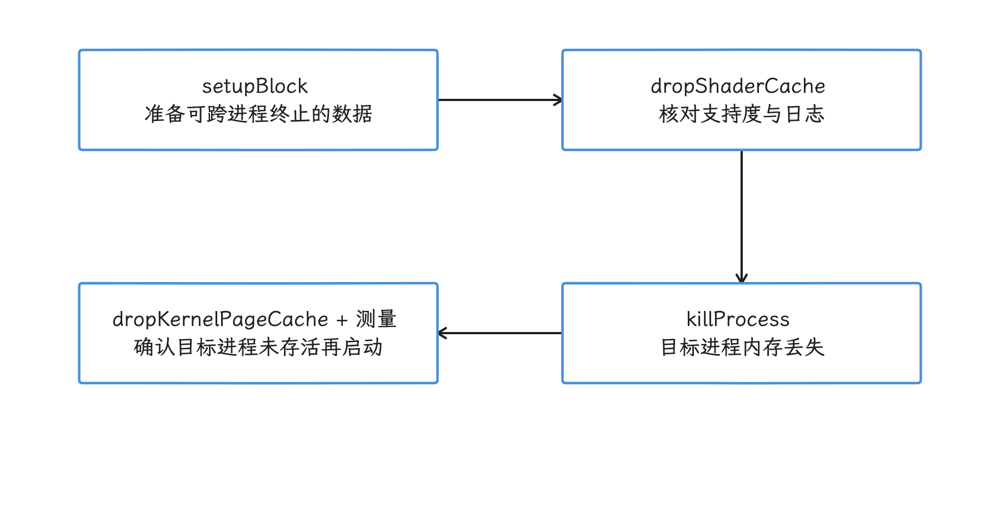

图：固定1.4.1先运行setup，再清理支持的缓存并终止进程，最后正式启动测量。 仅存在目标进程内存的准备会丢失；WARM/HOT首轮未计入统计的进程预热又是另一层。

## 排除规则与异常值

排除样本的条件必须在运行前定义，例如：

- 热状态门控失败；
- 目标页面断言失败；
- 设备发生系统更新、重启或充电状态变化；
- trace 缺失、metric 无样本或脚本未完成目标动作；
- 已识别的设备池故障。

看到一个慢值，再补一句“可能遇到 GC”就把它删掉，这会系统性地美化结果。有效但很慢的样本我们先保留，用 trace 判断它是否属于用户路径；每一次排除都要留下原因、原始记录和排除前后的样本量。

<!-- gracker-diagram: ch16-05-15-invalid-failed-slow-samples -->
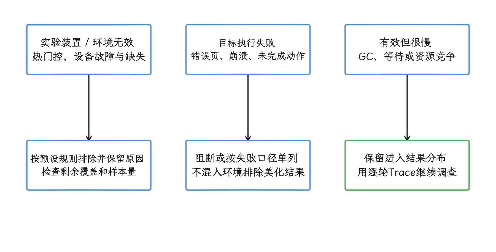

图：先按预定义规则区分环境无效、目标失败和有效慢值，再决定统计、阻断与补证。 不能把崩溃或错误页删掉后宣称通过；缺失不填零，排除数量和原始记录都需保留。

## 性能基线与回归检测

有了单次运行的规范，下一步是把结果变成可比较的基线，并定义什么样的变化才算回归。

### 基线是一份版本化合同

基线至少绑定：

- 目标 Git SHA（提交标识）、APK 与 AAB（Android App Bundle） 摘要和构建工具版本；
- Benchmark、AGP（Android Gradle Plugin）、Kotlin、R8 与 ProfileInstaller 版本；
- 设备序列、build fingerprint 和 ART Mainline 版本；
- workload、测试数据、编译模式、启动模式和迭代协议；
- 环境状态与排除规则；
- 原始 JSON、trace 和统计脚本版本。

只存一个 median 数字，后续变化就说不清来自应用、设备、Benchmark 升级还是统计脚本。

### 同机配对与交错运行

候选版本和基线版本放在同一台设备上跑，能减少设备间的差异。温度或后台活动随时间漂移时，我们按 A/B/B/A（基线、候选、候选、基线）或随机顺序交错运行，免得先跑完全部基线再跑全部候选，把时间偏差引进来。

配对比较要保留每个 block（成组执行批次）的顺序、环境状态和两侧结果；多台设备各自算变化，再按设备层次汇总，不同机型的原始毫秒留在各自的设备层里。

<!-- gracker-diagram: ch16-05-16-paired-versioned-baseline -->
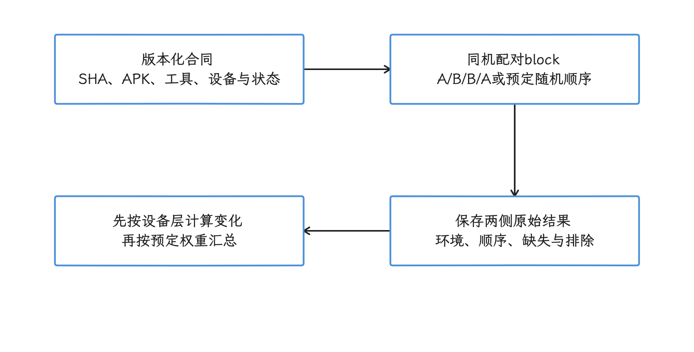

图：基线绑定构建、状态、工具和协议，在同机block中交错或随机运行基线与候选。 A/B/B/A是控制漂移的示例；它不自动消除所有热、缓存、网络和顺序效应。

### 阈值来自 SLO 与噪声下限

“P50 回归 10%、P90 回归 20%”这样的固定阈值，套不到所有 workload 上。回归判定通常要同时满足：

1. 数据质量检查通过；
2. 候选版本超过产品或平台 SLO；
3. 相对基线的效应量（实际变化幅度）超过该测试的历史噪声；
4. 置信区间或重复 job 支持同一方向；
5. 变化达到团队预先定义的工程意义。

样本量不足时，结果可标成 inconclusive（证据不足），随后自动增加独立运行，或转人工复核。p-value（假设检验中的概率指标） 代替不了效应量：统计显著但工程幅度极小的变化，未必需要阻断发布。

<!-- gracker-diagram: ch16-05-17-absolute-relative-gates -->
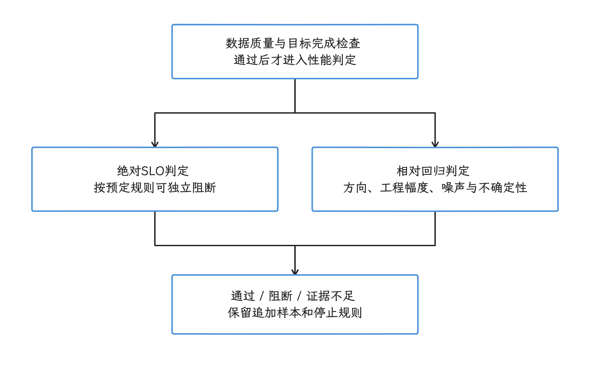

图：质量检查后分别评估绝对SLO和相对回归，再按预定义规则形成通过、阻断或证据不足。 相对劣化不必先突破SLO；基线已违约也不能自动放行，反复加样到显著会改变错误率。

### 趋势与单次闸门并用

PR 闸门拦截明确的回归，长期趋势负责发现一次次小幅累积。趋势面板应展示：

- 每台参考设备的原始 run 与 median；
- 控制限（历史波动边界）或历史噪声带；
- Benchmark、系统镜像和设备维护事件；
- 基线切换点及原因；
- 数据缺失、排除和设备健康。

基线更新要走审批并留迁移记录。新功能改变了工作量，可以建新场景或新 SLO；已经发生的退化要留在面板上，移动基线藏不住它。

## 测试报告的撰写规范

一份性能报告要同时支持两件事：复现实验和做出决策。

### 支持复现与决策的报告结构

我们建议按下面的结构来写：

1. 决策摘要：通过、阻断或证据不足，指出受影响场景；
2. 测试合同：工作负载、状态、设备、版本和统计协议；
3. 数据质量：样本量、排除、thermal、显示、供电和脚本断言；
4. 结果：基线、候选、绝对差、相对差、区间和 SLO；
5. 证据：JSON、每轮 trace、日志、构建摘要和关联变更；
6. 归因状态：已验证原因、待证实假设与下一项实验；
7. 处理人和复测条件。

结果表可使用以下列：

| Metric | Baseline | Candidate | Absolute delta | Relative delta | Uncertainty | SLO | Decision |
|---|---:|---:|---:|---:|---:|---:|---|

表中每一行都链接到原始 artifact（测试产物）。`StartupTimingMetric` 要标明 min/median/max 与 run count；`FrameTimingMetric` 要标明 percentile、frame count、API 版本，以及是否使用 `frameOverrunMs`。

### 相关性与根因的区分

“候选版本更慢”是测量结果，“某次慢样本同时出现了 GC”只是相关现象。要写成已验证原因，中间还差 trace、源码改动、对照实验或回滚验证这一步。

根因段落应区分：

- observation（观测）：稳定复现的现象；
- evidence（证据）：trace、日志、源码或对照结果；
- hypothesis（假设）：尚需实验验证的解释；
- decision（决策）：下一项实验或修复。

截图只作辅助；报告还要保存可查询的 trace、时间范围、process/thread 和 SQL/metric 定义，让另一位工程师能复核。

<!-- gracker-diagram: ch16-05-18-report-causal-evidence -->
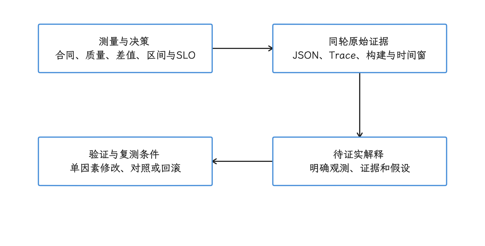

图：报告从决策与合同进入质量和结果，再用可查询现场区分观测、证据、假设与验证。 GC恰好同窗只是相关；图表和截图不能代替原始Trace、查询定义和同条件修复对照。

## Macrobenchmark 在 CI 中的集成

把 Macrobenchmark 放进 CI，runner 选择、产物归档和错误策略是三件主要的事。

### runner 与构建产物

Microbenchmark 用 `androidx.benchmark.junit4.AndroidBenchmarkRunner`；Macrobenchmark 用常规 `AndroidJUnitRunner`，目标 APK 与 test APK 分开构建。目标构建变体要接近 release，拿 debuggable 构建来替代会失真。

CI 至少归档：

- `*-benchmarkData.json`；
- 每个 Macrobenchmark measured iteration（正式测量迭代）的 `.perfetto-trace`；
- instrumentation stdout/stderr 与 logcat；
- 目标 APK、test APK 和摘要；
- 设备与环境 manifest（清单）；
- 统计与报告程序版本。

Gradle 会把额外测试输出复制到 `build/outputs/connected_android_test_additional_output/...`。目录层次随 module、构建变体和工具版本变化，CI 应从任务输出或 artifact glob（产物路径通配模式）定位当前目录。

### 真机负责数值，模拟器负责流程

| 环境 | 适用任务 |
|---|---|
| 专用本地真机 | PR 闸门和高灵敏度趋势 |
| Firebase Test Lab 真机 | 设备覆盖、周期性趋势；先量化共享环境噪声 |
| 模拟器 / GMD | 安装、导航、断言、JSON/trace 产出的 smoke test（冒烟测试） |

`androidx.benchmark.dryRunMode.enable=true` 能快速检查用例流程；dry run（仅验证流程的快速运行） 和模拟器的结果都要排除在性能基线之外。

### suppressErrors 的使用限制

Macrobenchmark instrumentation arguments 支持 `androidx.benchmark.suppressErrors`，可压掉的包括 `DEBUGGABLE`、`LOW-BATTERY`、`EMULATOR`、`NOT-PROFILEABLE` 和 `METHOD-TRACING-ENABLED`。这些条件每一个都影响结果可信度，正式闸门该做的是修复环境，而不是把错误降级成 warning。

CI 还要限制同一设备上的并发，定期运行固定的 calibration workload（用于监测设备漂移的校准负载） 监测设备漂移，并在设备更换、电池老化、系统更新或 Benchmark 升级后重建噪声模型。

### JSON 的正确使用

Benchmark JSON 里，single metric（每轮产生一个值的指标） 每轮产生一个值，通常包含 `minimum`、`maximum`、`median` 与 `runs`；sampled metric（每轮产生一组样本的指标） 每轮产生一组样本，保存从样本池算出的 percentiles。解析器应：

- 校验 schema（字段结构及版本约定） 和 Benchmark 版本；
- 保留 `runs`，不只保存 median；
- 区分 single metric 与 sampled metric；
- 拒绝缺失或非有限值；
- 保存 `repeatIterations`、`warmupIterations` 与 context；
- 关联同一次测试生成的 trace 文件。

CI 自己计算 P90 或置信区间时，插值方法和 bootstrap（有放回重采样）参数都要固定下来，并给统计脚本单独做回归测试。

<!-- gracker-diagram: ch16-05-19-ci-artifact-pipeline -->
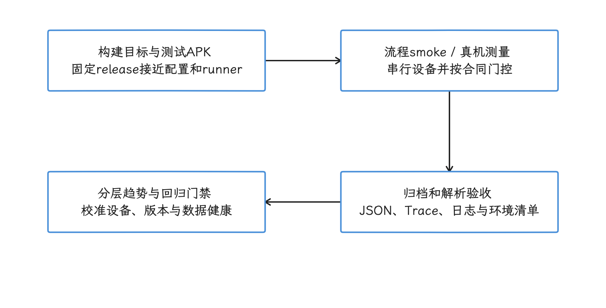

图：流程smoke、真机数值测试、产物校验和分层判定使用明确的版本与数据协议。 dry run和模拟器结果不入性能基线；suppressErrors不能替代修复环境，缺失/失败不补零。

## 扩展：Firebase Performance Monitoring 的边界

Firebase Performance Monitoring（FPM）提供线上启动、网络和 custom code trace（自定义代码区间）数据。它适合观察真实用户的版本趋势，与受控设备上的合入前 benchmark 各管一段。

### 当前 custom code trace 限制

当前官方文档给出的约束包括：

- trace name 最长 100 个字符，且不以下划线开头；
- metric name 最长 100 个字符；
- 每条 custom code trace 最多 32 个 metrics，包含默认 Duration；
- attribute name 最长 32 个字符，只允许规定字符；
- 每条 trace 最多 5 个 custom attributes；
- attribute 不得包含可识别个人的信息；
- 高频创建 trace 会增加资源开销，应避免逐帧创建。

FPM 的服务端采样和聚合由服务端决定，客户端没法按 benchmark 实验协议精确控制。它能按版本、设备、国家等维度做分析，也提供 session（一次应用使用会话）时间线，但 session 数据和 Perfetto system trace 不是一回事。

### 延迟与报警

当前 FPM 文档把兼容 SDK 的处理描述为 near real-time（近实时），数据通常在采集后数分钟内显示。SDK 首次检测、批量上传、离线设备和平台故障还会带来额外延迟；发布报警要监控数据新鲜度与覆盖率，把数据延迟到达当作设计前提。

<!-- gracker-diagram: ch16-05-20-firebase-online-boundary -->
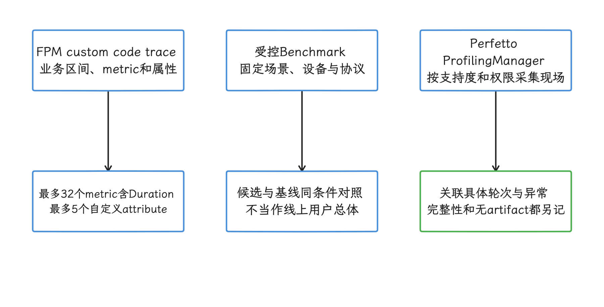

图：FPM记录线上自定义区间并按属性聚合，受控Benchmark提供固定条件对照，Perfetto提供有权限边界的现场。 FPM通常几分钟展示不等于时限保证；session采样不是完整系统Trace，线上与实验室的单位和分布要先对齐。

### 与其他数据源的分工

| 数据源 | 适合回答的问题 |
|---|---|
| Macrobenchmark / Microbenchmark | 候选改动在固定实验条件下是否回归 |
| Android Vitals | Play 用户的启动、渲染、ANR 等版本趋势 |
| FPM | 启动、网络与自定义 trace 的线上分群 |
| 自建遥测 | 自定义业务终点、采样与低延迟诊断 |
| Perfetto / ProfilingManager | 单个异常样本的系统级或进程级证据 |

实验室与线上数据对不上时，先比较设备分布、入口、缓存、编译和指标定义——两个系统可能都是对的，只是观测对象不同。

## 在 Perfetto 中复核 benchmark

Macrobenchmark 为每个 measured iteration 生成独立 Perfetto trace，我们拿它来检查：

- 启动：launch intent（启动请求）、进程创建、`bindApplication`（系统把应用绑定到新进程）、首帧与 `reportFullyDrawn()`；
- 帧：expected/actual FrameTimeline（期望帧与实际帧时间线）、主线程、RenderThread、GPU 与 SurfaceFlinger；
- 调度：线程运行、睡眠、抢占、CPU 迁移和频率；
- I/O 与 ART：`dex2oat`（ART 的 DEX 编译工具）、JIT、GC、文件系统和 Binder（Android 跨进程调用机制）；
- 测试动作：目标控件是否出现、滚动区间是否一致。

TTID 与 TTFD 要分开看。`StartupTimingMetric.timeToFullDisplayMs` 依赖应用调用 `reportFullyDrawn()`，Android 10 / API 29 及以下还可能拿不到。

帧回归的统一判定交给 `frameOverrunMs` 和 FrameTimeline：API 31+ 用它们判断 miss，再定位到 App、GPU 或合成阶段。动态刷新率和流水线 deadline 都在变，`DrawFrame > 16 ms` 这样的统一阈值用不了，`DrawFrame` 也只是流水线里的一个切片。

trace 和结果对不上时，按顺序检查 metric 语义、测量范围、应用断言、编译/启动模式和环境。后台 I/O 只是可能原因之一，把它写进结论之前，先在 trace 里找到依据。

<!-- gracker-diagram: ch16-05-21-trace-metric-reconciliation -->
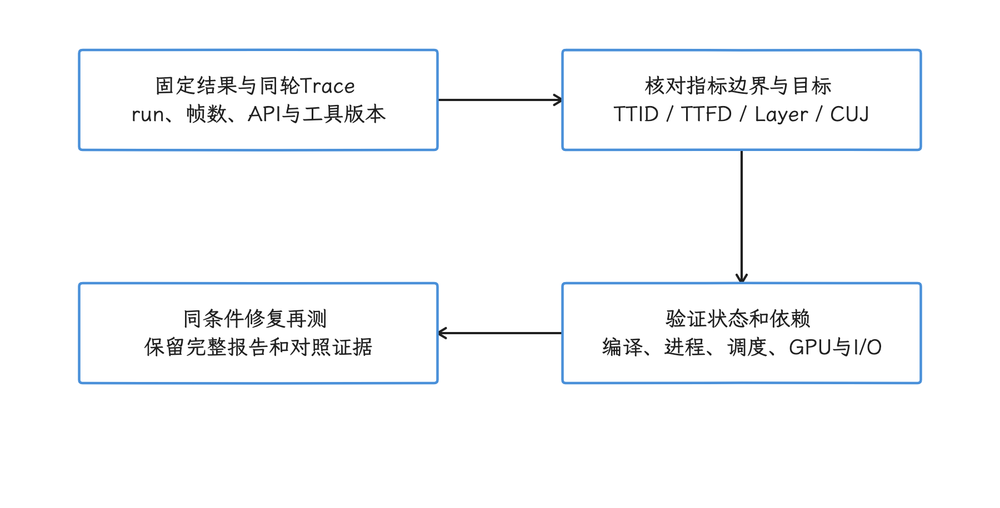

图：将指标关联回同轮Trace与成功断言，逐项核对时间边界、模式、数据和环境后再归因。 TTFD要有匹配的fully-drawn/帧证据；单个DrawFrame或jank分类不能独自证明根因。

## 常见误区

- 只测一次，把偶然结果写成基线。
- 用模拟器数值阻断真机性能回归。
- 将 `StartupMode.COLD` 解释为清数据或全新安装。
- 将 `CompilationMode.None()` 解释为冷缓存用户状态。
- 把 `Partial.warmupIterations` 当成普通测量预热。
- 用十次启动的 P90 代表线上用户 P90。
- 把 `FrameTimingMetric` 的帧 percentile 与启动 run percentile 混为一谈。
- 关闭动画、网络或定位后，却声称测量生产 workload。
- 用 thermal status override 隐藏真实降频。
- 对 Macrobenchmark 写死 CPU0 sysfs 频率。
- 启用 `--disable` 后忘记恢复后台 dexopt。
- 观察慢样本后删除“异常值”。
- 用固定百分比阈值覆盖所有指标。
- 只保存 median，不保存 runs 与 trace。
- 用相关事件直接下根因结论。

## 与其他章节的关系

- §5.2 解释 Thermal HAL（Framework 与厂商温控实现的接口）、framework 状态与设备降频。
- §8.3 定义冷、温、热启动及优化路径。
- §14.1 介绍 Perfetto 抓取与实验配置。
- §15.6 介绍 Android 自动化性能工具与 Macrobenchmark 回归门禁。
- §16.3 定义指标合同、SLO、线上采样、聚合与报警。

## 参考资料

### Android 官方

- [Benchmark your app](https://developer.android.com/topic/performance/benchmarking/benchmarking-overview)
- [Benchmark in Continuous Integration](https://developer.android.com/topic/performance/benchmarking/benchmarking-in-ci)
- [Write a Macrobenchmark](https://developer.android.com/topic/performance/benchmarking/macrobenchmark-overview)
- [Capture Macrobenchmark metrics](https://developer.android.com/topic/performance/benchmarking/macrobenchmark-metrics)
- [Macrobenchmark instrumentation arguments](https://developer.android.com/topic/performance/benchmarking/macrobenchmark-instrumentation-args)
- [Microbenchmark](https://developer.android.com/topic/performance/benchmarking/microbenchmark-overview)
- [CompilationMode](https://developer.android.com/reference/kotlin/androidx/benchmark/macro/CompilationMode)
- [AndroidX Benchmark releases](https://developer.android.com/jetpack/androidx/releases/benchmark)

### Firebase 官方

- [Custom code traces](https://firebase.google.com/docs/perf-mon/custom-code-traces)
- [Performance Monitoring troubleshooting](https://firebase.google.com/docs/perf-mon/troubleshooting)

### AOSP android-17.0.0_r1

- `frameworks/base/services/core/java/com/android/server/power/thermal/ThermalManagerService.java`
- `frameworks/base/services/core/java/com/android/server/display/mode/DisplayModeDirector.java`
- `frameworks/base/services/core/java/com/android/server/pm/PackageManagerShellCommand.java`
- `art/libartservice/service/java/com/android/server/art/ArtShellCommand.java`
- `art/libartservice/service/java/com/android/server/art/BackgroundDexoptJob.java`
- `art/libartservice/service/java/com/android/server/art/BackgroundDexoptJobService.java`
- `art/libartservice/service/java/com/android/server/art/ArtManagerLocal.java`

### AndroidX 源码

- `androidx-main/benchmark/benchmark-macro/src/main/java/androidx/benchmark/macro/CompilationMode.kt`
- `androidx-main/benchmark/benchmark-junit4/src/main/java/androidx/benchmark/junit4/SideEffectRunListener.kt`
