# 竞品分析方法

竞品对比只有在场景、设备状态、版本和指标口径一致时才有解释力。我们做它的目的，是用可重复的实验判断差异落在哪个用户阶段、竞品的哪些设计可以迁移到自己的产品上；一份笼统的排名反倒是次要产出。

> 源码基线：AOSP `android-17.0.0_r1`（Android 17 / API 37）。本文未逐项审计某个内核分支；涉及调度、频率或功耗归因时，需要另存实际设备内核、事件与厂商实现证据。

## 为什么要认真做竞品性能分析

竞品测试回答的是一个范围明确的问题：

> 在指定设备、系统版本、应用版本、账号状态和操作路径下，两个应用的观测结果有多大差异？

这个问题的答案有明确的范围：一轮竞品测试量出的是差异有多大、出现在哪个阶段；差异由哪段代码造成、放到全部用户身上是否成立，还要回到源码、Trace（系统时间线记录） 和更多设备上补证据。所以实验条件必须随结果一起写进报告——缺了条件，一个启动耗时或卡顿率连复现都困难，更撑不起版本决策。

本文的源码结论只用来解释 Android 平台这一侧的计时和帧数据；竞品内部的业务实现我们看不见，写原因时只能写成假设，并列出还缺哪些证据。

## 竞品性能对比的方法论

一轮可复现的竞品测试至少包含四份记录：

1. **问题定义**：比较哪个用户场景、哪个指标、哪个时间窗口；
2. **实验清单**：设备、构建、应用版本、账号、数据集、网络、温度与编译状态；
3. **原始结果**：每次执行的顺序、成功或失败、指标值及对应 Trace；
4. **结论边界**：观察到了什么、尚未证明什么、下一步需要哪种证据。

<!-- gracker-diagram: ch16-06-01-experiment-records -->
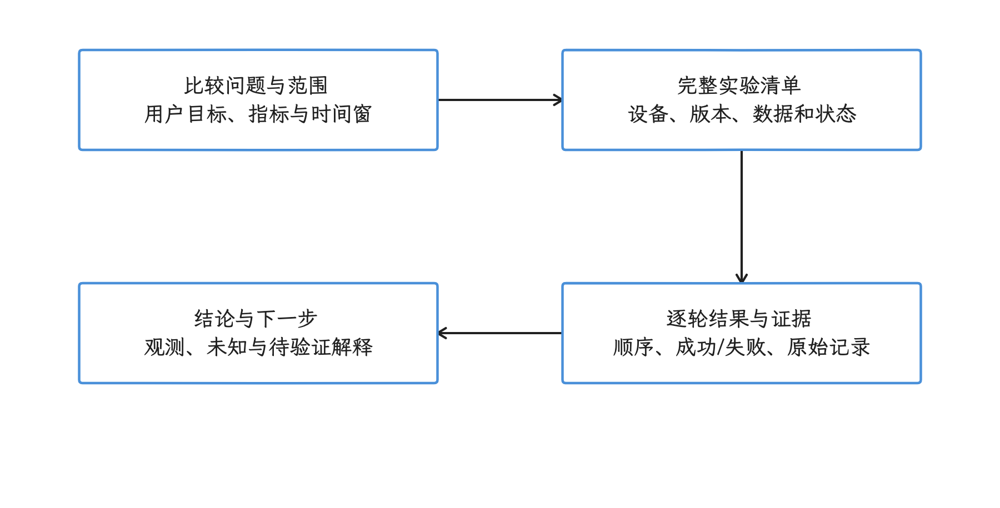

图：问题、实验条件、逐轮原始证据与结论边界共同定义可复查的比较。 结果仅适用于声明的设备、版本与任务；差异不自动证明竞品内部实现原因。

### 控制变量的四项基本原则

**同设备**：A/B（成对交替测试两个应用）在同一台物理设备、同一 Android 用户空间和同一实际显示模式下执行。就算型号相同，芯片个体差异、存储老化和厂商配置也可能有差别。要覆盖多个档位时，让每台设备独立形成一组结果，跨设备的样本分开统计。

**同场景**：使用用户可感知的起点、终点和成功条件。例如“从 Launcher 点击图标，到首个可操作 Feed 出现”，还要补上账号是否登录、缓存是否存在、广告是否展示、列表有多少项。两个产品的信息架构不同，页面名称对不上没关系，工作量和用户目标要相近。

**同网络**：记录 Wi-Fi 或蜂窝网络、带宽、往返延迟、丢包、DNS（域名解析）、代理和服务端数据集。可控环境可以使用网络整形和固定响应；真实网络测试则交替执行 A/B（在同一条件下交替测试应用 A 和 B），并把网络时间单列。TLS 会话是否复用、内容是否命中 CDN 边缘缓存、服务端负载如何，这三样靠“连同一个 Wi-Fi”消不掉，要单独记录。

**同热状态**：记录环境条件、可用传感器、Thermal Service 状态和测试前的静置协议，ABBA（A1、B1、B2、A2）或预先随机顺序可减少部分时间漂移，但不保证消除缓存、携带或非线性热效应。短路径若违反预定义初态门控，应保留原因后重跑；持续负载中的自然升温和降频往往就是被测结果，不能因热等级改变便删样本。热状态是粗粒度信号，等级相同也不证明温度或频率相同。用户体验测试通常保留动态调频，锁频另标实验条件。

<!-- gracker-diagram: ch16-06-02-matched-conditions -->
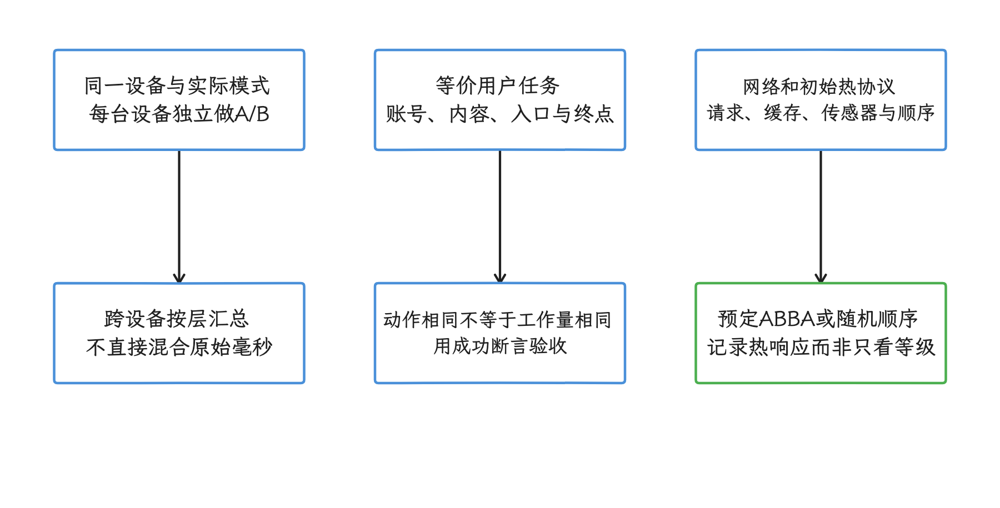

图：同设备内匹配工作量、网络与初始热状态，按预定顺序执行并保留自然热响应。 ABBA不能消除全部漂移；持续负载自然升温或降频不能事后删样本。

### 测试前的设备准备

准备项要写进机器可读的 run manifest，也就是每轮测试随结果保存的配置清单，避免依靠测试人员记忆：

- 设备序列号、型号、build fingerprint（系统构建标识）、API level、安全补丁和刷新率；
- App 的包名、versionName、完整 long versionCode、安装来源、签名摘要，以及 APK 和 split APK（按设备配置拆分的安装包）文件摘要；
- 账号、地区、语言、主题、权限、实验开关和本地数据状态；
- 电量、充电状态、节电/性能模式、亮度、音量、屏幕方向和网络参数；
- ART（Android Runtime） 编译策略，以及 Baseline Profile（随 App 发布的热点代码清单）是否保留；Cloud Profile（Google Play 根据线上数据生成的热点代码清单）是否保留同样要记录；
- 测试脚本版本、数据版本、执行时间和测试顺序。

`adb shell am kill-all` 只结束系统认为可以安全清理的后台进程，离“设备恢复到一致状态”还差得远；划掉最近任务同样未必让进程退出。所以每个测试维度要有自己的复位动作：启动测试控制目标进程与任务，滑动测试恢复列表位置，网络测试恢复响应数据，功耗测试恢复电量和热状态。

系统动画是否关闭要写进场景合同。完整用户转场保留生产动画并固定缩放；若关闭动画做受控窗口诊断，另报实验条件，不能再把它当作生产用户体验。关闭动画也不保证只影响计时终点。

<!-- gracker-diagram: ch16-06-03-state-reset-manifest -->
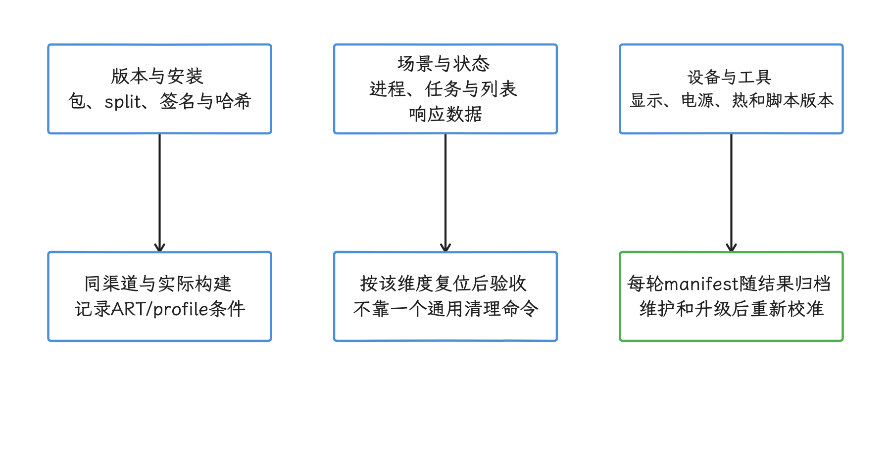

图：把构建和环境写入逐轮清单，再按启动、滚动、网络或能量场景执行可验证的复位。 kill-all和划任务不能恢复整个设备；关闭动画的实验另报条件。

### 采样、顺序与停止条件

样本量由数据决定：场景波动、想检测的差异大小和设备数量都会改变样本需求，流程里写死的“20 次”“30 次”并没有统计上的保证。我们先做小规模预采样，再在测试计划中固定：

- 每台设备的最少有效轮数；
- 单轮超时和失败判定；
- 实验装置失效、目标失败和有效慢样本的分类；来电、更新或网络异常按预定义规则处理，目标失败与自然热响应不能随意排除；
- 最大轮数、查看批次与停止规则；若依据区间宽度自适应停止，统计方法也要适应该设计，不能边看边加到有利结果；
- 查看结果前已经确定的主指标。

A/B 在同一设备、相近时间内成对执行，并保留设备和独立 block 层级。分别报告 A、B 的原始分布与尾部分位，再报告预定义的配对效应量及区间；“配对差值的中位数”不等于“两组中位数之差”，两者的 P90/P99 也不是同一对象。小样本尾部分位不稳定，应同时给样本量与算法。频率学派置信区间的覆盖率来自同一方法反复抽样的性质，不能解释为本次固定区间包含真值的概率。

平均值与标准差可照报，同时给效应量和不确定性；“均值相差两倍标准差”不能替代检验。使用配对 bootstrap 时应按独立设备/block 等实际抽样单元保留 A/B 配对，并重算事先选定的统计量，不能把所有相关帧当独立样本。长尾、小样本、依赖结构与非参数检验各有前提，bootstrap 或非参数名称本身不保证区间有效。

<!-- gracker-diagram: ch16-06-04-paired-sampling -->
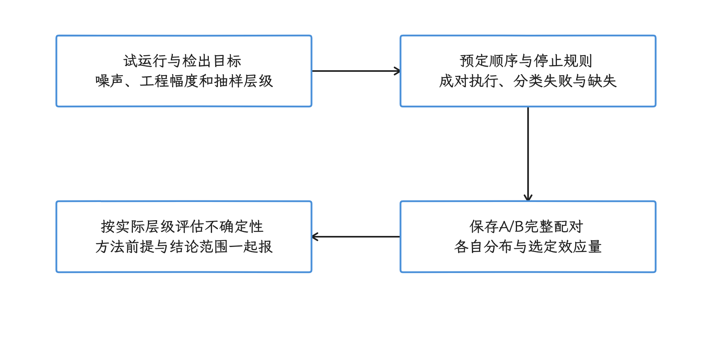

图：按设备和独立block保留配对，预先确定统计量、查看批次和停止规则。 差值中位数不等于中位数之差；相关帧不当作独立重复，尾部估计需样本量。

## 竞品启动速度对比

启动对比的第一步是选定口径，用户可感知的口径至少有两个：

- **TTID（Time to Initial Display，首次画面显示时间）**：系统记录启动到应用初始画面的时间；不保证业务内容完成或光学呈现与交互就绪同时发生；
- **TTFD（Time to Full Display，应用报告完整显示的时间）**：依赖 `reportFullyDrawn()` 声明，具体工具还可能取匹配帧完成边界；不是声明即刻必然可交互的保证。

TTID 由系统记录，但仍要核对实际 Activity、入口和显示边界。TTFD 靠应用埋点，竞品是否调用、调用位置是否等价未必可知；未知时不做横向 TTFD 排名，也不把缺失填零。可保留可解释的 TTID，并用两侧等价的视觉/UI 成功断言补充“业务就绪”区间，分别标明工具、起点和终点。

<!-- gracker-diagram: ch16-06-05-startup-completion-boundaries -->
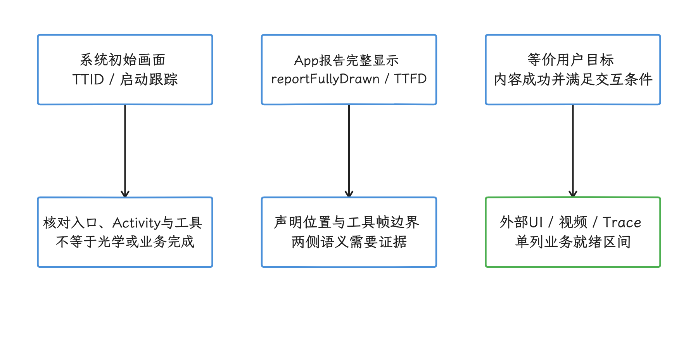

图：系统初始画面、App fully-drawn声明与业务成功条件是三种边界。 竞品TTFD埋点未知时不横向排名，缺失不补零；外部UI断言另标起止点。

### adb am start -W 的原理与正确使用

`ActivityManagerShellCommand` 在 `-W` 路径调用 `startActivityAndWait()`。正常受跟踪的窗口绘制路径中，`ActivityRecord#onWindowsDrawn()` 调用 `ActivityMetricsLogger#notifyWindowsDrawn()`，后者以当前 uptime 与启动跟踪起点之差生成 `windowsDrawnDelayMs`（毫秒）；`ActivityTaskSupervisor#reportActivityLaunched()` 再写入 `WaitResult.totalTime`、组件和状态并唤醒等待者。这是窗口绘制报告的系统边界，不是 GPU 全部工作、屏幕光学呈现或业务可操作的共同完成点；已有顶部 Activity、跟踪失效或超时还可能走其他返回路径。

<!-- gracker-diagram: ch16-06-06-am-start-wait-path -->
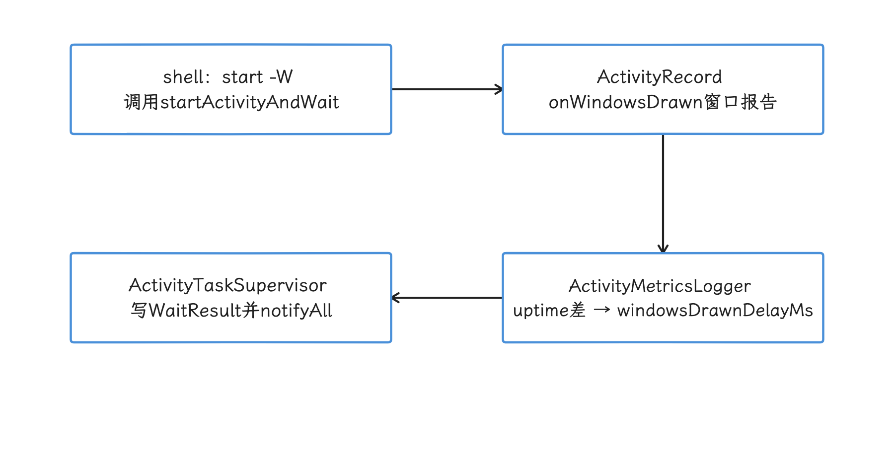

图：正常启动跟踪从shell等待进入窗口绘制报告，再将毫秒延迟写回WaitResult并唤醒等待者。 图中是正常跟踪路径；已有顶部Activity、超时或无有效跟踪需另分类，窗口报告不等于光学完成。

下面的命令用于确认一个**进程冷启动**样本。Intent 描述待执行的操作和目标组件；`-S` 在启动前 force-stop（强制停止）Intent 匹配到的包，`-W` 等待启动结果：

```bash
adb shell am start -S -W \
  -a android.intent.action.MAIN \
  -c android.intent.category.LAUNCHER \
  com.example.app/.MainActivity
```

`-S` 在指定 Android 用户下对解析出的包执行 force-stop，再发起启动；只有停止与启动都成功，且结果校验符合预期，才能接纳为进程冷启动样本。它不清文件页缓存、业务数据或服务端缓存；后台重启、重定向或启动失败也要用原始输出和 Trace 排查。首次安装、首次登录与冷数据另设场景。

`android-17.0.0_r1` 的成功输出形状可如下；组件、耗时和 Intent 排版均为示意，不代表实测：

```text
Stopping: com.example.app
Starting: Intent { act=android.intent.action.MAIN cat=[android.intent.category.LAUNCHER]
                  cmp=com.example.app/.MainActivity }
Status: ok
LaunchState: COLD
Activity: com.example.app/.MainActivity
TotalTime: 1024
WaitTime: 1038
Complete
```

三个字段的读法，以源码为准：

- **LaunchState**：`WaitResult` 有 `COLD`、`WARM`、`HOT`、`RELAUNCH` 及 `UNKNOWN`。报告保存原始状态与实际组件，并检查 Status、警告和错误；预期 COLD 却不匹配时按预定义失败协议处理。
- **TotalTime**：在正常绘制跟踪路径中，是跟踪起点到窗口绘制报告的毫秒延迟；接近系统 TTID，但不是任意工具的同名值都可互换。它可缺失或无有效延迟；数据齐备、可操作性另看等价业务断言。
- **WaitTime**：shell 在调用附近用 `uptimeMillis()` 取差，包含选项准备、启动调用、等待与返回的一段时间；计时在 `-S` 的 force-stop 和该路径 250 ms 等待之后开始，也不含完整 adb 传输。它适合诊断这段命令等待，不能拿它减 `TotalTime` 就断言某项业务开销。

旧版本曾输出 `ThisTime`，Android 17 的 [`WaitResult.java`](https://android.googlesource.com/platform/frameworks/base/+/refs/tags/android-17.0.0_r1/core/java/android/app/WaitResult.java) 已无该字段，[`ActivityManagerShellCommand.java`](https://android.googlesource.com/platform/frameworks/base/+/refs/tags/android-17.0.0_r1/services/core/java/com/android/server/am/ActivityManagerShellCommand.java) 也不再打印它。所以解析脚本按目标系统版本识别字段，`TotalTime` 缺失、负值或未知状态时不填零；保存原始输出并区分未启动、无有效跟踪与超时。

<!-- gracker-diagram: ch16-06-07-shell-output-validity -->
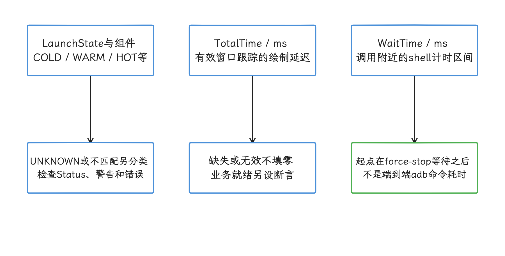

图：同时核对Status、组件、LaunchState和时间字段，保存未知、超时与缺失。 WaitTime不含-S的force-stop/250ms等待或完整adb传输；不能用两时间之差自动归因。

### 冷启动 vs 温启动 vs 热启动

下面五项解释 `am start -W` 返回的 `LaunchState`：它按进程是否运行、Activity 是否新建来分类，比用户层面的通用启动定义窄，报告里要注明用的是哪套口径。

- **Cold**：目标应用进程需要创建。文件缓存和应用数据可以仍在。
- **Warm**：进程可复用，但 Activity 需要创建。
- **Hot**：进程和 Activity 可复用，任务被带回前台。
- **Relaunch**：进程复用但 Activity 销毁重建，例如未自行处理的配置变化。
- **Unknown**：不构成有效启动或无法分类，例如 Activity 已在顶部；不能自动并入 Hot。

<!-- gracker-diagram: ch16-06-08-launch-state-objects -->
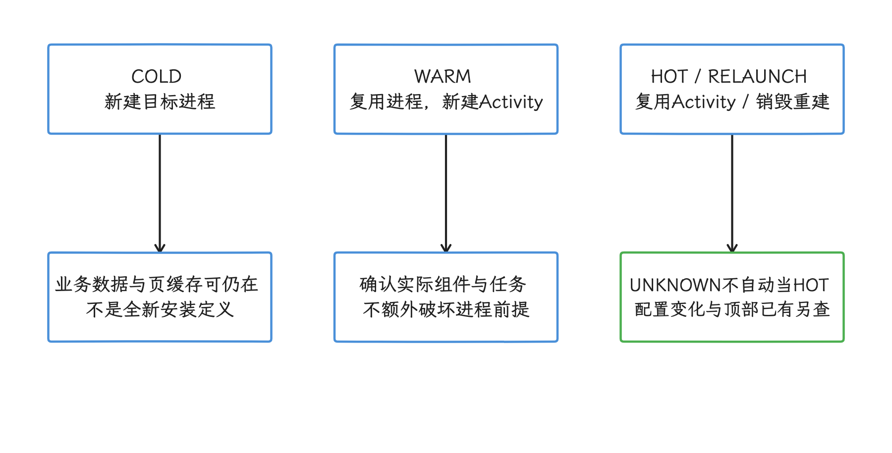

图：Cold、Warm、Hot按进程和Activity复用分类；Relaunch与Unknown另存。 返回键、划任务或固定命令意图不能替代平台状态与实际启动链校验。

测试脚本应让平台返回的 `LaunchState` 参与校验，少用“按了返回键所以一定是 warm”这类间接判断。一个竞品可能通过透明 Activity、deep link（直达指定页面的链接）、多进程或不同 task（Activity 任务栈）策略进入首页，`TotalTime` 覆盖到哪个 Activity，取决于本次实际启动链。要看清这段启动链，我们再借助 Perfetto 中的 Android App Startups 派生指标（由原始 Trace 计算出的启动区间）和 Activity transition（页面切换过程） 补足时间线。

### 启动对比的注意事项

**SplashScreen**：Android 12 起的系统启动画面可能先于应用内容帧出现，但 `TotalTime` 的完成点仍来自目标 Activity 的窗口绘制，说明不了“页面数据可用”。报告可以同时保留“启动画面出现”“应用首帧”“业务可操作”三个视觉时间点；后两者需要 Trace、视频或等价的 UI 状态检测。

**编译状态**：Play 安装的包可能带 Baseline Profile，用一段时间后还可能积累 JIT（Just-In-Time，运行时即时编译） 产物或 Cloud Profile。竞品对比先选一种协议并写进报告：

- **商店现实状态**：保留各自经商店分发和正常使用形成的编译状态，回答用户现实体验问题；
- **统一实验状态**：对所有包执行同一安装、交互和编译流程，回答固定 ART 条件下的差异。

以下命令请求按 `speed` filter 编译包；需检查命令结果与实际 ART 编译状态，不代表所有类初始化提前完成，也不保证所有路径最快：

```bash
adb shell cmd package compile -m speed -f com.example.app
```

它偏离了用户从 Play 安装后的自然状态，结果别叫“商店体验”。`speed-profile` 只按设备上已有的 profile 预编译热点代码；各 App 的 profile 是否存在、质量是否相近没有核验过，用它反而引入新的不一致。

<!-- gracker-diagram: ch16-06-09-art-state-protocols -->
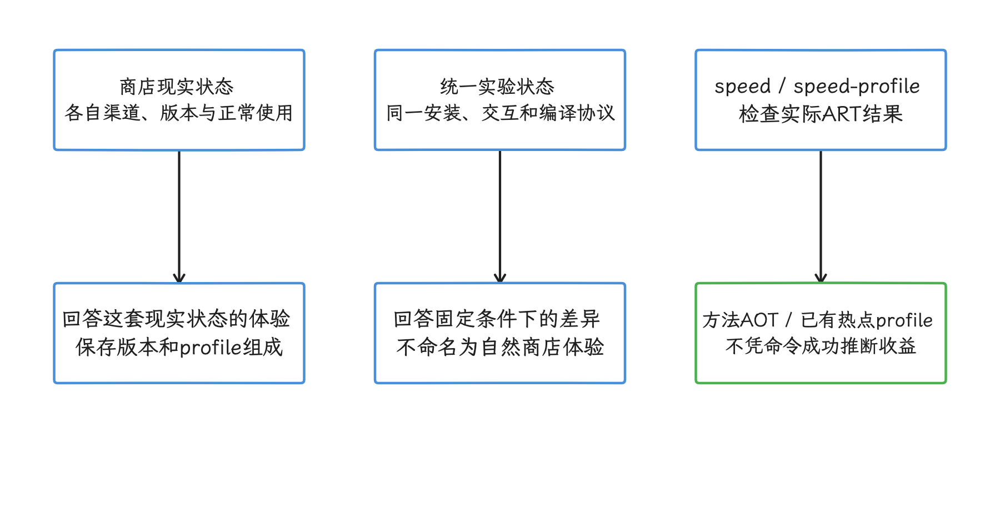

图：先选择保留自然分发/使用状态，或统一安装交互与编译协议，再解释性能差异。 speed不是所有类初始化完成或最快保证；speed-profile需核对各侧profile存在与质量。

**窗口与显示状态**：锁屏、分屏、画中画、外接显示器、刷新率切换和系统转场都会改变启动路径，这些状态在轮与轮之间可能漂移，所以每轮开始前都校验一遍。

## 竞品流畅性对比

平均 FPS（Frames Per Second，每秒帧数） 会把停顿的位置和长度抹平，所以我们看流畅性时不只盯这一个数：帧 deadline（每帧的完成时限）命中情况、长尾帧、连续卡顿段、场景阶段和帧归属至少要有。加载中的临时界面、页面转场和稳定滑动分开统计。

### 抓 Trace 对比帧耗时分布

Android 12 起，SurfaceFlinger（负责图层合成与呈现的系统服务） 的 FrameTimeline 能把 App 产生的帧和显示端呈现的帧关联起来；固定源码版本可查 [`FrameTimeline.cpp`](https://android.googlesource.com/platform/frameworks/native/+/refs/tags/android-17.0.0_r1/services/surfaceflinger/Scheduler/FrameTimeline.cpp) 与 [`frame_timeline_event.proto`](https://android.googlesource.com/platform/external/perfetto/+/refs/tags/android-17.0.0_r1/protos/perfetto/trace/android/frame_timeline_event.proto)。

应先查询实际设备支持的数据源、atrace 分类和权限，再选择 Trace 配置。常用的采集项包括：

- `android.surfaceflinger.frametimeline` 数据源；
- `linux.ftrace` 中实际可用的 atrace 分类，例如 `view`、`input`、`wm`、`gfx`；需要调度因果证据时再启用相应 `sched_*` 等内核事件，二者不是同一种事件；
- 目标包的 atrace events，也就是 App 通过 Android Trace 标记写入的事件；
- 场景开始、结束和阶段切换标记。

还要核对目标 Layer、Surface/Display token 关联、完整结束事件与数据丢失；多 Layer 不能简单合成一条“应用帧序列”。SurfaceView、游戏、自定义 Surface 和设备/版本的覆盖需实证确认，不能用空帧集合推断无卡顿。

<!-- gracker-diagram: ch16-06-10-frametimeline-object-join -->
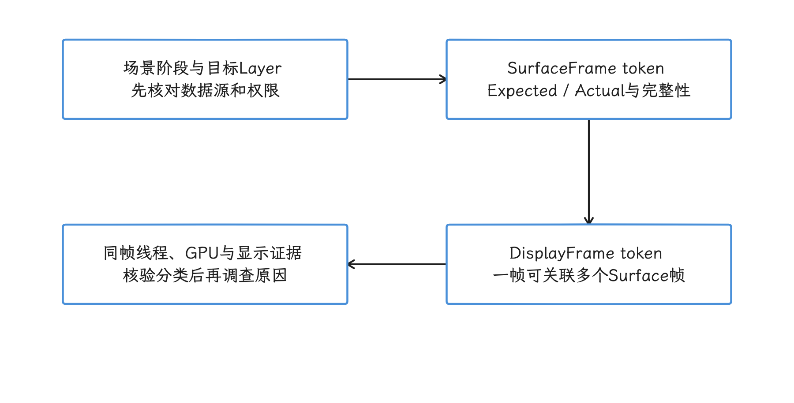

图：按目标Layer与token联系应用Surface帧、合成Display帧和显示反馈，再判断覆盖。 一个DisplayFrame可合成多个SurfaceFrame；空集合、缺失结束事件与不支持Surface不能当无卡顿。

Trace 时长要覆盖完整的操作路径：短动画可能几秒就够，长列表或视频场景可能要一分钟，“至少 10 秒”这类通用门槛站不住。持续时间跟着场景定义走，帧数和有效区间一起报告。

滑动可以由 UI Automator（可跨 App 操作界面的自动化测试框架）或坐标事件驱动。坐标相同只说明输入相同；两个应用各自滚了多远、内容工作量多大，还要用可见 item、页面标识或录屏确认终点。`sendevent` 是向 Linux 输入设备节点写事件的低层命令，依赖设备节点和权限，不适合作为可移植方案。

### 帧耗时分析的关键指标

**deadline（平台为每帧分配的完成时限） miss 率**：未按时完成的帧占比。先声明统计的是 App 完成、显示呈现还是工具 overrun；这些条件与 jank type 不等价。再用该帧匹配的 deadline——可变刷新率、App 对期望帧率的投票和 SurfaceFlinger 调度都会让相邻帧的预算不同，硬编码 60 Hz 的 16.6 ms 或 120 Hz 的 8.3 ms 会误判。

**P50/P90/P99**：分位数描述主体与长尾。统计对象必须写明：应用帧实际时长、预期时长、超出 deadline 的时长，还是帧间隔；对象一致，两组 P99 才有可比性。

**连续卡顿段**：在同一目标 Layer、交互阶段和预定义有效序列中，记录连续 miss 的帧数与持续时间。时间单位、边界、丢失帧和截断段另报；单个长帧与多个超时帧即使百分位相近，视觉现象也可能不同。

**归属**：FrameTimeline 的 App Jank、SurfaceFlinger Jank 和 jank type（平台标记的卡顿来源类型）是定位线索。要把责任落到业务代码、GPU 驱动或系统服务，还得回到 UI thread（处理界面事件与布局绘制的主线程）、RenderThread（承担部分渲染工作的线程）、GPU 和 SurfaceFlinger 时间线里找直接阻塞关系。

**有效帧集合**：标出首帧、窗口转场、无内容变化帧和测试脚本空等帧。排除规则我们在看数据之前就定好，并对 A/B 使用同一规则。

<!-- gracker-diagram: ch16-06-11-frame-metric-population -->
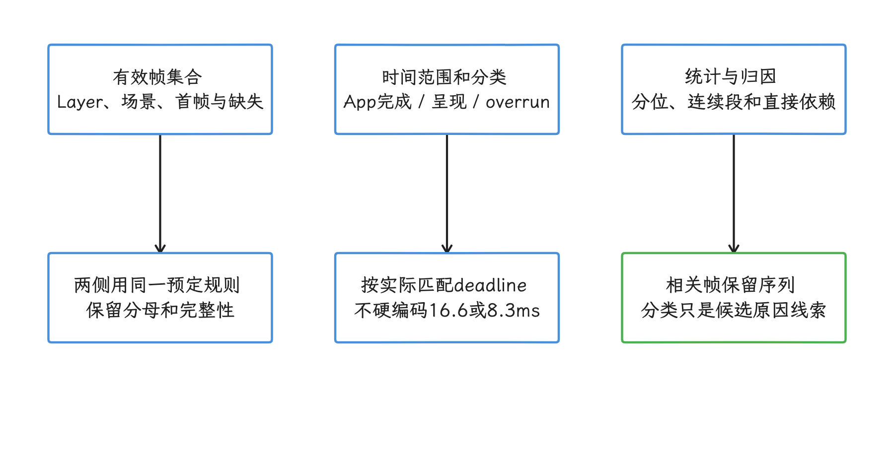

图：先定义目标Layer、阶段与有效帧集合，再分别统计时限、尾部和连续卡顿段。 App完成时限、显示呈现、工具overrun与jank type不是同一个指标，缺失与排除另报。

### FrameMetrics 能做什么

`FrameMetrics` 从 API 24 提供 `Window` 帧的分阶段耗时，适合接在**我们自己控制的应用**里；未授权的竞品进程注入不了，所以它当不了任意竞品的线上采集方案。

即使双方都接入了同类 APM（Application Performance Monitoring，应用性能监控）系统，也要确认采样率、过滤规则、窗口范围和用户分群一致。

下面的监听器用于自有应用记录总时长、deadline 和首绘标记。`DEADLINE` 从 API 31 才可用，因此示例显式保留旧系统的缺失值：

```java
activity.getWindow().addOnFrameMetricsAvailableListener(
    (window, frameMetrics, dropCountSinceLastInvocation) -> {
        long totalDuration = frameMetrics.getMetric(FrameMetrics.TOTAL_DURATION);
        long deadline = Build.VERSION.SDK_INT >= Build.VERSION_CODES.S
                ? frameMetrics.getMetric(FrameMetrics.DEADLINE)
                : -1L;
        boolean firstDraw =
                frameMetrics.getMetric(FrameMetrics.FIRST_DRAW_FRAME) == 1L;
        recordFrame(totalDuration, deadline, firstDraw, dropCountSinceLastInvocation);
    },
    metricsHandler
);
```

回调交给已启动的专用 `HandlerThread` 对应 Handler，并在窗口生命周期结束时移除监听器、回收线程。`FrameMetrics` 对象每次复用；本例立即提取原始数值，`recordFrame` 应只做轻量有界入队，延后处理不能持有原对象。`dropCountSinceLastInvocation` 是丢失的监听报告数，不是显示掉帧数，应与收到的报告及缺失一起保存。各指标单位为 ns，负值作为不可用保留；只有 total、deadline 均有效且 deadline 为正时才分类，API 26–30 的 deadline 缺失不能填固定刷新周期。

平台的 [`FrameMetrics.java`](https://android.googlesource.com/platform/frameworks/base/+/refs/tags/android-17.0.0_r1/core/java/android/view/FrameMetrics.java) 定义 `TOTAL_DURATION = INTENDED_VSYNC → FRAME_COMPLETED` 和 `DEADLINE = INTENDED_VSYNC → FRAME_DEADLINE`，源码注释用 `TOTAL_DURATION < DEADLINE` 表示按时完成；两者相等时按未命中处理。这是该 Window 帧的生产时限比较，不保证显示栈其他阶段没有 jank；也不能直接替代 FrameTimeline 的全部 jank 类型。阶段耗时可能重叠，不能逐项相加当总时长。`FIRST_DRAW_FRAME` 在动画卡顿统计中按预定义规则单列，并单报首绘；不同 Surface 的覆盖另核对。

<!-- gracker-diagram: ch16-06-12-framemetrics-listener -->
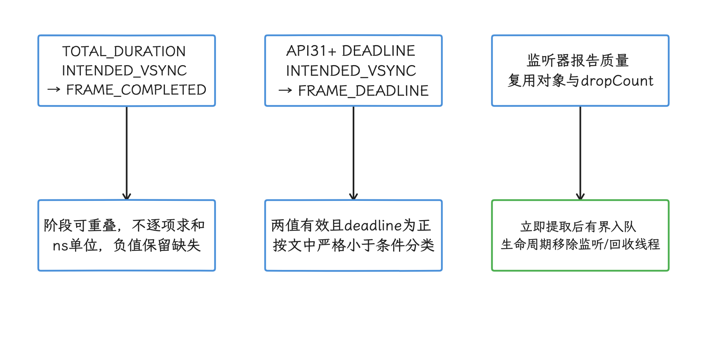

图：在可控制的Window内立即提取原始ns数值，轻量入队并保留丢失报告，按有效deadline分类。 监听报告丢失不是显示掉帧；TOTAL与DEADLINE是Window生产边界，也不能证明整个显示栈没有jank。

`dumpsys gfxinfo <package> framestats` 可以作为无侵入备选，但它主要反映 HWUI（Android 硬件加速界面渲染管线） 窗口帧，输出字段随平台演进，覆盖面也不等同 FrameTimeline。解析器必须按 API 版本测试，并保留原始 dump 输出。

## 竞品包体积对比

包体积对比的第一步是选定比较对象。“包有多大”至少对应四种对象：AAB（Android App Bundle，上传到应用商店的发布包）、单个 APK、某设备收到的 base + split APK（按设备配置拆分交付的安装包） 集合，以及压缩下载估算。对象选错，比出来的数字就没有意义：只拿竞品的 `base.apk` 对自家 universal APK（含多种设备资源的通用包），就是对象错位。

<!-- gracker-diagram: ch16-06-13-package-size-objects -->
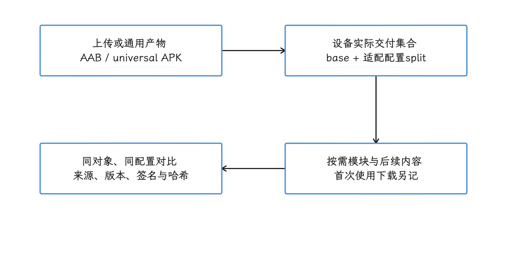

图：先固定比较对象，再按同设备配置整理base/split、动态模块和追加下载。 AAB、universal APK、单个base和实际交付集合不能直接混作一个大小排名。

### APK Analyzer 的使用

Android Studio 的 APK Analyzer 可以查看 APK 或 App Bundle 的压缩大小、下载大小估算、DEX（Android 字节码文件）、资源、assets（原样打包的资源文件）和 native libraries（C/C++ 等原生库）。使用竞品安装包前，先确认获取与分析符合渠道条款，并保存下载来源、版本、签名和文件哈希。

图形界面的基本流程如下：

1. 在 Android Studio 中选择 `Build → Analyze APK`，或者直接将 APK 文件拖入编辑器窗口。
2. 对每个文件同时记录 Raw File Size（该项对 ZIP/APK 文件大小的贡献，不是解压后逻辑大小）与 Download Size（交付压缩大小估算），两种数字各记各的，汇总时分开引用。
3. 展开 DEX、`resources.arsc`、`res/`、`assets/` 和 `lib/<abi>/`。
4. 使用 Compare with previous APK 比较同一个产品的相邻版本。

<!-- gracker-diagram: ch16-06-14-apk-size-measurements -->
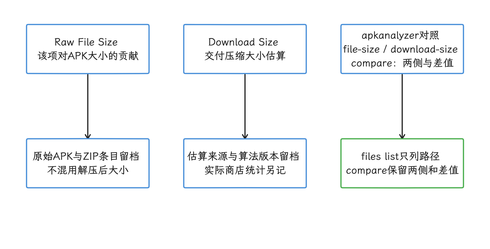

图：APK Analyzer按ZIP/APK贡献量与交付压缩估算解释体积，CLI可保存同口径输出。 Raw File Size不等于解压后逻辑大小；download-size不是Play实际交付的保证。

横向对比时，先为目标设备收集已交付 base/split 集合，并分别记录按需模块与后续下载，再按相同 ABI（CPU 指令集）、density（屏幕密度）、language（语言资源） 和动态功能模块计算；取不到完整集合时，报告写明缺哪些 split。

### 命令行工具 apkanalyzer

Android SDK Command-Line Tools 自带 `apkanalyzer`。下面的命令分别读取文件大小、下载大小估算、包内文件和两个 APK 的逐项差异：

```bash
apkanalyzer -h apk file-size app.apk
apkanalyzer -h apk download-size app.apk
apkanalyzer -h files list app.apk
apkanalyzer -h apk compare --different-only app-a.apk app-b.apk
```

`files list` 的当前官方语法没有 `--size` 选项，需要明细大小时用 `apk compare` 或 APK Analyzer 界面。`unzip -l ... | tail -1` 也不适合分类统计：glob、目录层级和压缩方式都会使汇总失真。

### 包体积对比的关键维度

**DEX**：大小受功能量、依赖、编译器、R8（Android 代码压缩与优化工具）配置、字符串、调试信息和压缩率共同影响。看到 DEX 大就断言代码质量差、或归因到 Kotlin/Java 的语言选择，都跳步了；它只说明上面某几项大。

**Native libraries**：按 ABI 和压缩状态拆分。AAB 交付通常只向设备发送匹配的 ABI；universal APK（包含多种设备资源的通用安装包） 则可能包含多套 `.so`。还要看调试符号是否剥离、库是否按内存页边界对齐，以及相同库是否在多个动态模块重复出现。

**Resources 与 `resources.arsc`**：分别检查图片、字体、音视频、密度/语言变体和资源表。位图改成矢量图可能减小文件，也可能增加运行时栅格化（把矢量图转换成像素）成本，要结合场景判断。

**Assets**：离线数据、Web bundle（Web 页面文件的打包集合）、模型和预置媒体常放在这里。Play Asset Delivery（Google Play 的大资源交付机制）或运行时下载的内容不在当前 APK 时，要在“首装下载”和“首次使用追加下载”中另行记录。

**交付大小**：用户关心某台设备实际要下载的压缩字节。`apkanalyzer apk download-size` 给的是估算值，不能保证与 Play Console 的真实交付统计相同；报告里标明数据来源。

<!-- gracker-diagram: ch16-06-15-package-component-evidence -->
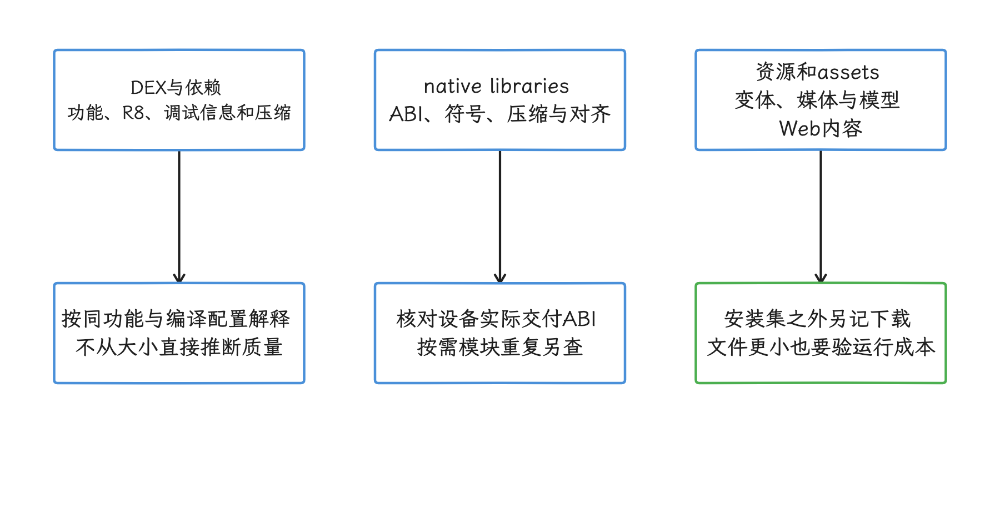

图：将DEX、native、资源与assets按设备交付口径拆分，再结合功能、配置与运行成本提出候选解释。 DEX大不证明语言或混淆质量；离线内容、按需模块与运行时下载还要单独记账。

## 注意事项：避免误导性结论

实验条件固定住之后，剩下的风险集中在结论的写法上。这一节把六种常见的过度解读放在一起，写报告时可以对照检查。

### 误区一：只看单次数据就下结论

单次结果只是观察记录。重复采样后看差值分布和区间；样本再多，也救不回测试顺序、网络或热状态失控的轮次。报告用“在本实验条件下，A 的配对中位数比 B 低 X ms，区间为……”这类可核查的表述。

### 误区二：不同量级的场景放在一起比

Cold 与 Warm、首屏骨架与首屏数据、信息流滑动与静态设置页，量级相差太远，放进同一组只会互相稀释。产品形态没有等价场景时，保留两个各自有意义的用户任务；为了凑排名制造虚假的一一对应，得不偿失。

### 误区三：忽略版本差异和编译状态

“最新版”仍可能因地区、灰度渠道和签名不同而对应多个构建。记录 versionCode 和安装包哈希，并确认测试期间没有自动更新。刚安装与长期使用的包，ART profile、磁盘数据、登录态和服务端分群都可能不同，把差异直接归因到 JIT 就太早了。

### 误区四：把设备差异当性能差异

同型号的两台设备，仍然是两台设备。每台设备分别做 A/B，再汇总“多少台设备上方向一致”。系统 OTA（整机系统在线更新）、Google Play system update（经 Google Play 分发的系统组件更新）和系统关键服务更新后，设备进入新的实验批次，旧结果只作历史参考。

### 误区五：忽略 SoC 平台差异的影响

SoC（System on Chip，系统级芯片）、GPU 驱动、内存、存储、厂商调度配置和散热结构共同影响结果。跨设备数据适合回答覆盖面问题；“设备甲上的 A”对“设备乙上的 B”这种交叉比较回答不了问题，要比较就回到同一台设备上。性能模式、游戏模式和自适应刷新率也要作为设备配置保存。

### 误区六：把相关性写成实现原因

没有竞品源码时，Trace 能证明某线程、Binder（Android 跨进程调用机制） 调用、GPU 或系统阶段占用了时间；再往产品设计动机上推，证据就撑不住了。包体积分类显示的是字节分布，DEX 大小同样说明不了混淆质量。结论分成“观测”“候选原因”“验证办法”三列来写。

<!-- gracker-diagram: ch16-06-16-observations-to-causes -->
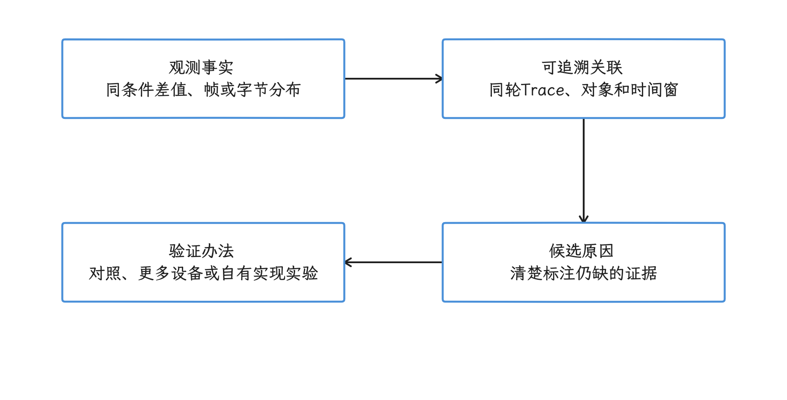

图：先写可复核观测，再列候选解释与能区分解释的验证办法。 Trace关联和字节分布都不自动证明竞品设计动机；跨设备交叉比较不能当同机效应。

## 扩展：自动化竞品对比测试流水线

### 基本架构

1. **合规获取与归档**：保存来源、渠道、版本、签名、哈希和完整 split 清单；不绕过访问控制。
2. **设备调度**：校验 fingerprint、显示模式、电量、thermal status、网络和磁盘空间，异常设备退出本轮。
3. **状态准备**：按场景创建账号与数据，执行可验证的复位动作。
4. **随机执行**：按设备生成 A/B 顺序，设置超时、重试上限和失败分类。
5. **证据采集**：保存 `am start -W` 原始输出、Perfetto Trace、录屏、安装包分析和设备快照。
6. **统一计算**：从原始文件生成帧集合、分位数、配对差值和区间，分析代码与原始数据一起版本化。
7. **报告门禁**：缺版本、样本不足、状态不匹配、目标失败与必需证据缺失分别分类；不生成超出证据的排名。Trace 不是所有指标的共同有效性条件，应在合同里说明它用于计量、归因还是补充诊断。

Macrobenchmark 适合自有应用并提供 JSON 与逐轮 Perfetto 产物，但目标配置、启动入口、编译重置和测试工作负载仍需适配。当前官方指南要求 profileable；固定 1.4.1 源码的 `NOT-PROFILEABLE` 错误实际只在 API 29–30 且 `DeviceInfo.profileableEnforced` 时成立，API 31+ 的 app trace tag 不再以此为同一硬门槛。因此不能仅因竞品 manifest 不可修改就断言所有版本无法使用。应按实际库/API、权限和依赖验收；需要时改用外部 UI Automator/adb 与 shell Perfetto，并记录覆盖限制，不能靠 suppressErrors 假装条件已满足。`FrameMetrics` 监听代码则需要可控制的目标进程。

`dumpsys gfxinfo` 若作为兼容路径，流水线应按 Android API 版本选择解析器，并用固定样本验证字段。遇到未知格式直接失败——静默填 0 会把错误带进结论。

<!-- gracker-diagram: ch16-06-17-automated-evidence-pipeline -->
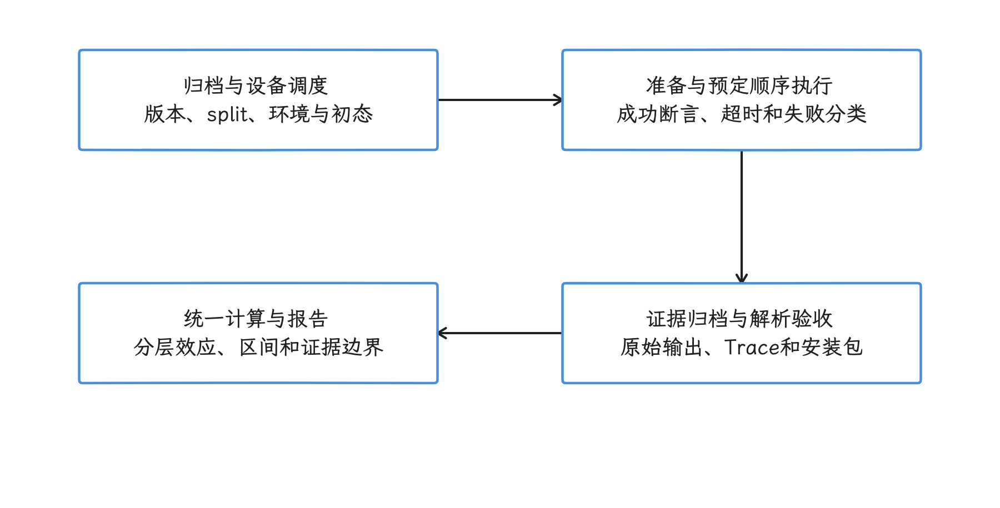

图：流水线归档版本、调度设备、准备状态、交错执行，最后按指标所需证据计算与报告。 固定1.4.1的profileable硬检查有API29–30条件；其他版本/API需验收，未知格式与缺失不填零。

## 扩展：竞品功耗对比方法

功耗是系统级结果：屏幕、蜂窝信号、Wi-Fi、音频、传感器、温控和后台服务，任何一项的波动都可能盖过两个应用之间的差值。所以场景要固定持续时间、亮度、音量、网络响应、屏幕内容和用户输入，并交替执行 A/B。

### 软件测量方案

Battery Historian 已不再积极维护，但仍可把 batterystats（Android 系统累计的电池使用统计） 里的 wake lock（唤醒锁）、job（系统调度任务）、alarm（定时唤醒事件）、网络和进程状态放到时间线上，帮我们解释行为。注意它展示的是组件何时活跃；组件消耗了多少能量，还要另行测量。

下面的命令用于重置统计，并在执行场景后导出 bugreport（包含系统诊断信息的压缩包）：

```bash
adb shell dumpsys batterystats --reset
adb bugreport bugreport.zip
```

重置会影响全设备统计，需在专用测试机执行。bugreport 可能包含账号、网络与系统日志，归档前按团队安全规范处理。

截至 2026-10-26，官方 Macrobenchmark 指南仍将实验性 `PowerMetric` 的高精度 power/energy 采集列在 Pixel 6、Pixel 6 Pro 及后续实体设备范围，且数值是系统级观测。还要检查实际库、API、powerstats rail 通道与采集结果，型号名本身不是可用性证明。固定 1.4.1 的高精度支持检查读取 `dumpsys powerstats` 的 `ChannelId`；`Type.Battery` 是另一种电荷变化路径，不能与 rail 能量或平均功率混算。这些结果都不等于竞品进程独占能耗。

平台的 Power Stats 入口可从 [`PowerStatsService.java`](https://android.googlesource.com/platform/frameworks/base/+/refs/tags/android-17.0.0_r1/services/core/java/com/android/server/powerstats/PowerStatsService.java) 继续追到设备 HAL（Hardware Abstraction Layer，硬件抽象层）；具体可用的 channel（能量测量通道）和 consumer（逻辑耗能单元）由硬件实现决定。

<!-- gracker-diagram: ch16-06-18-power-software-observations -->
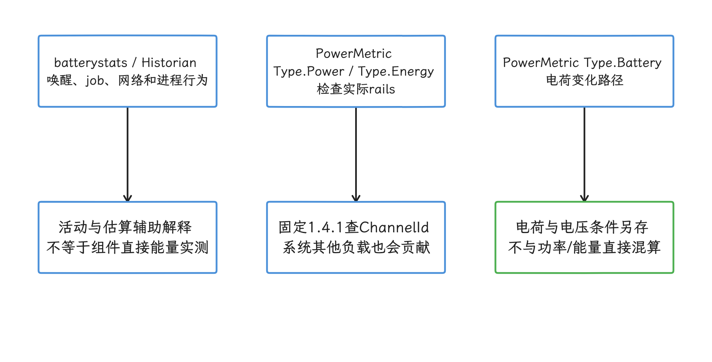

图：行为时间线帮助解释活动，高精度rails与电荷变化分别提供不同范围的能耗观测。 PowerMetric是系统级测量；型号名不证明rail支持，Type.Battery也不是同精度能量值。

### 硬件测量方案

外部电源分析仪需要设备支持的供电夹具或厂商测试接口，别在没有硬件规范的情况下直接断开电池。测量流程包括：

1. 校准采样率、电压与时间同步，确认设备不会同时从 USB 和仪器取电；
2. 在同一电压、屏幕和无线条件下记录空闲基线；
3. 用场景标记对齐每轮操作，保存原始电压与电流序列；
4. 以同步电压与电流计算功率 `P(t)=V(t)×I(t)`，再对时间积分得到能量 `E=∫P(t)dt`；统一为 J、mJ、Wh 或 mWh，保留测量点与 USB/夹具边界；
5. 按随机顺序重复 A/B，给出配对差值与区间。

`mAh`（毫安时）只表示电荷量，电压一变，同样的电荷对应的能量就不同。空闲基线相减也可能掩盖后台活动，原始总能量与基线修正值要同时保留。

<!-- gracker-diagram: ch16-06-19-external-power-integration -->
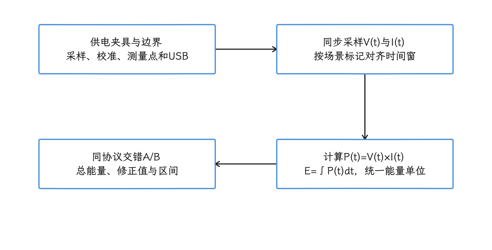

图：在明确测量点校准并同步电压电流，按场景积分总能量，再保留配对差值与区间。 mAh是电荷；测量点、USB供电和空闲基线修正会影响结果，原始总能量同时保留。

## 参考资料

### 官方文档
- [App startup time](https://developer.android.com/topic/performance/vitals/launch-time) — 官方启动时间测量指南
- [Overview of measuring app performance](https://developer.android.com/topic/performance/measuring-performance) — 设备校准、编译状态与测量边界
- [APK Analyzer](https://developer.android.com/studio/debug/apk-analyzer) — APK 分析工具文档
- [apkanalyzer](https://developer.android.com/tools/apkanalyzer) — 命令行语法与大小口径
- [Benchmarking overview](https://developer.android.com/topic/performance/benchmarking/benchmarking-overview) — 性能基准测试框架
- [Macrobenchmark metrics](https://developer.android.com/topic/performance/benchmarking/macrobenchmark-metrics) — Startup、Frame 与 Power 指标
- [FrameMetrics API](https://developer.android.com/reference/android/view/FrameMetrics) — 帧性能测量 API
- [Reduce APK size](https://developer.android.com/topic/performance/reduce-apk-size) — APK 体积优化指南
- [Battery Historian](https://developer.android.com/topic/performance/power/battery-historian) — 电量分析工具

### AOSP 源码
- [`ActivityManagerShellCommand.java`](https://android.googlesource.com/platform/frameworks/base/+/refs/tags/android-17.0.0_r1/services/core/java/com/android/server/am/ActivityManagerShellCommand.java) — Android 17 `am start -W` 调用与输出
- [`WaitResult.java`](https://android.googlesource.com/platform/frameworks/base/+/refs/tags/android-17.0.0_r1/core/java/android/app/WaitResult.java) — Android 17 启动等待结果字段
- [`ActivityTaskSupervisor.java`](https://android.googlesource.com/platform/frameworks/base/+/refs/tags/android-17.0.0_r1/services/core/java/com/android/server/wm/ActivityTaskSupervisor.java) — 等待与 `totalTime` 回填
- `frameworks/base/services/core/java/com/android/server/wm/ActivityMetricsLogger.java` — 启动 transition、`windowsDrawn` 与 `Displayed` 计时记录
- `frameworks/base/services/core/java/com/android/server/wm/ActivityRecord.java` — Activity 窗口绘制完成状态与启动等待结果
- `frameworks/base/core/java/android/view/FrameMetrics.java` — FrameMetrics API 定义
- [`FrameTimeline.cpp`](https://android.googlesource.com/platform/frameworks/native/+/refs/tags/android-17.0.0_r1/services/surfaceflinger/Scheduler/FrameTimeline.cpp) — Android 17 SurfaceFlinger FrameTimeline

- [AndroidX Benchmark 1.4.1 固定源码](https://dl.google.com/dl/android/maven2/androidx/benchmark/benchmark-macro/1.4.1/benchmark-macro-1.4.1-sources.jar) — Macrobenchmark profileable 检查与 PowerMetric/PowerRail 实现

### 工具与平台
- [Perfetto](https://perfetto.dev/) — 系统级 Trace 分析平台（§14.1-§14.3 详细介绍）
- [Android Studio Profiler](https://developer.android.com/studio/profile) — 集成性能分析工具（§15.1 详细介绍）
