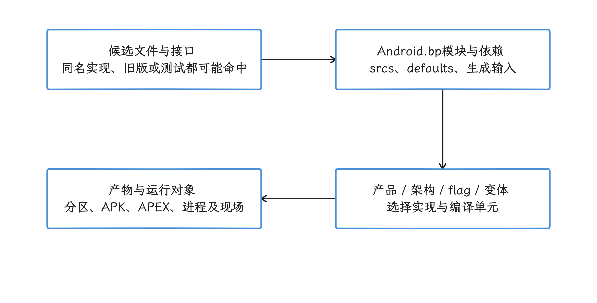
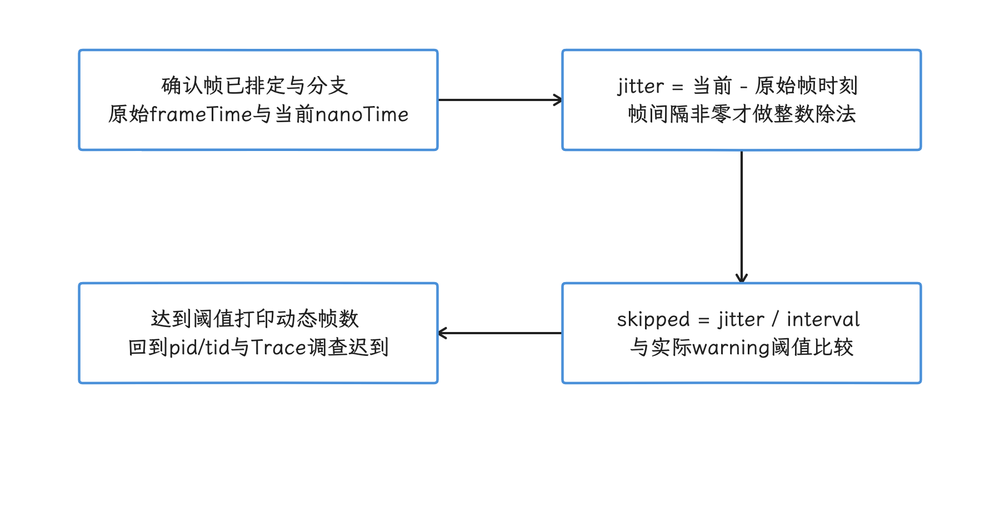
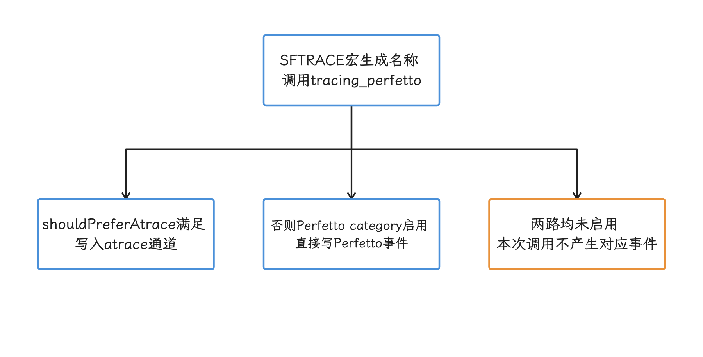
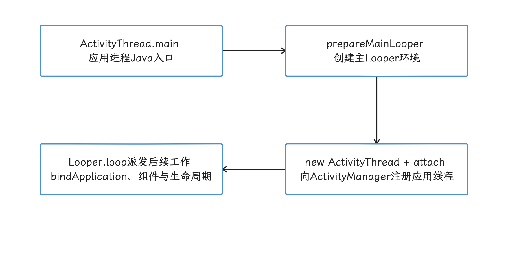
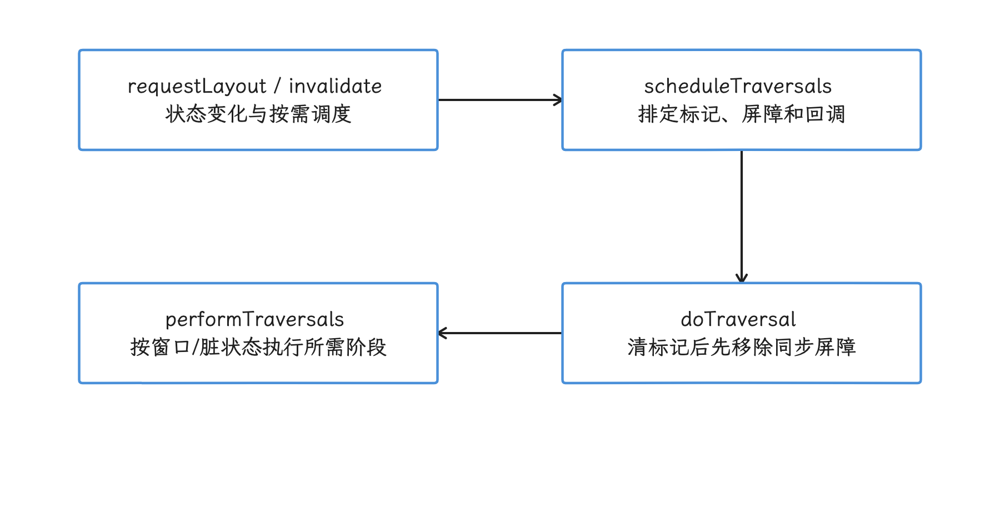
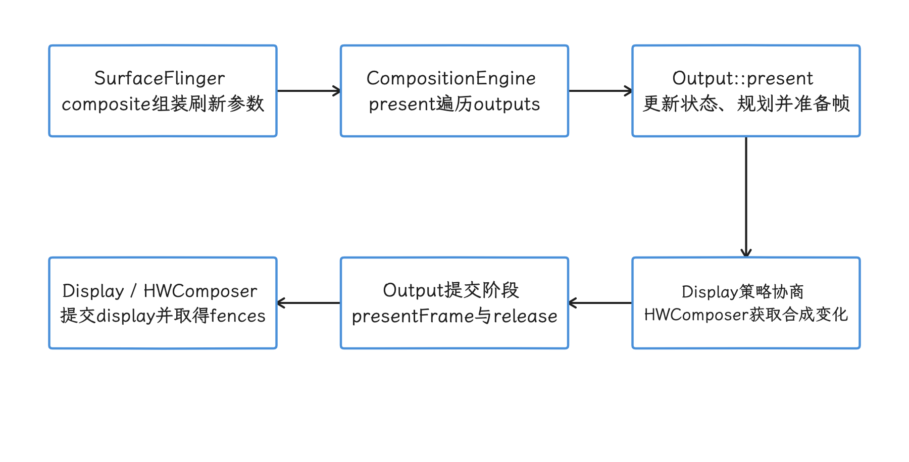

# AOSP（Android Open Source Project，Android 开源项目） 代码阅读

我们在排查设备问题时抓到的日志、slice 和调用栈，最终都要回到源码才能解释：这段行为由哪一版代码、在什么条件下产生。所以源码阅读要由具体运行证据驱动——先固定平台 tag（标签）、模块和调用入口，再沿日志、trace 或 Binder（Android 的进程间通信机制） 接口向上下游展开。这样得到的是可验证的实现解释，而不是在当前主干代码里找一个可能不存在于目标设备的答案。

## 阅读源码前，固定三个坐标

我们要先做的第一件事，是把问题固定成可验证的形式：某段运行时行为由哪一版代码产生，控制条件是什么，证据能否解释设备上的现象。为此，开始搜索前先记下三个坐标：

1. **平台版本**：默认使用 `android-17.0.0_r1`，对应 Android 17 / API 37。
2. **Git 项目**：例如 `platform/frameworks/base` 或 `platform/frameworks/native`。
3. **项目内路径**：例如 `core/java/android/view/Choreographer.java`。

为什么要先记版本？因为“AOSP 源码”是 Repo 协调管理的一组 Git 项目：manifest（清单） 记录每个项目的路径和 revision（分支、tag 或 commit），checkout 出来才是我们看到的目录树。顶层目录与 Git 项目之间也没有严格的对应关系，`frameworks/base` 与 `art` 就是两个并列的项目。所以只写“我看了 AOSP 最新代码”，别人难以复核——`main`、`android-latest-release`、发布 tag（Git 标签）和厂商分支可能早已分开。

阅读时再保留一份运行现场：

- Build fingerprint（整套设备软件构建的标识）、`ro.build.version.sdk` 和厂商版本；
- 进程、线程、时间窗；
- Logcat 原文或 Perfetto trace（系统时间线记录）；
- 复现条件；
- 源码 tag、项目和文件路径。

这份记录帮我们避开两类误判：用 Android 17 源码解释旧设备行为，或用 AOSP 行为代替厂商实现。厂商可以修改 Framework、SurfaceFlinger、HAL（Hardware Abstraction Layer，硬件抽象层） 和内核；AOSP 是参照系，设备证据决定现场是否走了同一条路径。


## 在线阅读：Android Code Search

在线阅读主要用 [Android Code Search](https://cs.android.com)：它把 Repo 组合后的 AOSP 目录放在同一个界面里，全文搜索、符号交叉引用（cross references，即定义与引用列表）、目录浏览和版本切换都支持。官方说明见 [Android Code Search](https://source.android.com/docs/setup/contribute/code-search)，查询语法见 [Code Search syntax reference](https://developers.google.com/code-search/reference)。

### 固定版本，再打开文件

文件链接应带发布 tag；需要严格复现时，还应保存各 Git 项目的 commit SHA 或 pinned manifest。下面的地址把版本钉在发布 tag 上，定位到 `Choreographer.java`：

`https://cs.android.com/android/platform/superproject/+/android-17.0.0_r1:frameworks/base/core/java/android/view/Choreographer.java`

界面提供的 `HEAD` 链接适合跟进正在开发的代码；要作为文章证据引用时，我们复制“当前 revision + 行号”的链接。行号会随提交变化，tag 和文件路径才是长期复核所需的信息。

### 使用受支持的搜索过滤器

Code Search 默认搜的是文件路径和内容，官方过滤器包括 `file:`、`content:`、`function:`、`symbol:`、`usage:`、`lang:`，双引号表示逐字匹配。下面几组查询分别用于搜索日志原文、方法和符号使用点：

```text
content:"The application may be doing too much work"
file:Choreographer.java function:doFrame
lang:java usage:scheduleFrameLocked
file:services/surfaceflinger symbol:composite
```

这四条各有分工：第一条从 Logcat 反查，第二条缩小到文件和函数，第三条排除注释与字符串，第四条聚焦 SurfaceFlinger 路径。旧资料里的自造语法或含义不明的正则，不宜直接复用。

### 交叉引用提供候选调用关系

点击已索引的符号可看定义和引用，快捷键 `x` 打开 cross references。交叉引用跳转可能回到该索引构建时的文件版本，所以每次进入新文件，我们先复核 revision、路径和构建变体，再往下读。逐条判断时还要注意：

- 虚方法调用指向静态类型，运行时对象可能是子类；
- 反射、JNI（Java 与 native 代码之间的接口）、Binder、消息分发和回调会中断普通调用层次；
- 宏展开、生成代码、条件编译和产品变体可能改变入口；
- 某些 revision 或语言没有完整索引；
- 引用列表只说明语法关系，设备运行时是否执行要另行确认；

所以 Code Search 适合用来生成候选路径；路径是否真的发生，由调用栈、trace、日志和构建配置验证。


## AOSP 关键目录

AOSP 目录树很大，我们常打交道的只是少数几个项目。下面按 Git 项目分组：先列常见入口，再说读哪类问题时会跨到哪里。

### `frameworks/base`：应用进程与 Java 系统服务

这个项目同时覆盖应用进程侧和 Java 系统服务侧，常见入口如下：

- `core/java/android/app/`：`ActivityThread`、`Instrumentation`、`LoadedApk`；
- `core/java/android/view/`：`ViewRootImpl`、`Choreographer`、`View`、输入接收端；
- `core/java/android/os/`：`Looper`、`Handler`、`Binder`、`Trace`；
- `services/core/java/com/android/server/am/`：进程、Service、Broadcast、ANR；
- `services/core/java/com/android/server/wm/`：Activity、Task、Window、DisplayArea、转场；
- `services/core/java/com/android/server/power/`：电源状态和 WakeLock；
- `packages/SystemUI/`：状态栏、通知、锁屏和系统界面；
- `graphics/java/android/graphics/`：Canvas、Bitmap、Paint 和渲染接口。

这份清单只是初始范围：顺着一条链路追下去，同一个问题往往要跨好几个目录。以应用启动为例，应用进程侧会进入 `ActivityThread`，system_server（承载核心 Java 系统服务的进程） 侧会进入 `ActivityTaskManagerService`、`ActivityManagerService` 和进程启动代码，运行时还会涉及 ART（Android Runtime） 与 zygote（预加载运行环境并派生应用进程的进程）。

### `frameworks/native`：图形、Binder 与原生系统组件

做性能分析时，我们常进入下面这些路径：

- `services/surfaceflinger/`：SurfaceFlinger、CompositionEngine、DisplayHardware；
- `libs/gui/`：Surface、BufferQueue、BLAST 和图形 IPC（进程间通信） 数据结构；
- `libs/ui/`：显示、颜色、像素格式和 Fence（表示图形工作完成时点的同步对象） 相关抽象；
- `libs/binder/`：Native Binder；
- `services/inputflinger/`：输入读取与分发；
- `cmds/atrace/`：atrace 命令及类别配置。

SurfaceFlinger 的实现分布在 `SurfaceFlinger.cpp`、`CompositionEngine/`、`DisplayHardware/`、`Scheduler/` 等多个子目录，我们读合成流程时要连着看；只盯单个文件，会漏掉输出策略，也看不清 HWC（Hardware Composer，硬件合成器） 与 RenderEngine（SurfaceFlinger 的 GPU 合成组件） 之间的分工。

### `system/core`：init、日志与系统基础组件

常见入口包括：

- `init/`：Android 的 init 进程、service 管理、属性触发器和 `.rc` 配置解析；
- `rootdir/`：平台 `.rc` 文件与早期用户空间配置；
- `libutils/include/utils/Trace.h`：平台原生代码常用的 RAII trace 宏，可借助 C++ 对象生命周期自动结束 trace 区间；
- `libcutils/include/cutils/trace.h`：atrace tag 常量和底层接口；
- `toolbox/`：仍保留的少量系统命令实现。

日志与 ADB 的实现要进入其他项目：`logd/`、`liblog/` 位于 `system/logging/`，ADB 的 host、client 与 daemon 位于 `packages/modules/adb/`。这些项目与 checkout 路径的对应关系可在固定 tag 的 [`platform/manifest/default.xml`](https://android.googlesource.com/platform/manifest/+/refs/tags/android-17.0.0_r1/default.xml) 中核对。

shell 命令还可能来自 `external/toybox` 或独立项目。看到设备命令名时，应通过模块名、安装路径和 `Android.bp` 确认提供者，不要只按旧目录印象判断。

### `art`：运行时、GC 与编译

`art` 是独立 Git 项目。追启动或 GC 问题时，我们会进这些目录：

- `runtime/`：Runtime、线程、类加载、GC 和解释执行；
- `compiler/`：编译器基础设施；
- `dex2oat/`：dex2oat 命令入口；
- `libartbase/`：ART 公共基础库；
- `libartservice/service/`：ART Service 的 Java 实现；`artd/`：它调用的原生守护进程实现；
- `tools/`、`profman/`：诊断、profile 与编译辅助工具。

应用启动或 GC 问题同时涉及 Framework 与 ART：Framework 决定何时请求 dexopt、创建组件或触发 GC 相关策略，ART 决定编译、分配和回收如何执行。

### `packages/modules` 与模块化源码

现代 Android 把多项系统能力放进 Mainline（可独立更新的系统组件）模块，代码经常位于 `packages/modules/`，ART 本身也按独立项目和 APEX（系统组件的封装与交付格式）交付。所以遇到网络、蓝牙、权限、设备锁、虚拟化这类问题，就要想到完整实现未必在 `frameworks/base` 里。

遇到公开 API 只保留转发逻辑、看不到实际实现时，可以按下列顺序继续：

1. 看类的 import、Binder 接口和模块名；
2. 在 `Android.bp` 搜索该模块的 `srcs`、`static_libs`、`libs`、`defaults`；
3. 搜索 `packages/modules/`、`system/`、`hardware/interfaces/`；
4. 检查 APEX 或 APK 的进程归属；
5. 用设备上的进程与 trace 线程验证服务端位置。

### 先读 `Android.bp`

这里要先澄清一个常见误会：源码文件存在，未必说明它进入当前产品。`Android.bp` 是 Soong（AOSP 构建系统）的模块配置文件，Soong 会根据模块、依赖、架构、产品变量、feature flag（功能开关） 和生成规则选择源文件。我们读它，至少能回答四个问题：

- 这个文件属于哪个模块；
- 模块编进哪个分区、APK、JAR、APEX 或二进制；
- 同名接口使用哪套实现与变体；
- AIDL（Binder 接口定义）、proto（Protocol Buffers 数据定义）、aconfig（平台 flag 声明）、sysprop（类型化系统属性 API 声明）等生成代码从哪里来。

当 Code Search 找到多个实现时，构建图（模块及其依赖关系）比文件路径更能说明平台选用了哪一个。Soong 语法与模块规则可从 [`build/soong`](https://android.googlesource.com/platform/build/soong/+/refs/tags/android-17.0.0_r1) 复核。

<!-- gracker-diagram: ch16-07-04-build-selected-implementation -->


图：通过模块依赖、产品架构和生成规则确认候选文件如何进入所选产物。 文件存在不证明被编入；构建配置声明也不代替实际构建与刷入产物验收。

### 问题到目录的初始映射

| 运行现象 | 初始入口 | 还要检查 |
|---|---|---|
| 应用冷启动慢 | <code>frameworks/<wbr>base/<wbr>core/<wbr>java/<wbr>android/<wbr>app/<wbr></code> | system_server、ART、磁盘 I/O、应用代码 |
| measure/layout<br>draw 阶段慢 | <code>frameworks/<wbr>base/<wbr>core/<wbr>java/<wbr>android/<wbr>view/<wbr></code> | RenderThread、GPU、SurfaceFlinger |
| 合成或 present 慢 | <code>frameworks/<wbr>native/<wbr>services/<wbr>surfaceflinger/<wbr></code> | HWC HAL、Fence、显示驱动 |
| 输入延迟 | <code>frameworks/<wbr>native/<wbr>services/<wbr>inputflinger/<wbr></code> | system_server、应用主线程、窗口焦点 |
| Binder 等待 | Java/Native Binder 与 AIDL | 服务端进程、线程池、锁、HAL |
| GC 暂停或分配压力 | `art/runtime/` | 应用分配栈、堆策略、设备内存压力 |
| 系统启动慢 | <code>system/<wbr>core/<wbr>init/<wbr></code> | zygote、system_server、模块与厂商服务 |
| WakeLock 或休眠异常 | Framework power service | Power HAL、suspend、实际设备内核与厂商实现 |

表格给出的只是搜索起点；后续往哪边查，要看问题落在哪个进程、运行证据指向哪里。


## 从 Logcat 反查源码

### 示例：`Choreographer` 跳帧日志

先看一个例子。日志里带动态帧数，设备上可能看到下面这种形式：

```text
I/Choreographer: Skipped 42 frames!  The application may be doing too much work on its main thread.
```

`42` 是运行时变量；日志末尾的 `main thread` 在源码中又被拆成了两个字符串拼接，按整条日志逐字搜索也不会命中。搜索时我们选取源码中连续的一段：

`"The application may be doing too much work"`

在 `android-17.0.0_r1` 中，这段文本位于 `frameworks/base/core/java/android/view/Choreographer.java`。在已排定帧且进入相应分支时，代码以 `System.nanoTime() - 原始frameTimeNanos` 得到 jitter；帧间隔非零时用整数商 `jitterNanos / frameIntervalNanos` 计算 skippedFrames，达到 `SKIPPED_FRAME_WARNING_LIMIT` 才打印日志。

阈值从属性 `debug.choreographer.skipwarning` 读取，源码默认 30，设备上以属性当时的取值为准。这条日志说明的是该 Choreographer 所在线程进入帧处理时的迟到；迟到落在 CPU 执行、Runnable 等待还是 Binder 上，这 42 帧是否都已提交为坏帧，要结合 pid/tid 和 Trace 验证。

<!-- gracker-diagram: ch16-07-05-skipped-frame-warning -->


图：在已排定帧的相应分支，用原始帧时刻计算jitter，非零间隔下达到阈值才打印。 设备属性值可能偏离默认阈值30；日志只标记迟到本身，坏帧计数与迟到来源要靠进一步验证。

### 可复用的日志定位步骤

1. 保留原始时间戳、priority（级别）、tag、pid（进程 ID）、tid（线程 ID） 和进程名。
2. 去掉数字、地址、对象 ID、包名等动态字段。
3. 选择一段有区分度的稳定文本，使用 `content:"..."` 搜索。
4. 固定源码 tag，查看日志调用周围的条件分支和参数来源。
5. 追调用者，并记录日志是否受 debug flag（调试开关）、系统属性或 build type（构建类型） 控制。
6. 回到设备证据，对照进程、线程、版本和条件。

tag 只能缩小范围：多个类可以共用 tag；厂商日志可能没有对应 AOSP 源码；资源、proto、EventLog 结构化事件、statsd（系统统计守护进程）或格式化模板也可能让完整文本不以连续字面量存在。字面量找不到时，依次搜索：

- tag 常量和日志方法；
- 字符串中的稳定片段；
- error code、event ID 或 stats atom（statsd 的结构化事件定义）；
- 调用栈里的类与方法；
- 生成源的输入文件；
- 厂商仓库或对应开源组件。

### 本地文本搜索

在本地 checkout 中搜索日志和符号，常用下面几个命令：

```bash
rg -n -F 'The application may be doing too much work' frameworks/base
rg -n 'scheduleFrameLocked\(' frameworks/base/core/java/android/view
git -C frameworks/base grep -n 'SKIPPED_FRAME_WARNING_LIMIT' android-17.0.0_r1
repo grep -n 'presentAndGetReleaseFences'
```

这几个工具各司其职：`rg -F` 按字面量搜索，适合日志；带正则的 `rg` 适合方法形态；`git grep` 可以限定 Git revision；`repo grep` 跨 Repo 项目。它们都只做文本匹配，重载、继承或动态分派要靠我们自己判断。


## 从 Perfetto slice 反查源码

### 先确定 slice 的轨道和进程

再看 trace 这条线。Perfetto 里的完整 slice 有起止时间，挂在一条 track（轨道）上；遇到未闭合、截断或丢失结束事件的区间，我们要单独标注，统计完整耗时时排除在外——同名 slice 还可能来自不同模块。所以搜索源码前，先记录：

- track 名称；
- process / thread 名称与 pid / tid；
- slice 完整名称；
- 起止时间和相邻 slice；
- trace 配置里启用的数据源和 atrace 类别；
- slice args（事件参数）、cookie（异步配对标识）、flow或Binder关联及其作用域；同名或相同数字ID核对过作用域，才能当作同一对象；

为什么要记这么全？比如 `measure` 出现在应用 UI 线程时，通常指向 View traversal（measure/layout/draw 调度）；出现在工具进程或厂商线程时，含义可能完全不同。把轨道和进程对上之后，我们再按名字去源码里找，才不容易选错实现。


### Java trace：字符串与 tag 都要看

`Choreographer.doFrame()` 会在 `TRACE_TAG_VIEW` 启用时生成带 VSync ID（帧时间线标识） 的 slice。下面的节选只保留反查所需的调用形态：

```java
Trace.traceBegin(
        Trace.TRACE_TAG_VIEW,
        "Choreographer#doFrame " + timeline.mVsyncId);
```

Perfetto 中我们搜前缀 `Choreographer#doFrame`，动态 VSync ID 不要写进源码查询。`ViewRootImpl.performMeasure()`、`performLayout()` 和 `performDraw()` 分别生成 `measure`、`layout` 与绘制相关 slice；这些事件都受 `TRACE_TAG_VIEW` 控制。

Java 层反查埋点时，要区分平台内部接口与公开 SDK：

- `Trace.traceBegin()` / `traceEnd()`：Framework 内部接口，可指定 tag，普通应用走的是下面几条公开 SDK 接口；
- `Trace.beginSection()` / `endSection()`：API 18 起可用的公开同步区间接口，必须在同一线程正确嵌套并成对调用；区间名最多 127 个 Unicode 代码单元；
- `Trace.beginAsyncSection()` / `endAsyncSection()`：API 29 起可用的公开异步区间接口，可在同一进程内跨线程，用相同 name 与 cookie 配对；并发事件要区分cookie，每次 begin 对应一次 end，配对只发生在同一进程内；
- `Trace.instant(long, String)`：平台内部瞬时事件接口，在 Android 17 源码中标为 `@hide`；
- `Trace.setCounter(String, long)`：API 29 起可用的公开计数器接口。

上面列出的公开区间/计数器接口使用 `TRACE_TAG_APP`；前面的 Framework 节选使用 `TRACE_TAG_VIEW`。异步事件的配对与时间上是否相邻无关。接口可用版本和调用约束见 [`Trace` API 文档](https://developer.android.com/reference/android/os/Trace)，内部接口以固定 tag 的 [`Trace.java`](https://android.googlesource.com/platform/frameworks/base/+/refs/tags/android-17.0.0_r1/core/java/android/os/Trace.java) 为准。


### Native trace：识别宏的命名规则

平台原生代码的埋点是一套宏：`ATRACE_CALL()`、`ATRACE_NAME()`、`ATRACE_BEGIN()` 都常见；SurfaceFlinger 在 Android 17 使用 `SFTRACE_*` 宏族。当前宏定义位于：

- `system/core/libutils/include/utils/Trace.h`
- `system/core/libcutils/include/cutils/trace.h`
- `frameworks/native/services/surfaceflinger/common/include/common/trace.h`

看 `SurfaceFlinger::composite()` 的命名方式：

```cpp
const VsyncId vsyncId = pacesetterTarget.vsyncId();
SFTRACE_NAME(
        ftl::Concat(__func__, ' ', ftl::to_underlying(vsyncId)).c_str());
```

`__func__` 在这里得到 `composite`，所以 slice 形如 `composite <vsyncId>`，我们在 trace 里看到这种名字时，回源码搜 composite 方法就能对上。`SFTRACE_NAME` 只使用调用点传入的名称，前面并不会自动带 `SurfaceFlinger::` 前缀。同一方法还使用 `SFTRACE_ASYNC_FOR_TRACK_BEGIN` 在 WorkloadTracer 专用 track 上记录 Composition 区间。

通用规则如下：

| 埋点形式 | 常见 slice 名来源 | 反查方式 |
|---|---|---|
| `ATRACE_CALL()` / `SFTRACE_CALL()` | 当前函数名 | 搜方法名和宏 |
| `ATRACE_NAME(x)` / `SFTRACE_NAME(x)` | 参数 `x` | 搜稳定字符串<br>拼接变量和宏 |
| Java <code>trace<wbr>Begin(tag, x)</code> | 参数 `x` | 搜字符串和 tag |
| async begin/end | name + cookie/track | 同时找 begin 与 end |
| counter | counter 名与数值 | 搜 counter API 和名称 |

Android 17 的 `SFTRACE_*` 还转到 `libs/tracing_perfetto` 封装。固定 `traceBegin()` 按 `shouldPreferAtrace()` 选择 atrace，或在相应 Perfetto category 启用时直接写 Perfetto；`isTagEnabled()` 同时检查两类启用状态。所以看到 `SFTRACE` 宏名，先要想到它可能走 atrace，也可能直接写 Perfetto；要确认某个埋点是否关闭，只看 atrace 类别开关并不够，还要核对注册、配置和实际数据源。

<!-- gracker-diagram: ch16-07-09-native-name-and-backend -->


图：SFTRACE保留调用点名称并经tracing_perfetto选择后端，采集时核对实际启用路径。 composite名称由函数名与动态VSync ID拼成，不自动带类名前缀；关闭atrace不必然关闭直接Perfetto路径。

版本历史资料要按 tag 阅读：Android 12 到 Android 17 之间，SurfaceFlinger 的入口、宏封装和 slice 名都发生过变化。Android 17 的结论倒推不到旧 trace，旧文章里的函数名也要先对照当前源码，再拿来用。

### 按实际后端核对 atrace 类别

最常见的问题场景是：预期的 slice 没有抓到。`ATRACE_TAG_GRAPHICS`、`ATRACE_TAG_INPUT`、`ATRACE_TAG_VIEW` 等 tag 的启用与否，由 atrace enable mask（启用位掩码） 判断；这时我们先检查抓取配置、tag、build flag（构建开关） 和代码分支。

另外，Perfetto 还能通过 `ftrace` 采集内核调度（sched）事件，以及 Binder 事件、堆分析数据源 `heapprofd`、应用或 native 埋点 `TrackEvent` 等。某条数据源没有使用 atrace tag 时，启用或关闭 atrace 类别都控制不了它；所以分析缺失事件时，我们要先识别数据源类型。


## 四个源码入口

目录熟悉之后，反复读的就是少数几个入口类：应用进程的 `ActivityThread`、View 树与窗口的连接点 `ViewRootImpl`、帧回调调度 `Choreographer`，以及系统合成侧的 `SurfaceFlinger`。

### `ActivityThread`：应用进程 Java 主入口

路径：`frameworks/base/core/java/android/app/ActivityThread.java`

应用进程由 zygote fork（派生） 后，经 RuntimeInit（Java 运行时初始化入口） 进入 `ActivityThread.main()`。`main()` 调用 `Looper.prepareMainLooper()`，创建 `ActivityThread`，执行 `attach(false, startSeq)`，随后进入 `Looper.loop()`。它是应用进程的 Java 主入口——进程创建在它之前已经经过 zygote、native runtime 和 RuntimeInit。

上述调用发生在 Framework 内部；[`Looper.prepareMainLooper()` 已标记为弃用](https://android.googlesource.com/platform/frameworks/base/+/refs/tags/android-17.0.0_r1/core/java/android/os/Looper.java#158)，应用的主 Looper 由 Android 环境创建，应用代码无需自行调用。

阅读应用启动时，我们常看这几个方法：

- `main()`：主 Looper 和进程 attach；
- `attach()`：向 ActivityManager 注册应用线程；
- `handleBindApplication()`：绑定包、创建 Context、装载 provider、创建 Application 等；
- `handleLaunchActivity()`：处理客户端 launch transaction；
- `performLaunchActivity()`：创建 Activity，并推进 attach 与生命周期；
- `handleReceiver()`、Service 相关 handler：组件调度。

不过这些方法单独都解释不了完整启动时延。system_server 调度、zygote fork、包与 dex 文件访问、ART 编译状态、应用初始化和首帧渲染都可能占时，所以我们先用 Perfetto 的进程启动、Binder、主线程和 FrameTimeline（帧预期与实际时序）对齐时间线，再决定进入哪段源码。

<!-- gracker-diagram: ch16-07-11-activitythread-entry -->


图：ActivityThread建立Java主线程运行环境并attach，随后由主Looper派发应用与组件工作。 main之前已有进程创建与运行时初始化；完整启动还跨system_server、ART、I/O和首帧。

### `ViewRootImpl`：顶层 View 树与 Window 系统的连接点

路径：`frameworks/base/core/java/android/view/ViewRootImpl.java`

顶层 View 与窗口系统的连接点就是 `ViewRootImpl`：`WindowManagerGlobal.addView()` 为加入 WindowManager 的顶层 View 创建 `ViewRootImpl`，由它管理 View 树 traversal、窗口 relayout、Surface、输入接收和与 WMS（WindowManagerService，窗口管理系统服务） 的会话。

它的调度关系是：

1. `requestLayout()` 或 invalidate 路径设置状态；
2. `scheduleTraversals()` 在尚未排定时登记 traversal 并插入同步屏障；屏障挡住其后的普通同步消息，异步消息可越过，线程本身仍在运行；
3. 它通过 `Choreographer.postVsyncCallback(CALLBACK_TRAVERSAL, mTraversalCallback)` 注册 traversal；
4. traversal 回调执行 `doTraversal(frameTimeNanos)`，在排定状态下先清标记并移除屏障，再进入 `performTraversals(frameTimeNanos)`；
5. `performTraversals()` 按窗口和脏状态选择 relayout、measure、layout、draw 等路径，不保证每次都完整执行全部阶段。

这里的 `requestLayout()` 表示请求后续 traversal：调用点只负责设置状态，布局要等随后的 traversal 完成，把它概括成“直接请求一个 VSync”也并不准确；是否注册新回调，由 `mTraversalScheduled` 等状态决定。

<!-- gracker-diagram: ch16-07-12-viewroot-traversal -->


图：请求先更新状态，再按需排定traversal；执行时清标记、移除屏障并按状态遍历。 请求不会同步完成布局，也不保证每次新增VSync或每帧完整执行measure/layout/draw。

分析时我们重点关注：

- `scheduleTraversals()` / `doTraversal()`：时序和消息屏障；
- `performTraversals()`：窗口状态与 View 树工作；
- `performMeasure()` / `performLayout()` / `performDraw()`：阶段耗时；
- `relayoutWindow()` 相关路径：与 WMS、Surface 状态交互；
- 输入 stage 链：应用侧输入分发。

### `Choreographer`：应用 UI 线程的帧回调调度

路径：`frameworks/base/core/java/android/view/Choreographer.java`

以下是正常进入回调派发时的类别顺序；该 Choreographer 所在线程执行各类到期回调，没有到期任务的队列可以为空，前置条件也可能导致提前返回：

1. `CALLBACK_INPUT`
2. `CALLBACK_ANIMATION`
3. `CALLBACK_INSETS_ANIMATION`
4. `CALLBACK_TRAVERSAL`
5. `CALLBACK_COMMIT`


常见入口包括：

- `scheduleFrameLocked()`：登记帧并请求 VSync 或投递调度消息；
- `scheduleVsyncLocked()`：调用 DisplayEventReceiver 请求 VSync；
- `doFrame()`：校正 frame time，更新 frame timeline，执行回调队列；
- `postCallback*()` / `postFrameCallback*()` / `postVsyncCallback()`：注册不同回调；
- `doCallbacks()`：取出并运行某一类到期回调。

看到宽的 `Choreographer#doFrame <vsyncId>` slice 时，我们展开其子 slice，结合主线程调度状态判断等的是什么：CPU 运行、Runnable、input、animation、traversal 还是同步 Binder——外层 slice 宽只说明整个帧回调区间宽。

### `SurfaceFlinger`：显示合成与 present

主入口目录：`frameworks/native/services/surfaceflinger/`

主合成链可以按下面的源码关系来读：

1. `SurfaceFlinger::composite()` 组装 `CompositionRefreshArgs`；
2. `CompositionEngine::present()` 遍历显示输出对象（outputs）；
3. `Output::present()` 更新输出状态、规划合成（composition）、准备帧并提交；
4. 物理显示的 `Display::chooseCompositionStrategy()` 调用 `HWComposer::getDeviceCompositionChanges()`，通过 HWC validate（校验本帧层配置）或 `presentOrValidate()` 协商 composition type（合成方式）；
5. `Output::presentFrameAndReleaseLayers()` 通过虚方法进入 `Display::presentFrame()`；
6. `Display::presentFrame()` 调用 `HWComposer::presentAndGetReleaseFences()`，随后读取 display present fence 和各图层的 release fences。

<!-- gracker-diagram: ch16-07-14-surfaceflinger-present-path -->


图：从SurfaceFlinger组装刷新参数，经CompositionEngine遍历输出，进入策略协商、合成与提交。 这是正常调用关系示意；client合成可选，HWC可提前present，offload等分支需要同帧证据。

按 HWC 的 fence 契约，物理屏的 present fence 在该帧开始显示（video-mode）或开始向面板内存传输（command-mode）对应的 VSync 触发；虚拟显示则在输出缓冲写完、可安全读取时触发。release fence 表示设备已读完相应旧缓冲，可以重新写入。定义见固定 tag 的 [`hwcomposer2.h`](https://android.googlesource.com/platform/hardware/libhardware/+/refs/tags/android-17.0.0_r1/include_all/hardware/hwcomposer2.h#1767)。

取得 fence 对象、CPU 提交调用返回与 fence 触发是三个不同的观察点；present fence 标记的是上面定义的 VSync 边界，和整屏扫描结束是两回事。Android 17 的 [`PresentFence.aidl`](https://android.googlesource.com/platform/hardware/interfaces/+/refs/tags/android-17.0.0_r1/graphics/composer/aidl/android/hardware/graphics/composer3/PresentFence.aidl#31) 还允许特定 TV 图像处理场景返回晚于 display fence 的逐层 present fence；注释说明此行为偏离 `SurfaceControl.Transaction` 契约，仅允许用于需要这项能力的 TV 设备。


Client composition 指 RenderEngine 使用 GPU 完成的客户端合成，device composition 则交给 HWC/HAL 与显示硬件。还要注意 `getDeviceCompositionChanges()` 不保证每帧都单独执行 `validate()`：没有 client composition 且满足提交时序条件时，它会先尝试 `presentOrValidate()`；如果该调用已经完成 present，后续 `presentAndGetReleaseFences()` 会刷新待执行命令并使用已保存的 fences。

`Output::present()` 还可能走几条特殊路径：composition prediction（沿用上一帧策略，同时验证本帧 HWC 结果）、异步 prepare（并行开展 HWC 协商与可能的 GPU 合成准备）和 present offload（把本帧提交临时交给 worker 线程）。一次 trace 中采用哪条分支，要看 output state（输出状态）、composition type、HWC 结果、Fence 与相关 slice。


旧资料常出现 `onMessageRefresh()`、`composeSurfaces()`、`Layer::onDraw()` 或直接的 `validateDisplay()` / `presentDisplay()`，这些名字适合对应版本。读 Android 17 应从当前的封装层（wrapper）和 CompositionEngine 结构出发；HWC wrapper 内部仍会调用 Composer HAL，只是 Framework 侧入口已经有明确封装。

## 追踪调用链：按问题选择工具

| 工具 | 擅长 | 主要限制 |
|---|---|---|
| Code Search | 跨项目定位、定义/引用、固定 tag 链接 | 静态索引无法证明运行路径 |
| `rg` | 快速文本、日志、宏、配置搜索 | 不理解类型和动态分派 |
| `git grep` | 在单一 Git 项目或 revision 搜文本 | 不跨 Repo 项目 |
| `repo grep` | 跨 Repo 项目搜文本 | 大范围查询结果较多 |
| IDE / AIDEGen（AOSP IDE 工程生成器） | 类型解析、跳转、引用、调用层次 | 依赖索引、构建图和变体配置 |
| clangd + compdb（编译数据库） | C/C++ 语义跳转 | 只覆盖 compdb 中的编译单元 |
| Perfetto / 调用栈 | 验证设备运行路径 | 采集配置和符号决定可见度 |
| Git / Gerrit（AOSP 代码评审系统） | 追版本、设计原因和评审 | 历史提交可能没有公开评审 |

实践中一个稳健的顺序是：运行证据确定进程与时间窗，Code Search 或 `rg` 定位候选，构建配置确认实现，语义工具展开同进程调用，Binder/AIDL 追跨进程边界，Perfetto 或调试器验证路径。

### 跨 Binder 边界

Java 调用栈停在 Binder proxy（客户端代理对象） 时，我们按以下步骤查：

1. 搜索 `.aidl` 接口；
2. Java 服务端搜索 `extends IXXX.Stub`，Native AIDL 搜索 `BnXXX`、`BpXXX` 或 NDK binder 基类；
3. 搜索 service registration 与获取 service 的代码；
4. 从 Perfetto 的 `binder transaction` / `binder reply` 读取客户端和服务端 pid/tid；
5. 在服务端入口继续追同步调用、线程切换和锁。

生成的 Stub/Proxy（服务端桩与客户端代理） 说明 transaction 的编解码和分派方式；业务耗时通常要继续进入服务实现、HAL 或回调。

### 消息、回调与线程切换

遇到 `Handler.post()`、`Executor.execute()`、`Choreographer` callback、native scheduler 或 Future 时，普通 Call Hierarchy（IDE 静态调用层次） 会断开。记录下面这些信息，可以把两侧重新连起来：

- 投递点与 Runnable/callback 类型；
- 消息 `what`、token、callback 对象；
- 目标 Looper、线程池或 scheduler；
- trace cookie、flow ID 或对象 ID；
- 消费点和取消路径。

源码关系给出“可能投递”，trace 的线程与时间给出“这次被谁执行”。

### JNI、AIDL 与生成代码

找不到类或方法的实现时，按下面几处检查：

- Java `native` 声明与 `RegisterNatives` / `JNINativeMethod`；
- `Android.bp` 中的 `aidl`、`proto`、`aconfig`、`sysprop`、`genrule`；
- 实际输出目录中的 `soong/.intermediates/` 生成文件（默认位于 `out/`，自定义 `OUT_DIR` 时相应变化）；
- Stable AIDL 的 `aidl_api/` 兼容性快照；
- 由 header library 或 Rust bindgen 生成的绑定。

Code Search 展示源输入和部分生成结果，本地当前产品的 `out/` 才能反映选定变体。


## 获取 Android 17 源码

本地搜索和 IDE 索引都需要一份 checkout。官方流程见 [Download the Android source](https://source.android.com/docs/setup/download)；下面的命令用于检出本文使用的固定版本：

```bash
mkdir aosp-android17
cd aosp-android17
repo init --partial-clone --no-use-superproject \
  -b android-17.0.0_r1 \
  -u https://android.googlesource.com/platform/manifest
repo sync -c -j8
```

参数含义：`-b` 接受 tag，`--partial-clone` 按需获取 Git 对象，`repo sync -c` 只从服务端获取 manifest 指定的当前分支。并发数要按网络、内存与服务端响应调整，`-j8` 只是官方文档给出的示例值。

如果我们只做文本阅读，可以按项目路径同步：

```bash
repo sync -c -j8 frameworks/base frameworks/native system/core art
```

只同步这组项目，平台编译未必能完成；调用链进入其他模块时还要同步相应项目。

[官方环境要求](https://source.android.com/docs/setup/start/requirements)列出 64 位 x86 Linux、glibc 2.17+、至少 64 GB 内存与 400 GB 可用磁盘空间，其中约 250 GB 用于 checkout、150 GB 用于构建输出；依赖安装按 Ubuntu 18.04 或更高版本的说明执行。官方自 Android 11 起不再支持以 macOS 作为 Android OS 开发平台。真机运行还需要与设备和版本匹配的专有二进制库，不能把 AOSP checkout 直接视为可刷入任意设备的系统。

同步完成后，可以用这些命令确认项目与 revision：

```bash
repo list | rg 'frameworks/base|frameworks/native|system/core|platform/art'
git -C frameworks/base describe --tags --exact-match
git -C frameworks/native rev-parse HEAD
repo manifest -r
```

`repo manifest -r` 会把 manifest 中各项目 revision 固定为 commit SHA（提交哈希），适合作为复现记录。要核查 tag 签名，应在相应 Git 项目执行，例如 `git -C frameworks/base tag -v android-17.0.0_r1`；命令成功退出后，仍要按官方文档核对可信公钥，完成密钥身份验证。


## IDE、AIDEGen 与 clangd

想在 IDE 里用上跳转和引用，前提是工具拿到正确的工程结构：Java/Kotlin 这边我们用 AIDEGen 生成工程，C/C++ 还有 compdb 一条路。

### Java / Kotlin：使用 AIDEGen 生成项目

Android 17 源码包含 AIDEGen，它根据 Soong 模块依赖为 Android Studio 或 IntelliJ 生成可索引的工程配置。入口文档位于 `tools/asuite/aidegen/README.md`。下面的命令展示 Framework 项目的常用配置：

```bash
source build/envsetup.sh
lunch aosp_cf_x86_64_only_phone-aosp_current-userdebug
aidegen frameworks/base
```

`lunch` 示例采用 product、release config、build variant 三段式兼容语法；该版也支持空格分隔，未给 release/variant 时默认 `trunk_staging`/`eng`。固定 Cuttlefish 产品表包含 `aosp_cf_x86_64_only_phone`，release map 将 `aosp_current` 别名映到 `cp2a`；这只能核对配置声明，不代表本轮已经完成构建。实际 target 仍须匹配研究对象；AIDEGen解析模块依赖，重新同步后需重跑，且可能覆盖已有IDEA配置，先保存本地改动。

### C/C++：AIDEGen 或 Soong compdb

SurfaceFlinger 使用 Soong，目录里没有一套可代表产品构建的手写 CMake 工程。这时我们可以让 AIDEGen 为 native 模块生成 IDE 配置：

```bash
source build/envsetup.sh
lunch aosp_cf_x86_64_only_phone-aosp_current-userdebug
aidegen surfaceflinger -i c
```

这里的 `-i c` 表示选择并启动 CLion。按 AIDEGen 文档，native 工程还需在 CLion 的 `Tools > CMake > Change Project Root` 中把项目根目录设为对应源码目录；工具生成的配置用于索引，不代表源码目录自带一套独立 CMake 构建。

也可以让 Soong 生成 `compile_commands.json`，供 clangd 等工具读取：

```bash
source build/envsetup.sh
lunch aosp_cf_x86_64_only_phone-aosp_current-userdebug
SOONG_GEN_COMPDB=1 \
SOONG_LINK_COMPDB_TO="$ANDROID_BUILD_TOP" \
m nothing
```

compdb 是 compilation database（编译数据库） 的简称，只包含本次 Soong 构建图中收集到的编译单元。产品、架构、flag 或模块范围变化后，旧 compdb 可能指向错误的 include path（头文件搜索路径）、宏和变体。


## 用 Git 与 Gerrit 追版本

AOSP 工作区由多个 Git 项目组成，所以运行 `git log` 前，我们要先进入文件所属项目；`repo list` 可以看清项目是怎么划分的。

### `git log`、`-S` 与 `-G`

下面的命令分别查看文件历史、追踪某个字符串数量发生变化的提交，以及寻找 diff 中匹配正则的提交：

```bash
git -C frameworks/base log --follow -p -- \
  core/java/android/view/Choreographer.java

git -C frameworks/base log -S'SKIPPED_FRAME_WARNING_LIMIT' -- \
  core/java/android/view/Choreographer.java

git -C frameworks/native log -G'SFTRACE_(NAME|CALL)' -p -- \
  services/surfaceflinger
```

`-S` 适合回答“哪个提交改变了这个字符串的出现次数”；`-G` 适合回答“哪个 diff 行匹配这个模式”。`--follow` 只跟一个文件的重命名历史，复杂拆分或跨项目迁移还要人工查相关提交。

### `git blame` 只显示最近一次逐行修改

下面的命令用于查看指定行段的归属：

```bash
git -C frameworks/base blame -L 1074,1212 \
  core/java/android/view/Choreographer.java
```

输出首列给出 commit SHA；复制 SHA，再用 `git show --format=fuller` 查看提交。`blame` 显示的是最近一次逐行修改，未必出自最初设计者之手：格式化、移动代码或重构都会覆盖逐行归属，所以要配合 `git log -S`、`git log -G`、父提交和关联 bug 一起读。

### 从 Change-Id 进入 Gerrit

AOSP 提交消息通常包含 `Change-Id: I...`，它是一次 Gerrit 评审在多版提交间保持不变的标识。复制完整 Change-Id，在 [AOSP Gerrit](https://android-review.googlesource.com) 查询，并核对项目与目标分支；同一Change-Id可在不同仓库/分支复用，靠项目与分支信息才能锁定这次评审。

公开 change 页面可能包含 patch set（同一评审的某一版改动）、测试说明、review comment 和关联 bug。部分历史提交、上游导入或受限讨论没有完整公开信息，此时只能依据 commit message、diff、公开 bug 与代码行为。


## 一次源码阅读应产出什么

仅保存一个源码链接，后续很难复用。我们建议为每个结论记录：

- **问题**：要解释的日志、slice、调用栈或行为；
- **运行证据**：版本、进程、线程、时间窗和复现条件；
- **源码坐标**：tag、Git 项目、路径、符号；
- **进入条件**：flag、状态、产品变体和调用者；
- **跨边界**：Binder、JNI、消息、HAL 或内核接口；
- **排除项**：未执行分支、厂商差异和采集盲区；
- **验证方式**：trace、日志、断点、测试或代码 diff；
- **适用范围**：结论从哪个版本开始，到哪个版本经过验证。

所以带着具体问题阅读就好；一次分析的完成条件，是证据能够解释当前行为，并明确仍未确认的范围。AOSP 的目录、调用链和版本历史，会随着案例积累逐渐形成可检索的知识。


## 常见误区

### 把 `main` 当作设备版本

主干名和移动的最新发布分支，都对不上设备实际的 revision。当前官方FAQ已将 `aosp-main` 标为只读，并引导开发使用 `android-latest-release` 对应的manifest分支；这类移动别名仍随上游更新，本篇研究固定在 tag/commit 上。文章引用保留精确源码坐标，设备判断另核对fingerprint、模块版本与厂商信息。

### 把搜索命中当作执行证据

同名方法、旧实现、测试代码和未选中变体都可能命中。构建图确认“编了谁”，trace 或调试确认“跑了谁”。

### 沿 Java 栈停在 Binder proxy

同步 Binder 等候期间，耗时往往在服务端线程或下游 HAL。需要用 transaction 两端的 pid/tid 进入服务端。

### 用旧函数名解释 Android 17

SurfaceFlinger、WindowManager、ART 和模块划分都会变化。旧资料提供概念与历史线索，当前结论要回到 `android-17.0.0_r1` 的文件和调用点。

### 忽略错误与退出分支

性能路径常有 early return（提前退出）、缓存命中、预测、异步执行、超时与降级。只跟着正常返回的主路径读，容易遗漏现场采用的分支。阅读时要把运行条件与 trace args 对齐。

### 修改系统源码来验证，却不记录改动

临时日志和 trace 很有用，但应记录 patch、构建 target、刷入产物与设备 fingerprint；这些记录齐了，观测结果才能和原始 AOSP 或其他设备互相对照。

## 参考资料

- [AOSP当前开发分支FAQ](https://source.android.com/docs/setup/about/faqs)
- [Android 17 tracing_perfetto后端选择](https://android.googlesource.com/platform/frameworks/native/+/refs/tags/android-17.0.0_r1/libs/tracing_perfetto/tracing_perfetto.cpp)
- [Gerrit Change-Id匹配范围](https://gerrit-review.googlesource.com/Documentation/user-changeid.html)

- [Android Code Search 官方说明](https://source.android.com/docs/setup/contribute/code-search)
- [Code Search 查询语法](https://developers.google.com/code-search/reference)
- [AOSP 源码下载](https://source.android.com/docs/setup/download)
- [Android 17 AOSP 构建环境要求](https://source.android.com/docs/setup/start/requirements)
- [Repo 命令参考](https://source.android.com/docs/setup/reference/repo)
- [Android 17 `ActivityThread.java`](https://android.googlesource.com/platform/frameworks/base/+/refs/tags/android-17.0.0_r1/core/java/android/app/ActivityThread.java)
- [Android 17 `ViewRootImpl.java`](https://android.googlesource.com/platform/frameworks/base/+/refs/tags/android-17.0.0_r1/core/java/android/view/ViewRootImpl.java)
- [Android 17 `Choreographer.java`](https://android.googlesource.com/platform/frameworks/base/+/refs/tags/android-17.0.0_r1/core/java/android/view/Choreographer.java)
- [Android 17 `SurfaceFlinger.cpp`](https://android.googlesource.com/platform/frameworks/native/+/refs/tags/android-17.0.0_r1/services/surfaceflinger/SurfaceFlinger.cpp)
- [Android 17 `CompositionEngine.cpp`](https://android.googlesource.com/platform/frameworks/native/+/refs/tags/android-17.0.0_r1/services/surfaceflinger/CompositionEngine/src/CompositionEngine.cpp)
- [Android 17 `Output.cpp`](https://android.googlesource.com/platform/frameworks/native/+/refs/tags/android-17.0.0_r1/services/surfaceflinger/CompositionEngine/src/Output.cpp)
- [Android 17 `Display.cpp`](https://android.googlesource.com/platform/frameworks/native/+/refs/tags/android-17.0.0_r1/services/surfaceflinger/CompositionEngine/src/Display.cpp)
- [Android 17 `HWComposer.cpp`](https://android.googlesource.com/platform/frameworks/native/+/refs/tags/android-17.0.0_r1/services/surfaceflinger/DisplayHardware/HWComposer.cpp)
- [Android 17 SurfaceFlinger trace 宏](https://android.googlesource.com/platform/frameworks/native/+/refs/tags/android-17.0.0_r1/services/surfaceflinger/common/include/common/trace.h)
- [Android 17 AIDEGen](https://android.googlesource.com/platform/tools/asuite/+/refs/tags/android-17.0.0_r1/aidegen/README.md)
- [Android 17 Soong](https://android.googlesource.com/platform/build/soong/+/refs/tags/android-17.0.0_r1)
- [Android 17 项目清单](https://android.googlesource.com/platform/manifest/+/refs/tags/android-17.0.0_r1/default.xml)
- [Android 17 ART Service](https://android.googlesource.com/platform/art/+/refs/tags/android-17.0.0_r1/libartservice/service/java/com/android/server/art/ArtManagerLocal.java)
- [公开 `Trace` API 与可用版本](https://developer.android.com/reference/android/os/Trace)
- [Android 17 `Trace.java`](https://android.googlesource.com/platform/frameworks/base/+/refs/tags/android-17.0.0_r1/core/java/android/os/Trace.java)
- [Android 17 HWC fence 契约](https://android.googlesource.com/platform/hardware/libhardware/+/refs/tags/android-17.0.0_r1/include_all/hardware/hwcomposer2.h#1767)
- [Android 17 Composer AIDL 的 TV 逐层 present fence 边界](https://android.googlesource.com/platform/hardware/interfaces/+/refs/tags/android-17.0.0_r1/graphics/composer/aidl/android/hardware/graphics/composer3/PresentFence.aidl#31)
- [Android 17 `envsetup.sh`](https://android.googlesource.com/platform/build/+/refs/tags/android-17.0.0_r1/envsetup.sh)
- [Android 17 Soong 编译数据库说明](https://android.googlesource.com/platform/build/soong/+/refs/tags/android-17.0.0_r1/docs/compdb.md)
