# Google Android Bench：AI 编码能力评测方法论

Android Bench 的分数取决于任务集、运行框架、验证器和统计口径。当前官方方法页已经进入 Android Bench 2.0；Harbor Hub 上公开的 `android-bench/android-bench` 数据集仍是 1.0 系列的 100 任务数据集。读分数之前要先分清这两个口径。

## Android Bench 测量什么

Android Bench 是 Google Android Developers 面向 Android 工程任务的基准评测。它评估模型和编码代理在已有工程环境里完成 Android 任务的能力，而不是评估 AOSP、kernel 或某个 Android 版本的实现质量。

当前官方方法页把 Android Bench 2.0 定位为长周期移动工程评测。它关注多天级任务：从视觉稿创建应用、迁移依赖和架构、实现平台能力、把跨平台应用转换为原生 Android。首版 Android Bench 1.0 则更接近 SWE-bench 形式：给定问题描述和仓库起点，让模型生成一个补丁，再由自动化测试判断是否通过。

这两个版本都不是「从空目录做完整产品」的综合考试。它们测的是给定任务、给定环境、给定验证器下的完成情况。代码可读性、安全、功耗、长期维护和缺少可执行验收条件的架构取舍，只有在评测协议显式加入检查时才会进入分数。

<!-- gracker-diagram: ch16-08-01-evaluation-configuration -->
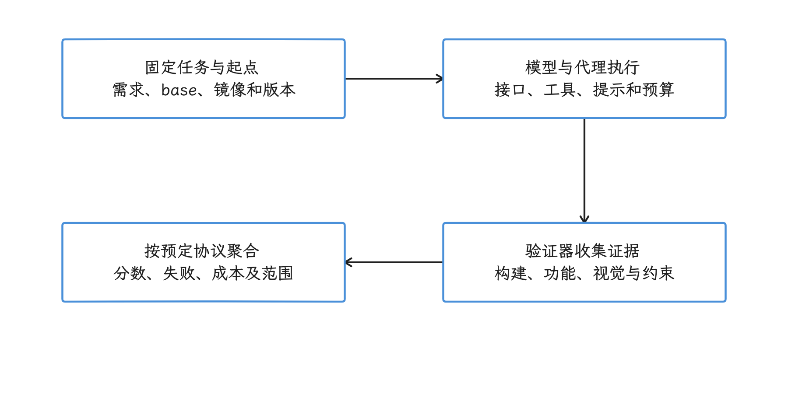

图：任务、模型与代理、运行环境及验证器共同定义一个可解释的分数。 2.0包含greenfield应用任务；分数只覆盖协议检查的能力，不自动证明所有工程质量。

## 2.0 和 1.0 不能混用

Android Bench 2.0 和 1.0 的任务规模、数据公开状态和评分方法都不同。

| 口径 | 任务集 | 主要用途 | 评分特征 |
|---|---|---|---|
| Android Bench 2.0 官方方法页 | 30 个长周期任务，当前数据集私有 | 比较现代编码代理在复杂 Android 工程任务中的能力 | 同时报告 pass rate 和 completion rate |
| Harbor Hub `android-bench/android-bench` latest rev.5/v1.3.0 | 100 个公开任务，88 个来自 GitHub PR，12 个专家编写 | 复现 1.0 系列结果、分析公开任务 | 以二值通过/失败和 pass@1 为主 |
| 归档仓库 commit `65a86bf` | 1.0 系列源码、指南、技术报告和评分枚举 | 查验首版实现细节 | `PatchScore` 为 `0.0` 或 `1.0`，另有诊断状态 |

因此，不能把 2.0 官方方法页里的 30 个长周期任务，和 Harbor Hub 页面上的 100 个公开任务当成同一套「当前组成」。也不能拿 1.0 的 pass@1 排名直接解释 2.0 的 completion rate。

<!-- gracker-diagram: ch16-08-02-version-coordinates -->
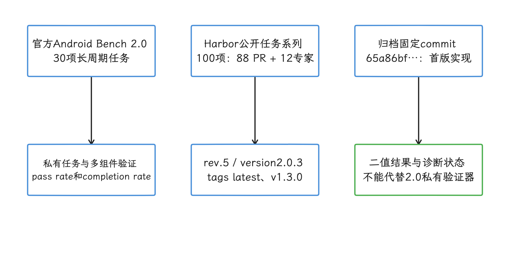

图：先区分官方方法代次、公开数据包revision/version/tag和固定归档源码，再比较结果。 Harbor的version2.0.3不自动代表官方30任务的2.0；latest是移动标签。

## 2.0 任务集怎样组成

Android Bench 2.0 有 30 个任务，分为四类：

| 任务流 | 数量 | 关注点 | 典型规模 |
|---|---:|---|---|
| App creation | 9 | 从视觉设计稿创建 Food Vibes 这个内部多屏应用 | 1200～5500 行，20～70 个文件 |
| Migrations | 13 | 生产应用的库和架构迁移，例如 Retrofit 到 Ktor、RxJava 到 Coroutines、Hilt 到 Koin、Navigation 2 到 Navigation 3 | 200～8200 行，5～294 个文件 |
| New features | 6 | 在已有代码库里实现平台能力，例如画中画、Wear OS companion sync、桌面小组件、CameraX | 400～2200 行，4～60 个文件 |
| App conversions | 2 | 将 Flutter 或 React Native 应用转换为 Jetpack Compose 原生 Android 应用 | 完整 UI、导航和持久化 |

2.0 的防污染策略也变了。官方方法页列出四类措施：使用未公开的内部代码库，选择上游仓库里不存在的迁移，选择没有原生 Android 版本的跨平台应用转换，并审计操作轨迹以发现 reward hacking、硬编码输出和外部代码查找。当前 2.0 数据集是私有的，官方仍在评估怎样公开而不造成污染。

这个设计提高了任务真实性，但降低了外部可复现性。外部团队引用 2.0 结果时，应把它当作官方排行榜口径；要自己复现实验，仍需要可获取的数据集、运行环境和验证器。

## 公开 1.0 数据集从哪里来

Harbor Hub 的 latest 数据集页面列出 100 个任务：88 个来自 GitHub pull request（PR，合并请求），12 个由专家编写，用来覆盖公开样本不足的领域。任务来源仓库要求至少有 500 个 GitHub stars；归档技术报告说明，这里的 stars 是项目流行度和质量的粗略指标。

公开数据集的组成如下：

| 维度 | Harbor Hub latest 公布的数据 |
|---|---:|
| 来自 GitHub PR | 88 个任务 |
| 专家编写任务 | 12 个任务 |
| Kotlin | 71% |
| Java | 25% |
| Jetpack Compose UI | 41% |
| View-based layout | 59% |
| 应用项目 | 42% |
| 库项目 | 58% |
| 带 UI 问题截图 | 20 个任务 |
| 小于 27 行的变更 | 46% |
| 27～136 行的变更 | 33% |
| 大于 136 行的变更 | 21%，最大 435 行 |
| patch 中位数 | 32 行 |

归档 User Guide 对有效任务给出三条基本要求：问题描述清楚，base commit 和 Docker 环境可复现，测试在 base 上失败、在 canonical/oracle patch（维护者已知正确的标准修改）上通过，并且测试不能依赖未同步的 UI timing 等易抖动条件。

Oracle patch 只能证明任务环境和验收测试能跑通。它不能证明测试覆盖了需求的全部语义，也不能证明模型补丁和 canonical 实现等价。

<!-- gracker-diagram: ch16-08-03-oracle-controls -->
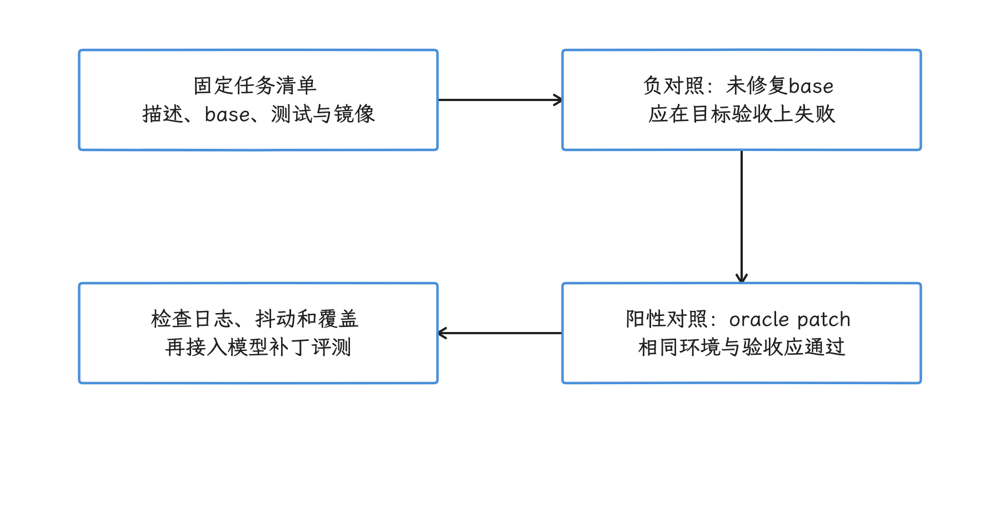

图：固定任务环境后，分别验证base失败与标准补丁通过，并检查抖动和验收覆盖。 标准补丁通过只支持已编码的验收条件；不证明模型实现等价或需求语义全覆盖。

## 2.0 怎样执行和验证

Android Bench 2.0 基于 Harbor 运行。官方方法页列出的关键环境约束包括：每个任务在新的 Docker 容器里执行，使用支持 KVM 的 CPU 运行硬件加速 AVD，最低资源要求为 16 个 CPU、72 GB RAM 和 500 GB 存储；模型必须通过结构化工具调用提交 shell 命令，而不是把命令写在 Markdown 文本块里。

2.0 不再只看一个简单 shell 编码代理。官方方法页明确写到，评测扩展到 Claude Code、Codex、Antigravity SDK 等现代编码代理。为了处理模型输出的不确定性，2.0 对每个任务执行 5 次独立运行，并对完成的运行求平均。

验证器也从「构建 + 测试」扩展为多组件验证：

- instrumentation assertions：用 Android instrumentation 测试验证 UI 交互和状态流转；
- database verification：直接检查 SQLite 和 Room 数据表，确认数据持久化；
- system boundaries：监控 outbound Intent extras、网络调用和 Wear OS 同步事件；
- regression suites：同时运行已有回归测试，确认原有能力没有被破坏；
- visual judgement：用 Gemini 3.5 Flash 比较截图和基准图，并返回 0.0～1.0 的结构化判断；
- accessibility tree judgement：解析 `dumpsys accessibility` 输出，检查原生组件、触摸目标和文本标签；
- anti-cheating patch inspection：检查静态图片覆盖、硬编码数据库状态、测试阈值篡改、删除断言、捆绑预编译二进制、包一层旧 API 等投机方式。

这套验证器允许不同实现路径通过，但它仍然是评测协议的一部分。没有写进验证器的质量维度，不会自动进入分数。

<!-- gracker-diagram: ch16-08-04-isolated-execution -->
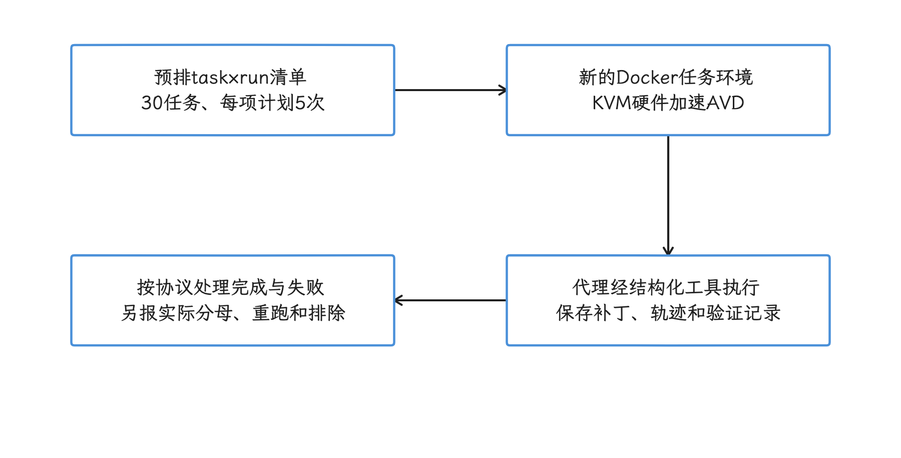

图：2.0在隔离环境中执行代理与验证，计划每任务5次独立运行。 30×5=150只是计划数；completed runs的纳入、重跑和排除不能从计划数自行推定。

<!-- gracker-diagram: ch16-08-05-multifaceted-verification -->
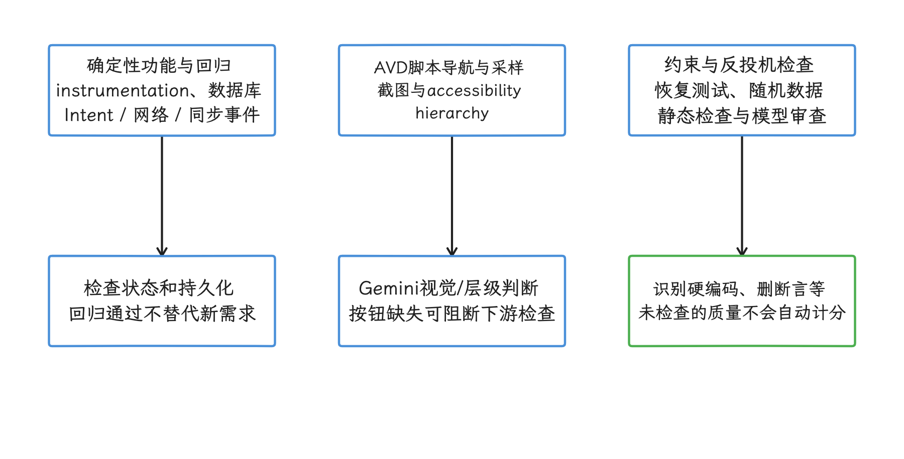

图：确定性功能检查、AVD多模态观察和反投机约束共同构成验证证据。 视觉与层级判断有模型参与；脚本可达性、硬件mock与本地后端限制覆盖范围。

## 2.0 分数怎样计算

2.0 报告两个指标：pass rate 和 completion rate。

pass rate 是主指标。一次运行只有在功能测试全部通过、视觉结果合规、没有约束违规并拿到满分 `1.0` 时，才算完全通过。

completion rate 是 0.0～1.0 的连续分数，用来表达复杂任务的部分完成程度。官方公式是：

\[
\text{CompletionRate}=\text{BaseScore}\times\text{Multipliers}
\]

BaseScore 是四类分数的加权和：functional（运行时状态、数据库持久化和核心逻辑）、regression（已有测试是否仍然通过）、requirements（任务指令、库版本和架构规则是否满足）、visual（界面布局和 accessibility hierarchy 是否匹配）。权重由任务作者按任务设置。

Multipliers 是惩罚项。官方表格里，构建失败、作弊违规和在原生 Android 任务里复用 Flutter/Dart/JavaScript 文件都会把分数乘以 `0.0`；在 Jetpack Compose 任务里使用 `findViewById` 这类 legacy API，会把分数乘以 `0.5`。

这个口径比 1.0 的二值分数更细，但也更依赖验证器设计。报告 2.0 结果时，至少要同时写出 pass rate、completion rate、任务集版本、编码代理、模型服务商、模型 ID、工具调用接口、预算、运行日期和环境。

<!-- gracker-diagram: ch16-08-06-completion-and-pass -->
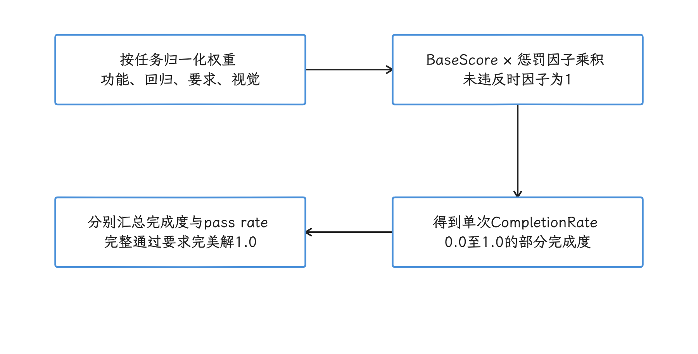

图：每次运行先算归一化组件分，再乘惩罚因子；完整通过与平均完成度分别统计。 0.8×0.5=0.4是单次完成度，不能解读为40%的运行通过；完整通过还要求满足全部约束。

## 1.0 的 pass@1 和状态枚举

归档技术报告把 pass@1 定义为通过任务数除以纳入统计的任务总数。报告的方法段写明每个模型运行 10 次，并使用 bootstrap 计算置信区间；附录中的实际 `num_runs` 为 3～10 次，部分模型的平均任务数少于 100。引用首版统计时，应以附录中具体模型的行和原始结果为准。

归档源码的 `PatchScore` 把单任务得分记为 `0.0` 或 `1.0`，并用 `Status` 保存诊断状态。固定 commit 中的状态包括：

- `PASSED`、`PASSED_FLAKY`；
- `AGENT_NO_PATCH`、`AGENT_FAILED_BUILD`、`AGENT_FAILED_TEST`、`AGENT_FAILED_VALIDATION`、`AGENT_FAILED_TO_APPLY_PATCH`、`AGENT_MISSING_REQUIRED_TEST_RESULTS`；
- `INFRA_FAILURE`、`INFRA_FAILURE_SETUP_ISSUE`、`INFRA_FAILURE_EMULATOR_STARTUP`、`INFRA_FAILURE_EMULATOR_TIMEOUT`、`INFRA_FAILURE_EMULATOR_OFFLINE`；
- `INFRA_FAILURE_AGENT_*` 系列，用于模型服务、输出格式、执行超时和预算耗尽等问题。

这个源码版本没有 `NO_PATCH_GENERATED`、`EVAL_ERROR` 或 `SKIPPED` 这三个评分枚举名。归档仓库的 troubleshooting 文档里出现过 `NO_PATCH_GENERATED` 这样的排障标题，但它不是 `common/models/benchmark.py` 中的 `Status` 枚举。

比较模型时，不能只看通过数。报告应公开 scheduled（计划运行）、attempted（实际尝试）、evaluable（按协议计入主分数）、passed、infra failure 和 excluded（预先排除）的数量。基础设施错误是否重跑、是否进入主分数，必须在运行前写进协议。

<!-- gracker-diagram: ch16-08-07-task-level-pass-at-one -->
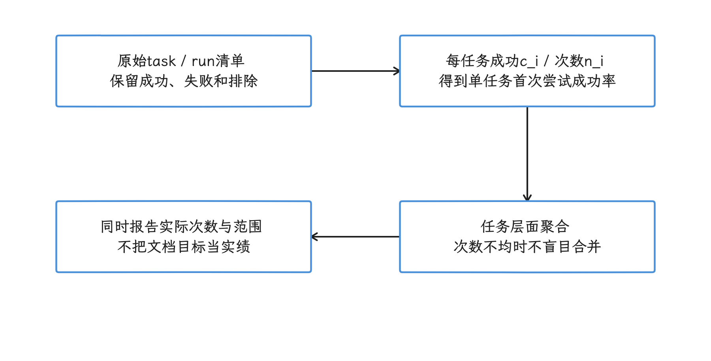

图：先算各任务c_i/n_i，再按任务聚合；相同任务的重复尝试仍属于同一层级。 只有各任务次数和纳入范围一致时，才等于全部尝试合并比例；它不是多次择优的pass@k。

<!-- gracker-diagram: ch16-08-08-hierarchical-bootstrap -->
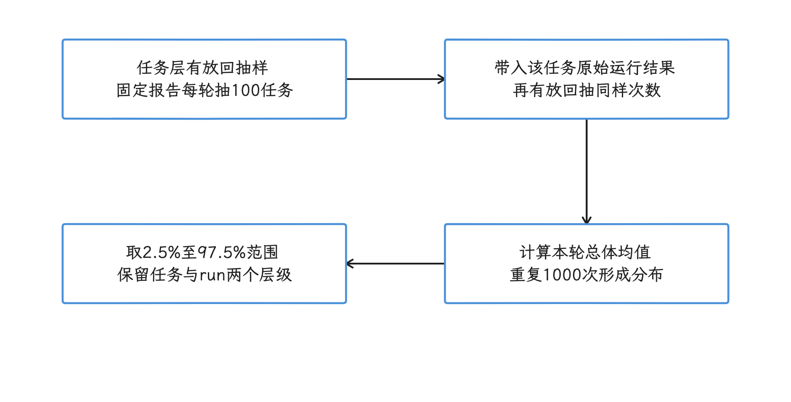

图：归档报告先抽任务，再在任务内抽运行结果，形成模拟均值分布。 固定报告重复1000次取中间95%；同任务重复不等于新增独立任务，CI重叠不是差异检验。

<!-- gracker-diagram: ch16-08-09-score-status-policy -->
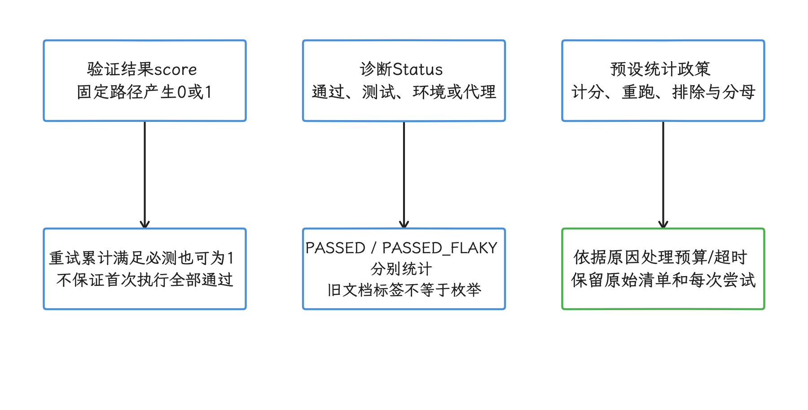

图：固定首版的二值分数、状态诊断和报告中的纳入规则是三种不同信息。 PASSED_FLAKY仍可score=1；INFRA_FAILURE_AGENT预算等前缀不自动授权剔除。

## 成本、token 和时延怎么读

成本、token 和时延适合在分数接近的配置之间比较，不适合单独排序。

- Cost（费用）使用运行时模型服务商价格，跨日期会受价格调整影响；
- Token（模型处理的文本计量单位）依赖推理服务返回值，缓存和共享系统指令可能没有统一计量；
- Latency（时延）包含 API 网络传输，受运行地域和接口负载影响；
- 提前失败的配置消耗更少，低费用和低时延可能只是因为没有完成任务。

2.0 官方方法页也提醒，汇总所有任务的资源消耗会天然偏向失败更早的模型。团队可以补充 cost per solved task（每个已解决任务的平均费用）、成功任务时延和失败任务时延；通过数为 0 时，cost per solved task 没有定义。

<!-- gracker-diagram: ch16-08-10-resource-denominator -->
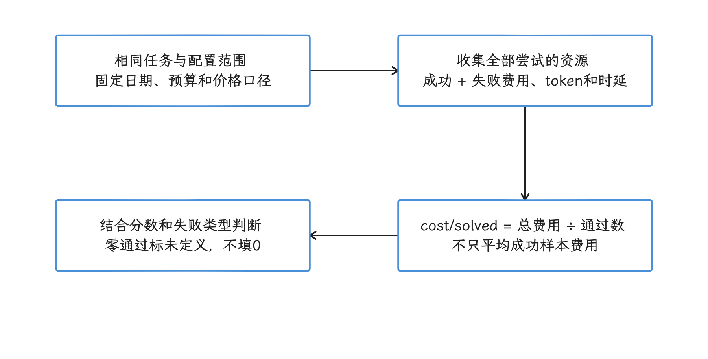

图：同一计分范围内保存全部尝试费用，再除以通过数，并分别观察成功与失败时延。 失败更早可能成本更低；通过数为0无有限cost/solved，价格与网络日期也会改变比较。

## 数据污染与测试投机

公开 GitHub PR 让 1.0 任务贴近真实工程，也带来训练数据污染风险：模型可能在训练阶段见过 issue、代码或标准修改。Harbor Hub 页面写明，所有任务文件包含 BIG-BENCH canary string（用于标记评测数据的固定文本），成功操作轨迹会人工审计，检查是否是真修复而不是 reward hacking。

canary 不能证明模型从未见过公开仓库。公开数据集发布后，后续模型也可能针对它优化。报告应区分任务发布日期、模型训练或知识截止时间（服务商公布时）、公开任务与隐藏任务结果。

2.0 把一部分防污染工作移到任务设计上：私有应用、上游不存在的迁移、无原生版本的应用转换，以及轨迹审计。这压缩了记忆答案的空间，但也意味着外部团队无法单靠公开仓库完整复现官方分数。

测试投机仍然要靠协议和文件权限处理。只在提示内容里写「不要修改测试」不够；应通过只读测试目录、patch allowlist（允许修改的路径清单）、验证前恢复测试文件和静态检查来约束。

<!-- gracker-diagram: ch16-08-11-contamination-and-cheating -->
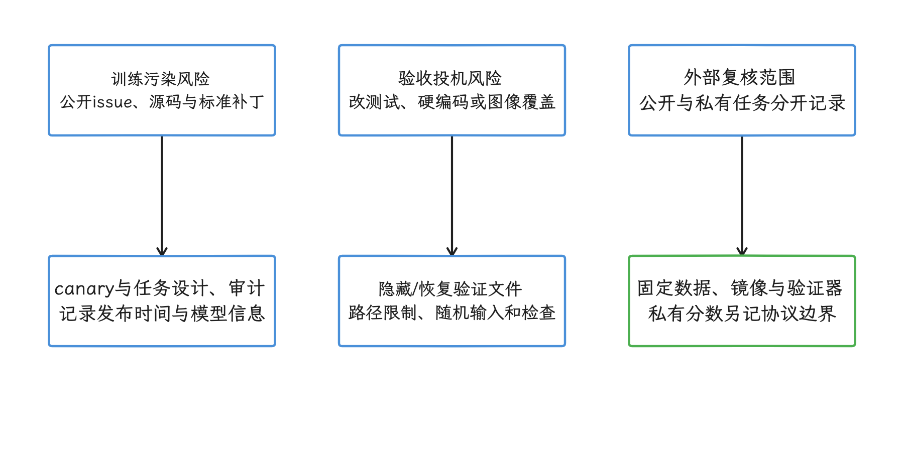

图：分别处理公开答案记忆风险、验证器被绕过风险和外部审计可复现范围。 canary不能证明训练未见；私有任务不能由公开仓库完整复现，约束也需实际执行。

## 怎样读公开排行榜

公开分数对应的是「模型 + 模型服务接口 + 编码代理 + 系统指令 + 工具 + 预算 + 数据集 + 验证器」这一整套配置。更换 Android Studio 内置能力、Claude Code、Codex、Gemini CLI 或自研上下文系统后，即使底层模型相同，分数也可能变化。

小分类不适合过度解读。100 个 1.0 任务再按 Compose、library、bugfix 或代码许可类型分组后，每组样本更少，置信区间会变宽。几分差距不能支持「模型 A 更懂 Compose」一类强结论，除非差异通过预先规定的统计检验，并在新任务上复现。

首版博客写的是模型完成率约 16%～72%，Gemini 3.1 Pro 位于当时榜首。这个结果只适合作为 2026-03 首版快照。官方 2.0 方法页已经说明，1.0 后来被前沿模型推到约 90% pass rate，局部 GitHub PR 任务出现饱和。

Android Bench 不是 Android 17 compatibility suite（兼容性测试套件），也不验证 AOSP framework 或 kernel 实现。任务跨 Android、Jetpack、Gradle 和第三方库版本；一个模型得分高，可能来自 Kotlin/Gradle 能力，也可能来自编码代理更会搜索、运行测试和保持上下文。

<!-- gracker-diagram: ch16-08-12-leaderboard-comparison -->
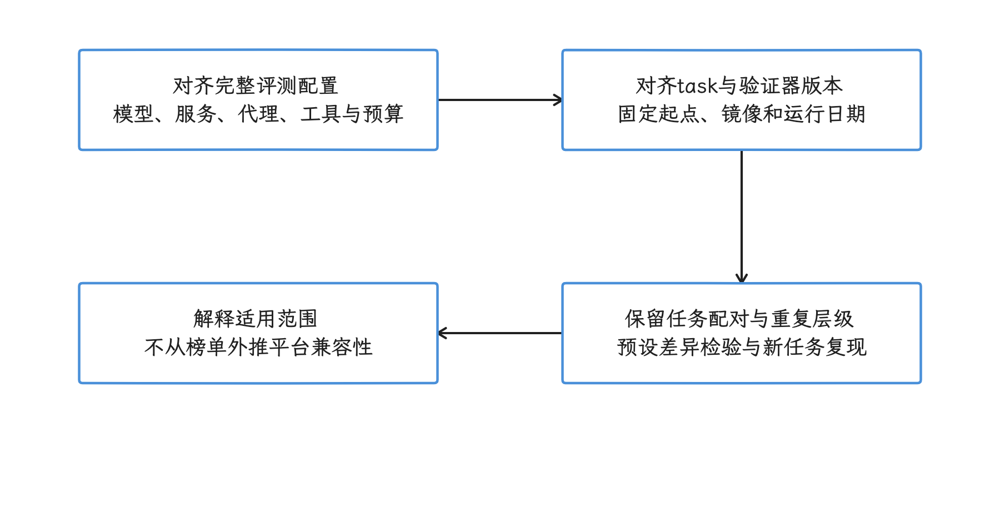

图：模型、代理、工具预算与任务/验证版本一起定义结果，再按相同任务比较差异。 小分类与历史榜首都受样本和日期限制；高分不证明AOSP或kernel实现质量。

## 团队怎样建立私有评测

公共基准评测适合观察通用能力，采购或工具选型还应增加团队自己的隐藏任务集。

### 任务选择

- 从近期已修复 issue 中选择有明确 acceptance criteria（验收条件）的任务；
- 覆盖团队的 Compose/View、Gradle、数据、网络、性能和兼容性工作；
- 保留低频高风险任务，不按 PR 数量机械抽样；
- 将测试、base commit、oracle patch 和环境镜像一并版本化；
- 让不参与模型运行的人维护隐藏验证。

<!-- gracker-diagram: ch16-08-13-private-evaluation-pipeline -->
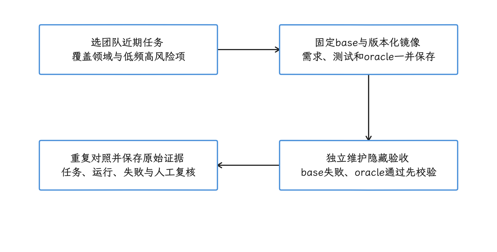

图：从团队任务中固定需求、起点和环境，由独立维护者保存隐藏验收，再验证oracle对照。 覆盖低频高风险工作；采样和验收是否代表真实业务，要由任务设计与复核确认。

### 对照实验

每轮只改变一个变量：

- 比较模型时固定编码代理、系统指令、工具和预算；
- 比较编码代理时固定模型、接口地址和数据集；
- 比较成本预算时固定其余配置；
- 每个配置重复运行，并随机化任务顺序；
- 基础设施错误按预设规则重跑，重跑次数公开。

<!-- gracker-diagram: ch16-08-14-controlled-comparisons -->
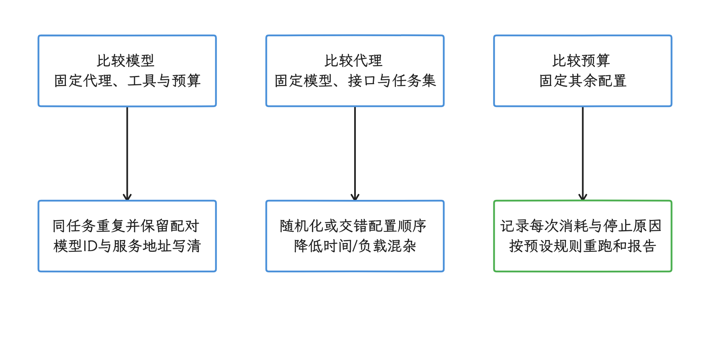

图：分别设计模型、代理或预算对照，在同一任务集重复并交错运行，按预设政策报告。 只改一个因素是识别该因素影响的实验设计；仍需记录服务负载、日期和实际失败。

### 报告字段

| 维度 | 建议输出 |
|---|---|
| 正确性 | resolved/evaluable（解决数/按协议可计分数）、pass rate、completion rate、95% CI（置信区间） |
| 稳定性 | 同一任务多次运行的通过比例、completion rate 分布和分歧任务 |
| 失败类型 | build、test、no patch、timeout、infra failure、cheating |
| 资源 | 总 cost、cost/solved、token、成功/失败 latency |
| 工程质量 | 人工 review、改动范围、测试增量、安全与性能风险 |
| 可复现性 | dataset、image、model、编码代理、系统指令、工具接口和预算的精确版本 |

模型选型不能只按总分排序。团队还要考虑数据策略、代码许可、私有仓库访问、可审计性、IDE（集成开发环境）/CI（持续集成）集成、速率限制和供应商稳定性。

## 与 Android 17 源码版本的关系

本文讨论的是评测框架，不包含平台或 kernel（内核）机制结论。涉及 Android API 行为时，最高版本固定为 Android 17 / API 37 / `android-17.0.0_r1`。

Android Bench 自身必须按数据集和运行框架版本固定，不能用 AOSP 版本 tag 替代。由于本文不讨论内核机制，也不引用 `android17-6.18` 源码结论。

## 参考资料

- [Android Developers：Android Bench methodology 2.0](https://developer.android.com/bench/methodology/2)
- [Android Developers Blog：首版 Android Bench 发布说明（2026-03-05）](https://android-developers.googleblog.com/2026/03/elevating-ai-assisted-androi.html)
- [Android Bench 归档仓库，commit `65a86bf`](https://github.com/android-bench/android-bench/tree/65a86bf41e45dde517a65d6e65a6dc7cdd2063ea)
- [归档技术报告](https://github.com/android-bench/android-bench/blob/65a86bf41e45dde517a65d6e65a6dc7cdd2063ea/docs/tech_report.md)
- [归档 User Guide](https://github.com/android-bench/android-bench/blob/65a86bf41e45dde517a65d6e65a6dc7cdd2063ea/docs/guide.md)
- [Harbor Hub：Android Bench dataset](https://hub.harborframework.com/datasets/android-bench/android-bench/latest)
