# APM 全景、Firebase 与商业平台选型

APM 在客户端采集启动、帧、网络、资源、Crash 和 ANR（Application Not Responding） 等应用可见信号，再由服务端聚合和归因。我们先建立客户端信号的总体图景，再看 Firebase 与商业平台在信号覆盖、数据模型、部署成本和生态集成上的差异。

## 客户端信号、采集架构与选型维度

这一节我们先把地基打好：APM 能采到哪些信号、证据分哪几层、每条采集路线要付出什么代价。这些约定会贯穿本章后面的工具分析。

### APM 先回答“线上发生了什么”

APM（Application Performance Monitoring，应用性能监控）负责回答三类线上问题：

- 哪个版本、页面、设备群或实验组正在变差；
- 影响面有多大，是否值得进入修复队列；
- 能否保留一份足以继续诊断的现场样本。

APM SDK 通常看得到的，是应用有权限采集的那部分信号。一份慢帧报告，首先说明它满足了该 SDK 的指标定义；帧范围、刷新率、报告丢失和采样这几项检查也要跟着做。至于责任段在主线程、RenderThread、CPU调度、Binder、I/O、GPU还是SurfaceFlinger，要等我们把同一事件的运行证据接回来才能判断。

进程死亡同样有多种来源：Java crash、native（C/C++ 等本地代码） crash、ANR（Application Not Responding，应用无响应）、LMK（Low Memory Kill）、force-stop、安装更新或系统策略。光凭一个耗时数字或 `reason`（退出原因字段），我们还到不了根因；要往下走，手里得有一份能继续展开的现场。

所以分工是：APM 负责发现问题和筛选样本，Perfetto、Android Studio Profiler、simpleperf（CPU 采样工具）、heap dump（堆对象快照）、AGI（Android GPU Inspector） 和 dumpsys（系统状态查询命令） 负责复现并定位原因。线上系统先给出分布和样本，我们再挑出样本，用线下及系统工具把它展开到线程、调用栈、资源、GPU 和显示路径。

### Android 17 复核基线


| 层级 | 版本基线 | APM 能看到什么 |
|---|---|---|
| Android 平台 | Android 17 / API 37 / `android-17.0.0_r1` | `ApplicationExitInfo`、`FrameMetrics`、`ProfilingManager`、系统 trace 与进程生命周期 |
| Android 内核 | `android17-6.18-2026-06_r39` | scheduler、I/O、binder driver、dma-buf/fence、内存压力等底层事实；普通应用不能任意读取这些数据 |
| Jetpack Metrics | `androidx.metrics:metrics-performance:1.0.0` | JankStats 的帧时长、jank 判断与 UI state |
| 第三方/自研 APM | 随应用版本固定 | 埋点、采样、堆栈、hook（拦截或替换调用）、缓存、上传和服务端聚合 |
| Google Play | 当前 Play Console / Reporting API 口径 | Android vitals 的 crash、ANR、wake lock、启动、渲染等聚合数据 |

内核那一行里的 scheduler 是线程调度器，binder driver 是 Binder 的内核驱动；dma-buf 用来在组件间共享缓冲区，fence 负责同步缓冲区的生产者与消费者。这些条目描述的是内核里的事实；普通应用能直接读到多少，仍由权限决定。

表中的 jank 指渲染过慢造成的卡顿帧，UI state 是当时的页面与交互状态，wake lock 是阻止设备进入休眠的系统锁。

Android 平台版本与 APM SDK 版本要分别记录。平台升级不会自动升级应用内的 Matrix、KOOM（Kwai 的内存监控项目）、JankStats（Jetpack 的逐帧卡顿统计库）、Firebase 或自研 SDK；反过来，升级 SDK 也不会改变设备的 framework（Android 框架层） 和 kernel（内核） 实现。

### 从异常指标到可验证结论

一条慢帧问题从线上发现到修复验证，中间要经过几步证据升级；我们把这条路径画成了下面的流程图。

这条路径连接指标、上下文、样本、深证据、受控复现与修复验证；各阶段保留关联标识和统计合同。

<!-- gracker-diagram: ch17-01-01-evidence-escalation -->
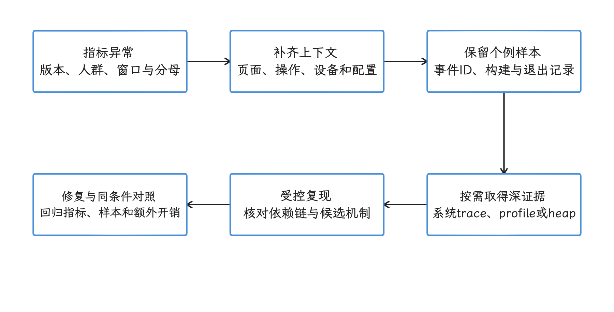

图：先由指标定位影响面，再把场景、样本与深证据接回复现和修复对照。 箭头表示调查顺序；指标或时间接近，离判定根因还差一层证据。

事件合同中的 `slow_frame_rate` 是慢帧占比，`stack`（线程调用栈）保存问题发生时的调用现场，`session_id`（使用会话标识） 用于关联同一次使用会话。这些字段负责把范围缩小到版本、设备和页面；至于慢帧发生在哪一行代码，要等后面的深证据才能回答。

举个完整例子。灰度发布的看板上，图片编辑页的慢帧率只在某个版本和一组低内存设备上升。JankStats 样本带有页面、操作和帧时长，但缺少主线程阻塞点，于是团队从该分组挑选可复现设备，采集 Perfetto，看到每次缩放都会在主线程同步解码大图并伴随 I/O 等待；simpleperf 或方法 trace 再把耗时集中的调用定位出来。

修复后，用相同图片、相同操作序列和相同编译模式跑 Macrobenchmark（Jetpack 的端侧性能基准工具），再在小流量灰度中观察原指标、用于归并同类问题的堆栈特征，以及 crash/ANR 副作用。这次“改善”要成为相同统计规则下的结论，前提是分母、采样率和设备范围都保持不变；其中任何一项换过，对比就要重做。

### 四类性能工具的分工

Android 性能工具至少分成四类，依据是采集位置、运行阶段、输出证据和工程成本。选型时我们按这四个维度对号入座，“都能看性能”这句话帮不上忙。

| 类别 | 代表能力 | <span style="white-space:nowrap">运行位置</span> | 主要输出 | 典型成本 |
|---|---|---|---|---|
| 客户端 APM | Matrix、KOOM、btrace/RheaTrace、Measure、自研 SDK | Release / 灰度发布 | 聚合指标、异常样本、堆栈、trace、heap 摘要 | 包体、CPU/内存、hook / 插桩（构建时插入采集代码）兼容、隐私、上传平台 |
| 官方信号与 SDK | Android vitals、JankStats、FrameMetrics、ApplicationExitInfo、ProfilingManager、Tracing | 系统、Play、应用进程 | 平台指标、帧数据、退出记录、受控 profile、应用 slice（带起止时间的 trace 区间） | 最低 API 版本、指标定义、回调开销、rate limit（频率限制） |
| 线下诊断 | Perfetto、Profiler、simpleperf、LeakCanary、AGI、dumpsys | Debug / QA / 实验室 | trace、调用栈、heap、GPU 命令流、系统状态 | 需要设备、复现和人工分析 |
| Benchmark / CI | Macrobenchmark、Microbenchmark、PerfDog、设备 benchmark | CI / 实验室 | 可比较的耗时、帧、吞吐、功耗或分数 | 测试环境、预热、编译模式、设备与温度控制 |

表里的 Release 指供用户安装的发布构建，Debug 指开发调试构建，QA 指测试阶段；CI（Continuous Integration，持续集成） 在代码变更后自动构建和测试。

这四类各有所长：客户端 APM 覆盖大量真实设备，代价是权限与采样预算；线下工具证据更深，覆盖的却是少量可复现场景；Benchmark 适合改动前后对比，结论限于测试环境；平台信号的指标口径更稳定，受制于版本、设备支持和数据可见性。

Android vitals与自建APM的数值可能不同。Play数据受设备认证、安装来源、数据共享和隐私门槛约束；crash/ANR核心问题率常按DAU统计，启动和渲染另有事件/会话口径，一律称作DAU问题率会出错。比较之前，人群、窗口、分母、去重与定义先对齐。

### 四类证据各有用途


指标、样本、trace 与上下文各自回答一层问题。先分清我们手里拿的是哪一类证据，才知道下一步该补什么。

#### 指标：发现趋势与影响面

指标是聚合结果，例如：

- `cold_start_p50_ms`、`cold_start_p95_ms`；
- `slow_frame_rate`、`frozen_frame_rate`；
- `user_perceived_anr_rate`、`crash_user_rate`；
- `lm_kill_user_rate`、`native_crash_rate`；
- `request_ttfb_p95_ms`、`request_failure_rate`。

指标适合版本门禁、趋势和分组排序。我们在看板上追一个上升的 P95 时，它只说明分布尾部变差；要落到具体某一行代码，还需要样本和上下文。

这些名称保留英文，便于和看板字段对应：`p50` 是中位数，`p95` / `p99` 是第 95 / 99 百分位，`ms` 是毫秒，`rate` 是发生率；TTFB（Time to First Byte） 表示从发起请求到收到首字节的时间。版本门禁指达到阈值后阻止继续发布。

#### 样本：保留一次现场

样本是一次事件，例如：

- 慢帧的 UI state、frame duration 与主线程堆栈；
- ANR 的线程堆栈、reason、前后台和近期操作；
- Java/native crash 的符号化栈（把地址还原为函数和源码位置）与 Build-ID（构建产物标识）；
- OOM/LMK 附近的 PSS（按共享比例折算的内存）、RSS（驻留物理内存）、heap 摘要和页面；
- 网络请求的 DNS（域名解析） 解析、TCP 建连、TLS 握手和 TTFB 分段。

样本数要还原成发生率，中间隔着一层可见性：异常触发采样、设备离线、磁盘满、进程死亡和上传限流都会改变样本被看见的概率。

#### Trace / profile：还原时间与资源关系

第三类证据是文件级的现场还原。trace 还原时间线，CPU sample（定期截取调用栈）采样调用栈，heap dump 保存堆对象快照，GPU capture（GPU 命令与资源快照）记录图形现场——时间线、CPU、内存与图形四个方向各有一份文件可查：

- Perfetto 解释线程调度、Binder、I/O、渲染和系统服务；
- simpleperf 解释 CPU 耗时集中位置与 native 调用栈；
- Hprof（Java 堆转储格式）、heapprofd（native 堆分析器）或 LeakCanary 解释对象、分配和引用关系；
- AGI 解释 GPU 命令、shader（着色器程序）、资源和渲染 pipeline（流水线）；
- ProfilingManager 在受支持版本上提供受控的 system trace（系统时间线）、heap dump、heap profile（堆分配采样） 或 stack sample。

这类文件较大、采集成本高，逐事件上传不现实。常见策略是先用轻量指标筛选，再对少量样本提升证据等级。

#### 上下文：决定样本能否比较

最小上下文应覆盖：

- App version、version code、build variant（构建变体）、发布渠道；
- ProGuard/R8 Mapping ID（混淆映射表的版本标识）、native ELF（native 可执行文件格式） Build-ID；
- Android 版本、build fingerprint（系统构建标识）、机型、ABI（Application Binary Interface，原生二进制接口）、RAM 容量档位；
- 进程、页面/场景、前后台、刷新率、实验组；
- `event_id`、`session_id`、`trace_id` 与用户匿名标识；
- 采样概率、SDK 版本、采集配置版本。

上下文字段若随意改名或高基数失控，同一个问题会被拆散，服务端存储和查询成本也会膨胀。高基数指字段存在大量不同取值，例如未归一化的 URL 或文件路径。

### 常见采集路线的工程代价


证据类型定了，接下来是采集路线。每条路线决定了能看到的现象，也决定了要付出的代价：

| 采集方式 | 可见范围 | 适合的问题 | 主要边界 |
|---|---|---|---|
| Looper logging / message observer | 主线程消息的执行区间 | 长消息、主线程阻塞、ANR 前堆栈 | 看不到消息之外的 RenderThread/GPU/系统等待；观察者自身会占主线程 |
| Choreographer（帧调度器）回调 | App UI frame 节奏 | 连续帧间隔、动画/滚动场景 | 帧间隔不等于完整呈现耗时，刷新率变化也会改变阈值 |
| FrameMetrics / JankStats | Window frame 与 UI state | 慢帧率、场景归因 | API 版本决定字段；回调必须快速返回 |
| 字节码插桩 | 被插桩方法的调用与耗时 | 启动节点、热点路径、业务 trace | 增加构建复杂度与运行代码；R8（代码压缩与混淆器）、AGP（Android Gradle Plugin）和 Kotlin 版本要回归 |
| PLT/inline hook、JVMTI、malloc hook | native/Java 运行时事件 | I/O、分配、线程、函数调用 | ABI、linker、符号、ROM 与安全策略带来兼容成本 |
| 系统 profiling | 调度、系统服务、heap、stack 等 | 少量高价值现场 | 受权限、频率限制、redaction（敏感字段裁剪）和系统支持约束 |
| 外部测试采样 | FPS、CPU、内存、温度、功耗等 | QA、竞品或设备对比 | 不等于线上用户数据；采样源和指标定义要核对 |

PLT/inline hook 改写 native 函数跳转，JVMTI（Java Virtual Machine Tool Interface）提供 Java 虚拟机观测接口，malloc hook 观察 native 内存分配。这三条路线能看到更底层的事件，代价是更依赖 ABI（应用二进制接口，此处主要指 `arm64-v8a` 等 CPU 架构）、动态链接器（linker）和设备 ROM（厂商系统） 的实现。

采集代码也会改变被测系统。主线程抓栈、每帧序列化、Hprof dump、native allocation tracking（原生内存分配跟踪） 和长 trace 都可能造成额外卡顿、内存或 I/O。上线前，我们要在高端与低端设备上把 CPU 时间、主线程时间、内存、包体、磁盘、流量和电量都测一遍；确认“功能能否收到数据”只是起点。

### JankStats 与 FrameMetrics 的版本差异

本篇固定核对`androidx.metrics:metrics-performance:1.0.0`；2026-10-26官方release页仍将其列为稳定版。JankStats在API24+使用FrameMetrics，更早版本使用OnPreDraw路径；同一API外观不保证各系统版本有相同字段和精度。

版本差异可按下面理解：

| <span style="white-space:nowrap">系统版本</span> | 主要来源 | 能力边界 |
|---|---|---|
| <span style="white-space:nowrap">API 23 及以下</span> | `OnPreDrawListener` | 在主线程回调，估计 UI frame 时长，无法获得现代 FrameMetrics 字段 |
| <span style="white-space:nowrap">API 24—30</span> | <code>Window.<wbr>OnFrameMetrics<wbr>AvailableListener</code> | 可获得 UI/CPU 相关耗时；回调由 FrameMetrics 线程交付 |
| <span style="white-space:nowrap">API 31—37</span> | FrameMetrics + deadline（帧截止时间）信息 | 可使用 `frameOverrunNanos` / `DEADLINE` 判断超过目标帧期限的时长 |

JankStats在启用跟踪并取得有效帧数据时才调用listener；回调一直静默，渲染和卡顿也可能照常发生。回调要快速返回，FrameData会复用，异步处理需复制所需数值与状态。固定1.0.0的isJank比较UI时长和乘过heuristic multiplier的预期时长（默认2.0）；API31+的frameOverrunNanos另由TOTAL_DURATION−DEADLINE计算，正overrun与isJank判为true是两条独立判定。

<!-- gracker-diagram: ch17-01-05-jank-and-deadline -->
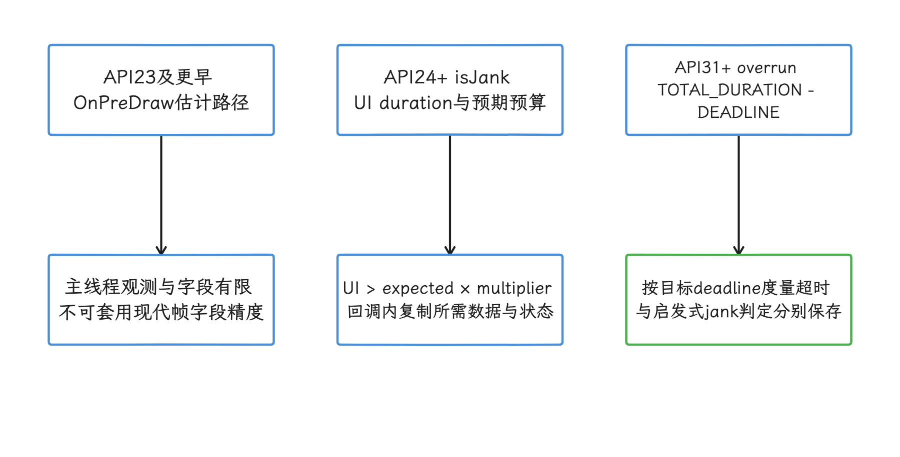

图：固定JankStats1.0.0的isJank和API31+ overrun使用不同输入与边界。 默认multiplier为2.0；正overrun换算不出isJank，回调报告丢失也推不出显示丢帧数。

FrameMetrics 的 `TOTAL_DURATION` 表示该帧从开始到提交给显示子系统的总时长；各 stage 可能重叠，子项之和与 total 对不上是正常现象。它也量不到物理屏幕真正 present 的时间——要回答这一段，我们转向 Perfetto FrameTimeline、SurfaceFlinger/HWC（Hardware Composer，显示硬件合成器） 和 GPU/display 证据，分析 display present。

JankStats 的 UI state 需要由应用维护。页面、滚动、过渡、列表类型等状态没有及时清理时，慢帧会被关联到过期场景，服务端统计会很精确地计算出一个错误结论。

### ApplicationExitInfo 的读取与归因

#### 应用 API 与服务端路径

API 30 起，应用可调用 `ActivityManager.getHistoricalProcessExitReasons()` 查询历史 `ApplicationExitInfo`，调用路径是：

```text
App
  → ActivityManager.getHistoricalProcessExitReasons()
  → Binder / ActivityManagerService
  → ProcessList.mAppExitInfoTracker
  → per-package / per-UID exit records
  → NativeTombstoneManager 合并可访问 tombstone
```

UID 是 Android 基于 Linux 用户标识实现的应用隔离身份。上面的路径说明查询会跨 Binder 进入 `system_server`（承载核心 Android 服务的进程），还可能合并 tombstone（native 崩溃记录）。这条查询要避开冷启动首帧：我们通过后台 executor（执行线程池） 查询最近记录，按 timestamp、process name 和 version/session 边界去重后再上报。

`AppExitInfoTracker` 是独立顶层类，实例由 `ProcessList` 字段 `mAppExitInfoTracker` 创建并初始化。AOSP 基础配置为每个 package/UID 最多保留 16 条记录，设备厂商可通过资源 overlay（覆盖系统资源配置） 改变容量。记录通过 `AtomicFile` 写入 `procexitstore/procexitinfo`，这种写法可在失败时回滚，避免留下半份文件；非紧急更新按 30 分钟间隔调度写入，package/user 移除时会清理对应记录。

<!-- gracker-diagram: ch17-01-06-exit-info-query -->
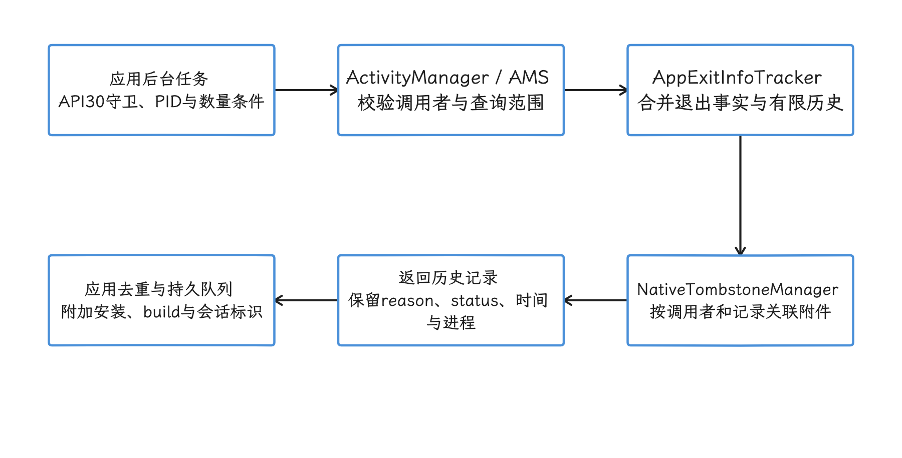

图：应用API经AMS校验和UID/包范围过滤，读取tracker并补充可关联的tombstone。 API30+；UID范围可能含历史shared UID包，记录数量有限，附件可过期为空。

#### reason 来自多路事实合并

基础记录来自进程死亡与 AMS 的主动终止；lmkd（低内存管理守护进程） 和 zygote（应用进程孵化器） 的外部通知可以补充 status、RSS 或修正 reason。源码还会保护已经明确为 ANR、Java crash 或 native crash 的记录，让后到的模糊信号覆盖不了这些高价值原因。

常见公开 reason 包括：

| reason | 值 | 解释时要保留的边界 |
|---|---:|---|
| `REASON_SIGNALED` | 2 | 结合 `getStatus()` 的 signal（操作系统信号）；在不支持 LMK 上报的设备上，内存压力终止可能表现为 `SIGKILL` |
| `REASON_LOW_MEMORY` | 3 | 先检查 <code>ActivityManager.<wbr>isLowMemory<wbr>KillReport<wbr>Supported()</code>；该 reason 本身不提供 heap dump 或 Java OOM 证据 |
| `REASON_CRASH` | 4 | Java 未处理异常，不等于 native crash |
| `REASON_CRASH_NATIVE` | 5 | API 31+ 可能附带 protobuf 格式的 tombstone stream（结构化 native 崩溃数据流），也可能因覆盖而为空 |
| `REASON_ANR` | 6 | 通常可取得系统保存的 ANR trace，但不保证永远存在 |
| `REASON_USER_REQUESTED` | 10 | 包含 force-stop、最近任务移除等用户相关路径，需结合 description 和当时场景 |
| `REASON_OTHER` | 13 | 依赖 description 与上下文，不能直接归为应用缺陷 |
| `REASON_FREEZER` | 14 | API 33+ 的 freezer（缓存进程冻结机制）相关退出 |
| <code>REASON_<wbr>PACKAGE_<wbr>STATE_CHANGE</code> / `UPDATED` | 15 / 16 | API 34+ 区分组件状态变化与包更新 |

`getPss()` 与 `getRss()` 取的是系统上一次采样值：可能为 0，也不是死亡瞬间的内存。`getTraceInputStream()` 通常用于 ANR；API 31+ 还可返回 native tombstone（native 崩溃转储文件） protobuf。进程曾发生并恢复的 ANR，其 trace 也可能附在之后因其他 reason 死亡的记录上。trace 和 tombstone 由独立循环存储管理，可能被更新事件覆盖，因此返回 `null` 是合法结果。


下面的代码用于展示一次低优先级、可去重的历史退出查询；生产代码还要接入自己的持久化和上传队列。

```kotlin
executor.execute {
    if (android.os.Build.VERSION.SDK_INT < 30) return@execute

    val records = activityManager.getHistoricalProcessExitReasons(
        null, // 仅查询调用方 UID 可访问的记录
        0,    // 不按 PID 过滤
        16,
    )

    records.forEach { info ->
        reportExitIfNew(
            processName = info.processName,
            timestampMs = info.timestamp,
            reason = info.reason,
            status = info.status,
            pssKb = info.pss,
            rssKb = info.rss,
        )
    }
}
```

`packageName = null`时服务端按调用方UID过滤；过滤的单位是整个UID，其中可能还包含历史shared UID的包，要另作区分，isolated caller也在可调用范围之外。`timestamp + processName + reason/status` 作为去重基础已经够用；跨 reinstall（重装）、数据清除和时钟变化时，还要加入 install/build/session 标识。

### ProfilingManager 的请求与触发器

API 35 引入 `android.os.ProfilingManager`，支持四类请求：Java heap dump（Java 堆转储）、heap profile、stack sampling（调用栈采样） 和 system trace。请求受频率限制，执行没有保证；结果会裁剪敏感和无权限数据，只包含请求进程可访问的信息。

API 36 增加 `ProfilingTrigger`，应用可注册 ANR、`reportFullyDrawn()` 等系统触发事件。API 37 又增加 OOM、冷启动、应用兼容性异常和过量 CPU 使用等类型；不同 trigger 返回的文件不同，例如 OOM 返回 Java heap dump，冷启动返回 system trace 和 stack sampling。trigger 同样不保证产生结果。调用方要注册一个全局 result listener（接收该 UID 全部结果的回调），处理应用重启后的重新交付，并为文件过期、上传和去重设计流程。

<!-- gracker-diagram: ch17-01-08-profiling-requests-triggers -->
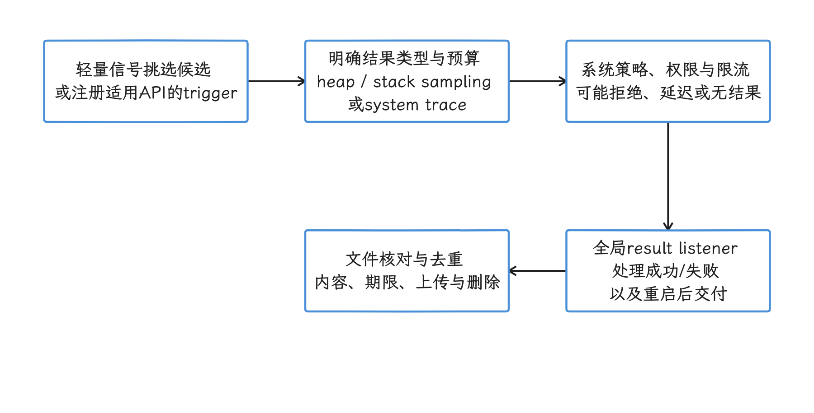

图：主动请求和注册trigger都经系统条件与限流，再通过结果监听处理文件。 请求或trigger命中不保证成功；API35请求、API36/37新增trigger须分别守卫。

把 ProfilingManager 接入少量高价值样本是合适的用法，例如：

- 启动 P99 异常且设备满足采集条件；
- 特定页面连续慢帧，并已通过轻量信号筛选；
- 远程配置选择的低比例实验人群；
- 系统 trigger 返回的 ANR、OOM 或冷启动 profile。

对每次慢帧都请求 system trace 是滥用；callback（回调） 迟迟未返回时，先别急着归咎于 API 故障——频率限制、资源状态、系统策略和进程生命周期都可能让请求空手而归。

### 线上现象与后续验证工具

| 线上现象 | APM 能提供的入口 | 后续验证工具 |
|---|---|---|
| 主线程长任务 | message duration、主线程 stack、页面 | Perfetto thread state、method trace、CPU profiler |
| CPU 抢占或频率受限 | 慢帧/启动样本、设备与温度上下文 | Perfetto scheduler/cpufreq、simpleperf、thermal 信息 |
| Binder 卡住 | 调用点 stack、超时样本 | Perfetto binder transaction、对端线程与服务 trace |
| I/O 等待 | 文件类别、耗时、调用 stack | Perfetto/ftrace I/O、simpleperf；必要时检查文件系统与内核事件 |
| GPU/显示晚 | frame duration、场景、Surface 类型 | Perfetto GPU/FrameTimeline、AGI、SurfaceFlinger/HWC |
| Java 对象泄漏 | heap 使用趋势、页面、退出原因 | Hprof、LeakCanary、Profiler |
| native 内存增长 | RSS/PSS 趋势、native stack sample | heapprofd、malloc debug、KOOM/厂商工具 |
| LMK/OOM | exit reason、PSS/RSS、设备 RAM、前后台 | ApplicationExitInfo、lmkd/PSI trace、heap/native memory 分解 |
| 网络慢 | DNS/connect/TLS/TTFB 分段与 endpoint 类别 | 客户端网络 trace、服务端 trace、网络环境复现 |

表里的几个词先说清楚含义：thread state 是线程的运行、就绪、休眠或等待状态，binder transaction 是一次 Binder 跨进程请求，`cpufreq` 是 CPU 频率轨道，thermal 指温度与降频信息；PSI（Pressure Stall Information）描述 CPU、内存或 I/O 压力造成的停顿，endpoint 指网络请求目标，method trace 记录方法调用时间线，ftrace 是 Linux 内核跟踪机制。

普通应用看不到完整系统和内核现场。需要 scheduler、driver、dma-fence、lmkd/PSI 或系统服务内部细节时，我们要在可控测试设备上采集 Perfetto/ftrace，或与平台/OEM（设备制造商） 团队协作。缺失字段明确标为未知即可；补成推测会在后续归因里埋进错误。

### 线上采样的数据合同

数据合同要先于 SDK 接入写下来。它规定“客户端采什么、服务端怎样解释、多久删除、如何关联构建”，避免同名字段在不同版本中表达不同含义。

下面的 JSON 只展示最小结构，用于讨论字段职责，不要把它当成某个特定后端的协议。

```json
{
  "schema_version": 3,
  "event_name": "jank_frame_sample",
  "event_id": "01J...ULID",
  "occurred_at_epoch_ms": 1784908800123,
  "duration_ns": 42800000,
  "sample_probability": 0.02,
  "session_id": "anonymous-session-id",
  "trace_id": null,
  "app": {
    "version_name": "8.4.0",
    "version_code": 804000,
    "mapping_id": "r8-mapping-uuid",
    "native_build_ids": ["7f3a..."]
  },
  "device": {
    "sdk_int": 37,
    "build_fingerprint_hash": "sha256:...",
    "model_class": "mid_ram_6g",
    "abi": "arm64-v8a"
  },
  "context": {
    "process": "main",
    "screen": "image_editor",
    "interaction": "pinch_zoom",
    "foreground": true
  }
}
```

`event_id`示例是ULID形状的占位文本，并非有效ULID；`schema_version`（事件结构版本） 表示事件结构版本。耗时字段要在名称或 schema 中固定单位。`sample_probability`记录所声明采样阶段的已知入选概率；联合采样和条件丢失仍须另记——采样是否无偏，要连同这两项一起判断。Mapping ID 与 Build-ID 用于还原 Java/Kotlin 和 native 栈。原始机型、URL、文件路径和用户信息取值多、识别风险高，应按数据最小化原则处理。


一份可执行的数据合同至少定义：

- 事件名、schema version、字段类型、单位，以及字段是否允许空值的 nullable（是否允许空值） 规则；
- 指标窗口、分母、去重、分位数算法和时区；
- 用户/session/event/trace 的关联与生命周期；
- Java Mapping ID、native Build-ID 和 source revision（对应的源码版本）；
- 采样单位是用户、session、事件还是异常；
- URL、请求头、日志、路径、截图和标识符的脱敏规则；
- 本地保留、上传重试、服务端保留和删除周期；
- SDK 配置版本、远程开关与回滚方式。

### 端侧采样、缓存与上传

事件从产生到进入服务端，要经过采样、本地缓冲和上传三道关口；每一层都可能丢数据，所以每一层都要有明确的策略。

#### 采样

不同事件使用不同策略：

- crash、ANR 等低频高价值事件优先保留完整轻量元数据；
- 每帧、每请求等高频数据先在端侧聚合；
- trace、heap dump 等重文件只对少量候选样本采集；
- 用户/session 采样尽量使用稳定 hash（相同输入得到相同分组），让相同输入每次落到相同分组，避免每次启动换一批人，导致同一批用户的前后变化难以比较；
- 保存采样单位及非零入选概率；只有丢失机制和概率已知并满足估计前提，才做加权。异常触发、离线、进程死亡等选择性缺失，光靠一个全局上传成功率是还原不回总体发生率的。

只在异常时采样，会把偏差带进结论。例如只在设备空闲、充电且网络良好时上传 trace，样本天然偏向特定设备状态；结论中要保留这项限制。

#### 本地缓冲

缓冲区应有总字节、单事件、单文件、条数和年龄上限。临时文件完整写入后在同一文件系统原子rename，可减少读到半份文件；原子目录项替换之外，断电持久性仍需处理文件/目录同步、恢复和损坏校验，或使用事务存储。重文件与普通指标分目录管理，优先淘汰过期和低价值事件。

敏感数据应在写盘前完成裁剪或脱敏。原始 URL、token（认证凭据）、日志和用户数据一旦落盘，进程死亡后就可能留在磁盘上，等上传阶段再处理已经晚了。

#### 上传

上传要成批量、做压缩，失败后按指数退避（失败越多，重试间隔越长）重试，并给重试时间加一点随机抖动（给重试时间加入随机偏移）；事件用幂等 event ID（重复上传仍识别为同一事件），服务端再做去重。网络、充电、温度、前后台等条件按文件价值设置，别让 APM 自身制造启动竞争、流量尖峰或发热。

服务端收到多少事件，取决于客户端还丢了多少。客户端要上报丢弃原因计数，例如 quota（配额耗尽）、serialization error（序列化失败）、disk full（磁盘已满）、expired（已过期）、rate limited（触发频率限制）、upload failed（上传失败）；缺了这些计数，看板就只描述“成功上传的人群”。

<!-- gracker-diagram: ch17-01-10-bounded-client-pipeline -->
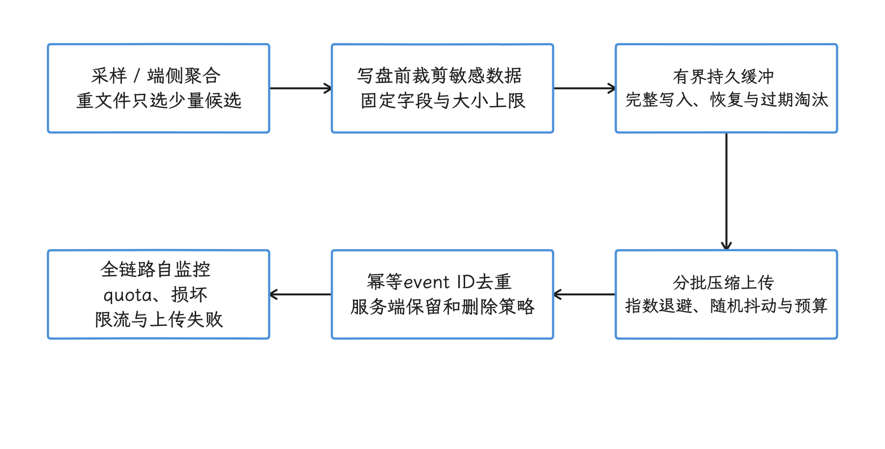

图：事件经过预算、落盘、上传和服务端去重，每层都记录丢弃原因。 同文件系统rename的原子替换给不了断电持久保证；服务端事件只覆盖走完整条链的样本。

### 选型：从团队约束推导组合

选型之前先区分“构建工具能解析依赖”和“可以进入生产环境”。一个 APM artifact（发布的库产物）要过七层检查：构建、打包、启动、采集、失败降级、停用恢复与隐私；仓库 README、较低的 `minSdk`（最低支持 Android 版本）、一次启动成功或 AOSP 中仍存在同名私有字段，都替代不了这些证据。

#### 用成对变体测量 APM 自身开销

同一 commit（源码版本） 至少准备以下 release（发布版本） 变体，R8、应用签名、ABI、资源和业务配置保持一致：

| 变体 | 内容 | 用途 |
|---|---|---|
| `baseline` | 不包含被测 SDK | 建立设备与业务基线 |
| `linked-off` | 包含依赖，但模块全部关闭 | 观察打包、类加载和初始化前影响 |
| `module-on` | 一次只开启一个模块 | 将成本归属到具体采集器 |
| `production-set` | 生产计划中的模块、采样与上传配置 | 验证组合效应 |
| `event-trigger` | 受控制造主线程阻塞、内存 dump、泄漏或上传失败 | 测量峰值和失败恢复 |

测试至少覆盖冷启动、前台空闲、固定交互、高频 Looper Message、后台静置和受控异常；轮次按 baseline 与 variant（构建变体） 交替或随机排列，每轮使用相同的温度、电量、刷新率、网络和数据状态。还要覆盖 4 KB 环境，以及关闭 16 KB backcompat（向后兼容） 模式的 16 KB 环境；后者用于暴露真实16KB条件下的加载失败与运行错误。业务占比高的厂商 ROM 也要单独测试。

CPU 用 Perfetto 里的进程/线程 running time（实际占用 CPU 的时间）；帧用 FrameTimeline、JankStats 或 FrameMetrics；内存同时记录 PSS（Proportional Set Size，按共享比例分摊后的进程物理内存）、RSS、Java/native heap 和峰值；启动由 Macrobenchmark 固定测试模式。I/O、网络、唤醒、包体、事件丢失、关闭后残留线程和异常恢复也要进入结果。开销数字要来自实测：源码操作数估不出“低于 0.1%”这类结论；周期 tracker（定时采集器）和一次 heap dump 的量级也不同，要分别记录。

发布表同时给绝对差值、相对差值、中位数、尾部值、最差有效轮和样本数。没有实测的数据保留为空；性能差但流程完整的轮次要保留在表里，按异常值删除会丢信息。最终 APK/AAB（Android 安装包/应用包） 中的所有 native 依赖，还要分别检查 ELF 的 LOAD segment（可加载段） 对齐、ZIP 内文件对齐和真机 page size（内存页大小）；三项检查回答的问题不同。


#### APM 接入准入清单

清单中的 `targetSdk` 指应用声明适配的目标 API 版本。

- 固定仓库、commit、依赖坐标、AGP、NDK、R8、targetSdk 与配置版本。
- clean build（全量构建）、增量构建、Gradle configuration cache（配置缓存）、各 variant 和最终安装产物均通过。
- manifest、权限、Provider、Service、通知、`PendingIntent`、文件目录和网络安全配置符合当前 Android 的组件声明、权限和后台执行要求。
- 4 KB/16 KB 设备验证安装、初始化、正常事件、边界事件、失败事件和关闭模块。
- 反射、私有符号、Hook、Printer（Looper 日志回调）、子进程、磁盘和上传失败都会显式降级，不以“没有报告”冒充“没有问题”。
- 关闭模块后恢复 Hook/Printer，停止线程与任务，缓存满足大小、年龄、重试和删除限制。
- 报告保存原始 trace、脚本 commit、测试顺序、判废原因和 SDK 自监控数据。

先补团队当前最缺的能力，再按问题类型补专项：

| 团队条件 | 优先能力 | 原因 |
|---|---|---|
| 没有线上性能平台 | Android vitals + crash/ANR + 基础启动/页面指标 | 建立稳定趋势和版本分组，再补专项 |
| UI 卡顿是主问题 | JankStats + UI state + 少量 Perfetto/Macrobenchmark | 轻量覆盖真实场景，深证据用于归因 |
| Java/native 内存问题多 | ApplicationExitInfo + heap/native 专项工具 | 区分 crash、LMK、ANR，再选择 Hprof/heapprofd/KOOM |
| 已有日志与数据平台 | 自研轻量 SDK 或开源采集组件 | 可复用认证授权、上传、查询和告警，但仍需评估客户端维护成本 |
| 发版节奏快、AGP/Kotlin 升级频繁 | 少 hook、少插桩，优先稳定系统/Jetpack API | 降低构建链和运行时兼容风险 |
| 低端设备占比高 | 更低采样、更小缓冲、端侧聚合、严格 kill switch（远程紧急关闭开关） | APM 开销更容易污染被测性能 |
| 隐私或合规限制严格 | 数据最小化、端侧聚合、短保留期、可审计 schema | 降低原始内容离开设备的范围 |

Matrix、KOOM、btrace/RheaTrace、Measure、Firebase、Sentry、APMPlus 等工具各自覆盖一部分问题。项目活跃度、license（许可证）、版本兼容和维护者状态都会变化，接入前要查看对应仓库的 release 和最小验证应用，“主流/维护中”这类标签可能早已过时。

具体工具的构建和运行边界留在各自正文：Matrix 看 17.2，KOOM 看 17.3，BlockCanary 与历史开源项目看 17.5。

### 分阶段建设顺序

1. 统一 build、version、device、process、screen、session 和采样字段。
2. 接入 Android vitals、crash/ANR 与基础启动/页面指标，建立版本门禁。
3. 按主要问题加入 JankStats、ApplicationExitInfo、网络分段或内存信号。
4. 从轻量事件中筛选少量样本，再请求 trace、profile、heap 或转到实验室复现。
5. 把 Macrobenchmark/Microbenchmark 和关键场景回归接入 CI。
6. 增加远程开关、采集预算、丢弃统计、隐私审计和 SDK 自身性能监控。

每一步都应能单独关闭和回滚。没有远程 kill switch 的 hook、每帧监听或重文件采集，先留在小流量阶段，等开关齐了再进大规模 Release。


### 后续章节怎样分工

- 17.2—17.4：看 Matrix、btrace、Tracing SDK、KOOM、LeakCanary、DoKit 与 Measure 的采集和工程边界；
- 17.5：理解 BlockCanary、ArgusAPM 等历史方案能保留的设计和必须替换的实现；
- 22.10：看 JankStats、FrameMetrics、系统合成器分类与线上卡顿治理；
- 17.6—17.7：看 Jetpack Benchmark、Baseline Profile 验证、外部性能测试与设备 benchmark；
- 17.8—17.12：看网络、crash/ANR、功耗、WebView/Flutter 混合栈与大规模端侧架构。

阅读某个工具前，我们先回答它处在“线上采集、系统信号、线下诊断、回归测量”中的哪一层，避免用一款工具去负责它没有数据权限或没有证据深度的问题。

### 源码与文档入口

- [Android vitals](https://developer.android.com/topic/performance/vitals)：核对 Play 数据范围、core vitals、分母差异和 Reporting API。
- [JankStats guide](https://developer.android.com/topic/performance/jankstats) 与 [AndroidX Metrics release notes](https://developer.android.com/jetpack/androidx/releases/metrics)：核对 API 版本路径、listener 线程、FrameData 复用和 `1.0.0` 稳定版。
- [`FrameMetrics`](https://developer.android.com/reference/android/view/FrameMetrics)：核对 API 24+ stage、API 31+ `DEADLINE`、单位和 total 语义。
- [`ApplicationExitInfo`](https://developer.android.com/reference/android/app/ApplicationExitInfo) 与 [`ActivityManager.getHistoricalProcessExitReasons()`](<https://developer.android.com/reference/android/app/ActivityManager#getHistoricalProcessExitReasons(java.lang.String,int,int)>)：核对 reason、status、PSS/RSS、trace 和访问范围。
- Android 17 的 [`ApplicationExitInfo.java`](https://android.googlesource.com/platform/frameworks/base/+/android-17.0.0_r1/core/java/android/app/ApplicationExitInfo.java)、[`ActivityManager.java`](https://android.googlesource.com/platform/frameworks/base/+/android-17.0.0_r1/core/java/android/app/ActivityManager.java)、[`ActivityManagerService（AMS）.java`](https://android.googlesource.com/platform/frameworks/base/+/android-17.0.0_r1/services/core/java/com/android/server/am/ActivityManagerService.java)、[`ProcessList.java`](https://android.googlesource.com/platform/frameworks/base/+/android-17.0.0_r1/services/core/java/com/android/server/am/ProcessList.java) 与 [`AppExitInfoTracker.java`](https://android.googlesource.com/platform/frameworks/base/+/android-17.0.0_r1/services/core/java/com/android/server/am/AppExitInfoTracker.java)：核对 Binder 查询、记录容量、持久化、lmkd/zygote 修正与 tombstone 合并。
- [`ProfilingManager`](https://developer.android.com/reference/android/os/ProfilingManager)、[`ProfilingTrigger`](https://developer.android.com/reference/android/os/ProfilingTrigger) 与 Android 17 [`ProfilingManager.java`](https://android.googlesource.com/platform/packages/modules/Profiling/+/android-17.0.0_r1/framework/java/android/os/ProfilingManager.java)：核对 API 35 主动请求、API 36 基础 trigger、API 37 新 trigger、频率限制、结果交付与敏感字段裁剪。
- [16 KB page-size 指南](https://developer.android.com/guide/practices/page-sizes)：核对 ELF/ZIP 对齐、backcompat 模式，以及 Android 17 让不兼容二进制立即中止的测试开关。
- [Macrobenchmark](https://developer.android.com/topic/performance/benchmarking/macrobenchmark-overview) 与 [Microbenchmark](https://developer.android.com/topic/performance/benchmarking/microbenchmark-overview)：核对端到端场景和局部代码 benchmark 的分工。
- [Perfetto Android trace](https://perfetto.dev/docs/getting-started/system-tracing)：核对 scheduler、Binder、I/O、内存和图形等系统证据的采集边界。
- 本文固定 kernel `android17-6.18-2026-06_r39` 的 [PSI 文档](https://android.googlesource.com/kernel/common/+/refs/tags/android17-6.18-2026-06_r39/Documentation/accounting/psi.rst) 与 [ftrace 文档](https://android.googlesource.com/kernel/common/+/refs/tags/android17-6.18-2026-06_r39/Documentation/trace/ftrace.rst)：核对内存压力和内核 trace 机制。此前核验使用的 `r6` [PSI 文档](https://android.googlesource.com/kernel/common/+/refs/tags/android17-6.18-2026-06_r6/Documentation/accounting/psi.rst) / [ftrace 文档](https://android.googlesource.com/kernel/common/+/refs/tags/android17-6.18-2026-06_r6/Documentation/trace/ftrace.rst) 链接继续保留，便于复现旧基线；普通应用权限边界仍由 Android 平台与设备策略决定。

### 常见误判

| 误判 | 修正 |
|---|---|
| 接入一个 SDK 就有完整 APM | SDK 只是采集端；还需要数据合同、缓存上传、符号化、聚合、查询、告警和验证 |
| Android vitals 与自建 crash rate 应完全相等 | 人群、分母、去重、窗口和隐私阈值不同 |
| JankStats 报 jank 就说明主线程慢 | 继续检查 CPU 调度、RenderThread、GPU、SurfaceFlinger 和刷新率 |
| FrameMetrics 各阶段之和等于总时长 | 阶段可以并发，API 文档明确不保证相等 |
| `REASON_LOW_MEMORY` 代表 Java heap OOM | 它表示系统内存压力 kill；先检查设备是否支持该 reason，再拆 PSS/RSS/heap/native |
| `getTraceInputStream()` 对 ANR/native crash 必有数据 | 独立循环存储可能覆盖，ANR 恢复后也可能把 trace 带到其他 reason |
| ProfilingManager 请求一定返回 | 请求受频率限制和系统策略控制，不保证执行 |
| 样本数就是发生率 | 采样、进程死亡、磁盘、网络和服务端去重都会影响可见样本 |
| 外部 benchmark 分数代表线上体验 | 分数只在相同版本、设备状态和测试条件下可比较 |
| APM 没采到 scheduler/GPU 细节，就能用堆栈推断 | 缺系统证据时转向 Perfetto/AGI/OEM 工具，并明确未知项 |

## Firebase Performance 的自动与自定义 Trace

明确 APM 通用能力后，我们来看 Firebase：它的自动启动、网络和屏幕信号覆盖到哪里，限制又在哪里。

### Firebase Performance 的定位

Firebase Performance Monitoring 是 Firebase 提供的托管型性能监控服务：数据接收、存储和控制台由 Firebase 运营，团队只需在应用中接入 SDK，无需自行部署采集服务器。它会采集启动、前后台、屏幕渲染和部分 HTTP/S 请求，也允许应用补充业务 trace。控制台按版本、设备、国家或地区等维度聚合数据。

它适合中小团队快速建立基础性能看板（汇总关键指标的 dashboard），也可以补充成熟监控体系，用来观察各版本的长期变化。限制也要先说清：它没有自托管采集服务，端侧会采样和限流，控制台展示也到不了秒级。实时故障发现、还原单次请求的完整过程、解释每一帧为何变慢、诊断 native 问题，这些场景要与其他工具配合完成。

本篇机制和源码分析固定使用下表版本。2026-10-26仓库最新BoM为35.1.0，对应Performance SDK23.0.1；Performance plugin仍为2.0.2、Google services plugin为4.5.0。下表22.0.6是可复核的分析基线，与前面查到的最新版本要区分开。

| 组件 | 版本 | 说明 |
| --- | --- | --- |
| Firebase Android BoM | `34.17.0` | 统一 Firebase Android 库版本 |
| `firebase-perf` | `22.0.6` | BoM 对应的 Performance SDK |
| Performance Gradle plugin | `2.0.2` | 网络请求和 `@AddTrace` 字节码插桩 |
| Google services plugin | `4.5.0` | 处理 `google-services.json` |

BoM（Bill of Materials）用于让一组 Firebase 库采用彼此兼容的版本。`firebase-perf:22.0.6` 的 AAR（Android Archive 库包） 声明最低支持 API 23；本文内容按 Android 8（API 26）到 Android 17（API 37）复核。本篇固定BoM34.17.0不列独立KTX构件；所用Kotlin扩展位于firebase-perf22.0.6主module，依赖写firebase-perf。

### 数据模型：trace、metric、attribute

我们看 Firebase 的数据，先记住三个对象：trace 表示一段被计时的执行区间，metric 表示数值指标，attribute 表示便于筛选的键值标签。自动 trace 和 custom trace 都带有 duration 等内建 metric；custom trace 还能记录自定义 metric 与 attribute。Network request trace 在此之外保存 URL pattern（把相似 URL 归为一组的匹配规则）以及 HTTP method、status code、payload size 和 Content-Type 等网络字段。

| 对象 | 含义 | 例子 | 使用建议 |
| --- | --- | --- | --- |
| trace | 一段被计时的执行区间 | `_app_start`、`home_first_feed` | 名称固定，不拼动态值 |
| metric | trace 中的整数计数或内建耗时 | duration、`item_count`、`retry_count` | 用数值表达次数或数量 |
| attribute | 用于过滤和分组的键值标签 | `entry=cold_start`、`result=success` | 只放可选值少且固定的枚举，不放 user id |
| network request trace | 一次被捕获的 HTTP/S 请求 | `GET api.example.com/v1/items/**` | 用 URL pattern 聚合动态路径 |

metric 适合记录条目数、重试次数等整数；trace duration 由 `start()` 到 `stop()` 自动计算，attribute 用于筛选和分组。用户 id、订单号、完整搜索词等高基数字段会把样本切成许多小组，还可能属于 PII（Personally Identifiable Information，可识别个人的信息），不要交给 Performance Monitoring。

这套模型擅长回答“哪个版本变慢”“哪类设备更慢”“哪条业务路径分布异常”；一次故障的完整调用栈，要靠样本和 trace 去还原。


### 构建接入：插件与运行库分工

Performance Gradle plugin 与运行时 SDK 负责不同工作。字节码插桩指插件在构建时修改编译产物、自动插入计时和采集调用，两边的分工是：

- `com.google.firebase.firebase-perf` 在构建期对受支持的网络库和 `@AddTrace` 做字节码插桩。
- `firebase-perf` 在进程中记录、采样、暂存并上传性能事件。
- `com.google.gms.google-services` 读取 `google-services.json`，把 Firebase 项目配置转换成 Android resource（应用资源）。

下面给出根脚本与app脚本两个Kotlin DSL模板，固定使用BoM34.17.0，对应本篇22.0.6分析基线。它不是当前最新版本的升级建议；AGP占位符须替换为项目已验证的实际版本，直接原样构建是跑不通的。

```kotlin
// 根 build.gradle.kts
plugins {
    id("com.android.application") version "<项目使用的 AGP 版本>" apply false
    id("com.google.gms.google-services") version "4.5.0" apply false
    id("com.google.firebase.firebase-perf") version "2.0.2" apply false
}

```

`app/build.gradle.kts`：

```kotlin
// app 模块
plugins {
    id("com.android.application")
    id("com.google.gms.google-services")
    id("com.google.firebase.firebase-perf")
}

dependencies {
    implementation(platform("com.google.firebase:firebase-bom:34.17.0"))
    implementation("com.google.firebase:firebase-perf")
}
```

代码中的 AGP 指 Android Gradle Plugin，其版本沿用项目现有配置。BoM 只管理 Firebase 库版本，不管 Gradle plugin 版本，因此两个 plugin 的版本仍要单独声明；使用 version catalog（版本目录） 或根构建脚本时，可以采用等价写法。

#### 构建插桩与运行采集的两套开关

团队经常只关闭运行时采集，却仍让 debug 构建执行字节码插桩——构建期和运行期是两套开关，要分开配置：

| 控制项 | <span style="white-space:nowrap">作用时机</span> | 结果 |
| --- | --- | --- |
| <code>FirebasePerfExtension.<wbr>setInstrumentation<wbr>Enabled(false)</code> | 指定 variant 的构建期 | 不对该 variant（如 debug、release）执行自动网络和 `@AddTrace` 插桩 |
| Gradle property <code>firebase<wbr>Performance<wbr>Instrumentation<wbr>Enabled=false</code> | 整次构建 | 全局关闭 Performance 插桩；适合 CI（持续集成）参数或临时诊断 |
| <code>firebase_<wbr>performance_<wbr>collection_<wbr>enabled=false</code> | 应用运行期 | Manifest默认值；已缓存的运行时API选择优先于此默认值 |
| <code>firebase_<wbr>performance_<wbr>collection_<wbr>deactivated=true</code> | 应用运行期 | 强制停用并覆盖 enabled；只有删除该 Manifest 项并重新发版才能恢复 |

下例通过 Android Manifest 元数据把运行时采集默认关闭，待用户同意隐私政策，或分阶段启用策略选中该设备后再开启：

```xml
<application>
    <meta-data
        android:name="firebase_performance_collection_enabled"
        android:value="false" />
</application>
```

此Manifest配置不关闭构建插桩。固定22.0.6先看deactivated，再看缓存的运行时enabled选择，之后才看Manifest enabled及高层默认配置；已有安装曾启用采集时，仅改默认值不保证立刻关闭。构建期Project Property又优先于variant Extension，两套开关须分别验收。


Firebase 没有“debug 构建默认关闭”的通用规则。可采用这样的发布策略：debug variant 明确关闭插桩与采集，内部测试包只对少量受控设备启用，release 再按产品政策开放。接入清单还应覆盖 Firebase IAM（Identity and Access Management，身份与权限管理）、BigQuery 数据仓库权限、服务可用地区、数据保留说明、用户同意机制和隐私政策。Google Analytics 权限不属于 Performance Monitoring 的基本接入条件。

> 多进程应用要特别留意：官方只支持主进程中的 Performance Monitoring。独立 `:remote`、`:push` 等远程进程不会自动获得与主进程相同的采集能力；需要观察这些进程时，仍要保留应用自己的多进程监控。

### 自动采集能力与版本边界

自动采集的范围由 SDK 划定：它明确识别的生命周期和网络调用会被自动记下，应用发生的其余性能事件留在自动采集之外。

| 能力 | 采集方式 | 稳妥边界 | 局限 |
| --- | --- | --- | --- |
| App start | 自动 | 记录 Firebase SDK 定义的启动区间 | 不是进程 fork 到首帧，也不是完整首屏 |
| Foreground / background | 自动 | 依据进程生命周期记录会话区间 | 不等同于业务页面停留 |
| Screen rendering | 自动 | Activity；SDK `20.1.0+` 增加 Fragment | 固定 60 Hz 阈值，缺少逐帧业务状态 |
| HTTP/S request | 自动 + 手工 | 自动覆盖受支持的 Java/Kotlin 网络库调用 | Cronet、native 或自研栈需要手工记录 |
| Custom trace | 手工或 `@AddTrace` | 业务阶段、解码、查询等代码区间 | 需要设计稳定字段，`@AddTrace` 不能附加自定义数据 |

Firebase Performance 并没有随 Android 平台版本另立统计规则，我们以 SDK `22.0.6` 的官方文档和源码为准；跨版本比较时，还要记录 SDK 版本和采样策略是否变过，免得把采集方式的变化误判成应用性能变化。

### App start：`_app_start` 的真实区间

在 `firebase-perf:22.0.6` 中，SDK 内部把这条 trace 记为 `_as`，控制台显示为 `_app_start`。计时使用单调时钟 `elapsedRealtime`：它按设备启动后的经过时间递增，不受用户修改时间或网络校时影响。它的区间是：

1. 起点：Firebase 首个类的早期 class-load（类加载）近似时间。
2. 终点：第一个 Activity 的 `onResume()` 回调时间。
3. 子区间：到首次 `onCreate()`、`onStart()` 和 `onResume()` 的几个阶段耗时。

公开app-start说明页将起点写作FirebasePerfProvider.onCreate完成；本篇固定22.0.6源码实际取class-load近似起点，图按该实现标注。这段区间覆盖不到此前全部进程时间，也等不到首帧或首屏内容。API24+的Process.getStartElapsedRealtime用于实验性TTID和相关子区间，稳定_app_start仍另取class-load起点。固定A17由ActivityThread.handleBindApplication调用Process.setStartTimes登记该值，这个时刻要与Zygote fork时间区分开；getStartRequestedElapsedRealtime另有起点，uptime与elapsedRealtime也各自独立，不可混算。

<!-- gracker-diagram: ch17-01-15-firebase-start-boundaries -->
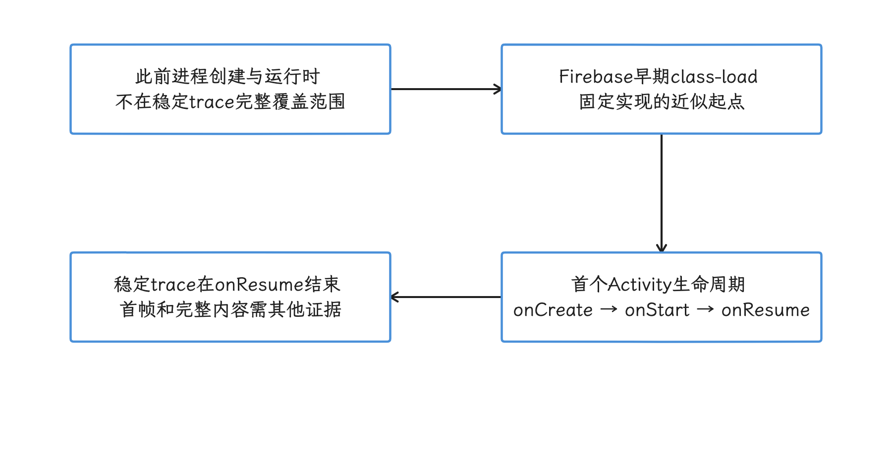

图：固定22.0.6的稳定_app_start从早期class-load近似时刻到首个Activity onResume。 公开概述写Provider.onCreate完成，图依固定实现；bindApplication、fork、首帧和TTFD均另有边界。

SDK 会过滤后台触发的进程启动。`22.0.6` 修复了 Android 14（API 34）及以上版本的判断：在 Firebase 的早期初始化阶段调用 `ActivityManager.getMyMemoryState()`，只有 `IMPORTANCE_FOREGROUND` 才允许生成 `_app_start`。

`_app_start` 可用于比较版本趋势；应用自己定义的启动完成点，比如 TTID 和 TTFD（Time to Full Display，完整内容可用时间），它替代不了。若“启动完成”的标准是首页骨架绘制、首批数据展示或页面可交互，就另建 custom trace，并用 Macrobenchmark 或 Perfetto 系统 trace 校验各阶段（stage）。

### Screen rendering：指标是“屏幕实例比例”

Firebase 自动 screen trace 的时间窗口取决于页面类型：

- Activity：`onActivityStarted()` 到 `onActivityStopped()`。
- Fragment：`onFragmentResumed()` 到 `onFragmentPaused()`，需要 SDK `20.1.0+`。

Fragment 不会独立读取一条 FrameMetrics 流。FrameMetrics 是 Android 提供的 `Window` 帧耗时数据；SDK 从宿主 Activity 的 `Window` 收集它，再计算 Fragment 生命周期区间内的计数差值。多个 Fragment 重叠、生命周期管理不规范，或使用单 Activity 的 Compose Navigation，都会让页面级结果更难解释，我们读这类数据时要带上这层背景。

SDK `22.0.6` 对FrameMetricsAggregator收集的整数毫秒桶分类：

- slow frame：毫秒桶值 `> 16`；
- frozen frame：毫秒桶值 `> 700`，同时计入slow frame。

例如AndroidX core1.13.0先用`(durationNs + 500000) / 1000000`四舍五入到整数毫秒：16.4ms落在16桶，16.6ms落在17桶。实际应用可能解析到不同core版本，需保存依赖版本；“所有原始耗时大于16ms都会计入”这样的读法在这里立不住。

官方文档明确指出，自动 screen rendering trace 按固定 60 Hz 阈值计算。在 60 Hz 屏幕上，每个刷新周期约为 16.67 ms；在 90/120 Hz 设备上，刷新周期缩短为约 11.11/8.33 ms。一帧即使错过设备的真实刷新周期，也可能没有超过 16 ms，因此 Firebase 可能低估高刷新率设备上的卡顿。

控制台中的汇总百分比也不是“慢帧数除以总帧数”：

- slow rendering：slow frame 超过该 screen instance 总帧数 50% 的 screen instance 占比；
- frozen frames：frozen frame 超过该 screen instance 总帧数 0.1% 的 screen instance 占比。

这里的 screen instance 指一次 Activity 或 Fragment 展示区间，不是一帧；自动 screen trace 也挂不上 custom metric 或 custom attribute。单 Activity + Compose 应用要区分具体 route（导航目的地）、滚动阶段或业务动作时，用 JankStats 记录状态，并按需增加 custom trace。

<!-- gracker-diagram: ch17-01-16-firebase-screen-population -->
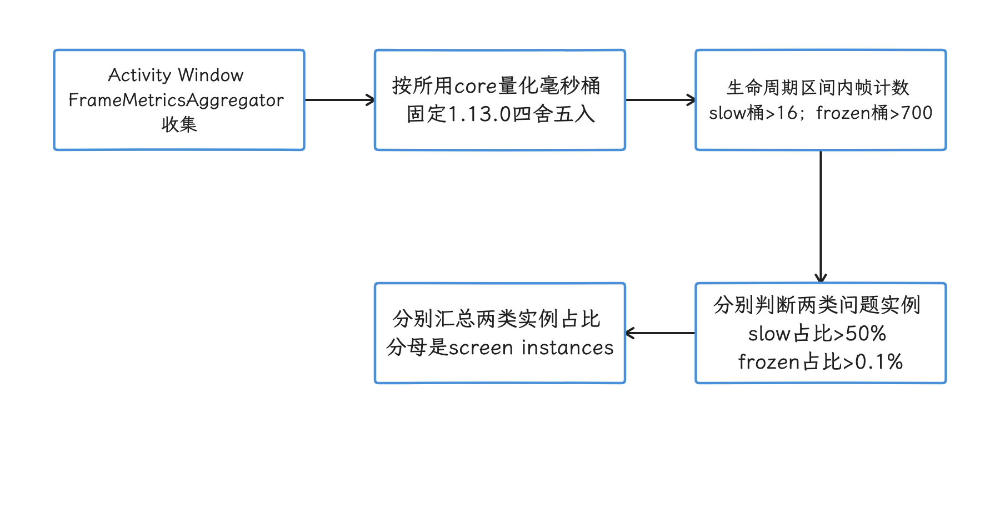

图：Activity窗口帧先形成整数毫秒桶，按页面生命周期区间统计，再分别汇总慢帧与冻结问题实例占比。 Fragment使用宿主窗口计数差值；固定60Hz阈值与实际刷新率deadline不同。

### 自定义 trace：字段规则与服务端边界

custom trace 的命名要保持长期稳定，也要符合控制台和后端的公开约束：

| 项目 | 公开约束 | 工程建议 |
| --- | --- | --- |
| trace name | 最长 100 个字符；无首尾空格；不能以 `_` 开头 | 使用固定 snake_case（小写单词以下划线连接） |
| metric name | 最长 100 个字符；无首尾空格；不能以 `_` 开头 | 表达可累加的整数计数 |
| trace metrics | 每条 custom trace 最多 32 个，duration 也计入 | 只保留诊断需要的少量指标 |
| attribute | 每条 custom trace 最多 5 个 | 采用取值少且固定的枚举 |
| attribute key | 文档口径最长 32 个字符，只使用英文字母与 `_` | 遵循文档口径，不依赖 SDK 的宽松校验 |
| attribute value | 最长 100 个字符 | 不写 PII、认证 token 或自由文本 |

公开资料与端侧校验之间存在差异。固定22.0.6允许attribute key最多40字符、首字母后的数字，并拒绝firebase_/google_/ga_前缀；专题文档则要求最多32字符、字母和下划线，开头避开下划线。两边都稳妥的共同范围，可取ASCII字母开头、后接字母/下划线、最多32字符且避开保留前缀。另有FAQ将trace/metric名称上限写成32，与专题页100及固定SDK校验对不上；我们要明确所用规则和SDK版本，别把不同资料拼成统一后端保证。

| <span style="white-space:nowrap">场景</span> | trace 名 | metric 名 | attribute | 不要写 |
| --- | --- | --- | --- | --- |
| <span style="white-space:nowrap">首屏首批内容</span> | <code>home_<wbr>first_<wbr>feed</code> | <code>item_<wbr>count</code>、<code>payload_<wbr>kb</code> | <code>entry=<wbr>cold_<wbr>start</code> | 完整接口 URL、user id |
| <span style="white-space:nowrap">登录流程</span> | <code>login_<wbr>request</code> | <code>retry_<wbr>count</code> | <code>result=<wbr>success</code> 或 <code>result=<wbr>fail</code> | 手机号、邮箱 |
| <span style="white-space:nowrap">图片解码</span> | <code>image_<wbr>decode_<wbr>list</code> | <code>image_<wbr>count</code>、<code>decode_<wbr>ms</code> | <code>source=<wbr>disk</code> 或 <code>source=<wbr>network</code> | 图片 hash（哈希值）、CDN（内容分发网络）签名 |
| <span style="white-space:nowrap">数据库查询</span> | <code>db_<wbr>query_<wbr>user</code> | <code>row_<wbr>count</code>、<code>query_<wbr>ms</code> | <code>source=<wbr>room</code> | SQL 原文、主键 id |

下面的示例用主 module 中的 Kotlin `trace` 扩展保证异常路径也会调用 `stop()`：

```kotlin
import com.google.firebase.Firebase
import com.google.firebase.perf.performance
import com.google.firebase.perf.trace

suspend fun loadFirstFeed(): List<FeedItem> {
    return Firebase.performance.newTrace("home_first_feed").trace {
        putAttribute("entry", "cold_start")

        val items = repository.loadFirstPage()
        putMetric("item_count", items.size.toLong())
        items
    }
}
```

`trace {}` 内部使用 `try/finally` 停止 trace，因此抛出异常或协程被取消时也能执行 `stop()`。若项目不用该扩展，应显式写 `start()`、`try/finally` 和 `stop()`，避免 trace 一直没有结束时间。`@AddTrace` 适合简单方法计时；要附带 custom metric 和 attribute 时，改用显式 API。


### 网络请求聚合和 URL pattern

自动 network request trace 记录请求 URL、HTTP method、response code、request/response payload size、Content-Type 和 duration。官方默认把 response code `100..399` 计为成功；duration 从发出请求算到完整接收响应。要拆出 DNS、TCP 建连、TLS 握手、服务器处理和重试等阶段，得靠应用自己在别的信号里补。

Performance Gradle plugin `2.0.2` 的插桩类覆盖以下调用：

- OkHttp 3.x 的 `Call.execute()` / `enqueue()`；
- `HttpURLConnection` / `HttpsURLConnection`；
- Apache HttpClient。

官方文档明确列的是 OkHttp **3.x.x**。较新的 OkHttp 即使保持二进制兼容，也只是编译进去的调用通常还能找到相同方法，Performance plugin 认不认这些调用要另行确认；升级网络库或插件后，发几个测试请求、用 SDK debug log 核对有没有采集成功再下结论。Cronet（基于 Chromium 的网络引擎）、native 网络栈、自研协议栈以及插件未识别的封装，需要手工创建 `HttpMetric`。

#### 手工记录不受支持的网络栈

下面的示例为 Cronet 或自研网络 client 的一次请求创建独立 `HttpMetric`：

```kotlin
import com.google.firebase.Firebase
import com.google.firebase.perf.FirebasePerformance
import com.google.firebase.perf.performance

suspend fun executeWithMetric(request: ApiRequest): ApiResponse {
    val metric = Firebase.performance.newHttpMetric(
        "https://api.example.com/v1/items",
        FirebasePerformance.HttpMethod.GET,
    )
    metric.start()

    return try {
        val response = cronetClient.execute(request)
        metric.setHttpResponseCode(response.code)
        metric.setResponsePayloadSize(response.bodySizeBytes)
        response.contentType?.let(metric::setResponseContentType)
        response
    } finally {
        metric.stop()
    }
}
```

`HttpMetric` 不保证线程安全，一次请求应创建一个实例，避免放进 singleton（全局共享的单例对象） 反复使用。异常分支也要执行 `stop()`。若网络 client 能区分 DNS、TLS、timeout 等错误，可在应用自己的少量固定分类字段或错误监控中记录；`HttpMetric` 没有通用的 network-stage 字段。


#### URL pattern 要在控制台中统一分组

固定22.0.6在HttpUrl可解析时移除URL的user-info、query和fragment，再限长2000字符并尽量保留完整path段；stripSensitiveInfo解析失败会返回原字符串。这层清理管的是可解析URL的传输内容：path中的订单号/用户信息仍会随URL保留下来，把它当全面的隐私保证是靠不住的。凭据要从URL里挡出去，attribute里也不写PII、token、签名或自由文本。

控制台会生成 automatic URL pattern，也允许创建 custom URL pattern。这里的 segment 指 URL path 中由 `/` 分隔的一段；pattern 语法不接受 `{id}` 这种参数写法：

- 字面量 segment：`api.example.com/v1/items/list`
- `*`：匹配一个 path segment
- `**`：匹配 path 的剩余部分，只能放在 pattern 末尾

例如，`/api/item/10001/detail` 与 `/api/item/10002/detail` 应定义为：

```text
api.example.com/api/item/*/detail
```

这个 pattern 只归并一个动态 segment。若其后还可能出现任意数量的 path segment，才使用末尾 `**`。

同一请求只映射到一个 URL pattern：Firebase 先尝试 custom pattern，再使用 automatic pattern；多个 custom pattern 同时命中时，从 path 左侧开始，按字面量、`*`、`**` 的顺序选择更具体的一条。这里还有两条时序特性要记牢：新增 pattern 不会追溯改写历史数据，新规则最多可能等待 12 小时才出现聚合结果。当前限制是每个 app 最多 400 个 custom pattern、每个 domain 最多 100 个；我们设计时应按同一类 API 资源归并，避免为每个具体 URL 单独创建 pattern。

<!-- gracker-diagram: ch17-01-19-firebase-url-contract -->
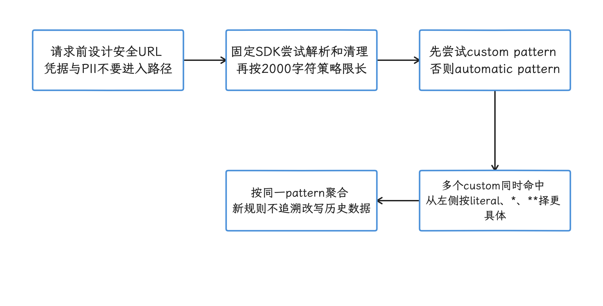

图：端侧URL清理限制传输内容，服务端pattern组织聚合，两层分别设计。 可解析时才清理user-info/query/fragment；path仍可敏感，解析失败会保留原字符串。

payload size 通常依赖 `Content-Length` 等 HTTP header（请求或响应头）；该 header 缺失或填写不准时，控制台数值也可能不准，线路实际传输字节数要另行测量。缺少 Content-Type 可以被接受，格式非法的 Content-Type 则可能让请求不显示。长时间未完成、没有执行 `stop()` 或未被插桩命中的请求，也不会形成可用样本。

排查采集时，可在测试构建的 Manifest 临时设置 `firebase_performance_logcat_enabled=true`，再到 Logcat（Android 设备日志） 检查 `FirebasePerformance` debug log 中是否出现已完成的 trace/request 和对应 URL；验证完成后移除该开关，避免增加生产日志。

### 采样、时效和排查边界

SDK 记录到事件，只是第一跳：采样按一定比例选择设备或事件，限流限制一个时间窗口内可发送或接收的数量，两者都可能减少最终样本；设备侧还会批量发送，服务端也要继续处理，控制台最终保存的是这条链路走完的事件。

| SDK 情况 | 控制台时效 | 适合做什么 |
| --- | --- | --- |
| Android SDK `19.0.10+` 或 BoM `26.1.0+` | SDK 大约每 30 秒批量发送；控制台通常几分钟内出现 | 分阶段发布观察、当日回归、版本趋势 |
| 旧 SDK | 大约 36 小时延迟 | 次日复盘、长期趋势 |

`firebase-perf:22.0.6` 已进入近实时处理路径，含义是数据通常在采集后几分钟内显示。这几分钟只是常态而非承诺：设备离线、省电策略、初始化失败、上传失败或服务端处理都可能继续推迟数据，严格的实时 SLA（Service Level Agreement，服务时效约定） 要另找方案。

官方 troubleshooting 文档给出的设备限流数字是：code trace 和 network request trace 合计每台设备每 10 分钟最多发送 300 个事件。SDK 还会通过 Firebase Remote Config（远程配置服务） 取得针对该 app 的动态采样率，随机选择哪些设备发送 trace；服务端仍可能丢弃一部分已收到的事件。启用 BigQuery 集成的项目会获得较高的 network request trace 数量上限，全量采集仍然谈不上。因此：

- 高频轮询和图片请求不会保证逐条保留；
- 小流量分阶段发布可能因为样本不足而看不出变化；
- 控制台分布只能代表被捕获并被接受的事件。

Performance alerts 也有样本门槛。App start、custom trace、network 和 screen rendering 告警需要过去一小时至少 100 个样本；这里的样本是 Firebase 已记录并用于相应指标的事件。低流量版本没触发告警时，先查样本量再下结论。

#### BigQuery 导出与采样的关系

需要用 SQL 做长期留存和跨版本分析时，我们可以把 captured events（已被采集并接受的事件）导出到 BigQuery，每一行对应一个 performance event；BigQuery 是 Google Cloud 的托管分析型数据仓库。导出数据已经过端侧采样与限流，和设备上全部事件的原始副本之间还有一段距离。

首次启用导出后，初始数据传播最多可能需要 48 小时；之后的常规同步任务通常会在安排执行后的 24 小时内完成。BigQuery 提供分析和持有数据副本的能力，自托管采集入口则没有；字段 schema 也由 Firebase 制定。

<!-- gracker-diagram: ch17-01-20-firebase-observability-chain -->
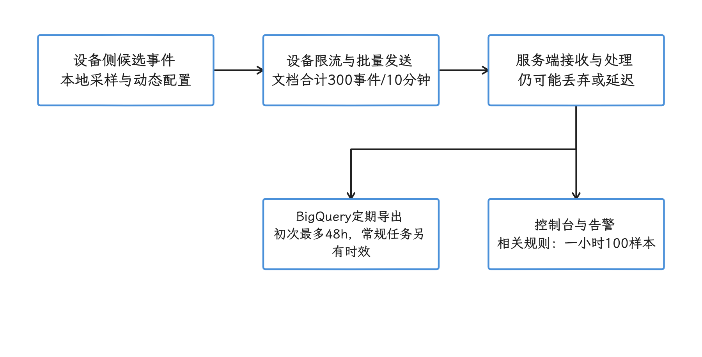

图：设备记录经采样、限流、批量传输和服务端处理后，才形成控制台及导出数据。 告警有相应样本门槛；BigQuery导出captured events，被采样或丢弃的总体事件恢复不回来。

### 和 JankStats、FrameMetrics、Android Vitals 的分工

这些工具都会出现渲染或稳定性指标，但观察对象不同：


| 工具 | 主要样本 | 长处 | 不足 |
| --- | --- | --- | --- |
| Firebase Performance | Activity/Fragment screen instance、network、custom trace | 接入快，可看版本、设备和地区分布 | 固定 60 Hz 阈值；缺少逐帧状态 |
| JankStats | 逐帧 jank（卡顿帧）判定 + `StateInfo` 状态标签 | 能关联 route、滚动和业务状态 | 需要自行聚合、存储和上报 |
| FrameMetrics | `Window` 级帧阶段耗时 | 能观察 layout、draw、同步和 GPU 等阶段 | API 24+；数据较底层，需要自行解释 |
| Android Vitals | Google Play 分发人群的慢帧、ANR 等质量数据 | 适合设定发布质量门槛和评估用户影响 | 只覆盖 Play 样本，业务上下文少 |

Firebase 的 16/700 ms、screen instance 占比与 Android Vitals 的用户或会话统计口径对不上，直接相比会读出错误结论。看到百分比变化时，我们先确认分母是哪批样本、刷新率、版本分布和采样窗口，再决定用 JankStats、FrameMetrics、Macrobenchmark 或 Perfetto 继续定位。

### 使用建议

#### 适合采用

- 希望用较低接入成本观察启动、页面和网络的版本趋势；
- 产品运行地区可以稳定访问 Firebase 服务；
- 能接受托管服务、采样、分钟级控制台延迟和 Firebase 定义的字段 schema；
- 愿意为首页可用、登录、图片解码、数据库查询等关键路径设计少量 custom trace。

#### 需要配合其他工具

- 秒级错误告警：使用业务错误码、日志或实时 APM 系统；
- 逐帧页面状态：使用 JankStats；
- 启动与渲染阶段：使用 Macrobenchmark、FrameMetrics 和 Perfetto；
- ANR 和 native 故障信息：使用 Android Vitals、系统 trace、tombstone 与内部采集；
- 自托管或完整样本回溯：选择满足数据所有权要求的自建或商业方案。

#### 接入与验收清单

- [ ] 锁定 BoM、Performance plugin 和 Google services plugin 版本；本篇固定分析基线分别为 `34.17.0`、`2.0.2`、`4.5.0`。
- [ ] 分别配置构建插桩开关与运行时采集开关。
- [ ] 确认只依赖主进程数据，没有把远程进程误算为已覆盖。
- [ ] 在测试构建核对 `_app_start`、screen trace 和受支持网络请求。
- [ ] 为 Cronet、native 或自研网络 client 增加独立 `HttpMetric`。
- [ ] 按资源族设计 URL pattern，禁止动态 id、query 和 token 进入维度。
- [ ] custom trace 的 attribute key 遵守最长 32 字符的公开文档规则，attribute 不含 PII。
- [ ] 把采样、展示延迟和 100 样本告警门槛写进看板说明。
- [ ] 按需启用 BigQuery，并确认导出对象是 captured events，不是全部端侧事件。
- [ ] Android 17 发布前用真实 90/120 Hz 设备检查 Firebase 固定 60 Hz 口径的偏差。

#### 从 Firebase 迁移时应保留的字段

迁移到自建或商业 APM 时，不要只复制 trace 名。至少保留这些分析字段的定义：

- app id、version name、version code、build type、distribution channel；
- device model、OS/API level、country/region、network type；
- trace name、start time、duration、metric、取值少且固定的 attribute；
- URL pattern、HTTP method、status code、payload size、Content-Type；
- screen name、total/slow/frozen frame count 及其阈值；
- SDK/plugin version、采样率、限流规则、客户端采集时间和服务端接收时间；
- 错误类型、重试次数、服务端 request id 的脱敏规则，以及它与服务端日志的关联方式。

把字段名、单位、计算公式、分母和采样规则写成可版本化的数据字典，一份说明每个字段含义和统计方式的规范。缺少它时，迁移前后的曲线即使同名，也可能没有可比性。

### 源码核对点

| 结论 | `firebase-perf:22.0.6` 对应实现 |
| --- | --- |
| `_app_start` 的起点和终点 | `AppStartTrace.logAppStartTrace()` 使用 Firebase class-load timer 到首次 `onResume()` |
| API 24+ 进程起点 | `Process.getStartElapsedRealtime()` 进入实验性 TTID trace，不是稳定 `_app_start` 起点 |
| API 34+ 后台启动过滤 | `AppStartCause` 读取 `ActivityManager.getMyMemoryState()` 的 importance（进程重要性等级） |
| 帧阈值 | `Constants.SLOW_FRAME_TIME=16`、`FROZEN_FRAME_TIME=700` |
| Fragment 统计方式 | `FragmentStateMonitor` 配合 Activity `FrameMetricsRecorder` 计算区间差值 |
| attribute 端侧校验 | `PerfMetricValidator.validateAttribute()`；其宽松边界不能替代公开文档约束 |
| URL 脱敏 | `NetworkRequestMetricBuilder.setUrl()` 调用 `Utils.stripSensitiveInfo()` |

## 商业平台的信号覆盖与工程取舍

商业平台通常补上崩溃、会话、服务端链路或厂商生态能力。选型时，我们要用同一场景验证字段、采样、符号化和数据保留。

### 商业平台的能力构成

APM 收集和分析的是 App 的稳定性、耗时与运行上下文；Sentry、APMPlus、Bugly 这类商业平台在此基础上，把付费内容扩展到 SDK、服务端、看板、告警、权限、符号文件、数据保留、工单协作和技术支持。其中符号文件包括 R8/ProGuard 的 `mapping` 与 native symbol，用于把混淆名或 native 地址还原成可读堆栈；团队由此省下的是采集后端维护、值班运营、告警规则维护和跨端数据分析这些工作。

选型前我们先确认团队缺少哪种能力：崩溃治理、性能指标、用户会话回看、跨端追踪、国内访问、合规审计、私有化部署，或数据迁移。商业 APM 接入后会进入 App 启动、异常捕获、网络、页面和用户标识等敏感路径，采购评审必须同时看能力、成本和退出方式。

以下实现分析固定Sentry8.53.0及plugin6.19.0；厂商公开接入页于2026-10-26重核。当天Maven最新Sentry Android为8.61.1、Bugly Pro两组制品均为4.4.8.2。固定源码结论不自动适用于新版，PoC须保存实际artifact哈希、合同能力表与部署清单。

| 平台 | 核对的公开 Android 制品 | 版本边界 |
|---|---|---|
| Sentry | `io.sentry:sentry-android:8.53.0`、Android Gradle plugin `6.19.0` | core AAR 的 `minSdk=21`；Session Replay 源码只在 API 26+ 启用；API 35+ UI/continuous profiling 使用 `ProfilingManager` |
| APMPlus 国内版 | `apm_insight:1.5.25.cn`、`apm_insight_crash:1.5.21`、plugin `1.4.2` | 国内与海外制品、上报地域不同，不能混用 |
| APMPlus 海外版 | `apm_insight:1.5.24.oversea`、`apm_insight_crash:1.5.21.oversea` | 当前公开接入页写明上报到马来西亚柔佛 |
| Bugly Pro | 2026-10-26 Maven Central 最新为 `com.tencent.bugly:bugly-pro:4.4.8.2` | 16KB page size 要选择 `com.tencent.bugly_16kb` 下的同版本；公开更新日志目前只说明到 `4.4.7.8` |

仓库元数据只说明发布坐标这一层，未公开的行为说明要另找证据补上。Bugly公开changelog仍只说明到4.4.7.8，而仓库已到4.4.8.2；其间新增/修复什么，须以实际AAR、厂商说明和PoC结果核对。


Android 17 / API 37 没有一套通用于所有商业 APM 的新采集协议，所以要逐项验证厂商 SDK 在 API 37 上使用的公开 API、native library（C/C++ 等本地代码库）、前后台判断、网络插桩和采样行为。“兼容 Android 17”这句宣传本身形成不了可复现的验收结论。

### 三个平台的定位

#### Sentry：错误监控起家，移动端 APM 能力逐步补齐

Sentry Android 除了错误捕获，还支持 tracing、profiling（抽样调用栈）、Session Replay（会话画面回放）、logs、user feedback 和 release health（按发布版本统计会话与故障）。Gradle plugin 负责上传 source context（出错位置附近的源码）、mapping、native symbol 等构建产物；运行时 SDK 负责事件、span、profile 和 replay，两者的版本与开关要分别管理。

它适合这些团队：

- 已经用 Sentry 管 Web、后端或 iOS 错误，希望移动端统一入口。
- 需要异常、performance transaction、profiling 和 release health 放在一起看。
- 面向海外用户，Sentry SaaS（由厂商托管的在线服务）可稳定访问。

固定Sentry8.53.0沿用8.51.0的UI/continuous profiling分支：API35+通过ProfilingManager请求PROFILING_TYPE_STACK_SAMPLING，产生Perfetto格式的调用栈采样文件；完整的scheduler/Binder/system trace，这份文件还撑不起这样的承诺。API22–34默认使用legacy ART tracer；API21虽可接入core SDK，profiling路径会提前返回。enableLegacyProfiling=false关闭旧设备回退及全部transaction-based profiling，API35+的该系统采样在这个开关的作用范围之外。

<!-- gracker-diagram: ch17-01-23-sentry-profiler-branch -->
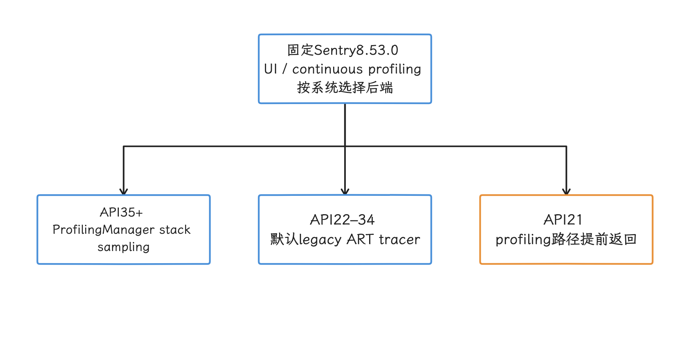

图：固定8.53.0的UI/continuous profiling在API35+请求系统调用栈采样，旧系统走有条件的legacy profiler。 Perfetto格式离完整system trace还有距离；SDK core min21也说明不了profiling支持API21。

两条profiling路径均需采样预算。系统会限制ProfilingManager请求，SDK命中采样不保证有profile，该后端也不支持app-start profiling。Sentry文档所述ART tracer崩溃风险属于legacy路径；若开启后runtime崩溃增加，先按SDK、系统与机型分组，关闭legacy或降低采样做受控对照，再核对设备是否收到相关runtime修复。仅凭runtime栈或时间接近，断定不了业务代码或SDK是根因。

Sentry Android 各能力存在 SDK/API 版本门槛，接入前要按版本表核对：

| 能力 | 最低 SDK / API 版本 | 边界与约束 |
|---|---|---|
| Session Replay | Sentry Android SDK `7.12.0+`；运行时 API 26+ | 默认遮盖文本、图片和 WebView；PixelCopy 仍可能出现遮盖位置偏差 |
| UI Profiling | Sentry Android SDK `8.7.0+`；`ProfilingManager` 后端需要 `8.51.0+` 和 API 35+ | manual 与 trace lifecycle 两种模式互斥；API 22～34 默认使用 legacy ART tracer；API21不启动该采样 |
| Transaction-based profiling | Sentry Android SDK 6.16.0+、API 22+ | legacy 能力，单次最长 30 秒；Sentry 文档建议迁移到 UI Profiling |
| App start profiling | Sentry Android SDK 7.3.0+ | 仅 legacy profiler 支持；API 35+ 的 `ProfilingManager` 后端忽略该开关；安装后的首次运行不会执行 |

Sentry 的主 profiling 页和 `8.51.0` changelog 都把 `ProfilingManager` 的起始版本写为 `8.51.0`，但 legacy 页导语目前写成 `8.47.0`。我们采用有对应发布记录的 `8.51.0` 作为可验证依据。

Session Replay需逐屏验证遮盖结果。默认PixelCopy先取截图，再按View hierarchy计算遮盖位置，时序差可使其错位；实验Canvas策略改为重绘时拦截文本与bitmap绘制，仍有未支持的绘制API，全部内容都可靠遮盖这一点还承诺不了，额外重绘开销也需实测。SurfaceView内容在独立surface中，实验采集须单独开启，也没法只遮盖其中某个标签或视频元素。支付、健康、聊天和身份页面应直接检查实际录制附件。固定8.53.0修复了一类硬件视频编码器卡住引发ANR的问题，仍须验证目标机型。


#### APMPlus：国内移动 APM 平台型方案

APMPlus 是火山引擎的应用性能监控产品，覆盖 Android、iOS、鸿蒙、Web、PC、服务端等多平台。公开文档中 App 侧能力包括崩溃、卡顿、内存、网络、启动、自定义事件、日志回捞、报警和自定义看板等。日志回捞指平台按授权和配置，让指定设备补充上传故障附近的本地日志；它涉及的权限与数据范围需要单独审核。

它适合国内业务、需要托管平台和移动端专项能力的团队。当前 Android 接入页把国内与海外 artifact 分开：国内版上报到中国，海外版上报到马来西亚柔佛。数据地域要以合同、网络抓包和实际项目配置三方核对，依赖后缀说明不了全部。

公开验证页称crash不受采样控制；这不保证离线或故障时100%送达。其他监控项要命中平台采样配置；ANR 需要同时接入 crash 组件，只有性能组件时看不到 ANR 日志；网络自动监控依赖 Gradle plugin 和对应网络开关。PoC 设备应加入测试白名单，使其强制进入采集范围，或把目标模块临时调到 100%；否则“没有数据”可能只说明设备没有命中采样。

进入选型核对时，我们要逐项验证：SDK 支持的 Android 版本、targetSdk、ABI（此处主要指 `arm64-v8a` 等 CPU 架构）、主流网络库，卡顿 / ANR / OOM / native crash 的采集口径，符号文件与版本的绑定方式，日志回捞授权流程，以及远程采样和阈值调整能力。若采购专有云或私有化形态，应让厂商给出采集网关、消息缓冲、计算、查询存储、对象存储、冷热分层（近期高频数据与历史低频数据分开存放）、备份恢复的实际 BOM（Bill of Materials，组件与资源清单）和容量模型；APMPlus 用了哪种数据库或流处理组件，答案就在这份 BOM 里，同厂商其他产品推测不出来。

#### Bugly：普通版与 Pro 版的分界

Bugly 普通版更偏 crash、ANR、符号文件和版本稳定性看板。公开普通版 Android changelog 的最新条目仍停留在 2021 年的 `3.4.4（2021 年）`，拿普通版文档推断 Bugly Pro `4.4.x` 的 API 或能力会出错。

Bugly Pro 要按 Pro 版自己的文档评估。Pro 版公开文档覆盖 crash、ANR、OOM、卡顿、FPS（Frames Per Second，每秒帧数）、内存、启动和页面回放等能力。ANR 有两组容易混淆的配置：

- `enableAllThreadStackAnr=true`：ANR 发生时抓取线程堆栈，当前 builder 文档标为默认开启；`4.4.6.2` 的更新说明写明全线程抓取时不再重复抓主线程。
- `setEnableRecordAnrMainStack(true)`：记录 ANR 发生前的主线程堆栈，`4.4.7.3` 新增，当前示例默认 `false`。

这两者采集时点不同。控制台缺少某份线程 stack 时，要先核对配置、系统是否在采集完成前终止进程，以及当前机型能否取得 ANR trace。

### 选型表

| 平台 | 更适合 | 能力边界 | 数据与部署 | 成本和退出点 |
|---|---|---|---|---|
| Sentry | 海外业务、跨端错误监控、tracing / profiling / replay 统一 | profiling 和 replay 必须低采样；API 34 及以下的 legacy ART 风险、API 35+ 的系统限流、遮盖可靠性、国内访问和 PII（可识别个人的信息）规则要分别核验 | SaaS 与 self-hosted（自行部署）在功能、升级和支持责任上不同 | 按事件量、seat（付费账号席位）、保留周期、附件、profile 和 replay 用量估算；退出时导出 issue、release、event、trace、alert |
| APMPlus | 国内业务、移动端性能和稳定性一体化平台 | 启动、卡顿、ANR、OOM、网络、内存、日志回捞、单点查询、报警和看板较全 | 公开接入页区分中国与柔佛上报；专有云或私有化能力以合同为准 | 费用与事件量、留存、日志回捞、部署资源、支持服务相关；退出时迁移指标口径和 dashboard |
| Bugly Regular | 国内稳定性治理、崩溃 / ANR / 符号文件 | 偏稳定性入口，性能能力按套餐确认 | SaaS 为主，和腾讯生态流程结合较深 | 接入成本低；退出时要处理 crash issue、mapping、symbol、Webhook（HTTP 回调）和版本趋势 |
| Bugly Pro | 需要卡顿、内存、启动 Span、页面回放等增强能力 | 2026-10-26 Maven 最新是 `4.4.8.2`，公开能力说明只到 `4.4.7.8`；远端配置要逐项验收，16KB 还要选对 groupId | 关注 ANR 诊断字段、replay、Span 数据和合同部署形态 | 费用和数据量、采样、保留周期相关；退出时迁移诊断字段、附件和 Span 数据 |

选型结论不要只看功能列表。商业平台越深入 App 运行路径，越要确认数据归属、字段合规、留存周期、费用模型、16KB Page Size 适配和退出成本。

### 商业 APM 的评审维度

16KB静态检查包括ELF LOAD segment对齐和APK中未压缩.so的ZIP位置对齐，两者回答的问题不同，互相替代不了；AAB还需检查实际生成的APK。两项通过只是静态前提，仍须在真实16KB环境、关闭backcompat时验证安装、运行及采集路径，代码里的4KB假设也可能出问题。


| 维度 | 要问的问题 | 验收方式 |
|---|---|---|
| SDK 覆盖 | Android 版本、targetSdk、ABI、主流网络库、Flutter / React Native（RN）/ WebView 是否支持 | 用试点 App 接入，覆盖 release、debug、混淆和包含多种 ABI 的包 |
| 稳定性 | SDK 自身 crash、ANR、启动开销、线程数、包体积 | 先发布给 1% 用户，跟踪 SDK crash、启动 P95（95% 样本不超过的耗时）、主线程耗时和包体积增量 |
| 16KB Page Size 兼容（Android 15+） | SDK 及其传递依赖中的 `.so` 是否支持 16KB ELF alignment，APK/AAB 中未压缩 native library 的 ZIP alignment 是否正确 | 用 16KB 模拟器或真机运行 release 包；执行官方 `check_elf_alignment.sh`，再用 `zipalign -c -P 16 -v 4` 检查 APK；关注加载失败与 native crash |
| 性能数据 | 启动、慢帧、卡顿、ANR、OOM、网络、磁盘、功耗是否有清晰口径 | 用已知慢帧、弱网、OOM、ANR 样本回放，核对平台展示与本地 trace / log 是否一致 |
| 故障证据 | 堆栈、日志回捞、trace、截图、session replay、用户路径 | 检查是否有授权流程、脱敏规则、采样上限和故障时的人工取证路径 |
| 符号化 | ProGuard mapping、native symbol、版本和 build id（一次构建的唯一标识）绑定 | 用一个已知混淆 crash 和一个 native crash 验证堆栈还原率 |
| 采样配置 | 远程开关、按版本 / 机型 / 页面采样、异常强制采样 | 灰度配置后核对生效延迟、回滚延迟和误采样率 |
| 数据所有权 | 原始事件、聚合指标、附件、replay、日志、trace 属于谁 | 合同写明导出格式、保留周期、删除 SLA（约定的完成时限）、离职权限回收 |
| 部署形态 | SaaS、专有云、私有化的数据边界和网络路径 | 画出数据流向图，标出端上采集、网关、存储、计算、看板、审计 |
| 价格模型 | license、seat、事件量、日志量、回放量、留存周期、私有化资源 | 做 3 档流量估算：当前量、2 倍峰值、活动峰值 |
| 迁移成本 | schema（字段结构）、trace 名、alert、dashboard、mapping、历史数据能否迁出 | 试导出 7 天数据，导入内部仓库或另一平台做字段映射 |
| 合规 | 数据区域、PII 过滤、保留周期、访问审计、删除流程 | 由法务 / 安全 / 隐私团队按字段清单签字 |
| 运营 | 告警、负责人分配、工单、Webhook、报表导出 | 用一次演练验证谁收到告警、谁看样本、谁确认修复 |

### Sentry 的 transaction 和 profiling

Sentry 的性能模型围绕 transaction / span 展开：transaction 是一次根操作，例如页面加载；span 是其中较小的计时区间，例如网络、解析或渲染。多个相关 transaction 和 span 组成一条 trace；我们在移动端记下的事件，由此就可以和后端服务路径关联。

下面的结构把页面加载作为根 transaction，把网络、解析和渲染作为子 span：

```text
transaction: HomeScreen.load
  span: http GET /feed
  span: json.parse
  span: db.read_cache
  span: ui.render
```

这些 span 的名称必须稳定。动态 URL、feed id 或 user id 会产生大量不同名称，span description 里不要拼这些值；确有分析需要时，放入经过隐私审核且取值受控的 attribute/tag。

下面的 Kotlin 示例确保子 span 和根 transaction 在成功、异常两条路径上都会结束：

```kotlin
import io.sentry.Sentry
import io.sentry.SpanStatus

fun loadHome(): Feed {
    val transaction = Sentry.startTransaction("HomeScreen.load", "ui.load")
    return try {
        val networkSpan = transaction.startChild("http.client", "GET /feed")
        try {
            api.loadFeed().also {
                networkSpan.status = SpanStatus.OK
            }
        } catch (t: Throwable) {
            networkSpan.throwable = t
            networkSpan.status = SpanStatus.INTERNAL_ERROR
            throw t
        } finally {
            networkSpan.finish()
        }
    } catch (t: Throwable) {
        transaction.throwable = t
        transaction.status = SpanStatus.INTERNAL_ERROR
        throw t
    } finally {
        transaction.finish()
    }
}
```

漏掉任意一次 `finish()` 都可能让 span 缺失或 duration 失真。生产封装应把 `try/finally` 放进 facade（内部适配层），让业务调用者只提供待计时的代码 block。

如果后端也接了 Sentry 或 OpenTelemetry（跨厂商的可观测数据标准），移动请求携带 trace headers（传播 trace 标识的 HTTP header）后，可以从 App span 关联到服务器路径。应通过 `tracePropagationTargets` 只允许自有 API host；host 在这里指服务器域名。`sentry-trace` 和 baggage（随 trace 传播的附加键值）不要发给广告、支付等第三方域名。客户端与后端的采样规则也要一起核对；一端有数据、另一端缺失，可能来自两端各自的采样决定。


Tracing、profiling、Session Replay 和附件要使用彼此独立的采样预算。接入评审里要单列 `tracesSampleRate` 与 sampler（按上下文决定是否采样的函数）、`profileSessionSampleRate`、replay 的 `sessionSampleRate` 与 `onErrorSampleRate`，还要记录回放时长、脱敏规则、附件大小、丢弃原因和上传失败策略。`1.0` 适合白名单验收设备，默认生产配置要另选。

### APMPlus 的移动专项能力

国内商业 APM 的优势是贴近 Android App 线上治理常见问题：崩溃、ANR、卡顿、启动、网络、内存、日志回捞、单点查询、报警和 SDK 远程配置。

APMPlus 公开文档中的“卡顿分析”监控的是主线程 message 执行超时；这里的 message 是 Looper 消息队列中一次待执行任务，默认卡顿阈值为 2.5 秒、严重卡顿为 4 秒。“流畅性/丢帧”属于另一组数据，与 Android Vitals 慢帧、JankStats jank 或系统 ANR 各是各的指标。这些名字先对清楚，我们再在接入时逐项验证下面这些问题：


- ANR 是系统 ANR、SDK 自判卡死，还是两者都有。
- 卡顿是 Looper message timeout、慢帧，还是方法 trace；各自阈值和分母是什么。
- 内存是 OOM、泄漏、PSS、Java heap，还是 native 内存。
- 日志回捞是否按用户授权和配置触发。
- SDK 采样是否能按版本和灰度动态调整。
- 私有化是否给出存储容量、查询 QPS（Queries Per Second，每秒查询数）、冷热分层、备份恢复和升级窗口。

网络模块示例通过ApmPlugin.okHttp3Switch启用OkHttp3插桩。2026-10-26所读接入页仍把plugin支持上限写为AGP7.0.2；1.4.2在仓库里可下载，离适配当前AGP还隔着一层核对。现代构建链先核对厂商更新说明，必要时采用非插桩接入；OkHttp4/5、Cronet、native或自研client仍需真实请求验收。

这些名词在不同平台里的口径可能不同。合同和接入文档里要写明起止点、阈值、采样、上报时机和聚合分母；写清楚了，多个控制台的同名指标才有可比性。

### Bugly 的稳定性边界

Bugly 普通版常见价值在：

- Java crash 聚合。
- Native crash 符号化。
- ANR 上报。
- 版本维度趋势。
- mapping / symbol 管理。
- Webhook 对接内部流程。

Bugly Pro的评审范围还包括ANR发生时线程栈、发生前主线程记录、卡顿抓栈与启动Span，须分别构造样本。2026-10-26 Maven最新4.4.8.2与公开changelog截至4.4.7.8之间存在说明缺口；版本号说明不了其间的行为变化，须保存实际制品、远端开关、采样、开销、上报时机与留存配置并做PoC。

公开Android接入页称crash、ANR、OOM不受采样控制，其他性能项支持采样；这描述采样策略，不保证在进程死亡、离线或上传失败时100%送达。这个差异会直接影响事件费用、流量与隐私评审，估算 Bugly Pro 成本时要按这两类分开算。

如果团队只需要 crash / ANR 基础设施，普通版可能足够。如果要把 Bugly 当完整性能平台，要按 Pro 能力做 PoC，普通版经验推断不出 Pro 版边界。

Bugly Pro 各增强能力存在 SDK 版本门槛，PoC 前要确认当前集成版本是否覆盖：

| 能力 | 最低 SDK 版本 | PoC 验证动作 |
|---|---|---|
| 页面启动耗时 | Android SDK `4.4.3+` | 核对 Activity 的渲染耗时、加载耗时与本地时间点 |
| 页面启动 Span | Android SDK `4.4.3.5+` | 检查 `startSpan()` / `endSpan()` 成对；同名 span 后写会覆盖前写 |
| <span style="white-space:nowrap">ANR发生时</span><br>线程栈 | 当前 builder 的 <code>enableAllThread<wbr>StackAnr=true</code> | 检查 ANR 详情中的线程栈；主线程可能由独立字段呈现 |
| <span style="white-space:nowrap">ANR前</span><br>主线程记录 | Android SDK `4.4.7.3+`，<code>setEnableRecord<wbr>AnrMainStack(true)</code> | 对比关闭与开启后的 ANR 前主线程样本 |
| 页面回放 | Android SDK `4.4.7.3+` | 检查二次启动后的附件上报、采样、敏感页面与数据遮盖 |
| 16KB Page Size | `4.4.6.2+` 开始提供独立 16KB artifact；2026-10-26 Maven 版本为 `4.4.8.2` | 依赖必须来自 `com.tencent.bugly_16kb`；对 release APK 做 ELF/ZIP alignment 和运行验证 |

Bugly的16KB文档存在历史措辞差异：changelog和Android接入页从4.4.6.2开始说明，升级指南以4.4.6.4举例。2026-10-26仓库已发布`com.tencent.bugly_16kb:bugly-pro:4.4.8.2`；这里只核对了元数据，实际接入还须固定AAR哈希、检查最终release包并运行验证。groupId是发布组织坐标，仅升级版本号而仍选com.tencent.bugly，证明不了选用了16KB制品。

页面回放在当前文档中仍标为完善中的功能。它每秒采集一张 view hierarchy 与 screenshot，crash 后缓存为附件，等 App 二次启动再上传；截图采用整图马赛克，敏感信息是否已被可靠识别要逐屏确认。默认采样率是 0，文档建议 `0.01～0.1`。PoC 应检查 `replay.zip` 中的 JPEG 和 JSON 原始内容、资源开销、附件权限与删除流程。


以上门槛来自 Bugly Pro 官方 Android 接入页、更新日志和功能页。Bugly 是商业 SDK，版本阈值由厂商制品控制；当前集成版本低于门槛时，应先在独立分支升级并做小流量验证。

### PoC 验收表

商业APM要按受控小流量验证，覆盖发现、取样、定位、修复验证与告警关闭。下表30次、30分钟，以及前表1%用户、7天导出，均是试点规划示例，不保证尾部分位数精度、统计功效或稀有故障覆盖；实际样本量和窗口按流量、噪声、置信区间与风险确定。

| 验收项 | 构造样本 | 通过标准 |
|---|---|---|
| Java crash | 构造一个已知异常，带混淆 mapping | 平台能聚合、还原符号、按版本和用户查询 |
| Native crash | 构造一个测试 `.so` 崩溃，上传 symbol | 能显示 native 栈、build id、ABI、系统版本 |
| ANR | 在受控测试包中用 input、BroadcastReceiver、Service 等超时路径构造系统 ANR，再补锁等待 / Binder 等待 | 能区分系统 ANR 与 SDK 自判卡死；记录触发类型、主线程与相关线程栈 |
| 慢帧 / 卡顿 | 构造 60Hz 和 120Hz 页面卡顿 | 能给出慢帧时间、页面、设备、系统版本；与同帧FrameTimeline对齐，并按各自定义解释差异 |
| 启动 | 冷启动、温启动各跑 30 次 | 能按版本、渠道、机型看 P50（中位数）和 P95（第 95 百分位）；采样对启动耗时影响可接受 |
| 网络阶段 | 对每种受支持 client 构造 DNS 慢、connect 慢、TLS 慢、服务端慢 | 文档承诺的阶段都能出现；未支持的 client 或协议有明确补点方案 |
| OOM / 内存 | 构造 Java heap 压力和 native 内存压力 | 能拿到内存趋势、设备水位、进程存活信息；不把 LMK（系统因内存压力终止进程）误写成 Java OOM |
| 采样准确性 | 白名单设备发固定数量事件，再把采样率改为 25% 重复测试 | 100% 配置下无系统性漏报；采样配置的生效时间、误差和服务端限流可解释 |
| 告警噪声 | 构造一次低量级异常和一次集中异常 | 告警阈值可控；不会因采样波动反复报警 |
| 低端机开销 | 低端设备跑 30 分钟常用场景 | SDK 线程数、CPU、内存、流量、包体积增量在接入预算内 |
| 16KB Page Size | Android 15～17 的 16KB 环境运行 release 包并触发 crash / ANR / profiling | 所有 `.so` 的 ELF/ZIP alignment 通过；App 与 native 采集能力正常 |
| 删除与权限 | 创建专用测试用户，产生 event、replay、log、attachment 后发起删除 | 数据在合同 SLA 内删除；导出、审计和离职权限回收均有记录 |

### 成本模型与 ROI 估算

TCO（Total Cost of Ownership，总拥有成本）不只包含“每年多少钱”，还应拆成这些项：

| 成本项 | 计算口径 | 低估后的后果 |
|---|---|---|
| license / 套餐 | App 数、平台数、MAU（月活跃用户数）、事件量、seat | 后续扩端或扩团队时费用跳涨 |
| 数据量 | crash、ANR、trace、log、replay、attachment 的月增量 | 保留周期被迫缩短，线上样本查不到 |
| 私有化资源 | 计算、存储、对象存储、消息队列、带宽、备份 | 查询慢、告警延迟、活动峰值时丢数据 |
| 运维人力 | 升级、容量、备份、权限、审计、值班 | 平台买回来后仍要内部团队兜底 |
| 合规成本 | 字段梳理、脱敏、删除流程、访问审计 | 上线慢，或后续被安全团队叫停 |
| 迁移成本 | facade、schema、历史数据、dashboard、alert、mapping | 供应商更换时业务代码和看板一起返工 |

月度总成本可以按这个公式估：

```text
月度 TCO = 平台订阅费用
         + 数据增量费用
         + 存储和保留费用
         + 私有化基础设施费用
         + 运维和值班人力成本
         + 合规与审计成本
         + 迁移预留成本
```

ROI（Return on Investment，投资回报）要用可比较的数据计算。可量化的收益包括：崩溃率下降带来的留存改善、ANR / 慢帧定位时间缩短、值班误报减少、内部 APM 后端维护人力减少、合规审计时间缩短。PoC 阶段至少记录“接入前定位一次线上 ANR 的耗时”和“接入后用平台样本定位同类问题的耗时”。


### 私有化责任表

私有化的交付范围包括内网部署，也包括部署、升级、存储、权限、审计、数据删除和故障责任。所有责任都要写进合同和验收文档。

| 事项 | 厂商应交付 | 客户侧负责 | 验收材料 |
|---|---|---|---|
| 部署架构 | 网关、采集服务、计算、存储、看板、告警的拓扑 | 网络、域名、证书、Kubernetes（容器编排）/ VM（虚拟机）资源 | 架构图、端口清单、容量模型 |
| 升级 | SDK 版本、服务端版本、兼容表、回滚方案 | 升级窗口、灰度策略、回滚审批 | 升级手册、回滚演练记录 |
| 存储 | 热数据、冷数据、对象存储、备份恢复方案 | 磁盘、备份介质、保留周期 | 容量压测、恢复演练、保留策略 |
| 权限 | 角色模型、项目隔离、审计日志 | 组织架构、离职回收、最小权限 | 权限表、审计样例 |
| 数据删除 | 用户数据删除 API、批量清理任务 | 删除工单、合规审批、回查流程 | 删除 SLA、抽样验证记录 |
| 故障责任 | 组件健康检查、告警规则、支持响应时间 | 值班人员、基础设施故障处理 | SLA、RCA（Root Cause Analysis，根因分析）模板、演练记录 |
| 成本控制 | 采样、保留、冷热分层、限流策略 | 业务峰值预估、预算上限 | 月度容量报表、费用报表 |

### 内部 APM facade 与字段合同

商业平台 SDK 不要直接散落在业务代码里。先定义内部 facade，也就是业务代码只依赖的统一监控接口，再由实现层映射到各平台 API。

```kotlin
data class MonitorContext(
    val pageName: String,
    val appVersion: String,
    val buildId: String,
    val experimentId: String?,
    val deviceTier: String
)

interface TraceHandle {
    fun addMetric(name: String, value: Long)
    fun addTag(name: String, value: String)
    fun finish(status: String)
}

interface AppMonitor {
    fun setUser(anonymousId: String?, userType: String)
    fun clearUser()
    fun setContext(context: MonitorContext)
    fun captureException(throwable: Throwable, tags: Map<String, String>)
    fun startTrace(name: String, context: MonitorContext): TraceHandle
    fun reportMetric(name: String, value: Long, tags: Map<String, String>)
}
```

实现层要保证 `finish()` 幂等，即重复调用也只结束一次，并提供内部 `try/finally` 包装，避免某个 vendor（平台供应商） 要求手工结束 span 时产生没有结束时间的数据。`anonymousId` 应是经过隐私评审的假名标识：它可以关联同一主体的事件，但不直接暴露真实身份。退出登录时调用 `clearUser()`，手机号、邮箱、广告标识符或可逆业务主键都不要直接传给厂商。

字段合同要比代码接口更早定下来：

| 字段 | 约束 |
|---|---|
| `page.name` | 用产品页面名，不用 Activity 类名直接当展示名 |
| `user.type` | 匿名、登录、会员、内测等有限枚举 |
| `user.id` | 只允许经同意的假名标识；定义生成、轮换、删除和跨平台映射规则 |
| `app.version` / `build.id` | 和 release、mapping、native symbol 一一绑定 |
| `experiment.id` | 灰度、A/B、功能开关统一命名 |
| `network.stage` | DNS、connect、TLS、request、TTFB（Time to First Byte，收到首字节前的时间）、download 统一枚举 |
| `device.tier` | 低端 / 中端 / 高端规则固定，避免迁移后设备分桶（按规则分组）发生变化 |
| `trace.name` | 由内部词典生成，不直接使用 vendor 自动名 |

稳定字段合同和facade可把多数更换工作收敛到适配层；厂商独有能力、不同采样和生命周期语义仍需显式处理，任意平台完全互换的保证则给不了。


### 退出成本与迁移失败样本

商业平台还要评估退出成本：数据能否导出，事件 schema 是否能迁移，客户端 SDK 是否与业务代码耦合，自定义 trace 名称是否平台专有，告警和工单流程是否绑定平台。

迁移中常见的失败样本有三类：

| 样本 | 现场表现 | 规避方式 |
|---|---|---|
| <span style="white-space:nowrap">字段名漂移</span> | 旧平台用 `screen_name`，新平台用 `page`；历史看板无法和新数据合并 | 接入前建立内部字段词典，所有 vendor 字段都由映射层生成 |
| <span style="white-space:nowrap">符号文件断档</span> | 旧平台保存了 mapping / symbol，新平台只有新版本符号；历史 crash 无法还原 | mapping、native symbol、build id 和 release 元数据单独归档，不能只放在 vendor 平台 |
| <span style="white-space:nowrap">告警规则丢失</span> | 迁移后阈值、负责人、工单状态无法搬迁；值班噪声暴涨 | 把告警规则导出成内部配置，迁移前做一次影子告警对照 |

迁移前先做影子运行：两个平台接收受控人群的数据，旧平台继续报警，新平台仅记录；窗口可先按7天规划，再按流量和稀有事件覆盖延长。按相同人群、定义、分母、窗口和采样对齐crash、ANR、慢帧、网络错误、告警与缺失样本，确认迁移开销和字段差异后逐步切流。

<!-- gracker-diagram: ch17-01-31-shadow-migration -->
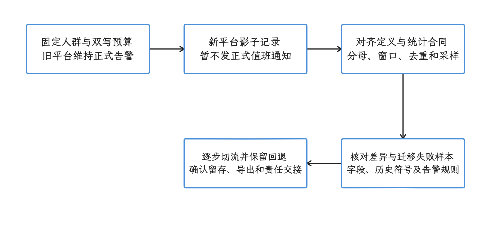

图：受控人群双写后统一统计合同，检查字段、符号与告警差异，再逐步转移正式监控。 7天只是起始规划；双SDK自身开销、稀有样本、历史符号和缺失数据均需纳入决策。

### 核验来源

商业 APM 的实现不在 AOSP 里，Android 17 platform tag（AOSP 对应版本标签）验证不了厂商闭源逻辑。核验采用三层证据：

1. 厂商公开接入页、功能页和 changelog，用于确认制品版本、开关和产品口径。
2. 可下载 AAR 的 Manifest、source package（源码包） 和最终 APK，用于确认 `minSdk`、API 分支、native library 与打包结果。
3. Android 8～17 真机或模拟器的构造样本，用于确认运行行为、采样、上传、符号化和开销。

“文档写了支持”只完成第一层。采购验收要把第二、三层的制品哈希、测试包 build id、设备、系统版本和平台截图归档。

## 参考资料

- [Firebase Performance Monitoring for Android：接入与当前版本](https://firebase.google.com/docs/perf-mon/get-started-android)
- [Custom code traces](https://firebase.google.com/docs/perf-mon/custom-code-traces?platform=android)
- [Automatic app start、foreground 和 background traces](https://firebase.google.com/docs/perf-mon/app-start-foreground-background-traces?platform=android)
- [Screen rendering performance data](https://firebase.google.com/docs/perf-mon/screen-traces?platform=android)
- [Network request performance data](https://firebase.google.com/docs/perf-mon/network-traces?platform=android)
- [Custom URL patterns](https://firebase.google.com/docs/perf-mon/custom-url-patterns)
- [Troubleshooting and FAQ](https://firebase.google.com/docs/perf-mon/troubleshooting?platform=android)
- [Performance alerts](https://firebase.google.com/docs/perf-mon/alerts)
- [Disable Performance Monitoring](https://firebase.google.com/docs/perf-mon/disable-sdk?platform=android)
- [Export Performance Monitoring data to BigQuery](https://firebase.google.com/docs/perf-mon/bigquery-export)
- [Firebase Android SDK release notes](https://firebase.google.com/support/release-notes/android)
- [Firebase Android BoM 版本元数据](https://dl.google.com/dl/android/maven2/com/google/firebase/firebase-bom/maven-metadata.xml)
- [`firebase-perf` 版本元数据](https://dl.google.com/dl/android/maven2/com/google/firebase/firebase-perf/maven-metadata.xml)
- [Performance Gradle plugin 版本元数据](https://dl.google.com/dl/android/maven2/com/google/firebase/perf-plugin/maven-metadata.xml)
- [Google services plugin 版本元数据](https://dl.google.com/dl/android/maven2/com/google/gms/google-services/maven-metadata.xml)
- [`firebase-perf:22.0.6` source package](https://dl.google.com/dl/android/maven2/com/google/firebase/firebase-perf/22.0.6/firebase-perf-22.0.6-sources.jar)
- [Firebase Android SDK：Performance 源码](https://github.com/firebase/firebase-android-sdk/tree/main/firebase-perf/src/main/java/com/google/firebase/perf)

### Sentry

- [Sentry Android SDK](https://docs.sentry.io/platforms/android/)
- [Android tracing](https://docs.sentry.io/platforms/android/tracing/)
- [Android profiling](https://docs.sentry.io/platforms/android/profiling/)
- [Android legacy profiling](https://docs.sentry.io/platforms/android/profiling/legacy/)
- [Android profiling troubleshooting](https://docs.sentry.io/platforms/android/profiling/troubleshooting/)
- [Android Session Replay](https://docs.sentry.io/platforms/android/session-replay/)
- [Sentry Java/Android SDK 8.53.0 release](https://github.com/getsentry/sentry-java/releases/tag/8.53.0)
- [Sentry Java/Android SDK 8.51.0 release](https://github.com/getsentry/sentry-java/releases/tag/8.51.0)
- [Sentry Android Gradle plugin 6.19.0 release](https://github.com/getsentry/sentry-android-gradle-plugin/releases/tag/6.19.0)
- [`sentry-android` Maven metadata](https://repo1.maven.org/maven2/io/sentry/sentry-android/maven-metadata.xml)
- [Sentry Java/Android SDK 8.50.1 release](https://github.com/getsentry/sentry-java/releases/tag/8.50.1)

#### APMPlus

- [APMPlus 产品简介](https://www.volcengine.com/docs/6431/69088)
- [Android SDK 接入](https://docs.volcengine.com/docs/apmplus/IntegratetheAndroidSDKintotheapplication?lang=zh)
- [Android SDK 数据上报验证](https://docs.volcengine.com/docs/apmplus/Reportverificationdata?lang=zh)
- [卡顿分析](https://docs.volcengine.com/docs/apmplus/Laganalysis?lang=zh)
- [内存优化](https://www.volcengine.com/docs/6431/68858)

#### Bugly

- [Bugly Pro 文档中心](https://bugly.tds.qq.com/docs/)
- [Bugly Pro Android SDK 接入](https://bugly.tds.qq.com/docs/sdk/android/)
- [Bugly Pro SDK 更新日志](https://bugly.tds.qq.com/docs/sdk/change_log/)
- [Bugly Pro 16KB Page Size 升级指南](https://bugly.tds.qq.com/docs/tutorial/Android/16kb_version)
- [Bugly Pro 16KB `4.4.7.16` Maven artifact](https://repo1.maven.org/maven2/com/tencent/bugly_16kb/bugly-pro/4.4.7.16/)
- [Bugly Pro `4.4.7.16` Maven artifact](https://repo1.maven.org/maven2/com/tencent/bugly/bugly-pro/4.4.7.16/)
- [Bugly Pro 16KB `4.4.7.8` Maven artifact](https://repo1.maven.org/maven2/com/tencent/bugly_16kb/bugly-pro/4.4.7.8/)
- [Bugly Pro Maven metadata](https://repo1.maven.org/maven2/com/tencent/bugly/bugly-pro/maven-metadata.xml)
- [Bugly Pro 16KB Maven metadata](https://repo1.maven.org/maven2/com/tencent/bugly_16kb/bugly-pro/maven-metadata.xml)
- [Bugly Pro ANR](https://bugly.tds.qq.com/docs/tutorial/Android/anr)
- [Bugly Pro 页面启动耗时](https://bugly.tds.qq.com/docs/tutorial/Android/pagelaunch/)
- [Bugly Pro 页面回放](https://bugly.tds.qq.com/docs/tutorial/Android/replay_report)
- [Bugly 普通版 Android changelog](https://bugly.qq.com/docs/release-notes/release-android-bugly/)

#### Android

- [Support 16 KB page sizes](https://developer.android.com/guide/practices/page-sizes)
