# KOOM 与 LeakCanary 内存诊断

LeakCanary 通过对象可达性和 Heap Dump 定位开发期 Java/Kotlin 泄漏；KOOM 是快手开源的内存诊断项目，面向受控线上样本补充泄漏、OOM（Out of Memory，内存耗尽）前兆和线程资源监控。KOOM 的 fork dump 尝试缩短父进程暂停，仍有复制页、CPU、磁盘和 Hook 成本，不能在没有测量时概括为“低内存开销”。两者的触发、证据和上传范围需要分别管理。

> 源码基线：AOSP `android-17.0.0_r1`；内核标签 `android17-6.18-2026-06_r39` / `android17-6.18-2026-06_r6`；LeakCanary `2.14` 与 `3.0-alpha-9`；KOOM master `df3b8c33f63ab1f23e814c19792314efb653deaf`（Maven 正式版 `2.2.2`）。

## 对象监视、Heap Dump 与引用链

### 工具定位与版本基线

LeakCanary 回答的是一个具体问题：某个 Java/Kotlin 对象的生命周期已经结束，它为什么仍能从 GC（garbage collection，垃圾回收） Root（垃圾回收器判断对象存活时使用的根节点） 经强引用到达？GC Root 是垃圾回收器遍历对象图的起点，例如已加载的 system class 或仍在运行的 Java thread（线程资源生命周期）。我们在开发或测试设备上观察对象、抓取 Java heap（ART 管理的 Java/Kotlin 对象堆） dump（Java/ART 堆快照），再由 Shark（LeakCanary 的 heap 分析库） 计算引用路径，把可疑引用缩小到便于回查代码的范围。

线上内存平台需要的其余职责，要靠别的工具补齐。几类工具的分工如下：

| 工具 | 擅长回答的问题 | 不能单独证明什么 |
|---|---|---|
| LeakCanary | 已知生命周期对象为何没有回收；哪条强引用路径保留了它 | native 内存为何上涨、线上发生率、整机内存压力 |
| Android Studio Memory Profiler | 分配记录、heap dump、对象图和本地交互分析 | 线上分布和自动生命周期判定 |
| Perfetto | PSS/RSS（驻留内存）、GC、调度、FrameTimeline 和 heap profiling 等时间线 | 某个已销毁 Fragment 被哪条 Java 引用长期保留 |
| KOOM / APM | KOOM 和 APM 记录的版本、机型、页面分布与受控样本 | 本地代码修改是否已经切断指定引用链 |

<!-- gracker-diagram: ch17-03-01-questions-and-evidence -->
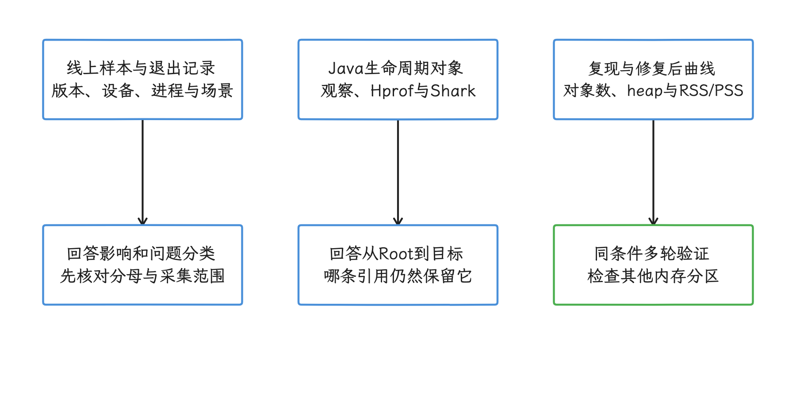

图：把影响分布、Java对象持有和进程曲线对应到各自证据。 工具能力有交叉；Java引用链不能单独解释native、GPU或全部RSS增长。

截至 2026-10-26，版本选择要分稳定线和预览线：

| 版本 | 发布状态 | <span style="white-space:nowrap">上游构建边界</span> | 使用建议 |
|---|---|---|---|
| `2.14` | 最新稳定版，tag 对应 commit <code>8d29638c<wbr>cf25e15d<wbr>84b0119b<wbr>6617f006<wbr>9bc0b2d8</code> | minSdk 14、compileSdk 34 | 作为常规 Debug / QA 默认选择 |
| <code style="white-space:nowrap">3.0-alpha-9</code> | 2026-06-25 发布的预览版，tag 对应 commit <code>bac94a74<wbr>fa87ed80<wbr>7c31a42b<wbr>4d495bbf<wbr>dcede33a</code> | minSdk 26、compileSdk 35 | 只在隔离分支评估 heap growth 等新能力 |

Maven Central 把 `3.0-alpha-9` 标成 latest/release，说的只是仓库元数据里的最新产物，alpha 不会因此变成稳定版。当前 main 的 `eb60b0be53732aa016c79b7774b497770ad1e4f3`（2026-10-21）也不是下文固定的 2.14 tag。2.14 没有以 compileSdk 37 构建；“源码路径在 Android 17 仍存在”和“API 37 真机通过回归”是不同证据。

稳定版最小接入只需要把完整能力放进 debug build variant（Gradle 构建变体）：

```kotlin
dependencies {
    debugImplementation("com.squareup.leakcanary:leakcanary-android:2.14")
}
```

依赖通过 manifest 中的私有 `ContentProvider` 在主进程自动安装 watcher（生命周期观察器）。系统先创建 `Application` 实例，再初始化 provider，随后调用 `Application.onCreate()`；provider 安装 watcher 时已经能取得 `Application`，无需在 `onCreate()` 中重复安装。2.14 另有基于 AndroidX Startup 的替代 artifact（发布组件），两条安装路径只能选择其一。若工程有 QA、internal 等自定义变体，应把依赖放到对应的 Gradle configuration（例如 `qaImplementation`），防止完整分析组件被合进生产包。

<!-- gracker-diagram: ch17-03-02-provider-install -->
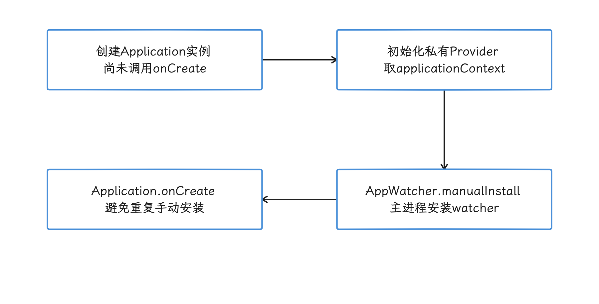

图：系统先创建Application，Provider安装watcher，随后调用Application.onCreate。 依赖只进入指定Debug/QA变体；Provider与Startup替代组件按上游约定择一。

### 从 watch 到 leak trace（泄漏引用链）

从 watch 一个对象，到触发 heap dump，再到确认泄漏，是三个先后阶段，压成一句“5 秒后发现泄漏”会丢掉中间的判断。heap dump 是某一时刻的堆对象与引用关系快照，我们按阶段拆开看。

1. 生命周期 watcher 在预期终点调用 `expectWeaklyReachable()`。`ObjectWatcher` 创建带唯一 key 的 `KeyedWeakReference`（可凭 key 在 heap 中找回目标的弱引用），并把它关联到 `ReferenceQueue`（弱引用目标可回收后进入的队列）。这个弱引用本身不会延长目标对象的生命周期。
2. 2.14 的默认 `retainedDelayMillis` 是 5 秒。延迟任务执行时，`ObjectWatcher` 先排空 `ReferenceQueue`，移除已入队引用对应的观察记录；仍在 `watchedObjects` map 中的记录被标为 retained 并通知 LeakCanary。这里没有先保证 GC 和入队已经完成，所以 retained 是延迟观察后的候选，不能据此直接证明目标仍强可达。
3. retained 只是候选状态，还不是 heap 分析结论。`HeapDumpTrigger` 在后台线程检查 retained 数量：`GcTrigger.Default` 调用 `Runtime.getRuntime().gc()`，固定休眠 100 ms，再调用 `System.runFinalization()`，随后重新计数。这 100 ms 是上游等待引用处理的启发式延迟，没有提供 GC 或入队完成保证。
4. 应用可见时，默认要达到 5 个 retained object 才 dump；应用不可见后，会等待一个 `retainedDelayMillis`，随后 1 个 retained object 也足以触发。用户点通知还可以主动请求 dump。
5. dump 前会再检查开关、调试器状态、最近一次 dump 等条件。默认 `AndroidDebugHeapDumper` 调用公开的 `Debug.dumpHprofData()` 写出 `.hprof` 文件——Hprof 就是 JVM/ART（Android Runtime） heap dump 的文件格式。
6. Shark 在 heap 中找到带 key 的弱引用对象，计算从 GC Root 到目标对象的最佳强引用路径。`ObjectInspector` 判断路径上对象是否应当泄漏，`ReferenceMatcher` 匹配已知系统或依赖引用模式。Shark 还会估算 retained size（移除该对象后可能释放的内存），再用尚未排除的 suspect reference（可疑引用） 算出 signature，用于同类引用路径归并；升级分析器、matcher 或代码结构后签名可能改变，跨版本比较需要保留这些配置。

<!-- gracker-diagram: ch17-03-03-watch-retained-analysis -->
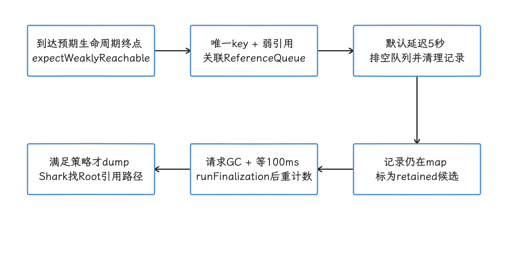

图：生命周期终点创建弱引用，延迟清理后的记录先成为候选，再由堆分析产生引用路径。 5秒和GC请求都不保证回收或入队完成；retained不是强可达或泄漏的直接证明。

按这个顺序走下来，有两点容易误读。页面退出 1 秒后对象还活着很常见，瞬时存活说明不了泄漏；`retainedObjectCount > 0` 也只是候选信号，要等 dump 中仍存在目标对象并找到保留路径，我们才会得到可供修复的 leak trace。前台 5 个的阈值是为了减少频繁冻结 UI，“少于 5 个就没有泄漏”并不成立。调试时把 App 切到后台，或在测试中调用官方 assertion（断言），都比为了快速出报告长期把前台阈值改成 1 更稳妥。

<!-- gracker-diagram: ch17-03-04-dump-conditions -->
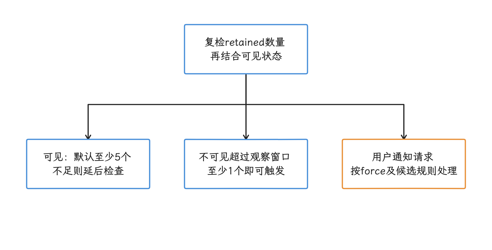

图：GC复检后的数量、应用可见状态和用户请求共同决定下一步。 前台少于5不证明无泄漏；还需通过开关、调试器、冷却与文件检查。

### 默认观察对象与依赖条件

2.14 的 `AppWatcher.appDefaultWatchers()` 安装四组 watcher：

| watcher | 观察终点 | 依赖和例外 |
|---|---|---|
| `ActivityWatcher` | `Activity.onDestroy()` 回调完成 | 使用 <code>Application.<wbr>ActivityLifecycle<wbr>Callbacks</code> |
| <code>FragmentAnd<wbr>ViewModel<wbr>Watcher</code> | Fragment `onDestroy()`、fragment view `onDestroyView()`、ViewModel `onCleared()` | AndroidX 路径只在相关类存在时安装；2.14 还兼容 support Fragment；framework Fragment 只覆盖 API 26+ |
| `RootViewWatcher` | root view 从 WindowManager 脱离 | Activity root 已由 ActivityWatcher 覆盖；PopupWindow root 不观察；Dialog root 默认不观察；Toast、Tooltip 和未知类型会观察 |
| `ServiceWatcher` | `Service.onDestroy()` 后 system_server 收到 <code>serviceDone<wbr>Executing()</code> | 依赖 framework 私有字段、消息号和 Binder 代理；反射失败会记录日志并放弃 Service 自动观察 |

“默认观察 View”的范围比字面看起来窄：Fragment view 跟着 Fragment 生命周期走，root view 来自 Curtains（LeakCanary 使用的 Window root 监听库） 对 WindowManager root 的监听，普通子 View 没有统一生命周期，业务仍要在明确终点自行观察。

<!-- gracker-diagram: ch17-03-05-watcher-coverage -->
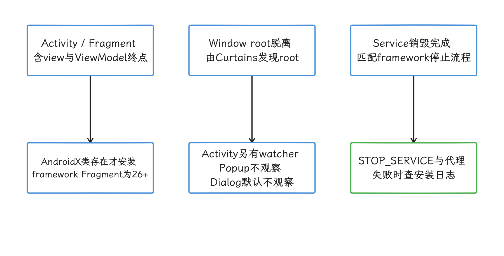

图：Activity/Fragment、Window root和Service使用不同的生命周期与安装机制。 普通子View要由业务定义终点；Service私有反射失败会放弃自动观察。

Service 是高版本验证的重点。2.14 的 `ServiceWatcher` 会反射 `ActivityThread.mH`、`mServices`、`Handler.mCallback` 和 `ActivityManager.IActivityManagerSingleton`，并识别 `STOP_SERVICE = 116`。这些名字和停止流程在 `android-17.0.0_r1` 中仍然存在，但它们都是 framework 内部实现，没有兼容性承诺；OEM（设备厂商） 修改、hidden API（应用 SDK 未公开的接口） 限制或后续平台改动都可能让 watcher 安装失败。我们会在测试包启动后检查 Logcat 是否出现 `Could not watch destroyed services`，关键 Service 可以在 `onDestroy()` 末尾再做业务侧观察。

### 自定义观察的终点

播放器控制器、地图会话、Presenter、Dagger component 和业务 scope（限定对象存活范围的生命周期作用域） 都可能有自己的 `release()` / `close()`。观察调用要放在资源清理完成后：到了这一步，负责持有和释放对象的 owner（负责持有和释放对象的一方） 理应尽快放弃强引用。

下面的例子用 2.14 推荐的 `expectWeaklyReachable()`，而不是已弃用的 `watch()`：

```kotlin
class PlayerController {
    private var released = false

    fun release() {
        if (released) return
        released = true

        stopPlayback()
        unregisterCallbacks()
        AppWatcher.objectWatcher.expectWeaklyReachable(
            watchedObject = this,
            description = "PlayerController.release() completed"
        )
    }
}
```

这段代码观察的是 `PlayerController` 本身，是清理时机摘录；`stopPlayback()`、`unregisterCallbacks()` 由业务实现，示例假设在同一 owner 线程调用。若这些步骤会抛错或异步完成，要先定义失败与完成协议，不能把提前设置的 `released` 当作全部资源已释放。调用后仍有强引用，且延迟检查时记录未被入队清理，才会成为 retained 候选；清掉 owner 引用使对象具备回收条件，也不保证在第 5 秒恰好完成 GC 和入队。

ObjectWatcher 2.14 没有为每次观察返回“取消句柄”。取消能力缺失，就要靠观察时机来补：对象可能复用、进入对象池或重新由其他 owner 持有，应等到不可逆的终点再观察；全局 `clearWatchedObjects()` 只能掩盖业务生命周期变化。测试框架为了隔离用例可以清理旧记录，业务代码则别拿它来消除报告。

<!-- gracker-diagram: ch17-03-06-custom-owner -->
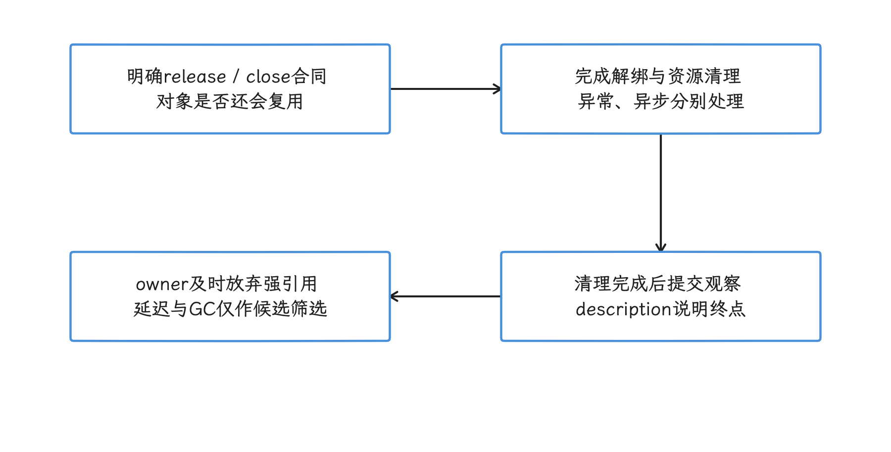

图：先定义不可逆终点，完成清理后提交观察，并要求owner及时放弃强引用。 复用池或异步teardown要按真实完成条件；全局清空watcher会掩盖问题。

降低噪声还要遵守三条规则：

- 不观察 Application、全局 cache、进程级 repository 等设计上常驻的对象。
- description 写“哪个生命周期终点已经发生”，不要只写类名。
- teardown（解绑回调、释放资源等收尾过程） 有异步完成条件时，在完成回调后观察；谁负责持有和释放要说得清，随意增加 sleep 只会把 ownership（谁负责持有和释放） 不清掩盖过去。

### leak trace 要逐行读

Leak trace 是 GC Root 到 retained object 的强引用路径，读它的时候别按线程调用栈的思路走。文本报告里各行的含义如下：

- `GC Root` 说明遍历起点，常见类型有 thread local（线程局部变量）、Java thread、system class 和 native reference（JNI/native 代码持有的引用）。
- `├─` / `╰→` 是路径上的对象；`↓` 是指向下一对象的字段、数组元素或 Java local（Java 局部变量）。
- `Leaking: NO / YES / UNKNOWN` 来自 Shark 的对象状态推断，分别表示有依据判定该对象不该泄漏、应当泄漏，或暂时还判断不出来。
- `~~~` 标出尚未被排除的 suspect reference，也就是后续该继续查的引用，并不等于工具已经定位到一行错误代码。
- `retainedHeapByteSize` 估算移除该泄漏后可回收的字节数，其中还会计入与 Java 对象关联的部分 native 大小，例如 Android Bitmap；通用 native heap（C/C++ 等本地代码申请的堆） 不在其覆盖内，共享对象图和运行时状态也会限制这个数值的解释范围。
- signature 由 suspect reference 组合计算，用来把同一原因的多个实例归为一组。

下面是一条经过压缩、但保留 LeakCanary 文本结构的 Fragment view 泄漏：

```text
┬───
│ GC Root: System class
│
├─ com.example.AnalyticsDispatcher class
│    Leaking: NO (a class is never leaking)
│    ↓ static AnalyticsDispatcher.callbacks
│                                 ~~~~~~~~~
├─ java.util.ArrayList instance
│    ↓ ArrayList.elementData
│                ~~~~~~~~~~~
├─ java.lang.Object[] array
│    ↓ Object[].[2]
│               ~~~
├─ com.example.HomeFragment$callback instance
│    ↓ HomeFragment$callback.this$0
│                            ~~~~~~
├─ com.example.HomeFragment instance
│    ↓ HomeFragment.binding
│                   ~~~~~~~
├─ com.example.HomeFragmentBinding instance
│    ↓ HomeFragmentBinding.rootView
│                         ~~~~~~~~
╰→ androidx.constraintlayout.widget.ConstraintLayout instance
     Leaking: YES (ObjectWatcher was watching this because
     HomeFragment received Fragment#onDestroyView() callback)
```

逐行阅读时按下面的顺序收敛：

1. 末尾的 root view 已经过了 `onDestroyView()`，因此“应该回收”的前提成立。
2. `HomeFragment.binding` 说明 Fragment 在 view 销毁后仍持有 binding；Fragment 留在 back stack（返回栈，保留 Fragment 实例以便返回） 时，这条引用会拖住整棵 view tree。
3. `callback.this$0` 是匿名内部类对 Fragment 的隐式引用。
4. 静态 `AnalyticsDispatcher.callbacks` 是长生命周期 owner。集合中的 callback 没有注销，因而 callback、Fragment 和 binding 始终可达。
5. 修复要落在 `onDestroyView()` 解除 dispatcher 注册并清空 binding，让 owner 与生命周期对齐；只把某个引用改成 WeakReference 解决不了问题。

GC Root 说明的只是整条链为何始终可达，业务修复点未必在这里。上例若盯着 system class 或 ClassLoader 处理，就会绕开未注销 callback 这个真正该改的地方。

<!-- gracker-diagram: ch17-03-07-strong-reference-path -->
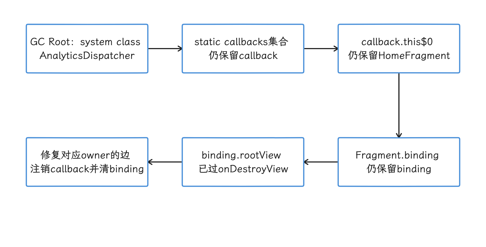

图：按持有方向追踪静态集合、callback、Fragment和binding，修复生命周期错配的边。 这是压缩示例；~~~是可疑引用，Root类型不是必须修改的位置。

### 三个能从代码走到 trace 的案例

#### Fragment：binding 活得比 view 久

Fragment 可以留在 back stack，而它的 view 已在 `onDestroyView()` 销毁。下面的 teardown 同时断开 RecyclerView 与 adapter、Fragment 与 binding 两组引用：

```kotlin
class FeedFragment : Fragment(R.layout.feed) {
    private var _binding: FeedBinding? = null
    private val binding: FeedBinding get() = requireNotNull(_binding)
    private val feedAdapter = FeedAdapter()

    override fun onViewCreated(view: View, savedInstanceState: Bundle?) {
        _binding = FeedBinding.bind(view)
        binding.list.adapter = feedAdapter
    }

    override fun onDestroyView() {
        binding.list.adapter = null
        _binding = null
        super.onDestroyView()
    }
}
```

典型 trace 会经过 `FragmentManager` 或它内部保存 Fragment 实例的 Fragment store（FragmentManager 内部保存 Fragment 的容器），到仍存活的 Fragment，再从 `_binding` 到 root view。`_binding = null` 切断主要引用；`list.adapter = null` 还会解除 RecyclerView 注册在 adapter 上的 observer（数据变化观察者），避免 adapter 从另一侧保留旧 RecyclerView。

<!-- gracker-diagram: ch17-03-08-fragment-two-edges -->
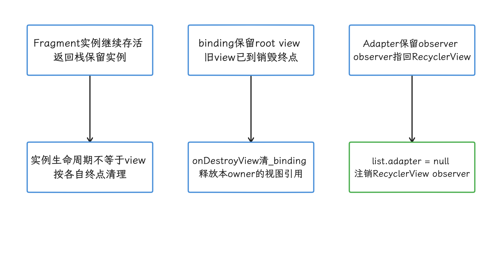

图：view销毁时同时断开Fragment到binding、adapter到旧RecyclerView的引用。 Fragment可留在back stack；清binding不能自动解除外部listener或其他owner。

#### RecyclerView：全局 listener 经 adapter 拖住页面

Adapter 常被当作“纯数据对象”，但 `AdapterDataObservable`（RecyclerView.Adapter 内部的 observer 注册表）、回调 lambda 和业务 listener 都可能形成反向引用。下面给出另一种页面级 adapter 生命周期摘录，省略 ViewHolder 和数据绑定实现；listener 由主线程 dispatcher 回调。`feedAdapter` 每次 `onViewCreated()` 新建，在 `onDestroyView()` 注销后清空，避免重用已 dispose 的实例：

```kotlin
class FeedAdapter(
    private val dispatcher: PlaybackDispatcher
) : RecyclerView.Adapter<FeedViewHolder>() {

    private val playbackListener = PlaybackListener { itemId ->
        val position = findPosition(itemId)
        if (position != RecyclerView.NO_POSITION) {
            notifyItemChanged(position)
        }
    }

    init {
        dispatcher.addListener(playbackListener)
    }

    fun dispose() {
        dispatcher.removeListener(playbackListener)
    }

    // 其余 Adapter 方法和 findPosition() 为业务实现，此处省略。
}

// Fragment 内；这是上一个无 listener 示例的另一种接入方式。
private var feedAdapter: FeedAdapter? = null

override fun onViewCreated(view: View, savedInstanceState: Bundle?) {
    _binding = FeedBinding.bind(view)
    feedAdapter = FeedAdapter(dispatcher)
    binding.list.adapter = feedAdapter
}

override fun onDestroyView() {
    binding.list.adapter = null
    feedAdapter?.dispose()
    feedAdapter = null
    _binding = null
    super.onDestroyView()
}
```

泄漏路径通常是 `PlaybackDispatcher` → listener → adapter → `AdapterDataObservable` → RecyclerView observer → RecyclerView → Activity。只清空 Fragment binding，dispatcher 这一侧的强引用还可能留着，所以 listener 的注册和注销必须成对。

`onDetachedFromRecyclerView()` 出现，未必代表 adapter 永久销毁：同一个 adapter 可能被临时拆下再挂回。是否在该回调释放，要由组件的复用约定决定；页面级 adapter 用显式 `dispose()` 更容易审计。

<!-- gracker-diagram: ch17-03-09-listener-adapter-lifecycle -->
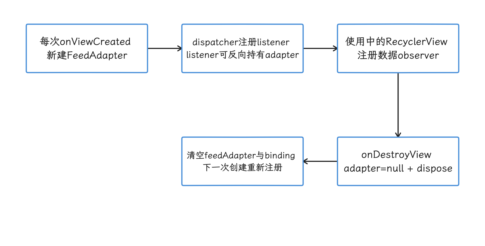

图：view创建时新建并注册页面adapter，销毁时拆绑定、注销listener并清空实例。 临时detach不一定是永久销毁；dispatcher须遵守主线程回调合同。

#### Coroutine / Flow：collector 绑定错生命周期

Fragment 的 `lifecycleScope` 跟 Fragment 实例一起存活，可能跨过 `onDestroyView()`。执行 `collect` / `collectLatest` 的 Flow collector（执行 `collect` / `collectLatest` 的收集逻辑） 若捕获 binding，就会在 view 已销毁后继续保留旧视图。下面我们把收集任务绑定到 `viewLifecycleOwner`：

```kotlin
viewLifecycleOwner.lifecycleScope.launch {
    viewLifecycleOwner.repeatOnLifecycle(Lifecycle.State.STARTED) {
        viewModel.uiState.collectLatest { state ->
            render(binding, state)
        }
    }
}
```

生命周期低于 `STARTED`（例如收到 `ON_STOP` 后）时，`repeatOnLifecycle` 取消内部 collection，再次达到 `STARTED` 时重新启动；`Lifecycle.State` 没有 `STOPPED` 枚举。view lifecycle 到 `DESTROYED` 时，外层 scope 也会取消。对应泄漏 trace 若出现 `JobSupport`、continuation（协程保存挂起位置与局部状态的对象）、collector lambda、Fragment 和 binding，我们先检查启动 scope 与 owner，再检查 Flow 上游是否把回调或 collector 另存到全局对象。

取消 coroutine 只能终止配合取消的挂起工作，阻塞 I/O、第三方 callback、`GlobalScope` 和自行保存的 listener 仍要单独 teardown。看到 `lifecycleScope` 就认定引用一定安全，为时过早。

<!-- gracker-diagram: ch17-03-10-flow-view-owner -->
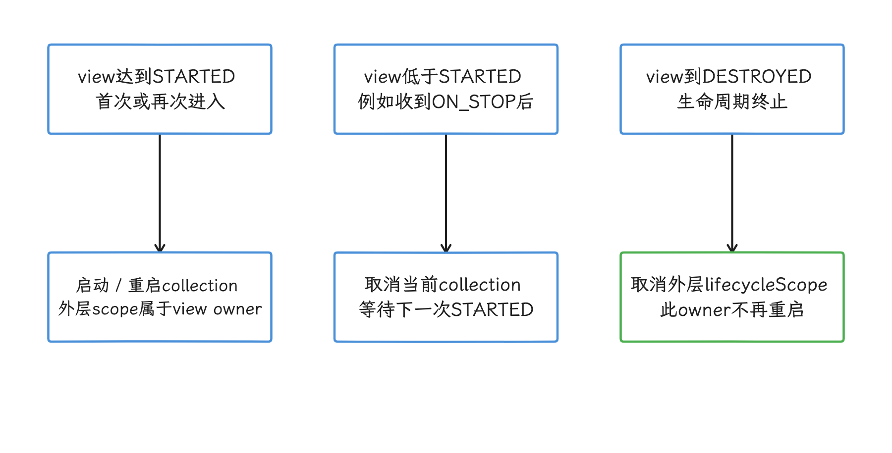

图：Flow收集绑定view owner，在低于STARTED时取消，恢复时重启，到DESTROYED终止scope。 Lifecycle.State无STOPPED枚举；取消需协作，外部callback与阻塞工作仍要解绑。

### 从“谁持有谁”看常见模式

读下面的路径时，箭头左侧是当前强引用的持有者，右侧是被持有对象；修复责任通常落在注册引用或决定对象生命周期的 owner。

| 模式 | 常见强引用路径 | 修复责任 |
|---|---|---|
| static / singleton | class → static field / collection → Activity、View、callback | 长生命周期 owner 不保存页面对象；只在语义允许时改存 `applicationContext` |
| Handler / Runnable | thread → MessageQueue → Message.callback → Runnable → 页面 | owner 保存自己的 Runnable，并在生命周期终点 `removeCallbacks(runnable)`；共享 Handler 的全部消息不要一并清掉 |
| Listener / callback | manager / SDK → listener list → lambda / anonymous class → 页面 | 注册方或 owner 成对注销，异常与提前返回路径也要覆盖 |
| Coroutine / Flow / Rx | scope / Job / subscriber → continuation / collector → View | 使用与目标资源一致的 scope；取消 Rx subscription，并终止外部 callback |
| Adapter | dispatcher → adapter，或 adapter observable → RecyclerView | 拆 adapter、注销 observer/listener、清理缓存的 ViewHolder |
| anonymous class / lambda | callback → `this$0` / captured variable → Activity 或 Fragment | 缩小捕获对象，或在 owner 结束时解除 callback |
| Context | singleton → Activity Context → Window / View tree | 只有不需要主题、Window、页面语义时才使用 Application Context |
| Dialog / PopupWindow | manager / listener → Dialog → Window → decor view → Activity | dismiss 后解除 listener 与 owner 引用；优先让 DialogFragment 管理配置变化 |
| WebView | 页面 / JS bridge / callback → WebView，或 WebView 内部对象 → Activity | 从父容器移除，停止加载，解除 JS interface/回调，按组件约定调用 `destroy()` 并清掉 owner 引用 |

Handler 的修复最好针对本 owner 的 Runnable：

```kotlin
private val refreshRunnable = Runnable { refreshUi() }

override fun onDestroy() {
    mainHandler.removeCallbacks(refreshRunnable)
    super.onDestroy()
}
```

`removeCallbacksAndMessages(null)` 会删除同一 Handler 上其他 owner 的任务，可能把泄漏问题换成功能错误。若 Runnable 必须跨页面执行，就不要捕获 Activity、Fragment 或 View，而是把结果交给生命周期感知的状态 owner。

<!-- gracker-diagram: ch17-03-11-callback-owner -->
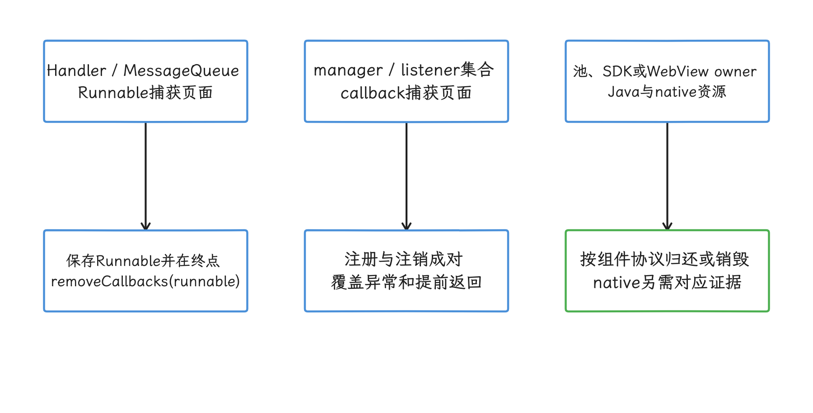

图：先找到长生命周期的持有者，再按注册点和资源终点解除属于该owner的引用。 只移除本owner的Runnable；共享Handler全清可能删除其他任务。

WebView 还可能持有 native 资源，LeakCanary 只能分析 Java heap 中通往 WebView 或 Activity 的引用。`WebView.destroy()` 也不是所有页面都能机械套用的补丁：先停止业务回调和 JS bridge，再从 parent 移除并按产品的复用策略销毁；共享 WebView 池则需要独立的 owner 和明确的回收协议。

### Application Leak 与 Library Leak 的处置

LeakCanary 使用 `ReferenceMatcher` 识别已知第三方或 Android Framework 引用模式。matcher 只是一条“某条引用在指定版本和设备条件下如何分类”的规则，不会删除 heap 中的对象：

- **Application Leak**：没有命中已知库问题，LeakCanary 按应用泄漏报告；多数 suspect reference 可由应用控制，也可能是尚未收录的系统或依赖问题。默认 CI assertion（自动化测试断言） 会为这类泄漏失败。
- **Library Leak**：命中已知模式，表示应用按正常 API 使用时仍受到系统或依赖 bug 影响。它仍在占内存，只是修复权可能不在应用侧。

处理 Application Leak，就是找到引用的 owner、注册点、预期解绑时刻和遗漏分支，随后补测试；给字段加 `ReferenceMatcher` 把自家问题改名为 Library Leak，只是换了个名字。

Library Leak 按影响处理：

- 记录 signature、系统版本、厂商、依赖版本、发生场景和 retained size。
- 查系统或依赖项目的 issue 与修复版本，针对同一场景分别验证升级、降级或最小规避方案，再比较结果。
- 高流量页面或大 retained size 即使来自系统，也要评估生命周期顺序、功能降级或隔离进程。
- 发生比例低、暂时规避不了的问题可以先缓一缓；matcher 要写明 issue、owner、适用版本和删除条件。

`referenceMatchers` 会改变分类和路径搜索，与“不 dump”是两回事。2.14 默认 instrumentation reporter 在分析成功时对 Application Leak 抛出断言错误，Library Leak 和 unreachable object 仅记录日志；若得到 `HeapAnalysisFailure`，它也会抛出分析异常。错误的 matcher 可能让应用泄漏用例误判为通过；这也是例外规则必须评审、注明期限并定期删除的原因。

<!-- gracker-diagram: ch17-03-12-classification-versus-failure -->
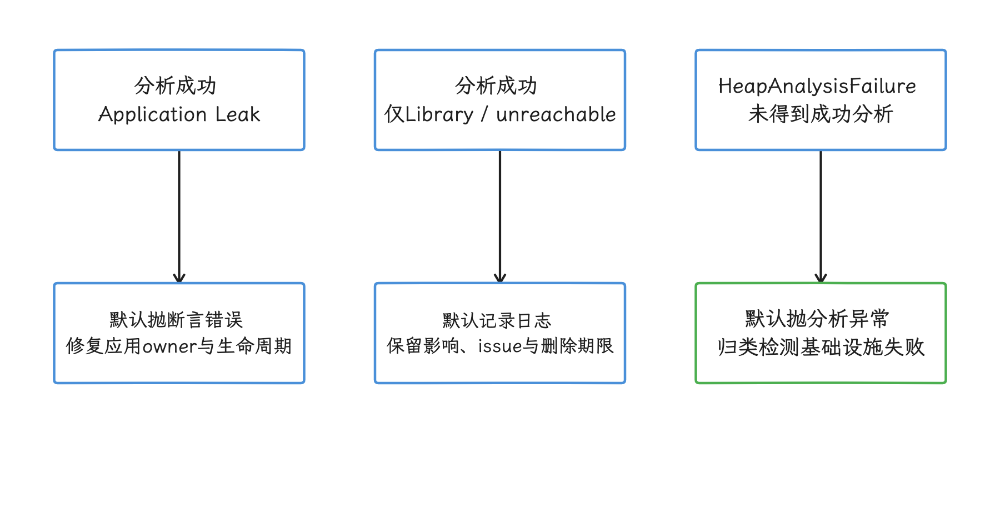

图：成功分析中的Application/Library分类，与没有得到分析结果的失败分开处理。 matcher不会释放对象；错误归类可能放过应用问题，分析失败不能算无泄漏。

### Android 17 / API 37 验证边界

在 `android-17.0.0_r1` 里，`android.os.Debug.dumpHprofData(String)` 仍是公开方法，内部继续调用 `VMDebug.dumpHprofData()`。LeakCanary 2.14 的默认 `AndroidDebugHeapDumper` 直接使用这条 API，这条 dump 路径没有解析 ART 私有 C++ 符号。3.0-alpha-9 已重组模块，实际 core sources 中没有这个同名类，不能把 2.14 的类名和完整流程直接套过去；此处流程和示例固定按 2.14 解释。

platform 源码也保留了 2.14 `ServiceWatcher` 所依赖的字段和停止消息流程：

- `ActivityThread.mH`、`mServices` 和 `H.STOP_SERVICE = 116`
- `ActivityThread.handleStopService()` 在 `Service.onDestroy()` 后调用 `IActivityManager.serviceDoneExecuting()`
- `ActivityManager.IActivityManagerSingleton`
- `Handler.mCallback`

这验证的只是 AOSP tag（Android 开源代码的一份固定版本快照） 的结构，反射调用依然没有兼容承诺。我们的 API 37 验收至少覆盖 Activity、AndroidX Fragment view、ViewModel、root view、Service、前后台阈值、通知权限、heap dump、Shark 分析和结果页；Service 要单列 watcher 安装日志。

本次检查了 2.14 的 `leakcanary-android`、`leakcanary-android-core`、`leakcanary-object-watcher-android-core`、instrumentation AAR，以及 3.0-alpha-9 的 android/core 两个 AAR，这些归档内没有 `.so`。这个结论只覆盖所列产物；顶层 android AAR 很小，不能据此替整个传递依赖图或最终 App 宣告 16 KB 兼容。完整安装包中的所有 native 依赖仍须逐一检查。

`android17-6.18-2026-06_r6` 这类 GKI（Generic Kernel Image，通用内核镜像）/kernel 构建版本也不适合拿来判断 LeakCanary 兼容性，它与这里使用的公开 Java API 没有直接版本绑定。被测 App 要分开看：自带的 native 库仍要独立检查 16 KB 对齐；malloc、GPU、驱动或 native cache 上涨，也不会因为 Java Hprof 可分析就得到完整根因。

2.14 用 compileSdk 34 构建，3.0-alpha-9 用 compileSdk 35 构建。它们可以被 API 37 App 依赖，但上游并未因此覆盖 targetSdk 37、OEM ROM 和 API 37 全套回归；我们仍要在自己的 compileSdk/targetSdk 37 internal 变体上保留上述测试集。

<!-- gracker-diagram: ch17-03-13-platform-boundaries -->
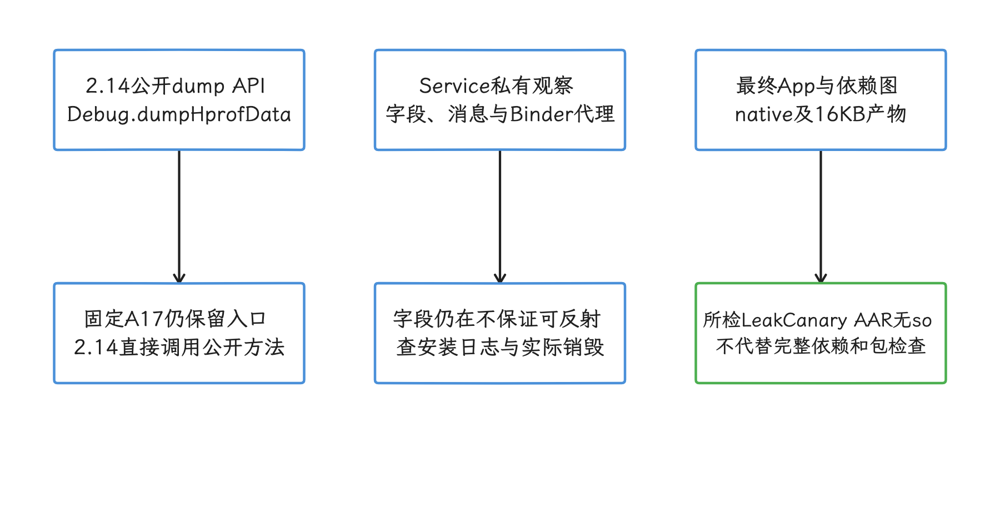

图：公开dump入口、Service私有观察和最终App制品需要分别验证。 这里只核验固定源码和指定AAR；没有执行API37/OEM/16KB设备回归。

### Release 边界：计数、分析和上传是三件事

生产包选依赖，光看 artifact 名称是不够的：

| 依赖 / 能力 | 行为 | 风险边界 |
|---|---|---|
| `leakcanary-android:2.14` | 自动观察、dump、Shark 分析、通知和结果 UI | 官方要求用于 debuggable 构建；非 debuggable 初始化默认抛错，以便尽早发现误接入 |
| `leakcanary-object-watcher-android:2.14` | 自动安装 watcher，可读取 `retainedObjectCount` | 只有候选计数，没有引用链；5 秒窗口和生命周期噪声不能换算成线上泄漏发生率 |
| `leakcanary-android-release:2.14` | 提供生产环境 heap analysis API | 官方标为 experimental，需要自行设计触发、取消、脱敏、存储和上报 |

完整 heap dump 会暂停被测进程，并把当时 Java heap 写入文件。文件里可能有字符串、URL、token（登录或访问凭据）、页面内容、业务 ID、集合元素和类结构，体积达到数十或数百 MB 也不稀奇；Shark 分析还要占用 CPU、内存、I/O 和电量。

实验性 release 分析配置中的 `stripHeapDump` 会通过 Shark 改写 Hprof 的 primitive array（基本类型数组）内容：char 数组填入问号，byte 数组填入 63（UTF-8 问号），其余对应数组置零；这不是 2.14 `LeakCanary.Config` 的同名开关。它能减少字符串等数据暴露，却不保证文件已经匿名化，也不能替代字段筛选。

线上专项分析至少要具备：

- 服务端开关、低比例采样、设备/版本限制、冷却时间和单设备上限。
- 只在后台、熄屏或用户明确同意的诊断流程触发，并允许取消。
- 使用 app 私有且不备份的临时目录；分析结束或失败后删除 Hprof。
- 优先上传分析结果，避免上传原始 Hprof；字段使用 allowlist，只允许预先评审过的字段，传输与存储还要设置加密、访问权限和保留期限。
- 记录 dump/analysis 时长、失败率、文件大小、OOM/ANR（应用无响应） 和电量影响；任一指标超过预设上限就自动停用该能力，这就是此处的“熔断”。

大多数团队更合适的走法，是让 KOOM、自研 APM 或 Android Vitals（Google Play 提供的线上质量指标） 给出线上信号，再回到可控的 Debug / QA 包用 LeakCanary 找引用链。生产 heap analysis 是专项能力：官方提供 release artifact，这件事本身说明不了它适合默认常开。

<!-- gracker-diagram: ch17-03-14-release-three-costs -->
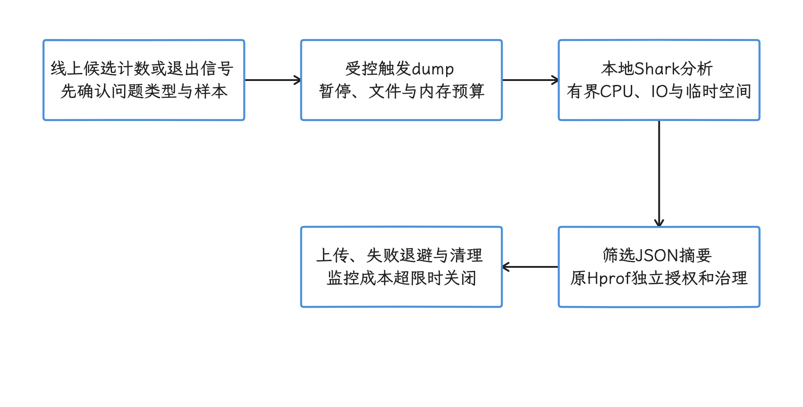

图：计数、dump/分析和交付各有独立成本与触发条件。 release分析仍为实验能力；裁剪数组不等于匿名化，原Hprof默认不上传。

### 从线上信号回到本地验证

线上 OOM 或 PSS 上涨，可能来自泄漏、缓存、图片、WebView、native allocator（原生内存分配器）、GPU 或进程工作集变化。我们排查时把“线上现象、Java 引用链、修复后曲线”三层记录都留下来：

1. 用 APM、Vitals 或 KOOM 确认问题版本、系统版本、机型、页面、操作序列和内存类型。
2. 在相同版本与接近的 API / OEM 设备环境构造可重复场景，循环进入、操作、退出页面。
3. LeakCanary 只负责 Java/Kotlin 生命周期对象：记录 signature、完整 trace、retained size 和观察 description。
4. 修复 suspect reference 后，用同一脚本重复多轮；确认旧 signature 不再出现，也没有新 signature。
5. 用 Profiler、Perfetto 或 heap diff（比较两份 heap 快照） 检查对象数与内存曲线，避免“引用链断了，但缓存或 native 内存仍上涨”。
6. 先向少量用户或设备发布修复，再回看原版本维度的 OOM、PSS/RSS 和页面指标。线上指标没有改善，就回到问题分类重新检查；LeakCanary 没有报告，只说明当前观察点没有找到 Java/Kotlin 生命周期泄漏。

这种联动让线上数据回答“影响多大、在哪里发生”，让 LeakCanary 回答“哪条 Java 强引用需要修改”。

<!-- gracker-diagram: ch17-03-15-repair-loop -->
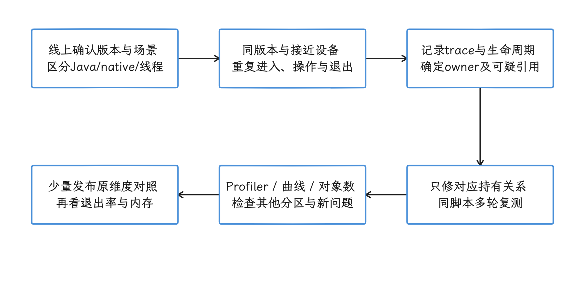

图：线上分类、本地复现、引用链修复和原维度指标回看构成闭环。 旧signature消失还要检查新签名、对象数与其他内存分区；采样分母须一致。

### Instrumentation 测试和 CI 失败条件

在 Android Instrumentation UI 测试中，LeakCanary 检测到 JUnit 位于 classpath（运行时可加载的类集合） 后，会关闭日常自动 dump。官方 `leakcanary-android-instrumentation` 会在 assertion 时等待主线程空闲、触发 GC、等待 retained delay，再在有 retained object 时 dump 和分析。

这套流程比手写 `sleep(6000) + retainedObjectCount == 0` 少一层时序猜测。

<!-- gracker-diagram: ch17-03-16-instrumentation-sequence -->
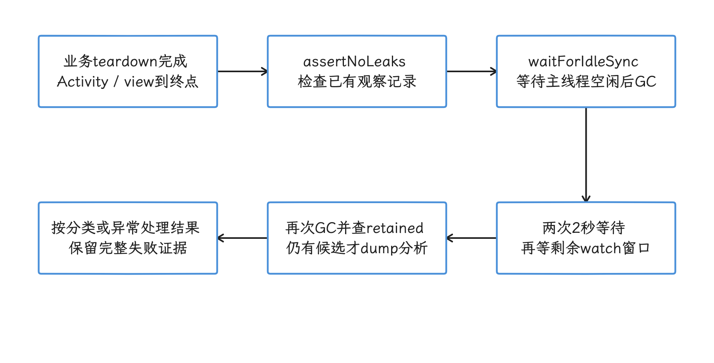

图：页面先到预期终点，官方assertion再组织空闲检查、GC与等待，有候选才分析。 默认还有两次2秒等待及剩余观察窗口；固定sleep或一次idle都不证明全部异步业务完成。

2.14 的测试依赖必须与 App 侧调试依赖同时存在：

```kotlin
dependencies {
    debugImplementation(
        "com.squareup.leakcanary:leakcanary-android:2.14"
    )
    androidTestImplementation(
        "com.squareup.leakcanary:leakcanary-android-instrumentation:2.14"
    )
}
```

`androidTestImplementation` 提供 assertion 和 JUnit rule（在测试前后插入检查的规则），`debugImplementation` 把 watcher 与 heap 分析实现放进被测 APK；只加测试依赖，替代不了 App 侧依赖。

单个关键场景可以在页面退出后显式断言：

```kotlin
@RunWith(AndroidJUnit4::class)
class CheckoutLeakTest {

    @Test
    fun checkoutPage_doesNotLeakAfterFinish() {
        ActivityScenario.launch(CheckoutActivity::class.java).use { scenario ->
            performCheckout()
            scenario.moveToState(Lifecycle.State.DESTROYED)
        }

        LeakAssertions.assertNoLeaks()
    }
}
```

`assertNoLeaks()` 发现 retained object 后才 dump；默认 reporter 在成功分析得到 Application Leak 时抛出 `NoLeakAssertionFailedError`，分析失败则抛出分析异常；后者应归类为检测基础设施失败，不能算作“没有泄漏”。页面必须在 assertion 前到达销毁终点，否则测试只是证明“仍在使用的页面还活着”。

要在每个成功用例末尾检查，可以使用 rule：

```kotlin
@get:Rule
val detectLeaks = DetectLeaksAfterTestSuccess(tag = "AfterTest")
```

Rule 只在测试主体成功时执行。它和 `ActivityScenarioRule` 的内外顺序会改变 assertion 发生在 Activity 销毁前还是销毁后；官方提供 `detectLeaksAfterTestSuccessWrapping()`，可在 Activity rule 两侧各检查一次，分别覆盖 Fragment/view teardown 和 Activity teardown。

<!-- gracker-diagram: ch17-03-17-rule-order -->
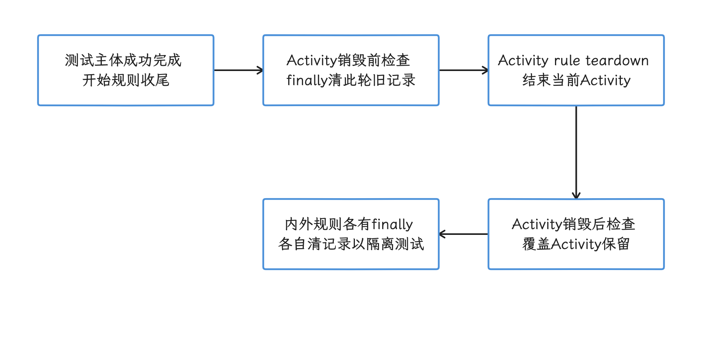

图：规则嵌套决定断言在Activity teardown之前或之后；包装helper可覆盖两侧。 仅成功测试主体触发检查；跨测试清理记录用于隔离，不能代替业务解绑。

CI 可以按执行成本分三层；这里既要求符合规则的 Application Leak 让任务失败，也要保留 dump/分析错误的失败状态：

- PR 检查只跑高流量页面、复杂容器和历史高风险路径，减少设备时间与偶发异步噪声。
- nightly（每天夜间定时执行的测试任务） 扩展页面集合和循环次数，并保存完整 heap analysis 文本。
- 3.0 alpha 的 repeating heap growth（重复执行场景并比较 heap 增长） 能发现“没有明确 lifecycle watch 点、但对象持续增加”的问题；它仍是预览 API，替换不了基于 2.14 的稳定检查。

每条失败至少保存 App commit、依赖锁文件、设备、API、ABI（应用二进制接口/CPU 架构，如 arm64-v8a）、场景 tag（测试场景标签）、leak signature、完整 trace、retained size 和测试次数。只凭 `retainedObjectCount` 没有路径，可靠地去重和定位原因都做不到。

#### 例外规则和误报维护

例外规则只留给已经确认归属的系统或第三方已知问题：

1. matcher 精确到 class、field、厂商、API 和依赖版本，不用宽泛包名前缀。
2. description 关联上游 issue、内部 owner、加入日期、影响范围和删除条件。
3. Application 自己的 singleton、listener、adapter 泄漏不进入 matcher。
4. 临时跳过测试使用 `@SkipLeakDetection` 时写明 issue 原因，并设到期检查；不要在 suite（整组测试集合） 级整体关闭。
5. 升级 SDK 或 Android 版本后，重跑一遍不带自定义 matcher 的对照测试，删除不再命中的规则。

一个 Library Leak 不会因为 CI 不失败就停止占用内存。CI 可以暂时容忍团队修不了的问题，但报告和趋势仍要保留。

### 修复后的验收清单

- 原始步骤能稳定触发旧 signature；只出现一次 retained 通知不足以证明泄漏。
- 修改点切断了 trace 中的 owner → target 强引用，生命周期责任可以从代码审查中说明。
- 相同设备、数据和操作循环下，旧 signature 不再出现。
- Fragment view、Activity、Service、Dialog、WebView 等各自到达预期终点后再 assertion。
- 没有用 WeakReference、扩大延时、提高阈值、清空全局 watcher 或 matcher 重分类来隐藏应用泄漏。
- retained size、对象数和 Java heap 曲线回落；涉及 native / GPU 时，另用对应工具核实。
- instrumentation 用例在 API 37 设备通过，Service watcher 安装和 heap dump / Shark 分析均有日志。
- 少量发布后，原问题维度的线上指标有所改善；无改善时回到内存类型和复现假设重新判断。


## 线上泄漏、OOM 与资源监控

开发期确认引用模式之后，线上方案还要回答另一组问题：多久触发一次、一次 dump 花多少开销、文件多大、怎么上传。KOOM 的三个模块各有各的判定逻辑，我们按问题域逐个看。

### Android 17 可用性结论

KOOM 是快手开源的内存专项工具，沿三条路径诊断：Java heap 归 ART 管，native heap 来自 C/C++ 等本地代码的申请，thread 关注线程资源的生命周期；其中 PSS 是按比例分摊共享页后的进程内存，RSS 是进程当前驻留的物理内存。它适合接手的，是已经由 OOM、PSS/RSS 或线程数趋势确认的内存问题；若启动慢、网络慢或列表卡顿还没有明确的内存线索，就先把原因弄清楚，别急着接 KOOM。

截至 2026-10-26，[Maven Central 元数据](https://repo.maven.apache.org/maven2/com/kuaishou/koom/koom-java-leak/maven-metadata.xml)中的最新正式版本仍是 `2.2.2`，最后更新时间为 2024-04-16；KOOM `master` 的 `VERSION_NAME` 已写为 `2.2.3`，该值尚未发布到 Maven Central。当前 `master` 顶部提交（HEAD）仍是 2026-01-12 的 [`df3b8c33f63ab1f23e814c19792314efb653deaf`](https://github.com/KwaiAppTeam/KOOM/commit/df3b8c33f63ab1f23e814c19792314efb653deaf)，构建配置使用 compileSdk 34、targetSdk 30、AGP（Android Gradle Plugin） 7.1.0。compileSdk 决定编译时可见的 API，targetSdk 决定系统采用哪组兼容行为；把这些配置和上游工程构建成功加在一起，也证明不了 Android 17 运行兼容。

更关键的限制写在源码里：

- `DefaultInitTask` 把 `CommonConfig.sdkVersionMatch` 配为 API 21～36；`OOMMonitor` 和 `ForkJvmHeapDumper.dump()` 都读这个可配置布尔值，默认初始化路径会拒绝 API 37。它不是 dumper 内部独立硬编码的 API 上限；`CommonConfig.Builder` 该值默认 false，自定义配置可覆盖，设成 true 也不证明私有 ABI 兼容。
- `ThreadMonitor` 的版本门放行 API 27～34，并调用名为 `isArm64()` 的检查：实际条件拒绝 `SDK_INT <= O`（API 26）或高于 API 34，错误提示中的“P 以下”与这个下界不符。模块 README 写的“Android N+”也不能替代实现；版本门放行仍需运行验证。
- `LeakMonitor` 检查 API 24+ 和同一个 `isArm64()`，没有 API 上限。该 helper 把 `VMRuntime.is64Bit() == true` 或 `Unsafe.addressSize() == 8` 直接映射为 ARM64，所以 64 位 x86 也可能被误认；实际 2.2.2 native/thread AAR 仅含 arm64-v8a `.so`。采用方须核对当前进程 ISA、打包 ABI 和加载结果，不能把 helper 返回 true 当作 API 37/arm64 可用证明。
- Maven `2.2.2` 的发布时间早于上游 2025 年的 Android 15 fast dump 修改和 2025-10-21 的 16 KB page-size 修改，这两批改动算不进正式产物。

所以，在 Android 17 项目里，`2.2.2` 当不了直接接入的生产依赖；当前 `master` 也要按实际启用模块处理配置门、私有实现兼容与最终制品，分别验收后再发布。采用方要维护自己的 source fork（从官方源码派生的自有分支），并按启用模块分别验证：Java fast dump 依赖 ART 私有符号，native leak 依赖平台内部的 `libmemunreachable` 和函数 Hook，thread leak 依赖 pthread Hook，所有随包 `.so` 还要通过 16 KB ELF 加载段对齐检查。没有这项维护预算，就优先保留系统退出记录、本地 Profiler/Perfetto 和 LeakCanary，暂不把 KOOM 加进生产依赖。

<!-- gracker-diagram: ch17-03-18-config-and-isa -->
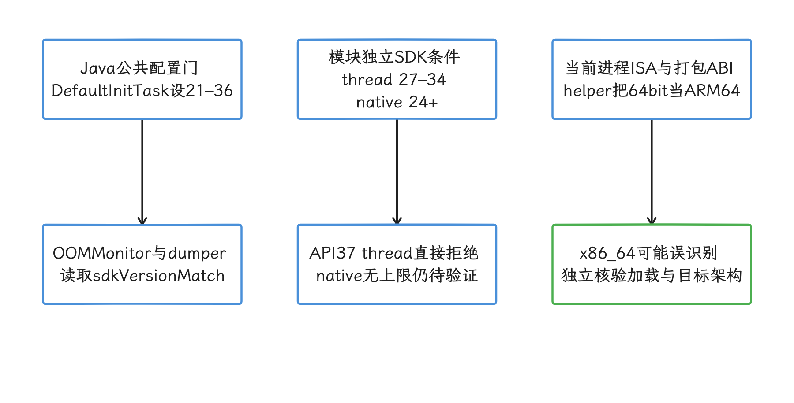

图：默认配置门、模块SDK条件和当前进程ISA各自决定是否进入下一阶段。 把公共布尔值改true或位宽helper通过，都不证明私有ABI可用。

### 三个模块分别看什么

读下表前先统一几个词的说法：FD（file descriptor，文件描述符） 是进程打开文件、socket 等内核对象时使用的整数句柄。Hprof 是 Java/ART 堆快照，Shark 是 LeakCanary 使用的 Hprof 分析引擎。Hook 指把目标函数调用转到监控代理函数，能看到什么取决于实际改写了哪些入口。

| 模块 | 观察对象 | 源码中的触发与产物 | 当前边界 |
|---|---|---|---|
| `koom-java-leak` | Java heap，以及线程数、FD 数等 OOM 前兆 | 主进程在前台时轮询；命中条件后用 `fork()` 派生子进程，生成原始 Hprof，再由 Shark 生成引用链 JSON | 默认初始化将公共配置门设为 API 21～36；自动路径不会裁剪 Hprof；dump 和分析仍有内存、I/O 与磁盘成本 |
| `koom-native-leak` | 被 Hook 的 app `.so` 中尚未释放的 native 分配块 | Hook 分配/释放函数，将活跃分配与 `libmemunreachable` 结果求交集，产出大小、线程、相对地址和 so 名 | API 24+、意图 arm64；位宽 helper 不能精确辨别 ISA；依赖私有库与文本格式，API 37 待验证 |
| `koom-thread-leak` | 已退出、却没有 `detach` 或 `join` 的 joinable pthread | Hook `pthread_create`、`pthread_detach`、`pthread_join`、`pthread_exit`，延迟上报创建栈和生命周期时间 | 源码版本门放行 API 27～34、意图 arm64；同样需独立核验 ISA；不能识别仍然活着的 `WAITING` 线程或无界线程池 |

joinable pthread 是 POSIX 线程，必须由另一个线程调用 `pthread_join` 才能回收资源；调用 `pthread_detach` 后，系统会在它退出时自动回收。回到工具分工：普通内存指标回答“进程用了多少”，KOOM 尝试回答“什么对象、分配或线程生命周期值得怀疑”，Android Studio Profiler 和 Perfetto 适合观察时间线、内存分区与复现过程，LeakCanary 则专注可复现的 Java/Kotlin 对象保留。四类工具各自证明各自的范围，互相替换不了。

<!-- gracker-diagram: ch17-03-19-module-evidence -->
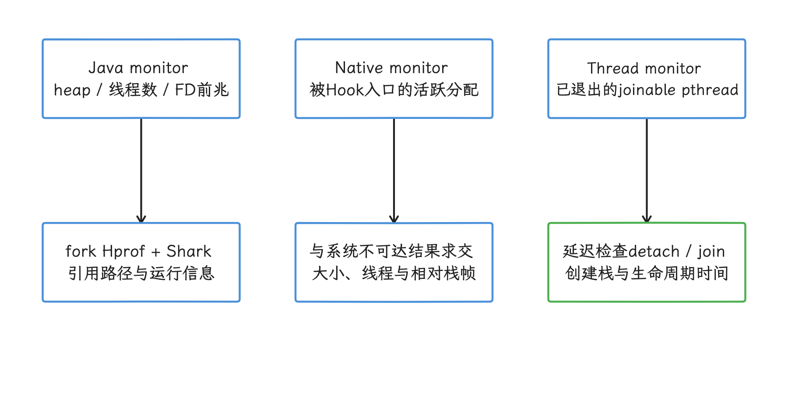

图：Java前兆、native分配和退出pthread资源使用不同的候选条件与报告。 三条路径都受实际采集范围限制；指标或报告存在不等于问题已被确认。

### Java heap：触发条件与常见误读

#### 源码会在什么条件下 dump

`OOMMonitor` 只在主进程工作，默认每 15 秒刷新一次 `SystemInfo`，再依次运行以下 tracker（周期性判定规则）：

| Tracker | 默认条件 | 会不会触发 Hprof |
|---|---|---|
| `HeapOOMTracker` | heap 使用率连续 3 次超过阈值，且每次下降不超过 5 个百分点；最大堆 ≥502 MiB 时 80%，≥246 MiB 时 85%，其余 90% | 会 |
| `ThreadOOMTracker` | 默认超过 750；厂商为 HUAWEI 且 API≤26 时为 450（上游 ROM 字段简化标作 EMUI）；连续 3 次均超过阈值且较上次下降不超过 50 | 会，同时暂存 <code>/proc/<wbr>self/<wbr>task/*/<wbr>comm</code> |
| `FdOOMTracker` | FD 数超过 1000，连续 3 次均超过阈值且较上次下降不超过 50 | 会，同时暂存 `/proc/self/fd` 链接 |
| <code>FastHugeMemory<wbr>OOMTracker</code> | heap 使用率超过 90%，或已有上次样本时，使用量增长超过 350000 KiB（约 341.8 MiB） | 立即触发 |
| <code>PhysicalMemory<wbr>OOMTracker</code> | 设备可用内存比例低于 5% 等区间 | 不会；当前实现只写日志，`return true` 已被注释 |

这套触发器里没有“连续 GC 后仍存活”的独立条件，PSS/RSS 阈值也不会直接触发 dump；PSS、RSS 和 VSS（Virtual Set Size） 只是进入运行信息和报告，其中 VSS 表示进程虚拟地址空间总量。报告里出现某个字段，说明不了它参与了触发判断。

<!-- gracker-diagram: ch17-03-20-tracker-trigger -->
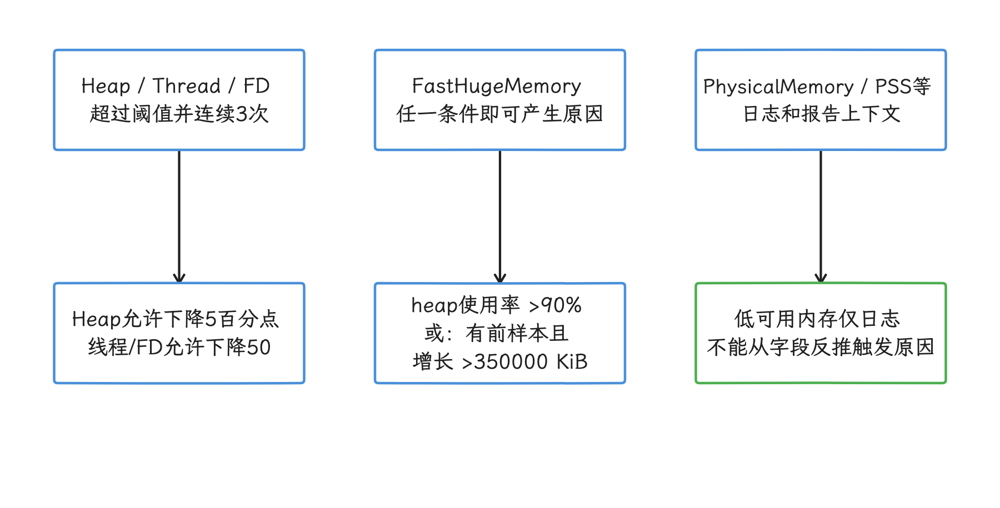

图：默认15秒刷新，常规连续规则与FastHuge直接规则都可以产生dump原因。 PSS/RSS/VSS只是报告字段；PhysicalMemory当前返回false，不直接触发Hprof。

进程进入后台时，应用生命周期的 `ON_STOP` 事件会停掉轮询，回到前台后才恢复；执行分析的 Android Service 也会等进程回到前台。每个监控进程生命周期最多发起一次自动 dump 尝试，非 debug 构建还配置了“每版本 5 次、首个 15 天内”的分析额度。注意源码是在次数已经 `> 5` 时才拒绝，计数恰好为 5 时仍可能再分析一次。接入方若要求严格上限，需要自己修正这个判断；命中期限或次数限制后，监控循环结束，本次不再生成 Hprof。计数是在调用分析 Service 前增加，也不是“成功分析份数”。版本前缀来自配置的 [`versionNameInvoker`](https://github.com/KwaiAppTeam/KOOM/blob/df3b8c33f63ab1f23e814c19792314efb653deaf/koom-monitor-base/src/main/java/com/kwai/koom/base/MonitorBuildConfig.kt)；`DefaultInitTask` 的示例值是常量 `1.0.0`，接入方必须改为自己的版本标识，才能按预期分隔额度。15 天窗口从该前缀下首次写入 `first_analysis_time` 起算，不能直接当成安装时间或成功分析时间。

这些默认值是上游策略，换一个应用未必安全。业务接入至少还要加上远程开关、按设备能力分组、随机采样、交互状态、剩余磁盘、电量和两次采集之间的冷却时间；同样是 90%，在 128 MB heap 和 512 MB heap 的进程里含义不同，单看比例也区分不了有意保留的图片缓存和失控增长。

<!-- gracker-diagram: ch17-03-21-foreground-budget -->
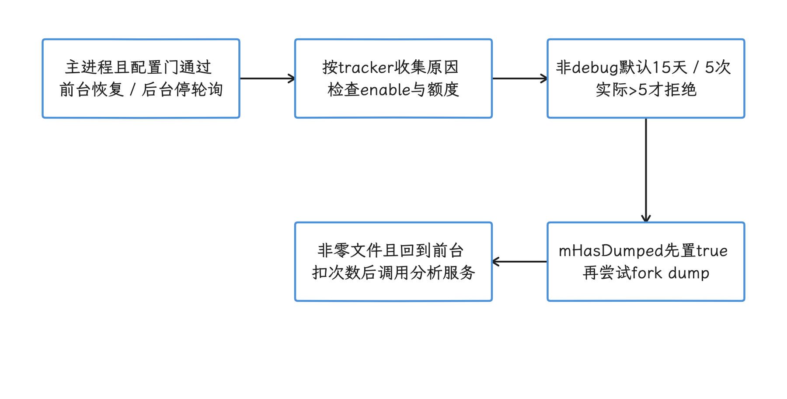

图：前台轮询、触发条件、分析额度和一次自动尝试状态逐层约束采集。 次数在Service调用前增加；上游>5才拒绝，失败也可能耗尽本进程dump机会。

#### fork dump 的停顿与资源开销

KOOM fast dump 的基本顺序是暂停 ART、调用 `fork()`、恢复父进程，再让子进程写 Hprof。`fork()` 出的子进程先与父进程共享内存页，copy-on-write（写时复制） 只在某一方修改页面时复制该页，所以创建子进程的瞬间并不会复制整块堆；但父子进程随后修改的页面仍会增加物理内存，子进程也要消耗 CPU、文件 I/O 和磁盘。可用内存已经很低时，诊断动作本身可能失败，也可能加快进程退出。

<!-- gracker-diagram: ch17-03-22-fork-and-cow -->
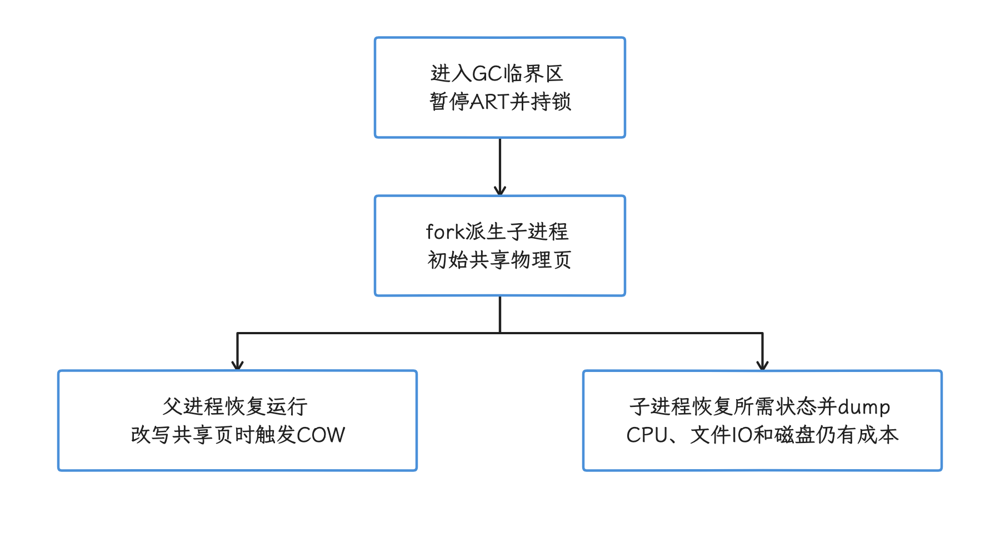

图：ART暂停后fork，父进程恢复，子进程写Hprof；后续写共享页可能增加物理内存。 COW不代表零内存开销；私有符号、布局与线程状态必须按目标系统验证。

这一实现不属于公开 Android SDK：`koom-fast-dump` 按 mangled name 从 `libart.so` 解析 `art::ScopedSuspendAll`、`art::gc::ScopedGCCriticalSection`、ART 锁和 `art::hprof::DumpHeap` 等私有符号，并用预留字节模拟部分对象布局。固定 A17 的 `DumpHeap` 仍有对应三参数实现，但符号存在并不保证导出、可解析、函数类型、对象布局或线程状态安全。API 37 必须逐项验证；覆盖默认公共配置门只会跳过策略检查。

自动路径还有独立的失败边界：`mHasDumped = true` 发生在实际 dump 前，调用方忽略 `dump()` 的布尔返回值，之后 `sleep(1000)` 也不是 `fsync()` 或持久化保证。`startAnalysisService()` 会拒绝并删除零长度文件，但非零不等于有效 Hprof；native `ResumeAndWait()` 只检查子进程正常退出，没有检查退出码必须为 0。接入方应分别验收返回值、退出状态、文件完整性、分析结果与失败后是否允许重试。

<!-- gracker-diagram: ch17-03-23-dump-attempt-results -->
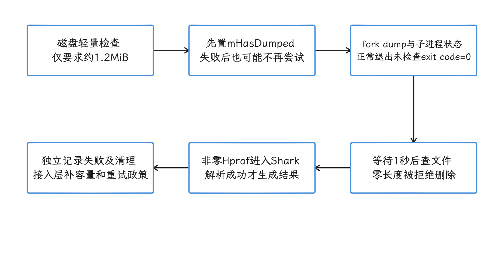

图：一次自动尝试还要分别核验返回值、子进程退出、文件完整性和Shark结果。 源码忽略dump布尔值，sleep不是fsync；非零文件也可能损坏。

还要分清两条 dump 路径：

- `OOMMonitor.dumpAndAnalysis()` 调用 `ForkJvmHeapDumper`，分析成功后把 Hprof 标为 `ORIGIN`（原始堆快照），再交给接入方配置的 uploader。
- 源码保留了 `ForkStripHeapDumper`，README 的手动示例也会使用它，但自动监控路径没有调用它。

所以 KOOM 的自动路径不会产出裁剪版 Hprof：上传器若传输原始文件，里面可能有字符串、账号数据、图片字节、业务对象和第三方 SDK 状态。生产环境更稳妥的做法是在设备内完成分析，只上传经过筛选的 JSON；确需保留 Hprof 时，单独取得授权，并使用应用私有目录、短保留期、加密传输和服务端访问审计。

#### 报告能回答什么

上游 `HeapReport` 的 `RunningInfo` 包含 JVM 最大/已用内存、VSS/PSS/RSS、线程数、FD 数及列表，以及 SDK、厂商、机型、应用版本、当前页面、使用时长、设备总内存/可用内存和触发原因。`GCPath` 保存 GC Root、引用路径、实例数、泄漏原因，以及按引用链计算的 SHA-1 摘要；另外还有类实例统计和可疑对象信息。`RunningInfo` 多数是字符串；分析 Service 把 PSS/RSS/VSS 换算为以 1024 为基数的 MiB 后拼上 `mb`，不能直接把这些字符串当作下文协议里的 KiB 数值。

引用链只是从 GC Root 到可疑对象的路径，单凭它还定不了“对象已经泄漏”：静态单例保留已销毁 `Activity` 通常证据很强，仍在执行的异步任务、合法缓存和进程级对象则要结合生命周期再判断。修复后我们在同一路径上重复进入和退出页面，配合 LeakCanary 或 Profiler 确认对象数量回落，再观察小比例发布（常称灰度）中同一摘要的样本是否下降。

`OOMFileManager.isSpaceEnough()` 只要求大约 1.2 MiB 可用空间，远低于真实 Hprof 可能需要的容量。生产接入要按“预计 Hprof 大小 + 分析临时文件 + 安全余量”计算配额，并设置单文件上限、目录总量、过期清理和失败退避（失败次数越多，下一次重试等待越久）。上游这项轻量检查，当不成完整的磁盘保护。

### Native leak：候选来自两份数据的交集

Native 模块先用 xhook 改写目标 `.so` 的 PLT（Procedure Linkage Table，共享库调用外部函数时使用的跳转表），拦截 `malloc`、`realloc`、`calloc`、`memalign`、`posix_memalign` 和 `free`，维护仍未释放的分配记录。检查时再加载 `libmemunreachable.so`（Android 平台内部的 native 不可达内存分析库），解析私有的 `GetUnreachableMemoryString(bool, size_t)` 符号，从文本输出里提取不可达地址；它用 `GetUnreachableMemoryString(false, 1024)` 请求有上限的结果，再匹配起始地址相同、或完整落在不可达区间内的跟踪分配。A17 实现会折叠关联项、排序并限制结果条目，1024 不是“完整扫描全堆只会有 1024 个泄漏”的保证。

这套做法有以下边界：

1. PLT Hook 只覆盖实际经过被 Hook 入口的分配；自定义 allocator（内存分配器）、静态绑定、直接 `mmap`（创建内存映射）、GPU/驱动内存和未选中的 `.so` 都在范围外。
2. 从当前 root 集看已经不可达，比“暂时没有业务引用”更接近泄漏，但扫描时机、库内部缓存和对象生命周期仍可能制造候选；修复结论仍要多轮趋势或可控复现来支撑。
3. `libmemunreachable` 是平台内部组件，Android 17 对应源码 [`system/memory/libmemunreachable@android-17.0.0_r1`](https://android.googlesource.com/platform/system/memory/libmemunreachable/+/refs/tags/android-17.0.0_r1) 仍包含相关能力；但应用进程自行 `dlopen`（运行时加载共享库）、解析 C++ 符号并依赖输出文本格式，这些都没有 SDK 稳定性保证。
4. 未开启本地符号化时，KOOM 的栈帧主要提供 `rel_pc`（相对程序计数器地址） 与 `soName`。服务端必须按应用版本、ABI 和 Build ID（标识一次 native 构建的 ID） 保存未执行 strip、仍含调试符号的准确文件——构建对不上，地址就可能被解析到错误函数。

还要注意候选会被消费：`GetLeakAllocs()` 将匹配项加入结果后立即 `UnregisterAlloc()`，删除的是 KOOM 跟踪记录，没有对真实分配执行 `free()`。因此同一块内存下一轮不再上报，并不能证明它已释放；候选数量也不能当成完整活跃泄漏存量。

<!-- gracker-diagram: ch17-03-24-native-intersection-consumption -->
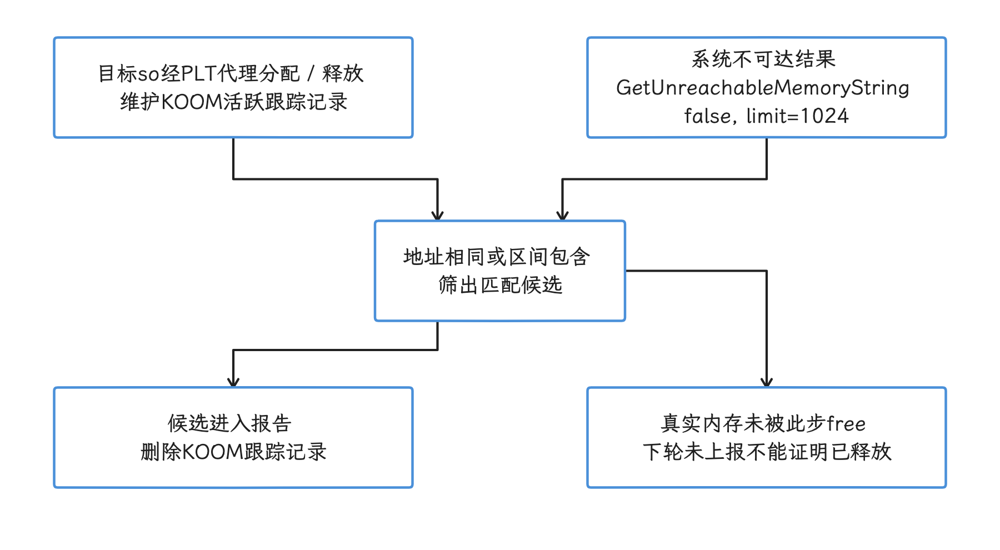

图：系统有界不可达结果与Hook活跃记录匹配，输出候选后移除跟踪项。 输出会折叠与截断；跟踪项删除不是free，报告数量不是完整泄漏存量。

以“每次播放后 RSS 上升 20 MiB”为假设排查场景，这个数值不是实测结果。限定播放器 `.so` 并准备对应符号后，按创建栈找候选；停止播放、销毁实例并等待回收，再使用独立的分配/释放统计、RSS 分区和新采集批次验证。不能要求同一跟踪项持续出现，也不能只凭候选减少认定修复成功。

`LeakMonitorConfig` 还提供分配大小门槛、目标/忽略 `.so`、默认 300 秒扫描周期和本地符号化开关；上游配置注释要求生产环境的扫描间隔不低于 300 秒。周期检测走 `LeakMonitor.call()`；这个方法已弃用，源码推荐业务使用 `checkLeaks()`。阈值大于 0 且已分配 native heap 大于 `nativeHeapAllocatedThreshold` 时，`call()` 提前返回，判断方向与配置注释相反；手动 `checkLeaks()` 在模块已初始化且 start 后才异步排队检查，不走这个阈值判断；stop/uninstall 也在同一 LoopHandler 上排队，方法返回不代表卸载已经完成。接入方需要在调用前自行检查采集条件，并分别测试周期与手动路径，不能依赖这个字段统一限制采集。 另一个时序边界是首次扫描：`start()` 把 `postAtFront=true` 传给公共 `LoopMonitor.startLoop()`，该分支把首轮直接放到队首，忽略所传 delay；300 秒是后续轮询间隔，不是首次扫描必须等待的时间。

<!-- gracker-diagram: ch17-03-26-periodic-manual-native -->
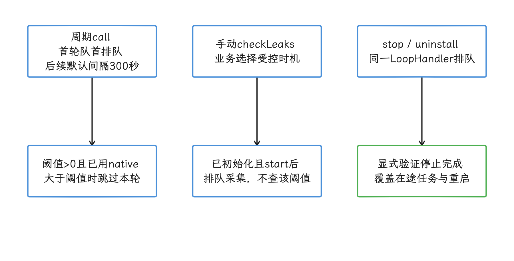

图：周期call首轮队首排队、后续默认间隔300秒；手动checkLeaks需已初始化并start。 阈值方向与注释相反；start/stop经LoopHandler排队，返回不表示卸载已完成。

固定实现还需要修复分配代理的失败路径：非零大小 `realloc(ptr, size)` 因内存不足返回 null 时，旧块仍然有效，但代理先注销旧记录，可能漏掉后续泄漏；`posix_memalign()` 返回错误时，代理仍读取 `*memptr` 并登记、清零，可能访问调用前的旧值或未初始化指针。这与 [POSIX realloc](https://pubs.opengroup.org/onlinepubs/9699919799/functions/realloc.html) 和 [posix_memalign](https://pubs.opengroup.org/onlinepubs/9699919799/functions/posix_memalign.html) 的失败合同不符，必须按返回状态分支，零大小行为另测。`malloc`、`memalign` 和 `posix_memalign` 成功路径还会对结果 `memset`，主动触碰整块申请内存，改变页驻留和成本；不能把监控当作透明旁路。

<!-- gracker-diagram: ch17-03-25-native-allocation-contracts -->
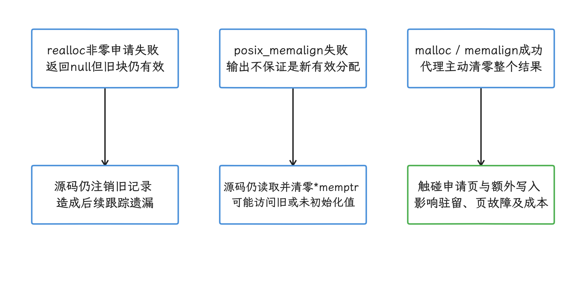

图：分配返回状态必须先决定能否改记录或访问输出，监控的memset也会改变工作负载。 这是固定源码的行为缺口；本次宿主受控用例不等于Android Hook回归。

### Thread leak 的识别范围

线程模块盯的是一种情况：joinable 线程已经退出，却没有被 `pthread_detach` 或 `pthread_join` 回收，超过延迟后才生成 `ThreadLeakRecord`；记录字段是 `tid`（Linux 线程 ID）、创建/开始/结束时间、线程名和创建调用栈。这类错误遗留的是 pthread 资源，线程本身已经结束。

下面几类问题需要另一套观测：

| 问题 | KOOM `ThreadMonitor` 的目标覆盖 | 应补的证据 |
|---|---|---|
| joinable 线程已退出，未 detach/join | 这是目标；仍受 Hook 覆盖和调用结果处理限制 | `ThreadLeakRecord` 创建栈与多设备聚合 |
| 匿名线程仍在运行 | 不能 | `/proc/self/task` 数量、线程名、创建栈或采样栈 |
| 无界线程池持续创建 worker | 不能直接确认 | 线程总量趋势、线程池指标、创建点 |
| 业务线程长期 `WAITING` | 不能 | thread dump、锁/队列所有者、业务生命周期 |
| Binder、RenderThread、GC 等常驻线程 | 不应按存活时间判泄漏 | 系统线程基线和版本/设备对照 |

源码配置没有面向业务的线程允许列表字段，接入方可以在自己的上报与聚合层实现：要求业务线程命名，再按规范化线程名前缀和创建栈归类；系统线程、固定规模线程池和经过评审的常驻 SDK 线程只做趋势监控。允许列表挡不住数量持续增长，同一前缀仍要设进程级上限和增长率告警。

<!-- gracker-diagram: ch17-03-27-thread-resource-state -->
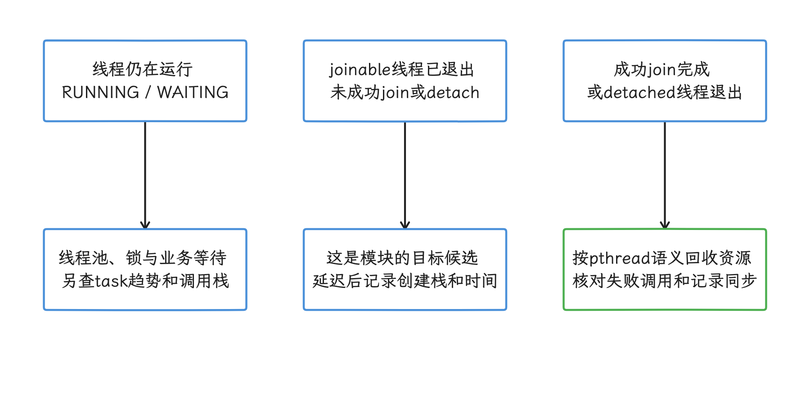

图：运行中线程、退出joinable资源和已成功回收的状态必须分开。 正常WAITING和固定系统线程不按存活时长判泄漏；Hook覆盖与返回语义仍须验证。

`ThreadMonitor.stop()` 经 JNI 调到 `koom::Stop()`，后者先把 native `isRunning` 设为 false 并让 HookLooper 退出；因此不能说 stop 什么也没做。但 `ThreadHooker::Stop()` 本身为空，没有恢复 PLT，Kotlin 的 `mIsRunning` 也未复位，已经进入 start wrapper 的线程仍涉及后续记录时序。接入方要验证停止、在途线程、重复 stop/start 和 Hook 共存，不能把方法返回当成完整卸载。

<!-- gracker-diagram: ch17-03-28-thread-stop-layers -->
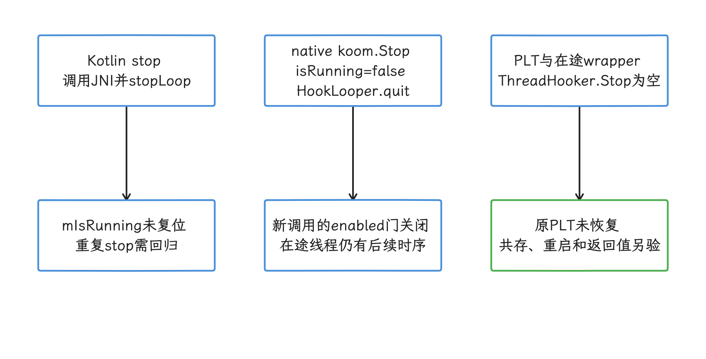

图：Kotlin停止循环、native关标志和退出HookLooper，与恢复PLT入口是不同动作。 ThreadHooker.Stop为空；不能说总stop无作用，也不能把它当作完整卸载。

还要回归 pthread 的行为合同：固定 Hook 在取得 `pthread_detach`/`pthread_join` 返回值之前就投递事件；创建 wrapper 以 `void` 定义并强转成 pthread start routine，调用原 routine 后没有传回其返回值。需在自有 fork 中核对失败调用的记录处理和 `pthread_join` 取得的返回值，保留原函数语义后再谈候选准确率。

### 把系统退出证据放在 KOOM 前面

线上看到“OOM”，先弄清是哪一种退出或内存增长，再决定要不要启动高成本诊断。手头可查的记录有两个来源：`ApplicationExitInfo` 是 Android 11 起提供的历史进程退出记录，Android Vitals 汇总的是 Google Play 线上质量数据。建议按下面这条路径走：

先按版本、机型、进程和页面聚合退出率、PSS/RSS 或线程数异常，再核对系统退出记录与复现时间线。按 Java heap、native/RSS、线程/FD 选择专项工具，保存引用链、精确构建符号或创建栈，最后用同条件修复对照验证。

<!-- gracker-diagram: ch17-03-29-system-first-triage -->
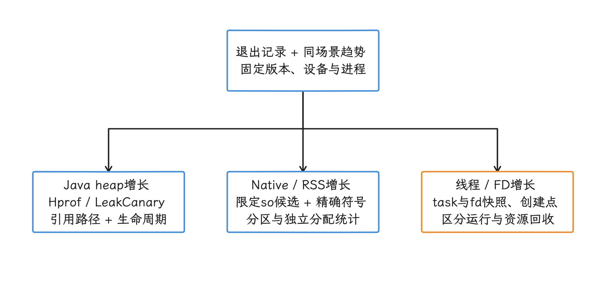

图：先固定退出与趋势证据，再按Java、native和线程/FD选择专项采集。 PSS上升不能单独证明Java泄漏，Native候选减少也不能证明已释放。

这条路径把退出事实、内存分区和专项排查分开：Java、native、thread 的修复人和验证工具通常不同，PSS 上升本身也证明不了 Java heap 泄漏。

#### `ApplicationExitInfo` 的版本边界

Android 11 / API 30 起，可以在下次启动后通过 `ActivityManager.getHistoricalProcessExitReasons()` 查询退出记录。调用会经 Binder 跨进程进入 `system_server`（承载 Android 核心系统服务的进程），我们不宜把它同步放在冷启动主线程。解释结果时留三个余量：

- 先用 `ActivityManager.isLowMemoryKillReportSupported()` 判断设备是否支持 `REASON_LOW_MEMORY`；不支持时，内存压力导致的杀进程可能只显示 `REASON_SIGNALED` 和 `SIGKILL`（不能被应用捕获的强制终止信号）。
- `getPss()`、`getRss()` 是系统最近一次采样值，可能为 0，也不保证贴近退出瞬间。
- `getTraceInputStream()` 通常在 ANR（Application Not Responding，应用无响应） 时有 trace；API 31 起，`REASON_CRASH_NATIVE` 还可返回 protobuf 格式的 tombstone（原生崩溃转储）。trace 存在系统全局循环缓冲区中，可能被本应用或其他应用的后续崩溃记录覆盖而返回 `null`。进程从 ANR 恢复后以其他原因退出，也可能保留此前的 ANR trace，不能据此直接判定退出原因；OOM/LMK（low memory kill，低内存终止） 未必带可读 trace。

Android 8～10 没有 `ApplicationExitInfo`，这部分设备要结合 Android Vitals、本地复现、版本级 PSS/RSS 趋势和受控日志判断。现代 Android 的内存回收决策由用户空间的 `lmkd`（low memory killer daemon，低内存终止守护进程） 按内存压力与进程优先级执行，Android 17 对应的平台源码是 [`system/memory/lmkd@android-17.0.0_r1`](https://android.googlesource.com/platform/system/memory/lmkd/+/refs/tags/android-17.0.0_r1)；相关判断并不直接依赖 `android17-6.18-2026-06_r39` 标签下的某段内核代码，API 37 的机制也别再用旧式“内核 lowmemorykiller 日志”来概括。

<!-- gracker-diagram: ch17-03-30-exit-record-evidence -->
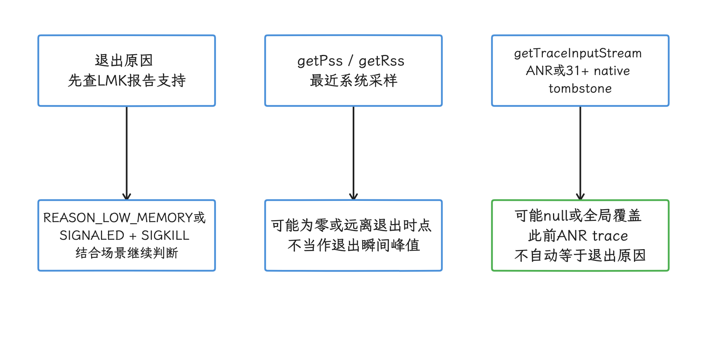

图：API30+异步查询历史记录，退出原因、最近内存采样和可选trace分别解释。 不支持LMK原因时可能仅SIGKILL；trace可被覆盖，也可能来自退出前恢复过的ANR。

#### `onTrimMemory` 压力信号的变化

`ComponentCallbacks2.onTrimMemory()` 在历史版本上可用于补充进程状态，但 Android 14 起系统只向应用交付 `TRIM_MEMORY_UI_HIDDEN`、`TRIM_MEMORY_BACKGROUND`，其余旧常量已在 Android 15 / API 35 正式废弃。`UI_HIDDEN` 表示 UI 转入不可见，`BACKGROUND` 表示后台进程已成为回收候选，两者都不是“系统将在固定时间内杀进程”的倒计时。我们接入时以自身 heap/RSS/线程趋势和系统退出记录为主，别再等旧压力级别来触发 dump。

PSS 适合在分摊共享页后比较进程总体内存，RSS 表示当前驻留的物理页，Java heap 只覆盖 ART 管理的堆。Java heap 平稳、RSS/PSS 却持续上升时，排查重点可以移向 native、graphics、`mmap` 或线程栈；复现环境里继续用 `dumpsys meminfo` 与 Perfetto memory counters（内存计数轨道） 区分内存去向。

<!-- gracker-diagram: ch17-03-31-memory-and-trim-signals -->
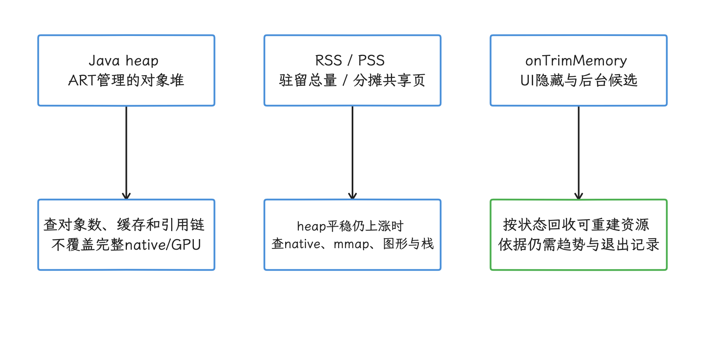

图：ART对象堆、进程驻留及应用状态回调回答不同问题。 API34起不交付旧压力级别；UI_HIDDEN/BACKGROUND都不是杀进程倒计时。

### 端侧报告的复现与采集边界

KOOM 原始结构之外，平台通常还需要样本、构建和业务上下文。下面是一份 `java_heap` 事件的合成外层示例，数值不是实测，API 37 也不表示本次已通过设备验证。`app_build_id` 标识 App 构建；PSS/RSS 统一用 KiB，需先转换 KOOM 原始带 `mb` 的字段。native/thread 类型另定义自己的 evidence，不能在一条记录中虚构三类证据：

```json
{
  "sample_id": "opaque-random-id",
  "kind": "java_heap",
  "app_version": "17.3.0",
  "abi": "arm64-v8a",
  "api_level": 37,
  "page": "PlayerDetail",
  "process_state": "foreground",
  "trigger": {
    "java_heap_bytes": 412000000,
    "thread_count": 812,
    "fd_count": 438,
    "pss_kib": 536000,
    "rss_kib": 601000
  },
  "evidence": {
    "gc_path_signature": "example-signature",
    "analysis_status": "success",
    "scenario_tag": "player-open-close"
  },
  "app_build_id": "app-17.3.0-example"
}
```

事件外层只保存定位所需的摘要：`kind` 表示这份记录的类型，决定哪些 `evidence` 字段有效，别为了方便查询，给每条事件填入并不存在的 GC path、native stack 或线程状态。账号、URL query（问号后的查询参数）、消息正文、图片字节和完整对象字段，先删除不需要的敏感内容；确需聚合的字段采用受控标识。散列仍可能被关联，不能自动视为匿名数据。

<!-- gracker-diagram: ch17-03-32-report-governance -->
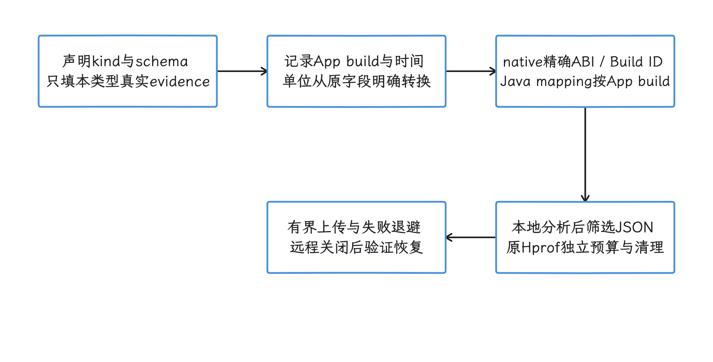

图：协议先声明类型与单位，再绑定对应证据、精确构建和采集状态。 JSON数值为合成示例；摘要、原Hprof和符号各有生命周期，散列不自动等于匿名。

文件治理至少包括：

- 设备端先生成 JSON 摘要，原始 Hprof 默认不上报。
- dump 前检查预计容量，设置单文件上限、目录总配额和过期时间；失败后指数退避。
- 只在命中远程开关、采样和设备能力条件时加载对应模块；内存容量小、磁盘不足、设备过热或用户正在高频交互时跳过。
- native 符号按版本、ABI、Build ID 保存；Java 混淆映射按构建号保存。
- 上传任务使用约束网络与充电策略；进程被杀后，同一个大文件要限制重试次数。
- 远程关闭后验证 monitor、Hook、子进程和临时文件均停止或被清理。

### Android 17 移植清单

把 KOOM 带到 API 37，改一处 `SDK_INT` 远远不够。以下验证至少完成，才谈得上从实验依赖转为小比例发布依赖：

1. 从明确的 KOOM commit hash（提交哈希） 构建，不把 Maven `2.2.2` 与 `master` 的 Android 15/16 KB 修改混在同一个版本描述里。
2. 审阅 `DefaultInitTask` 对 `CommonConfig.sdkVersionMatch` 的赋值及 dumper 对它的读取；对每个私有 ART 符号做启动时解析、失败降级和真机 dump 测试。
3. 在 Android 17 / API 37 上测试大堆、并发分配、前后台切换、dump 超时、子进程被杀、磁盘不足和重复启动。
4. 对 native monitor 验证 `libmemunreachable.so` 加载、符号解析、`ptrace`/进程 dumpable 条件、结果文本解析、xhook 与目标 allocator 覆盖率，以及分配失败、候选消费、主动清零和异步卸载。`ptrace` 和 dumpable 状态共同影响一个进程能否被检查或读取。
5. 不启用 thread monitor，除非已完成 API 37 适配；上游源码当前会直接拒绝。适配后还要覆盖 create/detach/join/exit、线程复用和 stop/start。
6. 以当前进程 ISA 与实际打包 ABI 核验 native/thread 模块，其他 ABI 明确禁用，不依赖上游位宽 helper 充当精确白名单；同时统一 `c++_shared` / `c++_static（C++ 运行库动态/静态链接）` 策略，避免 `libc++_shared.so` 冲突。
7. 使用 NDK（Native Development Kit，本地开发工具包） r28+ 重编所有 native 产物，并对最终 APK/AAB 执行 16 KB ELF 与 ZIP 对齐检查。上游 `master` 升到 NDK `28.2.13676358` 不能证明所有产物已重建或满足对齐；r28+ 是常见构建路线，也可按官方指南配置旧版工具链，最终以实际 `.so` 和安装包为准。
8. 在 Android 17 的 16 KB 设备或官方模拟环境中，用 `fatal` 模式关闭 page-size 兼容并运行专项用例。API 37 的 4 KB 设备通过只能覆盖该设备环境，不能证明 16 KB 页大小兼容；API、ISA 与页大小要分别记录。
9. 对比启用组和关闭组的启动时间、帧停顿、ANR、OOM/LMK、PSS 峰值、磁盘写入与电量，确认诊断收益高于监控成本。
10. 修复后用同一压测脚本复测，并观察至少一个小比例发布周期内的同一问题摘要所覆盖的设备数与退出率；单次 report 消失不算验证完成。

检查 16 KB 产物时，Android 官方建议对 ELF LOAD segment 和 APK ZIP 对齐分别验证。下面两条命令分别检查 native 库的段对齐与最终 APK 的包内对齐：

```bash
llvm-objdump -p path/to/libkoom-fast-dump.so | grep LOAD
zipalign -c -P 16 -v 4 app-release.apk
```

第一条输出中的 `LOAD` segment 对齐应至少为 `2**14`，也就是 16384 字节；第二条必须对最终交付 APK 执行。AAB 还要用当前 bundletool 生成对应 APK 后再查，只验中间产物不够。

<!-- gracker-diagram: ch17-03-33-porting-three-axes -->
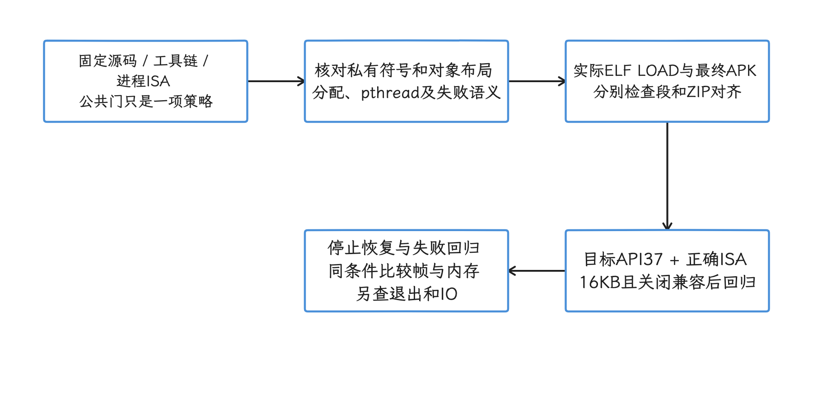

图：移植要同时通过私有行为合同、最终制品对齐和目标系统运行，再做监控成本对照。 10个KOOM2.2.2 ELF的LOAD均4096只是静态事实；本次未运行最终APK、API37或16KB设备。


## 参考资料

- [KOOM `CommonConfig` 的可配置版本门](https://github.com/KwaiAppTeam/KOOM/blob/df3b8c33f63ab1f23e814c19792314efb653deaf/koom-monitor-base/src/main/java/com/kwai/koom/base/CommonConfig.kt)
- [KOOM 实际 ABI helper](https://github.com/KwaiAppTeam/KOOM/blob/df3b8c33f63ab1f23e814c19792314efb653deaf/koom-monitor-base/src/main/java/com/kwai/koom/base/Monitor_Process.kt)
- [KOOM native 分配代理与候选删除](https://github.com/KwaiAppTeam/KOOM/blob/df3b8c33f63ab1f23e814c19792314efb653deaf/koom-native-leak/src/main/jni/src/leak_monitor.cpp)
- [KOOM native 不可达结果提取](https://github.com/KwaiAppTeam/KOOM/blob/df3b8c33f63ab1f23e814c19792314efb653deaf/koom-native-leak/src/main/jni/src/memory_analyzer.cpp)
- [KOOM 线程总停止入口](https://github.com/KwaiAppTeam/KOOM/blob/df3b8c33f63ab1f23e814c19792314efb653deaf/koom-thread-leak/src/main/cpp/src/koom.cpp)
- [Android 17 不可达结果折叠与条目上限](https://android.googlesource.com/platform/system/memory/libmemunreachable/+/refs/tags/android-17.0.0_r1/MemUnreachable.cpp)
- [LeakCanary alpha9 SDK 版本配置](https://github.com/square/leakcanary/blob/bac94a74fa87ed807c31a42b4d495bbfdcede33a/gradle/libs.versions.toml)

- [LeakCanary 2.14 源码锚点](https://github.com/square/leakcanary/tree/8d29638ccf25e15d84b0119b6617f0069bc0b2d8)
- [LeakCanary 3.0-alpha-9 源码锚点](https://github.com/square/leakcanary/tree/bac94a74fa87ed807c31a42b4d495bbfdcede33a)
- [Maven Central `leakcanary-android` 版本元数据](https://repo.maven.apache.org/maven2/com/squareup/leakcanary/leakcanary-android/maven-metadata.xml)
- [LeakCanary 工作流程](https://square.github.io/leakcanary/fundamentals-how-leakcanary-works/)
- [Leak trace 阅读与修复](https://square.github.io/leakcanary/fundamentals-fixing-a-memory-leak/)
- [LeakCanary 2.14 配置与 release retained count](https://square.github.io/leakcanary/recipes/)
- [Instrumentation 泄漏检测](https://square.github.io/leakcanary/ui-tests/)
- [实验性的 release heap analysis](https://square.github.io/leakcanary/leakcanary-for-releases/)
- [2.14 `ObjectWatcher.kt`](https://github.com/square/leakcanary/blob/8d29638ccf25e15d84b0119b6617f0069bc0b2d8/leakcanary-object-watcher/src/main/java/leakcanary/ObjectWatcher.kt)
- [2.14 `AppWatcher.kt`](https://github.com/square/leakcanary/blob/8d29638ccf25e15d84b0119b6617f0069bc0b2d8/leakcanary-object-watcher-android-core/src/main/java/leakcanary/AppWatcher.kt)
- [2.14 SDK 构建参数](https://github.com/square/leakcanary/blob/8d29638ccf25e15d84b0119b6617f0069bc0b2d8/build.gradle)
- [2.14 自动安装 manifest](https://github.com/square/leakcanary/blob/8d29638ccf25e15d84b0119b6617f0069bc0b2d8/leakcanary-object-watcher-android/src/main/AndroidManifest.xml)
- [2.14 `LeakCanary.Config`](https://github.com/square/leakcanary/blob/8d29638ccf25e15d84b0119b6617f0069bc0b2d8/leakcanary-android-core/src/main/java/leakcanary/LeakCanary.kt)
- [2.14 `MainProcessAppWatcherInstaller.kt`](https://github.com/square/leakcanary/blob/8d29638ccf25e15d84b0119b6617f0069bc0b2d8/leakcanary-object-watcher-android/src/main/java/leakcanary/internal/MainProcessAppWatcherInstaller.kt)
- [2.14 `HeapDumpTrigger.kt`](https://github.com/square/leakcanary/blob/8d29638ccf25e15d84b0119b6617f0069bc0b2d8/leakcanary-android-core/src/main/java/leakcanary/internal/HeapDumpTrigger.kt)
- [2.14 `ServiceWatcher.kt`](https://github.com/square/leakcanary/blob/8d29638ccf25e15d84b0119b6617f0069bc0b2d8/leakcanary-object-watcher-android-core/src/main/java/leakcanary/ServiceWatcher.kt)
- [Android 17 `Debug.dumpHprofData()`](https://android.googlesource.com/platform/frameworks/base/+/android-17.0.0_r1/core/java/android/os/Debug.java)
- [Android 17 `ActivityThread` 初始化顺序与 Service 停止流程](https://android.googlesource.com/platform/frameworks/base/+/android-17.0.0_r1/core/java/android/app/ActivityThread.java)
- [Android 17 `Build.VERSION_CODES` 常量](https://android.googlesource.com/platform/frameworks/base/+/android-17.0.0_r1/core/java/android/os/Build.java)
- [Android 17 `ActivityManager.IActivityManagerSingleton`](https://android.googlesource.com/platform/frameworks/base/+/android-17.0.0_r1/core/java/android/app/ActivityManager.java)
- [Android 17 `Handler.mCallback`](https://android.googlesource.com/platform/frameworks/base/+/android-17.0.0_r1/core/java/android/os/Handler.java)

- [KOOM 当前审阅锚点 `df3b8c33`](https://github.com/KwaiAppTeam/KOOM/tree/df3b8c33f63ab1f23e814c19792314efb653deaf)
- [KOOM v2.2.2 release](https://github.com/KwaiAppTeam/KOOM/releases/tag/v2.2.2)
- [Maven Central：`koom-java-leak` 元数据](https://repo.maven.apache.org/maven2/com/kuaishou/koom/koom-java-leak/maven-metadata.xml)
- [KOOM `gradle.properties`（`VERSION_NAME=2.2.3`）](https://github.com/KwaiAppTeam/KOOM/blob/df3b8c33f63ab1f23e814c19792314efb653deaf/gradle.properties)
- [KOOM 构建版本配置](https://github.com/KwaiAppTeam/KOOM/blob/df3b8c33f63ab1f23e814c19792314efb653deaf/build.gradle)
- [KOOM `DefaultInitTask` 的 API 21～36 版本门](https://github.com/KwaiAppTeam/KOOM/blob/df3b8c33f63ab1f23e814c19792314efb653deaf/koom-monitor-base/src/main/java/com/kwai/koom/base/DefaultInitTask.kt)
- [`ForkJvmHeapDumper` 读取公共配置门](https://github.com/KwaiAppTeam/KOOM/blob/df3b8c33f63ab1f23e814c19792314efb653deaf/koom-fast-dump/src/main/java/com/kwai/koom/fastdump/ForkJvmHeapDumper.java)
- [`OOMMonitor` 的自动 dump/分析路径](https://github.com/KwaiAppTeam/KOOM/blob/df3b8c33f63ab1f23e814c19792314efb653deaf/koom-java-leak/src/main/java/com/kwai/koom/javaoom/monitor/OOMMonitor.kt)
- [`LeakMonitor` 的 API/ABI 门与阈值判断](https://github.com/KwaiAppTeam/KOOM/blob/df3b8c33f63ab1f23e814c19792314efb653deaf/koom-native-leak/src/main/java/com/kwai/koom/nativeoom/leakmonitor/LeakMonitor.kt)
- [`LeakMonitorConfig` 的阈值注释与生产扫描间隔](https://github.com/KwaiAppTeam/KOOM/blob/df3b8c33f63ab1f23e814c19792314efb653deaf/koom-native-leak/src/main/java/com/kwai/koom/nativeoom/leakmonitor/LeakMonitorConfig.kt)
- [KOOM `ThreadMonitor` 的 API 27～34 版本门与 arm64 限制](https://github.com/KwaiAppTeam/KOOM/blob/df3b8c33f63ab1f23e814c19792314efb653deaf/koom-thread-leak/src/main/java/com/kwai/performance/overhead/thread/monitor/ThreadMonitor.kt)
- [KOOM thread Hook 与空 `Stop()` 实现](https://github.com/KwaiAppTeam/KOOM/blob/df3b8c33f63ab1f23e814c19792314efb653deaf/koom-thread-leak/src/main/cpp/src/thread/thread_hook.cpp)
- [Android 15 fast dump 合入提交](https://github.com/KwaiAppTeam/KOOM/commit/f653d7c986debb242b1d8b96761351f63d9f04bf)
- [16 KB page-size 修改提交](https://github.com/KwaiAppTeam/KOOM/commit/aae5a7c9212bd70c52d6b36ef631d6f5e6fb0fa1)
- [Android 17 ART 源码 `android-17.0.0_r1`](https://android.googlesource.com/platform/art/+/refs/tags/android-17.0.0_r1)
- [Android 17 `libmemunreachable` 源码 `android-17.0.0_r1`](https://android.googlesource.com/platform/system/memory/libmemunreachable/+/refs/tags/android-17.0.0_r1)
- [ApplicationExitInfo API 文档](https://developer.android.com/reference/android/app/ApplicationExitInfo)
- [Android 应用内存管理](https://developer.android.com/topic/performance/memory)
- [`ComponentCallbacks2` 的 trim 级别与废弃说明](https://developer.android.com/reference/android/content/ComponentCallbacks2)
- [Android 16 KB page-size 兼容指南](https://developer.android.com/guide/practices/page-sizes)
- [Android 17 common kernel `r39` 标签](https://android.googlesource.com/kernel/common/+/refs/tags/android17-6.18-2026-06_r39)
