# DoKit 调试工具与 Measure APM 平台

DoKit 提供应用内调试面板和多类检查插件，适合 Debug / QA 现场复现；Measure 是覆盖端侧采集、会话时间线、查询告警与自托管服务的生产 APM 平台。两者都能提供性能线索，但各自所处的接入阶段、承担的数据责任和发布要求完全不同。本文分别核对两者的采集能力、工程代价与适用范围：调试工具留在 Debug 现场，完整 APM 平台也不当成局部计时库来用。


> 源码基线：Android 17 / API 37 / `android-17.0.0_r1`。

## 应用内调试面板与性能插件

### DoKit 的定位：研发现场工具

排查一个只在真机上出现的问题时，我们最需要的是一台设备上就能改变条件的工具箱。DoraemonKit（DoKit）把网络查看、弱网模拟、Mock（用预设数据替换响应）、文件与数据库浏览、日志、性能浮窗、UI 检查和业务自定义入口放进同一个 Android 调试包。测试人员用它直接在设备上改变测试条件，开发人员也在同一场景里查看请求与进程状态——这类现场调试正是它擅长的场景。

同时要留意，这些工具本身也在改变被测环境：浮窗增加绘制工作，性能面板定时采样，网络模块插入 interceptor（请求拦截器），部分功能还依赖编译期字节码插桩（构建时改写 class）或 hidden API（应用 SDK 未公开的接口）。所以我们用 DoKit 回答“哪个页面、哪个操作或哪个网络条件值得继续调查”，把浮窗读数当作现场线索；版本级性能结论交给专项测量，生产 APM（Application Performance Monitoring，应用性能监控）的持续采集交给专门的平台。

DoKit 对 API 37 没有官方兼容承诺。本次核对的是固定源码、指定发布物与静态产物；要得出“可用”结论，团队还得用自己的 AGP、完整依赖、目标设备和最终安装包验证。

### 公开版本与源码的四条时间线

截至 2026-10-26，DoKit 的公开资料仍有四条容易混淆的时间线，我们逐条核对：

| 对象 | 可核对状态 | 工程判断 |
|---|---|---|
| 官方 README | 示例仍以 `3.5.0`、`3.5.0.1` 和 AGP 3.3.0+ 为主 | 只能说明旧接入方式，不能证明 AGP 8/9 或 API 37 兼容 |
| Maven Central | `dokitx`、`dokitx-plugin`、`dokitx-no-op` 的 latest/release 字段均为 `3.7.11`，仓库元数据更新时间为 2023-02-06 | 引入公开版本时应按 3.7.11 的 AAR、POM 和 source JAR 审计 |
| GitHub Releases | 最新可见的 `3.1.7` 发布于 2025-06-20，但标题明确是 `iOS: 3.1.7` | 不能把跨平台仓库的 iOS release 当成 Android Maven 新版 |
| GitHub <code>master</code> | 审阅提交为 <code>626827cd<wbr>db2feb2f<wbr>3aee87a5<wbr>2a064b4e<wbr>5ca2bed4</code>；<code>Android/<wbr>config.<wbr>gradle</code> 写的是未公开发布的 <code>3.<wbr>7.<wbr>14.<wbr>9-kotlin-13</code> | <code>master</code> 可用于理解后续代码，不能替代 3.7.11 发布物的行为 |

3.7.11 的 POM（Maven 依赖描述文件）仍依赖 Kotlin 1.4.32、OkHttp 3.14.7 和较早的 AndroidX 组件。Gradle 能把依赖下载下来，只说明 Maven 坐标可解析；这些旧依赖能否与当前工程的 Kotlin、R8（代码压缩与优化工具）、AndroidX 或 targetSdk 37 正常配合，还要靠实际构建和运行来回答。


审阅第三方调试 SDK 时，我们固定收齐四样材料：

- Maven POM：确认传递依赖，也就是该库还会自动带进哪些库。
- AAR（Android 库归档）与合并后的 manifest（Android 清单）：确认权限、组件、资源和 native（C/C++ 原生） 库。
- 同版本 source JAR（源码归档）：确认发布版本的运行语义。
- 最终 APK/AAB（安装包/应用商店包）：确认正式构建中实际留下了什么。

GitHub `master` 的代码用来理解后续演进是合适的，公开 3.7.11 的行为还要以发布物为准；README 的 AGP 下限也只代表当时验证过的范围。

### 能力地图：每项能力能回答什么

| 能力 | 使用者 | 适合现场 | 不适合下的结论 |
|---|---|---|---|
| FPS、CPU、内存浮窗 | 开发、性能专项 | 在手工路径中找到数值突变的位置 | 版本帧率、CPU 或内存达标 |
| 网络查看 | 测试、开发 | 核对 URL、Header（请求/响应头）、Body（请求/响应正文）、状态码和图片大小 | DNS 解析、连接、TLS 握手各阶段的精确耗时 |
| 弱网 | 测试、开发 | 在安全接口上观察慢请求、慢 Body 和页面等待 | 还原真实蜂窝网络、丢包、切网或系统超时 |
| Mock | 测试、开发 | 让 UI 消费指定响应，检查空态和容错页面 | 阻止原请求到达服务端，或验证网络异常类型 |
| 文件、数据库、日志 | 开发、测试 | 检查本地缓存、数据库迁移和业务状态 | 证明线上数据安全或并发写入正确 |
| 环境切换、业务入口 | 开发、测试 | 统一收纳测试域名、清缓存、诊断页 | 作为面向用户的运维入口 |
| UI 层级、取色、边界 | 客户端开发、UI QA | 检查控件信息和布局问题 | 替代可访问性、截图或渲染基准测试 |
| 卡顿、启动、函数耗时 | 开发、性能专项 | 找到值得录制 trace 的路径 | 给出可跨设备比较的性能结果 |

DoKit 负责提供线索和测试条件，可复核的结果由专项工具产出。

### 接入由运行时 AAR（Android Archive，Android 库归档） 和编译插件两部分组成

`dokitx` 是运行时工具箱，`dokitx-plugin` 负责构建期字节码改写。3.7.11 的插件在 `DoKitPlugin.kt` 中取得旧版 `AppExtension` / `LibraryExtension`，随后调用 `registerTransform()`。AGP 8.0 已移除 Transform API，官方替代接口在 AGP 7.2 时已经齐备，因此 AGP 8+ 的项目加载不了这套旧插件实现，出路见下表的迁移选项。

插件有两层基于名称的 Release 判断：入口检查顶层 Gradle task 名是否包含 `release` / `Release`，`AbsClassTransformer.onCommInterceptor()` 等后续路径还检查变体/Transform context 名。`assemble` 聚合任务可能注册 Transform，标准 Release 变体是否真的被插桩，要看具体变体名；自定义正式变体一旦不含这两个子串，就游离在这层判断之外，需要显式隔离。名称判断只是启发式，完整的发布隔离策略要另外制定。

可以按能力拆开决策：

| 接入方式 | 可以保留 | 会失去或需要另做 |
|---|---|---|
| 只接 `dokitx` 运行时 AAR | 面板、自定义 kit（DoKit 工具入口）、部分本地工具 | 依赖 ASM（JVM 字节码读写库）改写的 OkHttp 注入、函数耗时、部分启动采集 |
| 接 3.7.11 原插件 | 旧 AGP 项目中的字节码能力 | 不适用于 AGP 8+；还要验证变体隔离和构建稳定性 |
| 维护内部 fork（从上游代码派生并自行维护的版本） | 可按项目需要迁移字节码能力 | 要改用 Android Components 的 Instrumentation API（改写 class）与 Artifacts API（读写构建产物），并持续测试 AGP 版本 |
| Release 接 `dokitx-no-op` | 共享源码可继续引用 DoKit API | no-op 是不执行实际工作的占位实现；它只能降低误引用成本，仍要检查最终产物 |

3.7.11 发布插件把 OkHttp 改写放在 `CommClassTransformer`，当前 `master` 已拆出 `Okhttp3ClassTransformer`。类名变化说明这是两条源码线，引用实现时要以各自版本的源码为准。

团队若不准备维护插件 fork，在 API 37 工程中更稳妥的选择是只评估运行时 AAR，把字节码类功能交给 Perfetto（Android 系统 trace 分析工具）、Macrobenchmark（Jetpack 场景基准测试）、Profiler，或由网络库显式安装调试 interceptor。


### 按构建变体接入依赖

依赖要按 build variant（构建变体）声明。下面的例子以 Maven Central 公开的 3.7.11 为准，并且不加载旧插件：

```kotlin
dependencies {
    debugImplementation("io.github.didi.dokit:dokitx:3.7.11")
    releaseImplementation("io.github.didi.dokit:dokitx-no-op:3.7.11")
}
```

这种写法让 Release 源码仍能解析 DoKit API，但不会带入完整运行时。若项目有 `internal`、`qa`、`benchmark` 等 product flavor（产品维度的构建配置），应逐个声明允许的组合；`debugImplementation` 只描述 build type（Debug/Release 这类构建类型），不会自动表达所有变体的发布意图。

业务代码里，我们也不宜四处直接打开 DoKit 页面。下面的接口把业务诊断入口集中到一个注册点，Release 使用空实现：

```kotlin
interface DevToolRegistry {
    fun register(name: String, action: () -> Unit)
}

class NoopDevToolRegistry : DevToolRegistry {
    override fun register(name: String, action: () -> Unit) = Unit
}
```

Debug 实现可以把“切换接口环境”“清理指定缓存”“打开当前页面状态”“导出诊断日志”注册为自定义 kit；Release 注入 `NoopDevToolRegistry`。这样可以保留共享业务代码，同时把 DoKit 类型限制在调试模块内。


初始化时我们要主动关闭默认的使用统计。下面的调用只放进允许 DoKit 的 source set（例如仅参与 Debug 编译的 `src/debug`）中，`customKits` 接收项目自己的 `AbstractKit` 列表：

```kotlin
DoKit.Builder(this)
    .disableUpload()
    .customKits(internalKits)
    .alwaysShowMainIcon(false)
    .build()
```

`disableUpload()` 只把 `DoKitManager.ENABLE_UPLOAD` 设为 false，阻止初始化时上传应用基本信息，空 `productId` 也不会自动关闭这项默认统计。内置“健康体检”、Mock 平台和业务自定义 kit 有各自的请求路径，因此还要抓包核对测试包实际发出的流量。

### 性能面板：数据从哪里来

#### FPS（frames per second）

浮窗上的 FPS 数字，统计的是每秒收到的帧回调数。3.7.11 的 `PerformanceDataManager` 注册连续的 `Choreographer.FrameCallback`（每次界面帧调度时收到回调），每次界面帧调度收到一次回调就把计数加一；主线程上的 `Handler` 任务每 1000 ms 读取并清零计数。显示上限取自 `defaultDisplay.refreshRate`（屏幕刷新率），超过上限的计数会被截到该值。

这套计数有两个问题：

- 统计任务也在主线程。主线程阻塞时，“一秒窗口”可能延后执行，但代码没有按真实经过时间归一化。
- 内置“健康体检”的保存路径还会把帧率上限压到 60。90 Hz、120 Hz 设备上的高刷新率信息会丢失。

所以浮窗 FPS 能提示“这次滑动明显异常”；慢帧出在应用、RenderThread（渲染线程） 还是系统合成阶段，要交给专项数据回答：用 FrameTimeline（帧各阶段时间线）看慢在哪个阶段，用 JankStats（关联 App 状态与慢帧的库）把慢帧和它发生时的页面状态关联起来。

#### CPU

CPU 百分比在 Android 8.0 及以上来自 `top -n 1`：后台 Handler 完成本轮采集后再延迟 500 ms 排下一轮，前台时查找当前 PID 所在行，再把 `%CPU` 除以 `availableProcessors()`；更早的系统读取 `/proc/stat` 与 `/proc/<pid>/stat`。实际周期还包含命令执行和排队时间，间隔只能按约 500 ms 看待。

`top` 的输出格式在 Android SDK 兼容契约之外，执行命令本身也有开销。除以核数后的百分比，与 Profiler、Perfetto 或其他监控库的算法可能各不相同。它适合发现“某一步骤 CPU 持续升高”；要做版本对比，几次浮窗读数远远不够。

#### 内存

内存面板显示的值来自 PSS：Android 10 及以上调用 `Debug.getMemoryInfo()`，较低版本调用 `ActivityManager.getProcessMemoryInfo()`，再以 `totalPss / 1024` 显示。PSS 原值以 KiB 计，除后实际是 MiB；同样是采集完成后延迟 500 ms，且只在前台执行。这里的采集走 Debug 分支，ActivityManager 在 Android 10+ 的限频说明是另一条路径的事。

PSS（Proportional Set Size）是进程在采样时刻的驻留内存：私有页全部计入，共享页按比例分摊。要判断哪个对象仍被引用、一次上涨是不是泄漏，我们还得往下走一层：解释 Java/Kotlin 对象看 heap dump（堆转储）和引用链，解释进程整体内存要把 `dumpsys meminfo`、Perfetto 和 native 分配信息放在一起看。


#### 网络流量

网络浮窗的这个数字，含义是当前累计计数差；把它读成“每 500 ms 的流量增量”会读错。3.7.11 每轮用 `NetworkManager` 累计量减去 `mUpBytes` / `mDownBytes`，但这两个基线字段在该类中从未更新，初值一直为 0，于是每轮读到的都是从 0 起算的累计值，而非上一窗口的增量。500 ms 只是重排任务的延迟，也没有据真实时间换算速率。

3.7.11 插件为 OkHttp / HttpURLConnection 路径安装代理或采集逻辑，覆盖面取决于实际注入与使用路径，按“系统 UID 全流量”预期它会高估；现代 AGP 项目不加载该插件时，覆盖面还会进一步缩小。健康体检和 Mock 模板保存都存在 `peekBody(Long.MAX_VALUE)` 路径，大响应可能被完整缓冲或复制，干扰内存与网络测试。

网络面板适合确认“哪个请求、哪类 Body（请求或响应内容）值得查”。若要分别测量 DNS 解析、TCP connect、TLS 握手、请求发送和响应读取，应使用 OkHttp `EventListener`、服务端 trace（一次调用链） 或系统 trace。


#### 启动、函数耗时与卡顿

启动和函数耗时的采集主要落在插件插桩上，不加载插件时，这些面板就没有完整的采集路径。即便插件能够运行，Debug 构建、字节码改写和浮窗本身也会改变启动与方法耗时，正式性能结论仍要用 Macrobenchmark 与 Perfetto 复测。

DoKit 自带的卡顿监控按固定机制工作：

- 判定条件严格为墙上耗时 `> 200 ms`，不是 `>= 200 ms`。
- 堆栈采样在 300 ms 后开始，并继续以 300 ms 间隔采样。
- 200～300 ms 的主线程事件可能已越过阈值，却因没有采到堆栈而被丢弃。
- `MonitorCore` 依赖 `Looper.setMessageLogging()` 在主线程消息执行前后发出的日志，并同时记录墙上时间与主线程 CPU 时间。
- 堆栈最多保留 100 份，连续相同的堆栈会被过滤。

Android 17 的 `Looper` 仍只有一个 `mLogging` 字段，`setMessageLogging()` 每次都会替换这个 `Printer`。DoKit 的卡顿与 TimeCounter（页面跳转耗时）模块会互相停用，停止时还会把 logger 设为 null；应用内另一个使用相同接口的监控器也可能被覆盖。所以遇到“现场没有记录”的情况，先查监控是否被停用或覆盖，再判断有没有卡顿；一份堆栈也只代表某个 300 ms 采样时刻。

<!-- gracker-diagram: ch17-04-07-block-sampling -->
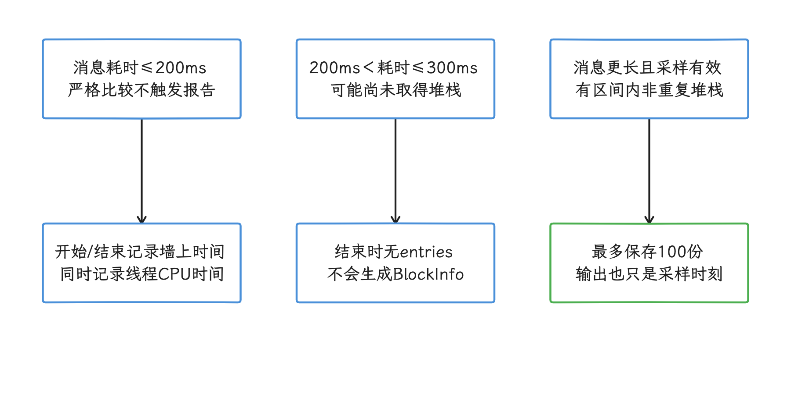

图：超过200ms仍要有区间内堆栈才报告，首次采样延迟300ms会产生盲区。 调度可能继续延后；logger只有一个，停止置null也不会恢复其他监控器。

### Android 17 上的运行时兼容性

#### 隐藏 API 与主线程 Handler hook

3.7.11 的 `DoKitReal.install()` 在主进程调用 `HandlerHooker.doHook()`。Android 9 及以上先调用包内 `com.didichuxing.doraemonkit.reflection.Reflection.unseal(app)`；这份代码注明源于 FreeReflection，先尝试 `exemptAll()`，失败后再加载内嵌 dex。这和宿主解析一个外部 FreeReflection 2.1.0 依赖是两回事。随后反射：

- `ActivityThread.currentActivityThread`
- `ActivityThread.mH`
- `Handler.mCallback`

`android-17.0.0_r1` 源码中这些成员仍存在，但它们不在公开 SDK 兼容契约内。`HandlerHooker` 没有检查 `unseal()` 的整数返回值，后续反射仍可能失败；它捕获 `Exception` 并打印堆栈，依赖 hook 的功能可能失效。包内 dex 还会经历写入 code cache、`DexFile` 加载和删除，Android 14+ 的动态代码加载只读要求也须在走到该回退分支时核验。API 37 测试要检查具体功能与日志，只看 App 是否崩溃会漏掉失效的 hook。

公开 3.7.11 还在 Android 12（API 31）及以上跳过 SandHook 全局 runtime hook；SandHook 是一种原生方法 hook 框架，源码注释直接写明 Android S 上会崩溃。API 37 设备至少要覆盖冷启动、Activity 跳转、横竖屏、分屏、前后台切换和加固后的安装包，只验证面板能打开的话，覆盖面太窄。

<!-- gracker-diagram: ch17-04-08-reflection-fallback -->
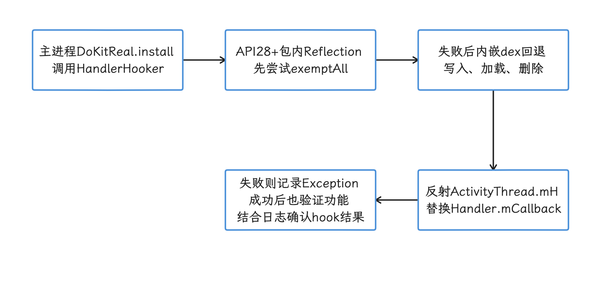

图：主进程先尝试隐藏API豁免，再代理ActivityThread主Handler的callback。 忽略unseal返回值时豁免未必成功；私有字段与动态dex均须按系统策略验证。

#### Manifest、权限与前台服务

3.7.11 核心 AAR 的 manifest 仍写着 `targetSdkVersion 31`，并声明了网络、Wi-Fi、存储、电话状态、相机、悬浮窗、前台服务和唤醒锁等多项权限。构建时，库 manifest 会合并进宿主 App；库里的 targetSdk 不会把最终应用固定在 31。最终 App target 37 后，平台按宿主的目标版本执行新规则。

合并 manifest 时要特别审查：

- `READ_EXTERNAL_STORAGE`、`WRITE_EXTERNAL_STORAGE`：target 30 及以上，`requestLegacyExternalStorage` 恢复不了旧存储模型。文件工具应改用应用私有目录、SAF（Storage Access Framework，由用户选择文件）或受控的测试导出路径。
- `SYSTEM_ALERT_WINDOW`：这是允许界面显示在其他 App 上方的特殊权限。能用应用内悬浮层完成的调试包，优先避免请求系统级悬浮窗。
- `POST_NOTIFICATIONS`：库没有声明。target 33 及以上若依赖通知展示状态，需要由宿主声明并按产品流程请求；拒绝通知时功能也应可诊断。
- `FOREGROUND_SERVICE_MEDIA_PROJECTION`：库的录屏 service 标了 `mediaProjection` 类型，却没有 Android 14 起所需的对应前台服务权限。宿主还要先通过 `createScreenCaptureIntent()` 让用户授权，再按规定启动服务；不准备维护这套流程时应禁用录屏工具。
- `READ_PHONE_STATE`、`CAMERA`、Wi-Fi 与存储权限：若团队不用对应 kit，应在 Debug manifest 中用 manifest merger（清单合并）规则移除，减少测试包权限范围。

AAR 还声明了未导出的 `FileProvider`，authority（ContentProvider 的唯一名称）为 `${applicationId}.debugfileprovider`，其 paths 配置是 `<root-path path="" />`。即使 provider 不导出，获得临时 URI grant（单个 URI 的临时访问授权）的接收方仍可读取被授予的文件。只在受控测试包启用文件能力，并检查分享目标、可生成的 URI 范围和日志。

库中附带 `dokit_network_config.xml`，内容允许明文 HTTP 流量，但核心 manifest 没有自动引用它。风险判断应看最终合并 manifest：只有宿主把它设为 `android:networkSecurityConfig` 时，这条明文策略才会生效。


#### Native 库与 16 KB 页

3.7.11 的核心 `dokitx` AAR 不含 `.so`，但这个结论只对核心包成立，可选模块要逐个看：

- `dokitx-gps-mock` 带多 ABI（CPU 架构）的 native 库。3.7.11 AAR 中 6 个 arm64 `.so` 的 ELF `LOAD` 段对齐均为 `0x10000`（64 KB），满足 16 KB 的 ELF 对齐要求；最终 APK/AAB 的 ZIP 条目对齐和设备安装运行仍要另测。
- `dokitx-pthread-hook` 会传递依赖 Matrix 2.0.2 的 hooks / fd 模块。`matrix-hooks` 与 `matrix-fd` AAR 中 6 个 arm64 `.so` 的 `LOAD` 对齐均为 `0x1000`（4 KB），不满足 16 KB ELF 对齐要求。

启用这些可选模块的项目，应展开完整依赖图，替换或重新编译 4 KB native 依赖，再对最终 APK/AAB 做 16 KB 检查，内容分别覆盖 ELF `LOAD` 段、包内 ZIP 对齐和目标设备运行。

早期记录中的 `android17-6.18-2026-06_r6`、`r39` 是历史 common kernel 标签，与本次最新内核是两回事。App 的 ELF 对齐、最终包和实际页大小分别核验；common kernel 标签只提供版本线索，vendor kernel 与目标设备运行结果仍要单独核验。


### 弱网模式的执行顺序与真实请求

3.7.11 的 `DokitWeakNetworkInterceptor` 是 OkHttp 的 network interceptor，执行位置贴近真实的网络收发。我们按源码的执行顺序理解这几个模式：

| <span style="white-space:nowrap">模式</span> | 代码做了什么 | <span style="white-space:nowrap">能测试什么</span> | 不能测试什么 |
|---|---|---|---|
| <span style="white-space:nowrap">断网</span> | 先调用 <code>chain.<wbr>proceed(<wbr>chain.<wbr>request(<wbr>))</code>；真实请求成功后，丢弃其响应内容并构造 HTTP 400 | UI 收到 400 响应后的状态 | 请求未出网、<code>Unknown<wbr>Host<wbr>Exception</code>、无服务端副作用 |
| <span style="white-space:nowrap">超时</span> | 先 sleep 配置时长，再执行真实请求；真实请求成功后构造 HTTP 400 | 页面延迟一段时间后收到错误码 | <code>Socket<wbr>Timeout<wbr>Exception</code>、连接超时、读取超时 |
| <span style="white-space:nowrap">限速</span> | 包装请求/响应 Body，按 KB 窗口 sleep | 大 Body 慢速读写时的 UI 表现 | DNS、TCP、TLS、丢包、切网、无线电状态 |

如果底层真实请求本身抛出异常，异常会向上返回，这一轮轮不到 DoKit 生成 HTTP 400。所谓“断网”和“超时”在真实请求成功后才改成 400，因此仍可能产生服务端副作用；上游这两条分支还没有关闭被替换的原响应 Body。支付、下单、创建、删除、上传等状态修改接口的失败验证要走别的路；拿它们做重试，还可能重复提交；“收到了 400”在网络异常的语义之外。

要验证 `IOException`、`UnknownHostException`、`SocketTimeoutException` 分支，可使用受控测试服务器、MockWebServer、网络代理或系统级网络条件，按目标异常构造真实失败。DoKit 弱网只适合安全、幂等的接口，幂等表示同一请求重复执行不会产生额外业务结果；它也可用于观察慢 Body 对页面状态的影响。


### Mock 的执行时机与服务端影响

`DokitMockInterceptor.intercept()` 先执行 `chain.proceed(oldRequest)`；默认 OkHttp 注入把它放在 application interceptor 链，因此这一步可能命中缓存、被前置拦截器短路，或实际访问后端。原响应不是图片、不是 Mock 主机且规则启用并选中场景时，才关闭旧响应，再向 Mock 平台发第二个 GET。平台返回 200 且 Body 非 null 才交付新响应；`newResponseHasData()` 只判断非 null，内容是否非空要另行确认。

这带来三个直接后果：

- Mock 规则在原请求之后才介入，真实网络路径可以到达业务后端。
- 满足场景规则才增加一次 Mock GET；失败或旧请求异常时，能否拿到替换数据没有保证。
- Mock 失败或无 Body 时，回退可能返回已经关闭的 `oldResponse`，透明回退在这份固定实现中没有保证。

因此，DoKit Mock 适合在无副作用的查询接口上检查空列表、字段缺失、超大列表和错误码页面。对下单、支付、发帖、删数据、上传等接口，应改用测试环境的服务端 Mock、通过依赖注入替换 repository（数据访问层），或使用能在发请求前直接返回的自建 interceptor。

<!-- gracker-diagram: ch17-04-12-mock-replacement -->
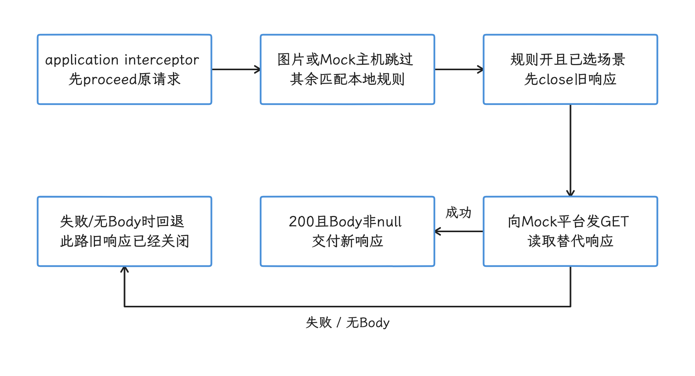

图：Mock在原请求返回后判规则，满足场景才关闭旧响应并请求Mock平台。 原proceed可能缓存命中；平台失败回退可返回已关闭旧响应，不保证透明回退。

### 一个可复现的网络测试场景

我们以商品列表页为例，目标是检查慢响应、缓存和降级逻辑，不碰状态修改接口：

| 步骤 | 条件 | 观察点 | 合格标准 |
|---|---|---|---|
| <span style="white-space:nowrap">正常条件</span> | 测试环境、正常网络 | 首屏、分页、图片与缓存 | 记录请求顺序，作为后续场景的对照；不把浮窗值当性能基准 |
| <span style="white-space:nowrap">慢 Body</span> | DoKit 对 GET 列表接口限速 | loading、取消请求、页面退出 | 无主线程阻塞，退出后不更新旧页面 |
| <span style="white-space:nowrap">HTTP 400</span> | DoKit“断网”模式，仅用于该幂等 GET | 错误页、重试入口 | 文案正确，不清掉可用缓存 |
| <span style="white-space:nowrap">空列表</span> | Mock 平台或本地 repository 返回空数组 | 无数据页面与统计事件 | 不应崩溃，不误显示网络错误 |
| <span style="white-space:nowrap">大列表</span> | Mock 返回上限数据 | 列表差量计算（diff）、布局、图片请求 | 用 Perfetto / Macrobenchmark 复核卡顿 |
| <span style="white-space:nowrap">真实超时</span> | MockWebServer 或代理制造 read timeout（读取超时） | 异常分类、逐步延长间隔的重试策略 | 命中 `SocketTimeoutException` 分支，重试次数受控 |

每轮记录应用版本、设备、账号、接口环境、DoKit 开关和操作路径。开发拿到这些条件后，才能复现场景并录制 Perfetto trace 或 Profiler 数据。

### DoKit 面板与专项工具如何分工

| 工具 | 适合回答 | 何时改用该工具 |
|---|---|---|
| Android Studio Profiler | 方法调用、对象分配、heap dump、进程内存与网络细节 | 已找到 CPU 或内存突变的操作 |
| Perfetto | 主线程、RenderThread、GPU、Binder（Android 进程间通信）、调度、I/O、FrameTimeline 的时间关系 | 已有稳定复现路径，需要判断事件的先后与因果关系 |
| JankStats | 带 App 状态标签的 jank（视觉卡顿/慢帧）事件 | 要把页面、交互状态与慢帧关联 |
| FrameMetrics | Window 帧耗时及 layout、draw、sync 等阶段 | 要检查单个窗口内帧耗时构成 |
| Macrobenchmark | 在独立测试进程中重复测量启动、滚动与交互 | 修复前后需要同设备、同条件的统计比较 |
| OkHttp `EventListener` | DNS、connect、TLS、请求与响应阶段 | DoKit 网络列表只显示总体请求信息 |

我们可以按下面的顺序处理：

1. 测试用 DoKit 记下异常页面、账号、手势、网络条件和请求。
2. 用安全的幂等接口或专用测试环境把问题稳定复现。
3. 开发按问题类型录制 Perfetto、Profiler、heap dump 或网络阶段数据。
4. 修复后用同一路径做专项测量，再回 DoKit 快速确认主要流程仍可用。

DoKit 缩短“发现到复现”的时间，专项工具负责定位原因和比较修复前后的结果。


### 出站数据与隐私

把 DoKit 当“纯本地面板”来审查，会漏掉出站数据。3.7.11 的运行时默认把 `DoKitManager.ENABLE_UPLOAD` 设为 true，初始化时会尝试上传包名、应用名、版本、DoKit 版本、系统类型和语言等接入信息；内置工具使用统计、“健康体检”和 Mock 还有各自的平台请求。

3.7.11 source JAR 中写死的目的地址包括：

- `https://doraemon.xiaojukeji.com/uploadAppData`
- `https://www.dokit.cn/pointData/addPointData`
- `https://www.dokit.cn/healthCheck/addCheckData`

空 `productId` 不会自动关闭默认统计，应显式调用 `disableUpload()`。2026-08-14 的证书与握手探测只保留为历史网络记录，本次没有重新探测这些服务，当时结果只说明当时状态。接入时应核对证书、服务、数据保留和实际出站流量；不使用的平台功能应关闭并抓包验证。

网络面板还可能记录 URL、Header、token（访问凭据）、Cookie、请求 Body 和响应 Body。截图、日志导出与文件分享会让更多人或系统接触这些数据，测试账号也可能含真实用户信息；包名带 `debug` 只是命名约定，隐私审查要按数据内容来做。


### Release 隔离：依赖与最终包都要查

3.7.11 的 no-op AAR 只保留一组空实现 API，manifest 只有 minSdk/targetSdk 信息，适合作为 Release 编译占位。开发者仍可能误加完整运行时、可选模块或本地重打包 AAR，因此 CI（持续集成任务）要同时检查解析后的依赖和成品内容。

下面的 Gradle 任务在执行时检查 `releaseRuntimeClasspath`，只允许 `dokitx-no-op`。示例同时把检查挂到 `check`；CI 必须执行 `check` 或显式执行该任务，只调用 `assembleRelease` 不会自动触发它：

```kotlin
import org.gradle.api.artifacts.component.ModuleComponentIdentifier

tasks.register("verifyReleaseWithoutDoKitRuntime") {
    doLast {
        val components = configurations
            .getByName("releaseRuntimeClasspath")
            .incoming.resolutionResult.allComponents
            .mapNotNull { it.id as? ModuleComponentIdentifier }

        val forbidden = components.filter {
            it.group == "io.github.didi.dokit" &&
                it.module != "dokitx-no-op"
        }

        check(forbidden.isEmpty()) {
            "Release contains DoKit runtime modules: ${forbidden.joinToString()}"
        }
    }
}

tasks.named("check") {
    dependsOn("verifyReleaseWithoutDoKitRuntime")
}
```

多 flavor 工程要为每个正式变体生成对应检查，避免把 configuration（Gradle 依赖集合）名写死后只覆盖一个包。依赖图检查通过后，还要解开最终 APK/AAB 搜索 DoKit 类、组件、权限、资源与 native 库；本地 AAR、shade（把依赖类复制进另一个包）或重打包都可能绕过 Maven groupId 规则。

发布前至少完成这些检查：

- 依赖：正式变体只有 no-op，未包含完整 `dokitx`、插件产物和可选 native 模块。
- 代码与资源：没有 `DoKitReal`、`UniversalActivity`、面板资源、自定义 kit、测试账号菜单、隐藏调试手势和调试 deep link（用 URL/Intent 直接打开页面的入口）。
- Manifest：没有多余的悬浮窗、存储、电话、相机、Wi-Fi、录屏前台服务权限或宽路径 FileProvider。
- 网络：没有 DoKit 统计、健康检查、Mock 平台、网络代理和测试域名请求。
- 数据：没有内网地址、token、Cookie、用户数据、Mock 数据和诊断日志留在 assets、res 或包内数据库。
- 行为：在全新设备、升级安装、通知拒绝、无悬浮窗权限和后台启动限制下测试正式包。
- Native：启用过 GPS mock、pthread hook 等模块时，检查最终包 ABI、16 KB ELF / ZIP 对齐和目标设备运行。

Release 隔离最终要验收签名后的 APK/AAB，Gradle 文件里的依赖声明只是其中一项依据。

<!-- gracker-diagram: ch17-04-15-release-verification -->
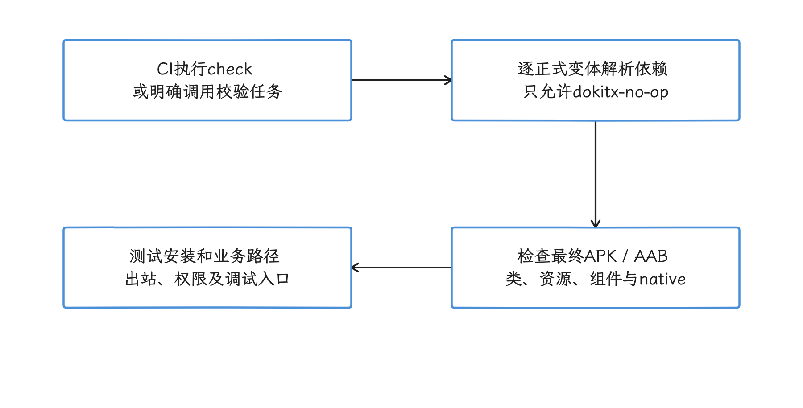

图：CI实际执行check或校验任务，再从解析依赖追到签名后的代码、清单和行为。 只调用assembleRelease不运行示例check依赖；group规则不覆盖本地重打包。

### 团队如何使用 DoKit

| 角色 | 现场动作 | 应交付的信息 |
|---|---|---|
| 测试 | 切测试环境、查看请求、构造安全的弱网/Mock 条件 | 版本、设备、账号、环境、开关、复现步骤、请求标识 |
| 业务开发 | 检查网络、本地数据和业务状态，增加短期诊断 kit | 初步假设、相关代码路径、需抓取的专项数据 |
| 性能专项 | 固定路径，关闭无关 kit，录制 trace 或运行 benchmark（基准测试） | trace、指标算法、设备条件、修复前后对比 |
| 安全与发布 | 审查权限、组件、出站域名、日志和最终产物 | 依赖与成品扫描记录、风险处置结果 |

团队还应约定三条纪律：

- 新增自定义 kit 时写明负责人、适用环境、数据范围和移除条件。
- 测试报告记录启用的 DoKit 功能；浮窗、网络记录和 hook 都可能改变结果。
- 性能复核包只打开当前调查所需能力，避免多个采集器互相干扰。

### 小结

DoKit 的优势是把调试入口和测试条件带到设备现场。它可以帮助团队更快找到异常页面、稳定复现步骤，并把网络、本地状态和业务诊断入口集中管理。

接入前要确认几个限制：公开 3.7.11 插件仍依赖已从 AGP 8 移除的 Transform API；运行时使用 hidden API hook；旧 manifest 需要按 target 37 重审；弱网与 Mock 都会先发送真实请求；可选 native 模块还可能引入不满足 16 KB 对齐的依赖。

可执行的接入方式是：Debug / QA 变体按需启用，默认关闭上传，只在安全接口上构造网络条件；DoKit 找到复现路径后，再用 Perfetto、Profiler、JankStats、FrameMetrics 或 Macrobenchmark 验证。Release 是否隔离成功，要以最终 APK/AAB 不含 DoKit 实现、入口、权限、数据和出站行为为准。

## Measure APM 的端侧采集与平台组成

DoKit 负责研发现场的调试入口；到了 Release 环境，持续采集崩溃、ANR（Application Not Responding，应用无响应）、启动、网络、资源和业务 span（一段有起止时间的操作）的工作交给 Measure，它把事件送入可查询的平台。生产侧的考量也随之变化：既要控制采样与测量扰动，还要承担数据治理、服务端运维、告警和恢复。

### 产品定位与版本现状

Measure 是一套面向移动端的 APM 与问题诊断平台。项目提供 Android、iOS、Flutter、React Native SDK，官网还提供 KMP（Kotlin Multiplatform）薄封装，让共享 Kotlin 代码调用 Android、iOS 原生 SDK。它的核心是把 Crash（未捕获崩溃）、ANR、启动、HTTP、CPU、内存、点击、页面导航、业务 span 和 bug report（用户主动提交的问题报告） 放进同一套 session（一次连续使用会话） 模型。

Matrix、KOOM 更偏向在设备内完成专项采集与诊断；Measure 还提供事件入库、检索、聚合、告警、附件保存和团队协作。它们解决的问题有交集，部署层次与运维范围不同，可以同时使用。

截至 2026-10-26，Maven Central 最新稳定 Android SDK 为 `0.22.0`，Plugin Portal 最新插件为 `0.14.0`，self-host 最新稳定版为 `v0.13.0`。本文按 SDK 标签提交 `34d2b917156abbd8d6b0f28d717b32f263d48398`、实际 AAR/source JAR、插件发布物和 self-host 提交 `59505fd70be0b728c3bb5682865e7145315daf32` 核对；三者分别发布，查证时各认各的版本号。

本次另核对 main 提交 `98a69b904c9def27d54fe1d947ff8e2b71d9461a`（2026-10-25），其 SDK / 插件为 `0.23.0-SNAPSHOT` / `0.15.0-SNAPSHOT`。当前官网的 native crash 说明明确要求 `>=0.23.0` / `>=0.15.0`；稳定 0.22.0 是否已覆盖，下文按实际代码核对。旧 0.19.0 与两份 7～8 月快照仅保留为历史参考。


评估前我们先记住三件事：

- 本文稳定 SDK 0.22.0 不采集 C/C++ native crash。系统 `ApplicationExitInfo` 里虽有 `REASON_CRASH_NATIVE` 常量，但 0.22.0 的 `AppExitCollector` 实际只处理 ANR，这条常量留在系统侧；官网要求更高版本的 native 能力需待对应发布物单独验收。
- Measure 能给出线上问题发生前后的上下文，但 CPU 抖动、对象泄漏、掉帧或调度问题仍需 Perfetto、heap dump 和 Android Studio Profiler 等专项工具继续定位。
- SDK 0.22.0 仍以 `compileSdk 36` 构建，却已在 API 37 注册 OOM、过量 CPU 退出和冷启动 trigger：代码复制 API 37 的整数常量并按运行版本与注册结果处理。编译版本只是线索，能力要看实际注册列表，后文按这个思路说明。

此前流传的 `android.app.Measure`、`MeasureSession` 以及 “Measure → DropBoxManager → statsd → Play Vitals” 链路不存在于 `android-17.0.0_r1`。开源产品 Measure 的入口是 `sh.measure.android.Measure`，数据上传到配置的 Measure ingest 服务，也就是接收 SDK 上报数据的入口。Android 平台的 `DropBoxManager` 位于 `android.os`，`statsd` 是系统统计守护进程，Play Vitals 是 Google Play 的质量指标服务，这些名称都证明不了它们与开源产品 Measure 有调用关系。

### 平台数据怎样流动

我们把 Measure 的数据流分成端侧采集、支持重试的上传、服务端处理和查询四段。下面这张图只画影响容量与故障处理的主要部件。

数据分成端侧事件与附件、服务端处理、构建符号上传三类。本图先画事件主路径，符号链路在后文单独说明；箭头只保留主要依赖。

事件经过 Ingest API、Apache Iggy 与 Ingest Worker，再写入供查询的 ClickHouse；团队、应用和构建配置等元数据在 PostgreSQL，附件与符号对象在 self-host 的 MinIO，Valkey 处理缓存。Gradle 插件先调用构建 API 获取上传描述，再按预签名地址上传 mapping；Ingest Worker 的符号化流程按构建身份选取 mapping 并调用 Symbolicator。`Symboloader` 的系统符号同步是另一条职责，与 Android mapping 的接收入口是两回事。

<!-- gracker-diagram: ch17-04-17-measure-data-flow -->
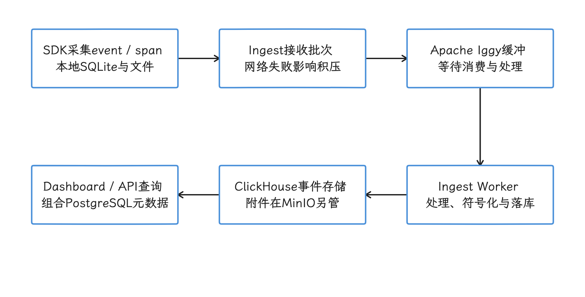

图：端侧先持久化再上传，服务端经Iggy与worker写入事件存储，查询层组合元数据。 附件和构建符号另有上传路径；图省略副本、重试与安全组件。

SDK 先把 event 与 span 写入本地 SQLite 数据库，再按批上传；附件走独立上传路径。默认本地空间上限为 50 MB，可配置在 20～1500 MB，达到上限后会先清理旧数据。离线、服务不可达或附件偏大时，本地容量决定故障现场能保留多久，网络重试次数只是其中一个因素。

self-host `v0.13.0` 的 Compose 定义 dashboard、API、agent、ingest、ingest-worker、cleanup、alerts、symboloader、migrator、Symbolicator、PostgreSQL、ClickHouse、MinIO、Apache Iggy 和 Valkey。基础文件的 `debug` profile 还带 ClickStack 与 Iggy Web；生产覆盖移除 ClickStack，默认生产启动也不带 debug profile。服务定义或 profile 的存在只说明“有这个选项”，每次安装实际运行哪些服务，取决于部署与持续运维。

### 会话、事件、span 与附件

#### Session 的生命周期

SDK 初始化时创建 session。应用进入后台超过 30 秒后再次回到前台，会创建新 session；更短的前后台切换仍属于原 session。每个 event 和 span 都带 `session_id`，页面、点击、资源曲线、错误与业务耗时由此按时间归入同一次使用过程。

默认动态配置为 fatal error、ANR 和 bug report 各保留问题前 300 秒的 replay 上下文；unhandled/handled error 的 replay 默认关闭。“5 分钟”是错误现场窗口。服务端 retention 是另一项：self-host 关闭计费时可设 30～365 天，默认 30 天；云服务受套餐权益约束，范围跟着套餐走。


#### Event 与 span 是两种对象

我们把两类对象分开看。Event 表示一个时间点发生的事情或一次状态采样，它有统一外壳：`id`、`session_id`、时间、类型、类型专属 `data`、系统属性、用户自定义属性、附件引用和采样标记。事件枚举含 `exception`、`anr`、`app_exit`、`gesture_click`、`screen_view`、`http`、`cpu_usage`、`memory_usage`、`cold_launch`、`profile` 等；枚举里有名字是一回事，自动采集路径是另一回事，0.22.0 的历史退出 collector 就只生成 ANR。

Span 表示一段持续时间，单独保存；核心字段是 `trace_id`、`span_id`、`parent_id`、`session_id`、起止时间、耗时、状态、属性与 checkpoints，checkpoint 是 span 内某个阶段完成时的时间标记。一个 trace 可以由多个有父子关系的 span 组成；event 即使出现在同一条时间线上，也不会自动变成 span。

下面的 JSON 用来理解关联关系，不是 SDK 的原始上传报文。

```json
{
  "session": {
    "id": "s-7f2d",
    "app_version": "8.4.0",
    "os_version": "17",
    "device_model": "Pixel"
  },
  "events": [
    {
      "id": "e-101",
      "session_id": "s-7f2d",
      "timestamp": "2026-07-25T09:00:05.120Z",
      "type": "screen_view",
      "data": {"name": "ProductDetail"}
    },
    {
      "id": "e-102",
      "session_id": "s-7f2d",
      "timestamp": "2026-07-25T09:00:06.220Z",
      "type": "http",
      "data": {
        "method": "get",
        "url": "https://api.example.com/products/42",
        "status_code": 200,
        "client": "okhttp"
      }
    }
  ],
  "spans": [
    {
      "trace_id": "4bf92f3577b34da6a3ce929d0e0e4736",
      "span_id": "00f067aa0ba902b7",
      "parent_id": null,
      "session_id": "s-7f2d",
      "name": "product.detail.load",
      "duration_ms": 1180,
      "status": "ok"
    }
  ]
}
```

示例里 `session_id` 把移动端现场归在一起，`trace_id` 标识一次耗时调用树。用户 ID、session ID 与分布式 trace ID 的生命周期和用途各不相同，后文“与 OpenTelemetry 的关系”一节会把三者的分工固定下来。


#### 一条 ANR 时间线能提供什么

假设用户反馈“打开详情页后卡住”：ANR 堆栈只描述取样那一刻各线程的位置，时间线却能还原问题发生前的顺序。下例是合成时间线，PSS 按共享页比例分摊。API 30+ 的 ANR 来自后续启动读取的退出记录，时间戳回填到问题现场；实时上传不是保证。低于 API 30 的 SDK 分支才拦截 `SIGQUIT`。

```text
00:00  lifecycle_app: foreground
00:01  screen_view: Home
00:05  gesture_click: feed_item
00:05  screen_view: ProductDetail
00:06  http: GET /products/{id}, 200, 820 ms
00:07  http: GET /recommendations, timeout
00:07  memory_usage: PSS 420 MB -> 680 MB
00:08  gesture_click: back
00:10  ANR occurrence (API 30+ record is read on a later launch)
```

这段记录能提出“详情页加载、超时回调、内存增长或返回流程是否阻塞主线程”等假设；要坐实根因，下一步应对照 ANR 全线程堆栈、`ApplicationExitInfo` trace 和服务端请求日志，仍定位不了时再复现并采集 Perfetto trace。


### Android 端能力与源码核对

我们把稳定版 `0.22.0` 标签、实际发布制品与插件 `0.14.0` 交叉检查，整理成下表。表中保留原始类名、字段名与行业术语，便于检索；文档与源码冲突时，以目标 release 的实际代码和远端下发配置为准。

| 能力 | 端侧来源与主要字段 | 能回答的问题 | 不能据此得出的结论 |
|---|---|---|---|
| Java / Kotlin Crash | 包装 <code>Thread.<wbr>Uncaught<wbr>Exception<wbr>Handler</code>；<code>exception</code> 含异常链、线程、frames（栈帧）、severity（严重级别）、前后台状态 | 崩溃分组、版本回归、混淆栈还原 | 未覆盖 C/C++ native crash；截图也不能替代线程和状态分析 |
| ANR | API 30+ 后续启动读 <code>Application<wbr>Exit<wbr>Info</code>，匹配旧 session 并验证 ART thread dump；低于 30 才用 native SIGQUIT + Java 栈 | ANR 现场与之前的 session 上下文 | API 30+ 无 ANR 截图；缺 session/有效主线程 Java frame 会丢弃，非每次 ANR 都能上报 |
| 历史退出记录 | API 30+ 读取最多 3 条，并按 PID 放入 map；0.22.0 的 collector 仅将其中 ANR 转成事件 | 为 ANR 匹配旧 session 与 ART trace | <code>APP_<wbr>EXIT</code> 枚举和模型仍在，但不是自动上报所有退出原因；native crash / LMK 不能当作已覆盖 |
| HTTP | Gradle 插件对 OkHttp 4.7.0～5.3.2 做自动 instrumentation（构建期插桩）；0.18.0 起支持包装 <code>Http<wbr>URL<wbr>Connection</code>；记录 URL、method、status、起止时间、失败、client，可按 URL 开启 body/header | 端侧耗时、失败率、请求与页面/错误的时序 | Retrofit 若只带 transitive dependency（传递依赖），自动插桩可能失效；请求 body 默认关闭；HTTP event 不等同于服务端 trace |
| 启动 | <code>Measure<wbr>Init<wbr>Provider.<wbr>attach<wbr>Info</code>、进程启动时间、Activity 生命周期与下一帧 draw；生成 cold/warm/hot launch | TTID（Time to Initial Display，首帧显示时间）趋势、启动 Activity、版本对比 | 初始化太晚会丢失早期崩溃并降低起点精度；当前 launch metric 不计算 TTFD（Time to Full Display，内容完整呈现时间），<code>report<wbr>Fully<wbr>Drawn(<wbr>)</code> 在 Measure 中用于触发 profile，TTFD 趋势需另建业务 span |
| App size | Gradle 插件在 <code>assemble&lt;Variant&gt;</code> / <code>bundle&lt;Variant&gt;</code> 后调用 <code>Gzip<wbr>Size<wbr>Calculator</code>，或 bundletool 的 <code>Build<wbr>Apks<wbr>Command</code> / <code>Get<wbr>Size<wbr>Command</code>；variant 指 build type 与 product flavor 组合出的构建变体 | APK（直接安装包）估算下载大小、AAB（应用包发布格式）可生成 APK 的最大大小趋势 | AAB 数值不代表所有设备的真实商店下载量；关闭该 variant 的插件后不会上传 |
| CPU | 前台周期采样 <code>/<wbr>proc/<wbr>self/<wbr>stat</code> 的 utime、stime、cutime、cstime，并按核数、<code>_<wbr>SC_<wbr>CLK_<wbr>TCK</code>（每秒时钟 tick 数）和间隔计算百分比 | 错误前后进程 CPU 趋势 | 该数据不是线程级火焰图，也不能说明某个函数耗时 |
| 内存 | Java/native heap、Debug PSS；<code>/<wbr>proc/<wbr>self/<wbr>status</code> 读取 <code>Vm<wbr>RSS</code> / <code>Rss<wbr>Anon</code> / <code>Vm<wbr>Swap</code>，Linux kB 按 1024 字节解释 | 前后台相关内存趋势，版本与错误现场压力 | 已不再从 statm 页数换算；曲线上涨不能直接判泄漏，缺字段与进程状态会限制样本 |
| 点击与滚动 | Curtains 拦截 Window touch；View hit test（按触摸坐标查找目标 View）；Compose 遍历 semantics（语义树）；事件含 target、id/label、坐标、尺寸和触摸时间 | 用户操作顺序、点击或滚动目标的估算 | 无可识别 target 的触摸会被丢弃，时间线无法覆盖所有 dead click（没有产生预期反馈的点击）；Compose 未设置 <code>test<wbr>Tag</code> 时，target id 信息有限 |
| 页面与生命周期 | Activity、Fragment、应用前后台；插件 0.14.0 的 Navigation Compose 范围 2.4.0～2.9.8；可手动 <code>track<wbr>Screen<wbr>View</code> | 页面路径、错误和耗时关联 | 按实际变体依赖与插桩结果核验；route 的动态 ID 会增加基数并泄露业务数据 |
| Trace / span | 手动 span、父子 span、自动 Activity/Fragment screen-load trace；span 含 trace/session/parent、duration、status、attributes、checkpoints | 登录、首屏、支付等业务路径耗时 | 当前 SDK 没有实现通用 OpenTelemetry SDK 的全部能力，也不会自动生成服务端 span |
| Trigger-based profile | WorkManager 存在时 API 36+ 自动注册 APP_<wbr>FULLY_<wbr>DRAWN / ANR；API 37 再注册 OOM / KILL_<wbr>EXCESSIVE_<wbr>CPU_<wbr>USAGE / COLD_<wbr>START | 取得平台 trace、stack sample 或 Java heap dump 附件 | 依赖注册成功、系统策略与 SDK 采样；不是每次触发都产出，也未注册其余全部新类型 |

#### 从 0.19.0 到 0.22.0 的行为变化

`0.22.0` 的 `DynamicConfig` 默认前台 CPU / 内存间隔均为 5 秒，内存后台间隔为 10 秒；后台内存采集还受 session 采样与进程 importance 筛选。默认 `memoryUsageSessionSamplingRate=0.01f` 表示 0.01%，不是 1%。这些是缺省值，实际运行还要检查远端缓存配置和采集条件。


0.22.0 默认 fatal error 截图开启，遮罩为 `AllTextAndMedia`；低于 API 30 的 SIGQUIT ANR 分支可请求截图，API 30+ 的历史 ANR 分支不请求截图。遮罩和截取成功与否都要在目标环境验证。pre-30 的 `ExceptionFactory` 常量虽然为 16，循环却以 `count <= 16` 判断且每个遍历项都加计数，所以“保证收集全部其他线程”“精确 16 条”这类说法都站不住。

<!-- gracker-diagram: ch17-04-21-anr-api-branches -->
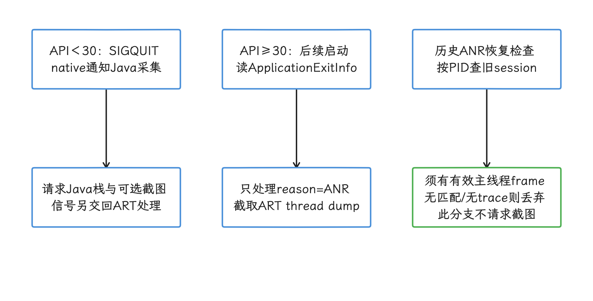

图：API30+从历史退出记录还原，较低API才拦截SIGQUIT并现取Java栈。 最多读3条且按PID合并；缺session或有效主线程frame会丢弃，pre30栈也有遍历上限。

插件 0.14.0 已把 Navigation Compose 上限从旧 0.13.0 的 2.9.7 提升到 2.9.8。其版本 map 只遍历根组件的直接依赖，直接声明动态版本时还可能先采用 requested version；因此 Retrofit 只传递引入 OkHttp 的工程应直接固定 OkHttp，或显式安装采集器，并在发布变体验证。

<!-- gracker-diagram: ch17-04-22-http-instrumentation -->
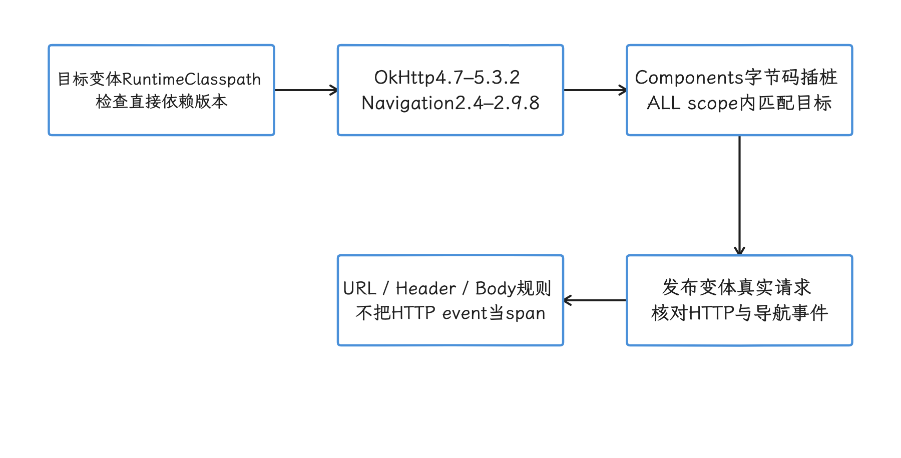

图：插件按变体识别依赖版本，在支持范围内插入网络与导航采集代码。 版本map只遍历根的直接依赖；代码存在只是一半，发布变体的实际采集要另外验证。

#### Android 17 / API 37 的新增机会

Measure 0.22.0 为 pre-30 SIGQUIT 分支仍带 `libmeasure-ndk.so`。CMake 使用 `-Wl,-z,max-page-size=16384`，本次实际 0.22.0 AAR 四个 ABI `.so` 的所有 LOAD 段对齐均为 16384；这只证明这些 ELF 段的静态对齐。RSS 已改读 `/proc/self/status` 的 kB 值，不再依赖旧版 statm 的页数换算。

应用这边仍要对最终 release APK/AAB 做 16 KB page-size 检查，因为宿主工程的 AGP、NDK（Native Development Kit）、其他 `.so` 和 ZIP 打包对齐都不由 Measure 控制。

Android 17 为 `ProfilingTrigger` 新增了九种类型。与性能和内存最相关的例子包括 `TRIGGER_TYPE_COLD_START`、`TRIGGER_TYPE_OOM`、`TRIGGER_TYPE_ANOMALY`、`TRIGGER_TYPE_KILL_EXCESSIVE_CPU_USAGE`：冷启动触发器返回新启动的 system trace 与 stack sampling profile（按时间抽样的调用栈），OOM 返回 Java heap dump，anomaly 的附件随异常类型变化，过量 CPU 退出触发器返回 running system trace 快照。

0.22.0 的 `ProfileCollector` 先注册 API 36 的两类 trigger；API 37 再尝试批量加入 OOM=7、过量 CPU 退出=9、冷启动=10。批量失败后逐项重试，不支持的项会记录日志。代码仍 compileSdk 36，但复制的整数值与固定 API 37 `ProfilingTrigger` 一致；ANOMALY 等未注册类型是否支持，看注册代码即可，与文件格式无关。


- API 36+ 且宿主依赖 WorkManager 时会启用注册，没有独立的默认关闭开关；缺 WorkManager 则不注册。
- SDK 为每种 trigger 请求至少间隔 1 小时，平台还有独立限额与特性开关；这个间隔只是请求侧的下限，每小时稳定产出一次并无保证。
- OOM 依赖未捕获异常处理器继续调用系统默认处理器；冷启动窗口到 fully drawn 或固定 AOSP 默认 5 秒，实际受平台配置影响。
- 附件还须通过结果码、文件存在、扩展名、trigger 与 profileSamplingRate 检查；默认采样为 100%，不覆盖系统拒绝或丢失。

0.22.0 按 `.perfetto-trace`、`.perfetto-java-heap-dump`、`.perfetto-heap-profile`、`.perfetto-stack-sample` 判断格式，旧的 `.hprof` / `.heapprofd` 描述已经对不上。文件名时间优先用于匹配旧 session；ANR 还有最长 3 分钟的关联窗口，这属于启发式关联。附件由有网络约束的 WorkManager worker 独立上传，服务端拒绝、链接过期与本地清理仍需验收；识别出文件，离“已采到可分析的结果”还有一段距离。

<!-- gracker-diagram: ch17-04-25-profile-artifact-pipeline -->
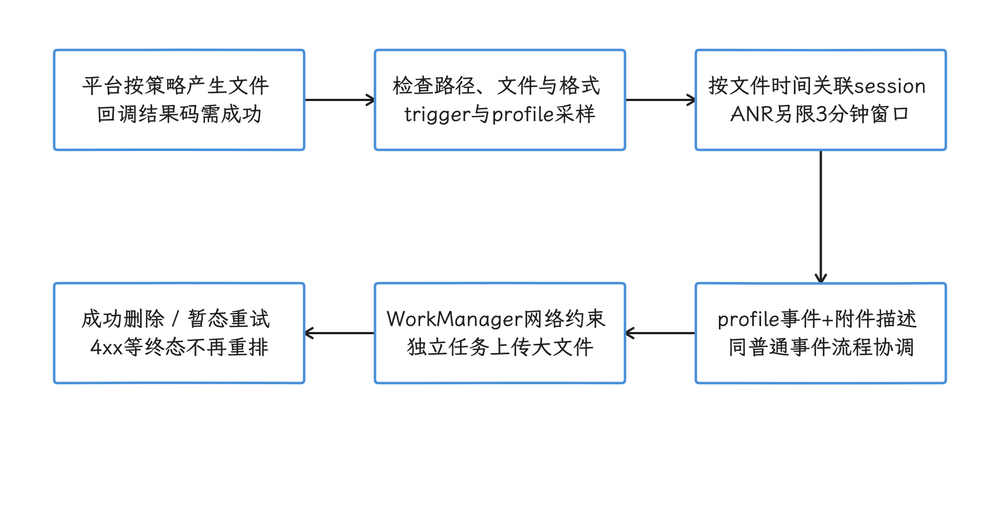

图：平台产物先过SDK有效性与采样检查，再按时间关联session，由独立worker上传附件。 SDK请求每类至少1小时并有系统限额；触发、注册或扩展名识别都不保证结果产出。

### 接入还包括平台侧工作

当前接入页的最低表列 minSdk 21、compileSdk 34、AGP 8.1.0、JDK 17，并没有 targetSdk 35 这一条。SDK 自身 compileSdk 36、宿主编译 API 和宿主 targetSdk 是三个概念；采用的 WorkManager、AndroidX 等完整依赖可能再抬高构建下限。稳定坐标如下，升级时同时查看 release notes 和 self-host 兼容表。

```kotlin
plugins {
    id("sh.measure.android.gradle") version "0.14.0"
}

dependencies {
    implementation("sh.measure:measure-android:0.22.0")
}
```

Gradle 插件负责 OkHttp、HttpURLConnection、AndroidX Navigation 等字节码插桩，还负责构建大小与 R8/ProGuard mapping 上传。R8/ProGuard 会压缩并混淆 Java/Kotlin 字节码，mapping 文件记录混淆前后的名称对应关系，服务端用它还原调用栈。禁用某个 variant 的插件会减少构建步骤，也可能让该 variant 缺少自动网络采集、包大小趋势或混淆栈还原。

初始化要尽量靠近 `Application.onCreate()` 开头，并把 API key 与 ingest URL 放在不同 build type、product flavor 的 manifest placeholder 或其他受控配置中；build type 是 release/debug 等构建模式，product flavor 是产品或环境维度，manifest placeholder 会在构建时把指定值代入 Manifest。若延迟初始化，早期 Crash 与启动耗时会缺少数据，事后也补不回来。

SDK 接好后，平台侧仍有这些工作：

- 为线上 release、预发 staging、调试 debug 决定是否拆分应用或环境，防止测试数据混入线上参照值。
- 让 API key、API URL、mapping、版本名、version code（整型构建版本号）与构建产物一一对应。
- 配置采样率（实际保留的数据比例）、URL 规则、截图、日志、retention、权限与告警。
- 建立告警负责人、去重规则、分批发布判断和处置时限。
- 监控 SDK 自身的启动耗时、主线程操作、磁盘占用、网络量与附件量。

官方在 Pixel 4a / Android 13 的简单样例上用 Macrobenchmark 重复测试 35 次，测得 SDK `0.16.0` 增加约 17.5～31.3 ms TTID，中位数 24.3 ms；识别点击目标并生成 layout snapshot（布局快照）约增加 0.6～1 ms。这组数字只适合作为回归参照，业务应用应使用自己的基准机、启动路径和 release 构建复测，尤其要关注低端机、首装、离线积压和大量 Compose 节点。


### 自定义 trace 要能聚合，也要能跨端关联

#### 命名与属性

Span 名称上限为 64 个字符，checkpoint 名称上限也是 64 个字符，每个 span 最多 100 个 checkpoints。命名应表达稳定的业务步骤，动态值放到值域、类型和隐私范围都受约束的属性里。

| 场景 | 推荐 span 名 | 推荐属性 | 不应放进名称的内容 |
|---|---|---|---|
| 登录 | `auth.login` | `login_method`、`result` | 用户 ID、手机号、错误全文 |
| 首屏 | `home.first_content` | `source`、`item_count`、`cache_hit` | 实验参数拼接串、时间戳 |
| 支付 | `checkout.payment.submit` | `provider`、`result`、`retry_count` | 订单号、金额、token |
| 图片解码 | `media.thumbnail.decode` | `format`、`width_bucket`、`cache_hit` | 图片 URL、文件路径 |

单位要写进属性名，例如 `payload_bytes`、`image_width_px`、`queue_wait_ms`。枚举值应受控，布尔量用布尔类型，避免把任意异常文本、完整 URL 或用户输入当成聚合维度。

下面是同步业务片段，使用 0.22.0 的 `SpanBuilder` API；`tokenizeCard()` / `submitOrder()` 由项目提供。父子 span 各自负责成功/失败状态与 `finally` 收尾，父 span 的结束替代不了子 span 的收尾。

```kotlin
val payment = Measure.startSpan("checkout.payment.submit")
    .setAttribute("provider", "example_pay")

try {
    val tokenize = Measure.createSpanBuilder("checkout.payment.tokenize")
        ?.setParent(payment)
        ?.startSpan()
    try {
        tokenizeCard()
        tokenize?.setStatus(SpanStatus.Ok)
    } catch (t: Throwable) {
        tokenize?.setStatus(SpanStatus.Error)
        throw t
    } finally {
        tokenize?.end()
    }

    submitOrder()
    payment.setCheckpoint("order_accepted")
        .setAttribute("retry_count", 0)
        .setStatus(SpanStatus.Ok)
} catch (t: Throwable) {
    payment.setAttribute("error_type", t.javaClass.simpleName)
        .setStatus(SpanStatus.Error)
    throw t
} finally {
    payment.end()
}
```

父 span 表示支付提交，子 span 只覆盖令牌化；异常原样抛回业务层，诊断代码不吞失败。属性仅记录受控错误类型，可能含账号或订单信息的 message 不写入。`createSpanBuilder()` 在 SDK 未初始化时可能为 null，“代码走完”也就说明不了 trace 已被采集。

<!-- gracker-diagram: ch17-04-27-span-exception-close -->
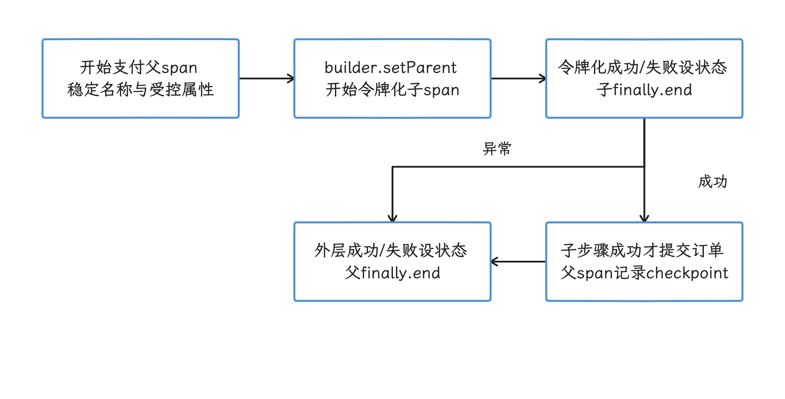

图：令牌化子span和支付父span分别设置状态，各自finally结束，异常继续交还业务层。 nullable builder或采样可能没有数据；父span的结束替代不了子span收尾。

#### 与 OpenTelemetry 的关系

移动 session 和分布式 trace 解决不同问题。session 关注应用前后台、设备、页面、手势、Crash、ANR 和资源曲线；OpenTelemetry（OTel，一套跨语言可观测性标准）trace 关注跨进程调用树、服务与依赖耗时。二者可以通过 W3C Trace Context 关联：它规定如何在请求头中传递 trace 上下文，无需把 session ID 改造成服务端 trace ID。

Measure Android SDK 能从 span 生成 `traceparent`，值中包含版本、trace ID、发送方 span ID 与采样标记。下面只构造请求，使用已开始且仍有效的 `activeSpan`；调用方执行请求并在成功、失败或取消后结束该 span。构造 Request 不会发送网络请求。

```kotlin
val request = Request.Builder()
    .url(paymentUrl)
    .header(
        Measure.getTraceParentHeaderKey(),
        Measure.getTraceParentHeaderValue(activeSpan),
    )
    .build()
```

服务端 OpenTelemetry instrumentation（自动提取并创建 trace 的中间件或 SDK）读取 `traceparent` 后，可继续同一个 `trace_id`；Measure 的自动 HTTP event 仍是 session 时间线事件，不会自动把每个 OkHttp 请求挂到自定义 span 下。

建议把三类 ID 分工固定下来：

- `session_id`：从移动错误或用户反馈回到 Measure 会话。
- `trace_id`：从移动 span 跳到服务端 APM，并追踪跨服务调用。
- `request_id`：保留服务端日志系统自己的单请求检索键，作为尚未全面接入 trace 的补充。

如果网关会丢弃未知 header，要把 `traceparent` 加入转发规则，并核对服务端采样策略。采样位表达上游决定，不强制后端保存 trace；远端接收失败、独立采样或导出失败仍可能造成两端缺一。若服务端另起 trace，至少在移动 span 和服务端日志同时记录一个不直接识别用户的 request ID，并通过真实请求验证两端可以互查。


### 自托管的成本与故障点

#### 官方自托管定位

当前官方文档把安装脚本定位为单台虚拟机部署，并说明 self-host 更适合云服务不可用、又有资深基础设施工程师持续维护的强监管环境。若需要分布式、安全且可横向扩展的部署，官方推荐其托管云。文档同时警告，配置错误可能造成数据丢失、安全漏洞和停机。最低机器规格是 x86-64 Ubuntu 24.04 / Debian 12、4 vCPU、16 GB RAM、100 GB 系统盘。

这组配置是安装下限，容量承诺要从写入量算起：上线前至少用“日活用户数 × 每会话事件数 × 采样率 × 单事件/附件大小 × 保留天数”估算写入量，再测试 ClickHouse 查询、MinIO 增长、Iggy 积压与清理吞吐。

#### 数据分别保存在哪里

| 数据 | 主要存储或服务 | 容量与恢复重点 |
|---|---|---|
| 事件、span、聚合查询数据 | ClickHouse | 分区、TTL（Time To Live，到期清理规则）、cleanup、磁盘水位、查询并发 |
| 团队、应用、权限、配置等元数据 | PostgreSQL | 一致性备份、迁移、凭据与恢复演练 |
| 截图、layout snapshot、profile、符号文件等对象 | MinIO | 对象生命周期、跨区备份、删除一致性 |
| ingest 缓冲 | Apache Iggy | 消费积压、磁盘保护、重放与重复处理 |
| 缓存/短期状态 | Valkey（Compose 服务名为 `redis`） | 丢失后的可恢复性、内存与淘汰策略 |
| 符号处理 | 构建 API / Ingest Worker / Symbolicator | mapping 与 App version/build 关联；Symboloader 另管系统符号同步 |

Android R8/ProGuard mapping 由插件在 assemble / bundle 之后的 build upload 路径上传，构建 API 与预签名对象上传分开。自托管环境要保证构建上传与事件 ingest 使用同一个 app/API 配置，并以 version name、version code、app identifier（应用包标识）关联。Compose 中存在 Symbolicator 只说明平台具备符号处理服务；Android native crash reporting 在本文稳定 SDK 0.22.0 上仍是缺项。

<!-- gracker-diagram: ch17-04-29-mapping-symbolication -->
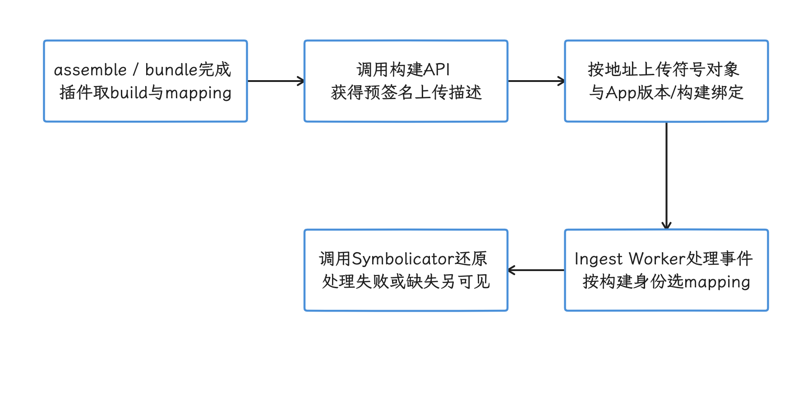

图：构建信息获取mapping上传描述，对象上传后由事件符号化路径按构建身份查询。 Symboloader不是Android mapping入口；它有系统符号同步职责，服务存在不证明SDK native覆盖。

#### 保留期、附件与备份

self-host `v0.13.0` 关闭计费时，应用 retention 可设 30～365 天，默认取 30 天；开启计费的云环境按套餐权益决定，自托管的范围照搬过去会出错。线上清理之外，附件、数据库备份、对象快照仍需逐项确认期限；Dashboard 配置为 30 天，管不到 180 天备份里的数据。

至少进行以下恢复演练：

- PostgreSQL 与 ClickHouse 在同一恢复点附近恢复后，应用、session 和查询是否仍对应。
- MinIO 恢复后，截图、profile、mapping 引用是否还可读取。
- Iggy 有积压时升级或重启，是否会漏数据或造成重复入库。
- 从一个稳定 `vMAJOR.MINOR.PATCH` tag 升级前，是否完成官方 migration guide 要求，并验证回滚数据兼容性。

生产部署要避开 `main`，按自托管文档选择面向部署的稳定 `v*` tag；SDK 与 self-host 也有最低版本配对关系，例如 Android SDK `>=0.16.0` 要求 self-host `>=0.10.0`。


#### 小团队也要算的账

| 阶段 | 推荐范围 | 主要成本 |
|---|---|---|
| 2～4 周试点 | 单应用、一个 release 版本、Crash/ANR/HTTP/会话 | 机器、接入、隐私审查、mapping 与告警验证 |
| 中型团队 | 多应用、多环境、按版本灰度、业务 trace | 容量规划、查询性能、权限、值班、备份与升级 |
| 强合规私有化 | 区域隔离、审计、删除流程、灾备 | 安全加固、身份系统、密钥轮换、证据留存与恢复演练 |

这张表没有给固定金额，因为附件比例、事件采样、日活和查询频率比团队人数更能决定成本。试点要记录每千 session 的 ClickHouse 增量、MinIO 增量和 ingest 峰值，再外推预算。


### 隐私策略要先于全量采集

Measure 把远端采集配置称为 Adaptive Capture：可以在 Dashboard 修改采样、截图遮罩和日志等选项，无需发布新 APK。Android SDK 启动时先读取并应用磁盘缓存；缓存到期后才请求新配置，成功获取后写入磁盘，留待后续启动应用。离线、缓存未到期或请求失败都会推迟生效，把“两次启动后一定生效”当时间承诺，是会落空的。这个能力便于在故障期临时提高采集率；反过来，有权限的人也能借它扩大数据范围，相关角色和变更记录都应纳入权限审计。

<!-- gracker-diagram: ch17-04-32-adaptive-capture-cache -->
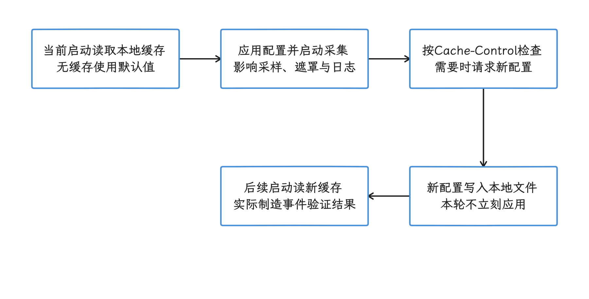

图：启动先应用磁盘缓存，再按缓存期限向服务端获取新配置并写盘，后续启动才应用。 两次启动不是时限保证；缓存未过期、离线或请求失败都会推迟生效。

| 采集内容 | 当前默认或控制点 | 建议 |
|---|---|---|
| 用户 ID | <code>set<wbr>User<wbr>Id(<wbr>)</code> 会跨启动持久化，<code>clear<wbr>User<wbr>Id(<wbr>)</code> 只影响后续标识 | 使用匿名内部 ID；登出清理；不要上传邮箱、手机号 |
| Intent data | <code>track<wbr>Activity<wbr>Intent<wbr>Data=<wbr>false</code> | 保持关闭，除非逐字段确认 deep link（打开应用内页面的链接）与 extras（Intent 附加参数）不含 token 或账号 |
| HTTP body/header | 默认不采；按 URL 精确或 <code>*</code> 规则开启；Authorization、Cookie、Set-Cookie、Proxy-Authorization、WWW-Authenticate、X-Api-Key 永久阻断 | 只对白名单接口短期开启；业务层先脱敏；不要把 GraphQL 全量 body 当成普通诊断字段 |
| URL | HTTP event 会记录完整 URL | 上传前去掉 query（<code>?</code> 后参数）、fragment（<code>#</code> 后片段）、签名参数和路径中的用户/订单 ID；统一成取值数量受控的 endpoint（接口路径） |
| 自动日志 | 默认关闭，最低采集 severity 与 ignore regex 可远端配置 | severity 是日志级别，regex 是正则过滤规则；日志正文仍要按敏感级别审查，异常对象不要直接拼完整请求 |
| Crash/ANR 截图 | 0.22.0 默认 fatal error 截图和 AllTextAndMedia；ANR 截图仅 pre-30 分支 | API 30+ 不期待 ANR 截图；敏感页面验证实际禁采与遮罩 |
| 点击 layout snapshot | click 默认可生成，连续 snapshot 有 750 ms 节流 | 检查文本、content description、Compose semantics 和 <code>test<wbr>Tag</code> 是否泄露业务数据 |
| Bug report 附件 | 最多 5 个，描述最多 4000 字符 | 让用户预览并删除附件；服务端校验类型、大小和访问权限 |
| 本地磁盘 | 默认 50 MB，离线时保留到上限 | 退出登录、账号切换和用户拒绝采集时定义本地数据处置方式 |
| 服务端 retention | self-host 非计费 30～365 天，默认 30；云端按套餐 | 同时确认库、对象和备份期限 |

`clearUserId()` 会清除本地持久化标识，让后续 event 不再带该 ID，已经上传的历史 session 则不会自动删除。公开 API 中可验证的是应用 retention 配置，“按 user ID 擦除所有历史数据”的完整流程目前还验证不到。上线前要用自己的部署版本演练检索、导出、删除、缓存失效、对象删除和备份到期；在这些演练做到位之前，先不上传可直接识别个人的数据。


### Firebase、Sentry 与 Measure 怎样选

下表比较的是产品重心，不是功能数量排名。各产品都在快速变化，采购或迁移前要用目标版本复核。

| 维度 | Firebase Crashlytics + Performance | Sentry | Measure |
|---|---|---|---|
| 托管形态 | Google 托管，无官方 self-host | 官方 SaaS；提供 self-hosted 发行版 | 官方云；Apache-2.0 仓库与单机 self-host |
| Android 错误 | JVM、NDK Crash；Crashlytics 在 Android 11+ 通过历史退出原因报告 ANR | JVM/NDK 错误、ANR、breadcrumbs（错误前的简短事件轨迹）等，覆盖面成熟 | 0.22.0：JVM Crash、按 API 分支采 ANR；无 native crash |
| 性能视角 | 自动启动、HTTP、屏幕渲染、自定义 trace | 跨端 error、transaction/span、profiling/replay 能力丰富 | 启动、HTTP、screen-load/custom span、资源曲线与 session timeline |
| 会话上下文 | Crashlytics breadcrumbs 依赖 Analytics；Performance 数据在 Firebase 看板 | breadcrumbs、release health、移动 replay 等 | 点击、导航、HTTP、CPU、内存、错误、附件围绕移动 session 组织 |
| 数据控制 | 服从 Firebase 服务区域、条款与导出能力 | SaaS 或自运维 self-hosted | 适合需要查看完整源码并控制自托管数据面的团队 |
| 运维成本 | 客户端与控制台配置为主 | self-hosted 架构复杂；SaaS 可降低运维负担 | 官方脚本是单机定位；全套服务仍需容量、备份、升级和安全运营 |

可以按问题类型做决策：

- 已深度使用 Firebase，需求集中在 Crash/ANR、启动、HTTP 和屏幕渲染指标：优先验证 Firebase，接入和团队学习成本通常较低。
- 需要 Web、后端、移动统一错误与 trace，或已经使用 Sentry：优先评估 Sentry，避免再建一套跨端问题系统。
- 主要是移动应用，希望源码透明、自托管，并重视错误前的点击、页面、网络与资源上下文：Measure 值得试点。
- 核心需求是 native crash：不要把 Measure 作为唯一稳定性平台。
- 核心需求是精确掉帧归因：仍要以 FrameTimeline、Perfetto 与源码分析为准，三者的聚合指标都替代不了。


### 2～4 周试点怎么验收

试点不宜从“把开关全打开”开始。选择一个有稳定发布节奏、能制造测试 Crash/ANR、流量可控的应用，我们按周逐步扩大验证范围。

#### 第 1 周：接入与数据边界

- 固定 SDK `0.22.0`、插件 `0.14.0` 和 self-host `v0.13.0` 或已确认兼容的 cloud 版本。
- 验证 release mapping 上传、混淆 Crash 还原、冷/温/热启动分类。
- 制造前台/后台 JVM Crash、Java deadlock ANR；API 30+ 验证下次启动还原 ANR，不把全部 app exit 当成已采能力。
- 抓包检查 URL、header、body、用户 ID、截图、layout snapshot。
- 记录 SDK 对 TTID、主线程、网络量和本地磁盘的影响。

#### 第 2 周：会话是否能缩短定位

- 用同一条业务路径制造慢接口、接口失败、内存增长和 ANR。
- 让未参与接入的工程师只根据看板还原复现步骤。
- 检查 session 搜索能否按版本、设备、页面、事件和匿名用户 ID 找到目标。
- 记录误导性 target、重复 screen、动态 route 和告警噪声。

#### 第 3～4 周：运营与恢复

- 为登录、首屏、支付、图片解码各接一个稳定 span，验证 P50（中位数）、P95（95% 样本不超过的耗时）与样本明细。
- 传播 `traceparent` 到一个服务端接口，从移动 session 跳到后端 trace。
- 调整采样后复核成本、查询速度和故障样本完整度。
- 自托管团队执行一次版本升级、数据备份与恢复演练。
- 演练用户数据检索与删除，确认对象存储和备份的处置时限。

验收表要包含可量化标准：

| 问题 | 建议通过标准 |
|---|---|
| Crash 定位 | release mapping 自动关联；测试混淆栈可还原；分组不被动态 message 打散 |
| ANR 上下文 | 能看到有效线程 dump 与问题前页面/点击/HTTP；API 30+ 历史 ANR 能回到匹配的旧 session |
| Session 检索 | 已知测试 session 在约定时限内可按至少两种维度找到 |
| 告警噪声 | 每类告警有负责人、抑制规则和可接受误报率 |
| Trace 规范 | 名称无动态 ID；属性有类型、单位、基数与隐私约束 |
| 平台成本 | 已测每千 session 数据量、附件占比、查询延迟和恢复时间 |
| Android 17 | API 37 既有采集及 OOM / cold-start / excessive-CPU profile 分别回归，核对注册日志、实际附件与 WorkManager 上传；未收到结果不直接判无故障 |

判断试点是否通过，要看“采到数据”能否转化为“更快找到根因”，以及团队是否愿意持续投入数据治理和平台维护。


## 参考资料

- [DoKit 官方仓库](https://github.com/didi/DoKit)
- [DoKit Android 接入说明](https://github.com/didi/DoKit/blob/master/Android/README.md)
- [DoKit `master` 审阅提交](https://github.com/didi/DoKit/tree/626827cddb2feb2f3aee87a52a064b4e5ca2bed4)
- [`master` 固定提交的 `Android/config.gradle`](https://github.com/didi/DoKit/blob/626827cddb2feb2f3aee87a52a064b4e5ca2bed4/Android/config.gradle)
- [GitHub `3.1.7`（iOS）release](https://github.com/didi/DoKit/releases/tag/3.1.7)
- [Maven Central：dokitx 元数据](https://repo.maven.apache.org/maven2/io/github/didi/dokit/dokitx/maven-metadata.xml)
- [Maven Central：dokitx 3.7.11 POM](https://repo.maven.apache.org/maven2/io/github/didi/dokit/dokitx/3.7.11/dokitx-3.7.11.pom)
- [Maven Central：dokitx 3.7.11 AAR](https://repo.maven.apache.org/maven2/io/github/didi/dokit/dokitx/3.7.11/dokitx-3.7.11.aar)
- [Maven Central：dokitx 3.7.11 source JAR](https://repo.maven.apache.org/maven2/io/github/didi/dokit/dokitx/3.7.11/dokitx-3.7.11-sources.jar)
- [Maven Central：dokitx-plugin 3.7.11 source JAR](https://repo.maven.apache.org/maven2/io/github/didi/dokit/dokitx-plugin/3.7.11/dokitx-plugin-3.7.11-sources.jar)
- [Maven Central：dokitx-gps-mock 3.7.11 AAR](https://repo.maven.apache.org/maven2/io/github/didi/dokit/dokitx-gps-mock/3.7.11/dokitx-gps-mock-3.7.11.aar)
- [Maven Central：dokitx-pthread-hook 3.7.11 POM](https://repo.maven.apache.org/maven2/io/github/didi/dokit/dokitx-pthread-hook/3.7.11/dokitx-pthread-hook-3.7.11.pom)
- [Maven Central：Matrix hooks 2.0.2 AAR](https://repo.maven.apache.org/maven2/com/tencent/matrix/matrix-hooks/2.0.2/matrix-hooks-2.0.2.aar)
- [Maven Central：Matrix fd 2.0.2 AAR](https://repo.maven.apache.org/maven2/com/tencent/matrix/matrix-fd/2.0.2/matrix-fd-2.0.2.aar)
- [Android Gradle Plugin API 更新：Transform API](https://developer.android.com/build/releases/gradle-plugin-api-updates)
- [Android 14 前台服务类型要求](https://developer.android.com/about/versions/14/changes/fgs-types-required)
- [Android 13 通知运行时权限](https://developer.android.com/develop/ui/views/notifications/notification-permission)
- [Android 11 分区存储变更](https://developer.android.com/about/versions/11/privacy/storage)
- [Android 16 KB 页支持指南](https://developer.android.com/guide/practices/page-sizes)
- [`android-17.0.0_r1`：`ActivityThread.java`](https://android.googlesource.com/platform/frameworks/base/+/android-17.0.0_r1/core/java/android/app/ActivityThread.java)
- [`android-17.0.0_r1`：`Handler.java`](https://android.googlesource.com/platform/frameworks/base/+/android-17.0.0_r1/core/java/android/os/Handler.java)
- [`android-17.0.0_r1`：`Looper.java`](https://android.googlesource.com/platform/frameworks/base/+/android-17.0.0_r1/core/java/android/os/Looper.java)
- [`android17-6.18-2026-06_r39` 历史 common kernel tag](https://android.googlesource.com/kernel/common/+/refs/tags/android17-6.18-2026-06_r39/)
- [`android17-6.18-2026-06_r6` common kernel](https://android.googlesource.com/kernel/common/+/refs/tags/android17-6.18-2026-06_r6/)

- [Measure 仓库快照：`8a189ea1e9728105773c1c81fb6cc8797e6b2d15`](https://github.com/measure-sh/measure/tree/8a189ea1e9728105773c1c81fb6cc8797e6b2d15)
- [Measure 历史仓库快照：`7501820c8e6f8bfc8a512061e1d2504b465e0466`](https://github.com/measure-sh/measure/tree/7501820c8e6f8bfc8a512061e1d2504b465e0466)
- [Measure Android SDK `0.19.0` release](https://github.com/measure-sh/measure/releases/tag/android-v0.19.0)
- [Measure Android SDK Maven metadata](https://repo.maven.apache.org/maven2/sh/measure/measure-android/maven-metadata.xml)
- [Measure Android SDK `0.19.0` AAR](https://repo.maven.apache.org/maven2/sh/measure/measure-android/0.19.0/measure-android-0.19.0.aar)
- [Measure Gradle 插件 metadata](https://plugins.gradle.org/m2/sh/measure/android/gradle/sh.measure.android.gradle.gradle.plugin/maven-metadata.xml)
- [Android SDK 构建配置：minSdk 21、compileSdk 36](https://github.com/measure-sh/measure/blob/34d2b917156abbd8d6b0f28d717b32f263d48398/android/measure-android/measure/build.gradle.kts)
- [Android SDK 动态配置默认值](https://github.com/measure-sh/measure/blob/34d2b917156abbd8d6b0f28d717b32f263d48398/android/measure-android/measure/src/main/java/sh/measure/android/config/DynamicConfig.kt)
- [Android ANR `SIGQUIT` handler](https://github.com/measure-sh/measure/blob/34d2b917156abbd8d6b0f28d717b32f263d48398/android/measure-android/measure/src/main/jni/anr_handler.c)
- [Measure native library 16 KB linker alignment](https://github.com/measure-sh/measure/blob/34d2b917156abbd8d6b0f28d717b32f263d48398/android/measure-android/measure/src/main/CMakeLists.txt)
- [Measure 0.22.0 RSS：proc status kB 字段](https://github.com/measure-sh/measure/blob/34d2b917156abbd8d6b0f28d717b32f263d48398/android/measure-android/measure/src/main/java/sh/measure/android/performance/MemoryReader.kt)
- [Android `ProfileCollector` 当前注册的触发类型](https://github.com/measure-sh/measure/blob/34d2b917156abbd8d6b0f28d717b32f263d48398/android/measure-android/measure/src/main/java/sh/measure/android/profiling/ProfileCollector.kt)
- [Android span 与 W3C `traceparent` API](https://github.com/measure-sh/measure/blob/34d2b917156abbd8d6b0f28d717b32f263d48398/android/measure-android/measure/src/main/java/sh/measure/android/Measure.kt)
- [Measure self-host production Compose](https://github.com/measure-sh/measure/blob/59505fd70be0b728c3bb5682865e7145315daf32/self-host/compose.prod.yml)
- [Measure 当前 self-host Compose](https://github.com/measure-sh/measure/blob/7501820c8e6f8bfc8a512061e1d2504b465e0466/self-host/compose.yml)
- [历史快照的 Navigation Compose 插桩上限](https://github.com/measure-sh/measure/blob/7501820c8e6f8bfc8a512061e1d2504b465e0466/android/measure-gradle-plugin/src/main/kotlin/sh/measure/asm/NavigationTransformer.kt)
- [Measure Android SDK 接入指南](https://measure.sh/docs/sdk-integration-guide)
- [Measure 当前 Android 接入页](https://measure.sh/docs/getting-started/android)
- [Measure Kotlin Multiplatform 接入页](https://measure.sh/docs/getting-started/kotlin-multiplatform)
- [Measure Session Timeline](https://measure.sh/docs/features/feature-session-timelines)
- [Measure Crash Reporting](https://measure.sh/docs/features/feature-crash-reporting)
- [Measure ANR Reporting](https://measure.sh/docs/features/feature-anr-reporting)
- [Measure Network Monitoring](https://measure.sh/docs/features/feature-network-monitoring)
- [Measure Performance Tracing](https://measure.sh/docs/features/feature-performance-tracing)
- [Measure Android Profiling](https://measure.sh/docs/features/feature-profiling)
- [Measure 当前 Error Monitoring：Crash 与 ANR](https://measure.sh/docs/error-monitoring)
- [Measure 当前 Performance Tracing](https://measure.sh/docs/performance-tracing)
- [Measure 当前 Android Profiling](https://measure.sh/docs/performance-tracing/profiling)
- [Measure SDK Configuration](https://measure.sh/docs/configuration-options)
- [Measure Adaptive Capture](https://measure.sh/docs/adaptive-capture)
- [Measure SDK Performance Impact](https://measure.sh/docs/performance-impact)
- [Measure Self Hosting Guide](https://measure.sh/docs/hosting)
- [Android 17 / API 37 `ProfilingTrigger` API 差异](https://developer.android.com/sdk/api_diff/37/changes/android.os.ProfilingTrigger)
- [Android `ProfilingTrigger` API reference](https://developer.android.com/reference/android/os/ProfilingTrigger)
- [Android 17 Features：新增 profiling triggers](https://developer.android.com/about/versions/17/features)
- [AOSP Profiling 模块：`android-17.0.0_r1`](https://android.googlesource.com/platform/packages/modules/Profiling/+/refs/tags/android-17.0.0_r1)
- [AOSP frameworks/base `android.app` 目录：`android-17.0.0_r1`](https://android.googlesource.com/platform/frameworks/base/+/refs/tags/android-17.0.0_r1/core/java/android/app/)
- [AOSP `android.os.DropBoxManager`：`android-17.0.0_r1`](https://android.googlesource.com/platform/frameworks/base/+/refs/tags/android-17.0.0_r1/core/java/android/os/DropBoxManager.java)
- [Firebase Crashlytics for Android](https://firebase.google.com/docs/crashlytics/android/get-started)
- [Firebase Performance Monitoring for Android](https://firebase.google.com/docs/perf-mon/get-started-android)
- [Sentry Android 文档](https://docs.sentry.io/platforms/android/)
- [Sentry self-hosted](https://github.com/getsentry/self-hosted)
- [Measure 稳定 SDK 0.22.0](https://github.com/measure-sh/measure/releases/tag/android-v0.22.0)
- [Measure 0.22.0 source JAR](https://repo.maven.apache.org/maven2/sh/measure/measure-android/0.22.0/measure-android-0.22.0-sources.jar)
- [Measure 插件 0.14.0 source JAR](https://plugins.gradle.org/m2/sh/measure/sh.measure.android.gradle.gradle.plugin/0.14.0/sh.measure.android.gradle.gradle.plugin-0.14.0-sources.jar)
- [self-host v0.13.0](https://github.com/measure-sh/measure/releases/tag/v0.13.0)
- [本次 main 快照 98a69b90](https://github.com/measure-sh/measure/tree/98a69b904c9def27d54fe1d947ff8e2b71d9461a)
- [self-host 固定 Compose](https://github.com/measure-sh/measure/blob/59505fd70be0b728c3bb5682865e7145315daf32/self-host/compose.yml)
- [构建 API 与符号对象](https://github.com/measure-sh/measure/blob/59505fd70be0b728c3bb5682865e7145315daf32/backend/libs/measure/build.go)
- [Symboloader 系统符号同步职责](https://github.com/measure-sh/measure/blob/59505fd70be0b728c3bb5682865e7145315daf32/backend/symboloader/README.md)
- [保留期与计费权益](https://github.com/measure-sh/measure/blob/59505fd70be0b728c3bb5682865e7145315daf32/backend/libs/measure/billing.go)
- [Android 14 动态代码加载要求](https://developer.android.com/about/versions/14/behavior-changes-14#safer-dynamic-code-loading)
- [W3C Trace Context](https://www.w3.org/TR/trace-context/)
