# 历史开源 APM：BlockCanary、ArgusAPM、AndroidGodEye、Collie 与 Rabbit

这些历史项目的依赖和界面未必适合直接接入现代 Android，但它们把卡顿监控、插件化采集和调试看板的典型取舍完整保留了下来。我们读它们，重点放在可迁移的机制、已经过时的假设和迁移成本上。

## 这些项目适合看设计取舍

APM（Application Performance Monitoring，应用性能监控）做的是持续采集、查询和分析应用的性能与稳定性信号；文中的 Crash 指未捕获崩溃。AndroidGodEye、Collie、Rabbit 当年都想用较低的接入成本覆盖多种 Android 信号，其中不少设计今天仍值得借鉴：按模块启停采集、把主线程事件转交给后台线程、用 Activity 生命周期补齐页面上下文，以及把本地调试 UI 和数据采集分开。

不过，“仓库里有这个功能”只说明作者实现过一条采集路径；放到 Android 17、可变刷新率设备、现代 AGP 和生产流量下是否仍然可靠，要逐项检查。我们评估一个旧 APM 项目，可以从四个维度入手：

- **信号语义**：采到的是系统定义的指标，还是由 SDK 自己推断的近似值。
- **运行开销**：是否在主线程做反射、抓栈、序列化、文件 I/O 或主动 GC（garbage collection，垃圾回收）。
- **构建兼容性**：Gradle 插件是否使用已经删除的 Transform API，或 AGP（Android Gradle Plugin，Android 构建插件）的内部类。
- **维护状态**：最近发布、固定 commit、`compileSdk`、`targetSdk` 与依赖仓库能否支撑当前工程。`compileSdk` 决定编译时可见的最高 Android API，`targetSdk` 声明应用按哪个 Android 版本的行为规则适配，`minSdk` 则规定最低安装版本。

<!-- gracker-diagram: ch17-05-01-evaluation-evidence -->
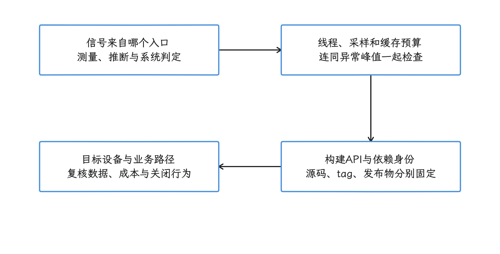

图：先核对信号定义，再审查预算、构建接口与维护基线，最后在目标场景验收。 功能清单和固定commit都不能单独证明API37可用或线上成本。

我们把源码固定在对应 commit 来分析。截至 2026-10-26，本节核对的六个项目所用固定 commit 仍是各自默认分支 HEAD。固定日期和构建版本只用来界定结论适用的代码，不是用来给项目排资历的：

| 项目 | 源码基线 | 发布与构建基线 | 可以得出的结论 |
|---|---|---|---|
| AndroidGodEye | [`459f5cb5`](https://github.com/Kyson/AndroidGodEye/tree/459f5cb5a2a4d176ff63f27322644a8191df2af9) | GitHub Release 3.4.3；AGP 3.2.1；`compileSdk` / `targetSdk` 29；`minSdk` 16 | 上游没有给出 Android 17 与现代 AGP 的验证证据 |
| Collie | [`bfdc6782`](https://github.com/happylishang/Collie/tree/bfdc6782d568bfcefef01e846e81ccfd5a7e3470) | 1.1.8；AGP 7.2.1；`compileSdk` / `targetSdk` 30；`minSdk` 21 | 可阅读运行时实现，但指标口径和依赖要逐项替换或复测 |
| Rabbit | [`d29f293a`](https://github.com/SusionSuc/rabbit-client/tree/d29f293a373167b03fc946e763d57e72157ab0e5) | README 标注 1.0.3；AGP 3.5.3；`compileSdk` / `targetSdk` 28；`minSdk` 19 | Gradle 插件不能直接进入 AGP 8.0+ 工程 |
| Matrix | [`3b8293bd`](https://github.com/Tencent/matrix/tree/3b8293bd65d47eeea7caf1f32a3a5d4d5eab60e7) | 2.1.0；插件编译依赖 AGP 4.0.0；README 声明支持 AGP 3.5/4.0/4.1 | Trace Gradle 插件仍受 Transform API 删除影响 |

BlockCanary 和 ArgusAPM 也放在本节一起讨论：两者分别完整保留了早期 Looper 长消息采样和一体化客户端 APM 的实现，发布物都停在现代 Android 之前，我们不再单独为它们写接入指南。

AndroidGodEye 的 `3.4.3` tag 指向表中的固定 commit，CI（Continuous Integration，持续集成）发布时会用 `TRAVIS_TAG` 覆盖版本；同一 commit 的根 `gradle.properties` 仍写着 `VERSION_NAME=3.1.11`。3.4.3 Release 本身仍然成立，但复现旧项目构建时，我们要同时记录 tag、CI 环境和源码默认属性，只抄一个版本号是不够的。 Collie 的 1.1.8 tag 指向 `a079c99d`，与本文分析的 master `bfdc6782` 不同；后文是固定 master 的源码结论，不等于已验证同版 AAR。Rabbit 也要区分 README 的 1.0.3、根工程 AGP 3.5.3，以及插件编译依赖中的 AGP 3.5.0。

<!-- gracker-diagram: ch17-05-02-source-release-build -->
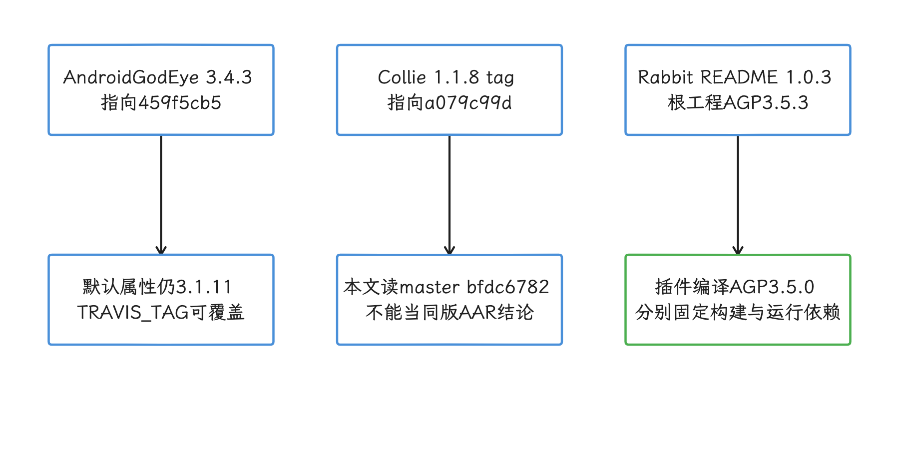

图：仓库HEAD、release/tag和构建默认属性要独立记录，再核对具体行为来自哪份代码。 Collie1.1.8 tag不同于本文master；版本号相同也不能证明制品字节相同。

## BlockCanary：保留 Looper 长消息原理

BlockCanary 1.5.0 用公开的 `Looper.setMessageLogging()` 安装 `Printer` 回调，拿到主线程每次 `Message` dispatch（从开始执行到执行结束）的起止时刻，再由后台线程采样主线程 Java 栈。

它测到的是一次 dispatch（消息开始执行到执行结束） 的 wall time（实际经过时间）；delivery delay（消息入队后未执行的等待）和从输入处理、RenderThread、GPU 执行到画面 present（提交显示）的完整帧流水线，都在这个测量窗口之外。

固定源码的 Android 版本属性仍为 1.5.0，使用 AGP 2.2.2、`compileSdk 23` 和 `targetSdk 22`。analyzer manifest 声明旧存储与电话权限，Android UI 模块的 Activity 带 intent-filter 却没有显式 `exported`；通知代码未建 channel，`PendingIntent` 只有 `FLAG_UPDATE_CURRENT`，`BlockInfo` 还尝试读取设备 ID。现代宿主要分别处理清单合并、通知、mutability、存储和标识权限。直接照旧版默认路径接入不构成 Android 17 兼容方案，借用原理或维护迁移分支都要重新验收。

### 真实采样窗口与盲区

采样并不是从 dispatch 开始就固定每 300 ms 抓栈，节奏由两个参数决定：`threshold` 是判定长消息的耗时阈值，`dump interval` 是相邻两次栈采样的间隔：

1. 原 Printer 不解析日志前缀，只在“开始/结束”布尔值之间交替；首次回调记录 `System.currentTimeMillis()` 和线程 CPU time，并启动 sampler。
2. 首次任务按 `threshold × 0.8` 延迟入队；默认 dump interval 等于 block threshold。后续在每次抓栈完成后再延迟 interval，调度和抓栈开销会继续推迟采样。
3. dispatch 结束时只有 wall time 严格大于 threshold 才投递报告任务，然后停止 sampler。
4. 报告任务只读取时间戳严格落在 dispatch 起止之间的栈；若没有样本就不生成 `BlockInfo`，栈缓存默认最多 100 条。

例如，阈值为 1000 ms、间隔自定义为 300 ms，一次持续 1200 ms 的 dispatch，理想调度下会在约 800 ms 和 1100 ms 取样；默认间隔若仍为 1000 ms，则通常只能赶上 800 ms 那次。前 800 ms 的热点可能全部错过；线程饥饿时样本还会更少，不能把这些时刻当成精确定时保证。

<!-- gracker-diagram: ch17-05-03-block-sampling-window -->
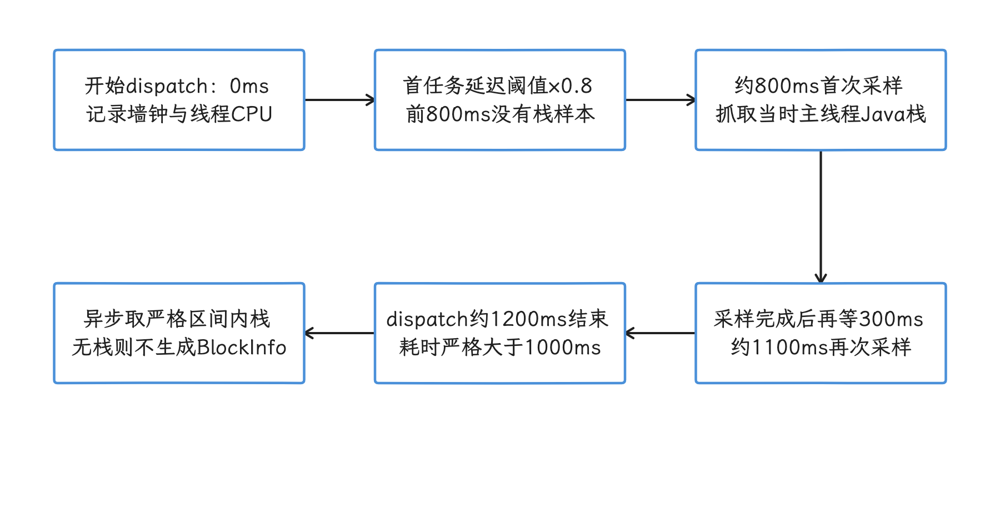

图：阈值1000ms、间隔300ms的示例，名义采样约在800ms和1100ms，结束时还需区间内有栈。 非实测时间轴；任务排队和抓栈耗时会推迟采样，默认间隔其实是1000ms。

采样栈只说明取样瞬间主线程停在什么位置。wall time 很长、thread CPU time（该线程占用 CPU 的时间）却很短时，我们要再借 Perfetto（Android 系统 trace 分析工具） 区分 Runnable 饥饿（可运行却长期抢不到 CPU）、Binder 跨进程调用、锁等待或 I/O；两者都长，才更接近持续占用 CPU。

<!-- gracker-diagram: ch17-05-04-wall-cpu-candidates -->
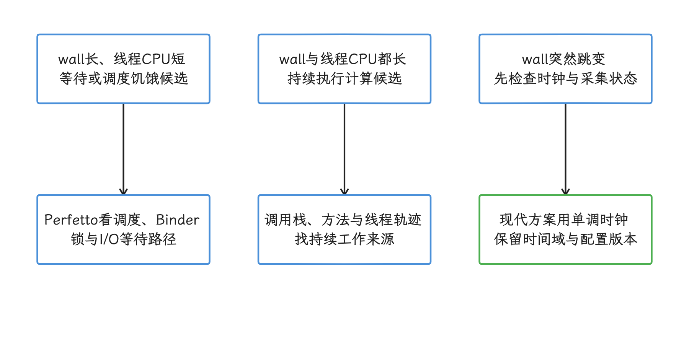

图：dispatch耗时与线程CPU时间用于缩小候选，抓到的栈只代表采样瞬间。 旧实现墙钟会受校时影响；任何一个差值都不能独立证明根因。

`Looper` 只有一个 message logger 槽位，后安装的 SDK 会覆盖先安装者，BlockCanary 停止时还会把它设为 `null`。自研方案若由应用控制所有观察者，可以装一个统一分发器（hub）转发回调；另一个 SDK 之后再来覆盖，这条路也拦不住。Android 17 里还有隐藏的 `Looper.Observer` 和 slow-log 阈值，但隐藏 API 不在普通应用的稳定契约之内，拿反射方案当长期替代并不可靠。

<!-- gracker-diagram: ch17-05-05-single-logger-hub -->
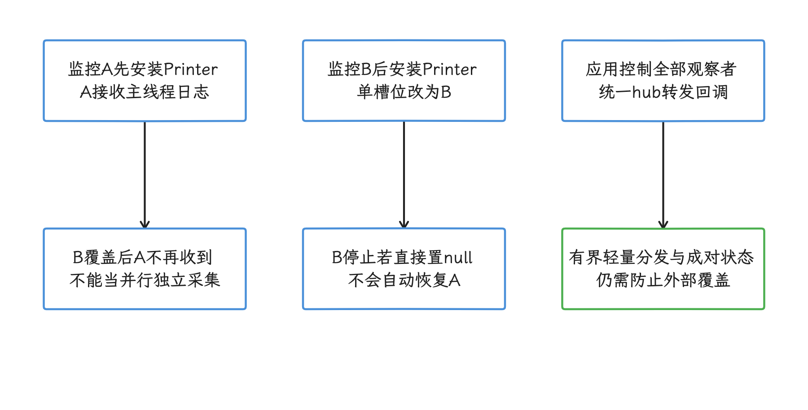

图：后安装者覆盖现有Printer，停止置null也不会自动还原；受控hub只能管理已知观察者。 第三方再次覆盖仍会失去回调；隐藏Observer不是普通App稳定替代入口。

要写一个现代的最小实现，我们至少要满足：

- 用 `uptimeMillis()` 或纳秒 monotonic clock（只向前推进的单调时钟）计算 wall duration，并保留 `currentThreadTimeMillis()`。
- Printer 回调只做耗时不随数据量增长的状态更新；抓栈、签名、序列化、磁盘和上传进入有容量上限的后台队列。
- 识别 dispatch start/finish 前缀并处理调试器、重复初始化、Printer 冲突和停止恢复。
- 阈值、采样间隔、最大样本数、页面/交互与配置版本随事件上报。
- 帧体验用 Jetpack `JankStats` 和系统 `FrameMetrics`；系统 ANR 则结合平台诊断和 system trace。`ApplicationExitInfo` 只补充已经退出的进程，不能覆盖所有仍存活的 ANR。

## ArgusAPM：完整架构样本与迁移对象

ArgusAPM 是 360 在 2018 年开源的客户端 APM。它把编译期织入、运行时 task（采集任务）、负责多进程汇总的 `ContentProvider`（可在应用启动早期创建、也能承接多进程访问的 Android 组件）、SQLite 批量缓存、云控接口（服务端远程下发采集规则）和上传接口放进一个仓库，模块划分得清楚，适合我们拿来看架构取舍。公开代码末次提交停在 2019 年，旧发布链使用 Bintray；README 公告明确停止新增免费服务端接入，并称已接入产品可以继续使用，这份历史公告不能证明旧服务今天仍在线，也不能作为新项目生产依赖的准入依据。

它的采集链是：Gradle 插件用 AspectJ 或 ASM 插入采集逻辑，运行时 task 生成事件，经 `ContentProvider` 汇总后进入 `DbCache` 和 SQLite，再由宿主的 `IRuleRequest`、`IUpload` 接规则服务与上传服务。库的 main manifest 本身没有注册 Provider；sample 在宿主中显式声明 `exported=false`。`StorageUtils` 按实际包名拼 authority，sample 写死的 `com.apm.application.apm.storage` 不能照搬到其他包名。

<!-- gracker-diagram: ch17-05-06-argus-data-flow -->
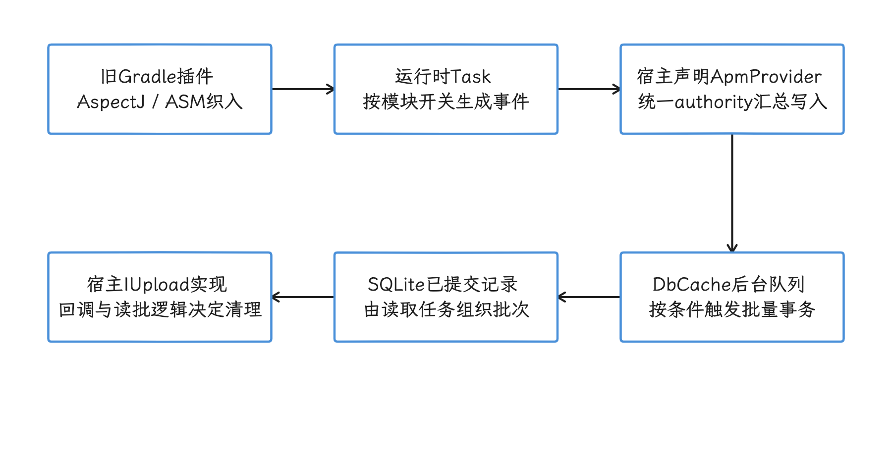

图：旧插件插入采集逻辑，运行时经Provider和缓存进入SQLite，再由宿主上传接口处理。 Provider须由宿主正确声明authority；入队、入库和服务端确认是不同边界。

| 旧能力 | 实际来源与口径 | Android 17 处理 |
|---|---|---|
| 启动/页面 | 在 `onCreate` 路径向 decor view（窗口根 View）调用 `post()`、生命周期 AOP 或 Instrumentation hook（替换系统组件创建入口） | 不等于 TTID（Time to Initial Display，初始内容显示时间）或 TTFD（Time to Full Display，完整内容显示时间）；移除隐藏的 Instrumentation hook |
| FPS（Frames Per Second，每秒帧数） | `Choreographer` 回调计数与 frameTime 差值换算；常规存储只留 ≤30 的窗口，Debug 解析另走一路 | 只作线索，改用 JankStats/FrameMetrics |
| 卡顿/Watchdog | Printer 延迟抓栈或后台 tick，默认阈值 4500 ms；调度延迟会改变实际观测窗口 | 命名为 stall（主线程停顿）预警，不冒充系统 ANR |
| ANR | 周期扫描 `/data/anr/` | 普通 API 37 App 不可依赖；迁到 ApplicationExitInfo/平台能力 |
| 网络 | OkHttp interceptor 和旧 URLConnection/HttpClient 改写 | 缺 DNS 解析、connect 建连与 TLS 加密握手耗时；OkHttp 的 `IOException` 路径直接重抛，不走末尾记录 |
| 内存/文件/进程 | PSS（Proportional Set Size，按共享页比例分摊的进程内存）快照、目录遍历和 SDK 看到的进程 | 不能据此判定泄漏、存储介质状态或进程存活率 |
| 函数/WebView | 固定签名 ASM；末次代码中 task 未完整注册 | 不能因 class 存在就宣称功能可用 |

旧 Gradle 插件依赖 `AppExtension`、`registerTransform()` 与旧 AGP 内部类型，consumer rules（随 AAR 传给宿主的 R8 规则）还包含无参数 `-dontwarn`、`-dontoptimize` 和宽泛 keep；R8 负责压缩、优化和混淆 Java/Kotlin 字节码。迁移时我们改用按 variant（构建变体） 工作的 Android Components Instrumentation/Artifacts API，并重新验证 Kotlin、协程、lambda、R8、增量构建与插桩失败行为；替换一个类名离完成迁移还差得远。

运行时还要移除 `ActivityThread.mInstrumentation` 反射、`/data/anr`、旧动态广播、`NetworkInfo`、不可重置设备标识、外部存储根目录和全局 WebView JS bridge（JavaScript 与 Java 的双向调用入口）。本轮所读核心 Java 源码不直接提供 native 采集实现；即使所用核心 AAR 不带 native `.so`（原生共享库），宿主 uploader 或其他组合 SDK 仍要自己满足 16 KB page size（原生库装载对齐）要求。

`DbCache` 不是“严格每 15 秒或最多 100 条”的持久化保证：每次收数据都重置延时；距上次写库达到 15 秒或列表达到 100 条时投递写库消息，否则从最近一次收数再等 15 秒。100 是触发阈值，Handler 队列和列表没有硬容量上限。Provider 返回成功只表示消息已入队；进程在事务提交前退出仍会丢数据，事务回滚前已从列表移除的项也缺少恢复路径。

<!-- gracker-diagram: ch17-05-07-argus-durability -->
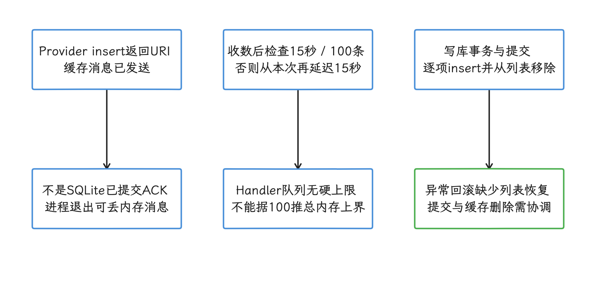

图：Provider返回成功只到消息入队，15秒/100条是写库触发条件，事务提交后才有持久化结果。 触发值不是硬容量或精确定时；退出与事务失败仍有数据丢失路径。

多进程写入可借鉴 Provider 汇总，但模块表、规则、清理和上传应明确由哪个进程管理。`DataHelper.readAll()` 对满 1000 条的批次检查 `onRead()` 返回值；不足 1000 条的末批则先计入删除游标，最终忽略回调结果并清理，失败时可能丢数据。迁移后应先持久化，以明确 ACK 推进删除游标，按 `event_id` 去重，并接受未确认成功时的有界重试；这才有条件实现 at-least-once delivery。

<!-- gracker-diagram: ch17-05-08-argus-final-batch-ack -->
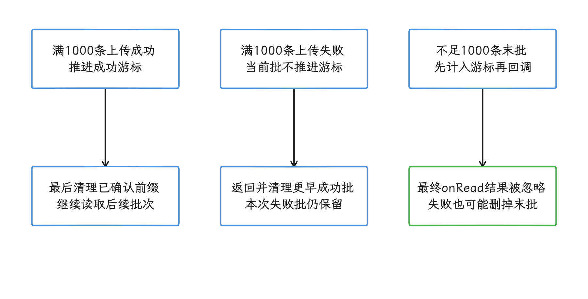

图：DataHelper对满1000条检查回调结果，末批不足1000条却忽略结果并清理。 现代方案应在明确ACK后推进删除游标，保留有界重试并以event_id去重。

OkHttp 路径还把本次 `OkHttpData` 放在 interceptor 实例字段；同一实例并发处理请求时可能串写。成功响应且 Body 长度未知时用 `source.request(Long.MAX_VALUE)` 读到结束，可能增加内存与等待，而记录的 `costTime` 在这之前就已结算。迁移时要使用每次调用独立的状态，并区分收到响应头、读完 Body、失败与取消。

<!-- gracker-diagram: ch17-05-09-argus-network-boundaries -->
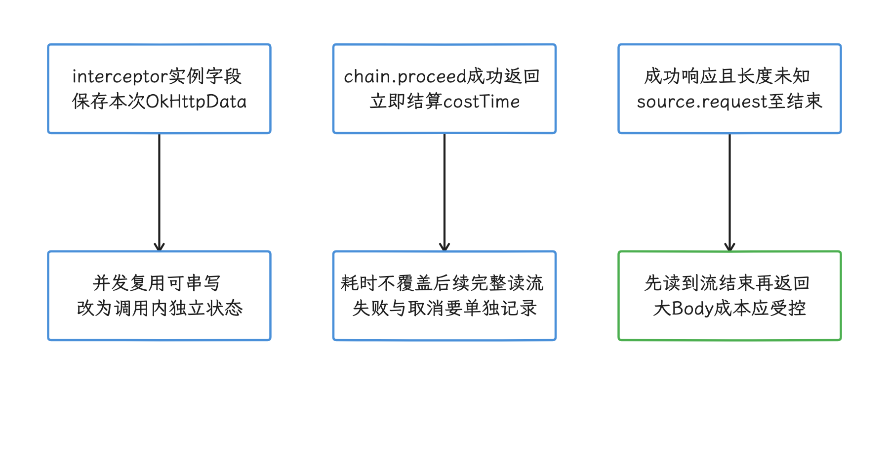

图：同一interceptor实例的字段可被并发请求串写，收到响应与完整读取Body也不是同一边界。 IOException直接重抛不落末尾记录；未知长度预读到结束可能增加等待与内存。

存量项目按下面顺序退出：

1. 冻结旧事件、开关、表、看板和 R8 规则。
2. 移除构建插件。
3. 在上传适配层补齐 schema 版本、`event_id`、`session_id`、`trace_id`、进程实例与时钟域，记录每个字段的语义和单位。
4. 按模块做旧、新 collector 对照；同一 Looper 的 Printer 等独占入口先统一分发，或按设备/时段互斥比较，不能直接让两个 SDK 同时抢槽位。
5. 连续两个发布周期稳定后再删除旧 AAR、Provider、权限、数据库和服务端 schema。

这里的兼容性判断并不是说“所有运行时模块在 Android 17 都会崩溃”。它只说明上游没有提供 `targetSdk 37`、API 37 与当前 AGP 的完整验证，旧版本 README 也就当不了生产准入报告。

## AndroidGodEye：浏览器看板式调试平台

AndroidGodEye 分成 Core、Debug Monitor 和 Toolbox 三层：Core 生成性能数据，Debug Monitor 在浏览器展示，Toolbox 提供 LeakCanary、xCrash、OkHttp 等组合入口。其 README 列出的范围很广，包括 CPU、Battery、FPS、PSS、Heap（堆内存）、RAM（物理内存）、流量、卡顿、启动、线程 dump、页面耗时、Java/native Crash、ANR、方法耗时、APK（应用安装包） 体积、图片与 View 检查。

这套设计里值得借鉴的，是“采集能力与查看方式分离”：

- Debug 调试包可以保留高密度实时曲线、线程列表与网络正文。
- Release 生产包只保留经过预算和脱敏的事件，不携带浏览器面板或调试入口。
- 每个 monitor 单独声明采样周期、线程、权限、缓存上限和停用动作。

到了 Android 17 新项目这里，它就不是能直接依赖的二进制基线了：固定版本仍使用 AGP 3.2.1，`compileSdk` 与 `targetSdk` 都是 29，发布脚本还保留着已停止更新、进入退役状态的 JCenter 仓库流程。接入这样的项目，我们要做构建迁移、依赖升级、manifest（组件与权限声明文件） 审核和模块级回归，远超改一个版本号的工作量。

如果团队喜欢 AndroidGodEye 的浏览器看板，可以复用它的信息架构：保留“模块列表—实时曲线—单次事件详情”的交互，再用自己的事件协议和采集器供数，这样就不会把旧运行时依赖一起带进 Release 包。固定 `GodEyeMonitorServer` 用 HTTP 和 `/refresh` WebSocket 向浏览器发送数据，不能把“在浏览器查看”理解成默认只有本机能访问或已具备生产认证。复用 UI 时还要限制调试服务的开启范围、网络可达性与字段内容。

<!-- gracker-diagram: ch17-05-10-godeye-data-ui -->
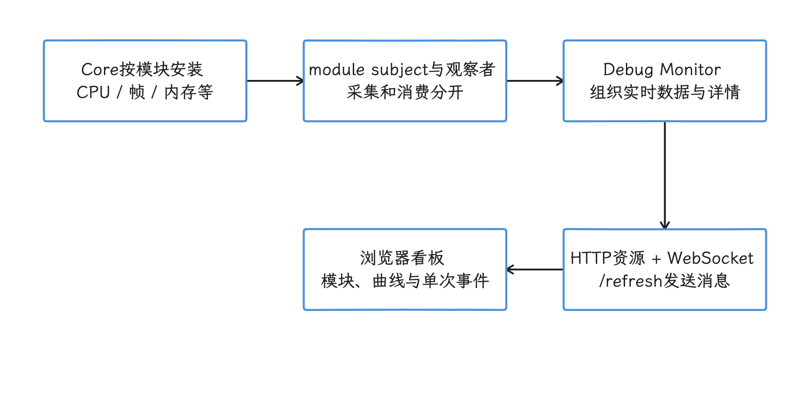

图：Core模块产生数据，由观察者接到调试Monitor，再经HTTP/WebSocket服务供浏览器查看。 图表达分层职责；浏览器UI不意味着默认仅本机可达或已具备生产鉴权。

## Collie：轻量实现里的指标陷阱

Collie 的代码量不大，很适合我们学习“一个轻量监控库如何拼出第一批信号”；也正因为实现写得直接，几种常见误差在源码里一目了然。

### Looper 卡顿与 ANR 判定的来源

“启发式”在这里的意思是：SDK 按自己的规则推断风险，这和 Android 系统对 ANR 的确认是两回事。`LooperMonitor` 调用 `Looper.setMessageLogging()` 安装 `Printer`，用 `>` / `<` 日志标记一次 message dispatch 的开始和结束；它还会反射 `Looper.mLogging` 保存原有 Printer，在队列进入 idle 时检查距上次检查是否已过 60 秒，满足才重装。这不是独立的 60 秒定时巡检；主线程一直忙时可能长期不检查。这里有两个工程约束：

- 一个 Looper 只有一个 message logging Printer。多个监控 SDK 都想接管它时，安装顺序和恢复逻辑会影响数据，甚至导致某一方失去回调。
- 一次主线程 message 很慢，只能解释一部分卡顿；一帧完整的 CPU/GPU 时长、系统对 ANR 的正式判定，都在这个信号之外。

Collie 在 dispatch 开始时先往 `FpsThread` 的无界队列放一个任务，消费到它之后才向共用 Handler 安排 5000 ms 延时；结束时修改同一个 runnable 的 `invalid` 标志。回调只检查 Activity 弱引用和该标志，没有重新核对 dispatch 起点或 elapsed duration。排队延迟、跨 dispatch 复用状态与跨线程可见性都会影响结果，因此它只能叫 SDK stall 线索，不能保证准确覆盖“单次 dispatch 超过 5 秒”。

<!-- gracker-diagram: ch17-05-11-collie-stall-two-queues -->
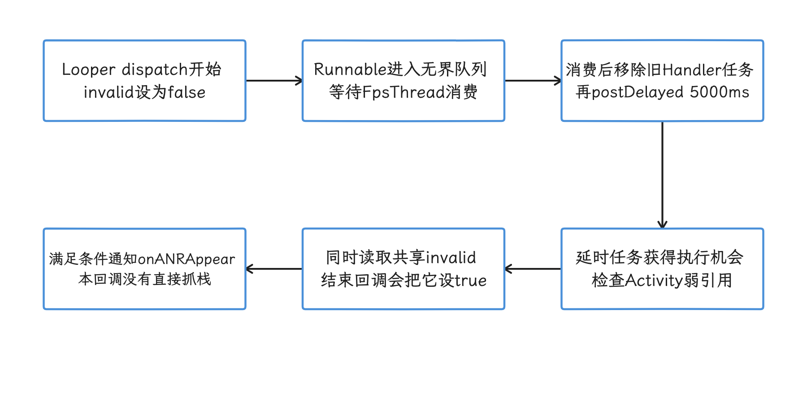

图：dispatch开始先排入FpsThread，再由它安排Handler延时，最终只检查共享标志与Activity弱引用。 结束会修改invalid；队列延迟、复用标志和跨线程状态让它不能等同精确5秒单消息判定。

系统 ANR 分 input（输入） dispatch、BroadcastReceiver、Service、ContentProvider、无焦点窗口等多种类型，超时阈值也不是统一的 5 秒常量。如果要借这个回调触发抓 Java 栈，还需另加受控采样；当前 `onANRAppear` 本身没有抓栈：事件名可以写成 `main_dispatch_stall` 就好，`system_anr` 这个名字留给系统判定。

### FPS 计算的 60 Hz 假设

`FpsTracker` 把 Looper dispatch 当作累计样本，并不是逐帧拿到系统完成时刻：`cost ≤16 ms` 时只累加计数与 `max(16,cost)`；较慢消息转交后台；Activity 有效且累计消息数超过 3 时才通知回调，掉帧估算为 `max(1, cost / 16 - 1)`，平均值按累计消息数和累计耗时换算并截到 60。这不是固定一秒窗口的真实 FPS，普通消息也会参与，17 ms 这样的消息就会被估成至少掉一帧。90/120 Hz 与动态刷新率还会进一步放大固定 16 ms 假设的误差。

源码还反射 `Choreographer.mLock`、`mCallbackQueues` 与 `addCallbackLocked()`，固定实现实际只往 input 队列加回调设置 `mInDoFrame`，并没有输出三个阶段各自耗时；代码在 `SDK_INT > P` 时直接跳过，P（API 28）仍会尝试反射；失败则标志可能一直为 false。就算只看 Android 8 到 Android 17 的覆盖范围，这些私有字段在不同系统版本上的含义也不一致。

现代实现优先用 `JankStats`：API 24+ 时它以系统 `FrameMetrics` 帧时序为基础，低版本退回 `OnPreDrawListener`，业务侧补上页面和交互状态即可。如果我们必须自己接 `FrameMetrics`，要在回调内复制对象，并把后续聚合移到后台线程——系统会复用该对象，消费过慢还会丢报告。

<!-- gracker-diagram: ch17-05-12-collie-fps-dispatch -->
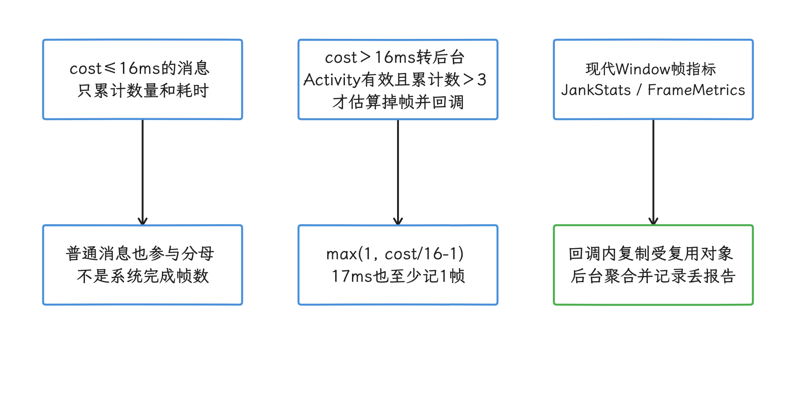

图：Collie按dispatch累加消息数和max(16,cost)，慢消息用固定16ms估算掉帧并把平均值截到60。 不是固定一秒的真实FPS；现代帧指标也要记录Window、刷新率与回调丢失。

### 启动、流量与泄漏的指标命名

Collie README（固定 commit） 把启动方式写成 `ContentProvider+onwindforcus`，其中 `onwindforcus` 是 README 的原文拼写，指的是 window focus（窗口获得焦点）。但固定 commit 的 library manifest 并没有注册采集 Provider，源码里也找不到对应的 `ContentProvider`；当前实现要靠应用手动调用 `Collie.instance.init()`，再结合进程启动时间、一个透明 View 的 `onDraw()` 和 window focus 估算启动或页面可见耗时。

这三个时间点都能辅助调试，离系统定义的 TTID 或 TTFD 还差一层：

- View 的 `onDraw()` 只说明该 View 进入绘制，未证明这一帧已经提交并显示。
- window focus 可能受启动窗口、权限弹窗、多窗口和焦点切换影响。
- TTFD 需要应用在可交互时调用 `reportFullyDrawn()`；系统不会从 window focus 自动推导。

如果另一个 SDK 采用 `ContentProvider` 提前初始化，我们要记住 Provider 在 `Application.onCreate()` 之前创建。Jetpack App Startup 也通过 `InitializationProvider` 工作，让多个 initializer（初始化任务）共用一个 Provider，并显式声明依赖顺序；采集代码本身仍会计入冷启动成本。

<!-- gracker-diagram: ch17-05-13-startup-timepoints -->
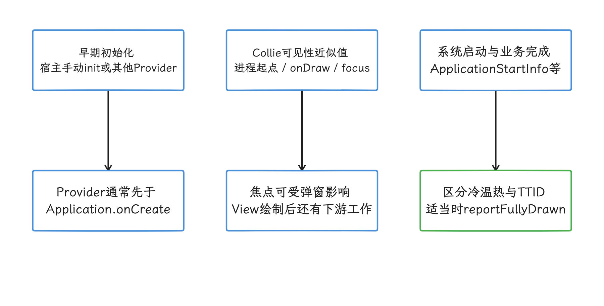

图：Provider初始化、View绘制、window focus与系统启动时间点回答不同问题。 Collie库未注册采集Provider；onDraw/focus不证明画面已显示，也不能替代TTFD。

流量模块只读当前 UID 的 `TrafficStats.getUidRxBytes()`，没有 TX、URL 或网络阶段。它只在 Activity 创建时改全局基线，在每次 pause 时把“当前累计量减同一旧基线”加到该 Activity；resume 没有重置。反复 pause/resume 会重复累计，多个页面还会覆盖同一个基线，API 返回 `UNSUPPORTED=-1` 也没有校验。它不只是粗略页面归因，连增量算法本身都需要修复。

<!-- gracker-diagram: ch17-05-14-collie-rx-counter -->
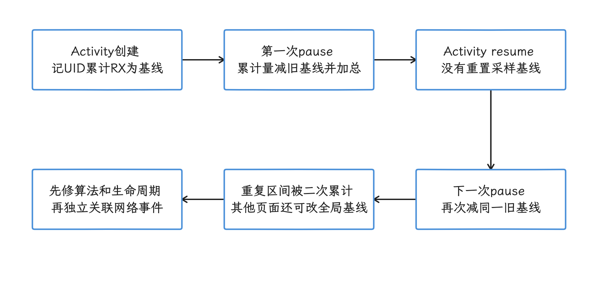

图：只在创建时重置UID RX基线，每次pause仍减同一旧值，恢复页面后会重复累计。 多个页面共用基线且不检查UNSUPPORTED；不能把旧数值当正确页面流量。

更严重的是，`statsMap` 用 Activity 作强引用键，`TrafficStatsItem` 也保存 Activity；destroy 时只通知 listener，没有移除 map 项。启用这条路径会保留已销毁页面，进而污染它自己的泄漏提示。现代实现应及时释放生命周期引用，并以独立网络事件的 route、字节数、时间与页面上下文做关联。

泄漏模块把已销毁 Activity 放入 `WeakHashMap`。退后台后分别安排约 1 秒和 10 秒的任务，每次分配并写触约 4 MiB 数组、请求 GC；第二次还等待 100 ms、调用 finalization，再统计仍能访问的弱键。第二次会复查后台状态，但第一任务不复查，排队也会改变实际时刻。弱键未被清除只是候选线索，不能证明已完成 GC 或给出泄漏引用链；流量模块留下的强引用也会让候选持续存在。生产诊断应按环境选受控 heap dump 或 LeakCanary 的可达性分析，并把主动分配/GC 造成的扰动计入成本。

<!-- gracker-diagram: ch17-05-15-collie-strong-weak-gc -->
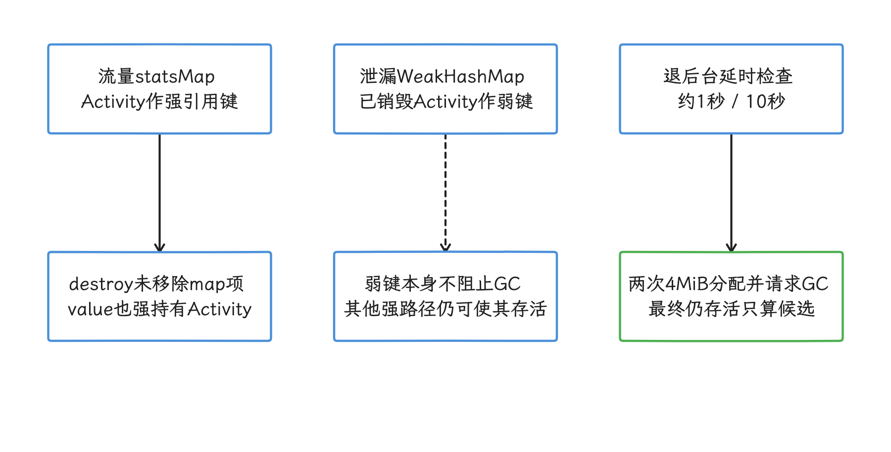

图：TrafficStats的强引用能保留已销毁Activity，WeakHashMap不阻止回收，但候选仍需引用链分析。 约1秒和10秒的主动分配/GC会扰动应用，100ms等待不能证明已完成GC。

Collie 还用没有容量上限的 `LinkedBlockingQueue` 转交部分事件：消费速度跟不上生产速度时队列持续积压，流量高峰就这样被转成内存增长——backpressure（消费跟不上生产的背压）没有处理。这个实现适合拿来教学，原样复制到生产 SDK 就危险了。`FpsThread` 是 `while(true)` 消费循环，捕获 `Exception` 后继续，连 interrupt 也不会让它退出；`FpsTracker.destroy()` 只释放 Looper 监听。`Collie.stop()` 则注销中心生命周期回调并退出共享 HandlerThread，没有逐个调用 tracker 的 destroy，也没有终止 FpsThread。关闭后的线程和直接注册的回调都需要额外验证与清理。

<!-- gracker-diagram: ch17-05-16-collie-worker-shutdown -->
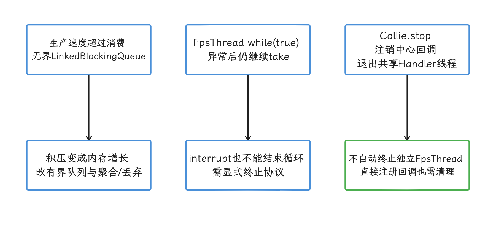

图：移到后台队列只降低调用延迟；容量上限、丢弃计数和逐模块停止仍须实现。 原FpsThread无限循环且忽略interrupt，Collie.stop未逐个destroy所有tracker。

## Rabbit：运行时工具与构建期检查的分工

Rabbit 的 README 一口气列出启动测速、FPS、敏感函数扫描、慢函数插桩、网络查看、内存、Java Crash、APK 分析、自定义 UI 和上报。对内部测试包来说，一套入口集中展示这些信息很方便；但站在 Release 包的角度，它们分属三类不同的生命周期：

| 类别 | 典型能力 | 合适的运行位置 |
|---|---|---|
| 运行时低成本信号 | 页面、内存概览、经过脱敏的网络耗时 | Release 可采样开启 |
| 现场诊断 | 网络正文、浮窗、调用栈、详细方法耗时 | Debug、dogfood（员工内部使用）或定向灰度（只向小范围设备开启） |
| 构建产物检查 | 大图、重复文件、APK 组成、SO 体积 | CI 或离线任务 |

<!-- gracker-diagram: ch17-05-17-rabbit-three-lifetimes -->
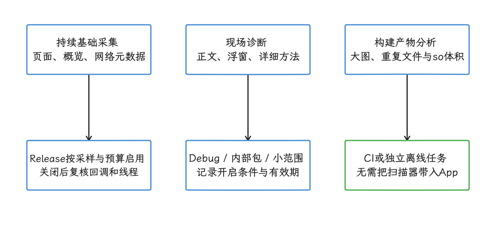

图：运行时低成本信号、定向现场诊断与APK分析应按生命周期分别交付。 统一UI入口不等于都应进入Release；各路径仍需独立预算与授权。

Rabbit 的 Gradle 插件直接调用 `registerTransform()`，还使用 `com.android.build.api.transform.*` 和 `VariantScope` 这类 AGP 内部结构；AGP 8.0 已经删除 Transform API，插件到了 AGP 8.0+ 工程里就加载不起来了。

迁移工作远不止把父类名称换成 `AsmClassVisitorFactory`：逐类修改字节码适合 Instrumentation API；要读全工程 class 或改整体构建产物时，我们再评估 `ScopedArtifacts`。迁完还要验证：

- 插桩范围是当前 module、整个 project，还是包含外部依赖。
- 增量构建、configuration cache（复用配置阶段结果的缓存）和并行构建是否稳定。
- R8 前后类名、方法签名与 mapping（混淆前后名称对照表）的关联是否正确。
- Kotlin、协程、Compose 生成代码及 desugaring（改写为低版本可运行字节码）后的结构是否符合假设。

<!-- gracker-diagram: ch17-05-18-transform-migration -->
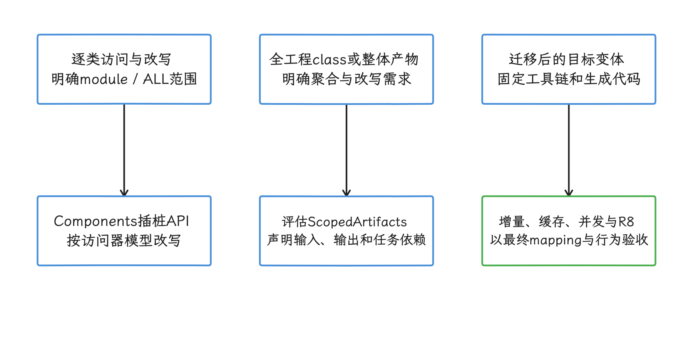

图：旧Transform迁移先确定类和产物的处理范围，再选择Instrumentation或Artifacts并验收构建行为。 更换父类不能覆盖变体、增量、R8、Kotlin和configuration cache的兼容性。

Rabbit 公共 README 对 Crash 的承诺是 Java 异常捕获。仓库里虽然出现了 native 和 JVMTI（Java Virtual Machine Tool Interface，虚拟机调试与分析接口）module，这离“已具备生产级 native crash 与线上 JVMTI 能力”还很远；每个 module 都要单独检查 ABI（Application Binary Interface，原生二进制接口）、API 下限、崩溃信号处理链、符号化（把崩溃地址还原为函数名）和 Android 17 行为。 Java 路径本身也要先修：`RabbitExceptionMonitor` 安装全局 handler 后，处理时先 sleep 1 秒并同步保存，只在主线程异常时再 sleep 1.5 秒、调用原 handler；后台线程异常没有继续交还。`close()` 只把 `isOpen` 设为 false，没有恢复 handler，此后 handler 会提前 return。关闭监控不能吞掉原有崩溃处理链，异常路径也不应靠 Toast 等待。

<!-- gracker-diagram: ch17-05-19-rabbit-crash-delegation -->
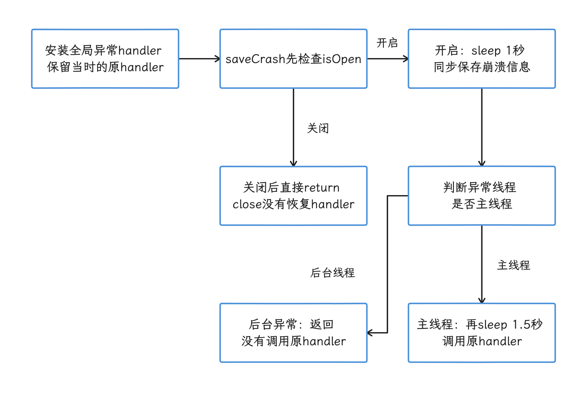

图：原实现只在主线程异常时继续原handler，close只改标志，会留下提前返回的全局handler。 这些是固定源码行为；迁移应保留所有异常路径的原处理链，并移除Toast等待。

## 横向对比

| 工具 | 值得学习的部分 | 不应直接沿用的部分 | 适合的处理方式 |
|---|---|---|---|
| AndroidGodEye | Core / Monitor / Toolbox 分层，浏览器实时看板 | 旧构建链和未经 API 37 复测的全量模块 | 借鉴模块边界与调试 UI |
| Collie | 少量代码组合 Looper、生命周期、内存与流量信号 | 60 Hz 假设、私有反射、主动 GC、无界队列、近似指标命名 | 阅读源码并重写采集器 |
| Rabbit | 研发工具的统一入口，运行时与 APK 检查的组合方式 | Transform 插件、AGP 内部 API、Release 中的高风险诊断能力 | 把运行时、调试和 CI 模块分拆 |
| Matrix | 多个 Canary 共享插件框架与上报接口 | Trace Gradle 插件对旧 Transform API 的依赖 | 模块级评估，现代 AGP 下先解决插件兼容性 |

这张表表达的是复用层级。复制概念的风险较低，复制源码需要测试，直接接旧二进制则必须有与当前构建链、目标系统和业务流量匹配的验证报告。

<!-- gracker-diagram: ch17-05-20-reuse-levels -->
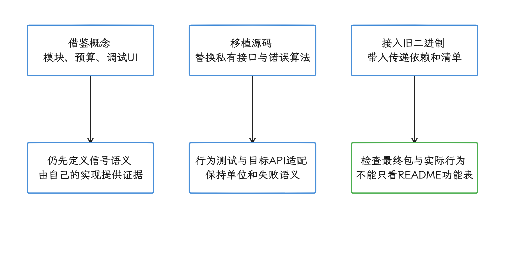

图：复用层级越靠近实际代码与制品，就越需要具体版本、设备和业务流量的验证。 概念可借鉴不代表实现正确；图不是按工具名称给风险打分。

## Matrix、轻量方案、官方 SDK、商业平台的分工

Matrix 上游 README 把自己描述为微信使用的 **plugin style、non-invasive APM system**——以插件组织、尽量少改业务代码的 APM。放到 Android 工程里看，它更接近一个客户端专项采集框架：Trace Canary、Resource Canary、IO Canary、SQLiteLint、Battery Canary 这些模块共享一套插件组织方式；Canary 是 Matrix 给单项检测模块起的名字。

“non-invasive”说的是接入形态；运行时有没有 Hook（拦截并转接原调用）、字节码插桩或额外开销，这三个字保证不了，每个 Canary 的采集原理和预算我们仍要单独审查。

Matrix 的 Trace Gradle 插件在固定 commit 中仍由 `MatrixTraceInjection` 调用 `AppExtension.registerTransform()`，配套 transform 类还依赖 `com.android.build.api.transform.*`。README 声明的支持范围是 AGP 3.5.0、4.0.0 和 4.1.0；示例工程用 AGP 7.2.2，只能说明仓库示例采用 Transform 尚未删除时的构建配置，不等于本轮已经成功运行它。AGP 8.0 删除该 API 之后，插件就没有可调用的兼容入口了。

不启用 Trace 插件时，Resource Canary、IO Canary 这些运行时模块可以分别评估；但“绕开 Gradle 插件”离“整个 Matrix 组合已兼容 Android 17”还差得远。正确的做法是按 artifact（可单独依赖或发布的构建制品）、初始化路径和设备组合出具测试结果。

<!-- gracker-diagram: ch17-05-21-matrix-artifact-boundaries -->
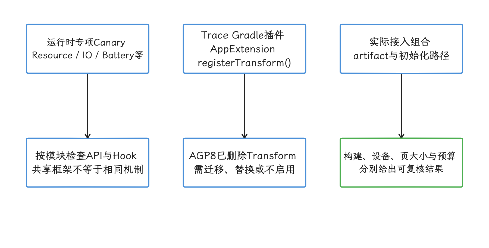

图：运行时Canary与Trace Gradle插件分别评估，插件的Transform兼容性不能替代整个组合的设备测试。 non-invasive只描述接入形态；Hook、字节码修改与运行成本须逐模块确认。

四类方案的分工如下：

| 方案 | 主要价值 | 团队需要自建的部分 | 适用条件 |
|---|---|---|---|
| 轻量自研或参考 Collie | 代码少，能快速验证少数信号 | schema、采样、缓存、重试、归因、隐私、后台服务 | 指标少且有人长期维护 SDK |
| Matrix、KOOM 等专项框架 | 内存、I/O、Trace 等专项经验较多 | 现代构建适配、服务端、发布验证 | 已明确要解决某类专项问题 |
| 官方系统 API 与 Jetpack | 系统语义清晰，版本边界可查 | 聚合、看板、告警、低版本回退 | 希望先建立可持续的基础指标 |
| Measure、Firebase、Sentry 等平台 | 会话、存储、查询、告警和协作能力完整 | 成本、数据控制、供应商迁移方案 | 团队已经需要平台服务 |

选型时我们要先明确：谁负责采集、谁负责事件协议、谁负责本地存储、谁负责上传、谁负责数据删除。功能列表长得相似，各项职责的成熟度未必相同。

## Android 版本与 APM 能力演进

平台实现固定到 AOSP（Android Open Source Project，Android 开源项目） `android-17.0.0_r1`，公开契约以官方 API 37 reference（官方 API 参考） 为准。版本表只记录与 APM 直接相关、能从公开 API 验证的变化。`ProcessLifecycleOwner`、`JankStats` 这些 Jetpack 库随依赖版本发布，我们把它们写成某个 Android 系统版本“新增”的平台 API 就错了。

| Android 版本 | API Level | 公开能力 | 使用边界 |
|---|---:|---|---|
| Android 4.1 | 16 | `Choreographer` 与 `FrameCallback` | 能跟随 vsync（屏幕垂直同步节拍）收回调，不能仅凭回调间隔还原完整渲染流水线 |
| Android 7 | 24 | `FrameMetrics`、`Window.OnFrameMetricsAvailableListener` | 按 Window 提供帧时长；回调对象会复用，处理慢会丢报告 |
| Android 11 | 30 | `ApplicationExitInfo`、`getHistoricalProcessExitReasons()` | 能补进程退出原因；ANR trace 是尽力提供，可能为 `null` |
| Android 12 | 31 | `FrameMetrics.DEADLINE` 等更完整的帧时序可供上层使用 | `JankStats` 在 API 31+ 可给出 `frameOverrunNanos`（超过该帧 deadline 的纳秒数），仍需业务状态辅助归因 |
| Android 15 | 35 | `ProfilingManager.requestProfiling()`；`ApplicationStartInfo` | profiling 有频率限制且不保证执行；启动信息提供冷/温/热类型和系统时间点 |
| Android 16 | 36 | `addProfilingTriggers()`；`APP_FULLY_DRAWN`、`ANR` | 两种触发器返回正在运行的 system trace 快照；`APP_FULLY_DRAWN` 在冷启动调用 `reportFullyDrawn()` 后触发，不是冷启动开始触发 |
| Android 16 minor SDK 36.1 | 36.1 | running trace 请求及 force-stop、recents、Task Manager kill 触发器 | 用 `SDK_INT_FULL` 判断次版本，普通 `SDK_INT` 仍是 36 |
| Android 17 | 37 | `COLD_START`、`OOM`、`ANOMALY`、`APP_COMPAT`、excessive CPU kill；ANR warning 与 `ApplicationExitInfo.AnrInfo` | 产物按触发器变化，ANR warning 也是尽力回调，不能代替退出记录 |

<!-- gracker-diagram: ch17-05-22-platform-signal-layers -->
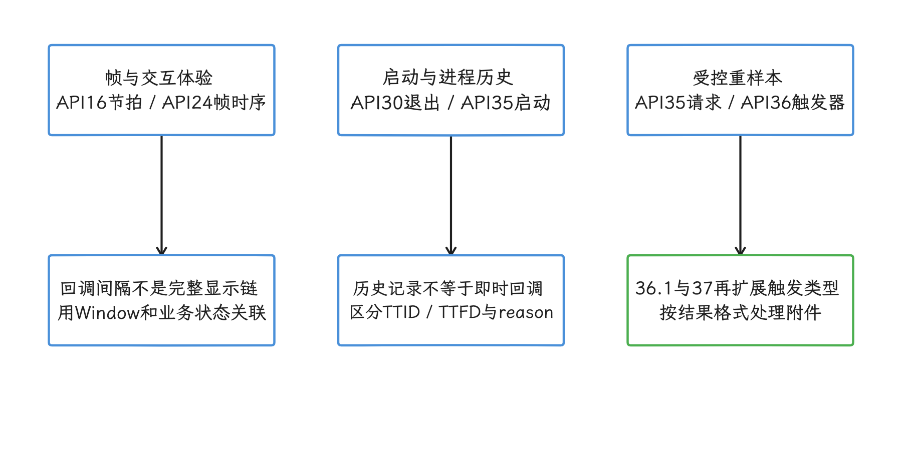

图：平台逐步增加帧、启动退出与profiling入口，轻量SDK应按信号与版本分层。 Jetpack单独发布；平台入口也有缺失、丢报告、限频与设备策略边界。

Android 17 的细节需要分开记：

- `COLD_START` 在系统确认 `ApplicationStartInfo.START_TYPE_COLD` 后尽早开始，但实际采集仍可能延迟；返回新启动的 system trace 与 stack sampling。持续到 `reportFullyDrawn()`，未调用时默认持续 5 秒，这个时长受系统配置控制；缓冲区满后丢弃后来的事件。
- `OOM` 触发器对应 `OutOfMemoryError`（Java 堆内存不足异常），返回 Java heap dump；应用自定义 `UncaughtExceptionHandler` 必须继续调用系统默认 handler，否则系统触发器就走不完这条路径。
- `KILL_EXCESSIVE_CPU_USAGE` 返回正在运行的 system trace 快照。
- `ANOMALY` 与 `APP_COMPAT` 的产物随异常类型变化，客户端不要固定按 Perfetto 文件去解析。

<!-- gracker-diagram: ch17-05-23-profiling-artifact-types -->
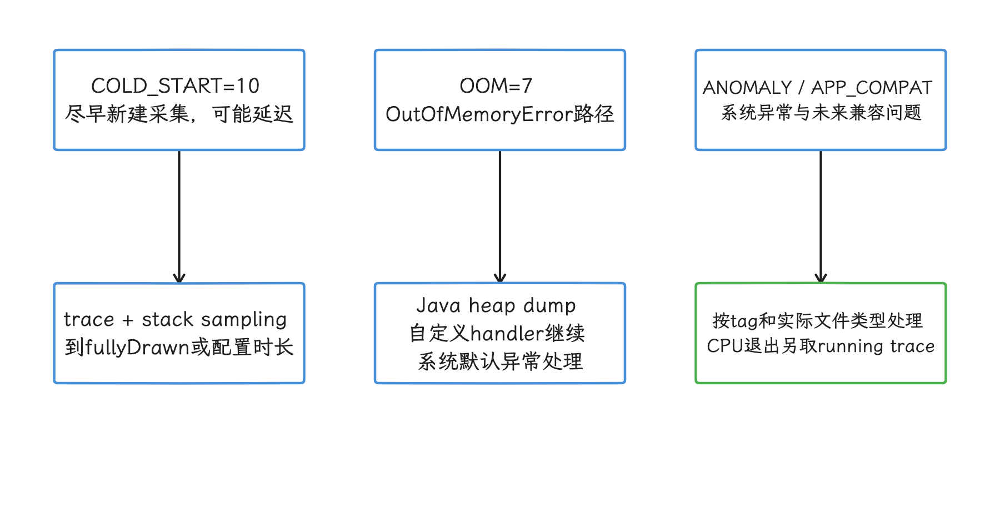

图：冷启动产出新trace与栈采样，OOM产出Java heap，系统异常类产物随原因变化。 注册和采集仍受策略/flag限制；OOM要求继续系统默认handler，不能固定按一种后缀解析。

ANR 预警还有独立的关联路径：

- `ActivityManager.registerAnrWarningListener()` 在接近 ANR 超时前尽力回调，执行回调的 executor（任务执行器）要避开主线程。`AnrWarningResult.getAnrId()` 可以和后续 `ApplicationExitInfo.getAnrInfo().getAnrId()` 关联，从“预警”追到“已发生的 ANR”。

<!-- gracker-diagram: ch17-05-24-anr-warning-correlation -->
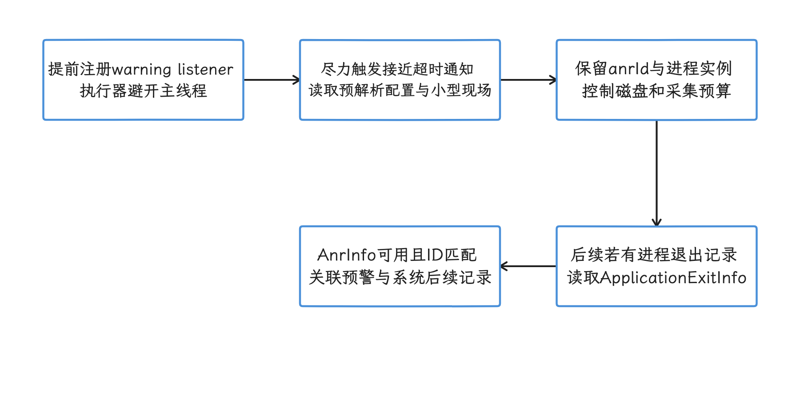

图：API37在接近超时前尽力预警，可用anrId与后续AnrInfo关联已有现场。 预警不保证执行，也不证明最终ANR或死亡；没有退出就不能期待对应退出记录。

Android 从 36.1 开始允许 minor SDK（次版本 SDK）增加 API。`Build.VERSION.SDK_INT` 只记录大版本；要区分 36 与 36.1，先守住 API 36 的大版本下限，再比较 `Build.VERSION.SDK_INT_FULL` 与 `Build.VERSION_CODES_FULL`。API 存在还不代表某设备开启了所有 profiling 触发器，注册、限频与结果错误必须处理。这些新 API 给轻量 APM 增加了更可靠的系统信号，低版本方案依旧省不掉：`minSdk 26` 的应用仍要同时维护 API 26-29、30-34、35、36、36.1 和 37 的分层路径。

<!-- gracker-diagram: ch17-05-25-major-minor-feature-gates -->
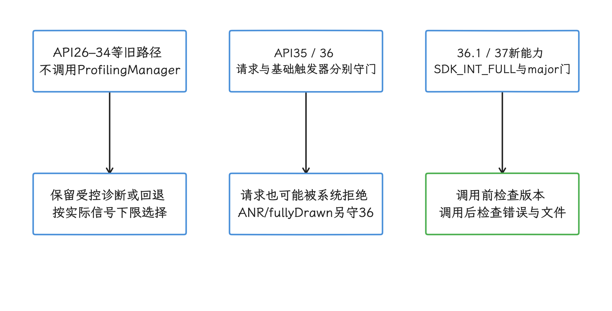

图：读取full SDK前先守API36大版本，再按36.1或37选择新接口，并处理注册失败和结果缺失。 SDK版本通过只证明API入口可用，不能证明设备开启所有trigger或一定产生附件。

## 轻量方案和商业平台的切换点

| 当前需求 | 更合适的方向 | 判断依据 |
|---|---|---|
| 少量研发人员查看本地现场 | 内部 debug 面板，参考 AndroidGodEye / Rabbit 的 UI | 不需要建设组织级存储与告警 |
| 只缺启动、慢帧、主线程 stall、Crash 基础指标 | 官方 API + 小型自研采集层 | 信号范围有限，团队能维护协议和服务端 |
| 已经需要 session、跨信号关联、告警、权限和版本对比 | 平台型方案 | 工作重点从采集转向检索与协作 |
| 需要深挖内存、I/O 或启动 trace | 专项框架或按需 profiling | 重样本需要独立预算和分析工具 |
| 私有化、删除请求和迁移成本是硬条件 | 先定义内部事件协议，再评估平台 | 数据所有权比客户端功能数量更重要 |

DAU（Daily Active Users，日活跃用户数）和团队人数都不适合当唯一阈值：一天一万用户，如果每次会话产生数百个网络 span（有起止时间的请求记录），数据量可能高过百万 DAU 的低采样 Crash 系统。切换点要看事件率、retention（数据保留期）、查询延迟、告警责任和合规要求。 容量可以先按 `会话数 × 每会话事件数 × 保留比例 × 平均事件字节数` 估算，再另算附件、索引、副本和保留期；按 session 抽样与按 event 抽样的统计单位要分别记录。

<!-- gracker-diagram: ch17-05-26-platform-capacity-switch -->
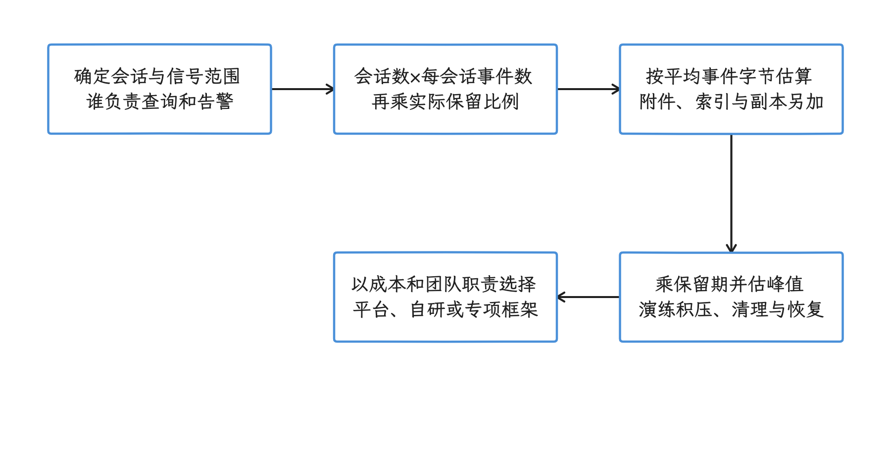

图：容量由会话、事件数、保留比例和平均字节共同决定，附件与索引另计。 这是规划公式不是基准结果；按session和按event抽样必须分别标明单位。

## 使用建议

存量项目接入旧库前，至少完成以下检查：

- 在目标 AGP、Gradle、JDK、Kotlin、R8 与 configuration cache（复用 Gradle 配置阶段结果的缓存） 组合上构建。
- 在 Android 8、11、15、16、17 以及主要厂商 ROM（厂商定制系统） 上运行核心用例。
- 检查 library manifest 合并结果，包括权限、Provider、Receiver、Service 和 `exported` 属性。
- 测量空闲、正常交互、异常高峰三种场景的 CPU、内存、线程、I/O、网络与包体增量。
- 验证多进程去重、session 边界、离线缓存上限、失败重试和卸载后数据处理。
- 对 URL、header、query、网络正文、文件路径、用户名、账号和设备标识做采集前脱敏。
- 演练远程停用、配置回滚和 SDK 移除，确认关闭后不会留下线程、回调或磁盘任务。

旧项目拿不出现代验证报告时，我们的默认动作是阅读和移植需要的设计，而不是把所有 artifact 一次接入。

## 从这些项目提炼最小 APM SDK

一个能进入生产环境的最小 APM SDK，可以只覆盖少量信号，但每个信号都要有稳定语义：

| 信号 | 推荐采集入口 | 最小输出 | 容易写错的地方 |
|---|---|---|---|
| 启动 | API 35+ <code>Application<wbr>Start<wbr>Info</code>；低版本自定义节点；应用调用 <code>report<wbr>Fully<wbr>Drawn(<wbr>)</code> | start type、TTID/TTFD、自定义阶段 | 把 window focus 当成 TTFD |
| 慢帧 | <code>Jank<wbr>Stats</code>；必要时直接用 <code>Frame<wbr>Metrics</code> | 帧时长、overrun、Window、UI state | 固定按 16 ms 和 60 Hz 计算 |
| <span style="white-space:nowrap">主线程</span><br>stall | Looper dispatch 计时 + 限频抓栈 | dispatch 耗时、栈签名、页面 | 把 SDK 阈值事件命名为系统 ANR |
| 内存 | <code>Debug.<wbr>Memory<wbr>Info</code>、Runtime / native heap、RSS（Resident Set Size，当前驻留物理内存） | 单位明确的 PSS/RSS/heap 与进程名 | 混用 kB、KiB、MB，或主动 GC 扰动样本 |
| 网络 | OkHttp <code>Event<wbr>Listener</code> + interceptor，或统一网络层 | route pattern（归一化接口路径）、方法、阶段耗时、状态与错误类 | 上传完整 URL、token、请求或响应正文 |
| Crash<br><span style="white-space:nowrap">退出</span> | Java handler、native crash 组件、API 30+ <code>Application<wbr>Exit<wbr>Info</code> | 栈、native signal / 退出 reason、进程、版本 | 只依赖 handler，遗漏 LMK（Low Memory Killer，系统因内存压力结束进程）、force-stop 和 native crash |
| <span style="white-space:nowrap">重样本</span> | API 35+ <code>Profiling<wbr>Manager</code> 或受控 Perfetto | artifact 类型、触发原因、tag、符号信息 | 假设请求必定执行，或在低版本调用新 API |

`ApplicationExitInfo` 是进程退出后留下的历史信息，常在后续启动读取；同一应用的主进程仍活着时，也可查询已经退出的其他进程。一次 ANR 没有导致进程退出，就不能指望马上出现对应退出记录。崩溃现场的最小持久化仍要自己做；profiling 也可能被限频、拒绝或产物缺失，所以采集链必须允许“只有事件、没有附件”的样本。

下面这张图展示最小 SDK 中各线程和存储层的职责；TTL（Time To Live）表示本地记录的到期清理规则：

<!-- gracker-diagram: ch17-05-27-minimal-sdk-data-flow -->
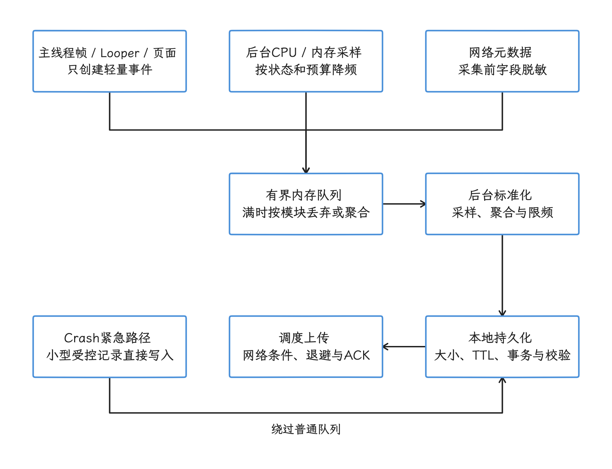

图：普通生产者尝试进入有界队列，由后台标准化和持久化；Crash走尺寸受控的直接写入路径。 这是迁移后的建议职责图，不是任何旧SDK的已实现保证；异常时不能指望异步队列排空。


主线程路径只创建小对象并尝试写入有界队列；队列满了就按模块策略丢弃或聚合，保证业务线程不被阻塞。Crash 紧急路径别指望普通异步队列全部排空，直接写尺寸受控、可校验的最小记录。

### 统一事件协议

AndroidGodEye、Collie 和 Rabbit 都没有一套能直接用到现代平台的统一上报 schema，迁移前需要团队自己定义协议。下面是一个示意事件，字段值只起说明作用：

```json
{
  "schema_version": 3,
  "event_id": "018f7d7e-6a39-7f42-a3d1-78d39f0e9c31",
  "session_id": "s_7c2f",
  "process": {
    "name": "com.example.app",
    "instance_id": "p_b641"
  },
  "app": {
    "version_name": "8.4.0",
    "version_code": 840012,
    "build_id": "release-840012"
  },
  "device": {
    "api_level": 37,
    "abi": "arm64-v8a"
  },
  "signal": {
    "type": "frame",
    "duration_ns": 27800000,
    "overrun_ns": 11100000,
    "window": "HomeActivity",
    "ui_state": "feed_scroll"
  },
  "time": {
    "wall_ms": 1784973600123,
    "elapsed_realtime_ns": 983402100000
  },
  "config_version": 42,
  "sample_rate": 0.01
}
```

事件的时长用 monotonic clock 计算，跨设备检索靠 wall clock（可能被校时的墙上时钟）；两件事各归各的时钟。URL、用户输入、账号这些高风险字段要进通用 attributes（可扩展属性集合），必须先过字段级白名单。 `elapsed_realtime_ns` 只能在同一次启动的时钟域内比较；进程实例、设备与 boot 身份要一起保留，不能跨设备或重启后直接相减。

<!-- gracker-diagram: ch17-05-28-event-ids-and-clocks -->
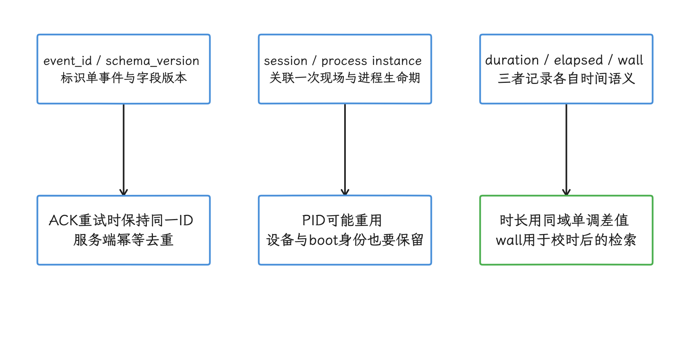

图：event标识单条记录，session和进程实例关联现场；时长与跨设备检索使用不同时间域。 正文JSON只是内部协议示意；elapsed不能跨设备或重启相减，配置还须标明采样单位。

## 轻量 APM 的线程模型

轻量并不是只开一个后台线程就够了；线程模型要规定清楚生产速度、消费速度和进程退出时的行为：

- 帧、Looper 和生命周期回调只写小型事件；回调里不做 JSON、压缩、DNS、文件写入或复杂栈处理。
- 队列必须有上限，并为 Crash、ANR warning、普通性能样本设置不同优先级。
- CPU 和内存采样使用固定节奏，但应用退到后台、进入省电状态或出现热限制时要降频。
- 本地文件采用可恢复的分段或事务写入，单文件、总目录和保留时间都有上限。
- 上传任务使用 exponential backoff（重试间隔指数拉长的退避）和 jitter（随机抖动），避免大量设备在配置更新后同时请求。
- 多进程各自生成 `process_instance_id`，由服务端按 session 和时间关联；只认 PID（重启后可能复用的进程号）是不够的。

Collie 的无界队列提醒我们：把工作移出主线程只解决了调用延迟，没有解决背压。队列上限、丢弃计数和配置版本也要作为 SDK 自身健康指标上报。

<!-- gracker-diagram: ch17-05-29-bounded-queue-worker -->
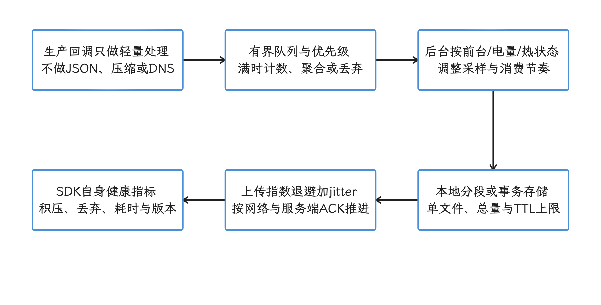

图：每层都限定容量和处理策略，后台化同时要暴露积压、丢弃和配置版本。 容量数值要按宿主预算测量；不能通过阻塞业务线程无限等待上传来保数据。

## 线上开关设计

生产 APM 至少需要四层控制：

- **总开关**：紧急停止所有非必要采集和上传。
- **模块开关**：启动、帧、网络、内存、Crash、ANR 与 profiling 分开控制。
- **采样规则**：按 stable hash（同输入同输出的哈希）选择用户或设备，再叠加版本、页面、异常类型和时间窗口。
- **预算限制**：约束单位时间事件数、附件字节数、CPU 时间、磁盘占用和单次上传大小。

配置要有递增的配置发布版本号（回滚旧内容也发布新版本）、签名或可信传输、TTL（配置有效期） 和本地默认值。客户端事件必须携带生效的 `config_version` 、采样单位与 `sample_rate`，否则服务端解释不了版本之间的数量变化。

对 Crash 和 Android 17 的 ANR warning 来说，等回调到来再去读复杂远程配置就晚了：关键阈值和脱敏规则要提前解析成内存快照（只读配置），异常路径只读这份快照。

<!-- gracker-diagram: ch17-05-30-config-controls -->
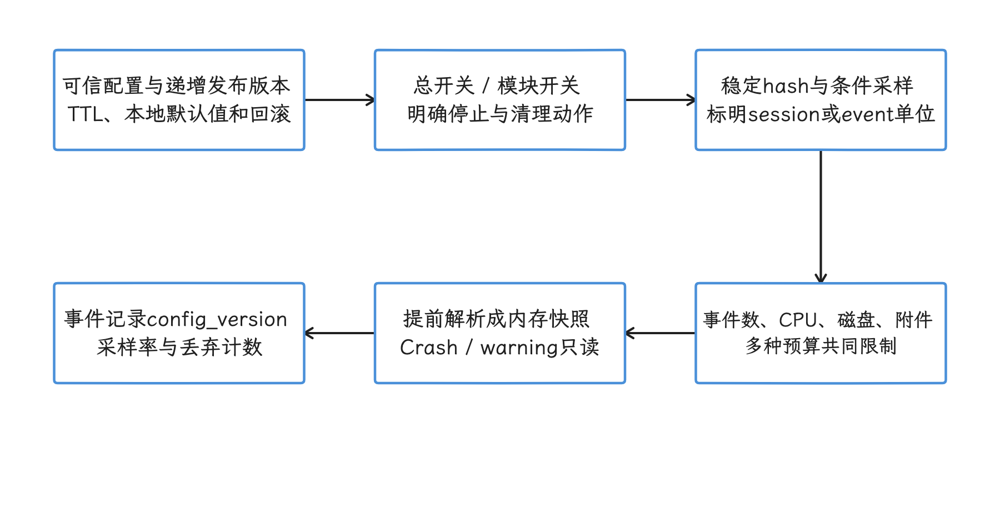

图：配置先验证并解析为快照，再按总开关、模块、采样和预算控制采集与上传。 回滚旧内容也发布新版本；异常路径只读快照，不临时下载或解析复杂规则。

## AndroidGodEye、Collie、Rabbit 各自更适合借什么

- **AndroidGodEye**：借 Core、调试 Monitor 与 Toolbox 的分层，以及浏览器看板的信息组织。
- **Collie**：借“用少量公开入口快速验证信号”的思路，同时把 60 Hz 假设、私有反射、主动 GC 和无界队列列为反例。
- **Rabbit**：借研发工具统一入口，但把构建检查、Debug 诊断和 Release 采集拆成不同 artifact 与构建变体。
- **Matrix**：借多个专项 Canary 的组织方式；对每个 module 单独做版本、开销与构建审计。

大图、重复资源、APK 组成、SO 体积和敏感 API 扫描属于构建产物分析。把这些任务继续塞进运行时 SDK 会增加包体和维护成本，应放到 CI 或独立离线工具中。

## 从旧开源工具迁移到官方 SDK / 平台的 checklist（检查清单）

迁移应优先保持事件语义连续。只有彼此兼容的入口才在有限窗口内同时运行；独占入口用统一分发或互斥样本对照：

1. 导出现有事件、枚举、单位、采样规则与看板查询。
2. 定义内部 schema，并记录每个旧字段的来源和误差。
3. 按启动、帧、stall、网络、Crash、内存、重样本拆分采集模块。
4. 为每个模块选择官方 API、重写采集器或平台 SDK，并写明版本下限。
5. 对兼容入口在小流量设备双写，用统一 session、时钟和采样单位比较分布；互斥采集则固定设备与场景、按分组比较，避免覆盖 logger 或重复触发重样本。
6. 迁移告警阈值、符号表、权限、删除流程和数据保留策略。
7. 停用旧采集后观察至少一个完整发布周期，再移除依赖与 manifest 项。

<!-- gracker-diagram: ch17-05-31-migration-continuity -->
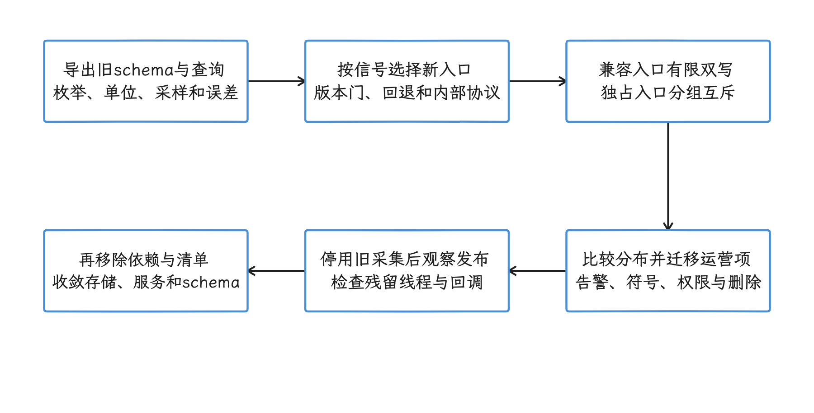

图：先记录旧协议和误差，再分模块替换，以兼容入口双写或互斥分组完成对照，最后停用清理。 不能同时抢Looper槽位或重复触发重样本；分组对照须固定设备、场景与采样单位。

迁移映射可以从这张表开始：

| 旧能力 | 优先目标 | 验证重点 |
|---|---|---|
| 固定 16 ms 的 FPS / 掉帧 | `JankStats`、`FrameMetrics` | 可变刷新率、Window 切换、回调丢失 |
| window focus 启动耗时 | `ApplicationStartInfo`、TTID、`reportFullyDrawn()` | 冷/温/热分类，TTID 与 TTFD 分离 |
| 5 秒 Looper “ANR” | `main_dispatch_stall` + `ApplicationExitInfo`；API 37 补 ANR warning | 区分预警、SDK stall 与系统 ANR |
| UID RX 流量 | 网络层 interceptor；必要时保留独立 UID 总量 | 修复旧基线与生命周期引用；区分 payload 字节、UID 计数、缓存与重试 |
| WeakHashMap 泄漏提示 | LeakCanary 或受控 heap dump | 只在合适环境抓重样本，避免主动 GC 常驻 |
| 旧 Transform 插桩 | Instrumentation API / `ScopedArtifacts` | 插桩范围、增量构建、R8 与 mapping |
| 手工 Perfetto 抓取 | API 35+ `ProfilingManager`，低版本保留受控 Perfetto | 请求可能被限频或拒绝，附件类型需显式记录 |

`ProfilingManager` 从 API 35 才可用，触发器从 API 36 才可注册；36.1 能力要做完整 SDK 版本判断，Android 17 新触发类型还要守住 API 37 并处理不支持或注册失败。Android 14 及以下应继续使用可控的 Perfetto、profileable（允许系统分析工具读取性能数据的构建配置）或内部诊断流程。

AndroidGodEye、Collie 和 Rabbit 的主要价值，是把早期移动端监控的工程取舍完整地留在源码里。到了 Android 17，系统已经提供更准确的帧、启动、退出、ANR 预警和 profiling 信号；旧项目中的模块化、限频和调试 UI 仍值得借鉴，依赖私有反射、固定帧率、主动 GC 和旧 Transform API 的实现则应替换。

## 参考资料

- [BlockCanary 固定源码 `ed688391`](https://github.com/markzhai/AndroidPerformanceMonitor/tree/ed688391cdf95742892ce61494736667cf5baf08)
- [Android 17 `Looper`](https://android.googlesource.com/platform/frameworks/base/+/refs/tags/android-17.0.0_r1/core/java/android/os/Looper.java)
- [ArgusAPM 固定源码 `75ead19`](https://github.com/Qihoo360/ArgusAPM/tree/75ead19ca98a8a1f776688e9df5b572f20c80b12)
- [ArgusAPM 任务注册](https://github.com/Qihoo360/ArgusAPM/blob/75ead19ca98a8a1f776688e9df5b572f20c80b12/argus-apm/argus-apm-main/src/main/java/com/argusapm/android/core/tasks/TaskManager.java)
- [ArgusAPM 批量读取与删除](https://github.com/Qihoo360/ArgusAPM/blob/75ead19ca98a8a1f776688e9df5b572f20c80b12/argus-apm/argus-apm-main/src/main/java/com/argusapm/android/core/storage/DataHelper.java)
- [AndroidGodEye README（固定 commit）](https://github.com/Kyson/AndroidGodEye/blob/459f5cb5a2a4d176ff63f27322644a8191df2af9/README.md)
- [AndroidGodEye 构建基线](https://github.com/Kyson/AndroidGodEye/blob/459f5cb5a2a4d176ff63f27322644a8191df2af9/build.gradle)
- [AndroidGodEye SDK 版本配置](https://github.com/Kyson/AndroidGodEye/blob/459f5cb5a2a4d176ff63f27322644a8191df2af9/gradle.properties)
- [AndroidGodEye 3.4.3 Release](https://github.com/Kyson/AndroidGodEye/releases/tag/3.4.3)
- [Collie README](https://github.com/happylishang/Collie/blob/bfdc6782d568bfcefef01e846e81ccfd5a7e3470/README.md)
- [Collie 构建基线](https://github.com/happylishang/Collie/blob/bfdc6782d568bfcefef01e846e81ccfd5a7e3470/build.gradle)
- [Collie library manifest](https://github.com/happylishang/Collie/blob/bfdc6782d568bfcefef01e846e81ccfd5a7e3470/collie/src/main/AndroidManifest.xml)
- [Collie LooperMonitor](https://github.com/happylishang/Collie/blob/bfdc6782d568bfcefef01e846e81ccfd5a7e3470/collie/src/main/java/com/snail/collie/core/LooperMonitor.kt)
- [Collie FpsTracker](https://github.com/happylishang/Collie/blob/bfdc6782d568bfcefef01e846e81ccfd5a7e3470/collie/src/main/java/com/snail/collie/fps/FpsTracker.java)
- [Collie LauncherTracker](https://github.com/happylishang/Collie/blob/bfdc6782d568bfcefef01e846e81ccfd5a7e3470/collie/src/main/java/com/snail/collie/startup/LauncherTracker.kt)
- [Collie TrafficStatsTracker](https://github.com/happylishang/Collie/blob/bfdc6782d568bfcefef01e846e81ccfd5a7e3470/collie/src/main/java/com/snail/collie/trafficstats/TrafficStatsTracker.kt)
- [Collie MemoryLeakTrack](https://github.com/happylishang/Collie/blob/bfdc6782d568bfcefef01e846e81ccfd5a7e3470/collie/src/main/java/com/snail/collie/mem/MemoryLeakTrack.kt)
- [Collie 1.1.8 Release](https://github.com/happylishang/Collie/releases/tag/1.1.8)
- [Rabbit README（固定 commit）](https://github.com/SusionSuc/rabbit-client/blob/d29f293a373167b03fc946e763d57e72157ab0e5/README.md)
- [Rabbit BuildInfo](https://github.com/SusionSuc/rabbit-client/blob/d29f293a373167b03fc946e763d57e72157ab0e5/buildSrc/src/main/java/Dependencies.kt)
- [Rabbit Gradle plugin](https://github.com/SusionSuc/rabbit-client/blob/d29f293a373167b03fc946e763d57e72157ab0e5/rabbit-gradle-transform/src/main/java/com/susion/rabbit/gradle/RabbitPlugin.kt)
- [Rabbit VariantScope 适配层](https://github.com/SusionSuc/rabbit-client/blob/d29f293a373167b03fc946e763d57e72157ab0e5/rabbit-gradle-transform/src/main/java/com/susion/rabbit/gradle/core/context/VariantScope.kt)
- [Matrix README（固定 commit）](https://github.com/Tencent/matrix/blob/3b8293bd65d47eeea7caf1f32a3a5d4d5eab60e7/README.md)
- [Matrix Gradle plugin 构建依赖](https://github.com/Tencent/matrix/blob/3b8293bd65d47eeea7caf1f32a3a5d4d5eab60e7/matrix/matrix-android/matrix-gradle-plugin/build.gradle)
- [Matrix Trace plugin 注册路径](https://github.com/Tencent/matrix/blob/3b8293bd65d47eeea7caf1f32a3a5d4d5eab60e7/matrix/matrix-android/matrix-gradle-plugin/src/main/kotlin/com/tencent/matrix/plugin/trace/MatrixTraceInjection.kt)
- [Matrix v2.1.0 Release](https://github.com/Tencent/matrix/releases/tag/v2.1.0)
- [AGP API updates](https://developer.android.com/build/releases/gradle-plugin-api-updates)
- [JankStats](https://developer.android.com/topic/performance/jankstats)
- [FrameMetrics listener](https://developer.android.com/reference/android/view/Window.OnFrameMetricsAvailableListener)
- [App Startup](https://developer.android.com/topic/libraries/app-startup)
- [ApplicationStartInfo](https://developer.android.com/reference/android/app/ApplicationStartInfo)
- [ApplicationExitInfo](https://developer.android.com/reference/android/app/ApplicationExitInfo)
- [ApplicationExitInfo.AnrInfo](https://developer.android.com/reference/android/app/ApplicationExitInfo.AnrInfo)
- [ActivityManager ANR warning API](https://developer.android.com/reference/android/app/ActivityManager)
- [`Build.VERSION` 与 `SDK_INT_FULL`](https://developer.android.com/reference/android/os/Build.VERSION)
- [ProfilingManager](https://developer.android.com/reference/android/os/ProfilingManager)
- [ProfilingTrigger](https://developer.android.com/reference/android/os/ProfilingTrigger)
- [AOSP `android-17.0.0_r1` ActivityManager](https://android.googlesource.com/platform/frameworks/base/+/refs/tags/android-17.0.0_r1/core/java/android/app/ActivityManager.java)
- [AOSP `android-17.0.0_r1` ApplicationExitInfo](https://android.googlesource.com/platform/frameworks/base/+/refs/tags/android-17.0.0_r1/core/java/android/app/ApplicationExitInfo.java)
- [AOSP `android-17.0.0_r1` ProfilingTrigger](https://android.googlesource.com/platform/packages/modules/Profiling/+/refs/tags/android-17.0.0_r1/framework/java/android/os/ProfilingTrigger.java)
- [Android 17 API diff](https://developer.android.com/sdk/api_diff/37/changes)
