# Jetpack Benchmark：Microbenchmark、Macrobenchmark 与测量协议

Microbenchmark 测量可重复的局部工作，Macrobenchmark 从外部进程测量启动与完整交互。可比较的结果依赖实验结构、编译状态、指标定义、噪声控制和 CI 门禁；BaselineProfileRule 生成的 Profile 可以作为实验输入，但测量时仍需显式控制编译状态。Profile 的生成、打包、渠道交付和 ART 状态验证见 [21.4 Baseline、Startup 与 Cloud Profile 编译优化](../../part5-app/ch21-startup/04-baseline-startup-cloud-profile.md)。

<!-- gracker-diagram: ch17-06-01-measurement-contract -->
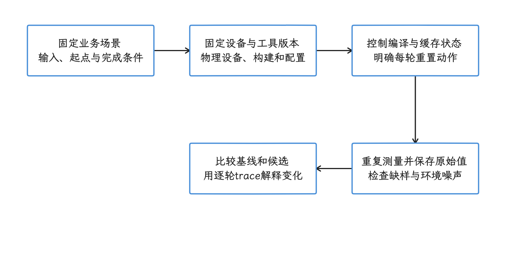

图：同一业务路径固定输入、设备、编译状态与指标，再用 JSON 和 trace 解释差值。 受控实验的数值不能直接代替线上用户分布。

## Microbenchmark、Macrobenchmark 与测量协议

### Benchmark 给优化结论提供可重复实验

Jetpack Benchmark 回答的是一个受约束的问题：同一场景、同一设备、同一编译状态下，candidate（待评估版本） 相对 baseline 是变快了还是变慢了。它替我们管理测量循环、采集指标、保存结果；真实用户那边的分布，交给线上 APM（Application Performance Monitoring，应用性能监控）、Android Vitals、JankStats 和故障样本去回答。

线上和实验室这两条线可以互相接续：

1. 线上数据定位到受影响的机型、页面和业务阶段。
2. 团队把该阶段压缩成可重复的本地数据与交互脚本。
3. Benchmark 对基线提交和候选提交执行同一实验。
4. 数字发生变化时，打开随迭代生成的 Perfetto trace（系统执行时间线） 解释原因。
5. 修复上线后，再由线上指标确认真实用户分布是否改善。

线上看 P95（95% 的观测值不超过该数值），实验室看 median（中位数）。两边的样本来源、设备分布和负载都不同，能放在一起比较的是它们指向的业务阶段和变化方向；数值门槛要各自维护。

<!-- gracker-diagram: ch17-06-02-online-lab-loop -->
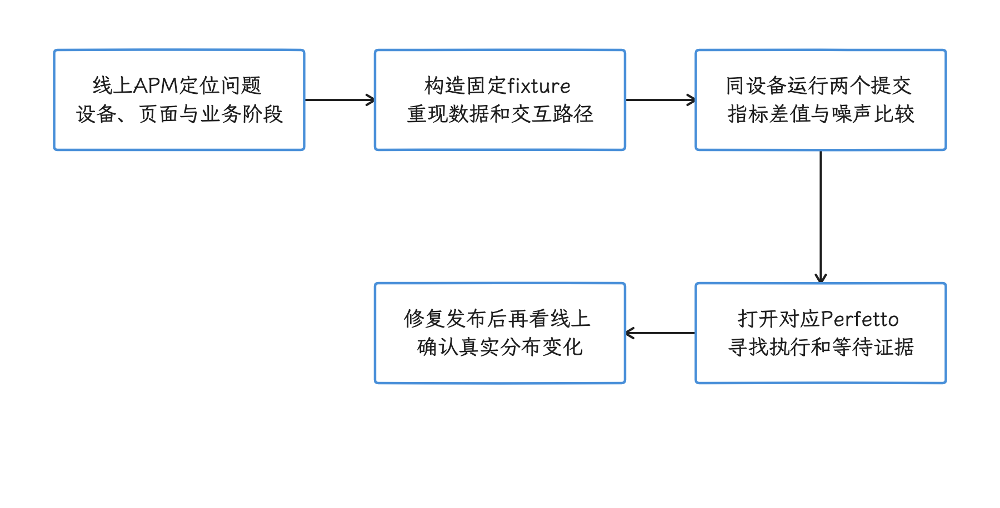

图：线上定位受影响阶段，实验室复现并解释，发布后再核对线上分布。 两端样本来源不同，各自维护预算与统计口径。

### 2026 年版本与平台锚点

截至 2026-10-26，AndroidX Benchmark 当前稳定版为 `1.5.0`，最新预发布版为 `1.6.0-alpha01`。本文保留 **1.4.1 作为固定历史复现基线**，后文未另注的实现与代码都指这一版本；不能把它的 API 下限或默认行为套到当前 1.5.0。Android 17 / API 37 的系统源码采用 `android-17.0.0_r1`，设备结果另记实际 fingerprint 与内核构建。

| 能力 | 固定 1.4.1 下限 | 使用边界 |
|---|---:|---|
| Microbenchmark | <span style="white-space:nowrap">API 21</span> | 进程内、可重复调用的局部代码 |
| Macrobenchmark | <span style="white-space:nowrap">API 23</span> | 独立测试进程驱动目标应用 |
| <code>Compilation<wbr>Mode.<wbr>None</code> / <code>Partial</code> | <span style="white-space:nowrap">API 24</span> | API 23 仅支持 <code>Full</code> |
| <code>Baseline<wbr>Profile<wbr>Rule</code> 生成 | <span style="white-space:nowrap">非 root API 33+</span><br><span style="white-space:nowrap">rooted API 28+</span> | 生成环境与收益验证环境分开 |
| Baseline Profile 收益验证 | <span style="white-space:nowrap">API 24+</span> | <code>Partial(<wbr>Baseline<wbr>Profile<wbr>Mode.<wbr>Require)</code> 与 <code>None(<wbr>)</code> 对照 |
| <code>Frame<wbr>Timing<wbr>Metric.<wbr>frame<wbr>Overrun<wbr>Ms</code> | <span style="white-space:nowrap">API 31+</span> | Android 17 可直接使用 |
| <code>Power<wbr>Metric</code> | <span style="white-space:nowrap">API 29+</span> | 还要检查设备是否支持所选 power rail |

旧资料中常见的“Microbenchmark 支持 API 14”，在本文固定的 1.4.1 Maven 发布件上也不成立：`benchmark-common:1.4.1` 与 `benchmark-junit4:1.4.1` 的 AAR manifest 都声明 `minSdkVersion=21`，Macrobenchmark 两个 Android AAR 则声明 `minSdkVersion=23`。

当前稳定版 1.5.0 的四个 Android AAR 均声明 `minSdkVersion=24`，与此前 1.5.0-rc01 一致。1.5 线采用 UiAutomator 2.4、稳定化 `BlackHole`，并支持合并 AndroidX Tracing 2.0 的进程内 trace。固定 1.4.1 的 `BlackHole` 仍带 experimental 注解，代码需要显式 opt-in。1.5.0 还默认要求 Microbenchmark 已 AOT 编译、普通 `measureRepeated` 不在主线程运行；实际参数名分别是 `androidx.benchmark.requireAot` 与 `androidx.benchmark.throwOnMainThreadMeasureRepeated`。迁移时要连同 minSdk、依赖、选择器和实验条件一起验证。

<!-- gracker-diagram: ch17-06-03-version-minsdk -->
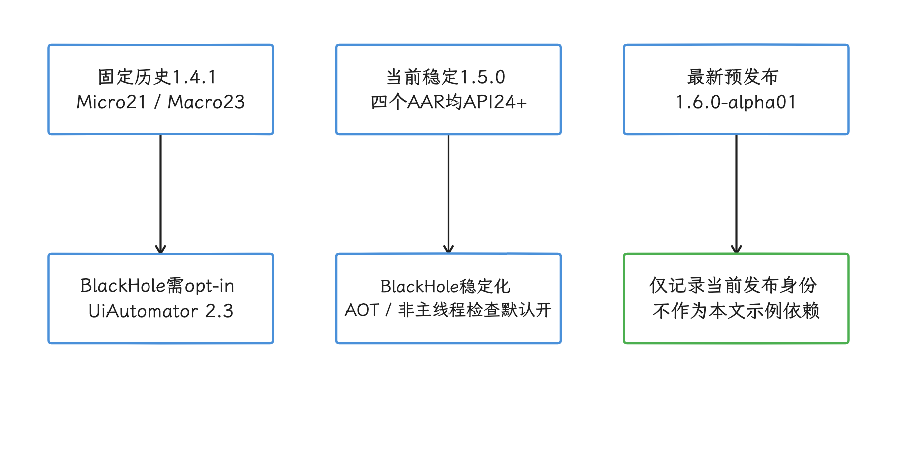

图：1.4.1 示例和当前 1.5.0 的运行下限、注解及默认检查分别绑定发布物。 升级要重新核对依赖与场景，不能只替换版本号。

### Microbenchmark：只测可重复的局部工作

拿到一段想优化的解析、排序或缓存代码时，我们先考虑 Microbenchmark：它在测试进程内反复执行同一段代码，适合纯 CPU 或内存分配路径，例如：

- JSON、Protocol Buffers（Proto）、图片元数据等解析和编码。
- diff（新旧数据的差量计算）、排序、查找、正则与格式转换。
- 小块图像处理、向量或数值运算。
- 缓存命中路径、对象池与数据结构操作。

下面这些工作则不适合 Microbenchmark：

- 冷启动、页面切换和列表滚动。
- 一次执行就改变全局状态、难以恢复的操作。
- 强依赖网络、磁盘冷缓存、Binder 或系统调度的端到端路径。
- 低频且每次行为明显不同的初始化工作。

<!-- gracker-diagram: ch17-06-04-micro-macro-scope -->
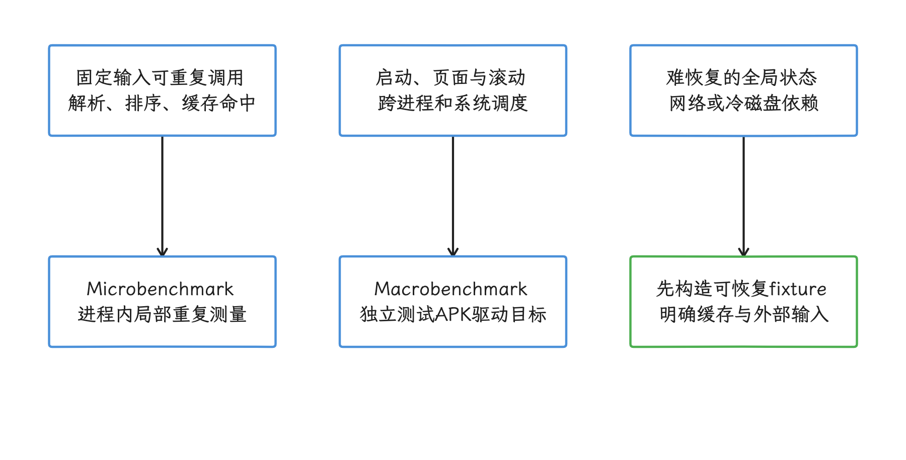

图：按输入是否可恢复、是否依赖完整系统路径选择 Microbenchmark 或 Macrobenchmark。 局部函数收益要回到完整用户旅程验证。

#### Warmup、JIT 与 AOT 要写进实验说明

`BenchmarkRule` 自己会执行 warmup（预热，先重复运行以稳定运行时状态） 和测量阶段，我们不要再在 `measureRepeated` 里套手工次数循环。实验采用哪种编译状态，取决于工程配置：

- 使用 Benchmark `1.3.0-beta01+`、Android Gradle Plugin（AGP）`8.4.0+` 并应用 `androidx.benchmark` Gradle 插件时，Microbenchmark APK 默认 full AOT，目标是减少 JIT 稳定时间和结果波动。
- 在 Gradle 属性中设置 `androidx.benchmark.forceaotcompilation=false` 会关闭插件的强制 AOT 配置；它本身不保证卸载旧 APK、清除既有编译产物或恢复某种特定 JIT 状态。1.5.0 还需显式处理默认的 `requireAot` 检查。
- 两组结果只在编译配置一致时才可比较。报告要记录 Benchmark、AGP、Kotlin、R8 代码优化/压缩工具和该开关。

full AOT 让实验更稳定，但用户设备上的常态编译状态未必是这样。局部优化若依赖 JIT 行为，我们应再补一组关闭强制 AOT 的实验，并在报告里写清这组结果对应的编译条件。

<!-- gracker-diagram: ch17-06-05-micro-compilation -->
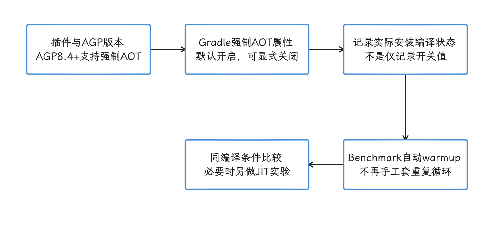

图：插件配置、已安装编译状态和 Benchmark warmup 是三个不同步骤。 关闭强制 AOT 开关不保证已清除旧编译产物。

#### 循环里只保留被测工作

下面的例子测量固定 100 条数据的 JSON 解析。fixture 是可重复使用的固定测试数据，seed 是生成它的固定随机种子；fixture 在 `@Before` 中准备，循环内只保留解析和防止结果被消除的消费操作，结果校验放到循环外。

```kotlin
import androidx.benchmark.BlackHole
import androidx.benchmark.ExperimentalBlackHoleApi
import androidx.benchmark.junit4.BenchmarkRule
import androidx.benchmark.junit4.measureRepeated
import androidx.test.ext.junit.runners.AndroidJUnit4
import org.junit.Before
import org.junit.Rule
import org.junit.Test
import org.junit.runner.RunWith

@OptIn(ExperimentalBlackHoleApi::class)
@RunWith(AndroidJUnit4::class)
class FeedParserBenchmark {
    @get:Rule
    val benchmarkRule = BenchmarkRule()

    private lateinit var parser: FeedParser
    private lateinit var payload: String

    @Before
    fun setUp() {
        parser = FeedParser()
        payload = Fixtures.feedJson(itemCount = 100, seed = 42)
        check(parser.parse(payload).size == 100)
    }

    @Test
    fun parse100Items() = benchmarkRule.measureRepeated {
        val result = parser.parse(payload)
        BlackHole.consume(result)
    }
}
```

这个测试量的是固定输入下、经过预热的局部解析；`@Before` 的一次校验也已提前触发解析路径，不代表首次冷调用。循环执行解析与 `BlackHole.consume()`，并由 Benchmark 管理重复次数和指标。准备阶段校验条目数、异常会使测试失败，但不证明所有输出字段正确；正式场景还需在计量外验证结果语义。BlackHole 用于保留计算结果，不应把它理解成任意构建配置下绝对零开销的证明。

<!-- gracker-diagram: ch17-06-06-parser-cost -->
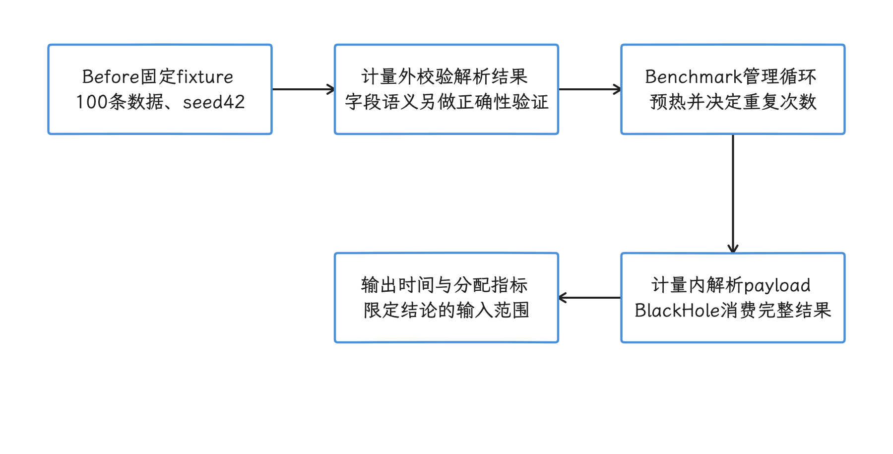

图：准备与正确性验证在计量外，循环保留解析及结果消费。 这是预热后的固定输入成本，准备阶段已提前调用解析。

可变状态要在每轮恢复，而恢复的成本要留在算法时间之外。下面的片段演示对原数组做副本，再只测排序。

```kotlin
benchmarkRule.measureRepeated {
    val working = runWithMeasurementDisabled {
        fixture.copyOf()
    }
    sorter.sort(working)
    BlackHole.consume(working)
}
```

固定 1.4.1 推荐使用 `runWithMeasurementDisabled()`；旧名 `runWithTimingDisabled()` 已弃用，因为它暂停的是整个 measurement（测量指标），计时只是其中一部分。暂停区也会反复执行，里面仍应保持轻量和确定性。 该方法是泛型并返回 block 的值，所以上例可以直接取得数组副本；暂停指标不会撤销分配、GC、缓存和热状态对后续排序的影响。

<!-- gracker-diagram: ch17-06-07-mutable-reset -->
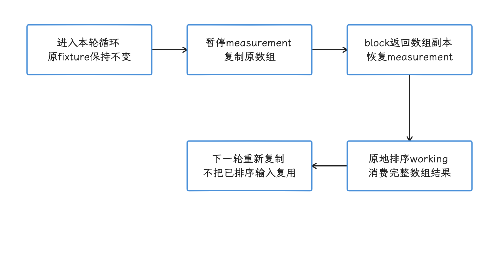

图：每轮在暂停区复制数组，取回泛型返回值，再计量排序与完整结果消费。 暂停不撤销分配、GC、缓存或热状态副作用。

#### 常见测错方式

| 写法 | 测到的内容 | 修正 |
|---|---|---|
| 循环内生成随机数据 | 随机数和分配成本 | 固定 seed，在 `@Before` 准备 fixture |
| 循环内打印日志 | I/O、锁和 Logcat 成本 | 移除日志 |
| 循环内做断言 | 断言与异常消息准备 | 在计量外覆盖结果语义与边界，按需检查末次结果 |
| 返回值无人使用 | 计算可能被编译器或 R8 删除 | 1.4.1 用 opt-in 后的 `BlackHole.consume()` |
| 原地排序同一个数组 | 首轮后输入已排序 | 每轮在 measurement 外复制 |
| 手工执行一万次 | 多套循环与 Benchmark 的 warmup 混在一起 | 每个 `measureRepeated` block 表示一次操作 |
| 在主线程调用普通 `measureRepeated` | 长测量可能触发 ANR（应用无响应） | 需要主线程的代码使用 `measureRepeatedOnMainThread()`，测试调用本身仍从非主线程发起 |
| 只测缓存命中却声称代表冷路径 | 结论对象错位 | 明确 cache state（缓存是否已有数据），必要时改用 Macrobenchmark |

Java 仍可通过 `BenchmarkRule.getState()` 和 `while (state.keepRunning())` 驱动旧式循环；Kotlin 代码应使用 `measureRepeated {}`，减少忘记结束状态机或错误暂停计量的风险。

### Macrobenchmark：从外部进程测完整用户路径

要测启动、滚动、转场、动画和关键用户旅程这类完整路径时，我们用 Macrobenchmark：它通过单独安装的 test APK（只包含测试与控制代码的应用包） 控制目标应用。它的控制流可以概括为：

```text
按 CompilationMode 决定是否重置编译状态
  -> 安装 profile / 预编译 / 需要时运行不计量的 warmup
  -> repeat(iterations) {
       setupBlock：把应用放到统一起点，不计入 metrics
       开始 Perfetto 采集
       measureBlock：执行被测交互
       停止采集并提取 metrics
     }
```

`setupBlock` 决定每轮起点是否一致，本身不计入指标；`measureBlock` 里任何等待都会进入 trace 的测量窗口，而某项 metric 是否计入这段等待，由它自己的定义决定。 `Partial` 的 warmup 和 `WARM` / `HOT` 的首次非计量预热也可能执行这些 block，所以脚本必须可重复、可恢复，不能把调用次数当作 measured iteration 数。

<!-- gracker-diagram: ch17-06-08-macro-window -->
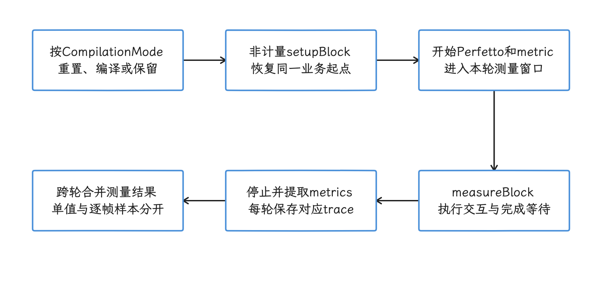

图：编译阶段之后，每轮先准备，再采集并执行 measureBlock，最后提取指标。 编译或启动预热可额外执行用户block；等待是否计入数值由metric定义。

#### `StartupMode` 只描述进程和 Activity 起点

| 模式 | 开始时的状态 | 不能推出的结论 |
|---|---|---|
| `COLD` | 目标进程不存在，需要进程创建和 Activity 创建 | 不等于首次安装，也不自动清应用数据 |
| `WARM` | 进程存活，需要新建并显示 Activity | 不等于页面数据已缓存 |
| `HOT` | 进程与 Activity 存活，把现有 Activity 带回前台 | 不等于零工作量 |

<!-- gracker-diagram: ch17-06-09-startup-modes -->
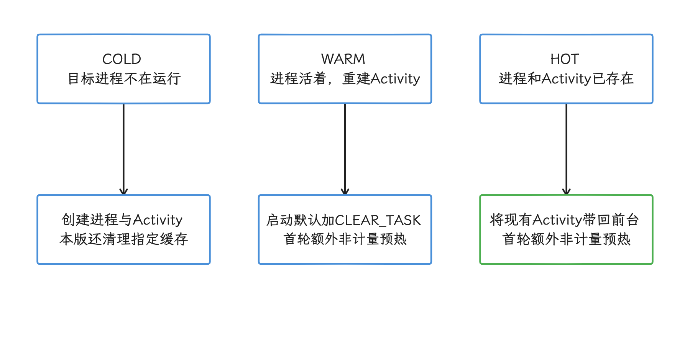

图：COLD、WARM、HOT 描述进程与 Activity 起点，数据和编译状态还要另行控制。 模式名不保证缓存命中，也不等于首次安装。

固定 1.4.1 的 `COLD` 每轮先执行用户 `setupBlock`，随后默认清 shader cache、杀目标进程、尝试清 kernel page cache，最后确认进程不在运行。API 31+ 通过 `perf.drop_caches` 并检查完成；更旧的非 root 设备可能只记录清页缓存失败。shader 清理也有参数与失败策略，报告必须记录实际结果。它仍不会自动清登录态、数据库和应用数据，也不等于首次安装。

<!-- gracker-diagram: ch17-06-10-cold-cache-order -->
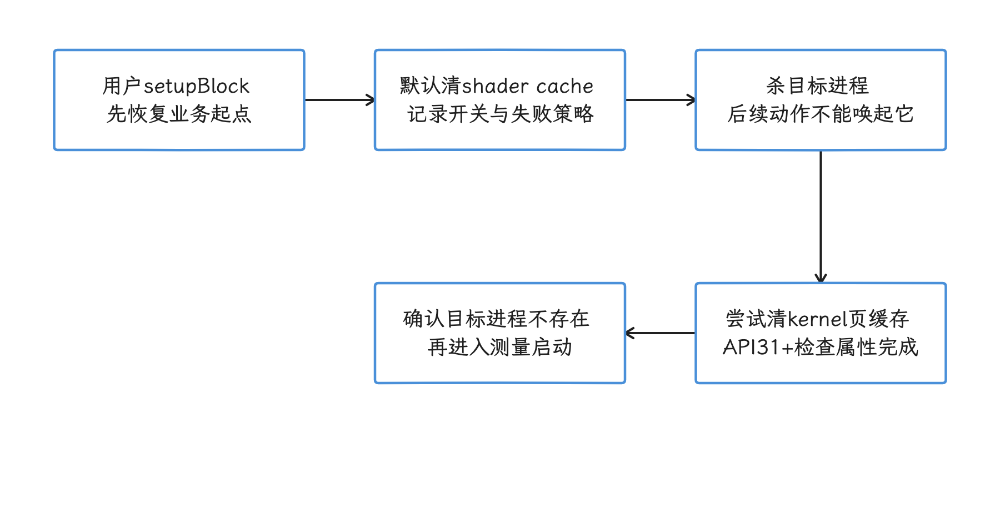

图：用户 setup 后依次清 shader、杀进程、清页缓存并检查进程状态，才开始测启动。 旧版非 root 页缓存清理可能失败；登录态与数据库不会自动清除。

#### `CompilationMode` 决定代码处于什么编译状态

这里的 profile 指运行时或构建阶段记录的热点代码清单，ART 可据此决定优先编译哪些方法。

| 模式 | API 24-37 行为 | 用途 |
|---|---|---|
| <code>DEFAULT</code> | <code>Partial(<wbr>Baseline<wbr>Profile<wbr>Mode.<wbr>Use<wbr>If<wbr>Available)</code> | 模拟安装后可用 profile 的默认体验；profile 缺失时不失败 |
| <code>None(<wbr>)</code> | 重置编译状态，不主动预编译；运行时仍可发生 JIT | 无预编译对照；不是所有真实首次安装条件的复刻 |
| <code>Partial(<wbr>Require)</code> | 要求安装 APK 内 Baseline Profile，再请求 <code>speed-<wbr>profile</code> 编译 | 核对安装与请求路径；具体方法是否编译仍受 ART 策略影响 |
| <code>Partial(<wbr>Disable,<wbr> warmup<wbr>Iterations=<wbr>N)</code> | 用 N 次 warmup 生成运行时 profile 后部分编译 | 模拟使用一段时间后的 profile-guided 状态 |
| <code>Full(<wbr>)</code> | 请求 <code>speed</code> 编译方法 | AOT 对照；不能预设性能上限，也不代表现代用户设备常态 |
| <code>Ignore(<wbr>)</code> | 跳过编译重置和主动编译 | 外部脚本控制编译；仍有测试进程管理和 ProfileInstaller skip-file 操作 |

API 23 只有 `Full()`，而 `Full()` 也未必更快：已编译代码变大后，磁盘读取和 instruction cache（CPU 存放近期执行指令的缓存） 的压力都可能跟着上来。验证 Baseline Profile 时，我们用 `Partial(BaselineProfileMode.Require)` 与 `None()` 成对比较；`DEFAULT` 留给模拟默认体验，严格的收益验证要靠这一对。

<!-- gracker-diagram: ch17-06-11-compilation-modes -->
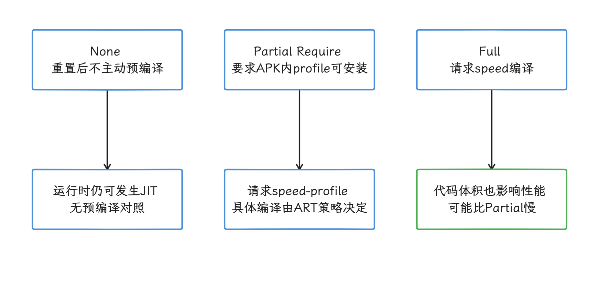

图：用 None 与要求 Baseline Profile 的 Partial 成对评估，Full 另作 AOT 对照。 DEFAULT允许缺profile；Full并不是性能上限，安装成功也不保证每条规则都编译。

重置能否保留应用数据取决于版本和权限。API 34+ 使用新的 profile reset 路径；API 34 前非 root 环境通常靠卸载重装重置，因此会丢失应用数据，rooted 环境则可走 `cmd package compile --reset`。预置账号或数据库要在可能重装后重新准备；外部脚本也可配合 `Ignore()` 管理编译。不要把“Android 14 之前”一律等同“必须重装”。

<!-- gracker-diagram: ch17-06-12-reset-data-branches -->
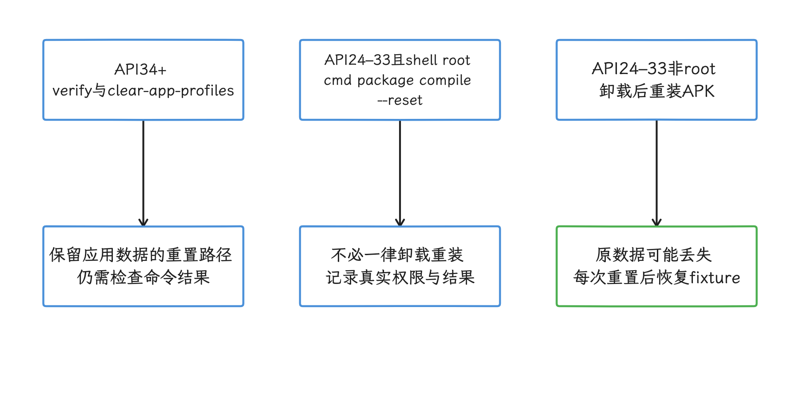

图：按 API 与 shell root 权限选择实际重置分支，重装场景需重建应用数据。 Ignore跳过编译重置，但仍有测试进程管理与skip-file操作。

### 工程结构：把测量代码与目标应用隔开

推荐结构如下：

```text
:app                 目标应用，提供接近 release 的 benchmark build type
:benchmarkable       可选；暴露给 Microbenchmark 的纯逻辑
:microbenchmark      com.android.library，进程内测局部代码
:macrobenchmark      com.android.test，从外部驱动 :app
```

`:app` 在 benchmark build type 下要维持工程本来的 release 形态：R8 沿用 release 的设置，日志处理与 release 一致，业务实现原样。build type 是同一应用的构建配置变体；`benchmark` build type 应继承 release 的压缩和优化，仅用本地签名方便安装。

<!-- gracker-diagram: ch17-06-13-module-processes -->
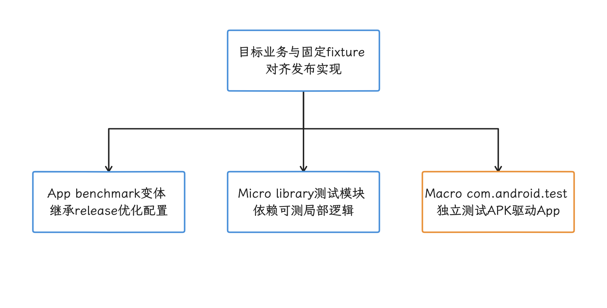

图：目标 App、局部逻辑模块与两类测试模块各自承担不同运行职责。 测试APK可以可调试，受测App仍保持release形态。

下面是目标应用需要关注的核心配置。

```kotlin
// :app/build.gradle.kts
android {
    compileSdk = 37

    defaultConfig {
        targetSdk = 37
    }

    buildTypes {
        getByName("release") {
            isMinifyEnabled = true
            isShrinkResources = true
            proguardFiles(
                getDefaultProguardFile("proguard-android-optimize.txt"),
                "proguard-rules.pro"
            )
        }
        create("benchmark") {
            initWith(getByName("release"))
            isDebuggable = false
            signingConfig = signingConfigs.getByName("debug")
            matchingFallbacks += listOf("release")
        }
    }
}

dependencies {
    implementation("androidx.profileinstaller:profileinstaller:1.4.1")
}
```

`matchingFallbacks` 让没有 `benchmark` build type 的依赖模块选择 `release`。ProfileInstaller 负责把 Baseline Profile 交给系统，也提供 Macrobenchmark 清 shader cache、采集和重置 profile 所需的命令通道；1.3+ 满足要求，这里固定到当前稳定版 1.4.1 便于复现。

目标应用 manifest 还要允许 shell profiling，也就是允许 adb shell 启动的受控工具采集性能数据。下面的元素位于 `<application>` 内，target app 本身必须保持 non-debuggable（不可附加普通调试器）。

```xml
<profileable
    android:enabled="true"
    android:shell="true" />
```

有了它，测试与 profiling 工具就能读取详细 trace，而应用仍是 non-debuggable。Android Studio 的 Benchmark module 模板会自动添加相应配置，手工工程要检查最终合并 manifest。

<!-- gracker-diagram: ch17-06-14-target-release-shape -->
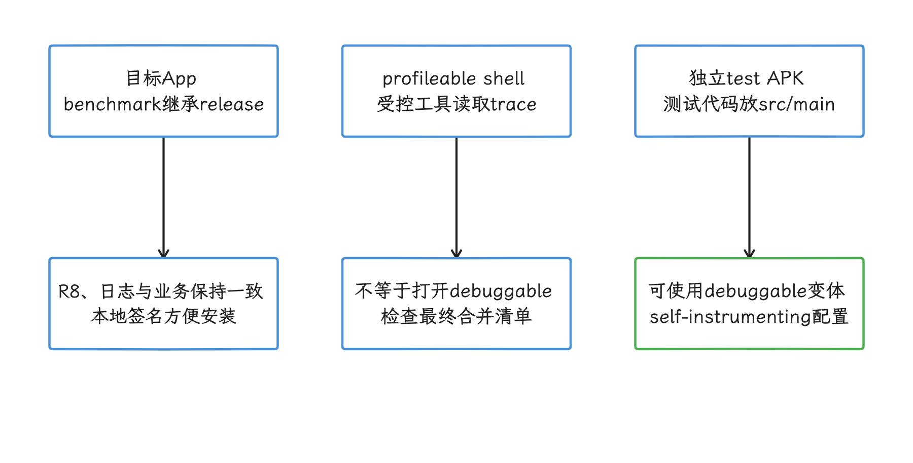

图：目标 APK 保持不可调试和 release 优化，同时允许 shell profiling；控制代码留在测试 APK。 profileable配置以最终合并manifest为准。

Macrobenchmark module 使用 `com.android.test`，核心配置如下。

```kotlin
// :macrobenchmark/build.gradle.kts
plugins {
    id("com.android.test")
    id("org.jetbrains.kotlin.android")
}

android {
    namespace = "com.example.macrobenchmark"
    compileSdk = 37

    defaultConfig {
        minSdk = 23
        targetSdk = 37
        testInstrumentationRunner = "androidx.test.runner.AndroidJUnitRunner"
    }

    buildTypes {
        create("benchmark") {
            isDebuggable = true
            signingConfig = getByName("debug").signingConfig
            matchingFallbacks += listOf("release")
        }
    }

    targetProjectPath = ":app"
    experimentalProperties["android.experimental.self-instrumenting"] = true
}

dependencies {
    implementation("androidx.benchmark:benchmark-macro-junit4:1.4.1")
    implementation("androidx.test.ext:junit:1.3.0")
}

androidComponents {
    beforeVariants(selector().all()) {
        it.enable = it.buildType == "benchmark"
    }
}
```

测试代码放在这个 test-only module 的 `src/main`。test APK 的 `benchmark` variant 可以 debuggable，受测的 `:app` benchmark APK 则必须保持 non-debuggable。`self-instrumenting` 让测试 APK 与目标应用分进程运行。`benchmark-macro-junit4:1.4.1` 已依赖 UI 自动化库 UiAutomator 2.3.0；若项目显式覆盖 UiAutomator 版本，需要重新验证选择器与手势行为。

Microbenchmark module 应使用与依赖同版本的 Gradle 插件。

```kotlin
// 根 build.gradle.kts
plugins {
    id("androidx.benchmark") version "1.4.1" apply false
}

// :microbenchmark/build.gradle.kts
plugins {
    id("com.android.library")
    id("org.jetbrains.kotlin.android")
    id("androidx.benchmark")
}

android {
    compileSdk = 37
    defaultConfig {
        minSdk = 21
        testInstrumentationRunner =
            "androidx.benchmark.junit4.AndroidBenchmarkRunner"
    }

    testBuildType = "release"
}

dependencies {
    androidTestImplementation(project(":benchmarkable"))
    androidTestImplementation("androidx.benchmark:benchmark-junit4:1.4.1")
    androidTestImplementation("androidx.test.ext:junit:1.3.0")
}
```

插件会配置 benchmark 输出复制、AOT 默认行为和 rooted（已获得系统 root 权限） 设备的 `lockClocks` task；`lockClocks` 用来固定 CPU 时钟，减少频率变化带来的噪声。被测代码宜放到 `:benchmarkable`，避免为调用应用内部实现而把整个 debug app 拉进测试。

<!-- gracker-diagram: ch17-06-15-micro-module-build -->
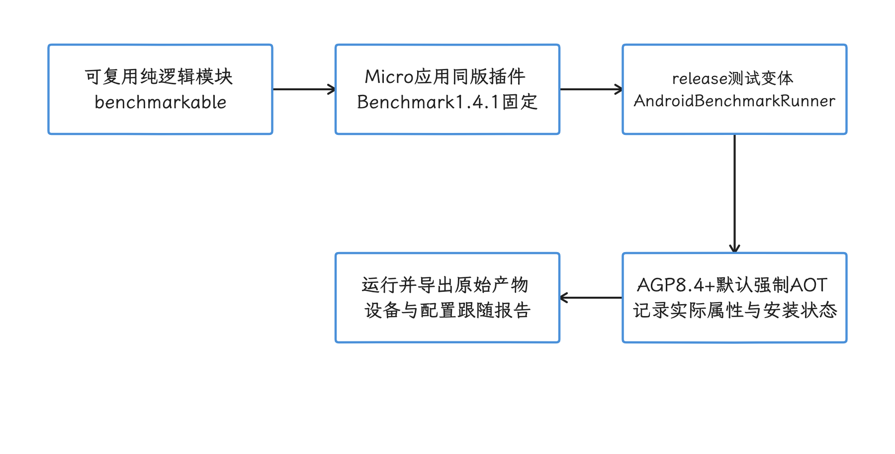

图：同版本插件和依赖配置 release 测试，输出复制与 AOT 条件随工具版本记录。 lockClocks依赖root；被测逻辑不应因拉入debug App而改变实现。

### 示例一：可判定失败的 cold startup

下面的例子测量目标应用的冷启动。测试数据由目标应用的 benchmark variant 提供固定本地 fixture；`home_ready` 是测试可以观察的就绪标记，只有在首屏数据和可交互状态准备完成后才出现；应用在同一时点调用 `reportFullyDrawn()`。

```kotlin
import androidx.benchmark.macro.CompilationMode
import androidx.benchmark.macro.StartupMode
import androidx.benchmark.macro.StartupTimingMetric
import androidx.benchmark.macro.junit4.MacrobenchmarkRule
import androidx.test.ext.junit.runners.AndroidJUnit4
import androidx.test.filters.LargeTest
import androidx.test.uiautomator.By
import androidx.test.uiautomator.Until
import org.junit.Rule
import org.junit.Test
import org.junit.runner.RunWith

@LargeTest
@RunWith(AndroidJUnit4::class)
class StartupBenchmark {
    @get:Rule
    val benchmarkRule = MacrobenchmarkRule()

    @Test
    fun coldStartup() = benchmarkRule.measureRepeated(
        packageName = PACKAGE_NAME,
        metrics = listOf(StartupTimingMetric()),
        compilationMode = CompilationMode.DEFAULT,
        startupMode = StartupMode.COLD,
        iterations = 10,
        setupBlock = {
            pressHome()
        }
    ) {
        startActivityAndWait()
        check(
            device.wait(
                Until.hasObject(By.res(PACKAGE_NAME, "home_ready")),
                5_000
            )
        ) {
            "Home did not become ready within 5 seconds"
        }
    }

    private companion object {
        const val PACKAGE_NAME = "com.example.app"
    }
}
```

这个测试把 launch、首帧与业务就绪等待放进测量窗口。指标是 TTID，以及可获得且被应用正确报告的 TTFD；`home_ready` 不出现会超时失败，但不能据此认定每轮都生成了有效 TTID/TTFD。固定 1.4.1 的单值指标合并会跳过字段不全的迭代，整体无指标才失败。CI 还应检查 JSON 中每项 `runs` 数量等于预期轮数，并逐轮核对 trace；10 轮可看 median，P95 接近极值，不能声称稳定估计尾部。

<!-- gracker-diagram: ch17-06-16-startup-readiness -->
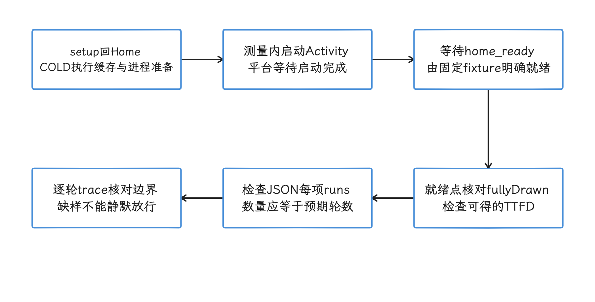

图：启动窗口同时等待业务就绪，随后还需核对每项指标的 runs 与逐轮 trace。 home_ready超时能失败，但不能保证每轮TTID/TTFD完整。

`startActivityAndWait()` 只保证启动 Activity 并等待平台可观察的启动完成；下一轮会不会在异步数据还没加载完时就开始，要靠额外的 `home_ready` 检查来防住。TTFD 是否正确，仍取决于应用报告 fully drawn（应用报告完整内容已显示） 的时机。

### 示例二：只把列表滚动放进测量窗口

滚动实验里，启动、登录和网络等待都要留在 `FrameTimingMetric` 的测量窗口之外。下面的 benchmark 用 deep link 载入固定 1000 条本地数据并回到列表顶部，这些准备动作放在 `setupBlock`；测量窗口执行一次向下 fling（带惯性的快速滚动），并等待受测 fixture 发出明确完成标记。

```kotlin
import android.content.Intent
import android.net.Uri
import androidx.benchmark.macro.CompilationMode
import androidx.benchmark.macro.FrameTimingMetric
import androidx.benchmark.macro.junit4.MacrobenchmarkRule
import androidx.test.ext.junit.runners.AndroidJUnit4
import androidx.test.filters.LargeTest
import androidx.test.uiautomator.By
import androidx.test.uiautomator.Direction
import androidx.test.uiautomator.Until
import org.junit.Rule
import org.junit.Test
import org.junit.runner.RunWith

@LargeTest
@RunWith(AndroidJUnit4::class)
class FeedScrollBenchmark {
    @get:Rule
    val benchmarkRule = MacrobenchmarkRule()

    @Test
    fun flingDown() = benchmarkRule.measureRepeated(
        packageName = PACKAGE_NAME,
        metrics = listOf(FrameTimingMetric()),
        compilationMode = CompilationMode.DEFAULT,
        startupMode = null,
        iterations = 10,
        setupBlock = {
            pressHome()
            startActivityAndWait(
                Intent(
                    Intent.ACTION_VIEW,
                    Uri.parse("example://benchmark/feed?count=1000&seed=42")
                )
            )
            check(
                device.wait(
                    Until.hasObject(By.res(PACKAGE_NAME, "feed_ready")),
                    5_000
                )
            )
            check(!device.hasObject(By.res(PACKAGE_NAME, "feed_fling_done")))
        }
    ) {
        val list = checkNotNull(
            device.findObject(By.res(PACKAGE_NAME, "feed_list"))
        )
        list.setGestureMargin(device.displayWidth / 5)
        // 返回值表示该方向是否还能继续滚动，不表示手势成功。
        list.fling(Direction.DOWN)
        check(
            device.wait(
                Until.hasObject(By.res(PACKAGE_NAME, "feed_fling_done")),
                5_000
            )
        ) {
            "Feed did not move and become idle within 5 seconds"
        }
    }

    private companion object {
        const val PACKAGE_NAME = "com.example.app"
    }
}
```

被测对象是固定数据上的一次 fling 与完成等待。fixture 每次打开 deep link 都回到顶部，并移除 `feed_fling_done`；只有确认列表位置已改变、随后收到滚动 idle 状态，才显示该 resource id。若未移动或未结束，测试超时失败。UiAutomator 2.3.0 的 `fling()` 返回值只表示该方向还能否滚动，到末端返回 false 不等于失败；`waitForIdle()` 只等无障碍事件空闲，也不能证明渲染或所有动画已经静止。完成标记自身的固定 UI 开销也在窗口内；用 trace 核对所需尾帧确实被覆盖。

<!-- gracker-diagram: ch17-06-17-fling-done -->
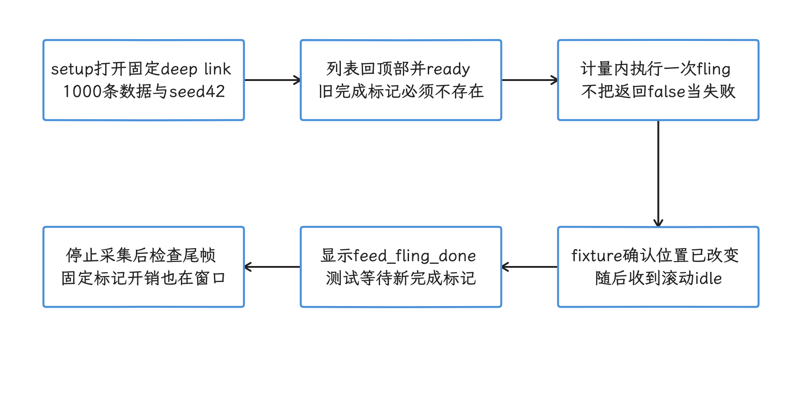

图：每轮回到顶部并清旧标记，手势后等待已移动且 idle 的新标记。 fling返回能否继续滚动；accessibility idle不证明渲染已结束。

在这个回归测试里，网络要作为受控输入。需要覆盖网络解析时，应使用本地 mock server（按预设响应请求的测试服务器）、固定响应、固定延迟策略，并把“网络实验”和“渲染实验”分成不同场景。

### 指标要按定义阅读

#### `StartupTimingMetric`

它输出：

- `timeToInitialDisplayMs`：从系统收到 launch intent 到目标 Activity 第一帧完成的时间。
- `timeToFullDisplayMs`：到应用 `reportFullyDrawn()` 所在或之后第一帧完成的时间；API 29 前可能不可用。

TTID 低只说明用户较快看到第一帧。若首屏仍是骨架屏或不可交互，业务目标要看 TTFD，并审计 `reportFullyDrawn()` 是否过早、过晚或从未调用。

<!-- gracker-diagram: ch17-06-18-startup-timepoints -->
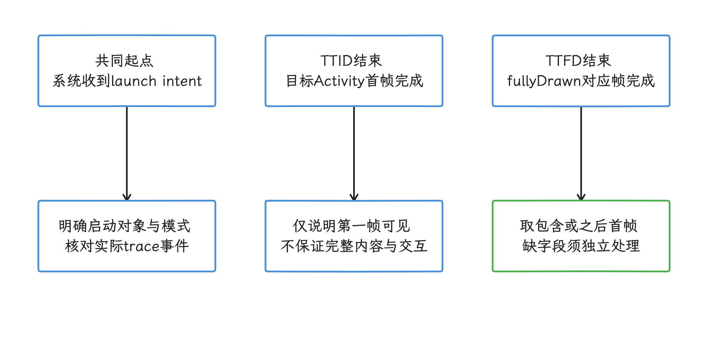

图：系统 launch 是两者共同起点，首帧与 fullyDrawn 对应帧分别结束 TTID 和 TTFD。 首帧可仍是骨架屏；fullyDrawn时机由业务正确报告。

#### `FrameTimingMetric`

它从 trace 匹配每帧数据，多轮样本合并后计算分位数；不是先算每轮分位数再取平均。不同轮的帧数不同，会改变合并样本权重：

- `frameDurationCpuMs`：固定 1.4.1 计算 `RenderThread slice 结束 − UI doFrame slice 开始`。这是经过时间，包含等待和抢占，不是两线程实际占用 CPU 的时长之和；API 31+ 仍使用这个公式，也没有把 Expected frame start 到 doFrame 的延迟加进来。
- `frameOverrunMs`：API 31+ 计算 `max(Actual frame 结束, RenderThread slice 结束) − Expected frame 结束`；正值超过 deadline，负值有余量。取 max 是这版对 Actual 过早结束问题的补偿。
- `frameCount`：本轮成功匹配到的 `FrameData` 条数。API 31+ 需要 UI、RenderThread、Expected、Actual 关联成功；查询还排除非正 duration。它不是设备显示的全部物理帧数，样本减少可能来自少画帧，也可能来自关联或采集缺失。

变刷新率设备上，我们优先用 `frameOverrunMs` 判断 deadline 表现。定位根因时，把它与 FrameTimeline（记录每帧生命周期的系统时间线）、主线程、RenderThread 和 GPU 轨道放在一起读；单看一个分位数是不够的。

<!-- gracker-diagram: ch17-06-19-frame-endpoints -->
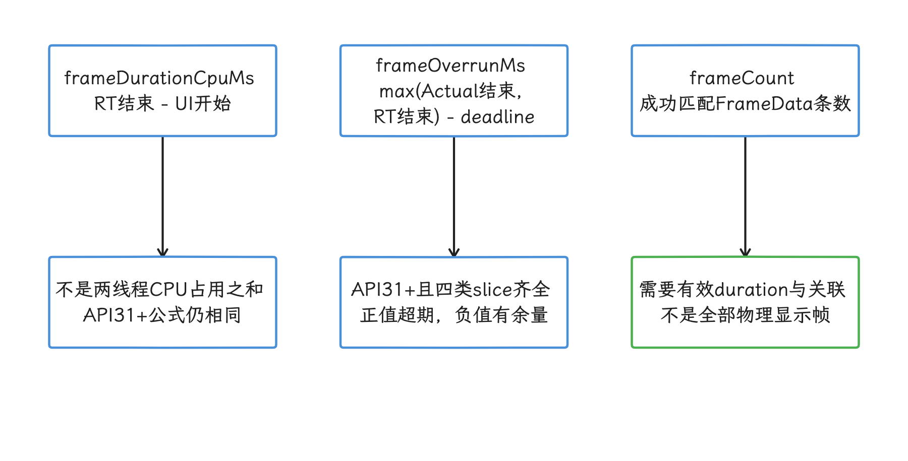

图：1.4.1 的帧时长从 UI slice 起点到 RT 终点，overrun 按 Actual/RT 较晚终点减 Expected 终点。 经过时间含等待与抢占；frameCount只统计成功关联的FrameData。

#### `TraceSectionMetric`

固定 1.4.1 中它仍标注为 `ExperimentalMetricApi`。默认 `mode` 是 `Mode.Sum`，会输出匹配 slice 的总时长和次数；还可以选择 `First`、`Min`、`Max`、`Count`、`Average`。默认只匹配目标包，未闭合且 `dur = -1` 的 slice 会被忽略。

使用时必须明确 mode。`First` 只取第一条；`Sum` 遇到递归或重入 section 时可能把重叠时间重复相加。业务 trace 名称要稳定，且要打开每轮 Perfetto trace 确认选中了预期 section。

<!-- gracker-diagram: ch17-06-20-trace-section-mode -->
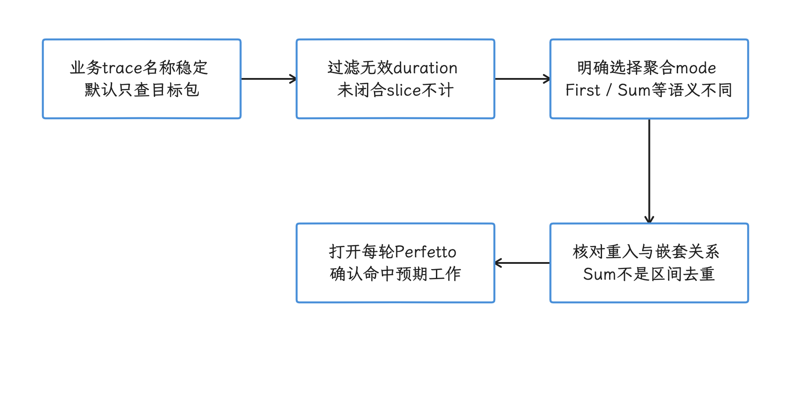

图：固定包和 section 名后选 First、Sum 或其他模式，并检查闭合与重叠关系。 Sum可能重复累计重叠时间；未闭合slice被过滤。

#### `PowerMetric`、`MemoryUsageMetric` 与 `ArtMetric`

- `PowerMetric` 从 API 29 可用，仍是 experimental。高精度 energy/power 依赖设备的 power rail（硬件分项能耗计数）；使用前检查 `deviceSupportsHighPrecisionTracking()` 与最低电量。
- `MemoryUsageMetric` 仍属 experimental，构造时显式选 `Mode.Last` 或 `Mode.Max`，读取最后可用样本或最大采样值；不是精确的连续峰值。heap、RSS、GPU 等计数的采样来源不同，缺失与单位要分别核对，不能单独证明泄漏、OOM 或 LMKD。
- `ArtMetric` 从 API 24 可用，但部分字段还要求相应 ART Mainline 版本与 tracepoint；不支持时可能没有该字段。固定 1.4.1 的类加载匹配还可能漏掉顶层重打包类，1.5 线已修复。它可辅助解释 JIT、类加载和校验变化，零值或缺字段都不能单独证明 Profile 生效或启动更快。

功耗实验需要固定设备、亮度、网络、温度、电池电量和操作时长。短场景的功耗差异常被采样噪声掩盖，需延长稳定阶段并用相同物理设备比较。

<!-- gracker-diagram: ch17-06-21-power-memory-art -->
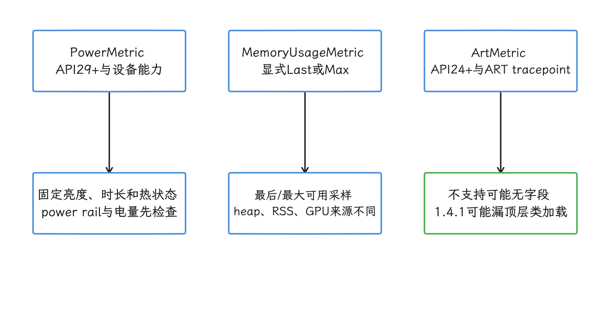

图：能耗能力、采样内存与 ART tracepoint 各自检查来源和缺失，组合解释性能变化。 计数或零值不能单独证明泄漏、Profile收益或完整连续峰值。

### 测试条件就是结果的一部分

每份报告至少记录以下信息：

| <span style="white-space:nowrap">类别</span> | 必填字段 |
|---|---|
| <span style="white-space:nowrap">代码</span> | baseline SHA、candidate SHA（两次提交的内容哈希）、applicationId、version、variant、R8 配置 |
| <span style="white-space:nowrap">工具</span> | Benchmark、AGP、Kotlin、JDK、ProfileInstaller 版本 |
| <span style="white-space:nowrap">设备</span> | model、device codename、系统构建 fingerprint、API、kernel tag、是否 root |
| <span style="white-space:nowrap">运行</span> | `CompilationMode`、`StartupMode`、iterations、fixture seed、账号和缓存状态 |
| <span style="white-space:nowrap">环境</span> | 电量、充电状态、thermal sleep（因设备过热而等待降温的时间）、刷新率、动画设置、网络模式 |
| <span style="white-space:nowrap">结果</span> | metric、方向、runs、median、适用时的 p90/p95/p99、基线差值 |
| <span style="white-space:nowrap">证据</span> | benchmark JSON、每轮 Perfetto trace、测试日志 |

系统源码 tag 是分析基线，实际运行设备必须记录 fingerprint、内核版本与厂商补丁；涉及调度和唤醒时，再匹配该设备对应的内核源码。`android17-6.18-2026-06_r6` 只能作为某个固定内核快照，不能统一代表所有 Android 17 设备。Benchmark 库行为则继续绑定本文的 1.4.1 发布物。

<!-- gracker-diagram: ch17-06-22-report-source-device -->
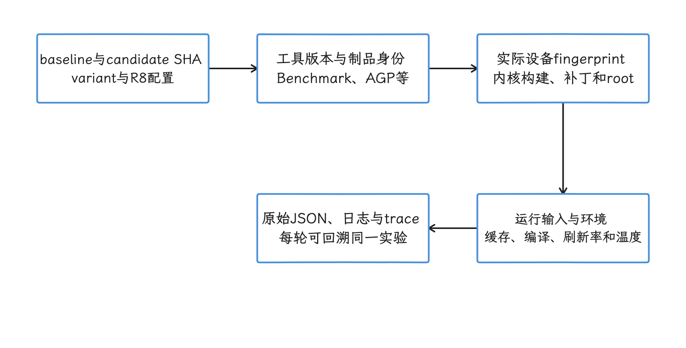

图：报告把代码SHA、工具发布物、设备构建与原始结果一起保存，内核源码匹配实际设备。 统一Android版本或某个kernel tag不能代表全部厂商设备。

还要固定这些实验条件：

- 性能门禁用物理设备。模拟器可以跑 smoke test（只验证流程可运行的快速检查） 验证流程，但数字受宿主机影响。
- 同一对比优先在同一台物理设备交错运行 baseline 与 candidate，并固定 fingerprint 和刷新率；跨设备先分别建立基线，不能只凭型号相同直接混合数值。
- 关闭省电模式，避免后台同步与系统更新，控制设备散热。
- Microbenchmark 可在 rooted 设备使用 `lockClocks`；官方 CI 指南说锁频只对 microbenchmarks 有必要，并没有禁止其他实验使用。锁频会改变运行条件，报告必须标明，不能把它当真实用户功耗状态。
- Macrobenchmark 让库处理温控降频等待；报告保留 `thermalThrottleSleepSeconds`。
- UI 场景使用稳定 resource id 或 Compose `testTagAsResourceId`，不要依赖文本和屏幕坐标。
- 每轮数据、登录态、页面起点与网络响应一致。

系统动画是否关闭取决于测试目标。若要测应用转场动画，关闭动画会改变被测对象；若只想测布局与列表工作，可关闭系统级无关动画。报告必须写明选择。

<!-- gracker-diagram: ch17-06-23-noise-control -->
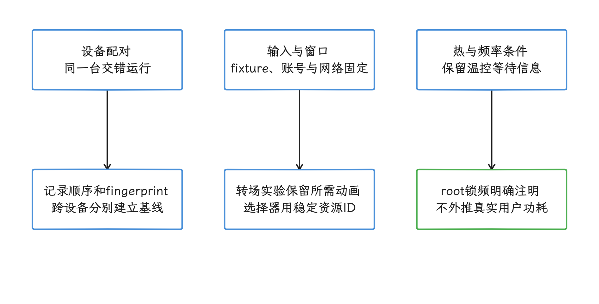

图：同一物理设备交错运行两个版本，同时固定数据、刷新率、动画与热状态。 锁频会改变实验条件；关闭动画也可能改变被测对象。

### CI：先量化噪声，再定义门禁

这里的门禁是 CI 根据性能预算自动放行或阻止代码变更的规则。

Benchmark 结果是连续数值，一次 pass/fail 判断不了回归；门禁要比较的是差值相对历史噪声的位置。建议按以下方式建设门禁：

1. 固定一小组物理设备，建立每台设备自己的历史序列。
2. 对 main 分支定时运行，估计每个 metric 的自然波动带。
3. PR 在同一台设备按交错顺序运行 baseline 与 candidate，记录各次温度、顺序与 fingerprint。
4. 只有差值同时超过业务容忍值和历史噪声带时，才判为回归。
5. 首次越界自动在同一设备重跑；方向一致可进入复核或按既定策略阻断，但两轮一致本身不是统计显著性的证明。
6. 保留 raw JSON 与 trace，人工复核测试起点、样本数和异常系统负载。

对“越小越好”的耗时指标，可以使用如下门槛：

`candidateMedian - baselineMedian > max(业务绝对预算, 历史噪声上界)`

历史噪声可用稳定窗口的 MAD（Median Absolute Deviation，中位数绝对偏差）、置信区间或团队已有统计模型估算。“慢 8% 就失败”这样的门槛要等历史数据说话；不同场景的信噪比，即真实变化相对随机波动的强弱，差异很大。

<!-- gracker-diagram: ch17-06-24-ci-regression-gate -->
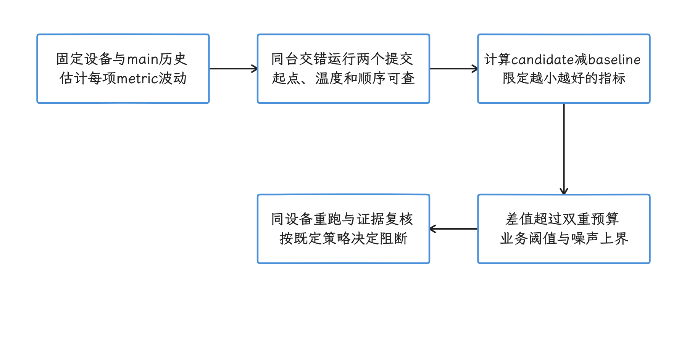

图：先建立每台设备的自然波动，再用业务预算与噪声上界判断配对差值。 重跑方向一致可以触发复核，但本身不是统计显著性证明。

样本数同样决定能看哪些统计量：

- 启动做 10 次时，适合看 median 和逐次 trace，P95 接近极值。
- 帧指标一轮就有许多帧样本，可以看 p90/p95/p99，但要同时看 frame count。
- 功耗与稀疏事件需要的是更长的测量窗口，单纯增加启动次数并不够。

<!-- gracker-diagram: ch17-06-25-sample-pooling -->
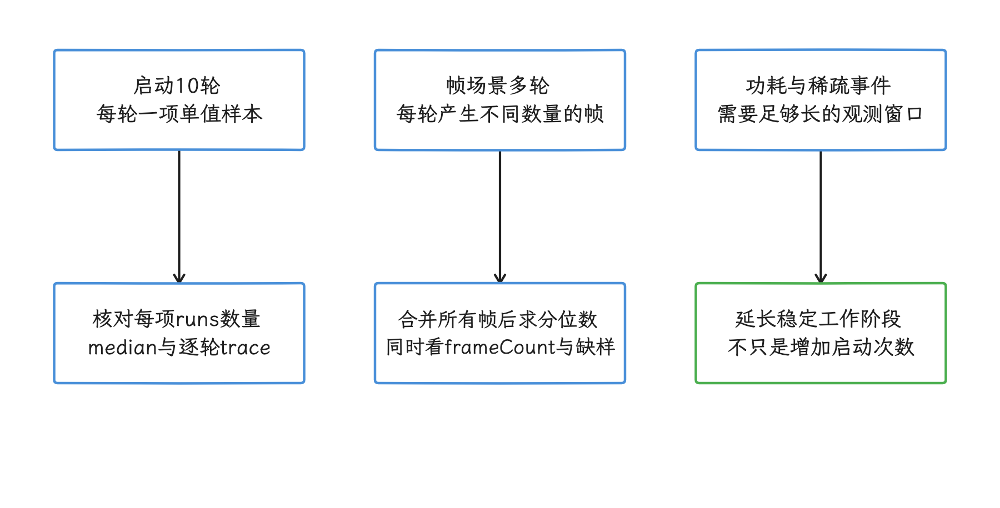

图：启动每轮取单值，帧指标则汇集各轮的全部帧后计算分位数。 多帧轮权重更大；10次启动的P95接近极值。

官方 Gradle 运行会把 JSON 和 trace 复制到 `build/outputs/connected_android_test_additional_output/...`。Macrobenchmark 每个 measured iteration（计入指标的一轮）生成一份 Perfetto trace；Microbenchmark 每个测试通常生成一份覆盖全部迭代的 trace。控制台摘要不够用，CI 应按 commit、设备和场景归档原始 JSON 与 trace。

`androidx.benchmark.suppressErrors` 只抑制显式列出的错误 ID，并不统一忽略所有错误。它可供 smoke job 检查脚本流程；性能门禁应保留环境检查并处理实际根因，避免把不可靠结果当作回归证据。

<!-- gracker-diagram: ch17-06-26-raw-artifact-archive -->
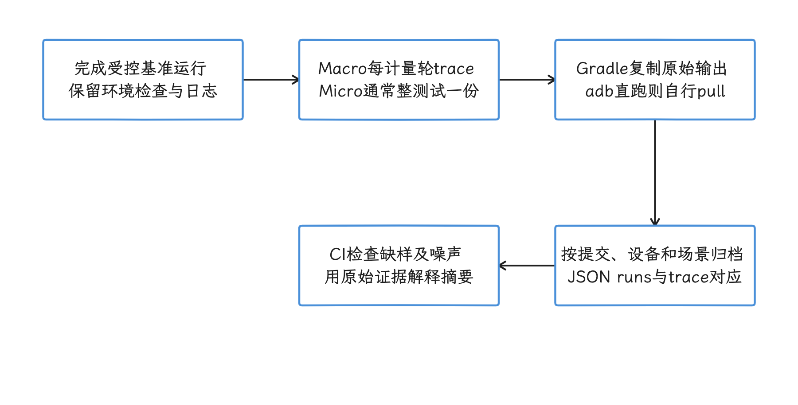

图：按提交、设备与场景保存 JSON、trace 和日志，再确认实际运行环境没有被错误抑制掩盖。 Macro每轮一份trace，Micro通常一测试一份；直接adb运行需自行拉取。

### 从线上问题构造 Benchmark

线上异常转成实验场景时，按四个问题收敛：

| 问题 | 需要固定的内容 |
|---|---|
| 哪类设备受影响 | SoC（System on Chip，片上系统）、API、刷新率、内存档位 |
| 哪个业务阶段受影响 | 页面、操作、稳定 trace 名称 |
| 哪种输入触发 | 数据规模、缓存状态、账号形态、网络响应 |
| 什么结果算修复 | 指标方向、绝对预算、相对基线与噪声带 |

我们以一次线上反馈为例：JankStats 显示 `screen=Home, phase=feed_submit` 的慢帧率上升，就构造固定 1000 条 feed 的 Macrobenchmark，并让应用保留 `Home#submitFeed` trace。`FrameTimingMetric` 验证帧 deadline 是否改善，`TraceSectionMetric` 检查提交阶段，最后用 Perfetto 确认主线程、RenderThread 或调度证据。

若 Perfetto 把耗时缩小到纯解析函数，再增加 Microbenchmark。这样端到端测试保护用户路径，局部测试保护算法成本，两者共同指向同一业务阶段。

<!-- gracker-diagram: ch17-06-27-online-to-local -->
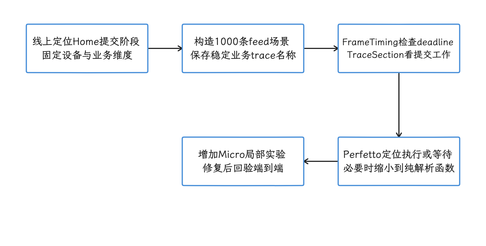

图：先用端到端实验保护业务路径，再根据 Perfetto 缩小到可重复局部函数。 局部算法变快不自动保证整条路径或线上尾延迟改善。

### Baseline Profiles：生成与验证是两项任务

Baseline Profile 是随 APK 发布的热点方法和类清单，ART 可据此提前编译常用路径。producer（生成方） 负责生成，通常复用 `:macrobenchmark`，或使用独立 `:baselineprofile` 的 `com.android.test` module；consumer（消费方） 是把 profile 打进 APK 的目标 `:app`。AGP 8.2+ 可直接使用 Android Studio 的 Baseline Profile Generator 模板，减少 variant 与文件复制配置。

<!-- gracker-diagram: ch17-06-28-profile-producer-consumer -->
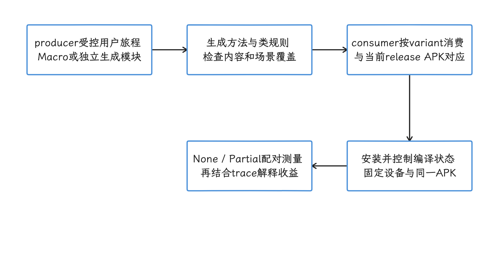

图：producer 收集受控旅程规则，consumer 把规则用于当前发布 APK，收益验证独立进行。 规则文件存在不等于安装、编译或收益已得到证明。

下面的测试生成启动旅程规则。`includeInStartupProfile=true` 让这次完整受控旅程的规则以 Startup Profile 输入文件（`startup-prof`）输出，并不会在 `reportFullyDrawn()` 处自动截断采集；收集范围由 `collect` block 实际执行的路径决定。启动旅程应停在业务就绪处，滚动与二级页面另建 `collect()`，保持该参数为 false，避免把非启动代码也纳入启动布局规则。

```kotlin
import androidx.benchmark.macro.junit4.BaselineProfileRule
import androidx.test.ext.junit.runners.AndroidJUnit4
import androidx.test.uiautomator.By
import androidx.test.uiautomator.Until
import org.junit.Rule
import org.junit.Test
import org.junit.runner.RunWith

@RunWith(AndroidJUnit4::class)
class BaselineProfileGenerator {
    @get:Rule
    val baselineProfileRule = BaselineProfileRule()

    @Test
    fun startup() = baselineProfileRule.collect(
        packageName = PACKAGE_NAME,
        includeInStartupProfile = true,
        strictStability = true
    ) {
        pressHome()
        startActivityAndWait()
        check(
            device.wait(
                Until.hasObject(By.res(PACKAGE_NAME, "home_ready")),
                5_000
            )
        )
    }

    private companion object {
        const val PACKAGE_NAME = "com.example.app"
    }
}
```

<!-- gracker-diagram: ch17-06-29-startup-profile-window -->
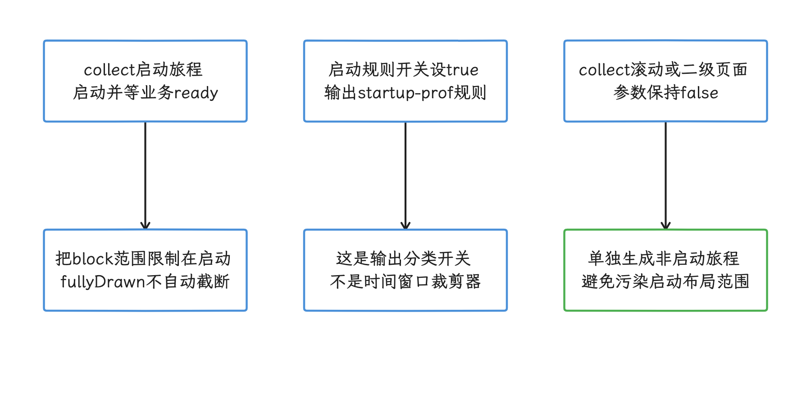

图：collect block 的实际路径决定收集范围，true 把这次规则输出为 startup-prof。 fullyDrawn不自动结束收集；滚动旅程另建collect且保持false。

`strictStability=true` 在默认最多 15 轮中要求规则集合连续 3 轮一致，否则失败；比较的是过滤前规则集合，不是耗时稳定或业务覆盖率。它也不检查过滤后的规则必然非空，生成结果仍需检查内容与旅程覆盖。

<!-- gracker-diagram: ch17-06-30-profile-stability -->
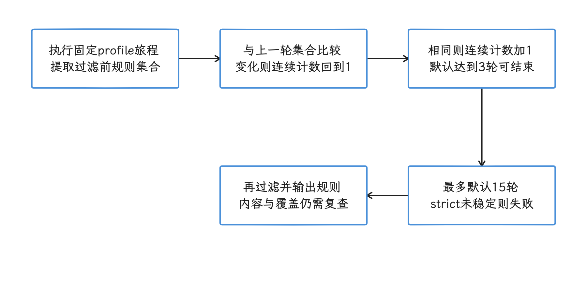

图：最多15轮中要求过滤前规则集合连续3轮一致，严格模式不满足就失败。 集合稳定不证明场景覆盖、过滤后非空或性能改善。

生成环境要求非 root 设备 API 33+，或 rooted 设备 API 28+；这只是 profile 收集的门槛。收益验证要回到实际发布的设备段，并至少成对运行：

- `CompilationMode.None()`：无预编译对照。
- `CompilationMode.Partial(BaselineProfileMode.Require)`：要求 APK 内 profile 可安装，否则直接失败。

两组测试使用相同目标 APK、fixture、设备和 iteration。`Partial(Require)` 需要 API 24+、APK 由 AGP 7.0+ 打包 profile，并包含 ProfileInstaller；当前工程宜使用 AGP 8.2+ 模板与 ProfileInstaller 1.4.1。API 23 只能运行 `Full()`，这组收益对照在那里凑不齐。

生成后的 profile 要跟着工程走：关键用户旅程、R8 映射（压缩后名称与原始名称的对应关系）、启动依赖或大版本任一变化，都应重新生成。文件存在只说明产物被创建。先确认规则与当前 APK 匹配、安装与编译状态，再把 `Partial(Require)` / `None()` 对照、可用的 `ArtMetric` 和启动/滚动指标结合起来评估收益；安装成功本身不保证变快。

<!-- gracker-diagram: ch17-06-31-profile-benefit-evidence -->
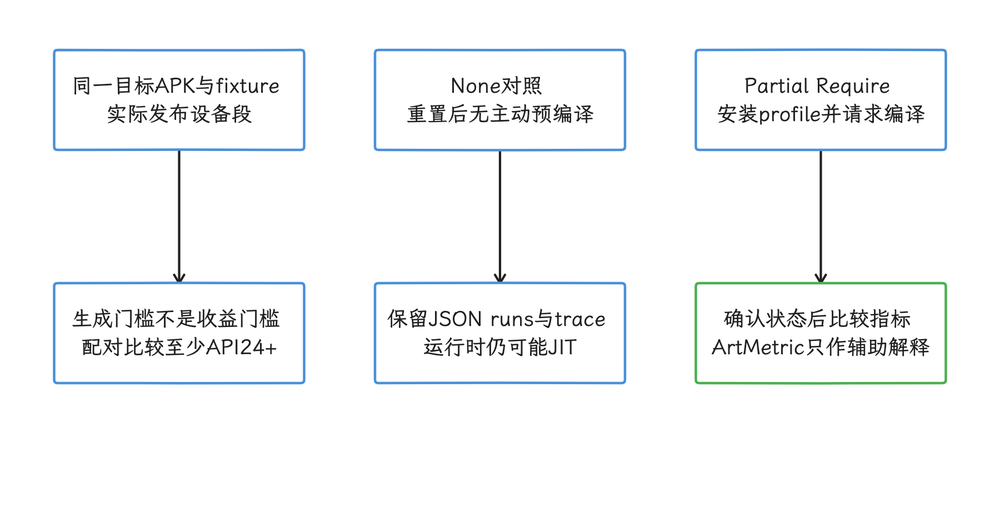

图：同 APK、输入和设备先核对规则与安装编译状态，再配对评估启动、帧与可用 ART 指标。 Require只要求安装路径成功；运行时间和覆盖仍需独立证据。

应用侧 producer/consumer 配置、`baseline.prof`/`baseline.profm` 位置、ProfileInstaller/Verifier 状态、Cloud Profile 与 DM 边界见 [21.4 Baseline、Startup 与 Cloud Profile 编译优化](../../part5-app/ch21-startup/04-baseline-startup-cloud-profile.md)。

### 源码核验记录

本轮对固定 1.4.1、历史预发布 1.5.0-rc01 与当前稳定 1.5.0 的已发布 AAR、POM、sources 做交叉核对；源码契约与宿主编译不等于已在 Android 17 设备完成测量：

- `benchmark-common` / `benchmark-junit4` manifest：`minSdkVersion=21`。
- `benchmark-macro` / `benchmark-macro-junit4` manifest：`minSdkVersion=23`。
- `CompilationMode.kt`：API 23 仅 `Full`，API 24+ 才有 `None` / `Partial`，`DEFAULT` 使用 `UseIfAvailable`。
- `Metric.kt`：Frame、Startup、TraceSection、Power、Memory 与 Art 指标的字段和 API 限制。
- `BaselineProfileRule.kt`：非 root API 33+ 或 rooted API 28+，以及 stability 参数。
- `BlackHole.kt`：固定 1.4.1 仍带 `ExperimentalBlackHoleApi`；`runWithMeasurementDisabled` 为泛型并返回 block 结果。
- `benchmark-*:1.5.0-rc01` 与 `1.5.0` 的四个 Android AAR manifest：下限均为 API 24。
- `benchmark-common:1.5.0-rc01` sources：`BlackHole` 已取消 `ExperimentalBlackHoleApi` 注解。
- `MacrobenchmarkPhase` / `MetricResultExtensions`：setup 与测量窗口、缺单值迭代跳过、逐帧样本池化；`FrameTimingQuery`：经过时间、deadline 与帧关联。
- UiAutomator 2.3.0：`fling` 的返回值是能否继续滚动，accessibility idle 不是渲染完成。
- AndroidX 当前发布信息：1.5.0 stable、1.6.0-alpha01；ProfileInstaller 仍为 1.4.1。

固定 1.4.1 下载件的 SHA-256 如下（不是当前稳定版）：

| 文件 | SHA-256 |
|---|---|
| <code>benchmark-<wbr>common-<wbr>1.<wbr>4.<wbr>1.<wbr>aar</code> | <code>54fad421<wbr>20f3c4a9<wbr>319c9b11<wbr>ad37733a<wbr>22a0dca9<wbr>2977ce4b<wbr>fa33be6e<wbr>6313c2b9</code> |
| <code>benchmark-<wbr>junit4-<wbr>1.<wbr>4.<wbr>1.<wbr>aar</code> | <code>035c2393<wbr>aa416b98<wbr>ed8979d7<wbr>51119518<wbr>a03da0a0<wbr>0f4a5529<wbr>eb21a3ee<wbr>ed6b0183</code> |
| <code>benchmark-<wbr>macro-<wbr>1.<wbr>4.<wbr>1.<wbr>aar</code> | <code>d99732de<wbr>5d713fea<wbr>47fe7caa<wbr>3b18438f<wbr>e615bbb1<wbr>225e3c6c<wbr>f0fac48e<wbr>c350943c</code> |
| <code>benchmark-<wbr>macro-<wbr>junit4-<wbr>1.<wbr>4.<wbr>1.<wbr>aar</code> | <code>41595999<wbr>e2dad5a3<wbr>e61b9ad7<wbr>4c18d737<wbr>00c21060<wbr>b7845df0<wbr>5f28a8fb<wbr>c9a08b15</code> |
| <code>benchmark-<wbr>common-<wbr>1.<wbr>4.<wbr>1-<wbr>sources.<wbr>jar</code> | <code>55d075a7<wbr>fede74c6<wbr>0c4ca8a9<wbr>c9a86cfd<wbr>067e7e55<wbr>ee4e33e3<wbr>f5c7e285<wbr>a298e930</code> |
| <code>benchmark-<wbr>macro-<wbr>1.<wbr>4.<wbr>1-<wbr>sources.<wbr>jar</code> | <code>7eee75b0<wbr>a5982329<wbr>906d2ae0<wbr>74c5cc05<wbr>e4d25500<wbr>a35d580a<wbr>3401bb97<wbr>dbfce2c4</code> |


## 参考资料

- [benchmark-common-1.5.0.aar](https://dl.google.com/dl/android/maven2/androidx/benchmark/benchmark-common/1.5.0/benchmark-common-1.5.0.aar)
- [benchmark-common-1.5.0-sources.jar](https://dl.google.com/dl/android/maven2/androidx/benchmark/benchmark-common/1.5.0/benchmark-common-1.5.0-sources.jar)
- [benchmark-macro-1.4.1-sources.jar](https://dl.google.com/dl/android/maven2/androidx/benchmark/benchmark-macro/1.4.1/benchmark-macro-1.4.1-sources.jar)
- [benchmark-junit4-1.4.1-sources.jar](https://dl.google.com/dl/android/maven2/androidx/benchmark/benchmark-junit4/1.4.1/benchmark-junit4-1.4.1-sources.jar)
- [benchmark-gradle-plugin-1.4.1-sources.jar](https://dl.google.com/dl/android/maven2/androidx/benchmark/benchmark-gradle-plugin/1.4.1/benchmark-gradle-plugin-1.4.1-sources.jar)
- [uiautomator-2.3.0-sources.jar](https://dl.google.com/dl/android/maven2/androidx/test/uiautomator/uiautomator/2.3.0/uiautomator-2.3.0-sources.jar)

- [AndroidX Benchmark release notes](https://developer.android.com/jetpack/androidx/releases/benchmark)
- [Google Maven：Benchmark metadata](https://dl.google.com/android/maven2/androidx/benchmark/benchmark-common/maven-metadata.xml)
- [`benchmark-common:1.5.0-rc01` AAR（预发布边界）](https://dl.google.com/android/maven2/androidx/benchmark/benchmark-common/1.5.0-rc01/benchmark-common-1.5.0-rc01.aar)
- [`benchmark-common:1.5.0-rc01` sources（预发布边界）](https://dl.google.com/android/maven2/androidx/benchmark/benchmark-common/1.5.0-rc01/benchmark-common-1.5.0-rc01-sources.jar)
- [Google Maven：ProfileInstaller metadata](https://dl.google.com/android/maven2/androidx/profileinstaller/profileinstaller/maven-metadata.xml)
- [Microbenchmark overview](https://developer.android.com/topic/performance/benchmarking/microbenchmark-overview)
- [Write a Microbenchmark](https://developer.android.com/topic/performance/benchmarking/microbenchmark-write)
- [Write a Macrobenchmark](https://developer.android.com/topic/performance/benchmarking/macrobenchmark-overview)
- [Capture Macrobenchmark metrics](https://developer.android.com/topic/performance/benchmarking/macrobenchmark-metrics)
- [Benchmark in CI](https://developer.android.com/topic/performance/benchmarking/benchmarking-in-ci)
- [Create Baseline Profiles](https://developer.android.com/topic/performance/baselineprofiles/create-baselineprofile)
- [Measure Baseline Profiles](https://developer.android.com/topic/performance/baselineprofiles/measure-baselineprofile)
- [`benchmark-common:1.4.1` AAR](https://dl.google.com/dl/android/maven2/androidx/benchmark/benchmark-common/1.4.1/benchmark-common-1.4.1.aar)
- [`benchmark-common:1.4.1` sources](https://dl.google.com/dl/android/maven2/androidx/benchmark/benchmark-common/1.4.1/benchmark-common-1.4.1-sources.jar)
- [`benchmark-macro:1.4.1` AAR](https://dl.google.com/dl/android/maven2/androidx/benchmark/benchmark-macro/1.4.1/benchmark-macro-1.4.1.aar)
- [`benchmark-macro:1.4.1` sources](https://dl.google.com/dl/android/maven2/androidx/benchmark/benchmark-macro/1.4.1/benchmark-macro-1.4.1-sources.jar)
- [`android17-6.18-2026-06_r6` kernel source](https://android.googlesource.com/kernel/common/+/refs/tags/android17-6.18-2026-06_r6)

- [Baseline Profiles overview](https://developer.android.com/topic/performance/baselineprofiles/overview)
- [Configure Baseline Profile generation](https://developer.android.com/topic/performance/baselineprofiles/configure-baselineprofiles)
- [Create Baseline Profiles for a library](https://developer.android.com/topic/performance/baselineprofiles/create-baselineprofile-library)
- [Manually create and measure Baseline Profiles](https://developer.android.com/topic/performance/baselineprofiles/manually-create-measure)
- [Debug Baseline Profiles](https://developer.android.com/topic/performance/baselineprofiles/debug-baseline-profiles)
- [Benchmark Baseline Profiles](https://developer.android.com/topic/performance/baselineprofiles/measure-baselineprofile)
- [Create Startup Profiles](https://developer.android.com/topic/performance/startupprofiles/dex-layout-optimizations)
- [Confirm Startup Profile optimization](https://developer.android.com/topic/performance/baselineprofiles/confirm-startup-profiles)
- [ProfileInstaller release notes](https://developer.android.com/jetpack/androidx/releases/profileinstaller)
- [`ProfileVerifier` API reference](https://developer.android.com/reference/androidx/profileinstaller/ProfileVerifier)
- [`profileinstaller:1.4.1` AAR](https://dl.google.com/dl/android/maven2/androidx/profileinstaller/profileinstaller/1.4.1/profileinstaller-1.4.1.aar)
- [`profileinstaller:1.4.1` sources](https://dl.google.com/dl/android/maven2/androidx/profileinstaller/profileinstaller/1.4.1/profileinstaller-1.4.1-sources.jar)
- [`android-17.0.0_r1` `artd.cc`](https://android.googlesource.com/platform/art/+/refs/tags/android-17.0.0_r1/artd/artd.cc)
- [`android-17.0.0_r1` `profman.cc`](https://android.googlesource.com/platform/art/+/refs/tags/android-17.0.0_r1/profman/profman.cc)
- [`android-17.0.0_r1` `dex2oat.cc`](https://android.googlesource.com/platform/art/+/refs/tags/android-17.0.0_r1/dex2oat/dex2oat.cc)
