# 实验室测试工具与设备 Benchmark（基准测试）

这一章我们讲两类实验室工具。PerfDog、SoloPi 和 Emmagee 采集应用场景中的帧率、CPU、内存和功耗近似信号，偏场景回归；设备 Benchmark 测量 CPU、GPU、Web 和存储能力，偏设备基线。前者回答“这个版本变差了吗”，后者回答“这台机器的能力到哪”。

<!-- gracker-diagram: ch17-07-01-evidence-scopes -->
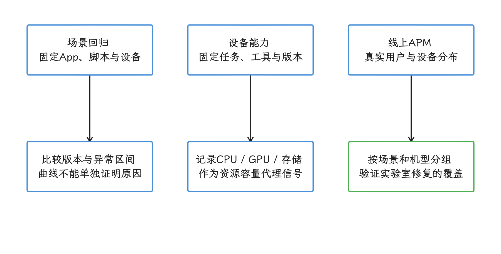

图：先确定要解释应用回归、设备能力还是线上分布，再选择数据。 设备分数与外部指标都需回到具体业务路径验证。

## 场景测试、指标采集与自动化

### PerfDog 的位置：实验室观测工具

PerfDog 是腾讯 WeTest 提供的跨平台性能测试与分析工具。Android 测试既不要求被测 App 接入 SDK（Software Development Kit，此处指需嵌入 App 的采集组件），也不要求设备 root（取得系统最高权限），接入成本很低，适合下面几类工作：

- QA（Quality Assurance，此处指测试或质量保障人员） 在固定设备和固定脚本上做发版回归。
- 开发团队快速筛出帧率、CPU、内存、温度或整机功耗异常的时间段。
- 在拿不到源码时观察第三方 App 或游戏的外部表现。
- 通过 PerfDog Service（自动化接口服务） 或 CLI（命令行工具） 接入实验室自动化。

截至 2026 年 10 月 26 日，官网提供 MCP（Model Context Protocol，让 AI 客户端调用工具的标准接口）和 Skills（封装分析流程和判断规则的规则包）入口。入口改变了调用与分析流程；仍须按所选功能核对数据来源、计算方式和适用条件，不能据入口名称推断底层实现或结果正确性。

它的定位是受控环境里的单台或一组设备；汇总真实用户、真实网络和设备分布下的长期数据，是线上 APM（生产环境中的应用性能监控） 的职责，两者各管一段。同样，一条外部曲线只够圈出可疑时间段；要证明某个函数、线程或缓存策略有问题，我们还要带着 Perfetto（Android 系统级时间线工具）、Android Studio、simpleperf（Android native CPU 分析器）、日志或业务埋点继续往下查。这两个分工决定了后面所有用法：先圈区间，再进源码和 trace。

#### Android 的两种设备模式

PerfDog 官方客户端手册把 Android 设备分为“非安装模式”和“安装模式”。这里的“安装”指手机端的 `PerfDog.apk`，不是被测 App 接入组件；PC 端 PerfDog 本身采用解压运行方式。

| <span style="white-space:nowrap">项目</span> | 非安装模式 | 安装模式 |
|---|---|---|
| <span style="white-space:nowrap">手机端组件</span> | 不安装 `PerfDog.apk` | PC 端向设备安装 `PerfDog.apk` |
| <span style="white-space:nowrap">实时显示</span> | 手机屏幕不显示 PerfDog 浮窗 | 手机端可显示实时指标 |
| <span style="white-space:nowrap">基础条件</span> | USB 调试、ADB（Android Debug Bridge，Android 调试桥）授权和稳定连接 | 在基础条件上增加 USB 安装与悬浮窗权限 |
| <span style="white-space:nowrap">适用场景</span> | 回归、竞品测试、希望减少手机端组件干扰 | 现场观察、演示或需要手机端实时读数 |
| <span style="white-space:nowrap">常见误解</span> | “没有浮窗”不代表没有采集 | 手机端显示进程被系统回收，不一定会中断 PC 端采集 |

辅助功能、通知读取或 `android.permission.DUMP` 这类权限没有固定的授予清单：不同客户端、Service 版本和所选指标会给出不同提示，以当前官方安装包和设备页面为准。若某个侧载组件在 Android 13 至 Android 17 上请求辅助功能或通知读取，系统可能显示 Restricted Settings（受限设置）这个针对侧载 App 敏感能力的确认页；我们只对来源可信、用途已确认的版本开放对应入口，测试结束后撤销不再需要的权限。

<!-- gracker-diagram: ch17-07-02-device-modes -->
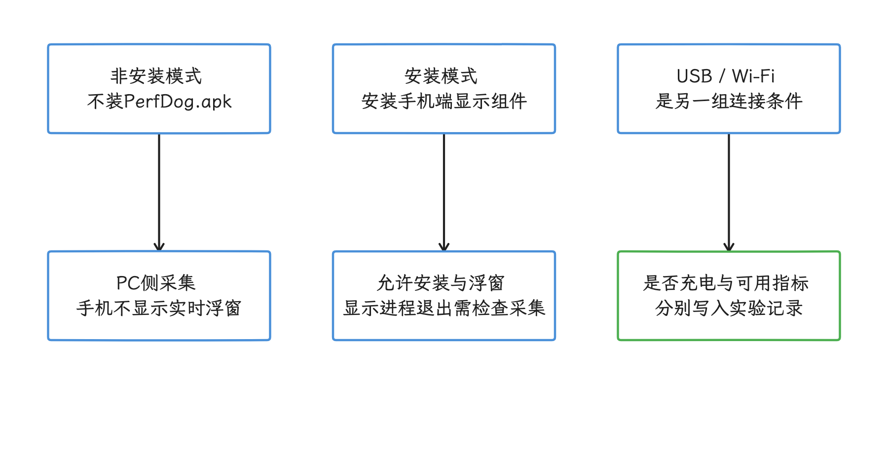

图：非安装与安装模式区分手机端组件，连接模式再单独记录。 被测 App 无需接入 SDK；各指标权限按当前版本核对。

#### USB 与 Wi-Fi 的采集条件

USB 模式便于保持连接和采集多数指标，但连接线会给设备充电，功耗数据会失真。所以 PerfDog 官方手册明确把 Android 的 Battery Power 放在 Wi-Fi 模式下采集：先通过 USB 建立 Wi-Fi 设备连接，连接成功后拔线，再开始功耗测试。我们写报告时要注明连接方式，USB 下的电流或功耗曲线单独归档，别和断线后的 Wi-Fi 结果混进同一组基线。

### 指标范围与可用条件

PerfDog 能显示哪些字段，取决于平台、设备、SoC（System on Chip，集成 CPU、GPU 等模块的系统级芯片）、驱动、测试模式、客户端版本和账号权限。我们开始测试前先查看当前设备的可用指标列表；字段为空就记“未采集”，不要填 `0`。

<!-- gracker-diagram: ch17-07-03-field-capability -->
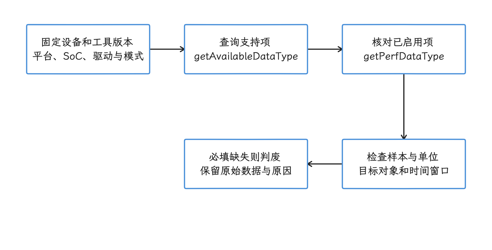

图：设备支持、实际启用和有效样本是三个连续检查点。 缺失记录为未采集，不能补零后参与统计。

下表沿用 PerfDog 的字段名，几个容易混淆的先说清楚：Surface 是 App 提交图形缓冲区的显示目标，GPU Counter 是 GPU 暴露的硬件计数器。PSS（Proportional Set Size） 按共享比例分摊进程物理内存，Swap 是换出到交换区的内存，VSS 是进程占用的虚拟地址空间。TTID（Time to Initial Display） 和 TTFD（Time to Full Display） 分别衡量首次画面与完整画面的显示时间。

| <span style="white-space:nowrap">指标组</span> | Android 常见字段 | 解释时必须保留的条件 |
|---|---|---|
| <span style="white-space:nowrap">帧呈现</span> | FPS、FTime、Jank、BigJank、SmallJank、TinyJank、Stutter、Smooth、1% Low、InterFrame | 被测窗口或 Surface、刷新率、前后台状态、场景标签 |
| <span style="white-space:nowrap">CPU</span> | AppCPU、TotalCPU、规范化 CPU、各核占用、各核频率、频率上限 | PerfDog 的规范化口径、核心数、性能模式、温度 |
| <span style="white-space:nowrap">内存</span> | PSS、Swap、VSS、Available Memory、Memory Detail | 目标进程、是否包含子进程、采样时长 |
| <span style="white-space:nowrap">GPU</span> | GPU Usage、GPU Frequency、GPU Counter | SoC、GPU 型号、驱动和设备支持列表 |
| <span style="white-space:nowrap">温度</span> | CTemp、GTemp、BTemp、NTemp | 传感器是否存在、起止温度、环境温度 |
| <span style="white-space:nowrap">电池与功耗</span> | BatteryLevel、Current、Voltage、Power、Sum(Battery)、FPower | Wi-Fi 模式、是否拔线、亮度、电量区间 |
| <span style="white-space:nowrap">网络流量</span> | 目标进程 Recv、Send | 目标进程、接口、缓存和服务器区域 |
| <span style="white-space:nowrap">启动</span> | TTID、TTFD | 冷/温/热启动条件、是否允许工具重新拉起 App |

Android 常规测试里的 Network 指标是目标进程的接收和发送流量；延迟、抖动、丢包与弱网模拟属于 PerfDog 的“网络分析”功能，`Recv/Send` 两条曲线回答不了这些问题。报告里要写清用的是常规流量指标还是网络分析任务。

GPU 是最容易出现“设备已连接但字段缺失”的一组数据。PerfDog 官方文档也把 Android GPU Usage 和 GPU Frequency 标为仅支持部分手机，并按 Adreno、Mali、PowerVR 提供不同 Counter 集。由此得到两条使用经验：

- 同一设备、同一驱动上的版本对比价值较高。
- 跨 SoC（System on Chip，系统级芯片） 的 GPU 利用率绝对值通常缺乏可比性——即使 Counter 名称相同，硬件含义也未必一致。

采集本身也可能改变结果。客户端手册注明，截图仅支持 USB 模式，部分机型的截图操作会影响性能；极高帧率测试中，少数低端机采集 `Memory Usage` 和 `Memory Detail` 也会增加开销。正式回归前先比较启用和停用这些采集项的结果，同一比较组保持采集项一致；功耗测试需要拔线时，不把 USB 截图当作必备附件。

<!-- gracker-diagram: ch17-07-04-observer-overhead -->
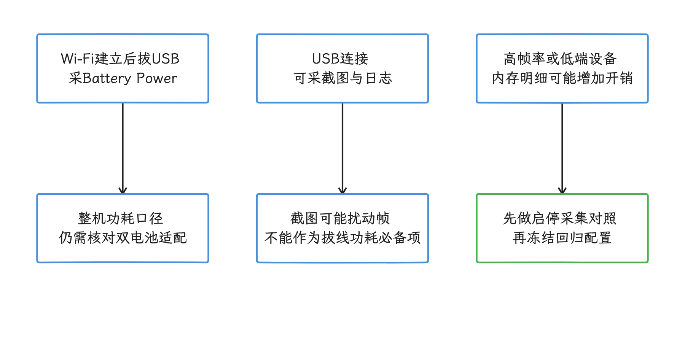

图：功耗、截图和高频内存采样各有采集条件与开销。 比较组保持采集项一致，并验证工具对被测场景的影响。

### PerfDog 的帧指标定义

读 PerfDog 的 Jank 系列指标前，我们先记住它和 Android Vitals（Play Console 的质量指标）、JankStats（应用内帧性能库）、Perfetto FrameTimeline（系统帧时间线） 的分类各是各的，别互相套用。PerfDog 官方客户端手册把固定的 24 FPS 电影帧时长用作第二个门槛，这个门槛不随手机的 60 Hz、90 Hz 或 120 Hz 刷新率变化：

| 指标 | PerfDog 官方判定 |
|---|---|
| SmallJank | 当前 FTime 大于前三帧平均值的 2 倍，且大于约 41.67 ms |
| Jank | 当前 FTime 大于前三帧平均值的 2 倍，且大于约 83.33 ms |
| BigJank | 当前 FTime 大于前三帧平均值的 2 倍，且大于 125 ms |
| Stutter | 测试区间内卡顿时长占比 |
| FTime | 相邻两帧画面显示的时间间隔 |
| 1% Low | 对最慢 1% 帧的平均帧时间取倒数并换算成 FPS |
| Smooth | PerfDog 的稳帧指数，数值越低越稳定 |

这套定义提供当前手册的解释口径；跨客户端版本仍须核对规则、窗口与导出定义，换到系统 jank 分类的语境里就对不上了。120 Hz 屏幕每帧预算约 8.33 ms，一帧 30 ms 已经错过多个刷新周期，却还没达到 PerfDog 的 SmallJank 固定门槛；所以高刷新率测试必须同时保留 FTime 分布、P95/P99（第 95/99 百分位）、1% Low 和连续低帧区间。

<!-- gracker-diagram: ch17-07-05-jank-thresholds -->
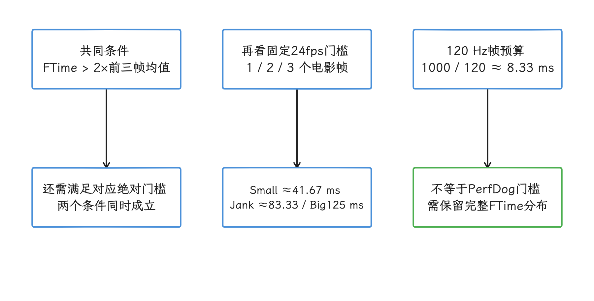

图：SmallJank、Jank 与 BigJank 都要求先超过前三帧均值两倍，再超过固定时长。 这是 PerfDog 口径；30 ms 在120 Hz下已错过刷新，却未到最小固定门槛。

官方对 Smooth 给出的经验值是游戏或视频小于 8、滑动类 App 小于 20。这一区间来自 PerfDog 的产品定义，与 Android 平台兼容性标准是两回事；团队应先用自身机型和场景建立基线，再决定门禁值，也就是自动通过或阻断测试的阈值。

#### 目标窗口的确认

一个包名可能同时存在 Activity 主窗口、`SurfaceView`、`TextureView`、视频层、游戏渲染层和子进程窗口。选错窗口时，PerfDog 可能显示系统 UI、静止层或与用户所见不一致的帧率。测试开始前我们至少确认：

- 包名、进程名和前台 Activity。
- PerfDog 当前选择的窗口或 Surface 名称。
- 游戏、视频、小程序是否使用独立 Surface。
- 旋转、画中画、弹窗或场景切换后，目标窗口是否发生变化。

PerfDog Service 提供 `getAppWindowsMap` 一类接口，可以列出 Android 应用各进程涉及的 Activity 与 SurfaceView。人工核对时也可以看 SurfaceFlinger（Android 的系统显示合成服务） 的 layer 列表；layer 是参与合成的显示层，名称属于系统调试信息，名称相似只值得怀疑，还够不上归属依据。

<!-- gracker-diagram: ch17-07-06-window-selection -->


图：包名、PID 与 Activity/SurfaceView 对应后，再确认正在测的输出目标。 旋转、画中画或 Surface 重建后重新核对，名称相似不能证明归属。

### 测试条件与可复现性

性能测试的首要产物是可复现的实验记录。每轮开始前固定并记录下面这些条件：

| <span style="white-space:nowrap">类别</span> | 必填项 |
|---|---|
| <span style="white-space:nowrap">硬件</span> | 品牌、完整型号、SoC、RAM；不要把 Pixel 8 写成 Snapdragon 设备，Pixel 8 使用 Google Tensor G3 |
| <span style="white-space:nowrap">系统</span> | Android 版本、API、构建号、安全补丁、厂商性能模式 |
| <span style="white-space:nowrap">显示</span> | 分辨率、刷新率、亮度、深色模式、自动亮度是否关闭 |
| <span style="white-space:nowrap">电源</span> | 起止电量、是否充电、电池健康状态、外接供电方式 |
| <span style="white-space:nowrap">热环境</span> | 室温、散热配件、起止温度、冷却等待规则 |
| <span style="white-space:nowrap">网络</span> | Wi-Fi/蜂窝、SSID（Wi-Fi 网络名称）或实验网络、服务器区域、弱网参数 |
| <span style="white-space:nowrap">App</span> | 包名、versionName、versionCode、渠道、ABI（native 二进制接口与 CPU 架构）、账号与配置 |
| <span style="white-space:nowrap">数据状态</span> | 冷启动/热启动、缓存、下载资源、首装或覆盖安装 |
| <span style="white-space:nowrap">操作</span> | 脚本版本、场景步骤、采集时长、场景标签 |
| <span style="white-space:nowrap">工具</span> | PerfDog 客户端/Service 版本、连接模式、已启用指标 |

自动刷新率、自动亮度、游戏加速器、厂商性能模式和后台同步都可能改变结果。测试前别用“清理全部后台”代替条件说明：系统服务清不干净，过度清理还会制造不符合用户场景的冷缓存。更稳妥的做法是列出允许保留的后台进程，并在各轮之间执行同一套恢复步骤。

长时游戏或视频至少覆盖热稳定阶段，也就是运行足够久、温度和频率趋于相对稳定的阶段。只取开局一分钟，测到的往往是尚未受温控约束的峰值。每轮开始温度必须落入预设区间；达不到就延长冷却时间并记录，别临时放宽门槛。

<!-- gracker-diagram: ch17-07-07-controlled-runs -->
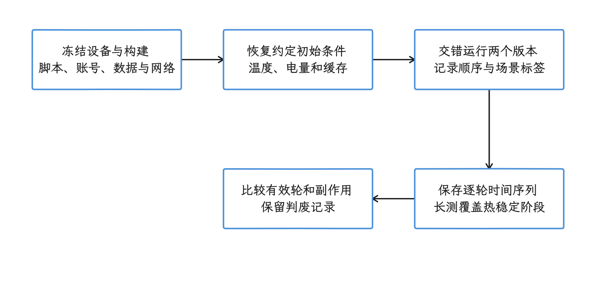

图：每轮先恢复预设条件，交错运行基线与候选，再覆盖所需的热阶段。 起始温度不达标时延长冷却，不能临时放宽窗口。

### 平均 FPS 之外的保留指标

平均值会同时掩盖“长期偏低”和“偶发长帧”。P50 是中位数，P95/P99 表示 95%/99% 的样本不超过该值。下面用两种分布说明区别，不代表设备实测：

| 场景 | FTime 分布 | 平均 FPS 容易遗漏的信息 |
|---|---|---|
| A：稳定受限 | 帧间隔持续偏长，但波动小 | 持续不够顺滑，帧节奏却可能稳定 |
| B：多数时间流畅、偶发尖峰 | 多数帧较短，少数帧明显变长 | 平均 FPS 较高也可能伴随间歇停顿 |

判断场景 B 是否更容易被用户察觉，还要看长帧的位置和连续性。一次回归至少保留：

- FPS 的平均值、中位数、1% Low 和稳定区间。
- FTime 的 P50、P90、P95、P99 和最大值。
- SmallJank/Jank/BigJank 次数及 Stutter。
- 长帧发生时的场景标签、截图或操作步骤。
- 采集区间前半段与后半段的对比。

P95/P99 若由导出数据离线计算，应在报告中写明脚本版本和空值处理方式，不要伪装成 PerfDog 界面原生字段。

<!-- gracker-diagram: ch17-07-08-frame-distributions -->
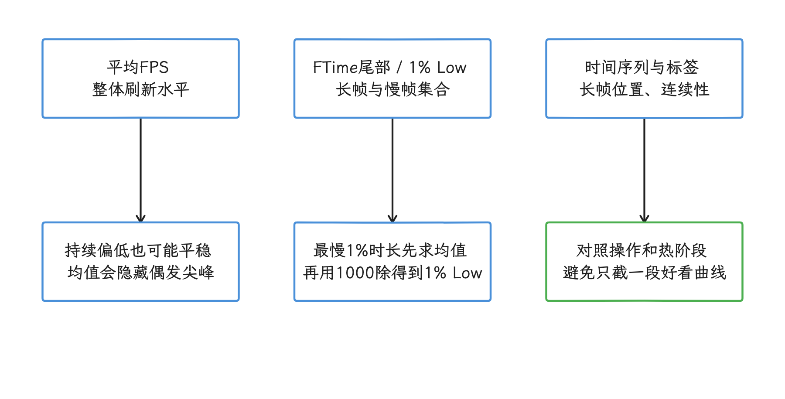

图：平均 FPS、慢帧尾部与连续区间回答不同问题。 离线分位数要写脚本、单位、空值与窗口，不冒充原生字段。

### 功耗、温度与频率的联合阅读

PerfDog 的 Android Battery Power 是整机口径，屏幕、基带（蜂窝通信模块）、Wi-Fi、后台进程和系统服务都包含在内，目标 App 只占其中一部分。对比时我们固定亮度、音量、网络、账号数据和后台状态，并使用 Wi-Fi 连接后拔掉 USB。双电池设备还要核对官方兼容列表与当前客户端的换算方式；未核对前，不把电流和功率直接并入单电池设备基线，也不自行套用统一倍数。

官方客户端把 `FPower` 列为帧能耗字段。报告应同时保存工具版本、原字段和导出单位；仅凭字段名称，不能把读数解释为目标 App 独占的单帧能量。需要跨工具比较每帧能量时，另行记录同一时间区间的整机能量与呈现帧数，并说明计算方法和采样对齐方式。FPS 接近 0、场景静止或两组帧率差距很大时，按帧比较功耗的解释力也会减弱。

<!-- gracker-diagram: ch17-07-09-power-scope -->
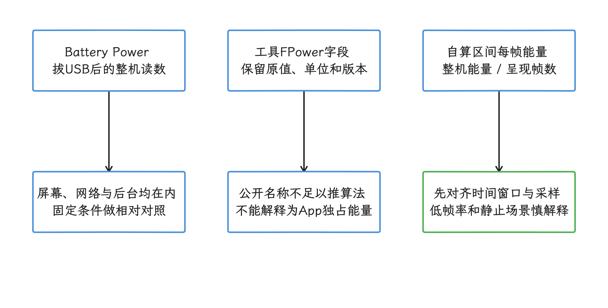

图：Battery Power、工具 FPower 与另算的每帧能量必须分别保存定义。 目标 App 不是整机唯一耗能者；读数与单位未经核对不跨工具换算。

判断热降频时，我们推荐寻找同一时间轴上的证据组合：

1. CPU、GPU、SoC、机身或电池温度持续上升。
2. CPU Frequency Limits、CPU Clock 或 GPU Frequency 出现台阶式下降。
3. FTime P95/P99、1% Low 或 Stutter 同步恶化。
4. 在相同操作标签处，CPU/GPU 负载没有出现能够单独解释退化的新峰值。

判断限频要这几条曲线互相印证，单个温度值说明不了问题。不同厂商暴露的传感器名称、安装位置与校准方式不同，同为 `CTemp` 的绝对值也不适合跨设备排名。报告写起止温度、曲线拐点和系统温控等级，别只贴峰值。

<!-- gracker-diagram: ch17-07-10-thermal-evidence -->
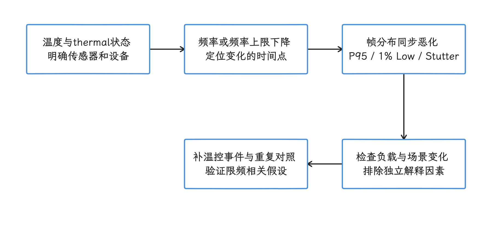

图：在同一时间轴对照温度、频率上限、帧指标和业务负载，再提出限频假设。 曲线相关仍需系统事件和同条件对照，单个温度值不能证明根因。

精确的能耗实验应使用外置功耗仪，并清楚区分电池端、USB 端和整机输入端的测量位置。PerfDog 更适合实验室回归中的相对变化监控。

### PerfDog、Perfetto、Profiler 与 Macrobenchmark（Jetpack 宏基准测试） 的分工

| 工具 | 擅长回答的问题 | 不宜单独负责的结论 |
|---|---|---|
| PerfDog 常规指标 | 哪个版本、设备或时间段的外部指标异常 | 单凭外部曲线定位具体函数的因果 |
| Perfetto / Android Studio System Trace | 主线程、RenderThread、SurfaceFlinger、调度、Binder（Android 跨进程通信）、I/O 如何重叠 | 大规模版本回归评分 |
| Android Studio Profiler | 开发机上交互查看 CPU、内存和网络，并继续定位到代码 | 低扰动的跨版本基准 |
| Macrobenchmark（Jetpack 宏基准测试框架） | 在受控启动和交互场景中重复测量启动与帧时序 | 第三方 App 的完整系统侧观测 |

PerfDog 当前还提供深度分析，可查看线程状态、调度和调用栈等信息；可用内容取决于设备、版本与采集条件。结论应绑定具体任务及原始证据，常规指标曲线本身仍不能证明函数级根因。

一个常用流程是：

1. 用 PerfDog 在固定脚本中定位异常区间，并打上场景标签。
2. 在同一设备、同一构建和同一操作上抓 Perfetto，查看 FrameTimeline、主线程、RenderThread、GPU 和 SurfaceFlinger。
3. 能修改源码时，增加低开销 trace，或使用 Profiler、simpleperf、heap dump（堆内存快照）定位代码。
4. 对已定位且可自动重放的启动、滑动或列表场景，补 Macrobenchmark 防回归用例。

<!-- gracker-diagram: ch17-07-11-investigation-loop -->


图：先圈定区间，再使用系统轨迹、调用栈或业务事件解释并验证。 PerfDog 深度分析另按具体任务取证；常规曲线不能独立证明函数因果。

PerfDog 的 StartupTiming 会重新拉起 App；不希望工具改变当前运行状态时，不启用该指标。TTFD 还依赖被测 App 在完整画面可用时调用 `reportFullyDrawn()`，第三方 App 未上报时，不能把工具读数当作已经测得的完整启动时间。精确启动基准仍要写清冷、温、热启动，并优先由 Macrobenchmark 控制启动模式。两种工具的启动数据可以互证，放进同一列比较时须保证启动条件和完成标记一致。

<!-- gracker-diagram: ch17-07-12-startup-markers -->
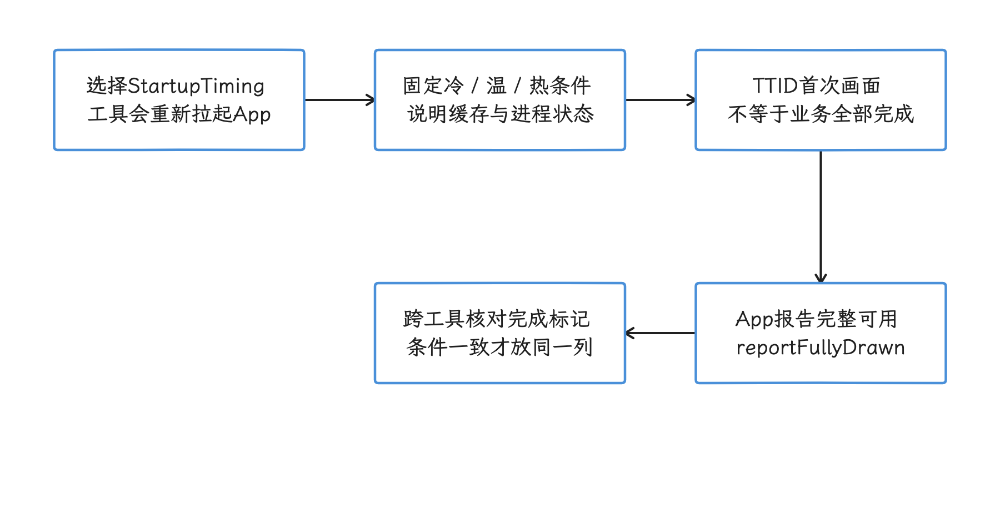

图：启动模式、工具拉起动作和 App 完成标记共同决定读数。 未调用 reportFullyDrawn 时，不能声称已测得完整启动。

### 三类使用流程

#### 发版前回归

1. 从高端、中端和业务重点机型中选固定设备池。
2. 每个场景规定预热、冷却、账号、缓存和网络状态。
3. 当前版本与基线版本都至少运行多轮，保存每轮原始文件。
4. 使用各轮中位数比较，并同时检查最差有效轮次。
5. 超过门禁后回放曲线；需要根因时补抓 Perfetto。

#### 专项优化

1. 用场景标签缩小异常时间段。
2. 一次只改变一个可控变量，例如纹理规格、线程数或缓存策略。
3. 交替运行基线与实验版本，减少升温和测试顺序带来的偏差。
4. 同时观察目标指标和副作用，例如 FPS 改善时内存、功耗是否上升。
5. 将确认有效的场景加入持续回归。

#### 竞品分析

1. 使用同一台设备、同一系统、同一刷新率和同一网络。
2. 对齐账号等级、内容资源、画质、广告状态和下载完成度。
3. A/B 交替测试，并在每轮前恢复到相同温度区间。
4. 只报告外部可观察差异，不把现象直接写成对方的内部实现。
5. 使用测试账号和脱敏数据，遵守产品条款，不在共享报告里泄露账号、设备标识、聊天内容或内部服务器地址。

“竞品 A 在同机同场景下 FTime P95 较低”是可验证结论；“竞品 A 使用了更好的缓存算法”只是需继续验证的假设。

### 自动化的操作与判废规则

精细回归优先使用 UIAutomator（Android UI 自动化框架） 或团队内部的确定性脚本。`monkey` 是随机发送系统与触控事件的测试工具，适合稳定性和探索测试，拿到逐轮路径一致的性能对比要靠前者。

PerfDog Service 的公开 gRPC（跨进程远程调用框架） 接口覆盖设备初始化、可用指标查询、启停测试、实时数据流、场景标签、保存数据和 Android 窗口查询；当前官网也提供 CLI 与 Service 的 CI/CD（持续集成与交付） 入口。接入脚本时，我们把下面这些内容一并纳入：

- 初始化设备后，用 `getAvailableDataType` 查询支持项，再用 `getPerfDataType` 核对已启用项；支持某项不等于正在采集，缺少必填字段就终止该轮。
- 用 `setLabel` 或等价接口标记场景；不要等测试结束后再凭曲线猜测时间点。
- 记录脚本 commit（Git 提交号）、设备序列号映射、PerfDog 版本和报告 ID。
- 正常完成、脚本异常或超时时，都要在清理分支对已开始的测试调用 `stopTest`。官方明确提示，漏调会继续计费；结束脚本或关闭数据流不能代替该调用。
- 停止后检查 `saveData` 的上传结果与本地导出结果，或用 `getDeviceCacheData` / `getDeviceCacheDataPacked` 取回缓存再落盘；缓存也可在测试中读取，新测试会清空旧缓存。按所选保存方式确认成功后再开始下一轮，不能把 RPC 返回当作两个保存目标都成功。
- 给每轮保留原始数据、控制台日志、操作日志和判定结果。

“看起来异常就删掉”会带来选择偏差。我们应在测试前写明判废条件，例如设备断连、必填指标缺失、脚本步骤失败、App 崩溃或网络环境越界。判废轮次仍保留原始文件和原因；性能差但流程完整的轮次属于结果，老老实实计入。

<!-- gracker-diagram: ch17-07-13-service-lifecycle -->
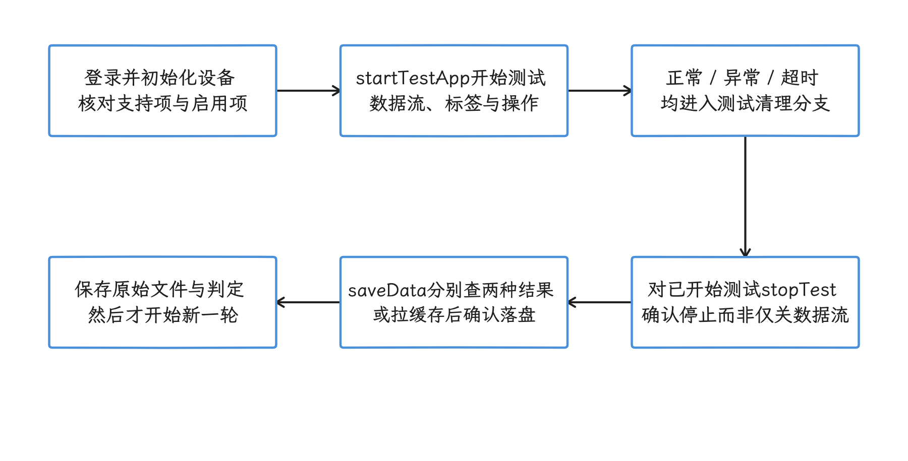

图：所有结束路径都停止已开始的测试，确认数据落盘后才开启下一轮。 关闭流或脚本退出不能代替 stopTest；新 start 会清空上一轮缓存。

场景文件可采用下面的命名方式：

`<app>-<version>-<device>-<android>-<scene>-<mode>-<iteration>-<timestamp>`

例如：`demo-6.2.0-pixel8-android17-feed-scroll-wifi-r03-20260725T143000+0800`。名称用于定位文件，完整条件仍写入报告，避免文件名过长。

### 可直接使用的报告模板

下面模板用于 QA 发版记录；尖括号字段必须替换，离线计算的指标要注明来源。

```markdown
# PerfDog 性能测试报告

- App：<package> / <versionName>(<versionCode>) / <channel>
- Commit：<git sha 或构建号>
- 设备：<品牌与完整型号> / <SoC> / <RAM>
- 系统：Android <version> / API <level> / <build> / <security patch>
- PerfDog：<client/service version> / <USB|Wi-Fi> / <enabled metrics>
- 场景：<scene name> / <script version> / <duration> / <轮次数>
- 显示：<resolution> / <refresh rate> / <brightness> / <performance mode>
- 网络：<type> / <server region> / <weak-network profile>
- 电源：<start-end battery> / <charging state> / <external meter>
- 热环境：<ambient> / <cooling> / <start-end temperature> / <thermal state>
- 账号与数据：<account profile> / <cache state> / <download state>
- 判废规则：<predefined invalidation rules>

| 指标 | 基线中位数 | 当前中位数 | 当前 P95 | 当前最差有效轮 | 变化 | 门禁 |
|---|---:|---:|---:|---:|---:|---:|
| FPS | | | | | | |
| 1% Low FPS | | | | | | |
| FTime (ms) | | | | | | |
| Stutter (%) | | | | | | |
| AppCPU (%) | | | | | | |
| PSS (MB) | | | | | | |
| Power (mW) | | | | | | |

## 异常区间

- <label / timestamp>：<外部现象与复现步骤>

## 结论

- <通过、阻断或继续调查；只写证据能够支持的范围>

## 附件

- <PerfDog 原始文件、导出表、脚本日志、Perfetto trace、截图>
```

模板把设备状态、统计汇总和原始附件放在同一份记录中。团队可以增加业务指标，连接方式、起止温度、脚本版本和判废规则这四项别删。

### 用 AOSP（Android Open Source Project，Android 开源项目） 源码交叉核验

PerfDog 没有公开 Android 客户端每个指标的完整采集实现，公开资料证明不了“Power 一定调用 PowerStats HAL（Hardware Abstraction Layer，硬件抽象层）”或“FPS 一定通过 `SurfaceFlinger --latency` 获取”。下面这些 AOSP（Android Open Source Project） 接口用来解释系统能够提供什么，我们可以在字段缺失或曲线可疑时拿来做独立核验；PerfDog 闭源实现走哪条调用链，以工具厂商的公开说明为准。

下面这些命令用于同机排障，执行前先替换包名和 layer 名称。

```bash
adb shell dumpsys SurfaceFlinger --list
adb shell dumpsys SurfaceFlinger --latency '<layer-name>'
adb shell dumpsys gfxinfo com.example.app framestats
adb shell dumpsys thermalservice
adb shell dumpsys powerstats
adb shell dumpsys meminfo com.example.app
```

命令输出也有权限、缓存窗口和厂商实现限制，我们用它确认“系统侧是否有数据”和“变化时间是否一致”就够了；数值与 PerfDog 一一相等是额外的要求，不作为预期。

#### 帧时间：SurfaceFlinger 与 FrameTimeline

在 `android-17.0.0_r1` 源码中，`SurfaceFlinger.cpp` 把 `--latency` 分派给 `SurfaceFlinger::dumpStats()`。该函数先输出当前 pacesetter VSYNC（SurfaceFlinger 用作节奏参考的垂直同步信号）周期，再按完整 layer 名查找目标并调用 `Layer::dumpFrameStats()`。`Layer.cpp` 随后经 `Layer::getFrameStats()` 从对应 timeline 生成 `desiredPresentTimesNano`、`actualPresentTimesNano` 和 `frameReadyTimesNano` 三列。

这条源码路径能解释几个常见现象：

- layer 名不完全匹配时，输出可能只有刷新周期，没有帧记录。
- Surface 重建后名称或序列会变化，长时脚本要重新确认目标。
- `gfxinfo framestats` 主要覆盖 Android UI Toolkit/HWUI（系统 UI 硬件加速渲染管线） 参与的帧。直接使用 OpenGL ES、Vulkan、Unity 或 Unreal 的应用可能只有部分数据，Android 官方慢帧文档也明确提示了这一限制。
- Perfetto FrameTimeline 提供预期与呈现时序以及 jank 分类，更适合查“哪一段流水线错过了截止时间”。

`FrameTracer` 是 SurfaceFlinger 内记录部分帧时间戳和 fence（协调 GPU 与显示完成时序的同步对象） 事件的模块，但 `--latency` 路径把它简化成“直接读取 FrameTracer”并不成立。

<!-- gracker-diagram: ch17-07-14-sf-independent-check -->
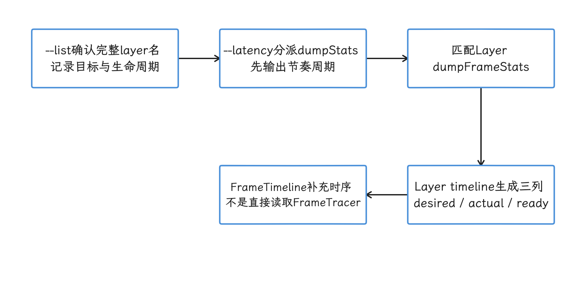

图：--latency 沿 dumpStats、Layer 与 timeline 导出帧列，作为独立系统核验。 这不证明 PerfDog 内部使用该路径，gfxinfo 也不能覆盖所有独立图形 Producer。

#### 温度与限频：`thermalservice`

framework（系统框架层） 层的实现位于：

`frameworks/base/services/core/java/com/android/server/power/thermal/ThermalManagerService.java`

服务通过 `Context.THERMAL_SERVICE` 发布，服务名是 `thermalservice`，所以核验命令应写成 `adb shell dumpsys thermalservice`。连接 HAL 时依次尝试 AIDL（Android Interface Definition Language，Android 接口定义语言）、Thermal HAL（Hardware Abstraction Layer，硬件抽象层） 2.0、1.1 和 1.0 兼容实现。

AIDL 接口位于：

`hardware/interfaces/thermal/aidl/android/hardware/thermal/IThermal.aidl`

它提供温度、按类型过滤的温度、CoolingDevice（降频、限流或风扇等冷却执行项）、静态阈值和温度变化回调。节流等级位于返回的 `Temperature.throttlingStatus`，HAL 里并没有 `getThrottlingStatus()` 这个方法。AIDL 注释还强调：设备温控策略可能包含迟滞（阈值上下保留回差，避免状态反复切换）和复合条件，静态阈值不足以准确推断当前节流状态，应以温度状态或回调为准。

Android 10 引入 framework thermal service 和 Thermal HAL 2.0；Android 14 将 `IThermal` 从 HIDL（旧一代 HAL 接口描述语言）迁移到 AIDL。保留旧 HAL 回退是设备兼容策略，具体某台设备会不会暴露 CPU、GPU、NPU 和机身传感器，还要逐台确认。

<!-- gracker-diagram: ch17-07-15-thermal-hal -->
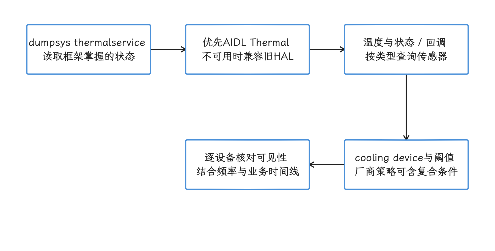

图：framework 通过可用 HAL 读取温度、执行项与节流状态。 Temperature.throttlingStatus 是字段，静态阈值不能代替含迟滞的运行状态。

#### 能耗：PowerStats 与 Battery Power 的口径

系统服务位于：

`frameworks/base/services/core/java/com/android/server/powerstats/PowerStatsService.java`

`PowerStatsService` 发布 `powerstats` Binder 服务，可列出代表硬件或子系统的 `PowerEntity`、能耗消费者 `EnergyConsumer` 和能量表 `EnergyMeter`，并通过 HAL 读取状态驻留时间（硬件在某个状态停留多久）或累计能量。`PowerStatsHALWrapper.getPowerStatsHalImpl()` 优先连接：

`android.hardware.power.stats.IPowerStats/default`

若 AIDL/PowerStats HAL 2.0 不可用，framework 回退到 HAL 1.0 的 JNI wrapper（Java 与 native 代码之间的桥接层）。是否有显示、CPU、GPU、Wi-Fi 等细分项，取决于设备 HAL；`dumpsys powerstats` 没有数据，也可能只是这套 HAL 路径没数据，PerfDog 的整机 Battery Power 仍可能正常。

PerfDog 官方把 Android Battery Power 描述为 Wi-Fi 模式下的整机 Current、Voltage 和 Power。PowerStats HAL 则可能提供硬件能量表或子系统累计能量，两者的对象、单位、采样周期和计算过程都可能不同。只有在工具厂商公开采集细节后，才能声明它们存在直接依赖。

<!-- gracker-diagram: ch17-07-16-powerstats-independent -->
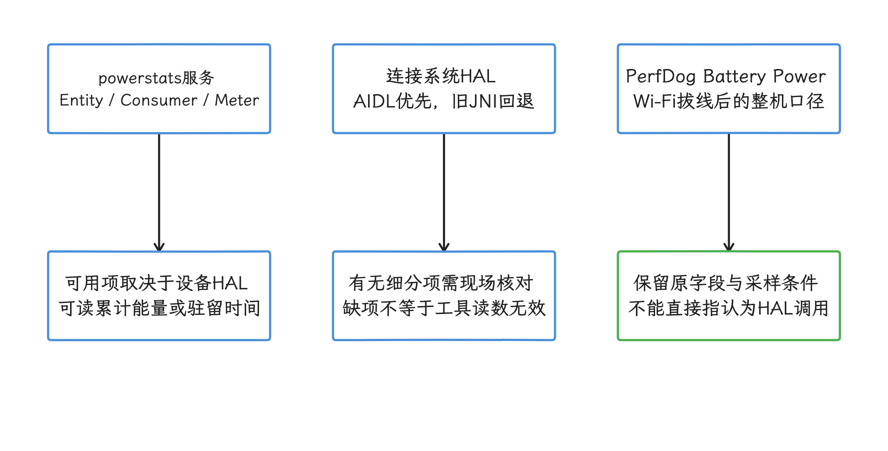

图：系统子系统能量与工具整机电池读数分别解释。 对象、单位和周期可能不同；公开能力不等于闭源工具的内部依赖。

#### CPU、内存、GPU 与网络

`dumpsys meminfo <package>` 可核对 PSS 分类，但多进程应用要逐个确认进程，汇总规则也要与 PerfDog 选择项一致。CPU 还要区分 AppCPU/TotalCPU、规范化/未规范化以及采样窗口。

Android 没有向普通工具保证一套跨厂商一致的 GPU 利用率、频率和 Counter API。PerfDog 能否显示这些字段取决于机型适配与驱动接口，`gfxinfo` 也推不出 GPU 使用率，它的核心用途是应用图形与帧统计。

常规 Network 的 Recv/Send 是流量观察。要解释延迟或丢包，还需要 PerfDog 网络分析、抓包、服务端日志或受控弱网记录来补依据。

### SoloPi 的复现能力与指标边界

SoloPi 的开源部分提供录制回放、设备侧操作、悬浮窗采样和视觉响应分析，适合 QA 固定复现路径；至于“一机多控（用一套操作同步控制多台设备）”，实现并未完整开源。

截至 2026 年 10 月 26 日，GitHub 最新发布为 `v1.0.3`（2026 年 10 月 21 日），发布 tag 与当前 `master` 均指向 `47d12f4904488b9c4bab5db3b0d164a83df36519`。这是安全修复版本，包含本机 HTTP 绑定、动态补丁签名与已安装补丁的再次校验；不能据此推定性能指标已改变或已通过 API 37 验收。固定源码声明 `appVersionName=1.0.3`、`versionCode=38`，仍使用 AGP 4.0.2、compile/targetSdk 29 和 NDK 21.1.6352462。发布说明的测试结果只代表其注明的环境，本轮没有安装或运行 APK。

讨论兼容时我们分开两个问题：当前 target 29 APK 能否在某台 API 37 设备运行，以及源码升级到 targetSdk 37 后能否满足现代规则。前者只证明一组 APK、系统镜像与厂商策略共同可用；后者那套构建、权限、前台服务、存储和 16 KB 验收，仍要逐项做。

<!-- gracker-diagram: ch17-07-17-solopi-identity -->
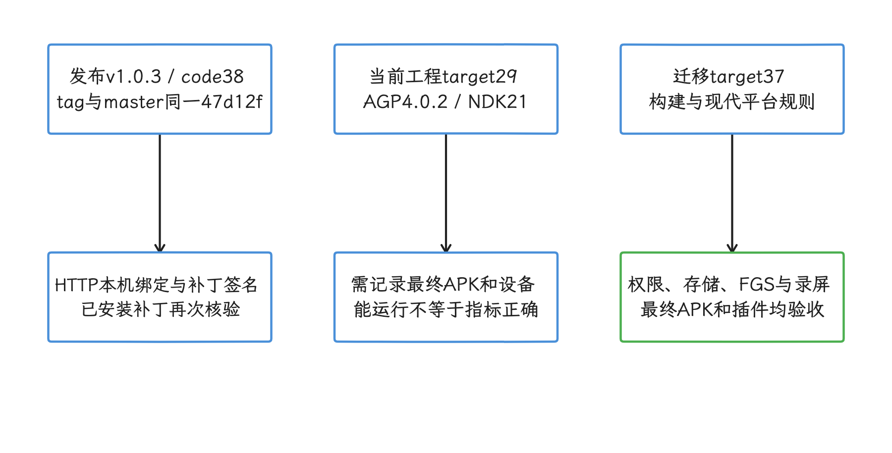

图：1.0.3 的发布身份和安全修复，与 target29 APK 运行及 target37 迁移分别核验。 本轮读取固定源码和发布说明，没有安装或完成 API37 真机验收。

#### 准入验收项

| 关卡 | 通过条件 | 失败信号 |
|---|---|---|
| ADB 通道 | 设备内连接持续执行 shell | 授权或密钥失效、厂商断连 |
| 无障碍 | 公开 selector（控件筛选条件）能稳定读、点、输 | 多个节点冲突、回放命中错误 |
| 悬浮窗 | 可显示、拖动和关闭 | AppOp（系统对 App 单项能力的开关）拒绝、触摸冲突 |
| MediaProjection（系统屏幕捕获 API） | 每次录制重新授权并正常结束 | 黑屏、复用授权、前台服务失败 |
| 后台存活 | 切到被测 App 后服务与控制通道持续 | 脚本中止、通知消失 |
| 存储与导出 | CSV（逗号分隔表格文件）、截图和视频位于合规路径 | 旧共享目录写入失败 |
| 指标语义 | 每个字段与独立来源对读 | 固定 0、旧值、单位或进程归属错误 |
| 16 KB | 最终 APK 与动态插件均兼容 | native 库装载或插件加载失败 |

固定 1.0.3 的节点处理器经 `AccessibilityUtil.buildCurrentNode()` 构建节点，辅助方法仍反射调用 `AccessibilityNodeInfo.getSourceNodeId()` 这个非 SDK 接口，失败后返回 0；节点类本身有变化，不代表这条风险已移除。公开 selector 仍须验证唯一命中与正确操作。录屏能力还涉及 MediaProjection；targetSdk 34 及以上需要声明 `mediaProjection` 前台服务类型及其专用权限。迁到 targetSdk 37 时应使用公开资源 ID、类名、文本、描述、窗口和边界组合定位节点，且每次捕获都重新获得用户授权。Android 15 QPR1 起，锁屏会停止屏幕投影；录制脚本应处理 `MediaProjection.Callback.onStop()`、释放捕获资源，并把提前结束的轮次单独记录。

<!-- gracker-diagram: ch17-07-19-projection-stop -->
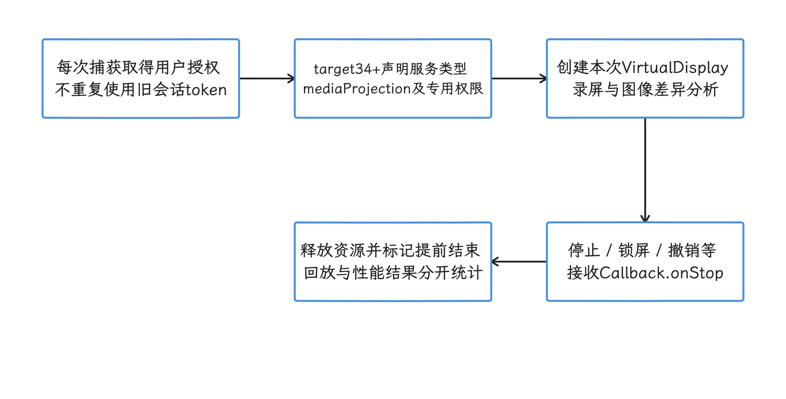

图：每个录制会话重新授权，按 target 声明前台服务，并处理系统提前终止。 Android15 QPR1起锁屏会停止投影；视觉稳定不是 TTID 或 TTFD。

#### 字段口径的逐项标注

| 字段 | 公开源码路径 | 使用边界 |
|---|---|---|
| CPU | 高权限 shell 读取 `/proc/stat` 与 <code>/<wbr>proc/<wbr>&lt;pid&gt;/<wbr>stat</code> | 依赖 ADB、PID（进程号）和 procfs（`/proc` 虚拟文件系统）；多进程要核对归属 |
| PSS | API 29 以下调用 <code>get<wbr>Process<wbr>Memory<wbr>Info<wbr>(pids)</code>；API 29 起通过高权限 shell 解析 `dumpsys meminfo` 的 `TOTAL` 行 | Android 10+ 普通 App 的跨 UID（Linux 用户标识，通常对应 App 身份）查询受限；该源码已切换到 shell 路径，需核对授权、PID 和文本列含义 |
| Private Dirty（进程独占且已修改的物理页） | 与 PSS 使用同一 SDK 分支；旧系统取 <code>get<wbr>Total<wbr>Private<wbr>Dirty<wbr>()</code>，API 29 起解析同一 `TOTAL` 行 | 依赖权限和文本格式；命令成功不代表固定列仍对应原指标 |
| 网络 | 高权限 shell 读取 <code>/<wbr>proc/<wbr>&lt;pid&gt;/<wbr>net/<wbr>dev</code> 中写死的 `wlan0`，或使用全局 TrafficStats | 前者是 network namespace（网络命名空间）的接口计数，后者含全机流量，均不是目标进程精确字节；蜂窝网络或接口名变化时，`wlan0` 路径不能代表当前流量 |
| FPS | 解析 <code>dumpsys gfxinfo ... framestats</code> 的 `IntendedVsync` 与 `FrameCompleted`，结合屏幕周期估算 | 属于 UI 帧统计估算，不能当作 Surface 的实际呈现帧率；Activity 匹配、文本格式和刷新率都需验收，不替代 FrameTimeline |
| 视觉响应 | MediaProjection 录屏 + 图像差异 | 点击到画面稳定，不是系统 TTID/TTFD |
| 电流/功率 | BatteryManager 与历史 sysfs（`/sys` 下的内核设备接口）路径 | 设备级数据，单位、符号和传感器需实测 |

每个字段都要从 `verified`（已核验）、`degraded`（降级）、`unavailable`（不可用）、`unknown`（未知） 里选一个标注。字段有值只说明采到了数，语义对不对要另外确认；脚本跑完，其中一项失效照样算失效。视觉响应可以作为用户体验的补充；系统启动由 Macrobenchmark 的 TTID/TTFD 与 `reportFullyDrawn()` 单列。

<!-- gracker-diagram: ch17-07-18-solopi-admission -->
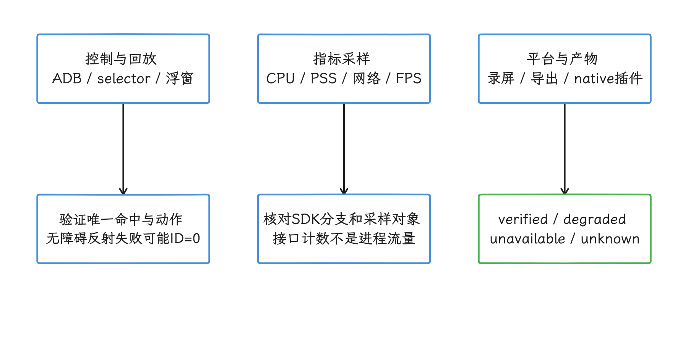

图：通道、控制、导出与字段语义逐项验收，结果按字段分级。 命令成功或字段非空不等于进程归属、单位和采样含义正确。

录制回放的性能价值来自路径一致性。固定数据、账号、刷新率和动画，用状态等待替代无条件的固定 sleep（无条件暂停）；正式轮次前先跑正确性，通过后再启用 PerfDog、Macrobenchmark 或 Perfetto。回放失败率与性能结果分开统计，避免把等待控件超时当成 App 变慢。

<!-- gracker-diagram: ch17-07-20-replay-fixture -->
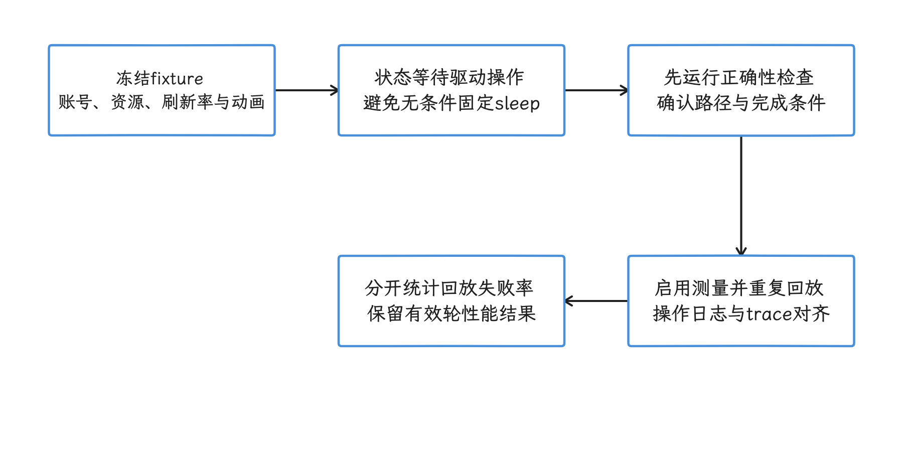

图：先验证固定数据与状态等待，再启用测量并保存操作证据。 控件超时或路径失败归入回放质量，不能混作业务耗时退化。

### Emmagee 的历史定位

Emmagee `V2.5.1` 发布于 2017 年 8 月 25 日，上游 `master` 最后提交于 2018 年 3 月 16 日，README 已明确 Android 7.0 不受支持。它的目标 PID、前台 Activity、CPU、PSS、流量和电流依赖受限的进程枚举、`/proc`、跨 UID API、旧 sysfs 或 root shell。上游没有提供可核验的 Android 17 适配依据，不能仅以“降低精度”解释采样失败，也不应直接用于 Android 17 回归。

旧 CSV 只能在原工具、原版本、相近设备与系统条件下阅读。缺少版本和口径时，把数值作为背景材料，不重新接入、补跑或与 PerfDog/SoloPi 当前字段直接换算。

<!-- gracker-diagram: ch17-07-21-historical-tools -->
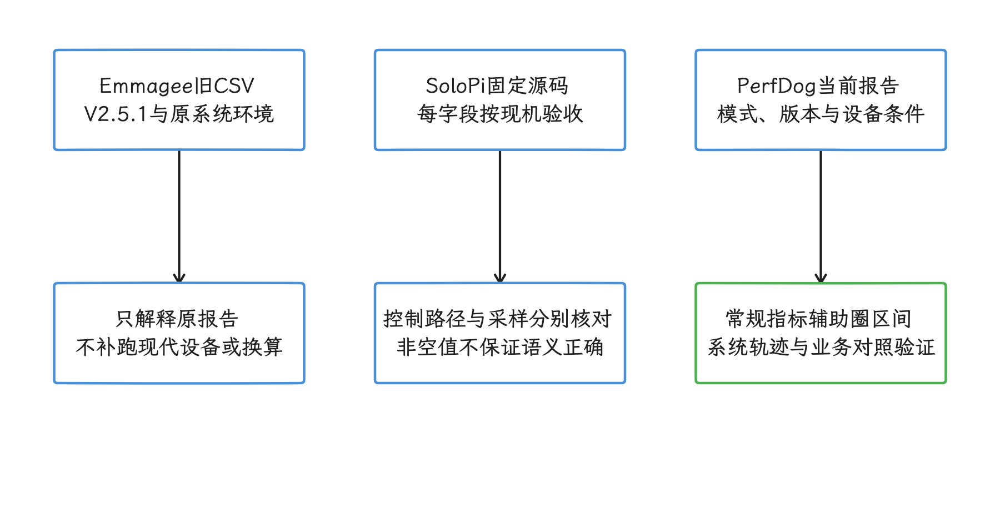

图：历史工具的数据保留原版本、对象和环境，缺少口径时不换算。 Emmagee README不支持Android7；没有依据将其接入Android17回归。

### 三种工具怎样协作

| <span style="white-space:nowrap">工具</span> | 主要职责 | 不应负责 |
|---|---|---|
| <span style="white-space:nowrap">SoloPi</span> | 固定操作、回放、视觉响应和现场辅助 | 根因、线上分布或跨工具指标真值 |
| <span style="white-space:nowrap">PerfDog 常规指标</span> | 外部帧、CPU、内存、温度与功耗趋势 | 单凭曲线证明函数和线程级因果 |
| <span style="white-space:nowrap">Macrobenchmark</span> | 受控编译/启动状态下的可重复基准 | 第三方 App 和真实用户分布 |
| <span style="white-space:nowrap">Perfetto</span> | 调度、Binder、渲染、I/O 与系统时间线 | 业务正确性断言 |

推荐链路是 SoloPi 或确定性 UIAutomator 固定路径，PerfDog 筛选异常区间，Macrobenchmark 把 App 场景转成可重复的自动测量，Perfetto 继续定位原因。权限、Restricted Settings（受限设置，即系统对侧载 App 敏感能力的额外确认页）、无线 ADB、录屏、截图和 CSV 只在隔离设备与测试账号中使用，测试文件需要脱敏、访问控制和删除期限。

### 结论

PerfDog 仍适合作为低接入成本的实验室观测工具，SoloPi 适合经过逐项验收后的操作复现，Emmagee 只留作历史解释。可靠使用依赖四条纪律：

- 先确认窗口、可用指标与连接模式，再开始采集。
- 把设备、温度、刷新率、网络和脚本写进报告。
- 用帧时间分布、长帧和热稳定曲线补足平均 FPS。
- 把 PerfDog 的异常区间交给 Perfetto、Profiler、Macrobenchmark 或源码 trace 继续验证。

工具给出的数值只有在口径和条件可复现时才有工程意义。

## 设备能力基线与跨设备比较

场景工具发现应用回归后，我们还要回答“是这台设备不行，还是这个版本不行”，设备 Benchmark 补上的就是硬件能力这一半。读分数有一条前提：不同版本、温度和系统策略下的分数要分开看，直接放在一起比会得出错误结论。

### 设备基线与 App 数据的分工

Benchmark 用统一任务测量设备在特定条件下的表现；本文所说的设备基线，是在固定工具、版本和环境下保存的设备参照数据。Geekbench、3DMark、PCMark、安兔兔和 Speedometer 给设备施加固定负载，描述 CPU、GPU、存储或浏览器执行路径的能力；线上 APM、Macrobenchmark 和业务场景 trace 描述 App 在指定版本、账号、网络和数据规模下的体验。两类数据各回答一半问题，放在一起互相解释才有价值，单拿一类都会丢掉另一半。

下面三种说法都把结论下过了头：

- “Geekbench 单核高，所以 App 冷启动一定快。”
- “3DMark 稳定性高，所以列表滚动一定稳定。”
- “安兔兔总分高，所以 SQLite 事务一定快。”

更稳妥的表达是：某项设备分数提示了可能的资源上限；它有没有真的限制当前 App，我们要用启动、帧时间、I/O（Input/Output，输入输出，此处主要指存储读写）、内存和功耗数据逐项验证。

### 版本号与分数可比性

分数是否可比，先看版本号。测试报告至少要记录三个版本：Benchmark 应用版本、应用内测试项目版本、被测系统与驱动版本；只写“3DMark 最新版”或“Geekbench 6”是复现不了结果的。

下表列出本章采用的版本与比较规则，下载版本的核对日期另行注明。表中的 workload 指工具内一组固定的测试任务：

| 工具 | 当前状态 | 可比性规则 | Android 17 项目的建议 |
|---|---|---|---|
| Geekbench 7 | 2026-07-23 发布；2026-10-22 核对官方下载页，要求 Android 12+、4 GB RAM | CPU、GPU 工作负载和多核规则相对 Geekbench 6 均有改动，不能把两个大版本的分数放进同一时间序列 | 新建 Geekbench 7 基线；已有 Geekbench 6 数据冻结在独立字段 |
| Geekbench 6 | 保留其公开 Benchmark Internals 作为可审计的工作负载样本 | 同一大版本也要保存精确应用版本；没有官方兼容声明时，按精确版本比较 | 用于维护既有 GB6 设备库，不再向 GB7 字段写入 |
| 3DMark Android | 2026-10-22 核对应用发布说明：2.7.5093，发布于 2026-09-08 | 应用版本和 Wild Life、Steel Nomad Light 等测试版本是两套编号；比较时以同一测试及其版本为准 | 从设置页同时抄录应用版本、测试名、测试版本和模式；2.7.5086 已将 target API 更新为 36 |
| PCMark Android | 2026-10-22 核对应用发布说明：3.1.4113，发布于 2026-06-15 | 3.1 与 3.0 的总分大致可比，但官方仍建议使用同一 workload 版本；Work 3.0、Storage 2.0 不可与旧测试混比 | 新报告固定 Work 3.0 或 Storage 2.0，并保存 System WebView 版本 |
| 安兔兔 | 2026-10-24 核对官方下载区：Android 版 V12.0.3，发布于 2026-10-23；旧设备库可保留 V11 字段 | V11 和 V10 因测试项变化不可比；V12 另建字段，未取得官方兼容声明前不跨大版本合并；跨 OS 分数不用于工程回归（检查版本变更是否引起性能退化） | 保存应用和 3D 资源包版本、模式与分项；标准包和精简包的结果分开 |
| Speedometer | 本章固定使用 3.1 | 3.1 修正了测量框架；不要把 3.0 和 3.1 混在一组 | 固定 Speedometer、浏览器或 WebView、系统和电源状态 |
| Vellamo | 本章采用 Qualcomm 2012 年套件介绍解释历史字段，不据此声明当前版本可用 | 历史报告只能在原工具、原版本和相近环境内阅读 | 冻结旧数据，不再补录 Android 17 新设备 |

Geekbench 7 于 2026 年 7 月 23 日发布。当前设备库若已积累大量 Geekbench 6 数据，别为追新覆盖旧列；增加 `geekbench_major=7` 和新分数字段，等样本覆盖率足够后再迁移设备分档规则。

<!-- gracker-diagram: ch17-07-22-version-comparability -->
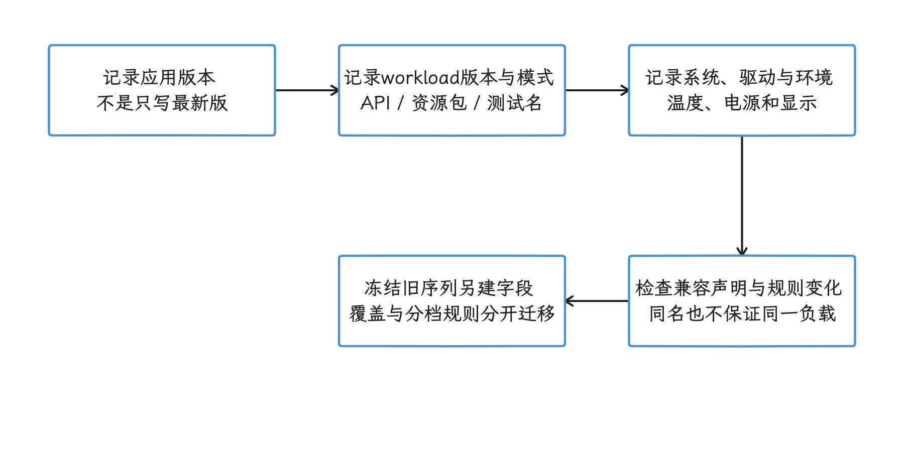

图：分数先绑定应用、测试与运行环境，评分体系变化后另建序列。 没有官方换算依据时不跨大版本折算，也不覆盖旧设备字段。

团队设备实验室还要核对商业许可。3DMark Android 的免费下载仅限非商业用途，专业用户须取得商业许可或适用的媒体许可。PCMark Android 官网为企业、政府和商业用户提供 Professional Edition；Single-Seat License 同一时间只允许一台设备，同时测试多台需要 Site License。个人免费下载和实验室批量测试的使用条件应分别确认。

### 工具分工：先选问题，再选分数

| 要回答的问题 | 首选信号 | 它没有回答什么 |
|---|---|---|
| 单线程通用 CPU 容量怎样 | Geekbench CPU single-core（单核） | App 主线程具体花在 Java、Binder（Android 跨进程通信）、I/O 还是锁等待 |
| 受控工作负载的多线程吞吐怎样 | Geekbench CPU multi-core（多核） | App 是否具备可并行任务、线程池是否合理 |
| GPU Compute（通用计算）容量怎样 | Geekbench GPU（Vulkan / OpenCL） | 图形渲染帧率、合成、触控延迟 |
| 重图形短时性能怎样 | 3DMark 指定图形测试 | 普通 View 或 Compose 页面是否卡顿 |
| 重图形持续性能怎样 | 3DMark Stress Test 的循环曲线 | App 自身的帧生成、资产加载和网络抖动 |
| WebView、视频、文档、图片、数据处理的组合表现怎样 | PCMark Work 3.0 子项 | 单个业务页面的启动或交互时延 |
| 内部存储、外部存储和 SQLite 组合表现怎样 | PCMark Storage 2.0 子项 | 某个文件系统调用、Room 查询或数据库事务的根因 |
| 浏览器前端交互执行路径怎样 | Speedometer 3.1 | 网络速度、服务端耗时、App 内 WebView 的完整链路 |
| 面向大众的设备综合档位怎样 | 安兔兔固定大版本的总分与子项 | 单项资源瓶颈和 App 性能因果 |

分数命名也要带上工具语义。`gpu_score` 这样的字段会把 Geekbench Compute 和 3DMark Graphics 混在一起，建议写成 `gb7_vulkan_compute`、`3dmark_wild_life_v1_score` 和 `3dmark_wild_life_stability`。字段名中的工具、大版本、测试和 API 共同说明分数来自哪套规则。

### Geekbench 分数作为代理变量

代理变量是间接反映目标能力的信号，帮我们提出假设；验证假设还是要靠 App 自身的直接测量。

#### Geekbench 6 的单核分数由什么组成

Geekbench 6 的公开内部文档说明：各工作负载按参考系统归一化，同一整数或浮点分组内取几何均值，再把两组分数按 65% 与 35% 做加权算术平均，分别得到单核和多核综合分。分数翻倍只描述这套固定负载与评分规则下的相对表现，不能推到任意 App 代码。

<!-- gracker-diagram: ch17-07-23-geekbench-score -->
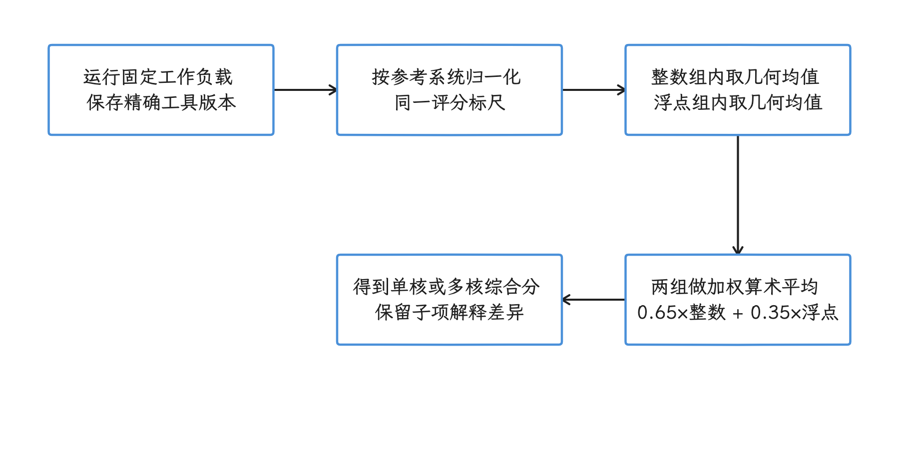

图：归一化后的工作负载先按组取几何均值，再按整数65%、浮点35%算术加权。 单核与多核分别组合；综合分不能直接换算 App 耗时。

下表把公开工作负载映射到 Android 工程问题。表中的“可提出假设”只用于确定下一步测量方向：

| Geekbench 6 工作负载 | 主要资源或算法 | 可提出的 Android 假设 | App 内验证方式 |
|---|---|---|---|
| File Compression（LZ4、ZSTD、AES、SHA1） | 整数、内存访问、压缩与加密指令 | 安装包解压、离线资源解压或同步加密可能受 CPU 限制 | 对 App 使用的压缩库、数据规模和线程模式做 Microbenchmark（Jetpack 微基准测试） |
| Navigation（Dijkstra、OpenStreetMap 数据） | 图算法、分支和内存访问 | 离线路径规划或大型关系图计算可能受单线程容量影响 | 对业务图规模采样，并在目标机型上测端到端耗时 |
| HTML5 Browser | 无界面浏览器中的 HTML 解析、CSS 布局和二维绘制，使用 Gumbo、litehtml 等库 | 网页解析、布局或绘制可能受单线程容量影响；该子项不直接衡量 JavaScript 引擎性能 | 用目标 WebView 版本跑页面 trace；不能把该子项当作 Chrome 或 WebView 分数 |
| PDF Renderer（PDFium） | 文档解析与栅格化 | PDF 首屏或翻页可能受 CPU 和内存共同影响 | 固定 PDF 文件，在 App 使用的 PDF 组件中测首屏和逐页时间 |
| Photo Library / Image Editing | 相册工作负载包含图片编解码、SQLite 和部分 ML（Machine Learning，机器学习）；图像编辑类工作负载覆盖滤镜等处理 | 相册扫描、缩略图生成或编辑可能受 CPU、内存和指令集影响 | 复用业务图片格式、分辨率和模型做 Macrobenchmark 或业务基准 |
| Clang、Text Processing、Asset Compression | 编译、正则、SQLite、纹理及几何资产压缩 | 文本处理、开发工具或图形资源处理流程可能有相近计算特征 | 对业务库直接基准；不要把 Text Processing 等同于 JSON 解析 |

“单核分数影响 JSON 解析”这个判断过于确定。Geekbench 6 跑的是通用工作负载，并未搭载业务自己的 JSON 库、序列化模型和数据规模，只能给出通用单线程容量线索；JSON、protobuf（二进制序列化格式）、XML inflate（从布局 XML 创建 View）、Compose measure/layout（测量与布局） 和 `RecyclerView` bind（把数据绑定到列表项） 仍要分别测量。I/O 等待、锁竞争或 Binder 往返占比高时，单核分数的解释力会更弱。

ARM 设备还可能按运行时能力使用 AES、SHA、FP16、Dot Product、I8MM 等加密、半精度浮点、点积或整数矩阵指令。两个设备的分差有时来自特定指令路径，而业务实现未必走同一条路径。跨 SoC 解释子项时，我们要核对 App 使用的库、`arm64-v8a` 这类目标 ABI（Application Binary Interface，应用二进制接口，例如 `arm64-v8a`）、编译选项和硬件加速路径。

<!-- gracker-diagram: ch17-07-24-proxy-validation -->
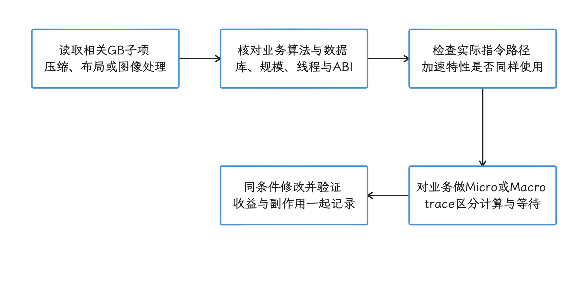

图：工作负载与指令路径只能提出容量假设，业务库和关键路径需要直接测量。 I/O、锁或 Binder 主导时，CPU 分数与业务时延的关系可能很弱。

#### 多核分数的 shared-task（共享任务） 模型

Geekbench 6 相对 Geekbench 5 改用 shared-task 模型，让多个线程协作处理同一批任务，纳入线程协调和共享数据带来的成本。2026 年 7 月 23 日发布的 Geekbench 7 又调整了规则：只有在对应现实任务适合并行时才进入多线程套件，例如其 HTML5 Browser 不进入多线程测试。

所以“App 开八个线程会快多少”这个问题，GB6 和 GB7 的多核分数都直接回答不了。我们先检查任务依赖、可并行比例、调度优先级、线程池拥塞和内存带宽；主线程上的串行关键路径，并不会因多核总分高而自动缩短。

#### Compute 分数的适用范围

Geekbench 6 的 GPU Benchmark 通过 Vulkan 或 OpenCL 运行计算工作负载，并将子项组合成 Compute 分数。它适合为图像处理、部分 ML、视频处理或通用 GPU 计算提出容量假设。

游戏和 Android UI 还涉及顶点与像素着色、光栅化、纹理、内存带宽、SurfaceFlinger 合成、显示刷新和帧调度。Compute 分数没有覆盖从 App 生成帧到屏幕显示的完整流程。我们分析渲染问题时，应改看 3DMark Graphics、Perfetto、FrameTimeline 和 App 自身帧数据。

<!-- gracker-diagram: ch17-07-25-parallel-compute -->
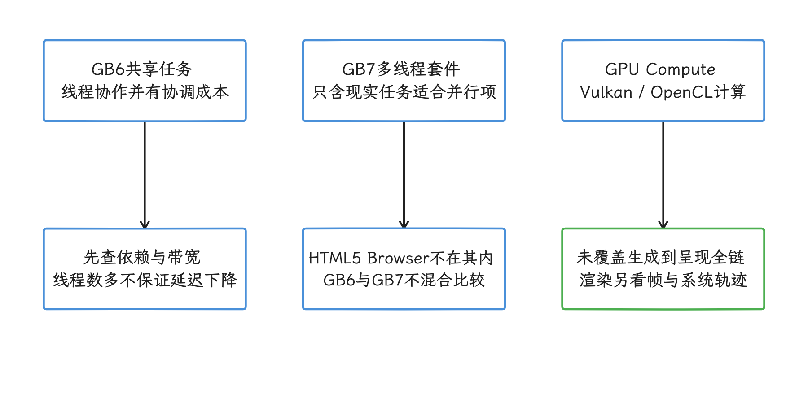

图：共享任务、多核选择规则和 GPU Compute 各有覆盖范围。 总分不能替代 App 的串行关键路径或完整显示管线。

### 3DMark 的峰值、持续性能与温控

#### 选择设备能稳定完成的测试

3DMark Android 会根据设备能力推荐测试，我们要做的是从中挑设备能稳定完成的负载。本项目常见的几种如下：

| 测试 | 适用对象 | 读取结果时的重点 |
|---|---|---|
| Wild Life | 支持 Android 10、Vulkan 1.1 且至少 3 GB RAM 的主流设备 | 短时 Graphics score、平均帧率以及同型号分布 |
| Wild Life Extreme | 在 Wild Life 基础要求上，还需支持 16 级各向异性过滤，并能稳定完成更重的 Vulkan 负载 | 重负载下的性能上限；低帧率本身不代表测试异常 |
| Steel Nomad Light | Android 10+、8 GB RAM、Vulkan 1.1 的高性能移动设备 | 更重的非光追现代图形路径；不满足门槛的设备改用较轻测试 |
| Solar Bay | Android 12+、4 GB RAM，并支持 Vulkan 1.1 ray query 的设备 | ray query 是查询光线与场景相交结果的光追能力；它不覆盖普通设备，也不代表传统栅格化帧率 |
| Sling Shot / Sling Shot Extreme | 旧设备与历史 OpenGL ES 数据 | 只维护历史序列，不与 Wild Life 或新测试换算 |

标准测试、Extreme、Stress 和 Unlimited 模式的结果要分别存储，只留一个 `3dmark_score` 会丢掉模式信息。Wild Life 的 Unlimited 模式离屏运行，使用固定帧时间步，并排除垂直同步和显示分辨率缩放等因素的影响；它适合比较芯片在固定负载下的表现，不能替代游戏实际呈现帧率。

官方发布说明还规定，Wild Life 普通模式在任一区间超过 60 FPS 时显示 `Maxed out`；Sling Shot 和 Sling Shot Extreme 也有相应规则。遇到该状态，应保留原始状态和测试版本，改用工具推荐的更重测试，或另建 Unlimited 序列。不要把它写成 `0`、当作有效的 60 FPS 成绩，或自行补出分数。

<!-- gracker-diagram: ch17-07-26-graphics-modes -->
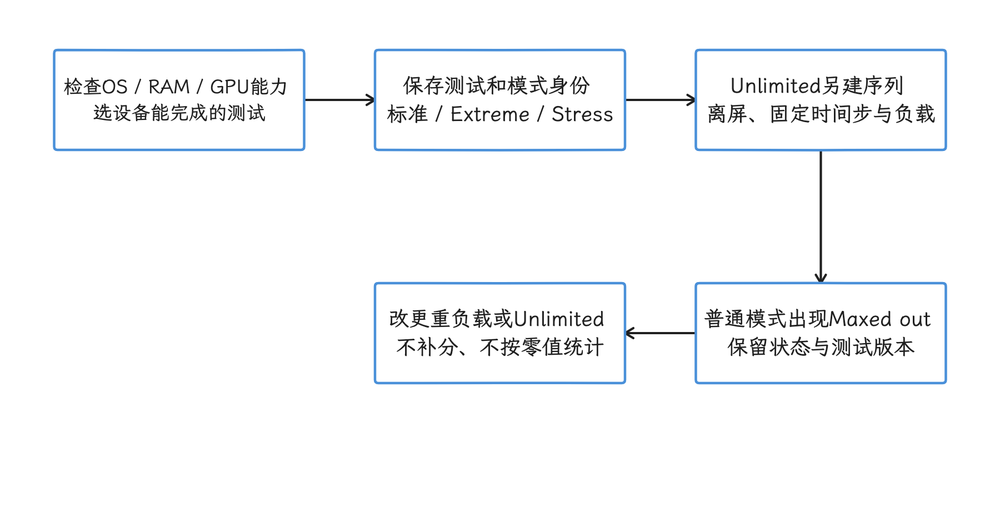

图：先检查测试能力要求，再区分标准、Extreme、Stress 和 Unlimited 结果。 Maxed out 保留原状态，不能填零或伪造60FPS有效成绩。

#### Stability 需要和帧率共同解释

Wild Life 的普通 Benchmark 用于观察短时间高性能；Stress Test 连续运行二十轮，每轮称为一个 loop，用于观察性能和温度随时间的变化。UL 在 PC 版 Stress Test 结果页给出了 Frame Rate Stability 的定义：最低循环平均帧率除以最高循环平均帧率，再乘以 100%；Android Wild Life 的官方说明则更强调二十轮曲线。移动端报告保存应用显示的 stability 和整条曲线即可，PC 页面给出的 97% pass 条件属于 PC 版产品的判断标准，照搬成 App 的产品门槛并不合适。

这个比例有两点容易忽略：

- stability 高但每轮帧率都低，只能说明表现稳定，不能说明性能足够。
- 首轮帧率高、后续循环明显下降时，峰值性能和持续性能要分别评价。

报告至少同时列出最好和最差 loop、stability、每轮帧率曲线和热状态。要解释游戏体验，还要在游戏自身固定场景中采集帧时间、CPU/GPU 频率、功耗和温控事件。

<!-- gracker-diagram: ch17-07-27-stress-results -->
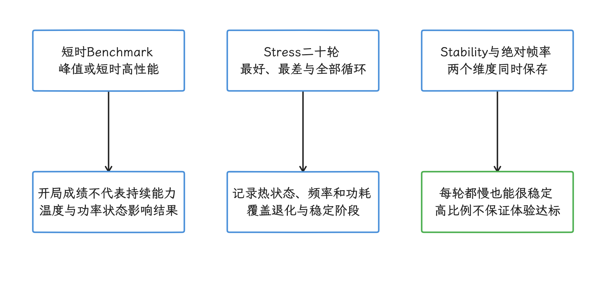

图：二十轮记录最好、最差和变化过程，区分性能水平与稳定程度。 PC产品97%通过条件不能照搬为 Android App 门槛。

#### 热数据的记录方式

平台的 `ThermalManagerService` 接收 Thermal HAL 的温度与节流状态，`PowerManager.getCurrentThermalStatus()` 向应用提供从 `NONE` 到 `SHUTDOWN` 的状态。在 `android-17.0.0_r1` 中，未通过 shell 覆写状态时，`onTemperatureMapChangedLocked()` 取 `TYPE_SKIN` 传感器上报的最大节流等级作为当前 thermal status（温控等级）。`THERMAL_STATUS_NONE` 不能证明 CPU/GPU 没有局部限频，也不能证明设备已回到相同初始温度；限频判断仍需结合各传感器状态与频率曲线。

内核侧以 `android17-6.18-2026-06_r6` 为源码锚点。`/sys` 下的内核设备接口 thermal sysfs 文档说明，`thermal_zone` 暴露当前温度与 trip point（触发温控动作的阈值），cooling device（降频、限流或风扇等冷却执行项） 参与温控。量产设备对传感器名称、可见性和温度标定的实现不同，两个厂商的 `thermal_zone0` 数值直接横向比较没有意义。

做温控测试时，我们更关心同一设备的相对变化：起始表面温度、每轮温度或 thermal status、首轮到稳定轮的性能衰减，以及冷却回基线所需时间。

<!-- gracker-diagram: ch17-07-28-thermal-status-scope -->
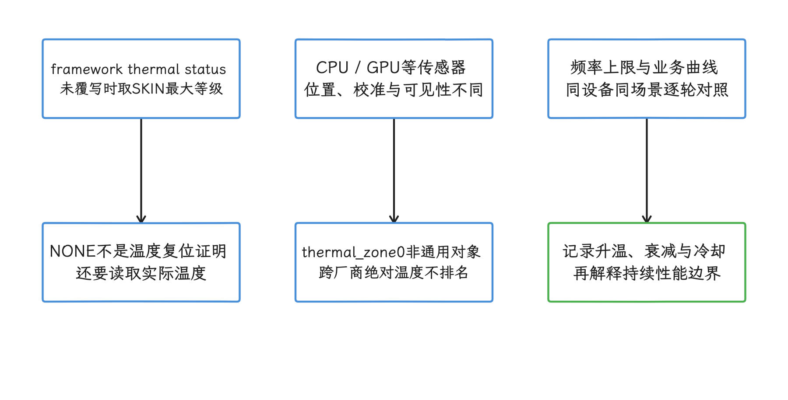

图：当前框架状态、各传感器与实际频率分别保存。 Android17未shell覆写时取SKIN最大等级，NONE不能排除CPU/GPU局部限频。

### PCMark 工作负载与总分

PCMark Android 3.1.4113 是当前应用版本，Work 3.0 包含 Web Browsing、Video Editing、Writing、Photo Editing 和 Data Manipulation；Storage 2.0 覆盖内部存储、外部存储和 SQLite 数据库操作。

3.1.4113 的发布说明还明确了几个兼容与读数边界：应用以 SDK 35 为目标，更新了支持 16 KB 页面大小的库，并修复 Storage 测试不返回最终分数的问题。部分旧调试输出曾把吞吐量 `KB/s` 误标为时延 `ms`；阅读旧日志时要核对输出项与工具版本，不能仅按标签解释为单次 I/O 时延。库已支持 16 KB 也不等于所有 Android 17 设备和测试路径都已验收。

这些子项比总分更接近 Android 业务，但仍需注意实现差异：

- Web Browsing 3.0 使用系统 Android WebView。系统更新后，即使 PCMark 应用版本不变，执行引擎也可能变化，因此要记录 `com.google.android.webview` 或设备实际 WebView provider（提供 WebView 实现的应用包） 的版本。
- Video Editing 3.0 使用 `MediaCodec`、ExoPlayer 和 OpenGL ES 2.0，反映一套固定的媒体处理流程；App 的编解码参数、滤镜和文件格式要另行测量。
- Writing 3.0 使用 Android `EditText` 与 `PdfDocument`，适合作为文档工作负载背景；业务编辑器仍要单独测量。
- Storage 2.0 的 Database 子项使用 SQLite，但 App 的 schema（表、列和约束的结构）、index（索引）、transaction（事务）、WAL（Write-Ahead Logging，预写式日志）、文件系统和缓存状态都会改变结果。

PCMark 3.1 发布说明指出，3.1 与 3.0 总体分数大致可比，同时明确建议在相同 workload 版本间比较。工程回归应遵守更严格的后一句：版本或 workload 变化就切分时间序列。Work 3.0、Storage 2.0 与 Work 2.0、Storage 1.0 同样分开，不放在同一序列里。自 3.0 起，Work 2.0、Work 1.0、Storage 1.0 和 Computer Vision 已停止支持并从应用移除；旧报告只能按原版本解释，不为延续旧序列而安装旧版补测 Android 17 设备。

<!-- gracker-diagram: ch17-07-29-pcmark-paths -->
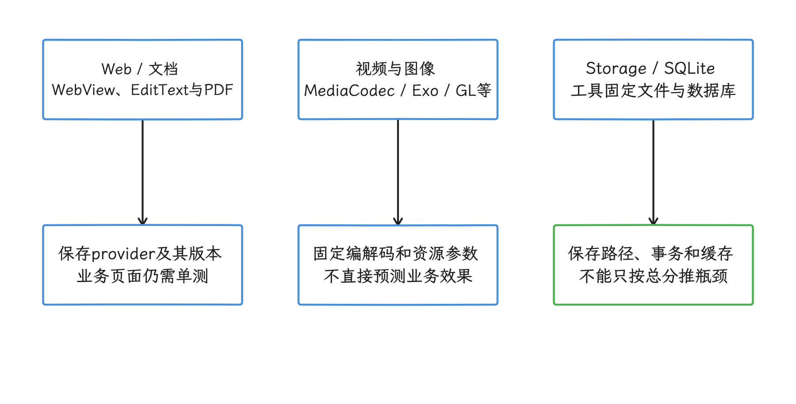

图：Work 与 Storage 子项更接近常见流程，仍绑定具体实现与 workload。 WebView更新会改变引擎；分数不能独立解释业务组件或SQLite根因。

### 存储专项 Benchmark 的协议

存储工具描述的是“这台设备在这套路径、参数和缓存状态下”的 I/O 背景；App 哪个文件、线程或 SQL 慢，一次 `write()` 有没有持久化到闪存，都要另外取证。从分数到业务结论，我们还要补上 App 路径、调用栈、事务、查询计划与用户场景。

#### AndroBench、A1 SD Bench 与现代替代

AndroBench 的 2012 年论文确认，测试覆盖顺序与随机 I/O，以及 SQLite 插入、更新和删除事务的吞吐。公开摘要和两页预览没有给出完整方法学，不能据此确定文件大小、随机块大小或重复次数。A1 SD Bench 的具体模式、测试路径和缓存处理，也应按留存的 APK 与对应版本文档核对，不能从工具名称或旧截图推断。

两者仅用于解释历史报告，不作为 Android 17 新设备库的默认基线。历史结果应附 APK 版本、文件 hash（用于识别文件内容的指纹）、模式和完整参数；缺少文件大小、block size（每次读写的数据块大小）、同步方式或汇总规则时，不与现代工具直接比较。小文件测试还可能主要反映 page cache（内核把近期文件内容保留在内存中的页缓存）、write buffer（暂存待写数据的缓冲区）和设备短时吞吐，不能直接当作闪存的持续性能。

现代设备实验室优先选择协议可审计的工具或业务自建基准：

- CPDT（Cross Platform Disk Test）的固定源码提供文件大小、write buffering（写入缓冲）与 in-memory caching（内存缓存）选项，保存 4 KiB random 读写摘要并导出 CSV。它采用单线程、无并行 I/O 队列的测试路径；不能据此推断高 QD 吞吐，使用前仍要验证该版本能否在 API 37 上正确运行。
- PCMark Storage 2.0 提供内部、外部与 SQLite 的组合 workload，但输出仍是工作负载分数；UFS（Universal Flash Storage，移动设备常用的闪存接口）设备本身的原始吞吐要另测。
- 最能预测真实表现的方案，是在目标 App 实际目录中复用相同文件格式、SQLite schema、事务、同步语义和线程模型。

#### 四类指标与必要参数

IOPS（Input/Output Operations Per Second） 表示每秒完成的 I/O 次数，latency 表示单次操作的等待时间。两者都要连同 block size 和 QD（queue depth，队列中同时等待的请求数）记录。`direct` 表示尽量绕过页缓存，`buffered` 表示经过页缓存；`sync` 语义则说明何时停止计时，例如数据只进入内核缓存，还是等待同步调用返回。

| 指标 | 必填参数 | 可提出的假设 | 不能直接解释 |
|---|---|---|---|
| 顺序读吞吐 | 文件、buffer size、cache 状态、并发 | 大资源连续读取上限 | 大量小文件冷启动 |
| 顺序写吞吐 | 文件、buffer size、direct/buffered、sync 语义 | 下载、导出、批量日志 | 单事务 commit 延迟 |
| 随机读 IOPS/latency | block、范围、QD、线程、分布 | 小块读取与索引背景 | 目录扫描和反序列化 CPU |
| 随机写 IOPS/latency | 上述参数 + 同步频率和预分配 | 数据库日志与元数据更新风险 | 业务事务设计是否合理 |

IOPS 不带 block size 和 QD 没有工程意义。吞吐越高越好，差的轮次表现为数值偏低，多轮报告看中位数与 P10（第 10 百分位）；latency 越低越好，单次操作看 p50、p95 和 p99。MAD（median（中位数） absolute deviation，中位数绝对偏差）描述样本相对中位数的离散程度。只有五轮时分位数还不稳定，宜报告 median、min/max 与 MAD。

<!-- gracker-diagram: ch17-07-30-storage-protocol -->
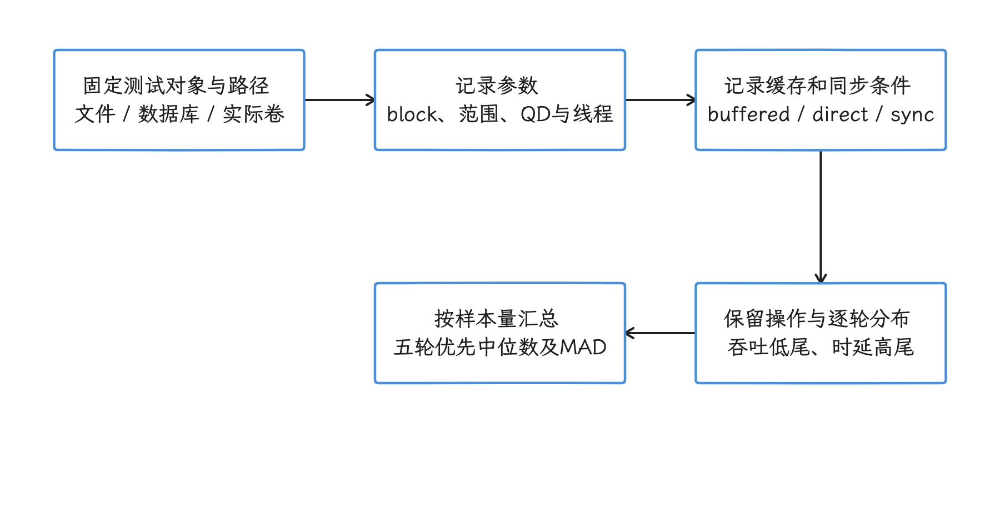

图：路径、块大小、队列、缓存与同步终点共同定义存储结果。 CPDT是单线程无并行队列；历史工具缺参数时不能补造协议。

#### 路径、缓存与持久化语义

| 路径 | Android 17 访问模型 | 结果边界 |
|---|---|---|
| `filesDir` / `cacheDir` / database | App 私有内部存储 | 接近业务私有数据，但仍包含加密、文件系统和内核缓存 |
| `getExternalFilesDir()` | App-specific external（系统分配给该 App 的外部存储目录） | 可能位于共享或可移除卷，不能假设永远可用 |
| MediaStore | 媒体集合、权限与 ContentProvider | 包含 Binder、元数据和介质路径 |
| SAF（Storage Access Framework） | 用户授权的 URI（资源标识符）或 directory tree（目录子树） | 包含 DocumentsProvider（向系统暴露文档的内容提供程序）与底层介质 |
| SD / USB | 卷、文件系统、读卡器和授权 | 不只代表卡片本身 |
| RAM | 内存复制或内存文件 | 不进入闪存排名 |

普通 buffered write 返回时，数据可能还只停留在 page cache 里。`fsync` 同步文件数据及相关元数据；`fdatasync` 同步数据与后续读取所必需的元数据。测试把同步等待计入耗时并检查错误；新建、重命名等操作若要求目录项也持久化，还需按文件系统协议同步父目录。仅同步文件不自动证明整个创建或替换流程在断电后可恢复。

cold read（目标数据不在页缓存）、warm read（目标数据已缓存）和 reboot 后首次读取是三组不同实验；重启也不保证固件、服务或预加载不会改变缓存。`drop_caches` 改变整机缓存状态，需要适当权限或受支持的测试通道，可能影响其他工作；受控冷缓存实验须记录方法与恢复步骤，不混入真实用户场景基线。剩余空间、文件系统 GC、discard、加密、温度、后台扫描和系统更新也要记录。

<!-- gracker-diagram: ch17-07-31-storage-durability -->
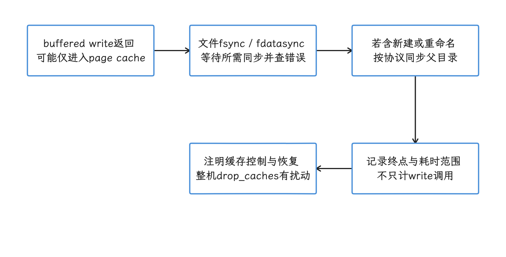

图：分别确定写入返回、文件同步完成和命名操作持久化的计时边界。 同步要检查错误并匹配文件系统协议；冷、热缓存与重启实验分别建基线。

SQLite 分数也使用工具自己的表、索引、journal（事务日志） 和 transaction。业务验证要检查批量写是否放在同一 transaction，并记录 WAL、`synchronous`（写入持久化强度）、checkpoint（把 WAL 内容合并回主数据库）、N+1 查询（一次主查询后又逐行追加查询）、索引和 `EXPLAIN QUERY PLAN`（查看 SQLite 查询计划）。测试用真实数据记录 p50/p95 latency 与实际扫描的行数。

存储 Benchmark 只提供设备背景。Perfetto 的 database/文件系统事件、Matrix IO Canary（辅助定位主线程等 I/O 问题的工具）或 StrictMode（发现主线程磁盘与网络访问的系统诊断机制） 可以给出发生时间和调用位置，再用 A/B 业务测试（保持其他条件一致，比较修改前后）验证效果。比如，先发现设备随机写较慢，再由 trace 定位启动主线程的重复小写入，最后验证改成后台批量写后 P95 回落，才形成较完整的证据链；单张跑分截图做不到。

<!-- gracker-diagram: ch17-07-32-io-causal-loop -->
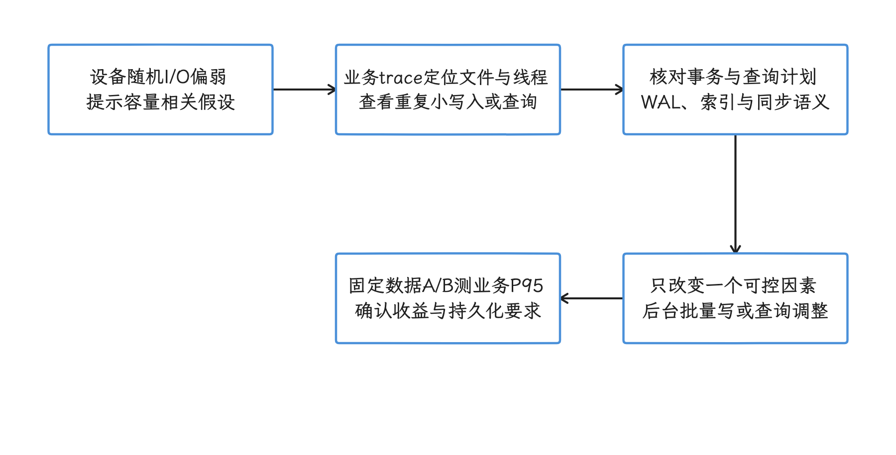

图：从设备代理信号回到实际文件、SQL、线程和事务，再验证修改。 跑分截图不能单独证明某个系统调用或数据库设计造成业务退化。

### 安兔兔总分的沟通定位

既有安兔兔 V11 基线包含 CPU、GPU、MEM（内存） 和 UX（用户交互体验） 等组合测试。官方 V11 公测说明明确写出，V11 因测试项调整与 V10 不可比，并给出 27℃±1℃、电量 80% 以上、亮度 300 nit 的示例测试条件；nit 是屏幕亮度常用单位，1 nit 等于 1 cd/m²。这些条件说明跑分对环境敏感；各团队采用什么电量，按自己的测试规范定即可。

2026 年 10 月 24 日核对的 Android 下载版本为 V12.0.3，配套 3D 资源包同为 V12.0.3。完整测试需要配套的 3D 资源包：官方下载页把标准包标为基于 UE5、适用于 Android 10 及以上且内存至少 8 GB 的设备，精简包标为面向 Android 10 以下设备，并另列 x86 包。Android 17 设备不能仅凭系统版本选择资源包，还要核对内存、架构和对应包的实际可用性；标准、精简和 x86 模式不合并评分。旧 V11 字段继续保留，V12 使用新字段，不把 V11 的分档边界直接搬过去。

若产品、测试和市场已经习惯用安兔兔总分描述设备档位，可以保留总分，但设备字典还要保存大版本和子项。工程排查时，我们从相关子项入手：

- 启动慢优先检查 CPU 单线程、存储和 App 启动 trace。
- 游戏掉帧优先检查 GPU 子项、持续性能和游戏帧时间。
- 数据库慢优先检查存储与业务 SQL，不从 UX 总分推断。
- 后台恢复或内存耗尽优先检查物理内存、进程状态和 App 内存峰值。

两个设备总分相近时，一个可能是 CPU 强、存储弱，另一个是 CPU 弱、GPU 强。总分把不同资源结构压成一个数，会隐藏 App 所依赖的那一维。

<!-- gracker-diagram: ch17-07-33-composite-score -->
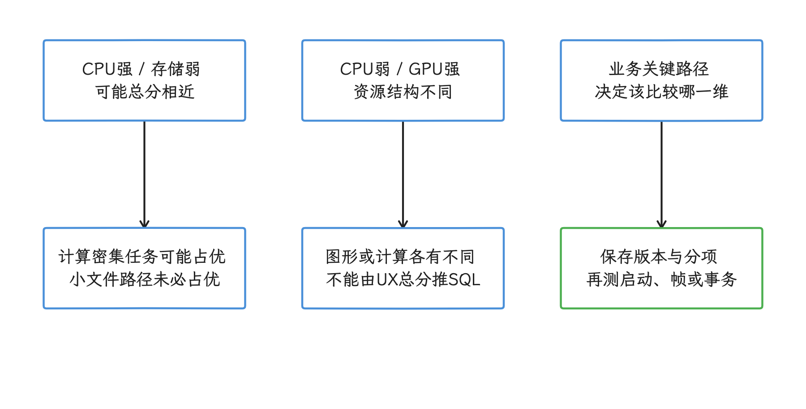

图：综合分只作摘要，工程动作回到相关分项与业务测量。 安兔兔应用、3D资源包、大版本与模式共同决定分数身份。

### Speedometer 与 WebView 实测的分工

Speedometer 3.1 通过模拟用户操作，测量 TodoMVC（一组用不同前端技术实现的待办事项示例应用），以及富文本编辑器、图表和新闻站点等 Web 应用负载的响应性。它的测量范围有限：网络吞吐和 Web Worker（在后台线程执行 JavaScript 的浏览器机制） 中并发异步工作的完整成本都不在其中；官方同样明确说明，它评不出 JavaScript 框架的优劣。

Android 上用 Chrome 跑出的分数描述“这台设备 + 这个 Chrome 版本 + 当前配置”的浏览器路径。App 内 WebView 的 provider、版本、启动方式、缓存、JS bridge（JavaScript 与原生代码之间的调用接口）、页面资源和进程模型都可能不同。要判断 App 的 Web 页面，我们建议补一套受控 WebView 容器，固定 provider 与页面资源，并采集 WebView/Chromium trace。

Speedometer 官方建议使用最新稳定浏览器，配一个不带扩展、历史缓存和自定义设置的干净 profile（独立用户配置），关闭其他标签页和后台程序，保持页面前台，并在两次测试间按需冷却。官方还要求电池供电设备接入充电器。团队若因发热控制而选择拔线，应在报告中标明偏离官方条件，单独建立基线，不与接电结果混比。

<!-- gracker-diagram: ch17-07-34-web-container -->
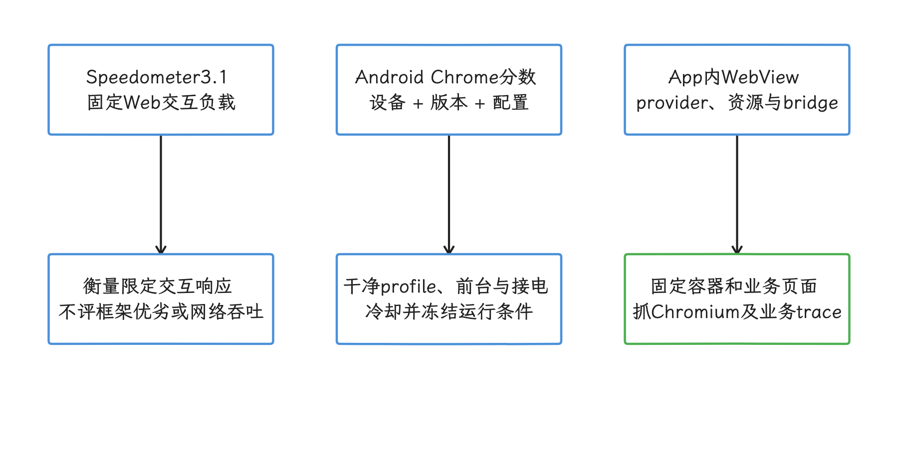

图：浏览器跑分绑定引擎与配置，App WebView 另建受控容器验证。 官方Speedometer要求接电；拔线结果单建基线，网络和异步worker完整成本不在覆盖内。

### Vellamo 的历史数据冻结

Qualcomm 2012 年官方资料把 Vellamo 描述为包含 HTML5 与 Metal 等章节的移动 Benchmark 套件。这份资料能解释旧报告中的字段；它在 Android 17 上是否仍有维护、兼容性或稳定测试规则，则证明不了。

处理旧数据时保留 APK hash、工具版本、Android 版本、设备和原始分数。新设备不再补跑，也不尝试把 Vellamo 分数换算成 Speedometer、Geekbench 或 PCMark 分数。

### Performance Class 的能力下限定位

Android 的 Media Performance Class（MPC，媒体性能等级）自 Android 12 引入，用 CDD（Compatibility Definition Document，Android 兼容性定义文档） 规定能力要求，并由 CTS（Compatibility Test Suite，兼容性测试套件） 验证。API 37 的 `Build.VERSION.MEDIA_PERFORMANCE_CLASS` 从设备属性读取声明值，未声明时返回 0。Jetpack Core Performance 是读取设备性能等级的 Jetpack 库，可以从系统 build 信息或 Google Play services（Google Play 服务组件） 查询兼容等级。

截至 2026 年 10 月 24 日，Android 官方 Performance Class 指南列出的等级为 30、31、33、34、35，没有单列 MPC 32；0 表示未定义。Performance Class 可向前兼容：设备升级到 Android 17 后，仍可能报告它原先满足的 33、34 或 35。指南中的等级列表不等于 API 37 的固定返回值集合；实际分档应读取设备声明并核对对应 CDD，不从 Android 版本号自行推导出“MPC 37”。

| 信号 | 可以表达什么 | 不能表达什么 |
|---|---|---|
| Media Performance Class | CDD/CTS 约束下的媒体、相机、内存、I/O、显示等能力下限 | CPU 综合排名、App 启动 P95、列表慢帧率 |
| Geekbench / 3DMark / PCMark | 固定测试里的 CPU、GPU、工作流和存储代理信号 | 业务代码路径的直接结果 |
| 线上 APM 和 App 基准 | 指定 App 版本与真实用户/受控场景的体验 | 脱离样本分布后的通用硬件排名 |

因此，Performance Class 适合做设备字典中的官方标签，不适合作为唯一档位。服务端要把它和 CPU、GPU、RAM、存储、热稳定性及线上表现组合使用。

<!-- gracker-diagram: ch17-07-35-mpc-capability -->
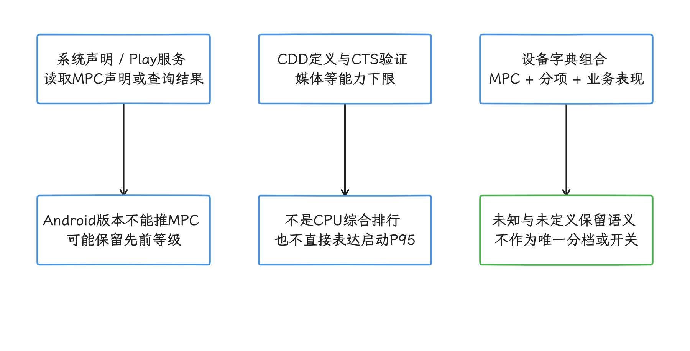

图：MPC、设备跑分与 App 数据三类信号共同描述设备。 系统升级不强制升级MPC；未声明的0不等于最低性能设备。

### 可复现测试规范

下面是一套适合团队设备实验室的起始规范。次数和温度窗口不是 Android 或 Benchmark 厂商规定，可在试运行后按实测方差调整。

#### 记录设备身份

- 设备品牌、市场型号、硬件 SKU（厂商用于区分配置的商品编号）、SoC、RAM、存储容量；同名机型的不同 SoC 或内存版本分开。
- Android 版本、build fingerprint（唯一标识系统构建的字符串）、安全补丁、基带、GPU driver（图形处理器驱动版本）、实际 kernel release（内核版本）。知识库源码锚点是 Android 17 / API 37 / `android-17.0.0_r1` 与 `android17-6.18-2026-06_r6`，测试报告仍应记录量产机的实际构建。
- Benchmark 应用版本、测试名、测试版本、API 或运行模式。Web 测试另记浏览器或 WebView provider 版本。

#### 固定运行条件

- 固定屏幕分辨率、刷新率和亮度；关闭自动亮度。
- 固定充电或放电状态、电量区间、性能/游戏模式、省电模式和散热配件。
- 固定室温与设备摆放；每组开始前等待表面温度回到约定窗口，并记录 thermal status。
- 完成系统更新和应用优化后再测试；关闭无关应用、下载、录屏、日志洪泛和同步任务。
- 需要联网的测试固定接入点与网络条件；不需要联网的负载避免让后台网络成为噪声。

这些 shell 命令用于保存 Android 17 设备的基本身份与热状态快照：

```bash
adb shell getprop ro.build.fingerprint
adb shell getprop ro.build.version.release
adb shell getprop ro.build.version.sdk
adb shell getprop ro.build.version.security_patch
adb shell uname -r
adb shell dumpsys battery
adb shell dumpsys thermalservice
adb shell dumpsys webviewupdate
```

`dumpsys thermalservice` 能显示框架服务掌握的 thermal status 与温度信息，但不同厂商的字段和传感器可见性不同。报告应保存原始输出，不要只提取一个跨设备比较的“CPU 温度”。

#### 重复、取值与作废规则

- 短测试建议预热一轮后至少保留 5 个有效轮次；报告中给出中位数、最小值、最大值和 MAD，以说明典型结果与波动范围。
- 长时间 Stress Test 建议在完整冷却后做至少 3 个独立 session（从冷却、启动到完成测试的一次完整实验），每个 session 保留全部循环曲线。
- 轮次更多时可以报告 P10/P90，即第 10 和第 90 百分位；5 个样本不足以形成稳定的分位数分布。
- 来电、通知弹窗、失去前台、后台安装、系统更新、意外网络切换或测试崩溃都应作废并写明原因。
- 热状态或起始温度不在约定窗口时不并入同一比较组；确认温度复位还要看温度读数本身，`THERMAL_STATUS_NONE` 单独作证不够。

平均值容易被一次异常高分或低分拉动，中位数更适合小样本跑分。任何“回归 3%”的结论都要先和同设备、同版本的自然波动比较。

<!-- gracker-diagram: ch17-07-36-repeat-invalidation -->
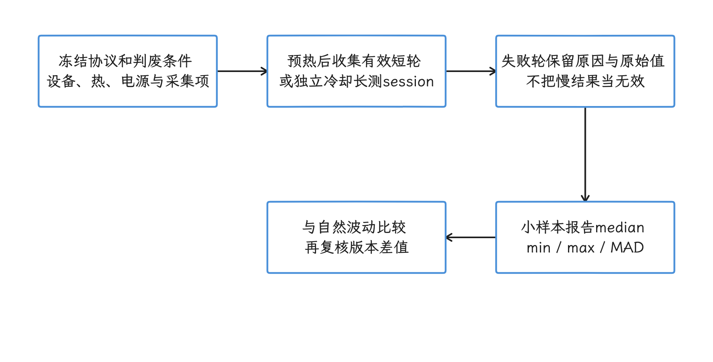

图：先冻结条件与判废规则，再按有效轮报告典型值、波动与原始结果。 五轮不足以稳定估计尾部；性能差但流程有效的轮次不能选择性删除。

### 用分项能力建立机型分层

设备分层指按相近能力把设备分组。我们分别保存 CPU、GPU、存储、内存和持续性能字段，形成能力向量；这些维度可能相关，并不具有统计独立性。只存一个综合档位，后面就无从拆解：

| 维度 | 建议来源 | 线上问题 |
|---|---|---|
| CPU single | GB6 或 GB7 的独立版本序列 | 主线程 CPU 计算、启动中的串行计算 |
| CPU multi | 同一 Geekbench 大版本 | 可并行图片、压缩、媒体或后台批处理 |
| GPU graphics | 3DMark 指定测试与模式 | 游戏、地图、相机特效和重图形页面 |
| GPU compute | Geekbench Vulkan/OpenCL 或业务计算基准 | 图像、部分 ML 与通用计算 |
| Storage | PCMark Storage 2.0 子项与业务 I/O 基准 | 冷启动文件、SQLite、缓存和资源加载 |
| RAM | 物理内存、低内存设备标志和线上采集 | OOM、后台恢复、缓存上限 |
| Thermal | 3DMark Stress 曲线、thermal status 和业务长测 | 游戏、视频、直播的持续性能 |
| MPC | Jetpack Core Performance | 官方能力下限与功能开关参考 |

#### 四档的边界计算

入门、中端、高端、旗舰的边界应从团队已冻结版本的设备样本分布中计算。例如，可在同一国家/渠道覆盖集内按关键维度的 P20、P50、P80（第 20、50、80 百分位）切四档，再由线上数据校正。换 Geekbench 大版本、3DMark 测试或设备覆盖集后，要重新计算边界。这里的性能预算，是每档设备对启动时延、慢帧率、内存等指标设定的上限。

| <span style="white-space:nowrap">档位</span> | 设备能力特征 | 性能预算与产品策略 |
|---|---|---|
| <span style="white-space:nowrap">入门</span> | 一个或多个关键维度位于低分位，常伴随小 RAM 或弱存储 | 核心路径采用最严格预算；默认降低预取、并发、图片规格和高成本效果 |
| <span style="white-space:nowrap">中端</span> | 关键维度覆盖主流下半区 | 维持完整核心功能；对非必要动画、媒体和缓存设置上限 |
| <span style="white-space:nowrap">高端</span> | 关键维度位于主流上半区且持续性能稳定 | 可开放更高质量资源，但仍受线上耗时和内存预算约束 |
| <span style="white-space:nowrap">旗舰</span> | 多个相关维度处于高分位 | 可试验高规格效果；不能因档位高而跳过启动、慢帧、功耗和温控验收 |

分档应围绕业务选择维度。资讯 App 可能重视 CPU single、Storage 和 RAM；游戏更重视 GPU graphics 与 Thermal；离线视频编辑还要加入媒体编解码业务基准。不存在一套对所有 App 都合理的总分权重。

<!-- gracker-diagram: ch17-07-37-capability-vector -->
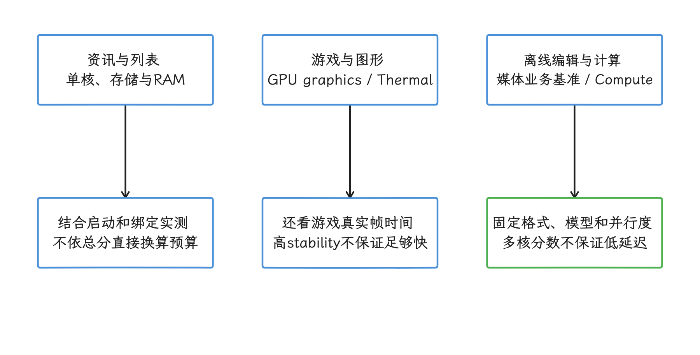

图：在冻结版本覆盖集上按业务相关维度分档，再由线上结果校正。 CPU、GPU、存储与热状态可能相关，分位边界随样本和规则变化。

### 把设备字典连接到线上数据

不建议让每个客户端在线跑 Benchmark，也不建议在每条 APM 事件里上传跑分。团队可以维护版本化设备字典，也就是一张从设备与系统标识映射到能力字段的表。客户端只上报已有标识，分析平台再关联对应字段。

下面的字段模板用于把启动事件与设备字典关联。设备身份来自实际采集，能力档位和 MPC 来自有来源记录的字典项；匹配不到的字段填写 `unknown`。

```text
event: app_start
app_version: <实际应用版本>
device_model: <实际设备型号>
soc: <实际 SoC>
ram_gb: <实际 RAM>
android_sdk: <实际 API level>

device_dictionary_join:
  capability_schema: <已发布的字典规则版本>
  cpu_single_bucket: <字典结果或 unknown>
  gpu_graphics_bucket: <字典结果或 unknown>
  storage_bucket: <字典结果或 unknown>
  thermal_bucket: <字典结果或 unknown>
  mpc: <实际声明或查询结果；无记录时为 unknown>
```

`capability_schema` 让历史事件始终能还原当时的分层规则。设备字典还应区分同型号的 SoC、RAM、存储和区域版本；匹配不上就写 `unknown`，凭市场名称猜会引入错误档位。

#### 关联表背后的混杂因素

按 CPU single 档位比较冷启动 P95 时，还要检查低档设备是否同时具有更慢存储、更小 RAM、旧系统或不同地区网络。分档与启动 P95 同时变化，不能单独证明 CPU 容量限制了启动。

分析时固定 App 版本与启动计算规则，按存储、RAM、Android 版本、网络和地区分别比较，再用区间趋势或 Spearman 秩相关（比较两组数据排序的一致程度）判断关系是否稳定。要证明某段 CPU 代码受限，还要回到 Macrobenchmark、trace 或 Microbenchmark。

<!-- gracker-diagram: ch17-07-38-dictionary-causality -->
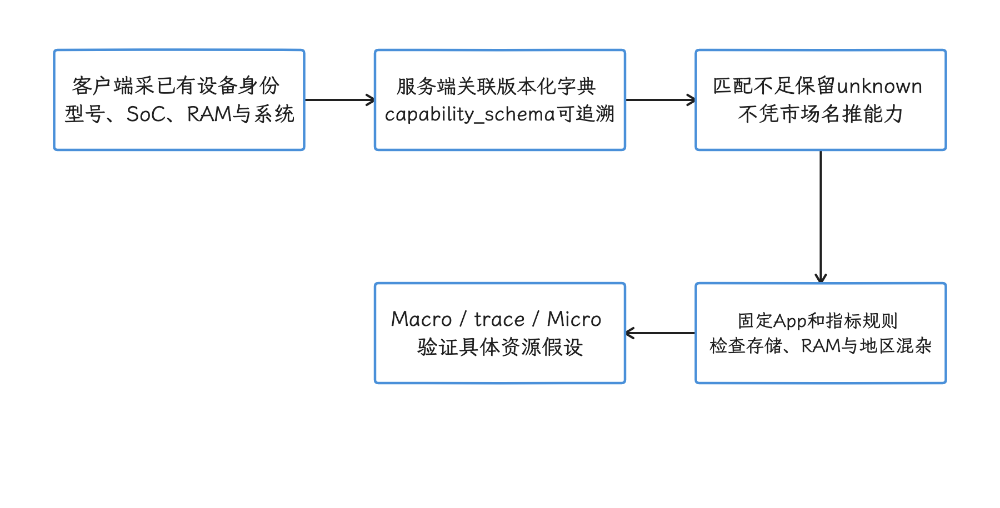

图：设备身份关联有版本的能力字典，未知保留，再分层核对业务关系。 档位与启动一起变化不能单独证明CPU限制；最终回到业务关键路径验证。

#### 灰度、预算和告警

- 灰度发布指先向一小部分用户开放版本。抽样时要覆盖各能力档位；新效果可以从小比例高档设备开始，但向所有符合条件的用户发布前必须覆盖入门档。面向低端优化的版本应优先保证低档样本量。
- 性能预算从真实用户分布和业务目标制定。例如按档位分别约束冷启动 P95、慢帧率、OOM（Out Of Memory，内存耗尽） 率和峰值内存，不从 Geekbench 分数换算毫秒。
- 告警阈值使用同 App 版本、同能力档位的历史波动。Benchmark 版本变化只触发设备字典重算，不直接触发线上性能告警。
- 功能降级由明确能力维度驱动。例如 GPU/thermal 弱时降低实时特效质量，RAM 小时降低缓存；不要用安兔兔总分作为单一开关。

### 相同综合分的两种取向

假设设备 A 的 CPU single 很强、存储随机读写较弱，设备 B 的 CPU single 较弱、存储较强，两者恰好拥有相同综合分。图片解码计算重的 App 可能在 A 上更快；冷启动读取许多小文件的 App 可能在 B 上更快——相同总分下，排序取决于业务吃哪一维资源。

工程报告应从业务关键路径反推资源维度，再选择子项。综合分可以留在摘要中，结论和行动项必须落到相关分项和 App 实测上。

### 历史数据与工具迁移

工具停更、测试项目升级或评分规则改变时，按下面的规则处理：

- 冻结旧序列，保留原始分数、单位、应用版本、测试版本、日期和运行条件。
- 新工具或大版本使用新字段，不覆盖历史分数。
- 厂商没有发布换算公式时，不做经验换算，也不把百分位强行对齐成“等价分数”。
- 分层迁移期并行维护两套设备覆盖率，通过线上指标验证新分档后再切换配置。
- 旧工具只用于解释原报告，不为 Android 17 新设备补跑 Vellamo 等历史项目。

Geekbench 6 到 7、安兔兔 V10 到 V11、PCMark Work 2.0 到 3.0 都应按大版本迁移处理。3DMark 还要在应用版本之外维护测试版本，避免应用自动更新后误判数据已经跨代。

### 测试报告模板

下面的模板用于保存可复现信息和结论的适用范围。`report_id` 中的日期只是命名示例，实际报告要替换为测试日期：

```yaml
report_id: android-benchmark-2026-07-25-001
device:
  brand: ""
  model: ""
  sku: ""
  soc: ""
  ram_gb: null
  storage_gb: null
software:
  android_release: "17"
  api_level: 37
  build_fingerprint: ""
  security_patch: ""
  kernel_release: ""
  gpu_driver: ""
benchmark:
  app_name: ""
  app_version: ""
  test_name: ""
  test_version: ""
  api_or_mode: ""
conditions:
  room_temperature_c: null
  start_surface_temperature_c: null
  battery_percent: null
  charging: null
  brightness_nit: null
  refresh_rate_hz: null
  performance_mode: ""
  thermal_status_start: ""
results:
  warmup_runs: 1
  valid_runs: []
  median: null
  min: null
  max: null
  mad: null
  invalid_runs: []
app_validation:
  metric: ""
  app_version: ""
  scenario: ""
  result: ""
conclusion:
  supported_claim: ""
  unsupported_inference: ""
```

模板中的 `null` 表示尚未填写，提交正式报告前补全必需项；不要把未知值改成 0 或 false。亮度 `nit` 需要校准仪器或有依据的换算，PerfDog 的 Brightness 只是亮度级别，不能直接填入该列。

模板把设备基线与 App 验证分开保存。`supported_claim` 只写当前数据能支持的判断，`unsupported_inference` 主动记录容易被误读的推论。

<!-- gracker-diagram: ch17-07-39-migration-report -->


图：冻结旧序列、并行新覆盖，保存实验身份和业务验证后再切换规则。 null不是零；受支持结论与尚未证明的推论在报告中分别记录。

### 源码与官方资料

- [Geekbench 7 发布说明](https://www.geekbench.com/blog/2026/07/geekbench-7/)
- [Geekbench 当前下载要求](https://www.geekbench.com/download/)
- [Geekbench 6 Benchmark Internals](https://www.geekbench.com/doc/geekbench6-benchmark-internals.pdf)
- [3DMark for Android](https://benchmarks.ul.com/3dmark-android)
- [3DMark Android 应用版本说明](https://support.benchmarks.ul.com/support/solutions/articles/44002142020-3dmark-android-application-release-notes)
- [3DMark Wild Life 概览](https://support.benchmarks.ul.com/support/solutions/articles/44002135593)
- [3DMark Wild Life 系统要求](https://support.benchmarks.ul.com/support/solutions/articles/44002135597-3dmark-wild-life-system-requirements)
- [3DMark Steel Nomad Light 系统要求](https://support.benchmarks.ul.com/support/solutions/articles/44002528073-steel-nomad-light-requirements)
- [3DMark Solar Bay 系统要求](https://support.benchmarks.ul.com/support/solutions/articles/44002466574-3dmark-solar-bay-system-requirements)
- [3DMark Stress Test 结果定义](https://support.benchmarks.ul.com/support/solutions/articles/44002134931-stress-test-result-screen)
- [PCMark for Android](https://benchmarks.ul.com/pcmark-android)
- [PCMark Android 应用版本说明](https://support.benchmarks.ul.com/support/solutions/articles/44002199189-pcmark-for-android-application-release-notes)
- [Speedometer 3.1](https://www.browserbench.org/Speedometer3.1/)
- [Speedometer 3.1 方法说明](https://www.browserbench.org/Speedometer3.1/about.html)
- [Speedometer 3.1 测试说明](https://www.browserbench.org/Speedometer3.1/instructions.html)
- [Speedometer 3.1 测量框架修复说明](https://www.browserbench.org/announcements/speedometer3.1/)
- [安兔兔 V11 公测说明](https://www.antutu.com/doc/135125.htm)
- [安兔兔官方下载](https://antutu.com/download.htm)
- [Qualcomm 2012 Vellamo 资料](https://www.qualcomm.com/news/onq/2012/09/vellamo-mobile-benchmark-suite)
- [Android Performance Class](https://developer.android.com/topic/performance/performance-class)
- [Android `PowerManager` Thermal API](https://developer.android.com/reference/android/os/PowerManager#getCurrentThermalStatus())
- [AOSP `Build.VERSION.MEDIA_PERFORMANCE_CLASS`（android-17.0.0_r1）](https://android.googlesource.com/platform/frameworks/base/+/android-17.0.0_r1/core/java/android/os/Build.java)
- [AOSP `ThermalManagerService`（android-17.0.0_r1）](https://android.googlesource.com/platform/frameworks/base/+/android-17.0.0_r1/services/core/java/com/android/server/power/thermal/ThermalManagerService.java)
- [Linux thermal sysfs（android17-6.18-2026-06_r6）](https://android.googlesource.com/kernel/common/+/refs/tags/android17-6.18-2026-06_r6/Documentation/driver-api/thermal/sysfs-api.rst)
- [AndroBench 论文 DOI](https://doi.org/10.1007/978-3-642-27552-4_89)
- [AndroBench 公开预览（仅第 667–668 页）](https://page-one.springer.com/pdf/preview/10.1007/978-3-642-27552-4_89)
- [CPDT 固定源码](https://github.com/maxim-saplin/CrossPlatformDiskTest/tree/a507cda4f487afc9334e0f02673af34a366961d9)
- [Android SQLite 性能指南](https://developer.android.com/topic/performance/sqlite-performance-best-practices)
- [Linux 文件同步实现（android17-6.18-2026-06_r6）](https://android.googlesource.com/kernel/common/+/refs/tags/android17-6.18-2026-06_r6/fs/sync.c)
- [Linux F2FS 文档（android17-6.18-2026-06_r6）](https://android.googlesource.com/kernel/common/+/refs/tags/android17-6.18-2026-06_r6/Documentation/filesystems/f2fs.rst)

## 参考资料

- [PerfDog 官网](https://perfdog.qq.com/)
- [PerfDog 客户端说明书](https://perfdog.qq.com/article_detail?id=10089&issue_id=0&plat_id=1)
- [PerfDog Jank、BigJank 与 Stutter 说明](https://perfdog.qq.com/article_detail?id=10162&issue_id=0&plat_id=1)
- [PerfDog Android 窗口与 FPS](https://perfdog.qq.com/article_detail?id=10081&issue_id=0&plat_id=1)
- [PerfDog Service 使用说明书](https://perfdog.qq.com/article_detail?id=10143&issue_id=0&plat_id=2)
- [PerfDog Service 指标参数映射表](https://perfdog.qq.com/article_detail?id=10210&issue_id=0&plat_id=2)
- [PerfDog 网络测试说明书](https://perfdog.qq.com/article_detail?id=10241&issue_id=0&plat_id=1)
- [AOSP Android 17 PowerStatsService](https://android.googlesource.com/platform/frameworks/base/+/refs/tags/android-17.0.0_r1/services/core/java/com/android/server/powerstats/PowerStatsService.java)
- [AOSP Android 17 PowerStatsHALWrapper](https://android.googlesource.com/platform/frameworks/base/+/refs/tags/android-17.0.0_r1/services/core/java/com/android/server/powerstats/PowerStatsHALWrapper.java)
- [AOSP Android 17 ThermalManagerService](https://android.googlesource.com/platform/frameworks/base/+/refs/tags/android-17.0.0_r1/services/core/java/com/android/server/power/thermal/ThermalManagerService.java)
- [AOSP Android 17 IThermal AIDL](https://android.googlesource.com/platform/hardware/interfaces/+/refs/tags/android-17.0.0_r1/thermal/aidl/android/hardware/thermal/IThermal.aidl)
- [AOSP Android 17 SurfaceFlinger](https://android.googlesource.com/platform/frameworks/native/+/refs/tags/android-17.0.0_r1/services/surfaceflinger/SurfaceFlinger.cpp)
- [AOSP Android 17 Layer](https://android.googlesource.com/platform/frameworks/native/+/refs/tags/android-17.0.0_r1/services/surfaceflinger/Layer.cpp)
- [Android Thermal mitigation](https://source.android.com/docs/core/power/thermal-mitigation)
- [Android slow rendering 与 FrameTimeline](https://developer.android.com/topic/performance/vitals/render)
- [Android Studio UI jank detection](https://developer.android.com/studio/profile/jank-detection)
- [SoloPi `v1.0.3` release](https://github.com/alipay/SoloPi/releases/tag/v1.0.3)
- [SoloPi 固定源码](https://github.com/alipay/SoloPi/tree/47d12f4904488b9c4bab5db3b0d164a83df36519)
- [SoloPi 性能工具 Wiki](https://github.com/alipay/SoloPi/wiki/Performance)
- [Emmagee `V2.5.1` release](https://github.com/NetEase/Emmagee/releases/tag/V2.5.1)
- [Emmagee 固定源码](https://github.com/NetEase/Emmagee/tree/6a382dffe74b5be6d2de78cb0c640cc67e9ce650)
- [Android MediaProjection 指南](https://developer.android.com/media/grow/media-projection)
- [Linux man-pages fsync 与父目录同步](https://man7.org/linux/man-pages/man2/fsync.2.html)
- [SoloPi 1.0.3 节点构建辅助方法](https://github.com/alipay/SoloPi/blob/47d12f4904488b9c4bab5db3b0d164a83df36519/solopi-app/shared/src/main/java/com/alipay/hulu/shared/node/tree/accessibility/util/AccessibilityUtil.java)
- [SoloPi 1.0.3 补丁签名约定](https://github.com/alipay/SoloPi/blob/47d12f4904488b9c4bab5db3b0d164a83df36519/PATCH_SIGNING.md)
- [Android 16 KB 页面兼容指南](https://developer.android.com/guide/practices/page-sizes)
