# 网络 APM 底层捕获原理

网络 APM（Application Performance Monitoring，应用性能监控）难在采样这一步。一条请求会依次经过业务封装、HTTP 客户端、DNS（把域名解析为网络地址）、socket（操作系统中的网络通信端点）、TLS（保护传输内容的加密协议） 和内核网络栈；WebView、Cronet（Chromium 提供的网络库） 或 C/C++ SDK 还会绕开应用熟悉的 Java 入口。监控图表上的一条“请求耗时”，要先把这一路上发生的事件正确配对，才有诊断价值。

> 源码基线：AOSP `android-17.0.0_r1`（Android 17 / API 37）；内核 `android17-6.18-2026-06_r6`。

OkHttp、Cronet 和 Android Gradle Plugin（AGP，Android 构建插件） 独立发布，版本要用各自渠道核对，从 Android API 级别推不出来。截至 2026 年 8 月 14 日，OkHttp 官方仓库已从 `square/okhttp` 迁移到 `lysine-dev/okhttp`，当前稳定版是 2026 年 6 月 8 日发布的 5.4.0。本文的大段示例固定在已审计的 5.3.0 接口上；5.4.0 仍保留它使用的 `retry（连接故障后的再次尝试）Decision`、`followUpDecision` 和响应事件签名。项目依赖版本不同，仍要按对应源码核对回调语义。

## 1. “无侵入”指业务入口免埋点

“无侵入”通常指业务开发者不必在每个接口旁手写计时代码。采集器仍会进入构建过程或请求执行路径，只是入口集中在客户端工厂、字节码插件或 Native（由 C/C++ 编译的本地代码） 代理里。我们先把各层的典型入口和它们各自答不了的问题列出来：

| 层级 | 典型入口 | 适合采集 | 无法独立回答的问题 |
| --- | --- | --- | --- |
| HTTP 语义层 | OkHttp `Interceptor`（拦截器）、Cronet callback（事件回调） | 路由、方法、状态码、缓存、业务 trace id（跨系统追踪同一次请求的标识） | DNS、建连和 TLS 的准确边界 |
| 客户端事件层 | OkHttp `EventListener`、Cronet metrics（测量结果） | DNS、route/connect、TLS、请求和响应事件 | 未经过该客户端的请求 |
| 构建期插桩层 | AGP Instrumentation API + ASM（修改 class 字节码的访问器库） | `HttpURLConnection` 调用点、封装在依赖中的 Java 请求入口 | Native 静态链接、自定义协议栈、反射或动态加载代码 |
| Native 动态链接层 | 库回调、PLT/GOT Hook（通过动态符号入口拦截函数调用） | libc（C 标准库实现）或动态 TLS 库的调用、返回值和 `errno`（系统调用错误码） | 静态链接、隐藏符号、直接系统调用、HTTP 业务语义 |
| 系统与内核层 | TrafficStats、系统 BPF（在内核中运行受限程序的机制）、受控测试工具 | UID（应用在 Linux 中的身份编号）/socket 流量、RTT（Round-Trip Time，网络往返时延）、重传和内核错误 | TLS 内的 URL、header（请求或响应元数据）和业务请求边界 |

<!-- gracker-diagram: ch17-08-02-coverage-choices -->
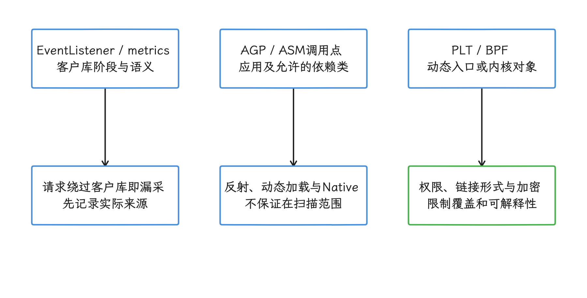

图：先接稳定的客户端回调，再按缺口选择构建插桩或底层观测。 任何一个入口都不能独立覆盖 Java、Native、HTTP 与内核全部语义。

这些层看到的对象并不重合。HTTP 请求、DNS 查询、建连尝试和 socket 之间没有一一对应关系：一次调用可能复用连接，也可能解析一次域名后并行尝试多个地址；HTTP/2 和 HTTP/3 还允许不同请求通过各自的 stream（连接内的独立逻辑数据流） 共享连接，HTTP/3 用的 QUIC 则是基于 UDP、内置加密与多路复用的传输协议。所以我们设计采集 schema（样本的字段结构） 时，只放一个 `attempt` 数组是不够的，重试和多路复用很快会让它失真；trace（跨服务串起同一次请求的调用轨迹） id 也要记清它对应 HTTP 的哪一层。

更稳妥的结构包含四条相互关联的记录：

- `call`：业务发起的一次客户端调用，是最外层生命周期。
- `dns_span`：一次域名解析区间，可出现零次或多次。
- `route_attempt`：对某个 IP、端口和 proxy（代理服务器） 的一次连接尝试。
- `exchange`：一轮实际发送的 HTTP request/response。重定向、鉴权挑战和部分故障恢复都会产生新 exchange。

关联键要从同一客户端实例内的事件里取；按时间窗口猜，容易把并发请求配错。底层 socket 数据还原不出可靠的 HTTP/2 stream 或 QUIC stream 时，就只保留连接维度的关联，并把可信度写进样本。

<!-- gracker-diagram: ch17-08-03-four-records -->
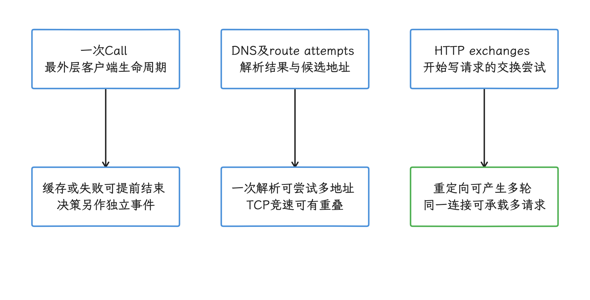

图：Call、DNS、route attempt 与 HTTP exchange 分别建记录并保留关联证据。 纯缓存可零 exchange；复用可有 exchange 而无新 route，多路复用不分摊连接指标。

## 2. OkHttp：事件时间线与请求语义分开采

OkHttp 主通道上，我们把 `EventListener`（按阶段通知网络事件的监听器） 和两类 `Interceptor` 组合起来用：

- `EventListener` 记录代理选择、DNS、连接、TLS、请求写入、响应读取、缓存与失败事件。
- 应用拦截器每个 `Call` 执行一次，适合生成 request id（请求关联标识）、业务路由和最终响应语义；缓存命中也会经过它。
- 网络拦截器按网络 exchange 执行，可看到发往网络的 request、连接和中间 response；纯缓存命中不会经过它。

Interceptor 一侧没有 `dnsStart`、`connectStart` 或 `secureConnectStart` 这类阶段事件；网络拦截器离传输层更近，看到的仍是一整段 exchange，拆不出 DNS、TCP 和 TLS。原始 request 用回调参数 `call` 的 `request()` 取；重定向或鉴权后发到网络上的 wire request，则要从 `requestHeadersEnd(call, request)` 取。我们把语义层与事件层用 `Request.tag()` 里的 request id 关联，id 本身不含用户信息或业务内容。

### 2.1 先读懂事件序列的四个例外

OkHttp 5.3.0 的 `EventListener` 源码把事件顺序写得很明确，我们先把四个例外记牢：

1. 连接复用时，代理选择、DNS 和 connect 事件可能全部缺席。
2. retry 与 follow-up（重定向、鉴权等后续请求）——前者是连接故障后的再次尝试，后者是重定向、鉴权等触发的后续请求——会重复产生事件序列。`requestFailed`、`responseFailed` 和 `connectFailed` 出现后，整个 `Call` 仍可能继续。
3. `Expect: 100-continue` 会先等服务端允许再发送 request body，因此 body 事件可能落在 response headers 事件之间；duplex body（请求和响应可同时传输的双工 body） 还允许两边交错传输。
4. 除取消外，当前事件通常顺序发生；`canceled` 可以与其他回调并发，甚至可能晚于 `callEnd`。后续版本还可能并发尝试多条 route。

还有一个容易遗漏的版本点：OkHttp 4.3 以前，`responseHeadersStart` 在“客户端准备读取 header”时就过早触发；4.3 起调整了触发位置。按本文使用的 5.3.0 与 5.4.0 实现，它在 `readResponseHeaders()` 返回后触发，HTTP/1.1 此时已读完一个 header block。这个回调给不出精确的首字节时间；遇到临时响应时，最终响应的起点单凭这一次回调定不下来。后文按这一触发位置计算观测值。`requestHeadersEnd(call, request)` 的签名从 OkHttp 3.9 就存在，但不同版本的响应回调语义要按各自源码核对。

<!-- gracker-diagram: ch17-08-05-event-exceptions -->
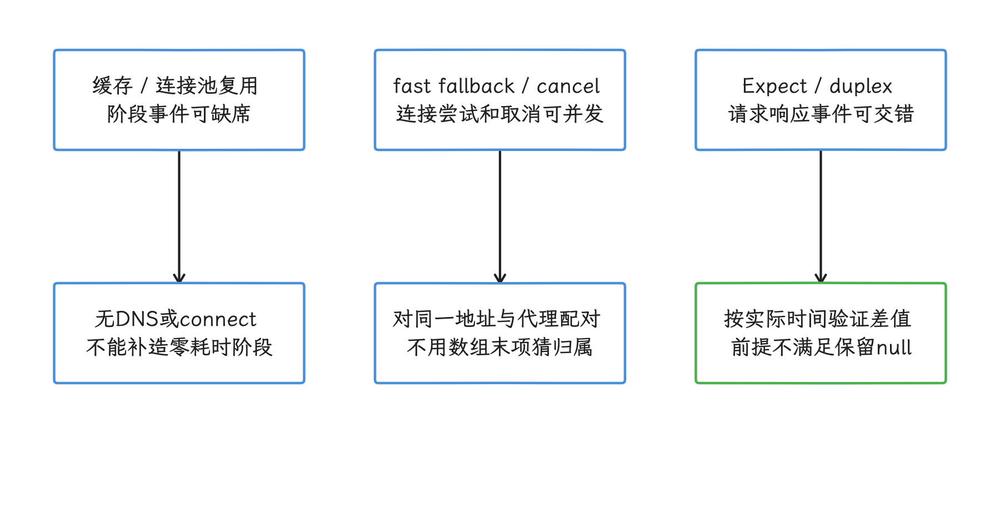

图：事件序列会因复用、并发建连、临时响应或双工传输改变。 失败回调不一定终止 Call；取消还可能晚于成功终止。

<!-- gracker-diagram: ch17-08-06-headers-boundary -->
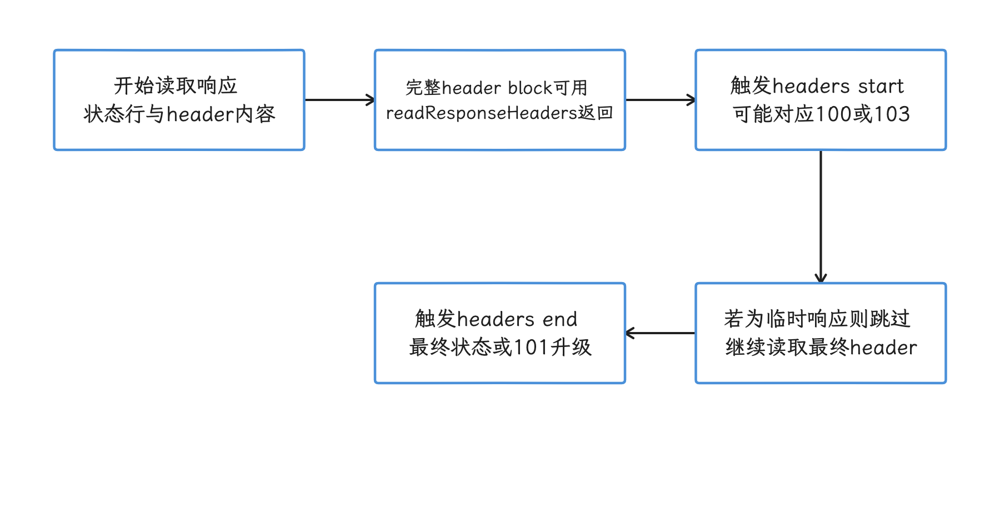

图：本文版本先完成一次 header block 读取，再触发 responseHeadersStart。 首次 block 可能是临时响应；这个回调不能提供精确首字节时间。

### 2.2 一份不会覆盖 retry/follow-up 的核心实现

下面的 Kotlin 代码展示 per-call listener，也就是每个 `Call` 独占一个监听器实例。它按事件顺序维护状态并生成快照。为了让关注点留在事件配对上，`NetworkDimensions` 代表项目自己的脱敏字段转换器；`NetworkMetricSink.enqueue()` 只把快照放入内存队列，不在回调线程做序列化或 I/O。

```kotlin
data class DnsSpan(
    val host: String,
    val startNs: Long,
    var endNs: Long? = null,
    var addressCount: Int? = null,
)

data class RouteAttempt(
    val address: String,
    val proxy: String,
    val connectStartNs: Long,
    var secureStartNs: Long? = null,
    var secureEndNs: Long? = null,
    var connectEndNs: Long? = null,
    var protocol: String? = null,
    var failure: String? = null,
    var failureNs: Long? = null,
    var connectionAcquiredNs: Long? = null,
)

data class HttpExchange(
    val index: Int,
    var requestHeadersStartNs: Long? = null,
    var requestHeadersEndNs: Long? = null,
    var requestBodyStartNs: Long? = null,
    var requestBodyEndNs: Long? = null,
    var responseHeadersStartNs: Long? = null,
    var responseHeadersEndNs: Long? = null,
    var responseBodyStartNs: Long? = null,
    var responseBodyEndNs: Long? = null,
    var requestBytes: Long? = null,
    var responseBytesReadByApp: Long? = null,
    var route: String? = null,
    var statusCode: Int? = null,
    var protocol: String? = null,
    var requestIsDuplex: Boolean = false,
    var hasExpectContinue: Boolean = false,
    var requestFailure: String? = null,
    var responseFailure: String? = null,
    var retryPlanned: Boolean? = null,
    var followUpPlanned: Boolean? = null,
    var connectionReused: Boolean? = null,
)

data class CallMetric(
    val callId: String,
    val callStartNs: Long,
    val callEndNs: Long,
    val terminalFailure: String?,
    val cancelObservedBeforeTerminal: Boolean,
    val cacheOutcome: String?,
    val dns: List<DnsSpan>,
    val routes: List<RouteAttempt>,
    val exchanges: List<HttpExchange>,
)

interface NetworkMetricSink {
    /** 只能把独立快照放入内存队列；入队后不得修改，序列化和 I/O 在后台完成。 */
    fun enqueue(metric: CallMetric)
}

interface NetworkDimensions {
    /** 返回值不得包含原始 query、动态 path 标识或未裁剪的网络地址。 */
    fun route(url: HttpUrl): String
    fun host(domainName: String): String
    fun address(address: InetSocketAddress): String
    fun proxy(proxy: Proxy): String
}

class NetworkMetricEventListenerFactory(
    private val sink: NetworkMetricSink,
    private val dimensions: NetworkDimensions,
    private val clock: () -> Long = System::nanoTime,
) : EventListener.Factory {
    override fun create(call: Call): EventListener =
        NetworkMetricEventListener(sink, dimensions, clock)
}

private class NetworkMetricEventListener(
    private val sink: NetworkMetricSink,
    private val dimensions: NetworkDimensions,
    private val clock: () -> Long,
) : EventListener() {
    private val lock = Any()
    private val callId = UUID.randomUUID().toString()
    private var callStartNs = 0L
    private var cancelObserved = false
    private var cacheOutcome: String? = null
    private var nextExchangeConnectionReused: Boolean? = null
    private val dns = mutableListOf<DnsSpan>()
    private val routes = mutableListOf<RouteAttempt>()
    private val exchanges = mutableListOf<HttpExchange>()

    private fun currentExchange(): HttpExchange =
        exchanges.lastOrNull()
            ?: HttpExchange(index = 0).also(exchanges::add) // 保留异常序列，便于审计

    private fun openRoute(addressKey: String, proxyKey: String): RouteAttempt? {
        return routes.asReversed().firstOrNull {
            it.address == addressKey &&
                it.proxy == proxyKey &&
                it.connectEndNs == null &&
                it.failure == null
        }
    }

    override fun callStart(call: Call) {
        synchronized(lock) { callStartNs = clock() }
    }

    override fun dnsStart(call: Call, domainName: String) {
        val hostKey = dimensions.host(domainName)
        synchronized(lock) {
            dns += DnsSpan(hostKey, clock())
        }
    }

    override fun dnsEnd(
        call: Call,
        domainName: String,
        inetAddressList: List<InetAddress>,
    ) {
        val hostKey = dimensions.host(domainName)
        synchronized(lock) {
            dns.asReversed()
                .firstOrNull { it.host == hostKey && it.endNs == null }
                ?.apply {
                    endNs = clock()
                    addressCount = inetAddressList.size
                }
        }
    }

    override fun connectStart(
        call: Call,
        inetSocketAddress: InetSocketAddress,
        proxy: Proxy,
    ) {
        val addressKey = dimensions.address(inetSocketAddress)
        val proxyKey = dimensions.proxy(proxy)
        synchronized(lock) {
            routes += RouteAttempt(
                address = addressKey,
                proxy = proxyKey,
                connectStartNs = clock(),
            )
        }
    }

    override fun secureConnectStart(call: Call) {
        synchronized(lock) {
            routes.asReversed()
                .firstOrNull { it.connectEndNs == null && it.failure == null }
                ?.secureStartNs = clock()
        }
    }

    override fun secureConnectEnd(call: Call, handshake: Handshake?) {
        synchronized(lock) {
            routes.asReversed()
                .firstOrNull { it.connectEndNs == null && it.failure == null }
                ?.secureEndNs = clock()
        }
    }

    override fun connectEnd(
        call: Call,
        inetSocketAddress: InetSocketAddress,
        proxy: Proxy,
        protocol: Protocol?,
    ) {
        val addressKey = dimensions.address(inetSocketAddress)
        val proxyKey = dimensions.proxy(proxy)
        synchronized(lock) {
            openRoute(addressKey, proxyKey)?.apply {
                connectEndNs = clock()
                this.protocol = protocol?.toString()
            }
        }
    }

    override fun connectFailed(
        call: Call,
        inetSocketAddress: InetSocketAddress,
        proxy: Proxy,
        protocol: Protocol?,
        ioe: IOException,
    ) {
        val addressKey = dimensions.address(inetSocketAddress)
        val proxyKey = dimensions.proxy(proxy)
        synchronized(lock) {
            openRoute(addressKey, proxyKey)?.apply {
                failure = ioe.javaClass.name
                failureNs = clock()
            }
        }
    }

    override fun connectionAcquired(call: Call, connection: Connection) {
        synchronized(lock) {
            val newRoute = routes.asReversed().firstOrNull {
                it.connectEndNs != null &&
                    it.failure == null &&
                    it.connectionAcquiredNs == null
            }
            nextExchangeConnectionReused = newRoute == null
            newRoute?.connectionAcquiredNs = clock()
        }
    }

    override fun requestHeadersStart(call: Call) {
        synchronized(lock) {
            // 每次 wire request 都新建 exchange。不能用 responseBodyEnd 判断上一轮，
            // 因为 requestFailed/responseFailed 后不一定出现 responseBodyEnd。
            exchanges += HttpExchange(
                index = exchanges.size,
                requestHeadersStartNs = clock(),
                connectionReused = nextExchangeConnectionReused,
            )
            nextExchangeConnectionReused = null
        }
    }

    override fun requestHeadersEnd(call: Call, request: Request) {
        val route = dimensions.route(request.url)
        val requestIsDuplex = request.body?.isDuplex() == true
        val hasExpectContinue =
            request.header("Expect").equals("100-continue", ignoreCase = true)
        synchronized(lock) {
            currentExchange().apply {
                requestHeadersEndNs = clock()
                this.route = route
                this.requestIsDuplex = requestIsDuplex
                this.hasExpectContinue = hasExpectContinue
            }
        }
    }

    override fun requestBodyStart(call: Call) {
        synchronized(lock) { currentExchange().requestBodyStartNs = clock() }
    }

    override fun requestBodyEnd(call: Call, byteCount: Long) {
        synchronized(lock) {
            currentExchange().apply {
                requestBodyEndNs = clock()
                requestBytes = byteCount
            }
        }
    }

    override fun requestFailed(call: Call, ioe: IOException) {
        synchronized(lock) {
            currentExchange().requestFailure = ioe.javaClass.name
        }
    }

    override fun responseHeadersStart(call: Call) {
        synchronized(lock) {
            // 记录回调时刻；它可能对应临时响应，不能标作最终响应的首字节。
            currentExchange().responseHeadersStartNs = clock()
        }
    }

    override fun responseHeadersEnd(call: Call, response: Response) {
        synchronized(lock) {
            currentExchange().apply {
                // OkHttp 5.3.0 / 5.4.0 已在内部跳过 100、102..199。
                responseHeadersEndNs = clock()
                statusCode = response.code
                protocol = response.protocol.toString()
            }
        }
    }

    override fun responseBodyStart(call: Call) {
        synchronized(lock) { currentExchange().responseBodyStartNs = clock() }
    }

    override fun responseBodyEnd(call: Call, byteCount: Long) {
        synchronized(lock) {
            currentExchange().apply {
                responseBodyEndNs = clock()
                responseBytesReadByApp = byteCount
            }
        }
    }

    override fun responseFailed(call: Call, ioe: IOException) {
        synchronized(lock) {
            currentExchange().responseFailure = ioe.javaClass.name
        }
    }

    // OkHttp 5.3.0 可直接记录客户端的决定；兼容旧版时删掉这两个 override，
    // 由相邻 exchange 和 response.priorResponse 推导，并标低可信度。
    override fun retryDecision(call: Call, exception: IOException, retry: Boolean) {
        synchronized(lock) { currentExchange().retryPlanned = retry }
    }

    override fun followUpDecision(
        call: Call,
        networkResponse: Response,
        nextRequest: Request?,
    ) {
        synchronized(lock) {
            currentExchange().followUpPlanned = nextRequest != null
        }
    }

    override fun cacheHit(call: Call, response: Response) {
        synchronized(lock) { cacheOutcome = "hit" }
    }

    override fun cacheMiss(call: Call) {
        synchronized(lock) { cacheOutcome = "miss" }
    }

    override fun canceled(call: Call) {
        synchronized(lock) { cancelObserved = true }
    }

    override fun callEnd(call: Call) = finish(null)

    override fun callFailed(call: Call, ioe: IOException) =
        finish(ioe.javaClass.name)

    private fun finish(terminalFailure: String?) {
        val snapshot = synchronized(lock) {
            CallMetric(
                callId = callId,
                callStartNs = callStartNs,
                callEndNs = clock(),
                terminalFailure = terminalFailure,
                cancelObservedBeforeTerminal = cancelObserved,
                cacheOutcome = cacheOutcome,
                dns = dns.map(DnsSpan::copy),
                routes = routes.map(RouteAttempt::copy),
                exchanges = exchanges.map(HttpExchange::copy),
            )
        }
        try {
            sink.enqueue(snapshot)
        } catch (_: Exception) {
            // APM 故障不能穿透到 OkHttp 回调。
        }
    }
}
```

这份实现把 DNS、route 和 exchange 分开保存，并在每个 `requestHeadersStart` 新建 exchange，`requestFailed` 或 `responseFailed` 后再恢复时，下一轮就不会覆盖前一轮。`connectEnd` 与 `connectFailed` 依靠 address、port 和 proxy 找回 route；`secureConnectStart` 没有地址参数，将来若并发多条 TLS route，监听器只能保留原始时间线并标记配对歧义，凭“最近一个 attempt”补出的确定关系是假的。`cancelObservedBeforeTerminal` 只记录终止快照生成前是否见过取消事件；晚于 `callEnd` 的 cancel 出现时，已经成功的 call 仍是成功的。

状态修改使用 per-call 私有锁，只保护几次字段读写，锁内不做 I/O、不打日志、不调用户回调。OkHttp 要求所有事件回调快速返回、不得抛异常、不得修改参数或再次调用客户端。`NetworkDimensions` 的四个方法要有明确的时间上限，尽量少分配对象，不带外部副作用，也不抛异常：host 走 allowlist（只允许预先批准的值） 或分段归一化，address 用进程内秘密密钥算单向摘要或取合规 IP 前缀，proxy 只返回类型和脱敏后的 endpoint（接口端点） key（端点标识）。采集器自身的异常也要隔离在回调之外。

注册必须使用 `eventListenerFactory(...)`：

```kotlin
val client = OkHttpClient.Builder()
    .eventListenerFactory(
        NetworkMetricEventListenerFactory(
            sink = metricSink,
            dimensions = networkDimensions,
        )
    )
    .build()
```

这样每个 `Call` 都有独立状态；`eventListener(listener)` 会在多个并发调用间复用同一个实例，只适合没有 per-call 可变字段的监听器。

<!-- gracker-diagram: ch17-08-07-collector-state -->
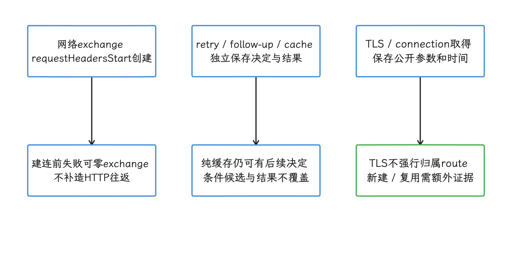

图：只有 wire headers start 创建 exchange，决策与缓存事件单独保存。 TLS 无地址参数，连接取得也不足以证明最近一次新建连接被采用。

<!-- gracker-diagram: ch17-08-09-budget-snapshot -->
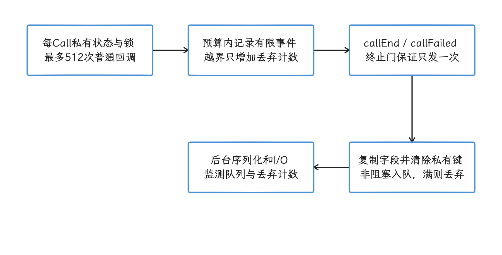

图：普通事件共享有限预算，耗尽后冻结字段，终止仍生成一次快照。 丢弃计数影响统计可信度；已入队 DTO 按约定不再修改。

<!-- gracker-diagram: ch17-08-08-private-correlation -->
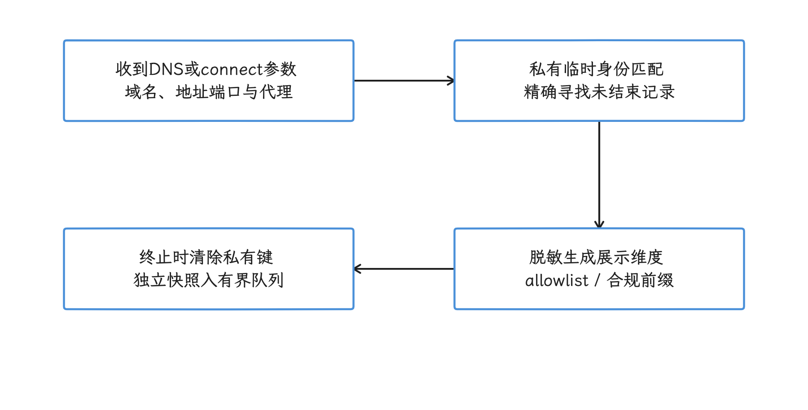

图：回调参数用于当前 Call 内配对，脱敏维度只进入有限快照。 前缀和摘要可能碰撞；私有原始键不进入日志或上报，终止时清除。

<!-- gracker-diagram: ch17-08-10-request-id-order -->
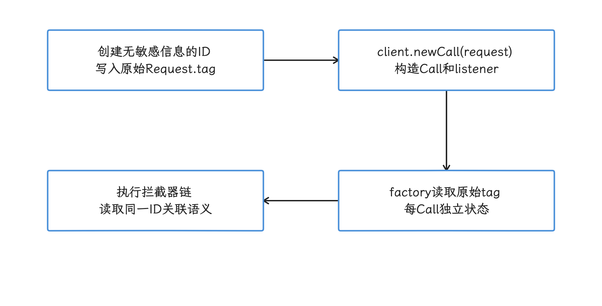

图：先设置 tag，再 newCall 创建 listener，执行时拦截器读取同一标识。 拦截器临时生成的 tag 无法反向传给已创建的 factory 状态。

### 2.3 Interceptor 只做它能证明的事

应用拦截器适合建立 request sample 外壳：

- 从业务路由注册表取得 low-cardinality route name，也就是取值数量有限、不会把每个动态 URL 都变成新维度的路由名。
- 生成 request id，通过 `Request.tag()` 传给 listener；只有服务端需要时才放入 header。
- 记录最终响应码、`priorResponse` 链、缓存语义和业务错误码。
- 记录已知的 request/response content length；未知长度保留 `null`。

网络拦截器适合观察每个 wire exchange，拿它读 body 来“顺便采样”则行不通：one-shot（只能发送一次）、duplex 和流式 body 可能无法重放，提前 `string()` 或复制整个 buffer 还会改变内存、时序和 backpressure（下游读取速度反过来限制上游发送的机制）——下游读取速度反过来限制上游发送的机制。我们确需统计字节时，用 forwarding sink/source（转发数据的同时计数的包装器） 在转发途中计数；内容采集仍按第 7 节的允许清单执行。OkHttp 的 `responseBodyEnd(byteCount)` 已给出“返回给应用的字节数”，提前 close 时该值小于资源总长度，这是有效状态，只是没有读完。

<!-- gracker-diagram: ch17-08-04-listeners-interceptors -->
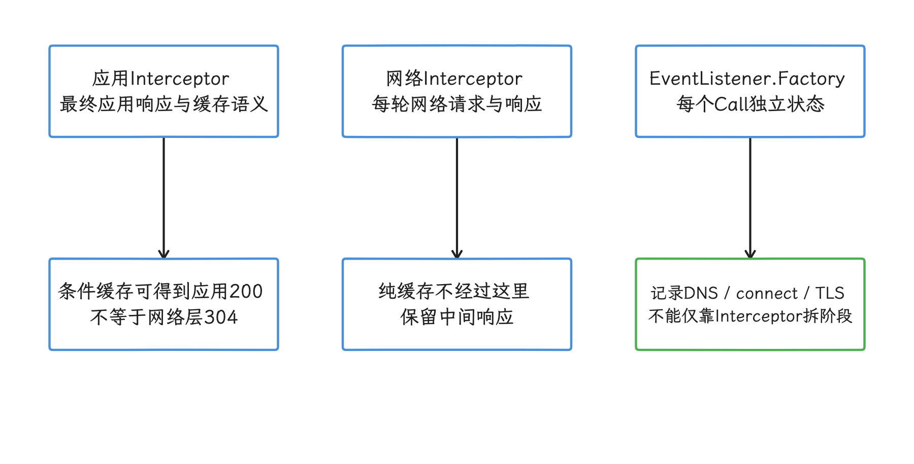

图：应用语义、网络 exchange 与阶段回调由不同入口采集。 request id 在 newCall 前设置，factory 与拦截器才可读取同一 tag。

<!-- gracker-diagram: ch17-08-11-body-byte-boundary -->
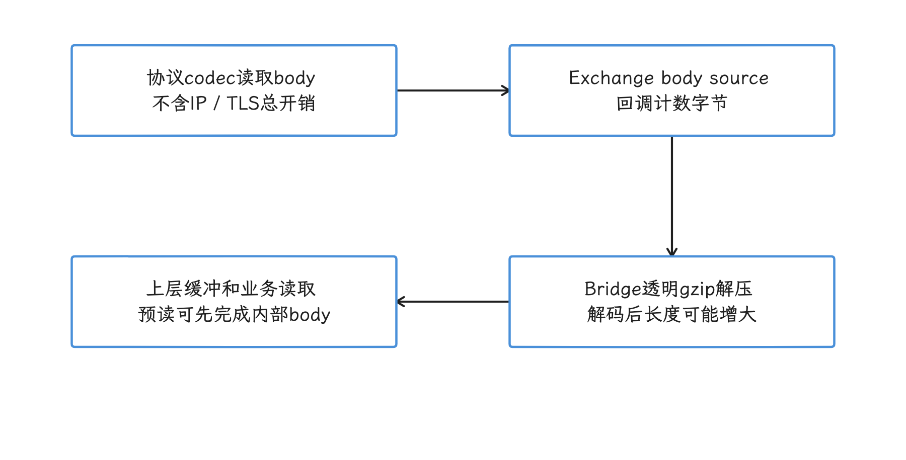

图：内部 body source 计数在透明 gzip 解压之前，缓冲预读又早于业务逐字节消费。 回调字节不是 IP/TLS 总字节，也不等于业务已消费量；不得提前读取 body 采样。

## 3. 指标模型：先定义计时边界，再计算差值

### 3.1 call、DNS、route 与 exchange 字段

| 记录 | 关键字段 | 说明 |
| --- | --- | --- |
| `call` | `call_id`、route、method、start/end、terminal error、cache outcome | `callEnd` 包含调用方延迟读取 response body 的时间 |
| `dns_span` | host pattern、start/end、address count | 自定义 DNS、缓存或重定向可能产生不同序列 |
| `route_attempt` | IP 前缀、port、proxy type、connect/TLS 时间、failure | IP 必须按隐私策略裁剪；不要把它等同 HTTP retry |
| `exchange` | wire route、request/response 时间、status、protocol、failure、follow-up | 重定向和鉴权 response 也要保留 |

`attempt_count` 这个名字过于含糊，我们把它拆成 `route_attempt_count`、`exchange_count`、`retry_decision_count` 和 `follow_up_count`。连接复用的请求可以有 exchange，却没有 route attempt；一次 DNS 结果也可能对应多个地址尝试。

`network_type` 同样要按会变化的量来存。蜂窝与 Wi‑Fi 切换、VPN 或 QUIC connection migration（连接迁移，即连接在地址或网络改变后继续使用）——连接在地址或网络改变后继续沿用——都可能发生在一次请求期间。至少记录 call 开始和结束时的 network handle/type（Android 网络对象标识与网络类型）；能监听默认网络变化时，再追加 transition（切换事件） 事件。VPN 下看不到底层网络，就写 `unknown`，别靠猜。

<!-- gracker-diagram: ch17-08-12-network-transitions -->
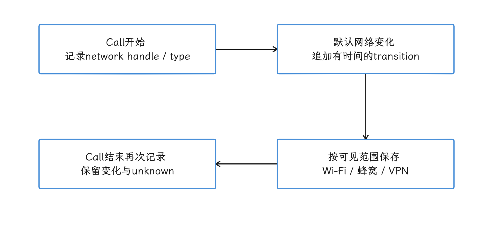

图：开始、切换和结束状态按时间记录，不能用一条静态网络类型覆盖整次请求。 VPN 底层网络不可见时保留 unknown；迁移细节由客户端证据确认。

### 3.2 OkHttp 阶段差值

TTFB（Time to First Byte）要的是“首字节到达”这个时刻。`EventListener` 的响应回调达不到这一精度：在 OkHttp 5.3.0 与 5.4.0 的 `CallServerInterceptor` 中，`responseHeadersStart` 在一次 `readResponseHeaders()` 返回后触发；HTTP/1.1 已经读完状态行和一个 header block。它可能对应 `100 Continue`、`103 Early Hints` 或最终响应，字段命名要体现这一点，直接叫“最终响应 TTFB（Time to First Byte，首字节时间）”会出错。

下表保留回调能证明的区间。`responseHeadersStart` 与 `responseHeadersEnd` 均指采集器收到回调的时刻：

| 指标 | 算法 | 正确解释 |
| --- | --- | --- |
| DNS | `dnsEnd - dnsStart` | 客户端 DNS 实现的阻塞区间；可能来自缓存或自定义 DNS |
| Transport connect | `connectEnd - connectStart` | Socket 建立到协议可用的总区间；HTTPS 下包含 TLS |
| Pre-TLS transport | `secureConnectStart - connectStart` | 直连时接近 TCP connect；有 HTTP proxy 时还可能包含隧道协商 |
| TLS | `secureConnectEnd - secureConnectStart` | TLS 握手区间 |
| Request headers | `requestHeadersEnd - requestHeadersStart` | 客户端写 request header 的区间；数据仍可能在缓冲区中 |
| Request body | `requestBodyEnd - requestBodyStart` | 客户端写 body 的区间；没有 body 时为空 |
| Exchange response-header wait | `responseHeadersStart - requestHeadersStart` | 从开始写 request 到首次 header block 可用回调；包含发送、等待与该 block 的读取处理 |
| Post-write response wait estimate | `responseHeadersStart - sendEnd` | 请求写入结束回调到首次 header block 可用回调；不保证请求已经发上网络 |
| Header callback interval | `responseHeadersEnd - responseHeadersStart` | 从首次 header block 可用到最终响应 header 回调；可能包含等待后续响应的时间 |
| Response body consumption | `responseBodyEnd - responseBodyStart` | 应用读取或关闭 body 的窗口，不等于纯下载时间 |

HTTPS 下 `connectEnd` 发生在 `secureConnectEnd` 之后，`connectStart → connectEnd` 已经含了 TLS，再当 TCP 握手用、再与 TLS 相加都会算错。直连 HTTPS 可把 `connectStart → secureConnectStart` 作为 TCP 近似；经过 HTTP proxy 时，这段还混着 CONNECT 隧道协商——代理先为客户端和 HTTPS 目标建立字节通道——所以只能叫 pre-TLS transport。

<!-- gracker-diagram: ch17-08-13-connect-tls-overlap -->
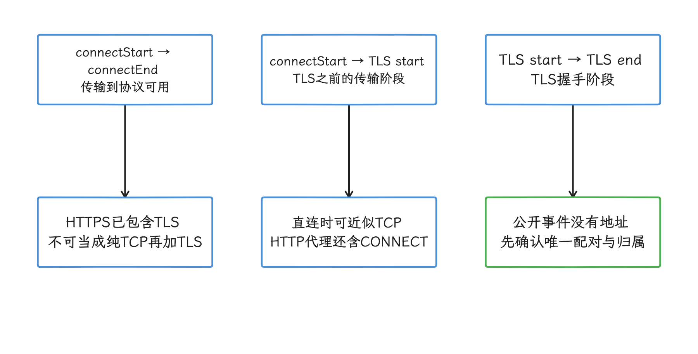

图：同一条 HTTPS route 的 transport 总区间包含 TLS，代理隧道还会影响 pre-TLS。 仅在事件可唯一配对且确属同一路由时计算；不能把 connect 与 TLS 重复相加。

`sendEnd` 有 body 时取 `requestBodyEnd`，无 body 时取 `requestHeadersEnd`。post-write response wait estimate 要满足三个条件：

- 已核对依赖版本的回调实现；本文的计时位置对应 5.3.0 与 5.4.0，4.3 以前的过早触发行为要另行核对。
- `sendEnd` 存在，且 `responseHeadersStart >= sendEnd`。
- request 不是 duplex，也没有 `Expect: 100-continue` 导致的事件交错。

条件不满足时，`post_write_response_wait_ms` 记 `null` 并写明缺失或交错原因；把负数取绝对值或强行归零，都会掩盖协议行为。条件满足时，我们拿到的也只是上述回调差值，把它当精确的“发完请求到响应首字节”还缺依据。

<!-- gracker-diagram: ch17-08-14-header-wait-estimate -->
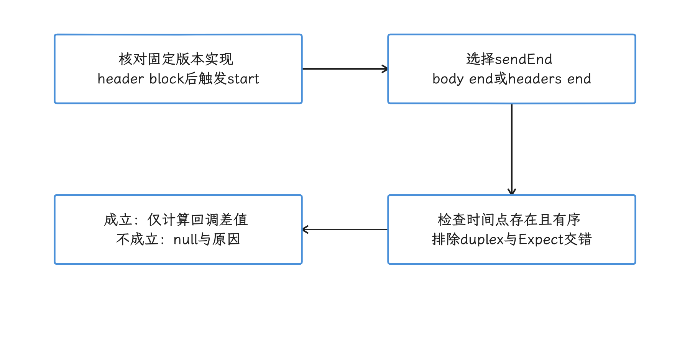

图：先验证版本、sendEnd 与事件交错，再保留可解释的 header 回调差值。 这不是精确 TTFB；负数不取绝对值、不强行归零。

同一 exchange 可能先收到 `100 Continue` 或 `103 Early Hints`。这两个版本在内部跳过 `100` 和 `102..199` 后，才用最终响应调用一次 `responseHeadersEnd`；`101 Switching Protocols` 则保留为协议升级响应。因此示例不从 `responseHeadersEnd` 计数临时响应，也不把 `responseHeadersStart` 重标为最终响应起点。仅靠这些公开回调，临时响应数量与最终响应首字节时间都应留空；需要逐个 header block 时，要增加能观察该阶段的客户端探针并验证其版本行为。

<!-- gracker-diagram: ch17-08-15-informational-response -->
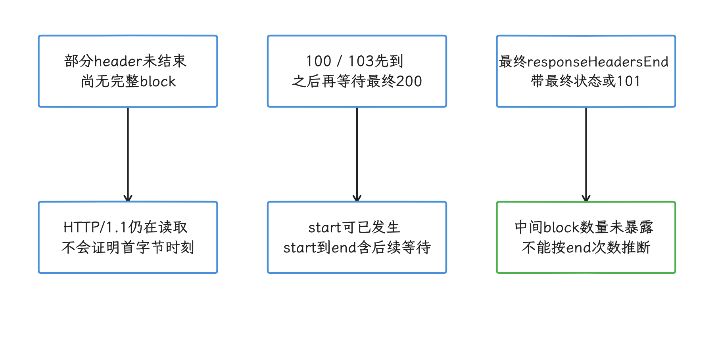

图：首次 header start 可对应临时响应，最终 header end 才带最终响应状态。 100及102至199由内部跳过，101升级保留；公开回调不能统计所有临时 block。

“Server Wait”也不适合直接作为这些端侧差值的名称。写入、缓冲、网络 RTT（在恢复既有连接时不额外等待完整往返即可发送早期数据）、服务端排队与执行和 header 处理都可能包含其中。要拆出后端耗时，就要借助服务端自报的 `Server-Timing`（服务端通过响应 header 报告的耗时）、记录跨服务调用轨迹的分布式 trace，或服务端日志，并校验时钟与 request id。

排查回调触发位置时，可以用受控 HTTP/1.1 服务先发状态行和部分 header，暂不发结束空行；再测试完整 `103` 后延迟最终 `200`。前者能检查 `responseHeadersStart` 是否等待完整 header block，后者能检查 start 与 end 是否对应不同的响应。不要用只有单个 `200`、一次性写完 header 的样例验证 TTFB 语义。

<!-- gracker-diagram: ch17-08-16-body-window -->
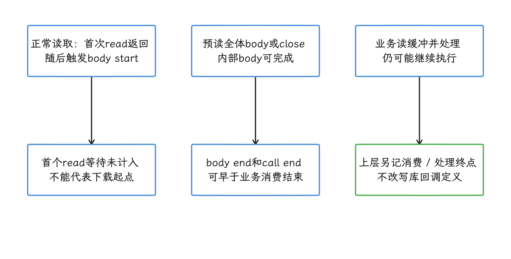

图：内部回调、上层消费与业务处理有不同完成边界。 正常读取时 start 在首个阻塞 read 返回后触发；零长度或未读关闭也可补发 start，回调差值不等于完整下载时间。

### 3.3 空字段也是结论

| 现象 | 常见解释 | 存储方式 |
| --- | --- | --- |
| 没有 DNS/connect/TLS | 连接池复用、缓存命中，或请求尚未走到该阶段 | `null`，另存 reuse/cache 状态 |
| 一个连接服务多个 call | HTTP/2 或 HTTP/3 多路复用 | socket 指标保留连接维度，禁止复制到每个请求后求和 |
| `responseBodyEnd` 很晚 | 应用延迟读取、流式处理、backpressure 或提前 close | 标为 consumption window（应用读取或关闭 body 的时间窗），并同时记录已读字节 |
| `callEnd` 很晚 | `Call` 要等 response body 消费完成 | 与“收到最终 response headers”分开显示 |
| DNS 为 0 ms | 客户端或系统缓存快速返回 | 保留 0；不要改为空 |

<!-- gracker-diagram: ch17-08-17-null-zero -->
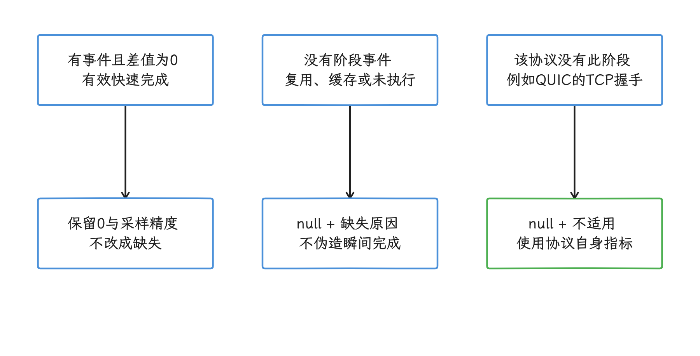

图：有观测的零时长、没有阶段和不适用是三种状态。 连接级统计不能复制给每个复用请求后相加；流式协议另建生命周期。

另一类不适合套一次性 HTTP 下载模型的是持续流、WebSocket upgrade（把 HTTP 连接升级为 WebSocket） 和 duplex RPC（请求与响应可同时传输的远程调用），它们应改用 stream 生命周期、首消息、消息间隔、backpressure 和关闭原因这类字段。

## 4. 弱网、重试与 follow-up 的识别

弱网分析的要领是保留失败路径，并把重复事件区分开来，别都叫重试：

- 多次 `connectStart` 表示多个 route attempt，可能来自地址回退，也可能来自类似 Happy Eyeballs 的 fast fallback（类似 Happy Eyeballs：让 IPv6 与 IPv4 连接尝试短暂错开并可能重叠）——IPv6 与 IPv4 的连接尝试短暂错开、可能重叠。
- `connectFailed` 只说明该 route 失败；只要还有 route，整个 `Call` 可以继续。
- `retryDecision(retry = true)` 是 OkHttp 5.3 及 5.4 连接故障恢复决定的直接依据。
- `followUpDecision(nextRequest != null)` 表示即将处理重定向、401/407 鉴权、408 或 503 等 follow-up。
- 多次 `requestHeadersStart` 表示多个 wire exchange，原因还要结合 retry/follow-up 决定和中间状态码。
- `requestFailed` 与 `responseFailed` 都可能被恢复，见到它们时先别把 call 标成失败。

同一域名的 IPv6 与 IPv4 地址可能被依次尝试，fast fallback（主实现不可用时启用的后备实现） 还可能让连接尝试重叠。route 配对要用 address、port、proxy 和事件参数去对，靠数组末项猜会配错；已有 API 定不下唯一配对时，上传原始顺序、`pairing_confidence = low（配对可信度低）` 和有限字段即可。

看板至少分开展示：

- `call_total_ms`：用户看到的整次调用生命周期。
- `route_failure_overhead_ms`：失败 route 覆盖的时间并集。并发 attempt 的时间有重叠，直接相加会重复计时。
- 每个 exchange 的 response-header wait 与 post-write response wait estimate。
- `final_exchange_header_wait_ms`：最终应用响应对应的 exchange 的 header 回调等待值；仍不表示该响应的精确首字节时间。
- `redirect（重定向）_or_auth_overhead_ms`：follow-up 前的中间 exchange 时间。

“只取最终 attempt 的 server wait”会丢掉连接复用、重定向和请求写入后重试等情况。最终 response 属于 exchange；route attempt 可能早已结束，当前 call 也可能没有发生建连。定位原因时，要用同一层级的事件。

<!-- gracker-diagram: ch17-08-19-overhead-scopes -->
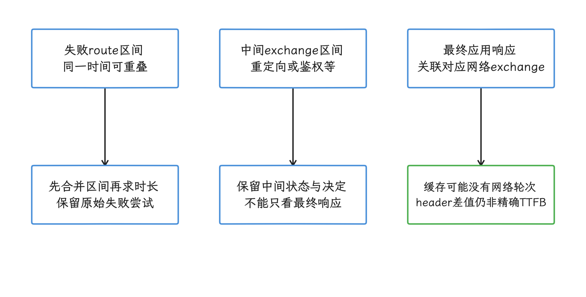

图：失败 route 的时间并集与中间 HTTP exchange 开销分别统计，最终响应归到 exchange。 并发区间直接求和会重复计时，最终 Call 也可能没有新建连接。

排查时我们按下面的顺序找线索：

- DNS span 超时或失败，且后续 route 未开始：先看解析器、DoH（DNS over HTTPS，通过 HTTPS 发送 DNS 查询）/系统 DNS 和网络切换。
- route attempt 失败、IP 或 proxy 切换：看地址可达性、TCP/代理/TLS 错误。
- post-write response wait estimate 高：先核对 header block 与缓冲语义，再结合 RTT 与服务端 trace 判断等待来自哪里。
- body consumption 高：结合传输字节、吞吐、应用读取间隔和下行丢包判断。

<!-- gracker-diagram: ch17-08-18-route-retry-followup -->
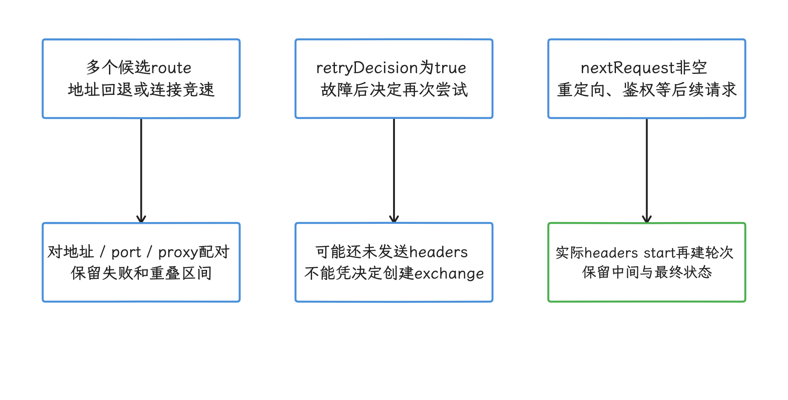

图：连接尝试、故障恢复决定与后续 HTTP 请求分别计数。 多个 connectStart 不等于多次 HTTP 重试，单个失败也不等于 Call 失败。

<!-- gracker-diagram: ch17-08-20-diagnostic-path -->
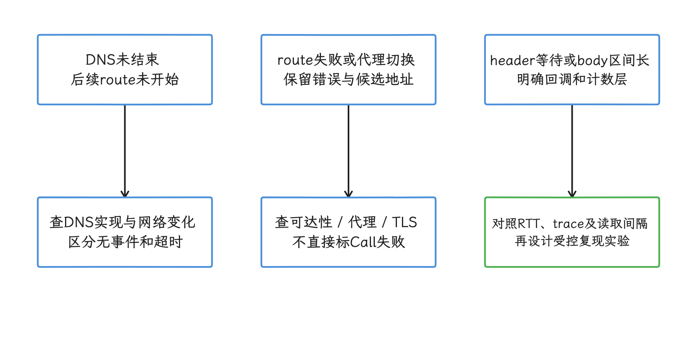

图：先按解析、传输或 exchange 阶段定位，再与网络和服务端证据交叉验证。 端侧等待包含缓冲、网络和服务端，不能直接归因为服务端执行慢。

## 5. `HttpURLConnection` 与三方 SDK：在调用点插桩

`java.net.URL` 与 `HttpURLConnection` 的 API 定义在 libcore（Android 的 Java 核心库实现）里，又在 boot classpath（系统启动时加载的核心 class 路径） 上，应用改不动它。我们让构建插件改写应用或依赖的 class 字节码，把这些 API 的调用导向采集桥接层。

AGP 8.0 已移除旧 Transform API。截至 2026 年 8 月 14 日，AGP 9.x 迁移路线仍要求通过 `androidComponents` 下的 Instrumentation API 与 `AsmClassVisitorFactory` 修改或检查字节码。下面的代码按每个 build variant（构建变体，例如 debug 或 release） 注册 ASM visitor：

```kotlin
androidComponents {
    onVariants(selector().all()) { variant ->
        variant.instrumentation.transformClassesWith(
            UrlConnectionVisitorFactory::class.java,
            InstrumentationScope.PROJECT,
        ) { params ->
            params.includePrefixes.set(listOf("com.example."))
        }
        variant.instrumentation.setAsmFramesComputationMode(
            FramesComputationMode.COMPUTE_FRAMES_FOR_INSTRUMENTED_METHODS,
        )
    }
}
```

ASM visitor 会逐条访问 class 中的方法指令；AGP 随后为受影响方法重算 stack map frame（JVM 验证字节码时使用的栈与局部变量类型信息），也就是 JVM 验证字节码时要用的栈与局部变量类型信息。默认用 `PROJECT`，只处理当前项目的 class。官方 API 限定库模块只能插桩本地项目类；应用与测试模块才可选择 `ALL`，把依赖类纳入范围。启用 `ALL` 时，通过 `isInstrumentable()` 的精确包名前缀排除 APM runtime（采集器运行时代码）、生成代码和不兼容依赖。

下面的 visitor 把实例调用替换成静态桥接调用。`URL` receiver（实例方法的接收对象） 原本在 operand stack（执行字节码时暂存操作数的栈） 上，替换后成为静态方法的第一个参数，因此无需额外插入 `DUP` 或局部变量。

```kotlin
private val replacements = mapOf(
    "openConnection()Ljava/net/URLConnection;" to
        Hook("openConnection", "(Ljava/net/URL;)Ljava/net/URLConnection;"),
    "openConnection(Ljava/net/Proxy;)Ljava/net/URLConnection;" to
        Hook(
            "openConnection",
            "(Ljava/net/URL;Ljava/net/Proxy;)Ljava/net/URLConnection;",
        ),
    "openStream()Ljava/io/InputStream;" to
        Hook("openStream", "(Ljava/net/URL;)Ljava/io/InputStream;"),
)

override fun visitMethodInsn(
    opcode: Int,
    owner: String,
    name: String,
    descriptor: String,
    isInterface: Boolean,
) {
    val hook = if (opcode == Opcodes.INVOKEVIRTUAL && owner == "java/net/URL") {
        replacements[name + descriptor]
    } else {
        null
    }

    if (hook != null) {
        super.visitMethodInsn(
            Opcodes.INVOKESTATIC,
            "com/example/apm/ApmUrlHook",
            hook.name,
            hook.descriptor,
            false,
        )
    } else {
        super.visitMethodInsn(opcode, owner, name, descriptor, isInterface)
    }
}
```

三个 method descriptor（编码参数与返回类型的方法签名） 必须分别匹配；只 Hook（拦截并转到自定义实现） 无参 `openConnection()` 会漏掉代理重载和 `openStream()`。`ApmUrlHook` 所在包必须从插桩范围排除，否则桥接方法再次调用 `URL.openConnection()` 会递归。

<!-- gracker-diagram: ch17-08-22-receiver-stack -->
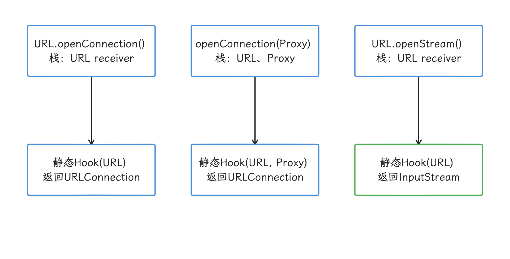

图：把 URL 实例调用重写为带 URL 首参数的静态桥接调用，保持栈中参数顺序。 无参、Proxy 重载和 openStream 分别匹配；桥接包必须排除以防递归。

桥接层可包装 `URLConnection`、input stream 与 output stream，记录公开 API 能证明的时刻和字节数。`connect()` 返回并不等价于“纯 TCP 完成”，`getInputStream()` 又可能同时触发建连、写请求和读 response header。`HttpURLConnection` 没有 OkHttp 那样的 DNS/TLS 回调，几个 Java 方法的时间点拼不出完整的协议阶段；需要 DNS、TLS 或重试细节时，只能结合实现可用的回调、受控 Native 观测或服务端 trace。

<!-- gracker-diagram: ch17-08-23-public-url-boundary -->
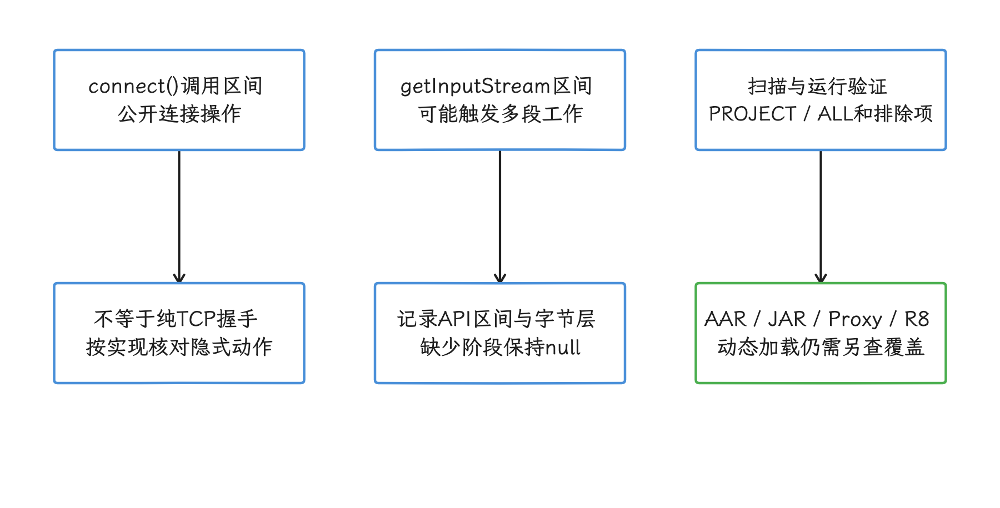

图：桥接层记录公开方法和流读写的边界，协议阶段只填有证据的字段。 getInputStream 可能混合建连、写请求与读头，不能拆出准确 DNS/TLS。

依赖 class 能否被 `InstrumentationScope.ALL` 处理，还受打包形式、动态加载、混淆和插件版本影响。构建时要输出“扫描 class 数、命中调用点数、排除原因”，再用 fixture（固定输入的测试样例）覆盖 AAR/JAR（Android/Java 依赖包格式）、Proxy 重载、异常和 R8（Android 代码压缩与优化工具） 构建。

<!-- gracker-diagram: ch17-08-21-instrumentation-build -->
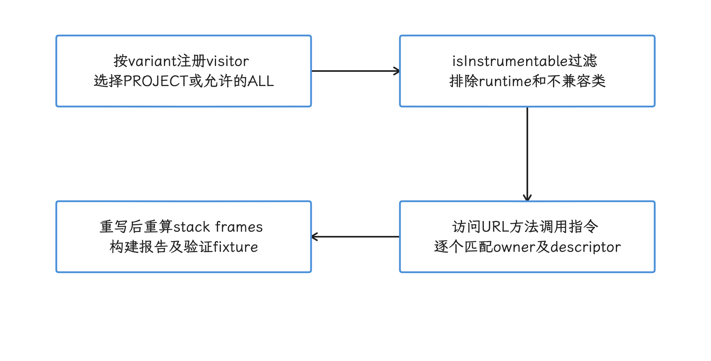

图：AGP 按变体扫描可插桩类，ASM 重写调用并重算受影响方法的栈帧。 系统 boot classpath 中的 URL 类本身没有被应用插件修改。

## 6. Cronet、PLT Hook 与 eBPF 的能力边界

OkHttp 和 `HttpURLConnection` 之外，请求还可能走 Cronet、Native 库或系统层。这三类入口的取数手段各不相同：官方 metrics、PLT/GOT Hook 与 eBPF 各覆盖一段，能力范围也各有前提。

### 6.1 Cronet 优先使用官方 metrics

Cronet 支持 HTTP/1.1、HTTP/2 和 HTTP/3 over QUIC。请求完成后，`RequestFinishedInfo.Metrics` 可提供 DNS、connect、SSL、sending、response start、request end、socket reuse、transport 字节数，以及直接计算的 TTFB 与总耗时，我们优先从这里取数。通过 `UrlRequest.Builder.addRequestAnnotation()` 放入不含敏感信息的 request id，再从 `getAnnotations()` 取回，可以避免按 URL 和时间窗口猜测关联关系。

Cronet 的字段也要按文档解释：

- `connectEnd` 位于 TCP 与 SSL 完成之后；QUIC 0-RTT 下，它甚至可能晚于 `sendingStart`。
- QUIC 的 `sslStart/sslEnd` 与 `connectStart/connectEnd` 指同一段时间，分别记录即可，相加会重复计时。
- socket reuse 为 true 时，DNS、connect 与 SSL 时间为空。
- metrics 不可用或请求未走到该阶段时，时间为 `null`。
- `getTtfbMs()` 表示从请求发起到响应 header 首字节的毫秒数；`getTotalTimeMs()` 包括成功、失败或取消前的完整请求时间。实际提供 Cronet 实现的 provider（实际提供 Cronet 实现的组件） 没有采集时，两者都可能为 `null`。
- `getResponseStart()` 是最终 response headers 收完的时刻，应与 Cronet 自己的 `getTtfbMs()` 区分。OkHttp 的 header 回调又受第 3.2 节所述触发位置的限制，名称相近的字段要先核对采样点再对齐；直接 TTFB 字段为空时，用 header 收完时间算出的值要另起字段名。
- `getMetrics()` 的总说明称时间和字节覆盖全部 redirect，但 `getReceivedByteCount()` 的字段说明又明确排除先前 redirect，源码也保留了返回完整 metrics 链的 TODO。redirect 字节数是否累计，以实际 Cronet provider/version 的 contract test（用固定输入验证字段行为的契约测试） 结果为准，先测再定。
- 单个 `Metrics` 精确还原不了每一跳；每个 redirect 要结合 `onRedirectReceived()` 另存语义事件。

Cronet 的 Google Play services 实现、作为后备的 fallback 与独立发布的 Chromium artifact（发布的依赖包） 之间可能存在 API 或实现差异。统一 schema（结构化数据的字段结构） 要保留 `metric_source = okhttp | cronet`、provider/version 与 `timestamp_semantics`（时间戳代表的事件边界）——时间戳各自指哪个时刻。上线前用编译依赖对应的 API 和真机契约测试核对空字段、redirect 与字节计算规则；字段名相同，采样点未必相同，跨客户端汇总前先统一定义。

<!-- gracker-diagram: ch17-08-24-cronet-metrics -->
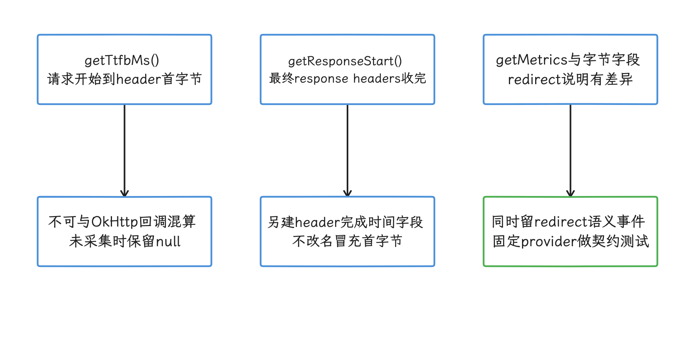

图：Cronet 保留自身 provider、版本与时间语义，再映射到共有字段。 TTFB 与 responseStart 边界不同，redirect 字节契约需在实际 provider 上验证。

### 6.2 PLT/GOT Hook 的覆盖范围

PLT（Procedure Linkage Table）和 GOT（Global Offset Table）是 ELF（Android Native 二进制格式） 动态链接过程中定位外部函数的表。我们修改这些入口，把部分函数调用转交给采集代码；它只对确实经过动态符号入口的调用生效。

Native 兜底常见目标包括：

- `getaddrinfo`：观察 libc 中的域名解析调用区间、返回码和结果数量。
- `connect`：观察目标地址、耗时、返回值与 `errno`（线程局部保存的系统调用错误码）。
- `send` / `recv`：观察 socket 调用的字节数和错误；HTTPS 下通常是 TLS record 或其他密文。
- `SSL_write` / `SSL_read`：动态 TLS 库导出且经 PLT/GOT 调用时，可观察输入或输出的明文字节数与 TLS 错误。

设计时要把三条限制写清楚：

1. `SSL_write` 的输入长度对应不上链路发送字节：TLS record 分帧、缓冲和重试都会改变数量；`SSL_read` 的输出也可能混着 HTTP/2 frame（协议帧） 等数据，未必就是业务 body。
2. `send/recv` 看不到 TCP 重传：重传发生在内核 TCP 栈，用户态 QUIC 的重传又属于协议库。socket 调用失败和“发生重传”是两回事。
3. Cronet 常把 BoringSSL（Chromium 使用的 TLS 实现）与网络栈静态链接，Mars 或自研库也可能隐藏符号、内联调用或直接执行 syscall（系统调用）。这时 PLT Hook 对 `SSL_*` 或 libc wrapper（封装函数） 的覆盖率可能很低。

<!-- gracker-diagram: ch17-08-25-plt-coverage -->
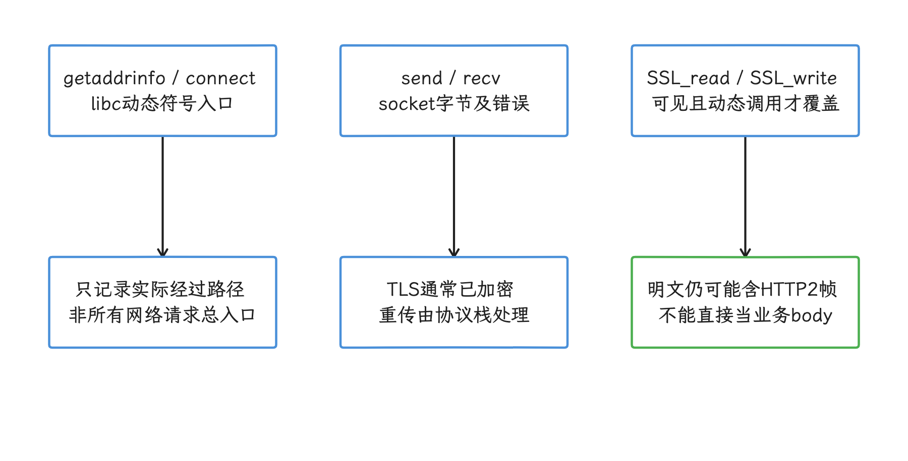

图：PLT/GOT 只覆盖经过对应动态入口的调用，观察层决定字节含义。 静态链接、隐藏、内联或直接 syscall 可绕过；send/recv 不提供 TCP 重传数。

Bionic（Android 的 C 标准库）的 `socket()` 仍通过 `NetdClientDispatch` 分派，dynamic linker（动态链接器） 负责 ELF 装载与符号解析。这个源码事实只说明存在潜在调用路径，离“所有网络请求都能 Hook 到”还差得远。Hook 实现还要处理线程局部的递归调用保护、原始函数解析、`errno` 保存恢复、fork（从当前进程创建子进程） 与动态加载、ABI（Application Binary Interface，应用二进制接口） 和 16 KiB page size（内存页大小） 兼容，并在故障时自动关闭采集。

<!-- gracker-diagram: ch17-08-26-hook-guard -->
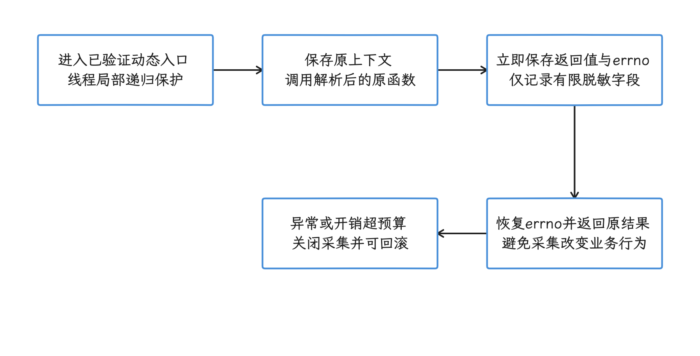

图：Native 代理需要递归保护、原函数调用与错误状态保护，并在异常时关闭采集。 源码中存在分派路径不等于全覆盖，ABI 与16KiB页兼容需在目标产物和设备验证。

只要网络库提供稳定回调，就优先接回调；PLT Hook 更适合当作覆盖范围已验证、先向少量设备开放并随时可撤回的后备观测，补回调盖不到的部分。

### 6.3 eBPF 适用于系统或受控设备

eBPF（extended Berkeley Packet Filter）允许受验证的小程序在内核事件上运行。`platform/system/bpf` 仍由系统 loader（加载器） 管理 BPF 程序，量产三方应用通常拿不到加载、pin（在 BPF 文件系统中保留对象引用） 并 attach（绑定到事件） BPF 程序所需的 Linux capability（细分的特权权限）、SELinux（Android 强制访问控制机制） 安全域与文件访问权限。我们能用的场景主要是：

- ROM（设备系统镜像） 或系统组件。
- 企业专管设备与经过授权的设备代理。
- root（取得系统最高权限）/工程机上的诊断工具。
- CI（持续集成） 实验室或线下复现环境。

<!-- gracker-diagram: ch17-08-27-bpf-capability -->
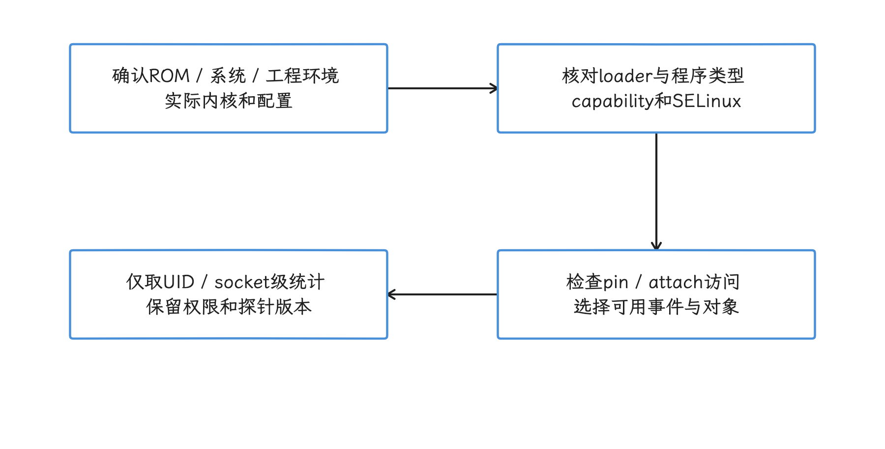

图：BPF loader、capability、SELinux 与对象访问共同决定能否加载和使用探针。 设备管理或用户授权本身不授予这些权限；普通三方 App 不能照搬系统方案。

在这些环境中，我们可以用 Android 17 的 6.18 common kernel，借 BPF、tracepoint（内核预留的稳定跟踪点）或 socket 统计观察 UID 流量、TCP RTT、重传和连接错误。但它看到的仍是密文与字节数：URL、header、HTTP/2 stream 或 QUIC stream 都恢复不出来，UID 字节数也没法直接分摊到单个业务请求上。

内核 TCP 重传指标盖不住用户态 QUIC 的协议重传。分析 HTTP/3 时，优先用 Cronet/QUIC 栈暴露的 NetLog（Chromium 网络事件日志）或 metrics，再拿内核 UDP/socket 事件补连接级的线索。

<!-- gracker-diagram: ch17-08-28-tcp-quic-boundary -->
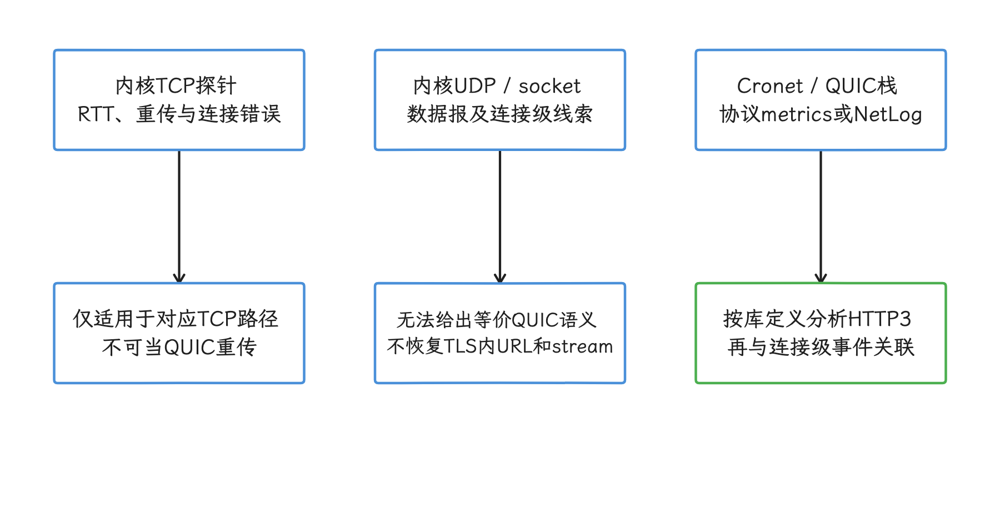

图：TCP 重传来自内核 TCP 栈，QUIC 协议重传要由用户态协议库提供。 加密和多路复用下，UID/socket 字节不能直接恢复或均摊单个 HTTP 请求。

## 7. 隐私与安全：原始数据不要进入样本

网络采集会碰到账号、token（登录或访问凭证）、设备标识、位置、订单与业务内容。我们要在生成内存样本之前就完成安全控制；服务端脱敏兜底的，已经是端侧泄露之后的数据。

### 7.1 URL 与 route

- 先用业务路由注册表匹配，再写入样本；禁止先保存 raw URL 后异步清洗。
- `/user/12345/order/888` 可归一为 `/user/:userId/order/:orderId`。
- 未命中的 path（URL 中表示资源路径的部分） 只上报允许的 host、path 段数和模板 hash（由模板内容计算的固定长度摘要），避免动态 path 原文泄露。
- URL 中 `?` 后的 Query（URL 中 `?` 后的参数），value 默认全部丢弃；key 也可能带业务含义，只保留允许清单中的名称。
- URL 中 `#` 后的 Fragment（URL 中 `#` 后的片段） 本就不发给 HTTP 服务端，APM 也不采集。

<!-- gracker-diagram: ch17-08-29-url-privacy -->
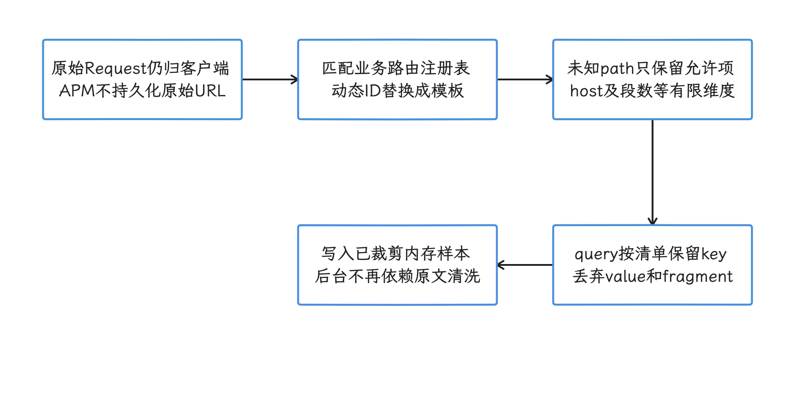

图：先匹配受控路由模板，再将允许的维度写入样本。 未知 path 不保留原文，query 默认丢值，fragment 不采集。

### 7.2 Header

- 默认允许清单可包含 `content-type`、受控的 `content-length` 与专用 trace id。
- `authorization`、`proxy-authorization`、`cookie`、`set-cookie`、设备 id、用户 id 和位置字段直接丢弃。
- trace id 也能跨事件关联用户，应设置用途、保留期和访问权限。
- 不通过中间人证书或绕过 certificate pinning（证书锁定）来获取内容；APM 不能降低原有传输安全。

### 7.3 Body 与文件

任意文本 body 的“前 N 字节”并不安全，token 和手机号常出现在开头。默认策略是不采内容，只记录经过校验的长度、MIME（内容类型标识） 和编码。业务确有诊断需求时，走下面的流程：

1. endpoint 与 schema 同时命中允许清单。
2. 在结构化对象阶段按字段名删除或替换敏感值。
3. 对脱敏结果设置很小的字节上限。
4. 经过采样、用户授权、保留期和访问审计后再上报。

满足这些条件后才可以截取 body。对未知文本、二进制、multipart（一个 body 中容纳多个部分的格式） 和文件上传，只记录类型、长度区间和成功/失败；文件名与本地路径留在样本之外。

<!-- gracker-diagram: ch17-08-30-content-gate -->
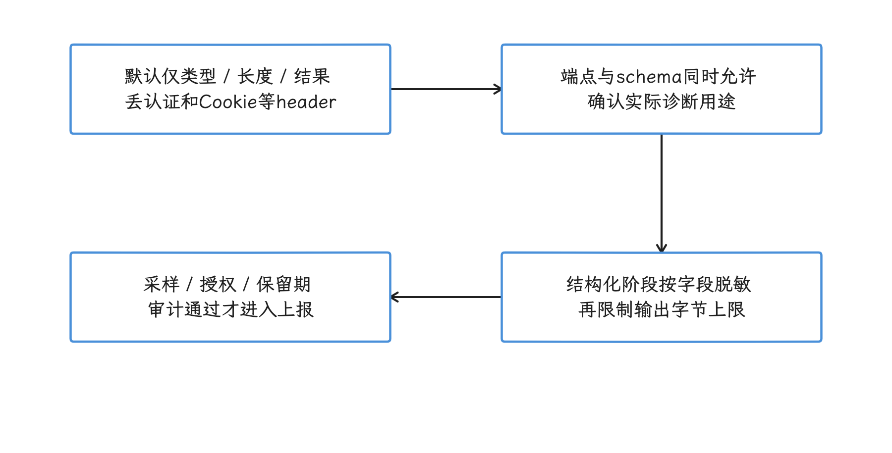

图：默认不采内容；确需诊断时先按端点和结构清除敏感字段，再限制体积与用途。 截前N字节不等于脱敏，未知文本、文件名和本地路径不进入样本。

### 7.4 标识符与删除

普通 hash 只是可关联的假名：手机号或邮箱的可能取值有限，攻击者仍可枚举原文并比对结果。优先不采用户标识；确需关联时，改用服务端管理、定期轮换的 HMAC key（计算带密钥摘要所用的密钥），并把用途限制在约定窗口内。request sample 与身份映射放进相互隔离的存储系统，支持按用户删除、到期清理、按法规要求限定数据存储地区和权限审计。

<!-- gracker-diagram: ch17-08-31-identifier-lifecycle -->
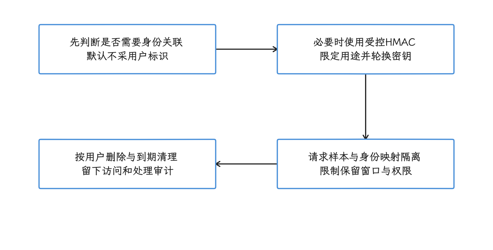

图：优先不采身份标识，必要的关联使用受控密钥与有限窗口，并支持删除。 普通 hash 可被枚举；request id 和 HMAC 结果仍需用途及访问限制。

## 8. 开销控制与自监控

EventListener 回调在请求的关键路径上，我们要给采集器定性能预算——每次回调允许占用的时间、内存和流量上限——超出时能自动减量或关闭：

- 回调只读取时间、枚举和计数，写入固定大小结构或有界 ring buffer（写满后按既定策略处理的环形缓冲区）。
- `System.nanoTime()` 只在同一进程内算时长，持久化后拿去和 wall clock（表示日期时间的系统时钟） 比较会出错。
- URL 归一化要避免正则表达式出现灾难性回溯，也要避免复制大字符串；规则在后台预编译。
- 不在回调中序列化 JSON、写文件、查数据库、打印日志或发请求。
- body 内容默认关闭；字节计数用 forwarding source/sink，不复制整包。
- 采样按 route 和 request id 做确定性决策，使同一标识总是得到相同的采样结果，避免同一问题的前后事件随机断裂。
- 大量故障同时出现时，要设置每分钟上限、按 route 或错误类型分组的 reservoir sampling（蓄水池采样）和丢弃计数，防止错误期进一步推高 CPU、磁盘和上报流量。
- 采集队列满时丢弃 APM 样本，不阻塞业务请求；上报端排除自己的网络请求，避免递归采集。

对象池不一定比小型 DTO（Data Transfer Object，只承载字段的数据对象） 更省：池本身会带来锁、生命周期和残留数据风险，先用基准测试证明对象分配真是瓶颈再上池。采集器至少自报 callback p50/p95/p99（第 50、95、99 百分位耗时），即第 50、95、99 百分位的回调耗时，以及分配量、队列深度、丢弃率和上报字节。超出预算时依次停 body 采集、降成功样本率、再降失败样本率，让诊断价值更高的失败样本留得更久。

<!-- gracker-diagram: ch17-08-32-collection-budget -->
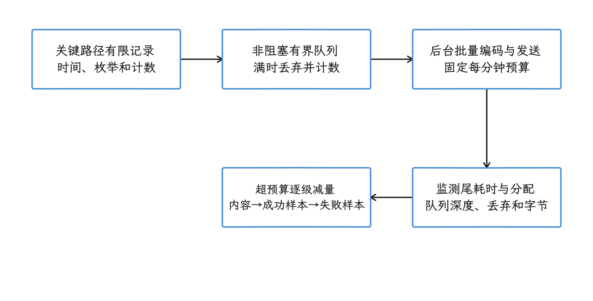

图：回调只做有限记录，队列和上报在容量及流量预算内退让。 对象池需先测收益，满队列不能阻塞请求，上报流量要排除递归采集。

## 9. HTTP/3 / QUIC 的字段要显式区分

QUIC 基于 UDP，传输握手与 TLS 1.3 紧密结合，支持连接复用、0-RTT 和连接迁移——0-RTT 指恢复既有连接时不等完整往返就先发送早期数据。把 TCP 字段原样搬过来填 0，等于把“不适用”伪装成“瞬间完成”。

推荐保留协议无关的上层字段，同时补充传输语义：

| 字段 | TCP + TLS | QUIC |
| --- | --- | --- |
| `transport` | `tcp` | `quic` |
| `transport_connect_ms` | TCP、代理和 TLS 到协议可用的总区间 | QUIC 库定义的 handshake/confirmation（握手与确认）区间 |
| `tcp_connect_estimate_ms` | 有条件计算 | `null` / not applicable |
| `tls_ms` | 独立 TLS 区间 | 与 QUIC connect 重叠，禁止重复相加 |
| `connection_reused` | 连接池复用 | QUIC connection/stream 复用 |
| `migration_count` | 通常为 0 | 由 QUIC 栈提供；没有证据时为空 |
| `retransmission_source` | 内核 TCP | QUIC 库；内核 UDP 无法给出同等语义 |

0-RTT 下请求发送可能早于握手确认，各阶段也就不再严格按“前一个结束、下一个才开始”的顺序发生。`connectEnd - connectStart` 仍可作为库定义的 transport 区间，只是别强行把它放到 sending 之前。跨 HTTP/2 与 HTTP/3 比较时，优先看定义一致的请求耗时、成功率和吞吐，再按 transport 分组看连接指标。TTFB 只在有首字节观测依据时比较，OkHttp 的 header 回调差值单列。

<!-- gracker-diagram: ch17-08-33-quic-overlap -->
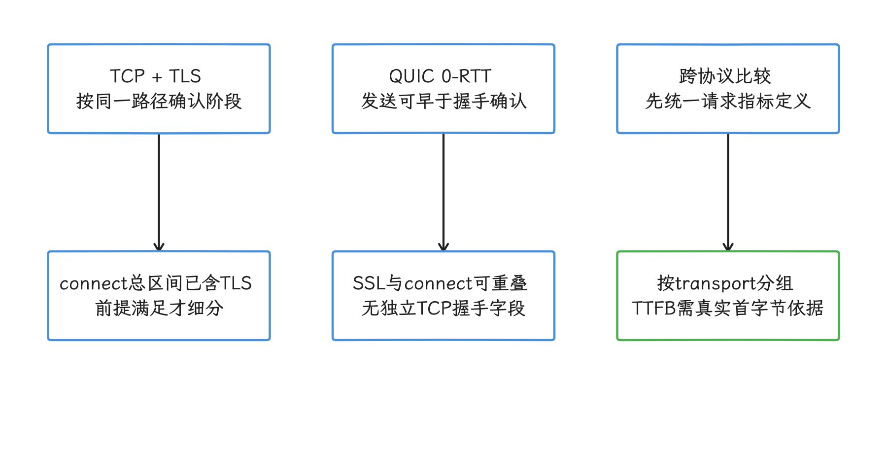

图：QUIC 发送可早于握手确认，SSL 与 connect 还可能描述同一区间。 TCP 字段不适用时留 null，不能填零或把重叠阶段相加。

## 10. 一套可维护的接入顺序

工程接入可按覆盖率与风险逐步推进：

1. 在统一 OkHttp client 上接应用拦截器、网络拦截器和 per-call `EventListener.Factory`。
2. 建立 call、DNS、route、exchange 四条时间线，先在线下验证缓存、连接复用、重定向、401、失败恢复、`Expect: 100-continue` 和 duplex。
3. 对仍在使用 `HttpURLConnection` 的自有代码启用 `InstrumentationScope.PROJECT`，用构建报告确认调用点覆盖。
4. 只对明确列出的少量三方 Java SDK 做 `ALL` 范围实验；Native SDK 优先接官方 callback。
5. Cronet 用 annotation（创建请求时附加、完成后原样取回的对象） 关联 `RequestFinishedInfo`——创建请求时附加、完成后原样取回——并保留其字段语义与 redirect 累计规则。
6. PLT Hook 与 eBPF 只在权限、覆盖率和回滚条件明确的环境启用；回滚指关闭采集并恢复到上一套已验证配置。
7. 端侧在样本生成前执行 route、header、body 和标识符规则，后台只接收已裁剪结构。
8. 用可控 DNS 延迟、代理故障、TLS 失败、限速/丢包和 HTTP/3 测试服务校验每个字段；事件证明不了的字段保留为空。

扩展到 WebView、gRPC（基于 RPC 与 HTTP/2 等协议的调用框架） 或自研 RPC 时，不必把它们伪装成 OkHttp：各客户端先保留原生事件，再映射到共有的 call、route 和 exchange 概念；对不齐的阶段用 `metric_source` 和 `timestamp_semantics` 明示差异。

<!-- gracker-diagram: ch17-08-34-integration-validation -->
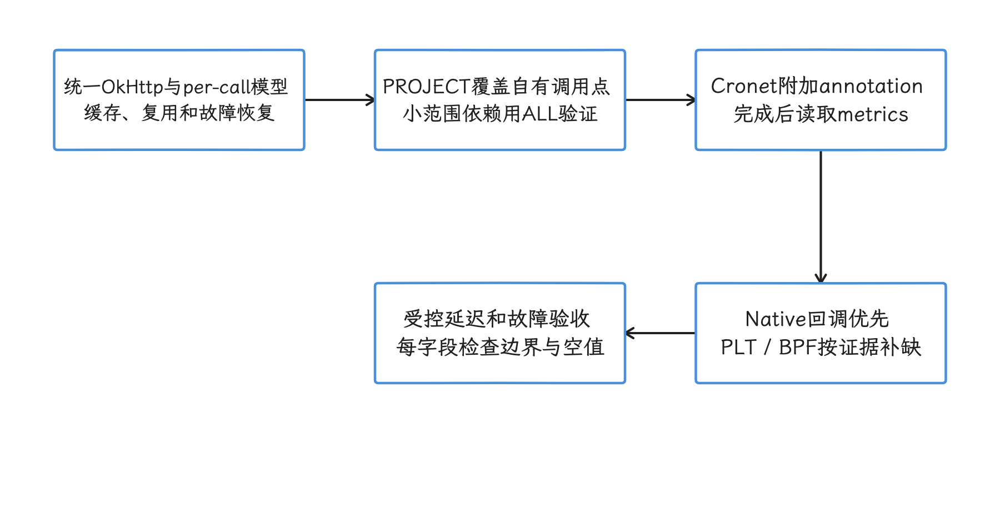

图：先验证主客户端模型，再补覆盖缺口，每种客户端保留原生来源与语义。 设备权限、协议和版本影响覆盖；证据不足的字段为空并记录原因。

## 11. 源码锚点与参考资料

### Android 17 / API 37

- [Android 17 `java.net.URL`](https://android.googlesource.com/platform/libcore/+/refs/tags/android-17.0.0_r1/ojluni/src/main/java/java/net/URL.java)：核对 `openConnection()`、代理重载与 `openStream()` 的平台 API。
- [Android 17 `HttpURLConnection`](https://android.googlesource.com/platform/libcore/+/refs/tags/android-17.0.0_r1/ojluni/src/main/java/java/net/HttpURLConnection.java)：核对公开生命周期与能力范围。
- [Android 17 Bionic `NetdClientDispatch.cpp`](https://android.googlesource.com/platform/bionic/+/refs/tags/android-17.0.0_r1/libc/bionic/NetdClientDispatch.cpp)：核对 libc `socket/connect/send*` 到 `NetdClientDispatch` 的入口。
- [Android 17 Bionic linker](https://android.googlesource.com/platform/bionic/+/refs/tags/android-17.0.0_r1/linker/linker.cpp)：核对 Android 动态链接与符号解析实现。
- [Android 17 system BPF](https://android.googlesource.com/platform/system/bpf/+/refs/tags/android-17.0.0_r1/)：核对系统 BPF loader 与目录结构。
- [Android 17 Connectivity BPF](https://android.googlesource.com/platform/packages/modules/Connectivity/+/refs/tags/android-17.0.0_r1/bpf/)：核对网络 BPF loader、netd 集成、program 与 syscall wrapper。

### Android 17 common kernel

- [`android17-6.18-2026-06_r6` BPF core](https://android.googlesource.com/kernel/common/+/refs/tags/android17-6.18-2026-06_r6/kernel/bpf/)：BPF syscall、map、program 与 verifier 的内核实现。
- [`android17-6.18-2026-06_r6` network BPF](https://android.googlesource.com/kernel/common/+/refs/tags/android17-6.18-2026-06_r6/net/bpf/)：网络 BPF 相关实现。
- [`android17-6.18-2026-06_r6` socket filter](https://android.googlesource.com/kernel/common/+/refs/tags/android17-6.18-2026-06_r6/net/core/filter.c)：socket filter 与 BPF helper 的关键实现。

### 客户端与构建工具

- [OkHttp 当前仓库与 5.4.0 版本](https://github.com/lysine-dev/okhttp)：核对当前维护位置与稳定依赖版本。
- [OkHttp 当前 Events 文档](https://lysine.dev/okhttp/features/events/)：核对事件模型与监听器使用方式；元数据中的 `square.github.io` 同名 URL 是迁移前旧址，现已返回 404，仅为保留历史来源。
- [OkHttp 当前 Interceptors 文档](https://lysine.dev/okhttp/features/interceptors/)：核对应用拦截器与网络拦截器的职责划分。
- [OkHttp 5.4.0 changelog](https://github.com/lysine-dev/okhttp/blob/parent-5.4.0/CHANGELOG.md)：核对 2026-06-08 版本及变更范围。
- [OkHttp 5.4.0 `EventListener` 源码](https://github.com/lysine-dev/okhttp/blob/parent-5.4.0/okhttp/src/commonJvmAndroid/kotlin/okhttp3/EventListener.kt)：核对当前回调签名与并发说明。
- [OkHttp 5.3.0 `CallServerInterceptor`](https://github.com/lysine-dev/okhttp/blob/parent-5.3.0/okhttp/src/commonJvmAndroid/kotlin/okhttp3/internal/http/CallServerInterceptor.kt) 与 [5.4.0 对应实现](https://github.com/lysine-dev/okhttp/blob/parent-5.4.0/okhttp/src/commonJvmAndroid/kotlin/okhttp3/internal/http/CallServerInterceptor.kt)：核对 header 读取后触发 start、跳过临时响应后触发 end 的顺序。
- [OkHttp 5.3.0 `Http1ExchangeCodec`](https://github.com/lysine-dev/okhttp/blob/parent-5.3.0/okhttp/src/commonJvmAndroid/kotlin/okhttp3/internal/http1/Http1ExchangeCodec.kt)：核对 `readResponseHeaders()` 读取完整状态行与 header block 的行为。
- [OkHttp 5.3.0 `EventListener` 源码](https://github.com/square/okhttp/blob/parent-5.3.0/okhttp/src/commonJvmAndroid/kotlin/okhttp3/EventListener.kt)：本文示例使用的事件顺序、恢复与并发说明。
- [OkHttp 5.3.0 Interceptors](https://github.com/square/okhttp/blob/parent-5.3.0/docs/features/interceptors.md)：应用拦截器与网络拦截器的差异。
- [AGP Instrumentation API 迁移说明](https://developer.android.com/build/releases/gradle-plugin-api-updates)：核对 Transform 移除与 Instrumentation API 注册方式。
- [AGP 9.x/10.0 API 迁移路线](https://developer.android.com/build/releases/gradle-plugin-roadmap)：核对当前 Variant 与 Instrumentation API 方向。
- [AGP `InstrumentationScope`](https://developer.android.com/reference/tools/gradle-api/current/com/android/build/api/instrumentation/InstrumentationScope)：核对 `PROJECT` 与 `ALL` 的处理范围。
- [Cronet `RequestFinishedInfo.Metrics`](https://developer.android.com/develop/connectivity/cronet/reference/org/chromium/net/RequestFinishedInfo.Metrics)：核对直接 TTFB、总耗时、阶段时间与字节字段。
- [Cronet `RequestFinishedInfo` 源码](https://chromium.googlesource.com/chromium/src/+/lkgr/components/cronet/android/api/src/org/chromium/net/RequestFinishedInfo.java)：核对 metrics、redirect 累计、annotation 与空字段语义。
- [Cronet request lifecycle](https://developer.android.com/develop/connectivity/cronet/lifecycle)：核对 callback 状态转换与终止条件。

<!-- gracker-diagram: ch17-08-01-observation-layers -->
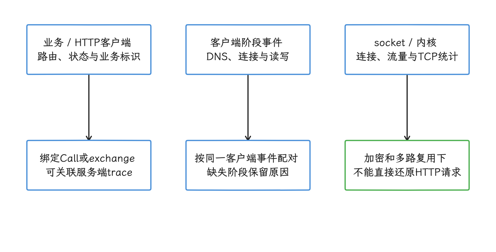

图：先确认 HTTP 语义、客户端阶段和连接级统计各自来自哪里。 缓存和连接复用会跳过阶段；跨层时间接近不足以证明同一请求。
