# 崩溃与 ANR（Application Not Responding，应用无响应） 捕获机制

稳定性 APM（Application Performance Monitoring，应用性能监控）要处理的“崩溃”不止一种：Java 未捕获异常、Native（C/C++ 等本地代码） 同步致命信号、系统判定的 ANR、lmkd（low memory killer daemon，Android 用户态低内存终止服务） 杀进程和资源耗尽。这几类现场发生时，进程的线程状态、权限和剩余执行时间各不相同。我们做采集器，第一件事是回答“现在还能安全做什么”，再决定采哪些数据。

> 源码基线：AOSP `android-17.0.0_r1`；内核 `android17-6.18-2026-06_r6`。

Android 8—10 的兼容路径会保留；厂商权限、root 或旧系统上可读的文件，本文不把它们写成普通应用的通用能力。

## 1. 四类现场，四种证据强度

拿到一份崩溃样本，我们第一步是判断它属于哪类现场——Java Crash、Native Crash、系统 ANR，还是资源耗尽与 LMK，四类现场的入口、进程状态和最可信的证据各不相同：
| 现场 | 主要入口 | 进程状态 | 最可信的证据 |
| --- | --- | --- | --- |
| Java Crash | `Thread.UncaughtExceptionHandler`、Android `RuntimeInit` 默认处理器 | VM（这里是 ART 运行时）仍在运行，资源可能已耗尽 | `Throwable`、崩溃线程、预存 breadcrumb、系统退出记录 |
| Native Crash | debuggerd/Crashpad signal path | 堆、锁或栈可能已经损坏 | `siginfo_t`、`ucontext_t`、tombstone/minidump、ELF build id |
| ANR | system_server 判定、ART `SignalCatcher`、`ApplicationExitInfo` | 进程可能仍存活，也可能稍后被杀 | 系统 ANR trace、触发类型、同一时间窗的 Perfetto/ProfilingTrigger |
| 资源耗尽与 LMK | 周期资源采样、lmkd、退出历史 | 临界点可能无法执行用户代码 | 预采样趋势、系统 reason、RSS/PSS、FD/线程/VMA 使用量 |

表中几个名词先交代清楚。breadcrumb 是应用预先记录的轻量事件轨迹；到了 Native 现场，证据换成了另一组：`siginfo_t` 保存信号原因和 fault address（出错地址），`ucontext_t` 保存寄存器等 CPU 上下文；tombstone 是 Android 系统生成的 Native 崩溃报告，minidump 是便于跨平台处理的紧凑转储文件，ELF build id 用来唯一匹配二进制与符号。

资源指标用的是另一套词汇：RSS 是实际驻留在内存中的页，PSS 按共享比例分摊内存，FD 是 file descriptor（文件描述符），VMA 是 virtual memory area（虚拟内存区域）。后面的取证会反复用到 Perfetto 和 `ProfilingTrigger`：Perfetto 是 Android 系统跟踪工具，`ProfilingTrigger` 是由系统事件触发性能采集的公开 API。

读这张表时还要区分“应用侧的怀疑”和“系统的结论”。应用端 watchdog（检查线程是否响应的监视器）报出“主线程卡了 5 秒”，这是应用侧的观察；系统判定的 ANR 是另一个层级的结论。同理，收到 `SIGKILL` 和被 LMK 终止，也要分开记录。

所以我们在每条稳定性样本里保存 `evidence_source`（证据来源）与 `confidence`（结论可信度），防止服务端把应用推测写成系统结论。

<!-- gracker-diagram: ch17-09-02-evidence-strength -->
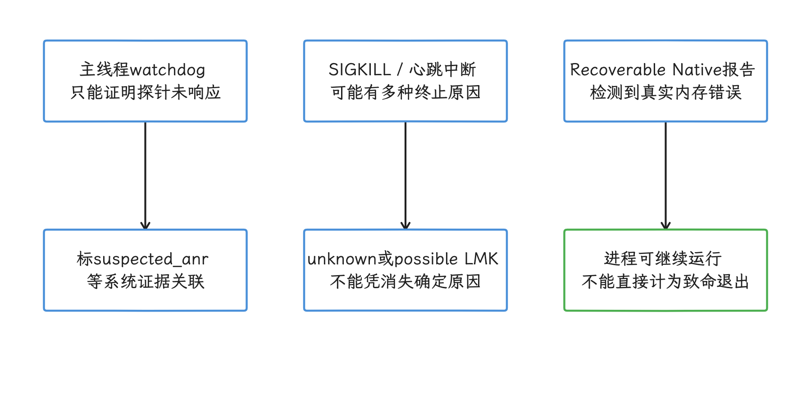

图：证据来源与可信度随样本保存，避免把应用观察直接转成系统结论。 疑似 ANR、可能 LMK 和可恢复 Native 报告分别保留含义。

## 2. Java Crash：代理默认处理器与系统终止链

### 2.1 默认处理路径

`RuntimeInit.commonInit()` 安装两层处理器。下文的 handler 指异常或信号到达后执行的处理回调：

- `LoggingHandler` 是 VM 内部的 uncaught-exception pre-handler（前置处理器），负责输出 fatal exception 日志。
- `KillApplicationHandler` 是 `Thread` 的 default handler（默认处理器），向 ActivityManager 报告崩溃并终止进程。

应用调用 `Thread.setDefaultUncaughtExceptionHandler()` 替换的是第二层，内部 pre-handler 仍由 VM 掌握。所以 APM（Application Performance Monitoring，这里指应用性能与稳定性监控） 安装前必须保存当前 default handler，采集结束后把异常交回给它。`ProfilingTrigger.TRIGGER_TYPE_OOM` 也明确要求自定义 handler 继续调用 default handler——少了这一步，`OutOfMemoryError`（OOM，内存不足异常） 路径上的触发式 Java heap（Java 对象堆） dump（堆快照）就产不出来。

下面的代码展示 Java 层代理的最小骨架。`CrashEnvelopeStore.tryWriteBounded()` 表示项目预先初始化的有界存储；崩溃当下它只完成这次有界写入，开数据库、创建线程、等待网络都留给正常运行期。

```kotlin
class ChainedCrashHandler private constructor(
    private val previous: Thread.UncaughtExceptionHandler?,
    private val store: CrashEnvelopeStore,
) : Thread.UncaughtExceptionHandler {
    private val handling = AtomicBoolean(false)

    override fun uncaughtException(thread: Thread, throwable: Throwable) {
        if (!handling.compareAndSet(false, true)) {
            // 同时崩溃或 previous 链成环时，立即结束，避免递归和死锁。
            hardTerminate()
        }

        try {
            store.tryWriteBounded(
                threadId = thread.id,
                threadName = thread.name,
                throwable = throwable,
            )
        } catch (_: Throwable) {
            // 采集失败不能替换原始崩溃。
        }

        try {
            previous?.uncaughtException(thread, throwable)
        } catch (_: Throwable) {
            hardTerminate()
        }

        // 正常的 RuntimeInit handler 不会返回；空 handler 或第三方返回都在这里终止。
        hardTerminate()
    }

    private fun hardTerminate(): Nothing {
        Process.killProcess(Process.myPid())
        exitProcess(10)
    }

    companion object {
        fun install(store: CrashEnvelopeStore) {
            val previous = Thread.getDefaultUncaughtExceptionHandler()
            val handler = ChainedCrashHandler(previous, store)
            Thread.setDefaultUncaughtExceptionHandler(handler)
        }
    }
}
```

这段代理把系统默认 handler 保留在链上，并用 CAS（compare-and-set，原子比较并设置）阻止采集器重复进入。`previous` 自身若返回，代码才执行防御性终止；正常的 Android 路径会在系统 handler 里结束进程。实际安装时我们还要防住 `previous === handler` 这类循环，并在集成测试中覆盖 Java exception、Java heap OOM、后台线程崩溃和多个 SDK 的安装顺序。

<!-- gracker-diagram: ch17-09-03-java-dispatch -->
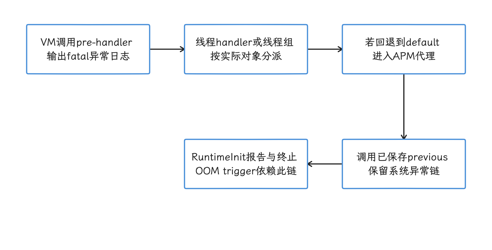

图：运行时先调用 pre-handler，再按线程和线程组分派，只有转交 default 时全局代理才参与。 显式线程 handler 或线程组不转交时，默认代理不能保证覆盖。

<!-- gracker-diagram: ch17-09-04-chained-handler -->
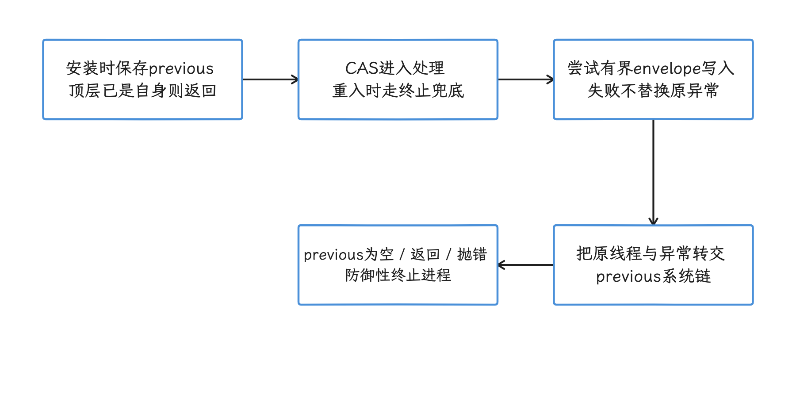

图：本 SDK 重复安装不包裹自身，进入崩溃处理后只做有限记录并转交 previous。 CAS 防重入不能保证所有同时崩溃都留档，其他 SDK 的覆盖仍需集成验证。

### 2.2 崩溃当下的轻量记录 envelope

这里的 envelope 是一条字段受限、字节数有上限的崩溃记录。Java handler 比 Native signal（信号） handler 宽裕一些，但堆和锁这时未必可用：`Throwable.printStackTrace()`、JSON 序列化、数据库事务和压缩都会分配对象，遇到 OOM 或运行时已经损坏时可能再次失败。

推荐的采集分工按时机拆开：

- 正常运行期维护固定容量的 breadcrumb ring buffer（环形缓冲区），并周期写入版本、进程、前后台、资源使用量等已脱敏快照。
- crash handler 只写 magic（识别文件格式的固定标记）、schema version、时间、线程 id、异常类型和预存 breadcrumb 的序号；栈序列化要限制深度、cause（异常原因链）数量和总字节数。
- 冷启动后校验 checksum（发现内容损坏的校验值）与完整标记，再补齐符号化所需字段，随后压缩、去重和上传。
- crash store（崩溃记录存储区）用独立小文件或预分配区域，和业务数据库分开锁与事务。

“立即发网络请求确保上报”成功率低，还会拉长系统崩溃处理。我们给同步等待设一个很小的硬超时；队列满或存储异常时宁可丢掉 APM 附件，也要让系统终止链先走完。

<!-- gracker-diagram: ch17-09-05-envelope-timing -->
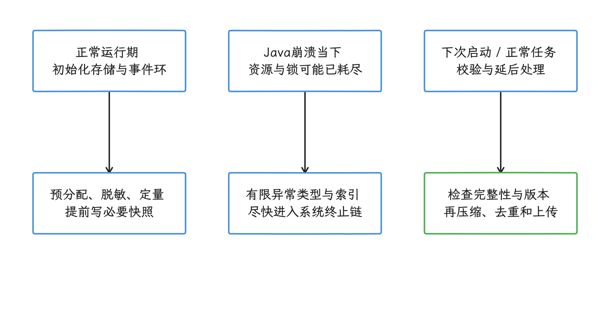

图：预存低成本快照，崩溃时只完成有限写入，正常执行恢复流程后再处理附件。 任意同步 I/O 或锁都不能靠外包计时强制中断，存储接口须事先验证。

## 3. Native Crash：signal handler 只负责交接

### 3.1 debuggerd（Native 崩溃诊断服务）、tombstone 与 Crashpad

signal 是操作系统通知进程发生事件的机制；Native 崩溃的起点是其中的同步致命信号——由当前线程执行的指令直接触发，常见类型包括 `SIGSEGV`、`SIGABRT`、`SIGBUS`、`SIGILL`、`SIGFPE` 和 `SIGTRAP`。系统的处理路径由 Bionic（Android 的 C 标准库）和 debuggerd 构成：debuggerd 是 Native 崩溃诊断服务，负责采集寄存器、线程、maps（进程内存映射）、backtrace（调用栈） 和 abort message（主动终止说明），再由 `tombstoned` 服务保存 tombstone。

`/data/tombstones` 普通应用读不到；Android 12 / API 31 起，我们改从 `ApplicationExitInfo.REASON_CRASH_NATIVE` 的 `getTraceInputStream()` 里取对应的 tombstone protobuf。protobuf 指 Protocol Buffers 二进制编码；这份记录也可能在我们读取前，就被系统环形存储里的新记录覆盖。

Breakpad 常由进程内 handler 生成 minidump；Crashpad 的 Linux/Android 设计把客户端与独立 handler 进程分开：客户端预先注册，崩溃时只把异常上下文的位置通知 handler，后者读取目标进程并写 dump。这种 out-of-process（进程外）设计可以少依赖已经损坏的堆和锁，代价是 handler 进程的启动、注册、权限与生命周期都要在正常运行期准备好。

下面三类文件各有用途：

- tombstone 是 Android 系统生成的 Native 诊断报告，protobuf schema 位于 debuggerd。
- minidump 是 Breakpad/Crashpad 使用的跨平台紧凑转储格式，适合 APM 上传和服务端解析。
- symbol file（符号文件）、未剥离 ELF 或符号服务器负责把 PC（program counter，程序计数器）里的指令地址还原成函数名和源码行。每个 `.so` 共享库必须保存 build id；只按 version name 选符号，遇到热修复或重打包会匹配到错误版本。

把地址还原为函数和源码行的过程叫符号化。符号化结果错误时，调用栈看起来仍然完整，所以 build id 比文件名或版本号更可靠。

<!-- gracker-diagram: ch17-09-06-native-signal-path -->
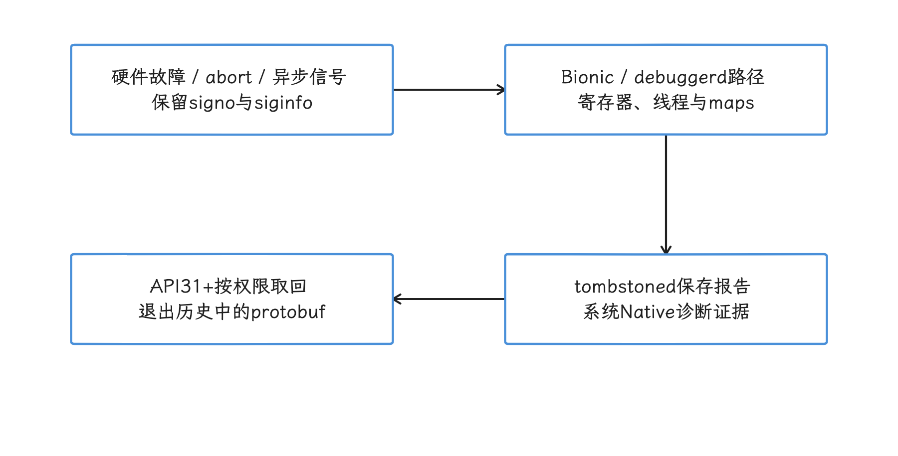

图：Native 故障可来自同步硬件异常、主动 abort 或异步信号，交由系统采集诊断。 信号编号本身不能证明触发方式；普通应用不能直接读取系统 tombstone 目录。

<!-- gracker-diagram: ch17-09-07-out-of-process -->
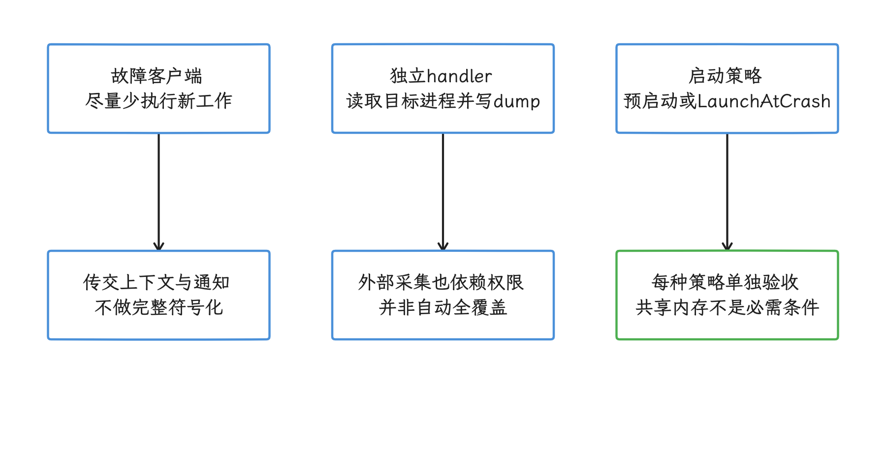

图：选择固定的 Crashpad 启动策略，客户端传交异常上下文，外部 handler 生成 dump。 独立进程减少损坏堆锁依赖，但启动、注册、权限与生命周期仍需验证。

<!-- gracker-diagram: ch17-09-11-symbol-identity -->
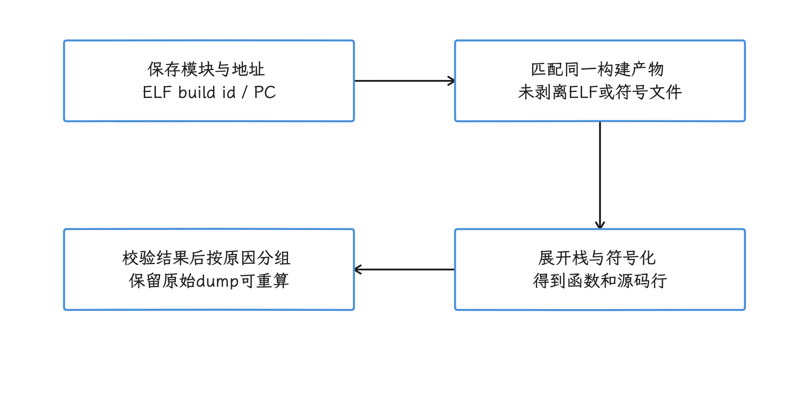

图：每个模块记录 build id，服务端用对应二进制与符号还原地址后再分组。 文件名或 version name 相同不保证产物相同，错误符号也可能得到貌似完整的栈。

### 3.2 signal 上下文的硬边界

致命 signal handler 里只能依赖 async-signal-safe 操作，即 POSIX 规范明确允许在异步信号上下文调用的那部分接口；我们所需的内存、FD 和 alternate signal stack（备用信号栈）也要提前备好。具体来说，下面这些动作要留在 signal handler 之外：

- `malloc/new/free`、STL（C++ 标准模板库） 容器扩容、普通日志与 JSON。
- `pthread_mutex`、Java/JNI（Java 与 Native 代码的调用接口） 回调、数据库与线程池。
- 在未知栈状态下调用通用 libunwind，并假设它不会分配内存或加锁。
- 直接上传网络、解析 `/proc` 大文件或遍历所有线程。

handler 可以读 `siginfo_t`、`ucontext_t` 与当前 tid（thread id，线程 ID），把定长结构写入预先打开的 pipe/socket，或通知 Crashpad handler。完整的 unwind（逐层还原调用栈）、maps 读取和 minidump 生成，交给受控的外部 handler 或系统 debuggerd。

<!-- gracker-diagram: ch17-09-08-signal-safe -->
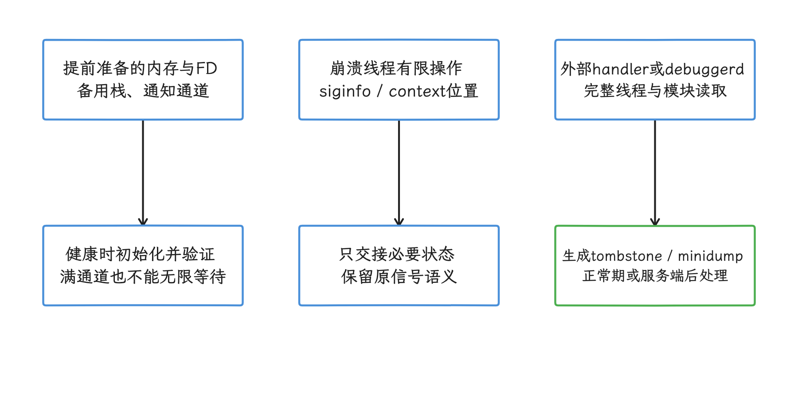

图：故障信号上下文只使用提前准备的有限结构与受验证的安全通知路径。 分配、普通锁、JNI、数据库、复杂 unwind 与网络上传都不放入通用 signal handler。

如果自研 reporter（崩溃报告器） 必须与前一个 handler 共存，还有一串 POSIX 细节要处理：`SA_SIGINFO` 回调签名、`SIG_DFL`（恢复默认处理） 恢复默认处理、`SIG_IGN`（忽略信号） 忽略信号、`SA_RESETHAND`（首次处理后恢复默认动作） 处理一次后恢复默认动作、signal mask（暂时屏蔽哪些信号） 暂时屏蔽哪些信号、备用栈和重入。同步产生的 `SIGSEGV`/`SIGBUS` 被忽略后通常会再次触发，`SIG_IGN` 挡不住进程再次崩溃。几行没经过系统版本与 ABI（application binary interface，应用二进制接口） 测试的 `sigaction()` 链式代码，谈不上生产可靠性。

<!-- gracker-diagram: ch17-09-09-signal-restoration -->
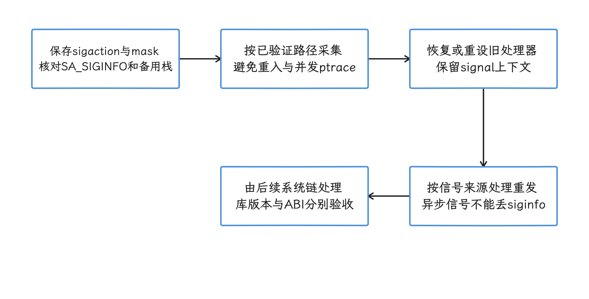

图：区分同步重触发与异步送达，按已验证库恢复处理器并保留原始 siginfo。 忽略硬件故障属于未定义行为，不能把 SIG_IGN 或简单 sigaction 链当作恢复。

### 3.3 从 fault 到上报的顺序

一条可维护的 Crashpad 路径通常是这样一个顺序：

1. 应用正常启动时创建 handler 进程、注册 socket、备用栈、共享内存与 annotation（随 dump 保存的键值注解）区域。
2. 崩溃线程收到同步致命信号，客户端 handler 读取 signal、fault address 与寄存器上下文。
3. 客户端通过预建 IPC（program counter，程序计数器中的指令地址） 通知外部 handler，崩溃线程停在可被读取的状态。
4. 外部 handler 读取线程、内存映射、模块与内存片段，写入 minidump。
5. 客户端恢复或转交系统 signal 处理语义，让 debuggerd/tombstoned 继续生成系统证据并终止进程。
6. 下次启动扫描完整 dump，按 build id 符号化，再按相似调用栈分组并上传。

第 5 步要按所用 Crashpad/Breakpad 版本的官方实现逐一验证。自研 handler 吞掉 signal，会同时损失系统 tombstone、Android Vitals 的原因分类和后续 SDK 的处理机会。

<!-- gracker-diagram: ch17-09-10-crashpad-prelaunch -->
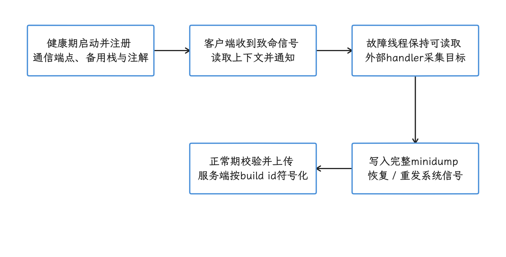

图：预启动路径先完成注册，故障时通知外部 handler，再恢复系统处理链并延后上传。 这里只描述所选启动策略，恢复系统报告与终止行为要用故障测试确认。

## 4. ANR 取证：权限与入口的演进

### 4.1 `/data/anr` 的访问权限

旧版调试资料常拿 `/data/anr/traces.txt` 当入口，较新的系统则是在 `/data/anr/` 下保存独立的 trace 文件。`init.rc` 以 `0775 system system` 创建目录，但具体 trace 仍由系统侧控制：目录权限位只说明目录本身的开放范围；普通应用读得到哪些内部文件，要再看 SELinux 强制访问控制、文件 owner/mode（属主与权限位）和系统服务检查这三道限制。

因此：

- adb/bugreport、root 权限、userdebug 系统镜像或厂商系统组件可以直接取证。
- 三方生产应用把轮询、inotify（Linux 文件变化通知）或反射调用系统服务当稳定方案，是走不通的。
- 文件名、压缩方式和保留数量都属于实现细节，端侧协议里不要依赖它们。

<!-- gracker-diagram: ch17-09-12-anr-permissions -->
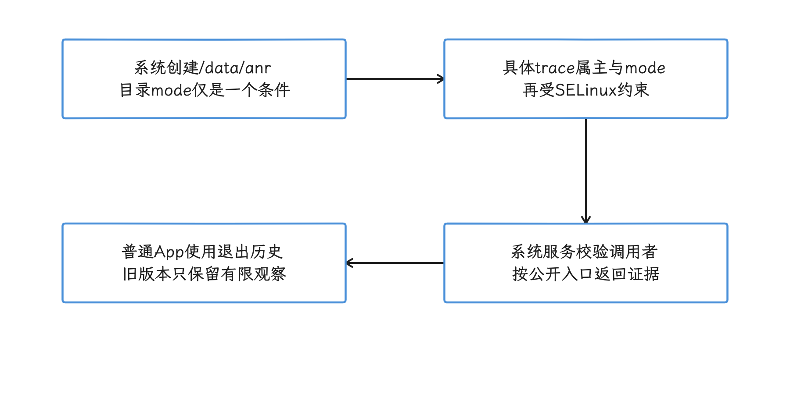

图：系统目录、文件权限、SELinux 和服务检查共同决定能否取到 ANR 证据。 root、userdebug、bugreport 与系统组件的能力不能当成普通生产应用能力。

### 4.2 SIGQUIT 与 ART（Android Runtime） SignalCatcher

我们先看系统怎么收集 Java 线程 dump：向目标进程发送 `SIGQUIT`。ART 在进程内专门启动 `SignalCatcher` 线程来接它；`signal_catcher.cc` 明确说明：`SIGQUIT` 先在各线程的 signal mask 中被屏蔽，再由等待线程通过 `sigwait()` 同步接收，普通 `sigaction` handler 在这条路径上没有执行机会。

这解释了两个看似矛盾的现象：

- ANR 取证路径确实在用 `SIGQUIT`。
- 应用自己再注册一个 `SIGQUIT` handler，系统 ANR dump 信号的接收并不稳定。

<!-- gracker-diagram: ch17-09-13-sigquit-sigwait -->
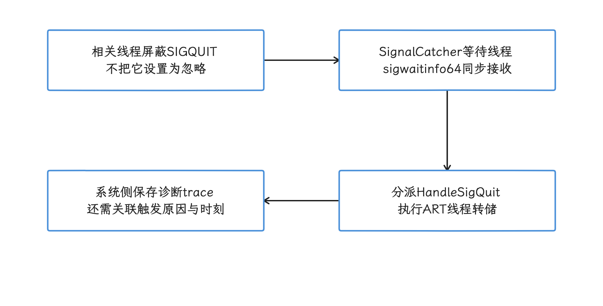

图：固定 r1 中，ART 屏蔽相关信号后由等待线程调用 sigwaitinfo64 同步接收，再执行线程转储。 再次安装普通 SIGQUIT handler 不能保证接到系统 dump 路径，dump 本身也不证明已判定 ANR。

所谓 Signal Catcher Hook，是通过拦截或改写 ART 内部调用路径来取得线程 dump。它往往要改信号掩码、拦截 ART 内部符号、修改 libsigchain 或参与系统 ANR 流程，与 Android 版本、ART 实现和其他 SDK 强耦合。这类手段适合厂商 ROM、root/userdebug 诊断或可回滚实验；普通应用的默认能力，应放在应用端自己的 watchdog（定时检查线程是否响应的监视器） 上。

main-looper watchdog 定时检查主线程消息循环是否还能响应，可以在卡顿期间多次采主线程栈，提前发现耗时消息、锁等待和 Binder（Android 跨进程调用机制） 阻塞。它拿不到 `system_server`（承载核心 Android 系统服务的进程） 掌握的输入分发、广播、service、content provider 等超时上下文，所以只能标记 `suspected_anr`；系统 ANR 结论，仍以后续 `ApplicationExitInfo`、Vitals 或系统 trace 为准。

<!-- gracker-diagram: ch17-09-14-watchdog-vs-system -->
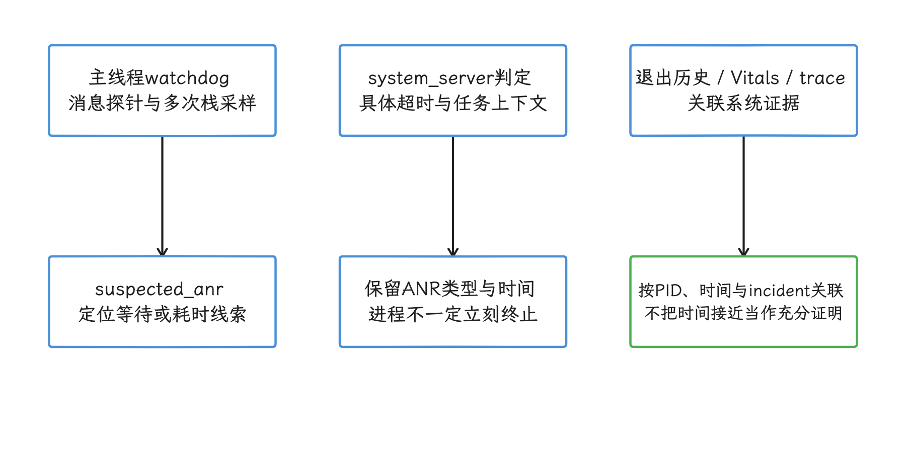

图：Watchdog 提供早期样本，系统原因与 trace 提供对应的 ANR 判定上下文。 固定秒数的主线程探针不掌握输入、广播和服务的全部系统超时条件。

### 4.3 Android 11+ 的 ApplicationExitInfo

API 30 起，`ActivityManager.getHistoricalProcessExitReasons()` 提供当前 UID（Android 为应用或隔离进程分配的用户标识）/包的历史退出记录。常用字段包括 reason、status、importance、process name、timestamp、description、PSS/RSS 和 process state summary（应用退出前主动保存的少量状态摘要）。

读取时我们要记住几件事：

- `REASON_ANR` 的 trace 通常是系统 ANR 文本流；流可能为空。
- API 31 起，`REASON_CRASH_NATIVE` 可返回按 `tombstone.proto` 编码的 protobuf，要按二进制处理，当成 UTF-8 文本解析会出错。
- trace 位于独立的全局环形存储，容量用完后会覆盖较旧记录；其他应用产生的新记录也会占用这份容量。
- 一个进程曾发生 ANR、随后恢复并因其他原因退出时，该退出记录仍可能带 ANR trace；看到 trace 就断定 `reason == REASON_ANR`，是误读。
- PSS/RSS 是系统最近采样值，未必等于死亡前一刻；0 也可能只是来不及采样。
- `description` 是给人看的说明，系统并未承诺格式跨设备或版本稳定，解析逻辑避开字符串切片。
- 不支持 LMK report 的设备会把低内存 kill 记为 `REASON_SIGNALED + SIGKILL`；这个组合只够标成“可能 LMK”，写成确定的 LMK 就过头了。

API 37 新增 `ApplicationExitInfo.getAnrInfo()`，只在 `reason == REASON_ANR` 时有值。从中我们可以读到 `getAnrType()（输入分发、广播、service、content provider、job 或应用启动等 ANR 类型）`、`getAnrId()`、`getTimeoutMillis()（系统等待到判定 ANR 的总时长）`，以及 `isUserPerceptible()（是否向用户显示 ANR 对话框）`。`getAnrId()` 只保证在同一种 ANR 类型内唯一，全局去重键要配合其他字段构造；其他退出原因调用 `getAnrInfo()` 会得到 `null`。

下面的代码展示 API 30+ 通用路径里的启动后拉取、去重和有界读取。`ExitEnvelope` 与 `ExitKind` 是项目自己的上传 DTO（data transfer object，数据传输对象）和枚举；trace 保持二进制原样，应用端不做 tombstone protobuf 到字符串的转换。API 37 的生产实现可以在这份兼容基线上另行读取 `getAnrInfo()`。

```kotlin
@RequiresApi(30)
fun readRecentExits(
    context: Context,
    seen: Set<String>,
    traceLimitBytes: Int = 2 * 1024 * 1024,
): List<ExitEnvelope> {
    val am = context.getSystemService(ActivityManager::class.java)
    val supportsLmkReason = ActivityManager.isLowMemoryKillReportSupported()

    return am.getHistoricalProcessExitReasons(
        context.packageName,
        0,   // all pids belonging to this package
        20,
    ).mapNotNull { info ->
        val key = listOf(
            info.processName,
            info.pid,
            info.timestamp,
            info.reason,
            info.status,
        ).joinToString(":")
        if (key in seen) return@mapNotNull null

        val kind = when (info.reason) {
            ApplicationExitInfo.REASON_ANR -> ExitKind.ANR
            ApplicationExitInfo.REASON_CRASH -> ExitKind.JAVA_CRASH
            ApplicationExitInfo.REASON_CRASH_NATIVE -> ExitKind.NATIVE_CRASH
            ApplicationExitInfo.REASON_LOW_MEMORY -> ExitKind.LMK
            ApplicationExitInfo.REASON_SIGNALED ->
                if (!supportsLmkReason && info.status == OsConstants.SIGKILL) {
                    ExitKind.POSSIBLE_LMK
                } else {
                    ExitKind.SIGNAL
                }
            else -> ExitKind.OTHER
        }

        val trace = try {
            info.traceInputStream?.use { it.readAtMost(traceLimitBytes) }
        } catch (_: IOException) {
            null
        }

        ExitEnvelope(
            dedupKey = key,
            kind = kind,
            processName = info.processName,
            timestampMs = info.timestamp,
            status = info.status,
            pssKb = info.pss,
            rssKb = info.rss,
            traceBytes = trace,
            traceEncoding = when {
                trace == null -> null
                info.reason == ApplicationExitInfo.REASON_CRASH_NATIVE ->
                    "tombstone-protobuf"
                else -> "anr-text"
            },
        )
    }
}

private fun InputStream.readAtMost(limit: Int): ByteArray {
    val output = ByteArrayOutputStream(minOf(limit, 32 * 1024))
    val buffer = ByteArray(8 * 1024)
    var remaining = limit
    while (remaining > 0) {
        val count = read(buffer, 0, minOf(buffer.size, remaining))
        if (count <= 0) break
        output.write(buffer, 0, count)
        remaining -= count
    }
    return output.toByteArray()
}
```

这段代码仍会分配内存，并执行 Binder 调用和文件 I/O（输入/输出），所以要放在冷启动后的后台任务里运行。生产实现要限制总记录数、单条 trace 大小、单次任务时长和本地磁盘占用；解析失败时保存 schema/version 与少量摘要，避免反复上传同一条损坏记录。

<!-- gracker-diagram: ch17-09-15-native-report-not-death -->
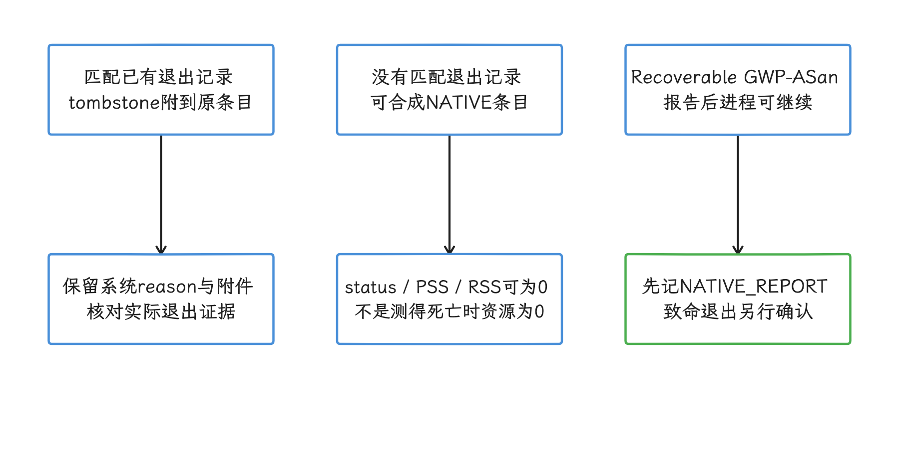

图：NativeTombstoneManager 可合成报告条目，Recoverable 故障还能在进程存续时产生报告。 status、PSS/RSS 为0和填入 GONE 都不证明真实退出现场，先保留报告来源。

<!-- gracker-diagram: ch17-09-16-api37-anr-info -->
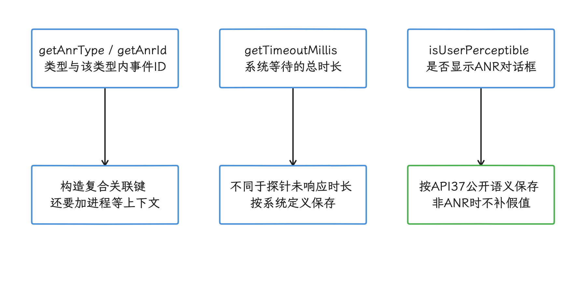

图：仅在 ANR reason 下读取 AnrInfo，再保存类型、受限作用域的 ID、等待时长与用户可感知属性。 ID 只在同一类型内唯一，其他退出原因返回 null，不能构造全局ID假象。

<!-- gracker-diagram: ch17-09-17-bounded-exit-reader -->
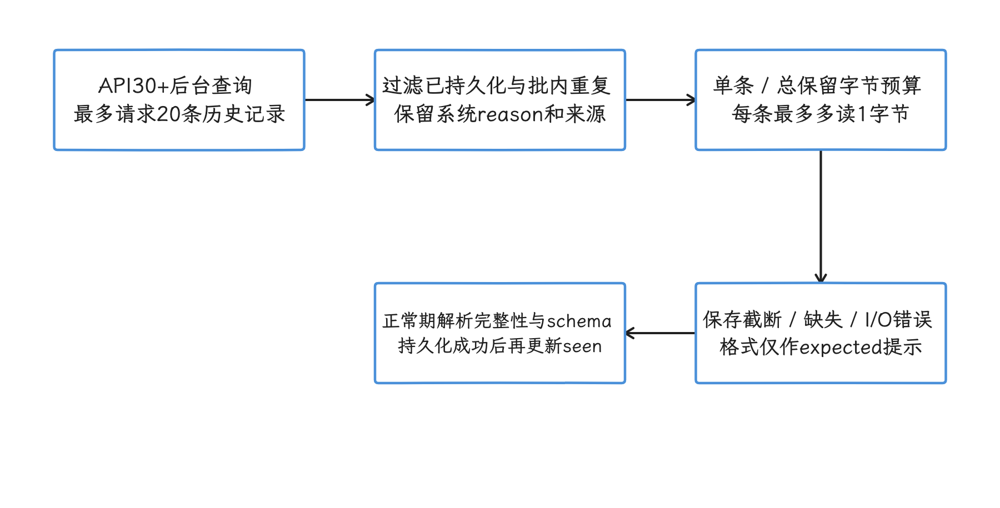

图：后台读取先查重，再限制每条与总保留字节，明确记录截断、缺失和读取失败。 格式提示不是解析成功，截断 protobuf 不能按完整报告处理，计时不能强制打断同步I/O。

## 5. 资源耗尽与多种 OOM

### 5.1 Java heap、Native RSS、FD、线程和 VMA

OOM 常被理解成 Java heap 装不下新对象，但进程还可能耗尽的是 Native 内存、文件描述符、线程或虚拟地址空间。先把失败的资源区分开，我们才知道该采哪类证据。

| 资源 | 常见失败 | 应用可观测信号 | 容易误判的地方 |
| --- | --- | --- | --- |
| Java heap | `OutOfMemoryError`、GC thrash（频繁 GC 却回收很少） | heap used/max、GC、对象增长 | Java heap 正常不能排除 Native/graphics 增长 |
| Native/graphics | RSS/PSS 上升、分配失败 | `Debug.MemoryInfo`、`/proc/self/status`、模块计数 | RSS 上升不自动等于泄漏 |
| FD table | `open/socket/dup` 返回 `EMFILE` | `/proc/self/fd` 数、`RLIMIT_NOFILE`、失败 errno | 扫目录本身也会短暂占用 FD |
| 线程 | `pthread_create` 返回 `EAGAIN`、Java 创建线程失败 | `Threads`、线程创建率、线程池活跃数/排队数 | 线程数只是一个维度，还要看 stack、地址空间和调度 |
| VMA/地址空间 | `mmap` 返回 `ENOMEM` | `/proc/self/maps` 条目、`VmSize`、ABI、映射来源 | 64 位 `VmSize` 含大块预留地址，不能单独作为内存压力 |
| 系统低内存 kill | 进程无回调地消失 | `ApplicationExitInfo`、Vitals、预存资源使用量 | `SIGKILL` 还可能来自 force-stop、shell 或其他系统策略 |

表中的 `errno` 是 Native 系统调用失败时的错误码：`EMFILE` 表示当前进程打开的 FD 过多，`ENOMEM` 表示没有足够内存或虚拟地址空间。

这几类资源里先看 FD。FD 泄漏最先破坏的是 socket、文件、eventfd（内核事件计数器）、pipe 和 Binder 辅助资源这些创建路径。`RLIMIT_NOFILE` 是进程可打开 FD 数量的上限，预警阈值应按当前使用量与该上限的比例计算，并保留 FD 类型分布；固定写死“超过 1024”，适配不了不同设备和进程配置。

线程这边，耗尽常由无界 executor（任务执行器）、每个请求新建线程、阻塞任务堆积或 Native 库自行建线程引起；每个线程还要占用用户栈映射、内核 task（调度实体） 资源与 CPU 调度时间。Android/内核最终可能返回 `EAGAIN`（资源暂时不可用）或内存失败，把这类失败一律标成 Java heap OOM，会盖住线程、栈和调度上的线索。

<!-- gracker-diagram: ch17-09-19-fd-thread-limits -->
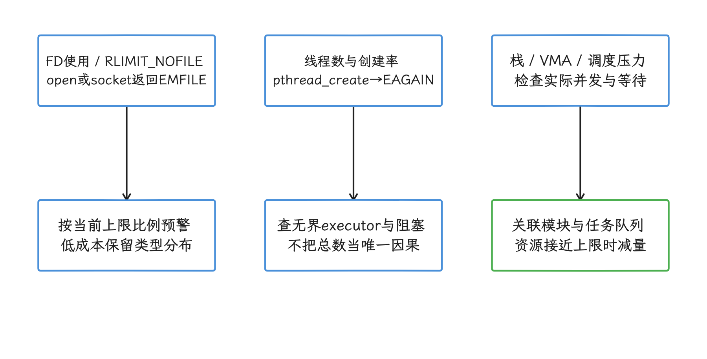

图：FD 和线程故障按当前限制、资源类型与创建路径诊断，避免固定数量阈值。 扫描FD会临时占FD，线程失败还涉及栈、地址空间和调度，不能都归为Java堆OOM。

VMA 风险在 32 位进程暴露得更早：有限的地址空间要同时装下 `.so`、JIT（just-in-time，即时编译） 代码、线程栈、ashmem（Android 匿名共享内存）、图形内存映射和碎片。64 位进程也可能碰到异常映射增长，或撞上 `vm.max_map_count`（单进程可拥有的 VMA 数量上限） 这样的限制；很大的 `VmSize` 可能只是预留了地址范围，对应的物理内存未必真的驻留。

现代设备的低内存处置，主要由用户态 lmkd 结合 PSI（Pressure Stall Information，内核压力停顿指标）、内存压力、swap（交换空间） 状态和 `oom_score_adj` 来选择目标。早期 kernel lowmemorykiller 那套固定 minfree 阈值的模型，只能解释一部分现代设备的行为。`oom_score_adj` 也只是选择终止目标时的优先级输入之一，把它读成“达到该值就立即杀进程”，等于丢掉了同一决策里的其他输入。

<!-- gracker-diagram: ch17-09-18-memory-resources -->
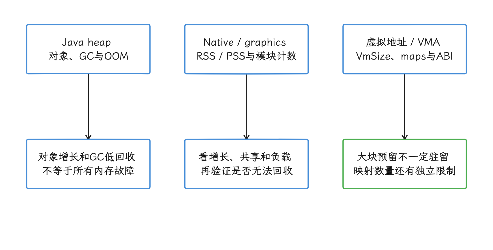

图：先识别耗尽的是哪类资源，再选择相应趋势和失败信号。 RSS 增长不自动证明泄漏，Java heap 正常也不能排除 Native 或图形资源问题。

<!-- gracker-diagram: ch17-09-20-lmk-policy -->
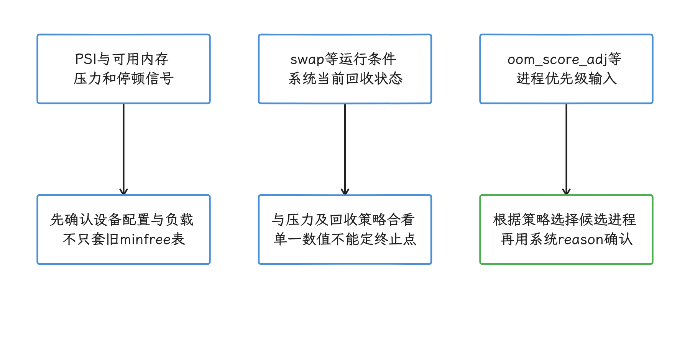

图：现代 LMKD 结合内存压力、swap 和优先级等信息决策，退出证据另行关联。 oom_score_adj 只是输入之一，SIGKILL 也不是 LMK 的充分证明。

### 5.2 预警靠正常运行期采样

我们建议按前后台与业务阶段做低频、错峰采样：

- 读取 `/proc/self/status` 的 `VmRSS`、`VmSize`、`Threads`，结合 `Debug.MemoryInfo`。
- 统计 `/proc/self/fd`，并在诊断抽样中解析 symlink（符号链接） 指向的资源类型；接近 FD 上限时停止高成本分类。
- 统计 maps 行数与主要映射类别，高频任务里不上传完整 `/proc/self/maps`。
- 记录线程创建速率、pool size（线程池大小）、queue depth（排队任务数） 和任务最长等待时间；线程总数只作参考维度之一。
- 给 WebView、图片、数据库、音视频、模型与图形资源建立模块计数。
- 使用分位数和增长斜率设告警，同时保留设备 RAM、ABI、前后台和进程类型。

资源使用量接近限制后，采样器要主动降频、停掉高成本分类：继续频繁扫描 `/proc`、抓 heap dump 或拼接大日志，反而可能成为进程的额外负担。

<!-- gracker-diagram: ch17-09-21-periodic-warning -->
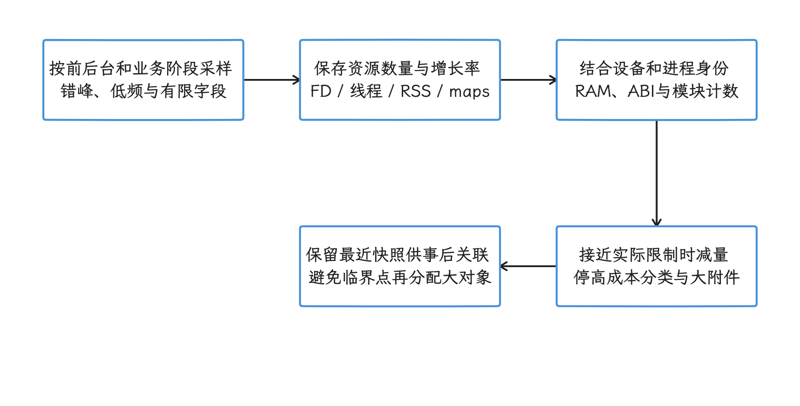

图：正常运行期按场景低频采样，接近资源限制时主动降低诊断开销。 异常期大量扫proc、抓堆或拼大日志会加重故障，采样趋势也不独立证明根因。

### 5.3 Android 8—10 没有退出历史时

API 26—29 没有 `ApplicationExitInfo`。Java crash、Native crash 仍可由 handler/reporting library 捕获；系统 ANR 与 LMK 对普通应用没有等价的官方本地查询 API。

低版本上我们能用的方案与各自的证据强度如下：

- main-looper watchdog 和周期主线程栈用来标 `suspected_anr`，冒充不了 system_server ANR。
- 上次运行的 heartbeat（周期存活时间戳）、clean-shutdown marker（正常退出标记） 与资源使用量可以识别“非正常消失”；force-stop、系统更新、重启、LMK 和外部 `SIGKILL` 又都可能留下相同结果，这类样本记为 unknown（原因未知） 或 possible LMK（可能由低内存终止）就好。
- Play Console Android Vitals 或厂商服务端数据可以补上系统 ANR/LMK 的视角，只是它们不属于端侧即时 API。
- bugreport、root、userdebug 和厂商合作能提供系统 trace；这些能力要按部署环境单列。
- KOOM 一类 fork-dump 会先用 `fork()` 创建当前进程的副本，再由子进程写 heap dump，减少原进程的暂停时间。它是版本敏感的工程方案，Android 平台层面没有兼容性保证；适用版本、ART suspend（暂停运行时线程）和 fork 后行为，以项目实测及第 17.3 章为准。

“低版本下次启动继续补拉 ANR/LMK”的通用端侧接口并不存在。把未知退出硬归为 LMK，稳定性率看起来完整了，诊断可信度也丢了。

<!-- gracker-diagram: ch17-09-22-legacy-evidence -->
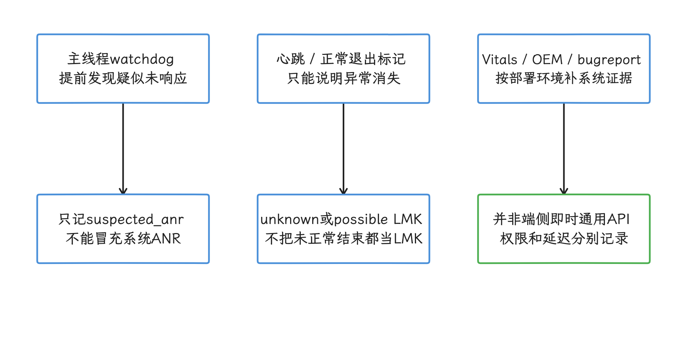

图：没有官方退出历史时，探针、存活标记和服务端系统数据保持各自证据强度。 异常消失可能来自多种原因，低版本不存在通用的本地补拉 ANR/LMK 接口。

## 6. 现场快照：把高成本信息提前准备

### 6.1 按四种时机采集

采集时机不同，能安全做的事也不同：

| 时机 | 可做的事 | 不应做的事 |
| --- | --- | --- |
| 正常运行期 | breadcrumb、资源使用量、network/UI 摘要、预先打开的存储区、模块表 | 持续抓全量 logcat 或保存敏感内容 |
| Java crash handler | 有界异常 envelope、已有 ring buffer 序号、继续调用系统 handler | 数据库、压缩、网络、无限栈展开 |
| Native signal handler | signal、fault address、tid、`ucontext_t` 位置、通知外部 handler | malloc、锁、JNI、通用日志、进程内复杂 unwind |
| 下次启动 | `ApplicationExitInfo`、trace/minidump 校验、补设备/版本、上传 | 在主线程解析大 trace |

寄存器来自 `ucontext_t` 或系统 tombstone，让 Java handler 伪造寄存器没有意义。RSS/PSS、FD、线程数适合用崩溃前最近一次采样；在 signal handler 里临时扫描 `/proc`，风险很高。

<!-- gracker-diagram: ch17-09-23-four-times -->
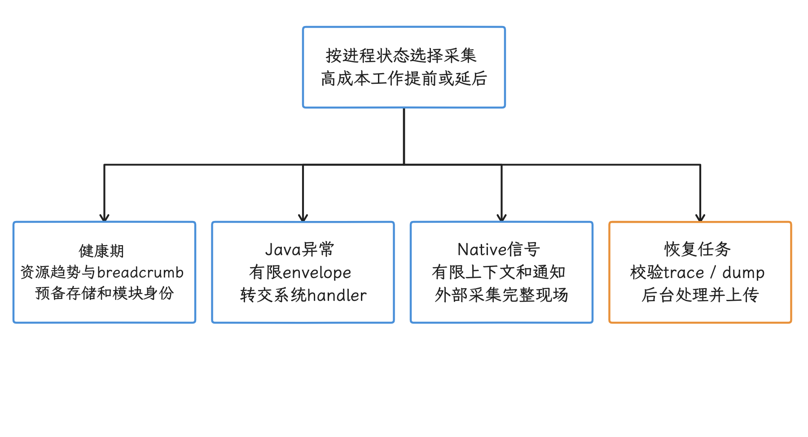

图：健康期准备、Java 异常、Native 信号和恢复任务分别承担不同工作。 寄存器来自实际上下文，临界点不临时扫描高成本信息，策略不是库自动保证。

### 6.2 Breadcrumb 与日志

breadcrumb 应记录低基数事件，即事件类型数量有限、便于分组统计；原始输入不要记录：

- 页面/组件 id、生命周期和前后台切换。
- 点击 action id，控件文本、账号或输入内容不保存。
- 网络 route pattern（去掉具体参数的路由模板）、结果类别和 request id；URL query/header/body 不保存。
- 关键开关、实验枚举、权限或配置版本。

Logcat 当不了稳定的私有 crash store：权限、ring buffer 覆盖和设备策略都会影响可用性，读取过程本身也有成本。我们在应用内部维护容量受限且已脱敏的日志 ring buffer；crash envelope 只引用最近序号，冷启动后再读取已经写入磁盘的片段。

<!-- gracker-diagram: ch17-09-24-breadcrumb-privacy -->


图：按低基数事件与隐私规则维护应用内有限日志，崩溃记录引用已存片段的序号。 logcat 受权限、覆盖与设备策略限制，输入文本、账号和网络内容不进入默认样本。

每条附件要有 schema（字段结构版本）、长度、checksum（用于发现内容损坏的校验值）、complete flag（写入完成标记）和隐私规则版本。写入顺序通常是 payload（实际内容） → checksum → complete flag，冷启动只处理完整记录。

<!-- gracker-diagram: ch17-09-25-record-commit -->
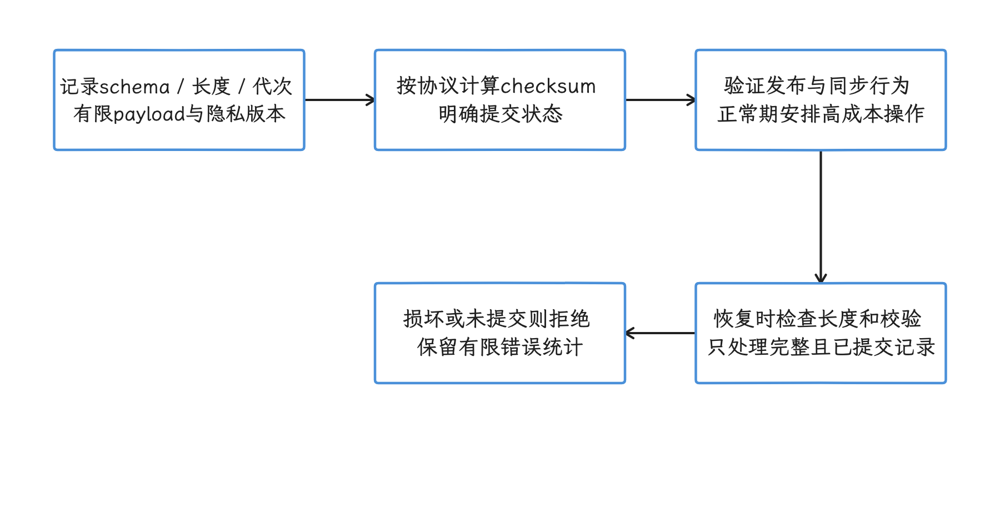

图：字段、校验与提交状态共同组成恢复协议，再按实际文件系统验证发布和同步行为。 payload/checksum/flag 的书写顺序不能独立保证原子性或掉电持久化，signal路径不临时做完整同步。

## 7. 多 SDK 的 handler 冲突

### 7.1 Java default handler

后安装的 SDK 会覆盖先安装者。即使每家都保存 `previous`，链上仍可能出现：

- A → B → A 的循环链。
- 多个 handler 依次等待 I/O，超过系统容忍时间。
- 某个 handler 捕获异常后返回，截断 `RuntimeInit` 默认终止与 OOM ProfilingTrigger。
- SDK 延迟初始化，应用在 `Application.onCreate()` 后检查时正常，稍后又被覆盖。

工程上的解法是指定一个统一负责者：

1. 由应用 stability hub（集中管理稳定性采集的模块）安装唯一代理，并保存系统 default handler。
2. 自研 sink（接收并保存事件的下游模块）只读取内存事件或有界 store，不各自安装 default handler。
3. 第三方 SDK 优先使用“不接管 handler”或 callback（仅接收回调） 模式。
4. 接管关不掉时，固定初始化顺序，并在启动后和首个 Activity 创建后校验当前 handler 的对象身份。
5. 测试崩溃进程是否按预期退出、系统退出历史是否存在、各 SDK 是否各收到一次。

多个 Java crash sink 不要并行调用：它们可能访问同一日志锁、数据库或 executor。崩溃线程按时间预算串行调用，超时或失败后立即跳过剩余附件，进入系统 handler。

<!-- gracker-diagram: ch17-09-26-java-sdk-hub -->
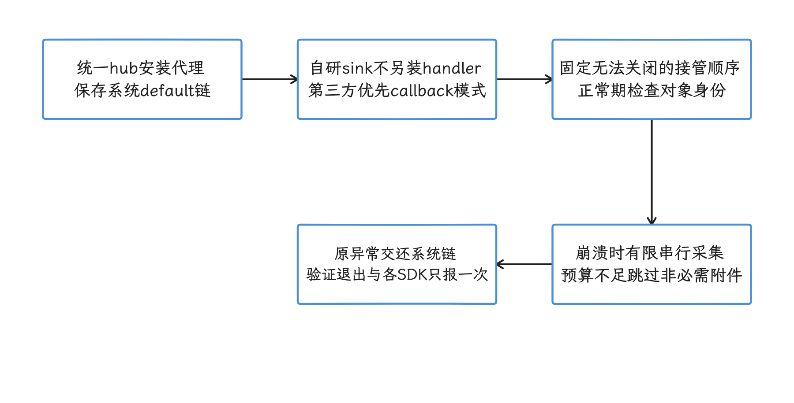

图：统一代理协调 SDK，正常期确认 handler 身份与初始化顺序，崩溃时只调用有限 sink。 时间预算不能中断已阻塞的同步 sink，循环和后来覆盖必须靠集成验证发现。

### 7.2 Native signal handler

Native 冲突更难靠安装顺序解决：

- 库可能拦截 `sigaction`，或通过 libsigchain（Android 用来串接多个信号处理者的内部库）与 ART/system handler 交互。
- `SA_SIGINFO` 和单参数 handler 混调会直接二次崩溃。
- handler 可能使用同一备用栈、修改 signal mask，或在重入时覆盖静态缓冲。
- Crashpad、GWP-ASan、MTE（Memory Tagging Extension，ARM 内存标记扩展）与系统 debuggerd 对特定 fault 有各自的处理语义。

所以“万能 signal hub”这种同步回调所有 SDK 的设计要放弃：我们选定一个经过 Android 版本验证的 Native reporter，其他 SDK 改为导入它生成的 tombstone/minidump，或只做启动后处理。第三方库控制不住时，至少在 CI（continuous integration，持续集成） 测试里枚举已安装的 signal action、制造各类 fault，验证系统 tombstone 和 build-id 符号化没有丢失。

<!-- gracker-diagram: ch17-09-27-native-sdk-conflicts -->
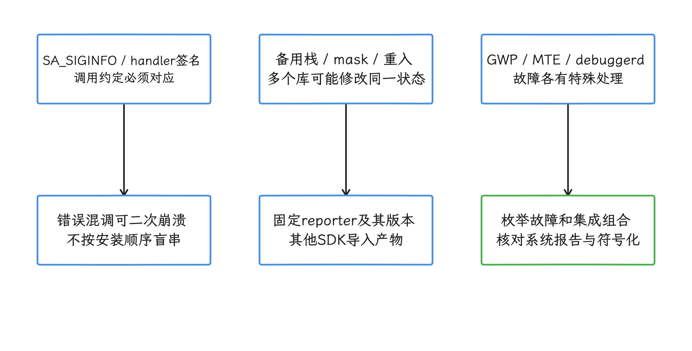

图：选择经过版本验证的 Native reporter，其他 SDK 共享报告或延后处理。 sigaction签名、mask、备用栈和内存标记工具各有语义，同步回调全部SDK不能保证兼容。

## 8. GWP-ASan：Android 17 默认走 Recoverable 抽样

GWP-ASan 是 Native 堆内存错误抽样检测器：随机挑选少量 allocation（内存分配），放进由 guard page（禁止访问的保护页）隔开的区域，从而捕获两类错误——heap use-after-free（释放后仍被访问，简称 UAF），以及 heap-buffer-overflow（读写越过堆缓冲区边界）。

启用后，每个受影响进程当前约占用 70 KiB 固定内存，CPU 开销也设计得很低，而且不需要重编译第三方 Native 库。它用于在线上取得真实错误现场，本身没有内存安全防护作用。

<!-- gracker-diagram: ch17-09-28-gwp-sampling -->
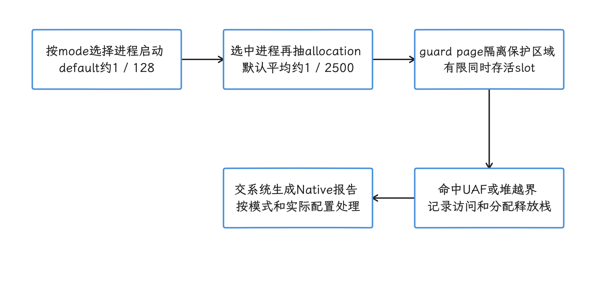

图：选中进程后仍只把少量 allocation 放入受保护区域，再记录命中的真实内存错误。 不需要重编译不等于全面覆盖，抽样检测也不是内存安全防护。

公开配置应使用 manifest：

| `android:gwpAsanMode` | Android 17 行为 | 使用建议 |
| --- | --- | --- |
| 未设置 / `default` | Recoverable GWP-ASan，约 1% 进程启动被选中 | 常规生产默认 |
| `always` | 每次启动启用基础 GWP-ASan；命中后终止进程 | 专项测试、小比例生产验证或能接受 crash 的独立进程 |
| `never` | 禁用 | 仅在兼容故障明确且有替代诊断时使用 |

Recoverable 模式命中后会生成 Native crash report（tombstone），然后允许进程继续；此时内存已经损坏，后续行为没有保证，进程可能稍后以另一个症状崩溃。一次进程生命周期只生成一份 Recoverable 报告。官方文档还明确指出：代表 Recoverable GWP-ASan fault 的 `SIGSEGV` 全程绕开应用自定义 signal handler。所以“自己的 `SIGSEGV` handler 先判断并放行”这条路走不通；我们在这里要做的是收下报告、保留现场，进程的存续交给系统的 Recoverable 语义。

<!-- gracker-diagram: ch17-09-30-recoverable-report -->
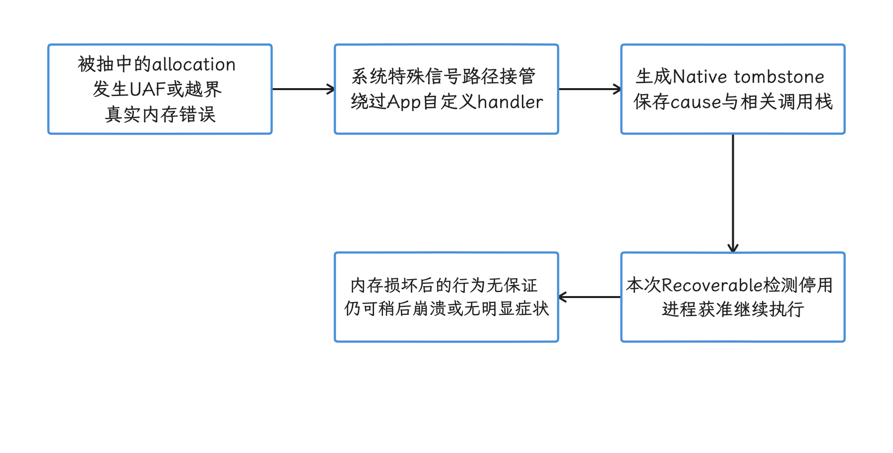

图：Recoverable 命中时生成一份报告并允许继续，仍需尽快修复真实内存损坏。 每次进程启动最多一份 Recoverable 报告，自定义 SIGSEGV handler 不会接到该特殊故障。

源码中的默认内部参数如下：

| 参数 | `android-17.0.0_r1` 默认值 | 含义 |
| --- | --- | --- |
| `SampleRate` | `2500` | 被选中进程平均每 2500 次 allocation 抽取一次 |
| `ProcessSampling` | default/system app 模式为 `128`，`always` 等模式为 `1` | 进程启动抽样的分母；`128` 表示约每 128 个候选进程选中一个 |
| `MaxSimultaneousAllocations` | `32` | 保护区内可同时保留的 allocation 数量上限 |
| `Recoverable` | `true` 的内部默认 | 具体是否使用还受 manifest mode 与初始化路径控制 |

这些数值来自 Bionic 实现，是内部默认值，应用不宜长期依赖；`libc.debug.gwp_asan.*` 系统属性或环境变量，也不要当成线上配置去写。`SetDefaultGwpAsanOptions()` 还把 `InstallSignalHandlers` 设为 false，报告由 Android debuggerd/Bionic 的既有路径协作完成。

源码中的 recoverable path 会在 fault 前后调用 GWP-ASan 的 pre/post crash hook，并通过 `recoverable_crash` 标记避免按普通致命 signal 再次发送。Permissive MTE（允许记录内存标记错误后继续运行的 MTE 模式）也走 recoverable 出口，但 fault 识别和恢复逻辑独立。APM 要保留的是系统 tombstone、GWP-ASan cause（错误类型）、模块 build id，以及 allocation/deallocation/access trace（分配、释放和非法访问调用栈）；系统 handler 的内部实现，不要复制进应用 signal handler。

<!-- gracker-diagram: ch17-09-29-gwp-modes -->
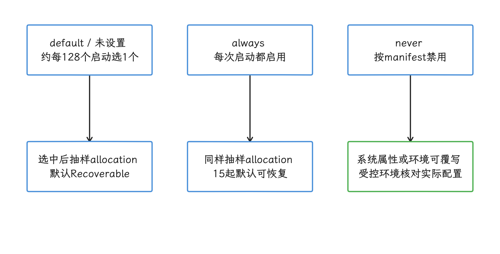

图：固定 Android17 无覆写时，default 与 always 都可恢复，区别在是否抽样选择进程。 指南always段落仍含旧终止说明；本图按已核验源码，allocation仍会抽样。

<!-- gracker-diagram: ch17-09-31-gwp-wrapper -->
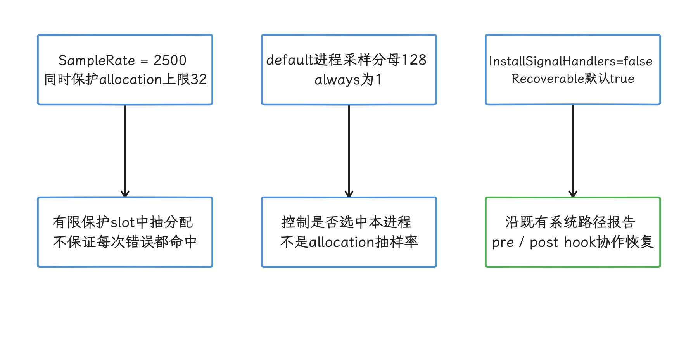

图：Bionic 抽样参数、无独立信号处理器设置和 debuggerd 的恢复路径共同形成报告机制。 2500/128/32是固定r1内部默认，系统覆写与manifest路径会改变实际行为。

## 9. ProfilingTrigger 提供的补充证据

`ProfilingManager` 从 API 35 起提供 app-driven profiling，即由应用请求 system trace、Java heap dump、heap profile 或 stack sample 等性能文件。`ProfilingTrigger` 从 API 36 起支持预先注册系统事件，到事件发生时由系统采集。36.1 指 Android 16 QPR2 的 minor SDK release（次版本 SDK），编译包为 Android SDK Platform 36.1，与 SDK Extensions 的版本号是两回事。与稳定性相关的主要能力如下：

| 版本 | trigger | 返回文件与边界 |
| --- | --- | --- |
| API 36 | `TRIGGER_TYPE_ANR` | 系统识别 ANR 后、可能杀进程前截取运行中的 system trace；触发不代表进程必然被杀 |
| API 36.1 | `TRIGGER_TYPE_APP_REQUEST_RUNNING_TRACE`、`TRIGGER_TYPE_KILL_FORCE_STOP`、`TRIGGER_TYPE_KILL_RECENTS`、`TRIGGER_TYPE_KILL_TASK_MANAGER` | 返回正在运行的 system trace 快照，可帮助解释应用主动请求或用户终止，不能代替 crash handler |
| API 37 | `TRIGGER_TYPE_OOM` | 发生 `OutOfMemoryError` 时返回 Java heap dump；自定义异常 handler 必须继续调用 default handler |
| API 37 | `TRIGGER_TYPE_ANOMALY`、`TRIGGER_TYPE_APP_COMPAT` | 返回文件随异常或兼容性问题变化，`ProfilingResult.getTag()` 提供类型说明；同一 UID 属于多个包时，部分异常可能没有文件 |
| API 37 | `TRIGGER_TYPE_KILL_EXCESSIVE_CPU_USAGE` | 因 CPU 使用过高且退出原因是 `REASON_EXCESSIVE_RESOURCE_USAGE` 时，返回运行中 system trace 的快照 |
| API 37 | `TRIGGER_TYPE_COLD_START` | 冷启动时新建 system trace，并周期抽取线程调用栈（stack sampling）；持续到 `reportFullyDrawn()`，未调用时默认 5 秒，缓冲区满后保留最早事件 |

触发器要先注册好，并同时受应用设置与系统 rate limit（频率限制）约束。`getRateLimitingPeriodHours()` 表示同一种 trigger 再次返回结果前，系统至少应等待多少小时；实际间隔可能更长，系统还会额外限流。我们拿触发器提高“事故前后有 trace”的概率；Java handler、Native tombstone 和 `ApplicationExitInfo` 仍是基础，触发器是补充。

<!-- gracker-diagram: ch17-09-32-profiling-versions -->
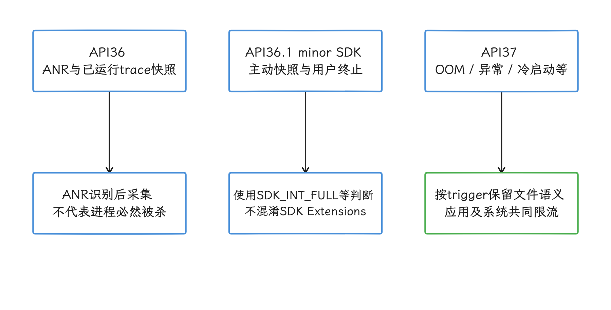

图：预注册系统 trigger 后由系统按类型提供证据，版本与限流分别检查。 36.1是minor SDK，不能只用SDK_INT>=36判断；触发不保证一定产出文件。

API 37 的 OOM trigger 有一条容易被多 SDK 破坏的前置条件：自定义 `UncaughtExceptionHandler` 必须调用 default handler。稳定性 SDK 一旦吞掉 `OutOfMemoryError`，系统 trigger 就会失效；应用只能在资源尚可时自行调用 `requestProfiling()`，crash 当下再请求通常太晚。

<!-- gracker-diagram: ch17-09-33-oom-trigger-chain -->
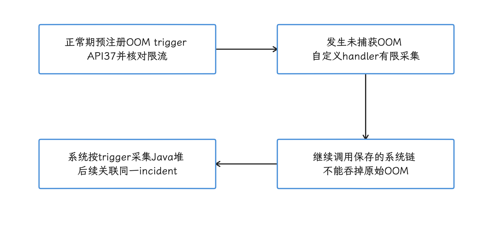

图：OOM 系统触发器要求自定义未捕获异常处理器继续调用默认系统链。 崩溃现场再临时请求堆分析通常太晚，主动Profiling安排在资源尚可的阶段。

Profiling API 的完整请求、回调、36.1 minor SDK 判断与 rate-limit 处理见第 15.7 章；本章只把 Profiling 结果作为稳定性证据源，关联到同一个 incident id（一次故障的关联标识）。判断 36.1 API 可用性时，使用 `SDK_INT_FULL`/`VERSION_CODES_FULL.BAKLAVA_1` 或对应 minor SDK API；只检查 `SDK_INT >= 36` 是不够的。

<!-- gracker-diagram: ch17-09-34-cold-start-profile -->


图：冷启动触发器新建 trace 与栈采样，到 fully drawn 或默认期限结束。 启动采集可能有延迟，discard缓冲满时丢新事件，不能声称完整覆盖所有启动活动。

## 10. 版本化接入建议

| 版本 | Java / Native Crash | ANR | LMK / 资源耗尽 |
| --- | --- | --- | --- |
| Android 8—10 / API 26—29 | chained Java handler + Crashpad/系统 tombstone | watchdog 只做疑似事件；系统证据依赖 Vitals/bugreport/OEM（设备厂商） | 周期预采样；未知退出保持 unknown |
| Android 11 / API 30 | 沿用 API 26—29 方案 | `ApplicationExitInfo` ANR text trace | `REASON_LOW_MEMORY` 或受限条件下 possible LMK |
| Android 12—14 / API 31—34 | native tombstone protobuf 可经退出历史取得 | 沿用 API 30 方案 | 沿用 API 30 方案；Android 14+ 默认 Recoverable GWP-ASan |
| Android 15 / API 35 | 加入 app-driven ProfilingManager | 可主动采 profile，但不能据此判定 ANR | 资源接近限制时可按预算主动 profiling |
| Android 16 / API 36、36.1 minor SDK | 沿用 API 35 方案 | 预注册 ANR ProfilingTrigger | 36.1 增加用户终止类 trigger |
| Android 17 / API 37 | 保持系统 handler 链，使用 API 37 trigger | ANR trigger、`getAnrInfo()` 与退出历史互相校验 | OOM/anomaly/excessive CPU trigger + 资源趋势 |

上线前，我们要准备一张故障用例表：Java exception、Java OOM、Native UAF/abort/SEGV、后台与前台 ANR、FD 上限、线程创建失败、mmap 失败、LMK、force-stop，以及多个 SDK 的不同初始化顺序。每个用例同时核对进程是否按预期终止、系统 reason、trace/dump、APM envelope、重复上报和隐私裁剪。

<!-- gracker-diagram: ch17-09-35-rollout-tests -->
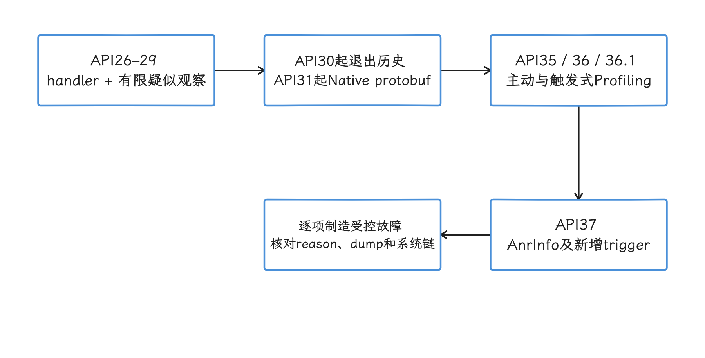

图：按部署版本选择入口，再用故障矩阵验证终止、系统记录、附件与去重。 源码与主机示例检查不能替代设备故障验收，权限和Native工具组合分别核对。

## 11. Android 17 与 6.18 r6 源码锚点

### Java Crash、ANR 与退出历史

- [Android 17 `RuntimeInit.java`](https://android.googlesource.com/platform/frameworks/base/+/refs/tags/android-17.0.0_r1/core/java/com/android/internal/os/RuntimeInit.java)：`LoggingHandler`、`KillApplicationHandler` 与默认终止链。
- [Android 17 `ApplicationExitInfo.java`](https://android.googlesource.com/platform/frameworks/base/+/refs/tags/android-17.0.0_r1/core/java/android/app/ApplicationExitInfo.java)：reason、PSS/RSS、ANR trace、API 31+ tombstone protobuf 与环形存储边界。
- [ApplicationExitInfo.AnrInfo API 参考](https://developer.android.com/reference/android/app/ApplicationExitInfo.AnrInfo)：API 37 的 ANR 类型、ID、系统等待时长与用户可感知标记。
- [Android 17 ART `signal_catcher.cc`](https://android.googlesource.com/platform/art/+/refs/tags/android-17.0.0_r1/runtime/signal_catcher.cc)：`SIGQUIT` 被屏蔽后由 `sigwait()` 接收的实现。
- [Android 17 `init.rc`](https://android.googlesource.com/platform/system/core/+/refs/tags/android-17.0.0_r1/rootdir/init.rc)：`/data/anr` 与 tombstone 目录的系统侧创建。
- [Android 17 tombstone schema](https://android.googlesource.com/platform/system/core/+/refs/tags/android-17.0.0_r1/debuggerd/proto/tombstone.proto)：Native tombstone protobuf 解析依据。

### Native reporter、GWP-ASan 与系统能力

- [Crashpad Overview Design](https://chromium.googlesource.com/crashpad/crashpad/+/main/doc/overview_design.md)：客户端、外部 handler、注册与 crash capture。
- [Android 17 Bionic signal header](https://android.googlesource.com/platform/bionic/+/refs/tags/android-17.0.0_r1/libc/include/signal.h)：`sigaction`、`SA_SIGINFO` 与 signal 类型定义。
- [Android 17 debuggerd handler](https://android.googlesource.com/platform/system/core/+/refs/tags/android-17.0.0_r1/debuggerd/handler/debuggerd_handler.cpp)：致命 signal、GWP-ASan/MTE recoverable path 与系统报告交接。
- [Android 17 GWP-ASan wrapper](https://android.googlesource.com/platform/bionic/+/refs/tags/android-17.0.0_r1/libc/bionic/gwp_asan_wrappers.cpp)：`2500/128/32` 默认参数与 pre/post crash hook。
- [Android GWP-ASan 官方指南](https://developer.android.com/ndk/guides/gwp-asan)：manifest mode、Recoverable 行为、开销与自定义 signal handler 边界。
- [Android 17 ProfilingTrigger](https://android.googlesource.com/platform/packages/modules/Profiling/+/refs/tags/android-17.0.0_r1/framework/java/android/os/ProfilingTrigger.java)：API 37 trigger 类型与返回文件说明。
- [ProfilingTrigger API 参考](https://developer.android.com/reference/android/os/ProfilingTrigger)：API 36、36.1 与 37 的公开版本边界。
- [Android 16 QPR2 SDK 设置](https://developer.android.com/about/versions/16/qpr2/setup-sdk)：36.1 minor SDK 与 `compileSdk` 配置。
- [Android 17 lmkd](https://android.googlesource.com/platform/system/memory/lmkd/+/refs/tags/android-17.0.0_r1/)：PSI（Pressure Stall Information，资源压力导致任务停顿的内核指标）、内存压力与 `oom_score_adj` 选择被终止进程的用户态实现。

### `android17-6.18-2026-06_r6`

- [FD table：`fs/file.c`](https://android.googlesource.com/kernel/common/+/refs/tags/android17-6.18-2026-06_r6/fs/file.c)：进程 FD table 的分配与扩展。
- [线程/进程创建：`kernel/fork.c`](https://android.googlesource.com/kernel/common/+/refs/tags/android17-6.18-2026-06_r6/kernel/fork.c)：task、clone/fork 与资源失败路径。
- [VMA：`mm/mmap.c`](https://android.googlesource.com/kernel/common/+/refs/tags/android17-6.18-2026-06_r6/mm/mmap.c)：mmap 与 VMA 管理的核心实现。

<!-- gracker-diagram: ch17-09-01-incident-kinds -->
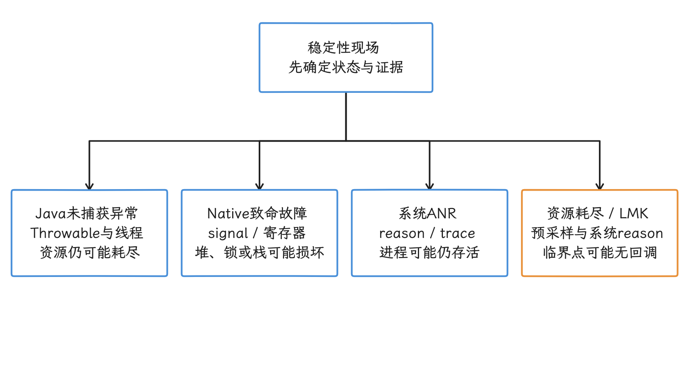

图：先识别 Java、Native、系统 ANR 或资源终止，再决定当前能安全保存的证据。 Native 报告未必证明进程死亡，现场采集能力取决于状态和权限。
