# 耗电与发热监控 (Battery & Thermal)

耗电监控要解决的是“哪段业务触发了哪些高成本资源活动”。单看“电量下降了多少”远远不够：电池百分比经过 fuel gauge（电量计）平滑，瞬时电流里还混杂着屏幕、蜂窝基带、GPU、充放电和其他进程的影响。所以线上 APM（Application Performance Monitoring，应用性能监控）若把一段方法执行时间直接换算成 mAh（毫安时），往往只会得到一个看似精确的误差值。

更可靠的方案是记录资源事件：哪个任务申请了 WakeLock，哪个 Alarm 被系统投递，定位与扫描请求是否收到结果，网络传了多少字节，哪些线程持续消耗 CPU，以及这些事件发生时进程是否在后台。发热侧再记录系统的 thermal status 和应用采取的减负动作。把两组证据放到同一条 monotonic clock（单调时钟）时间线上对齐——这种时钟只向前推进，不受用户修改系统时间影响——就能定位“升温期间仍在运行的高成本任务”；仅有时间重合，还不足以证明该任务是唯一热源。

<!-- gracker-diagram: ch17-10-01-evidence-loop -->
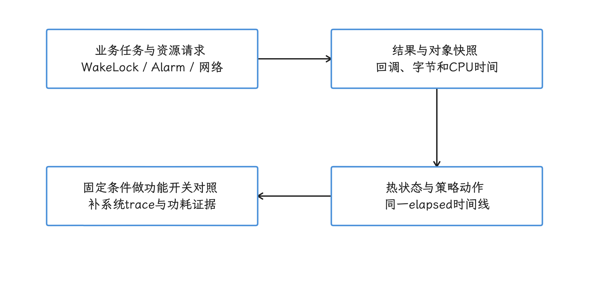

图：把资源事件、系统热状态与减负动作对齐，再检验关联是否能经对照实验重复。 时间重合不独立证明唯一热源，方法耗时不能直接换算 mAh。

> 源码基线：AOSP `android-17.0.0_r1`；内核 `android17-6.18-2026-06_r6`，平台为 Android 17 / API 37。

涉及 Android 10—17 的 API 演进会单独标出。

## 1. 建立证据等级：请求、回调、系统统计

我们先给证据分层：同一种资源通常有三层证据，APM 字段名应明确区分：

| 证据层 | 能说明什么 | 不能说明什么 | 典型数据 |
| --- | --- | --- | --- |
| 业务请求 | 应用代码表达了资源需求 | 请求已被系统接受、硬件已经工作 | `acquire()`、`setExact()`、<code>request<wbr>Location<wbr>Updates()</code>、`startScan()` |
| 应用可见结果 | 调用成功或回调已经到达 | 整个硬件活跃窗口、精确能耗 | Alarm delivery、定位回调、扫描成功/失败、网络请求字节 |
| 系统或实验室统计 | UID、硬件状态和功耗模型下的统计 | 单次方法在所有设备上通用的 mAh | batterystats、Perfetto、Power Profiler、Macrobenchmark `PowerMetric` |

这三层混用会带来几类常见误判：

- Alarm 设置成功，只表示系统接收了计划；要确认该次 Alarm 已投递，需要看到接收器或 `OnAlarmListener` 开始执行。
- 定位和扫描请求窗口是应用意图。系统可能返回缓存、批处理结果，也可能因权限、配额或硬件状态拒绝请求。
- `TrafficStats` 的 UID（系统为应用分配的标识）字节差能确认流量变化；蜂窝 modem（基带）的活跃时长和能耗，要另找证据。
- Thermal 状态来自系统对设备传感器的汇总。应用活动与状态上升出现在同一时间窗，只能说明两者存在相关关系；要判断因果，还需要对照实验、system trace（系统跟踪） 或大量样本统计来支撑。

<!-- gracker-diagram: ch17-10-02-three-evidence-levels -->
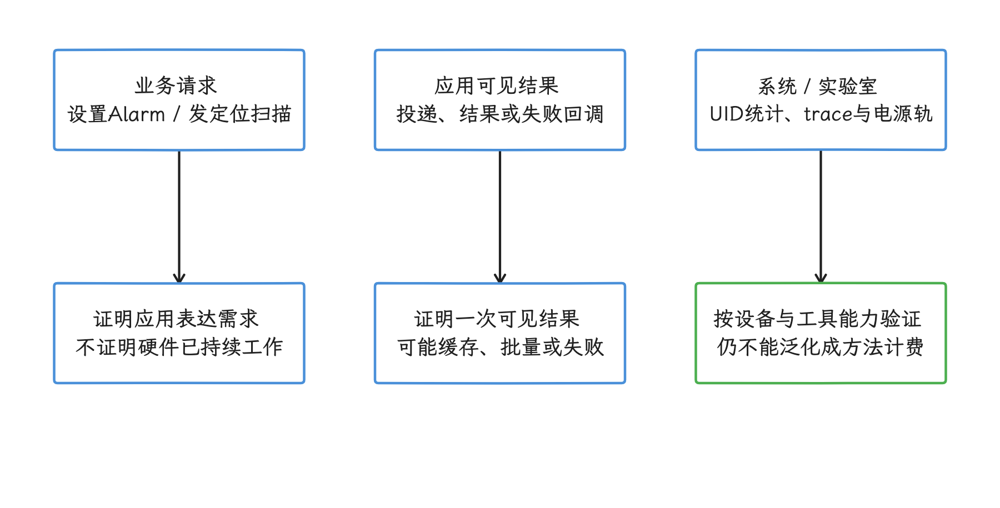

图：资源需求、应用回调和系统测量分层保存，字段随样本保留证据等级。 请求窗口、回调窗口与硬件活跃窗口不能互换。

Android 的 `BatteryStats` 使用计时器、计数器和功耗模型维护系统侧统计，完整数据留在系统侧。开发阶段我们可以用 `dumpsys batterystats --history`、Perfetto（Android 系统跟踪工具）、Android Studio Power Profiler 和 Macrobenchmark `PowerMetric`（基准测试的功耗指标） 核对应用端事件。

Battery Historian 仍可读取旧式 batterystats 报告，但官方文档已经注明它不再积极维护，验证时要与其他工具配合使用。

<!-- gracker-diagram: ch17-10-03-lab-tools -->
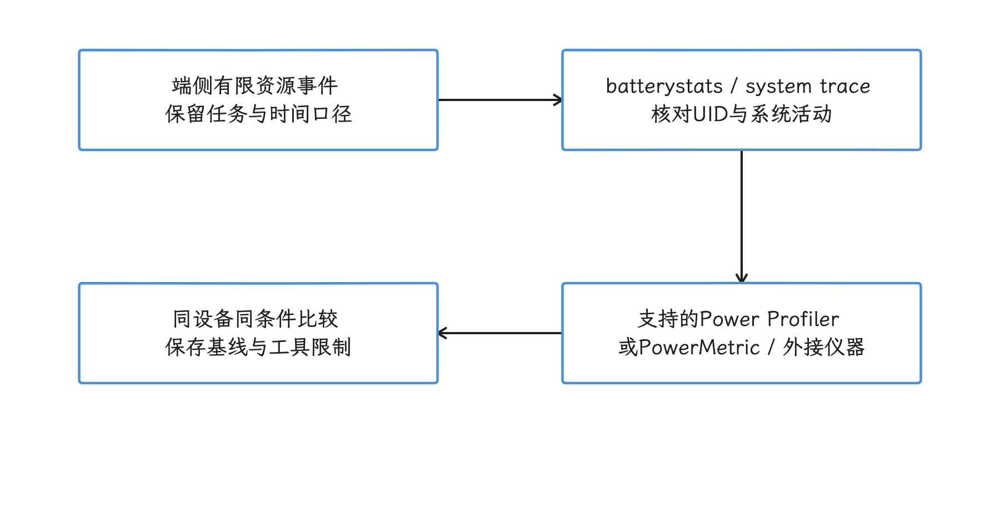

图：开发阶段用系统统计、trace 与受支持功耗工具校验端侧事件。 Battery Historian 已不积极维护，电源轨与 PowerMetric 也受设备支持限制。

## 2. WakeLock：公开调用、对象状态与系统生效要分别建模

WakeLock 用来请求设备维持指定电源状态；常见的 `PARTIAL_WAKE_LOCK` 请求在屏幕关闭后继续阻止 CPU suspend。记录时至少区分“公开调用返回”“客户端对象状态”和“系统是否让该锁生效”。服务端会根据缓存、冻结、idle 和 Low Power Standby 等策略禁用锁，不能仅凭 `acquire()` 返回或 `isHeld == true` 宣称 CPU 一直醒着。

### 2.1 源码中的对象语义

要把这三个状态分开记录，我们先看这把锁在源码里的对象语义。`PowerManager.WakeLock` 在构造时创建一个私有 Binder token `mToken`，这个 token 就是锁在服务端的身份。`acquireLocked()` 将 token、flags、tag 和工作来源交给 `IPowerManager.acquireWakeLock()`；`PowerManagerService` 以 token 识别这把锁，`release()` 再使用同一 token 调用服务端释放。

<!-- gracker-diagram: ch17-10-04-wakelock-token -->
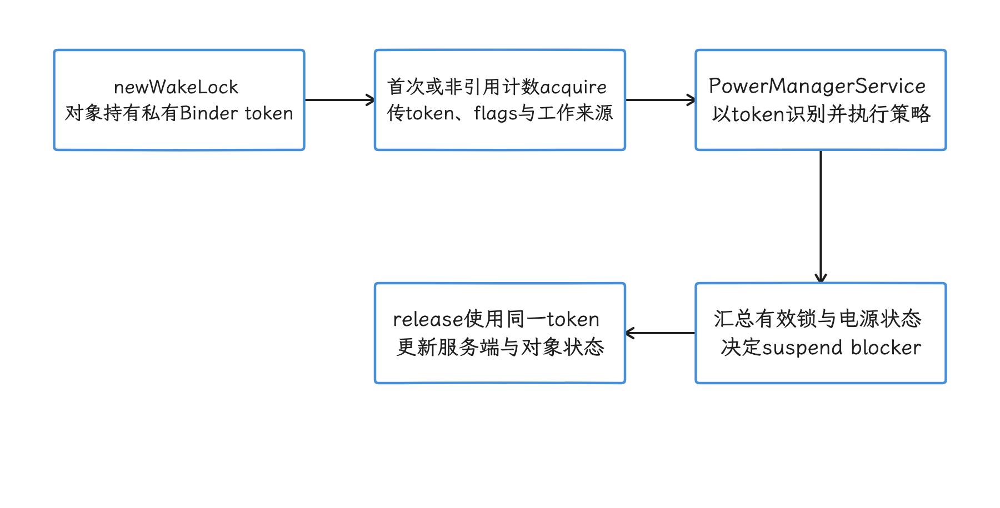

图：WakeLock 用私有 token 关联服务端记录，多把有效锁再聚合为电源约束。 tag 不是对象身份；引用计数 acquire 不一定每次都发 IPC。

应用侧有几个容易遗漏的语义：

- WakeLock 默认启用引用计数，记录同一对象尚未配对的 acquire 次数：同一对象 acquire 两次，通常需要 release 两次；`setReferenceCounted(false)` 后，一次 release 就能撤销此前的持有。
- `acquire(timeout)` 通过框架内部 Handler（向指定线程投递任务的机制） 安排 `release(RELEASE_FLAG_TIMEOUT)`，这个内部释放不会经过业务代码里的公开 `release()` 调用点。
- 框架源码在进入服务端前会递增内部计数，release 次数过多就会触发 under-locked（释放次数超过申请次数）异常。非引用计数模式、带 timeout 的多次 acquire，也都超出了一个布尔值的表达能力。
- `isHeld()` 返回客户端对象在 `mToken` 锁下保存的 `mHeld`，不查询服务端 `mDisabled`，也不测量 CPU 活跃窗口。它适合标记“探针时对象状态”；即便为 true，也不能排除系统已经忽略该锁。

<!-- gracker-diagram: ch17-10-05-object-vs-effective -->
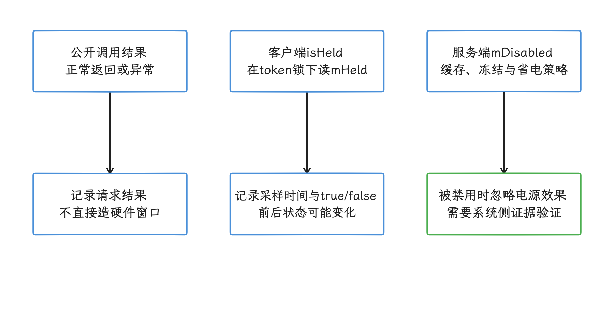

图：isHeld 读客户端 mHeld，系统另有禁用判断与电源约束汇总。 true 只是对象快照，不证明 CPU 在整个区间持续运行。

系统 token 是框架私有实现。线上 SDK 里反射读取 `mToken`、`mTag`、`mInternalCount`、`mRefCounted` 这条路径，随时会因隐藏 API 限制、R8（Android 代码压缩与混淆工具）、厂商改动或并发访问而失效；token 本身也没有上传价值。

<!-- gracker-diagram: ch17-10-06-refcount-timeout -->
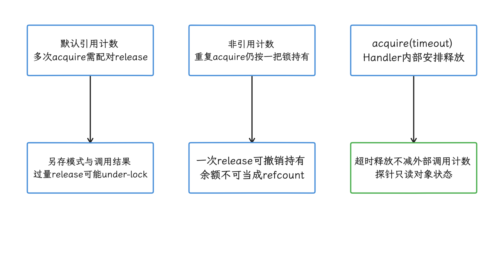

图：引用计数、非引用计数与内部 timeout 释放具有不同语义。 内部释放绕过应用调用点，publicCallBalance 不是框架计数。

### 2.2 插桩点与本地对象身份

比较稳妥的做法是 ASM 字节码插桩，我们在编译时给下面四类公开调用加上监控逻辑：

1. `PowerManager.newWakeLock(levelAndFlags, tag)` 返回后，为该对象分配进程内 `lockId`，保存创建时已经可见的 flags 和经过清洗的 tag。
2. `setReferenceCounted(value)` 成功返回后，更新本地模式。
3. `acquire()` / `acquire(timeout)` 返回后记录调用结果与 `isHeld()` 快照；异常路径单列。正常返回只记“调用成功”，不据此生成系统生效窗口。
4. `release()` 与 `release(flags)` 分别覆盖；正常返回记录 release 调用，异常时记录类型与受控栈。插桩避免在无参数重载转调有参数重载时重复计数。

对象注册表要用弱引用和 identity（按对象引用判断同一性）语义，既避免 APM 延长 WakeLock 生命周期，也避免把 `equals()` 的结果误当成身份。`lockId` 只在当前进程和本次启动周期内有效，跨会话统计要依靠清洗后的 tag、业务任务名和调用栈指纹（对调用路径生成的稳定摘要）。

<!-- gracker-diagram: ch17-10-07-public-hooks -->
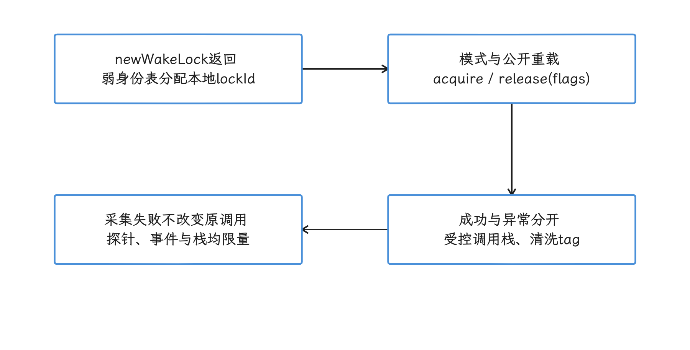

图：为对象分配本进程 lockId，覆盖公开重载并记录结果。 弱身份表不延长对象寿命；返回后 hook 顺序不能重建并发框架顺序。

下面的伪代码说明 timeout 到期后的保守处理，全程绕开 WakeLock 私有字段。

```kotlin
// Pseudocode: hooks run only after the original framework call returns successfully.
// Capture callReturnedUptimeMs immediately on return; probeHandler uses uptimeMillis.
data class LockState(
    val lockId: Long,
    val tagHash: String,
    val levelAndFlags: Int,
    var referenceCounted: Boolean = true,
    var publicCallBalance: Long = 0,
    var lastAcquireStack: String? = null
)

fun afterNewWakeLock(
    lock: PowerManager.WakeLock,
    levelAndFlags: Int,
    tag: String
) {
    locks.putWeakIdentity(
        lock,
        LockState(
            lockId = ids.next(),
            tagHash = Privacy.stableHash(Privacy.cleanTag(tag)),
            levelAndFlags = levelAndFlags
        )
    )
}

fun afterAcquire(
    lock: PowerManager.WakeLock,
    timeoutMs: Long?,
    callReturnedUptimeMs: Long
) {
    val state = locks.get(lock) ?: return
    synchronized(state) { state.publicCallBalance++ }
    state.lastAcquireStack = StackSampler.fingerprint()
    record("wakelock_acquire", state, timeoutMs)

    if (timeoutMs != null) {
        val weakLock = WeakReference(lock)
        val timeout = timeoutMs.coerceAtLeast(0)
        val deadlineUptimeMs = addUptimeSaturated(
            addUptimeSaturated(callReturnedUptimeMs, timeout), TIMEOUT_PROBE_GRACE_MS
        )
        probeHandler.postAtTime({
            val current = weakLock.get() ?: return@postAtTime
            // The framework's timeout release is private and bypasses app call-site hooks.
            record(
                event = if (current.isHeld) "wakelock_object_held_at_timeout_probe"
                        else "wakelock_not_held_at_timeout_probe",
                state = state,
                timeoutMs = timeoutMs
            )
        }, deadlineUptimeMs)
    }
}

fun afterRelease(lock: PowerManager.WakeLock) {
    val state = locks.get(lock) ?: return
    synchronized(state) { state.publicCallBalance-- }
    record("wakelock_release", state, timeoutMs = null)
}

private fun addUptimeSaturated(base: Long, delta: Long): Long {
    require(base >= 0 && delta >= 0)
    return base + delta.coerceAtMost(Long.MAX_VALUE - base)
}
```

`publicCallBalance` 只是本 SDK 看见的成功 acquire/release 调用余额，允许负值，不是引用计数或真实持有时长；非引用计数模式下重复 release 也可能正常返回。`probeHandler` 是应用预建的 Handler，使用 `uptimeMillis`；框架的 `postDelayed(mReleaser, timeout)` 同样使用这条不计深度休眠的时钟。`callReturnedUptimeMs` 由插桩在原调用返回时立即捕获，探针安排在其后 timeout 加宽限期，所以只是保守的检查时间，不能还原框架实际释放时刻。Binder 阻塞、队列延迟、深度休眠与其他 acquire 都会改变实际观察；业务关联时间线仍另存 `elapsedRealtime`，两种时间值不混减。

<!-- gracker-diagram: ch17-10-08-uptime-probe -->
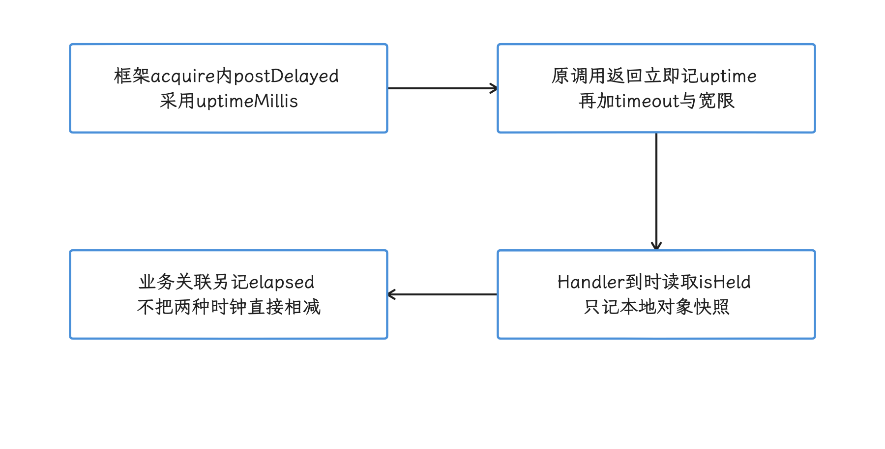

图：框架超时与探针按 uptime 调度，业务关联另存包含深度休眠的 elapsed 时间。 返回时刻只给保守探针起点，排队和其他 acquire 会改变实际观察。

这段示意代码依赖弱身份注册表、调度器和有限事件记录器；生产实现须使监控失败不改变原调用结果，限制每把锁的探针数并合并重复探针。栈采样、记录与注册表不能反向强引用锁；多线程原调用与返回后 hook 不是一个原子事务，因此不能用 hook 顺序重建精确框架顺序。进程退出、系统禁用/释放和未插桩调用均可能留下缺口，报告保留证据来源与不完整标志。

### 2.3 告警规则的场景维度

“持有超过 30 秒就是泄漏”这类固定规则会产生大量误报。我们至少要按下面几个维度区分：

- 锁等级，重点关注 `PARTIAL_WAKE_LOCK`；
- 进程前后台、前台服务类型和用户可见任务；
- 是否提供 timeout，以及 timeout 后是否仍处于 held 状态；
- 页面、Service、Worker 或 Job 的生命周期是否已经结束；
- tag/调用栈在相同设备和版本中的分位数，也就是该时长在同类样本里的相对位置；
- release 失败、引用计数模式变化和 acquire/release 栈是否对应。

抓栈可以选在首次 acquire、跨过阈值、模式变化和异常 release 这些时机；每次调用都抓完整堆栈，CPU 与内存开销会反过来污染耗电数据。

<!-- gracker-diagram: ch17-10-09-wakelock-alerts -->
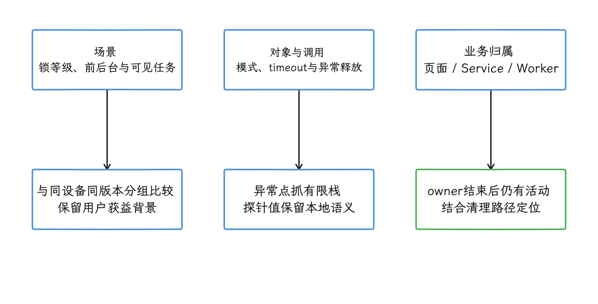

图：按锁模式、场景、owner 与异常分位数挑选有诊断价值的样本。 固定持有秒数不等于泄漏，逐次全栈采样会反过来增加功耗。

## 3. Alarm：设置、接受、取消、投递是四个事件

排查“设备为什么被唤醒”时，我们先把 wakeup alarm（可以把设备从低功耗状态唤醒的定时任务）挑出来：Alarm 里只有 `RTC_WAKEUP` 和 `ELAPSED_REALTIME_WAKEUP` 属于这一类，被投递时系统会唤醒设备，并在执行 `BroadcastReceiver.onReceive()` 或 `OnAlarmListener.onAlarm()` 期间持有 partial WakeLock。非 wakeup 类型也可能让应用在设备本来就醒着时执行工作，记录时把它和“唤醒设备”区分开即可。

要追踪一条 Alarm，我们把记录拆成四个阶段：

| 阶段 | 记录项 | 结论边界 |
| --- | --- | --- |
| schedule attempt（尝试设置） | API、type、请求时间、窗口、exact/idle 标记、业务 tag、调用栈 | 业务发起了设置请求 |
| accepted / rejected（接受或拒绝） | 正常返回或异常类型、<code>can<wbr>Schedule<wbr>Exact<wbr>Alarms()</code> | 系统是否接收本次调用；正常返回仍不代表一定投递 |
| cancel / replace（取消或替换） | 取消时间、稳定业务 ID、替换原因 | 计划被应用撤销，或被同一身份的新计划覆盖 |
| delivery（实际投递） | callback 开始/结束、计划与投递时间差、前后台、后续 Worker/Job/网络/WakeLock | 该次回调已经到达应用 |

`PendingIntent` 是交给系统保存、以后可以代表应用执行的操作封装，反射它的私有字段、上传完整 Intent 这两类动作都要避开。业务在创建 Alarm 时应提供低基数的稳定 ID，让取值种类有限、可以分组统计，例如 `daily_sync`、`user_reminder`，APM 记录其哈希即可。把动态时间戳、用户 ID 或随机数放进 tag，每条记录都会像新任务，还可能泄露隐私。

<!-- gracker-diagram: ch17-10-10-alarm-four-stages -->
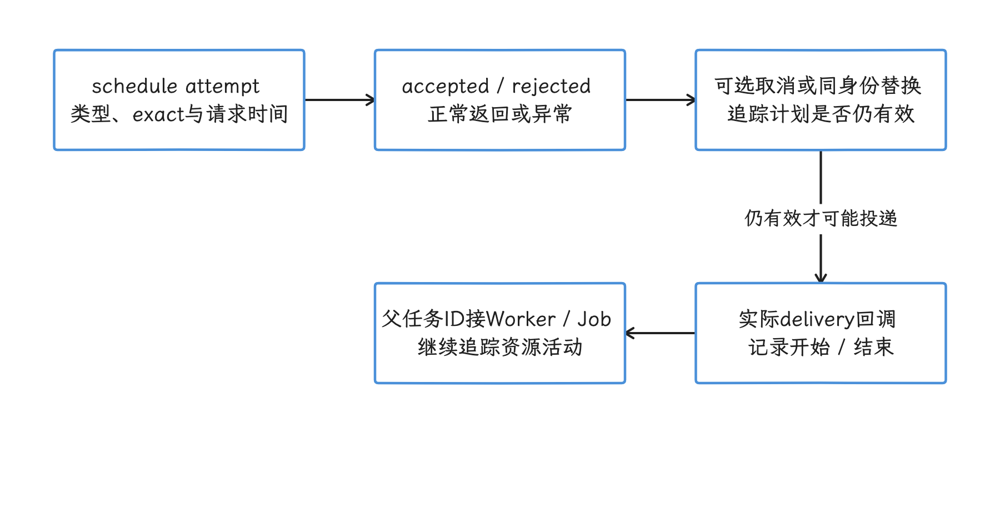

图：尝试设置、调用结果、取消替换和实际投递分别保存，靠业务 ID 关联后续工作。 设置成功不保证投递，时间接近不能代替父任务关系。

### 3.1 精确 Alarm 的版本边界

Android 12 开始对精确 Alarm 引入 special app access（特殊应用权限）。下表中的 target 指应用声明的 `targetSdkVersion`；具体限制既取决于 Alarm 用 `PendingIntent` 还是进程内 `OnAlarmListener`，也取决于系统版本：

| <span style="white-space:nowrap">系统 / target</span> | `PendingIntent` 精确 Alarm | <code>On<wbr>Alarm<wbr>Listener.<wbr>set<wbr>Exact()</code> |
| --- | --- | --- |
| Android 11 及以下 | 无 <code>SCHEDULE_<wbr>EXACT_<wbr>ALARM</code> 限制 | 无该限制 |
| Android 12—13，target 31+ | 需要声明并获得 <code>SCHEDULE_<wbr>EXACT_<wbr>ALARM</code>，豁免应用除外；Android 13 上，target 33+ 可按合规场景改用 `USE_EXACT_ALARM` | 对应版本的 <code>Alarm<wbr>Manager<wbr>Service</code> 同样检查精确 Alarm 权限，豁免应用除外 |
| Android 14—17，target 31+ | 未获相应能力时，`setExact()`、<code>set<wbr>Exact<wbr>And<wbr>Allow<wbr>While<wbr>Idle()</code>、`setAlarmClock()` 等调用抛出 <code>Security<wbr>Exception</code>，不会自动改成非精确 Alarm；target 33+ 可按合规场景选择两种权限之一 | Android 14 起不要求 <code>SCHEDULE_<wbr>EXACT_<wbr>ALARM</code>；Android 14 起的实现会在应用离开有效生命周期时清理 listener Alarm；Android 17 中，调用进程进入 cached（没有用户可见组件、可被系统优先回收）状态后，系统可丢弃该 listener Alarm，因此不适合持久后台提醒 |

`USE_EXACT_ALARM` 在安装时自动授予，撤销权不在用户手里，但只适用于闹钟、计时器、日历等受限核心场景，并受 Google Play 政策约束。`SCHEDULE_EXACT_ALARM` 由用户授予，也可能被用户或系统撤销。在 Android 14 及以上设备上，面向 Android 13（API 33）及以上的新安装不会预先获得它；通过备份恢复把应用迁移到 Android 14 新设备时，已授予状态也不会随数据迁移，而原设备上的应用随系统升级到 Android 14 时可以保留授权。

<!-- gracker-diagram: ch17-10-11-exact-alarm-versions -->
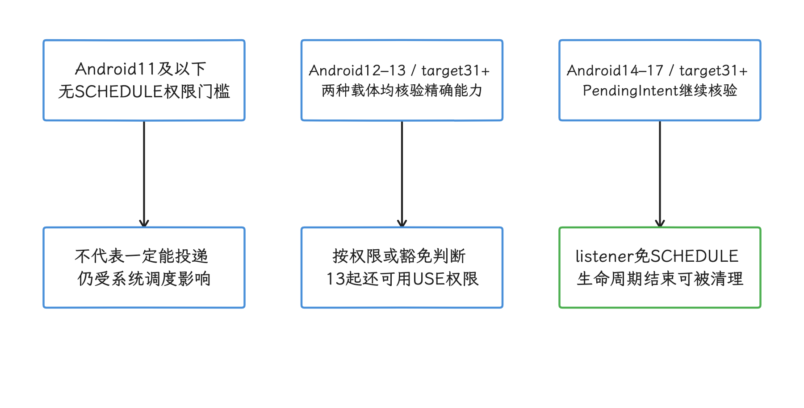

图：精确能力同时按系统版本、target 与 PendingIntent/listener 载体核对。 Android14 起 listener 免该权限，也受进程生命周期限制。

权限被撤销后，系统会停止应用并取消其后续精确 Alarm。对 `PendingIntent` 精确 Alarm，APM 应在调用前记录 `canScheduleExactAlarms()`，调用后再记录成功或 `SecurityException`，并在收到“已授予”广播后重新核查；撤销时不会发送这条广播。Android 14+ 的 `OnAlarmListener` 路径要另记 callback 载体与进程生命周期；即便 `canScheduleExactAlarms() == false`，listener（监听器） 调用也未必失败。所有样本都应分别保存 `requested_exact`、`accepted` 和 `delivered`。

<!-- gracker-diagram: ch17-10-12-exact-permission -->
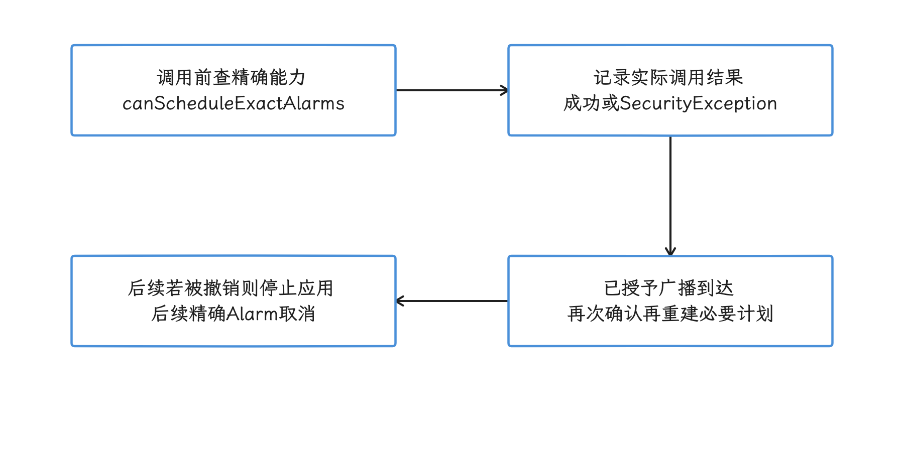

图：PendingIntent 精确调用记录能力快照和实际结果，授权广播到达后再确认能力。 广播只在授予时发送；撤销会停止应用并取消后续精确 Alarm。

### 3.2 Doze 配额与后台任务

深度 Doze 通常在设备未充电、屏幕关闭且静止一段时间后进入；轻度 idle 不要求设备静止，具体时机还受系统配置影响。`setExactAndAllowWhileIdle()` 允许 Alarm 在 Doze/idle 中执行，但系统仍会施加每应用配额和调度限制。投递时间要从实际的 delivery 事件读，凭请求时间推算出来的只是猜测；一次获准调用也只说明系统放行了这一次，谈不上“绕过 Doze”。

Alarm 适合用户可见且时间要求明确的提醒；可延迟的同步、日志上传和周期拉取应优先交给 WorkManager（可按约束延后并持久化的后台任务库），需要系统级约束和组件回调的任务可使用 JobScheduler。监控时同样要把“入队”和“执行”分开：

- WorkManager：记录 unique work 名、约束、expedited（加急）/foreground（前台执行）属性、入队时间，以及 `Worker.doWork()` / `CoroutineWorker.doWork()` 的开始、结果和重试。
- JobScheduler：记录 jobId、约束和 schedule 返回值，再记录 `JobService.onStartJob()`、`onStopJob()`、`jobFinished()`。
- Alarm 投递后启动 Worker 或 Job：用父任务 ID 连接；时间接近只是一种线索，是否同一调度链要靠 ID 关系确认。

同一任务在后台短时间反复经历“投递 → 网络重试 → WakeLock → 再入队”，才能形成可定位到代码位置的 wakeup storm（唤醒风暴）证据。线上阈值应按 App 版本、设备、任务类型和用户可见性分组，避免把合规的时钟或提醒功能与后台轮询混在一起。

<!-- gracker-diagram: ch17-10-13-doze-work-chain -->
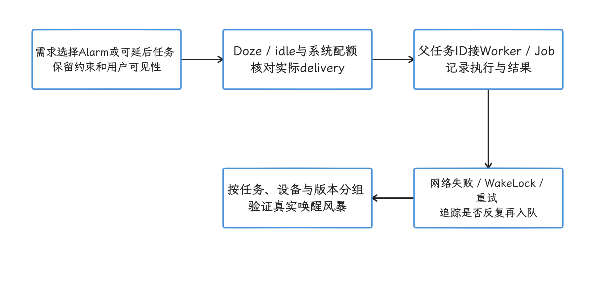

图：请求、配额放行、投递与后续重试沿同一任务链关联。 allow-while-idle 仍受配额，WorkManager 入队不等于已经执行。

## 4. 定位、扫描、网络与 CPU：不要把 API 窗口写成硬件窗口

GNSS（卫星定位系统）、Wi-Fi、蓝牙（扫描表中的 BLE 为 Bluetooth Low Energy，即低功耗蓝牙）和蜂窝基带的完整硬件活跃状态，普通应用直接读不到；我们能在应用端保留的，是“请求证据”和“结果证据”两层，更强的硬件结论交给 system trace 或实验室测量。

| 资源 | 请求侧记录 | 结果侧记录 | 必须保留的边界 |
| --- | --- | --- | --- |
| 定位 | provider / request、质量、最小间隔、最大延迟、duration、前后台、调用栈 | 首次回调、回调数、末次回调、移除请求、错误/权限状态 | 请求可能被限频、批处理，回调也可能来自缓存或融合定位；请求持续时间不等于 GNSS 射频持续时间 |
| BLE 扫描 | filters、scan mode、start/stop、任务和页面 | `onScanFailed()`、结果/批次回调、首末回调 | `startScan()` 返回不证明整个窗口内硬件持续扫描；记录结果中的设备名和地址会带来隐私风险 |
| <span style="white-space:nowrap">Wi-Fi</span> 扫描 | `startScan()`、返回值、权限、前后台 | <code>SCAN_<wbr>RESULTS_<wbr>AVAILABLE_<wbr>ACTION</code> 与 <code>EXTRA_<wbr>RESULTS_<wbr>UPDATED</code> | 调用可能因限频、idle 或硬件失败而返回 false；<code>get<wbr>Scan<wbr>Results()</code> 可能给出旧结果 |
| 网络 | 请求数、协议、网络类型、重试、应用层字节，UID 流量快照 | 成功/失败、响应字节、重试原因 | `TrafficStats` 的 UID 计数包含该 UID 的其他进程和请求，跨所有网络接口；它看不到 modem tail time（传输结束后基带继续保持高功耗的尾部时间）与能量 |
| CPU | 进程 CPU 时间、线程 CPU 时间、墙钟窗口、线程栈、调度任务 | 任务完成/取消、采样分位数 | 进程 CPU 时间是较强的应用自耗证据，仍不能直接换算成整机功耗 |

<!-- gracker-diagram: ch17-10-14-radio-windows -->
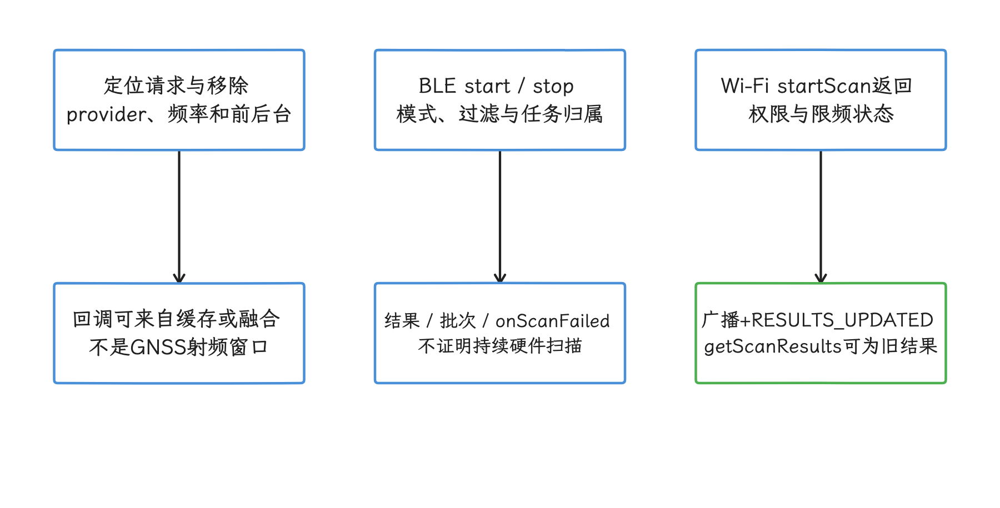

图：定位、BLE 与 Wi-Fi 分别保留请求和结果，不能从 API 窗口推出硬件持续工作。 缓存、批处理、权限和节流均可能改变结果，设备标识不进入默认样本。

### 4.1 网络侧的基带唤醒风险

蜂窝 radio（无线收发部分） 常在数据传输结束后继续保持一段高功耗状态，具体状态转换由 modem（调制解调器，也就是基带）、运营商网络和厂商配置决定。高频小包、失败重试和后台轮询都会推高这类风险；某次传输让基带多保持了多久，仅凭应用侧的 socket 时间线或 UID（Android 为应用或进程分配的用户标识） 字节差还确认不了。

端侧可以报告：

- 前后台移动网络发送/接收字节；
- 请求与重试次数、时间间隔、批量程度；
- 网络从 Wi-Fi 切换到蜂窝后的任务行为；
- 同一业务在弱网下增加的 CPU、WakeLock 和执行时长。

报告措辞与证据强度一致，例如“后台网络活动”“蜂窝耗电风险”。`getUidRxBytes()` / `getUidTxBytes()` 是自开机累计的 UID 全接口计数；采样须处理 `UNSUPPORTED`、重启和计数回退，不能只看采样瞬间的默认网络就把跨网络窗口全部归到蜂窝。需要每 UID 移动网络统计时另行核查 `NetworkStatsManager` 的权限、时间桶与可用性。实际 modem 活跃窗口、tail time 和能量仍需系统 trace、受支持设备的 power rails 或厂商工具验证。

<!-- gracker-diagram: ch17-10-15-uid-network -->
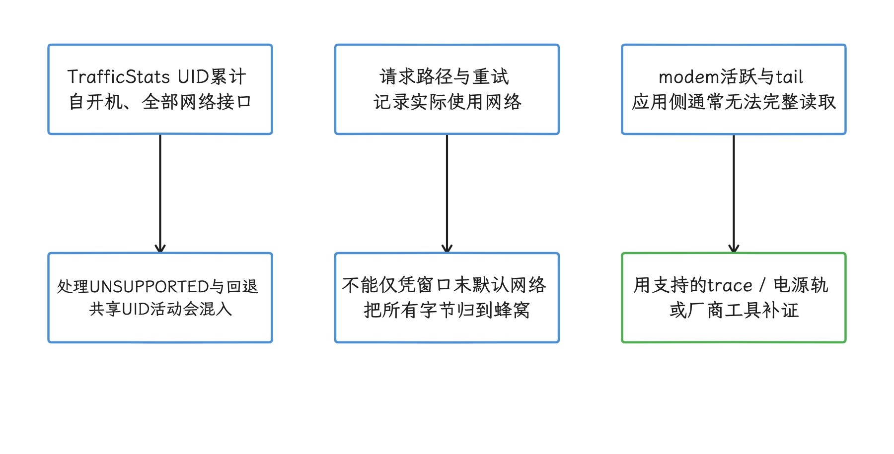

图：UID 全接口字节、实际请求路径与系统 radio 证据使用各自口径。 默认网络快照不能把跨网络计数归给蜂窝，字节量不能推出 tail time 或 mAh。

### 4.2 CPU 时间与墙钟时间

一段任务运行了 30 秒，我们先要看它实际占用了多少 CPU：等待网络、Binder、锁或磁盘时，wall-clock time（墙钟经过时间）继续增加，CPU time（真正执行指令的时间）可能只增加少量。多线程解码在 2 秒墙钟时间内，多个线程累计的 CPU 时间甚至可能超过 2 秒。

端侧样本可以保存：

```text
task_id, process_state
start_elapsed_ms, end_elapsed_ms
process_cpu_ms_delta
top_thread_cpu_ms_delta
sampled_stack_fingerprint
thermal_status_before, thermal_status_after
```

这组字段就是用来区分“任务持续很久”和“任务持续计算”的。线程 CPU 采样要限制频率，只在进程 CPU 异常增长时抓取 CPU 用量最高线程的调用栈，免得监控线程自己变成热源。

<!-- gracker-diagram: ch17-10-16-cpu-vs-wall -->
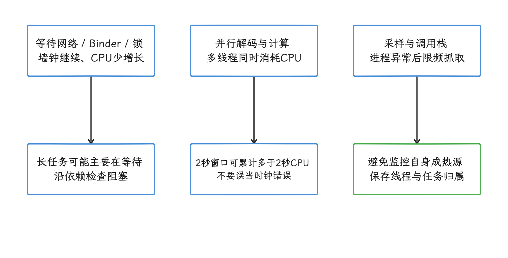

图：同时记录墙钟经过窗口与进程、线程 CPU 时间，区分等待与计算。 多线程 CPU 总和可超过墙钟时间；CPU 时间仍不是整机能量。

### 4.3 生命周期与资源归属

定位请求、扫描、网络重试或高 CPU 线程，如果在页面退出、Service 停止、Worker/Job 完成后仍然存在，就比单纯的持续时长更有诊断价值。所以我们给每类资源记录一个 owner，即本应负责结束它的生命周期实体：

- `screen:<route>`：页面或可见会话；
- `service:<class>`：前台或后台服务；
- `worker:<unique-name>`：WorkManager 工作；
- `job:<job-id>`：JobScheduler 任务；
- `feature:<stable-id>`：跨组件的业务会话。

owner 使用开发期配置的低基数标识，不采集用户输入、位置、蓝牙设备信息、完整 URL、query 或请求体。

<!-- gracker-diagram: ch17-10-17-owner-cleanup -->
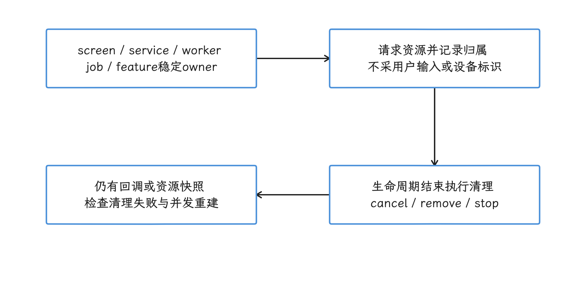

图：把请求、回调与结束动作挂到低基数 owner，生命周期结束后检查残留活动。 时间越长并不必然泄漏；跨组件会话需明确谁负责结束。

## 5. `BatteryManager`：适合做设备侧上下文，不适合给方法计费

做设备侧上下文采集时，我们主要读 `BatteryManager`，它对几项常用属性给出了明确单位：

- `BATTERY_PROPERTY_CURRENT_NOW`：瞬时电流，单位 µA（微安）；正数表示净电流流入电池，负数表示电池放电。
- `BATTERY_PROPERTY_CURRENT_AVERAGE`：平均电流，单位 µA；平均窗口由 fuel gauge（电量计芯片及其估算算法） 硬件及其配置决定。
- `BATTERY_PROPERTY_CHARGE_COUNTER`：剩余电荷量，单位 µAh（微安时）。
- `BATTERY_PROPERTY_ENERGY_COUNTER`：剩余能量，单位 nWh（纳瓦时）。
- 电压通常来自 `ACTION_BATTERY_CHANGED` 的 `BatteryManager.EXTRA_VOLTAGE`，单位 mV（毫伏）。

设备不支持某项 long property（64 位整数属性）时，`getLongProperty()` 返回 `Long.MIN_VALUE`；采集端要把“不支持”当独立状态，与 0 区分开。不同设备的采样周期、滤波、符号和精度仍会有差异，`CURRENT_AVERAGE` 的时间窗口也没有跨设备统一保证。

这些值可用于同一设备、相同充电状态下的实验对照，也可作为线上低频上下文。例如比较某版本在“未充电、屏幕状态相近、网络类型一致”的会话中，资源事件与放电电流分布是否一起变化。它们不适合：

- 用一次 `CURRENT_NOW × 电压 × 方法耗时` 计算某个方法的能量；
- 跨机型直接比较绝对电流；
- 在充电、电量校准或温控强降频期间推导业务成本；
- 高频轮询后把采样开销忽略不计。

端侧默认只需要低频、低比例采样。精确功耗评估放到固定设备、固定亮度和网络条件的实验室测试，并使用 Power Profiler、系统 trace、Macrobenchmark 电源指标或外接功耗设备。

<!-- gracker-diagram: ch17-10-18-battery-context -->
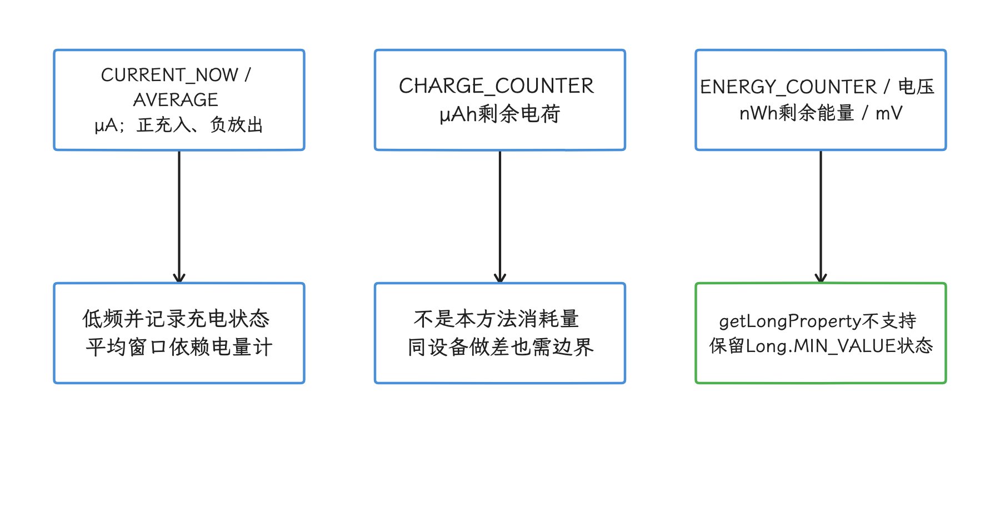

图：电流、电荷量、能量与电压按单位保存，用受控条件对照设备趋势。 不支持值与0分开，整机读数不能给单个方法分配能耗。

## 6. Thermal API：状态用于保护设备，headroom 用于提前减小负载

我们先分清三个词：thermal status（热状态）是系统汇总后的整机热节流等级；thermal throttling（热节流）指系统因温度升高而限制 CPU、GPU 等硬件性能的保护措施；thermal headroom 是接近 `THERMAL_STATUS_SEVERE` 阈值的归一化指标，值越接近 1.0，可继续升温的余量越小。listener 则是状态变化时由系统回调的对象。

Android Thermal API 的演进可以分成四步：

| Android 版本 | 公共能力 | 使用要点 |
| --- | --- | --- |
| Android 10 / API 29 | <code>get<wbr>Current<wbr>Thermal<wbr>Status()</code>、<code>On<wbr>Thermal<wbr>Status<wbr>Changed<wbr>Listener</code> | 读取和监听系统聚合的热节流等级 |
| Android 11 / API 30 | <code>get<wbr>Thermal<wbr>Headroom(forecast<wbr>Seconds)</code> | 读取当前值或预测 0—60 秒；不支持或显著过频可为 `NaN`，启动时样本不足通常先返回当前值 |
| Android 15 / API 35 | <code>get<wbr>Thermal<wbr>Headroom<wbr>Thresholds()</code> | 读取设备提供的状态阈值（threshold）；不是每个状态都一定有阈值 |
| Android 16—17 / API 36—37 | <code>On<wbr>Thermal<wbr>Headroom<wbr>Changed<wbr>Listener</code> | 接收当前 headroom 或阈值的显著变化；API 36 起阈值可变化 |

<!-- gracker-diagram: ch17-10-19-thermal-api-versions -->
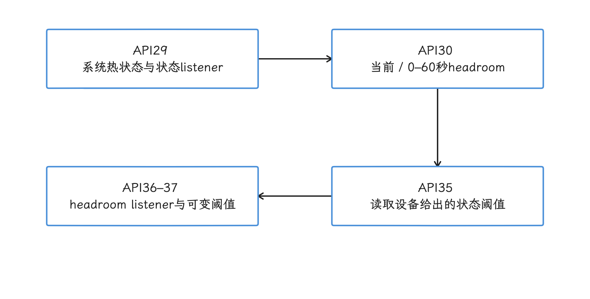

图：热状态、headroom、阈值与 headroom listener 分别检查 API 版本。 API 存在不保证设备支持全部预测和阈值，NaN 与缺项分别处理。

`getThermalHeadroom()` 返回值 1.0 表示当前或预测会到达 `THERMAL_STATUS_SEVERE` 的阈值；超过 1.0 之后，值和更高状态之间就失去了确定的对应关系，直接线性映射成 CRITICAL 或 EMERGENCY 站不住。`NaN`（Not a Number）表示本次没有可用数值，调用方要把它筛掉，不参与大小比较。官方说明还指出，慢速温度传感器轮询保持在约每秒一次以内即可，过频调用也可能得到 `NaN`；预测需要多个历史样本；开始几秒通常尚不外推，无论 forecastSeconds 为多少都先返回当前 headroom。缺少能力或有效温度时仍可能无结果，不能把启动时的当前值当作已经完成预测。

<!-- gracker-diagram: ch17-10-20-headroom-meaning -->
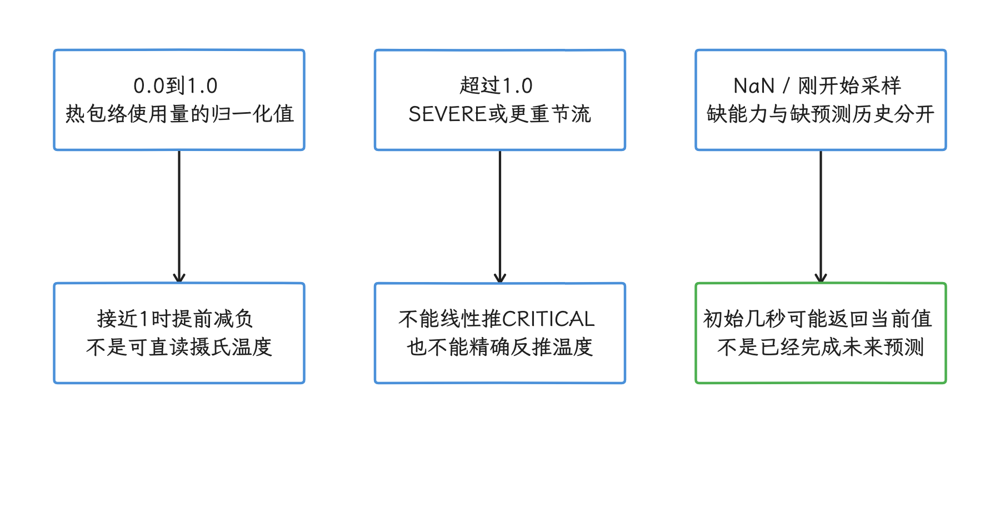

图：1.0 对应 SEVERE 门槛，预测启动期可能先返回当前值。 超过1.0没有更高状态的固定映射；NaN不可参与正常比较。

headroom listener 适合获知当前值或阈值的显著变化，但它不会只因某个未来预测值变化就持续回调，主动查询仍要保留：需要短期预测的游戏、相机或视频业务，应在受控频率下调用 `getThermalHeadroom(forecastSeconds)`，并处理 `NaN`。阈值由 OEM（Original Equipment Manufacturer，设备制造商） 根据设备散热和硬件配置提供，经验阈值要按机型各自标定。

<!-- gracker-diagram: ch17-10-21-headroom-listener -->
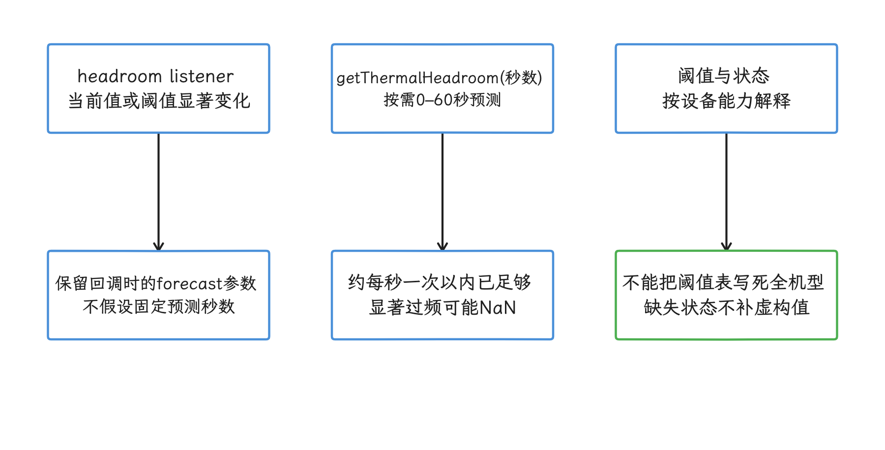

图：显著当前值或阈值变化由 listener 通知，短期预测仍需受控频率主动查询。 listener 不因未来预测值单独改变就持续回调，阈值依 OEM 且可变化。

### 6.1 状态与动作的映射

系统状态只描述整机热节流程度；“现在多少摄氏度”“热量是不是当前 App 造成的”这两个问题，它都回答不了。我们能做的是把它转成统一的资源预算，即各类任务允许使用的并发数、执行频率和质量规格上限：

| Thermal 状态 | 资源预算示例 | 恢复条件 |
| --- | --- | --- |
| `NONE` / `LIGHT` | 正常预算；LIGHT 可停止非必要的新增预取 | 低状态稳定一段时间后恢复全部能力 |
| `MODERATE` | 降低预取、上传、解码和渲染并发，减少后台扫描 | 低于 MODERATE 且持续稳定 |
| `SEVERE` | 暂停大文件后台下载，降低视频规格和高成本特效，压低工作线程并发 | 低于 SEVERE 且持续稳定 |
| `CRITICAL` | 停止非必要计算、定位与扫描，保留用户当前操作 | 状态持续下降后分级恢复 |
| `EMERGENCY` | 保存必要状态，停止所有可推迟任务 | 只做保守恢复 |
| `SHUTDOWN` | 不依赖回调完成持久化；若收到则立即执行最小保护 | 由设备后续状态决定 |

升温时应立即缩减预算，降温时延迟恢复。这里的迟滞是指“达到更安全的状态后仍等待一段时间再逐级恢复”，用来避免状态在阈值附近波动时反复启停下载、视频和动画。每项策略都要幂等，也就是重复应用同一预算不会继续叠加副作用；NORMAL 预算还必须显式恢复此前改变过的参数。

<!-- gracker-diagram: ch17-10-22-budget-hysteresis -->
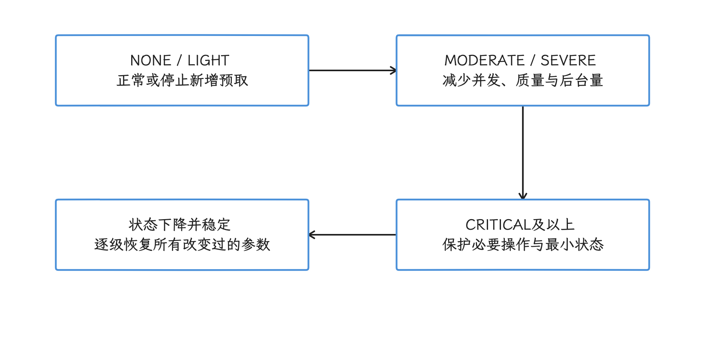

图：热状态映射统一预算，升温立即收紧，降温稳定后分级恢复。 升温可跨级收紧；预算与30秒等迟滞参数是业务策略，不是平台常量。

### 6.2 注册行为与可恢复状态机

状态机是“当前热状态、已应用预算及允许的下一步转换”组成的规则。在 `android-17.0.0_r1` 中，`ThermalManagerService.registerThermalStatusListener()` 注册成功后会立即把当前 `mStatus` 投递给新 listener，直接依赖这个初始回调即可；应用再紧接着调用 `getCurrentThermalStatus()` 并手工执行一次策略，反而会产生重复事件，还可能与异步回调交错。

下面的 Kotlin 结构展示串行回调、立即降级和延迟恢复。业务策略由 `ThermalPolicy.applyAll()` 统一设置，避免不同模块各自维护一份状态。

```kotlin
enum class ThermalBudget {
    NORMAL, REDUCED, SEVERE, PROTECT
}

// API 29+. Policy starts in NORMAL; applyAll and telemetry are bounded/non-throwing.
class ThermalGuard(
    context: Context,
    private val policy: ThermalPolicy,
    private val executor: ScheduledExecutorService =
        Executors.newSingleThreadScheduledExecutor()
) : Closeable {
    private val powerManager = requireNotNull(
        context.getSystemService(PowerManager::class.java)
    )
    private var active = false
    private var closed = false
    private var registered = false
    private var currentStatus = PowerManager.THERMAL_STATUS_NONE
    private var appliedBudget = ThermalBudget.NORMAL
    private var generation = 0L
    private var pendingRecovery: ScheduledFuture<*>? = null

    private val listener =
        PowerManager.OnThermalStatusChangedListener { status ->
            synchronized(this@ThermalGuard) {
                if (!active) return@synchronized
                currentStatus = status
                BatteryApm.recordThermalStatus(
                    status, SystemClock.elapsedRealtime(), ProcessState.isForeground()
                )
                cancelRecovery()
                val target = budgetFor(status)
                if (target.ordinal >= appliedBudget.ordinal) {
                    applyNow(target)
                } else {
                    scheduleOneRecoveryStep()
                }
            }
        }

    @Synchronized
    fun start() {
        check(!closed) { "ThermalGuard is closed" }
        if (active) return
        active = true
        try {
            // Registration posts the current status; do not add a competing manual read.
            powerManager.addThermalStatusListener(executor, listener)
            registered = true
        } catch (e: RuntimeException) {
            active = false
            cancelRecovery()
            throw e
        }
    }

    @Synchronized
    override fun close() {
        if (closed) return
        closed = true
        active = false
        cancelRecovery()
        try {
            if (registered) powerManager.removeThermalStatusListener(listener)
        } finally {
            executor.shutdownNow()
        }
    }

    private fun cancelRecovery() {
        generation++
        pendingRecovery?.cancel(false)
        pendingRecovery = null
    }

    private fun applyNow(target: ThermalBudget) {
        if (target == appliedBudget) return
        policy.applyAll(target) // NORMAL restores every changed knob.
        BatteryApm.recordThermalPolicy(appliedBudget, target)
        appliedBudget = target
    }

    private fun scheduleOneRecoveryStep() {
        val expectedGeneration = generation
        pendingRecovery = executor.schedule({
            synchronized(this@ThermalGuard) {
                if (!active || generation != expectedGeneration) return@synchronized
                pendingRecovery = null
                val stableTarget = budgetFor(currentStatus)
                if (stableTarget.ordinal < appliedBudget.ordinal) {
                    applyNow(ThermalBudget.entries[appliedBudget.ordinal - 1])
                    if (stableTarget.ordinal < appliedBudget.ordinal) {
                        scheduleOneRecoveryStep()
                    }
                }
            }
        }, 30, TimeUnit.SECONDS)
    }

    private fun budgetFor(status: Int): ThermalBudget = when (status) {
        PowerManager.THERMAL_STATUS_NONE,
        PowerManager.THERMAL_STATUS_LIGHT -> ThermalBudget.NORMAL
        PowerManager.THERMAL_STATUS_MODERATE -> ThermalBudget.REDUCED
        PowerManager.THERMAL_STATUS_SEVERE -> ThermalBudget.SEVERE
        else -> ThermalBudget.PROTECT
    }
}
```

示例中的 30 秒是业务迟滞参数，运行环境为 API 29+；它不是平台常量，也不保证精确到点执行。回调、恢复任务和 start/close 共用同步门，close 等待已经进入的策略调用结束，之后入队的回调和旧代次恢复任务会被忽略；对象关闭后不再复用。注册失败会回滚 active，移除失败仍关闭 executor 并把异常交给生命周期管理方。示例要求策略初始为 NORMAL、`applyAll()` 和 telemetry 有界且不抛异常；生产中每个策略模块须隔离失败并在自己的线程安全边界接收完整预算，避免在同步门内进行耗时 I/O。NORMAL 必须恢复所有曾改变的参数。

<!-- gracker-diagram: ch17-10-23-thermal-guard -->
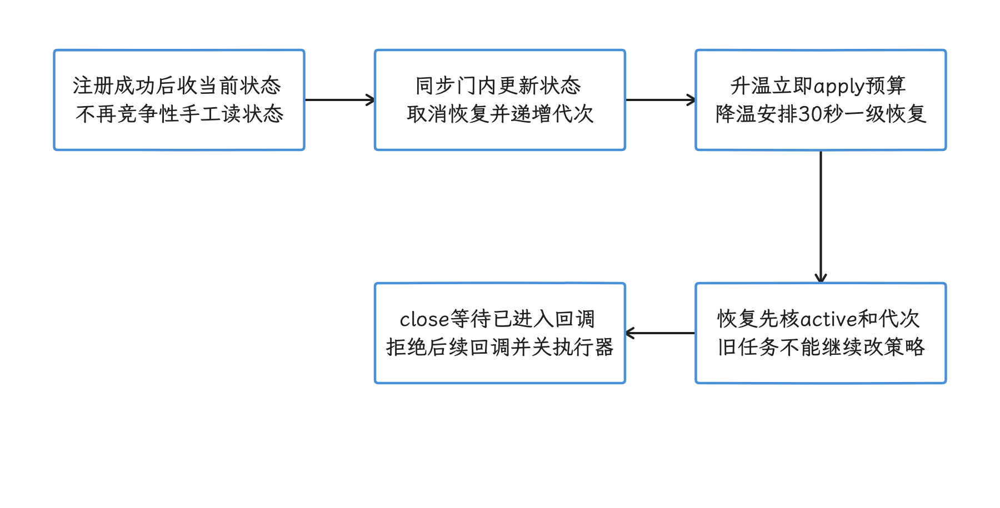

图：回调、恢复任务和生命周期共用同步门，以代次拒绝已取消的旧任务。 策略与记录器须有界不抛错；主机验证不替代设备温控验收。

### 6.3 发热与性能的反馈回路

反馈回路指前一步的结果又反过来影响起点：资源活动推高温度，系统节流让任务变慢，超时或重试又可能增加资源活动。这张图展示应用能观察到的部分。

应用与其他系统负载共同影响温升；传感器、Thermal HAL 和服务提供状态，应用据此收紧预算。系统节流也可能拉长任务，失败重试又增加负载；诊断需把这条反馈链与其他负载分开核查。

<!-- gracker-diagram: ch17-10-24-thermal-feedback -->
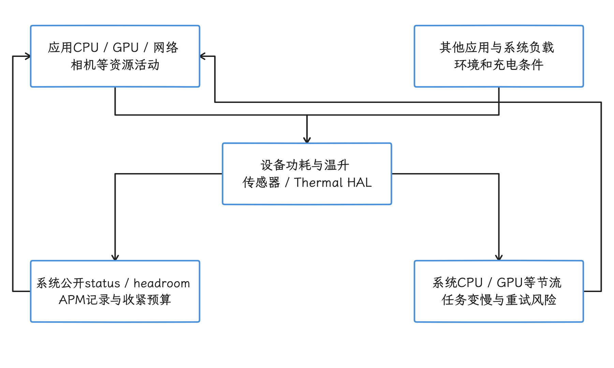

图：应用与系统负载共同推高温度，系统节流与应用减负分别反馈到任务执行。 重试可能放大负载，时间线仍需控制变量实验支撑因果判断。

Thermal HAL 是系统连接温度传感器与上层 Thermal 服务的硬件抽象层。APM 主要看得到系统公开状态、自己的负载与策略动作，其他应用和系统负载通常不完整。所以“业务负载先出现、热状态随后升高、减小负载后状态下降”这套时间线只是因果证据的一部分；要进一步确认因果，我们还需比较版本和设备分组，做其他条件不变、只切换目标功能的对照实验，并检查系统级 trace。

## 7. Android Vitals 与端侧 APM 的互补关系

截至 2026-10-26，Google Play 官方 vitals 页面公开定义如下（相关指标页更新于 2026-09-21）：

| Vitals 指标 | 当前公开定义 | 端侧可提供的补充 |
| --- | --- | --- |
| excessive partial wake locks | 所有非豁免 partial WakeLock 在任意 24 小时窗口内累计达到 2 小时；只计算应用处于后台或运行前台服务时的持有；当前豁免音频、定位和 JobScheduler user-initiated API 创建的锁 | tag/调用栈、业务 owner、每次持有窗口、timeout 与 release 异常 |
| stuck partial wake locks | 24 小时内至少出现一次后台持续 1 小时的 partial WakeLock | 哪个对象和生命周期没有结束 |
| excessive wakeups | 关注已触发的 `RTC_WAKEUP` / <code>ELAPSED_<wbr>REALTIME_<wbr>WAKEUP</code> | schedule、cancel、delivery 和后续工作之间的关系 |
| excessive background Wi-Fi scans | 后台每小时超过 4 次扫描 | 哪个业务请求、调用是否成功、结果是否更新 |
| excessive background mobile network | 后台每日收发合计达到 50 MB | 请求、重试、业务和网络类型分布 |

excessive partial wake locks 已是 core vital，也就是 Google Play 会用于应用质量与商店可见性评估的核心指标。它的 bad behavior threshold（不良行为阈值）是最近 28 天、所有设备中超过 5% 的 app sessions；app session 是 Play 用来计算该比例的应用运行会话，不等同于端侧 SDK 自定义的一次业务会话。对商店可见性的影响已从 2026 年 3 月 1 日起生效。

<!-- gracker-diagram: ch17-10-25-vitals-holding -->
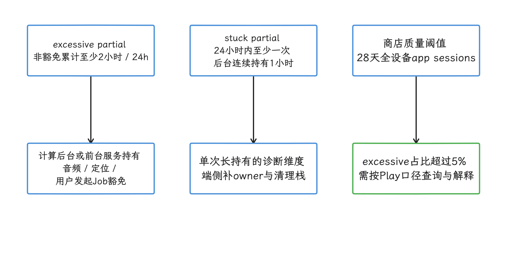

图：Excessive partial WakeLock 看24小时累计，stuck 看长时间后台持有；Play 阈值按官方分母计算。 豁免与分母不同，端侧 lockId 的一次会话不能直接换算成 Play 指标。

表中的 Wi-Fi 扫描、移动网络及 stuck WakeLock 使用 battery session，不能概括成统一的“单次充放电周期”。官方现行说明区分：Android 10 会合并 24 小时内的电池报告，Android 11 为固定 24 小时；各平台定义需随对应文档保存。它与 excessive partial WakeLock 的 app session 分母也不同，不能直接换算。Play 的阈值、豁免及口径可能调整，端侧单次业务会话的告警线另设。

<!-- gracker-diagram: ch17-10-26-vitals-denominators -->
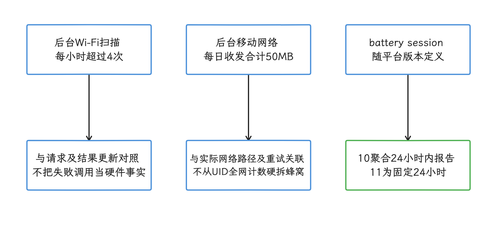

图：指标的数值门槛、平台版本和统计分母一起保存，再用端侧业务上下文定位。 Android10电池报告聚合与Android11固定24小时不同，不能用业务session替代。

Vitals 来自符合条件的 Google Play 安装和同意共享数据的用户，提供应用进程之外的系统视角；端侧 SDK 则覆盖自己的分发和业务上下文。两者的分母、会话定义与隐私门槛都不同，数值之间不做直接换算。合适的协作方式是用 Vitals 找版本、设备和指标趋势，我们再用端侧低基数任务 ID 与调用栈定位代码。

<!-- gracker-diagram: ch17-10-27-vitals-apm-join -->
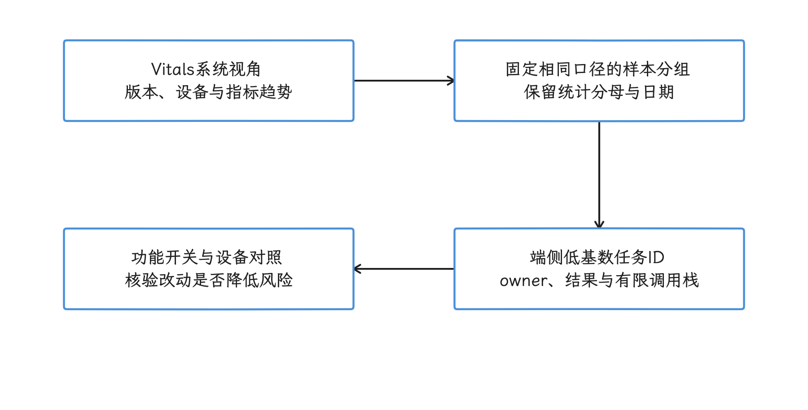

图：Vitals 找版本、设备和指标趋势，端侧靠任务 ID 与有限栈定位具体业务。 安装来源、用户共享选择、隐私门槛与会话分母均不同，数值不直接换算。

## 8. 上报、时钟与隐私边界

上报环节我们默认在本地聚合资源事件，也就是先在设备上把原始事件合并成次数、持续时间和状态分布，普通会话只上传分钟级摘要。命中异常分位数后，再从受控比例的会话上传少量明细；分位数是样本的相对位置，例如 p95 表示 95% 的样本不高于该值。建议保留：

- `elapsedRealtime`：设备开机后持续递增的单调时间，用于计算进程内持续时间和事件顺序，不受用户修改墙钟影响；
- wall clock（可对应日历日期的系统时间） 与 boot/session ID（本次开机或应用会话的标识）：用于关联跨进程日志；设备重启后，旧的 elapsed 时间线就断了；
- App 版本、Android 版本、机型分组、进程状态、充电/屏幕/网络类型；
- 低基数业务 ID、清洗后的 tag 哈希、调用栈指纹和采样原因；
- `evidence_level=request|callback|system_validation`：分别表示应用发出请求、收到系统回调、经过系统统计或实验验证，防止下游把请求事件写成硬件事实。

<!-- gracker-diagram: ch17-10-29-clock-domains -->
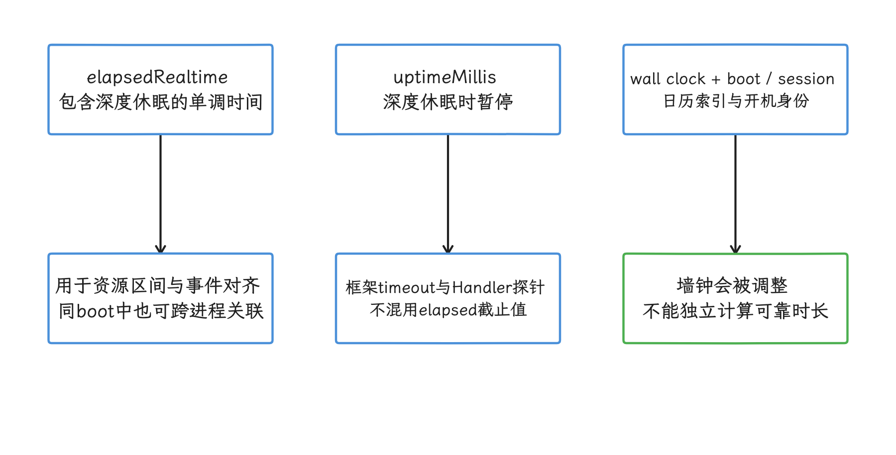

图：同开机周期用 elapsed 关联资源与热事件，Handler 定时用 uptime，日历时间另作索引。 设备重启会断开单调时间线；跨设备或跨开机不能直接相减。

以下数据不要进入耗电 APM：精确位置、附近 Wi-Fi SSID/BSSID（网络名与接入点标识）、蓝牙设备名和地址、完整 URL/query（包括查询参数）、请求体、用户 ID、原始 Intent extras（随 Intent 携带的键值参数）。调用栈上报前还要去除动态参数，并设置每日条数与字节预算。

<!-- gracker-diagram: ch17-10-28-aggregation-privacy -->
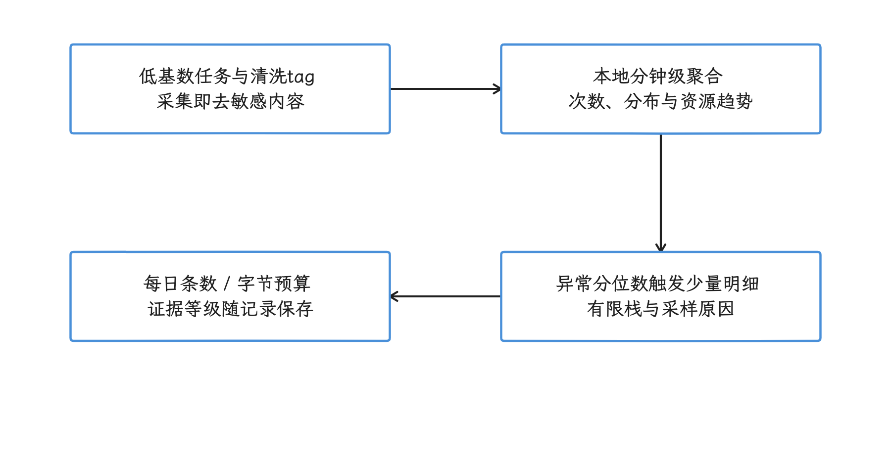

图：资源事件先脱敏并本地聚合，普通会话上传摘要，异常会话受控采样。 位置、附近设备标识、完整网络内容与原始 Intent 不进入默认耗电样本。

结论模板也要与证据匹配：

- 可以这么写：“`worker:feed_sync` 在后台 20 分钟内执行 18 次，其中 16 次发生经请求路径确认的移动网络重试，并在 14 次探针观测到 partial WakeLock 对象的 `isHeld == true`；该值不证明系统始终让锁生效。”
- 不宜这么写：“`feed_sync` 消耗了 12.4 mAh，导致基带保持活跃 8 分钟。”端侧数据没有提供这两个系统级事实。

## 9. 验证清单

验收这套监控时，WakeLock 测试至少要覆盖引用计数开启/关闭、连续多次 acquire、timeout 内主动 release、timeout 自动释放、release 过多和进程退出。断言对象是事件状态机与 `isHeld()` 观测，不要断言私有计数值。

Alarm 测试覆盖：

- `PendingIntent` 与 `OnAlarmListener`；
- wakeup 与 non-wakeup type；
- 精确能力已授予、未授予、撤销；
- schedule 后 cancel、同身份替换、进程进入 cached（缓存进程：不再承载前台组件，系统可回收或冻结） 状态；
- Doze 下普通 Alarm 与允许在 idle 期间执行的 Alarm 的投递时间；
- callback 内启动 Worker/Job、网络失败与重试。

Thermal 策略测试要模拟升温和降温序列，验证限制立即生效、恢复经过迟滞、重复状态幂等、close 后不再改策略。调试设备可通过 `adb shell cmd thermalservice override-status <status>` 注入状态，并用 `adb shell cmd thermalservice reset` 解除覆盖；这条命令只用于测试环境。headroom 路径还要覆盖 `NaN`、阈值缺失和 listener 不可用。

设备实验应固定亮度、刷新率、温度起点、充电状态、网络和业务输入，至少包含空载基线（不运行待测功能）与功能开关对照（其他条件相同，只改变该功能是否启用）。结果按设备和版本分组，不把某台设备的电流曲线推广成所有 Android 设备的功耗模型。

<!-- gracker-diagram: ch17-10-30-validation-matrix -->
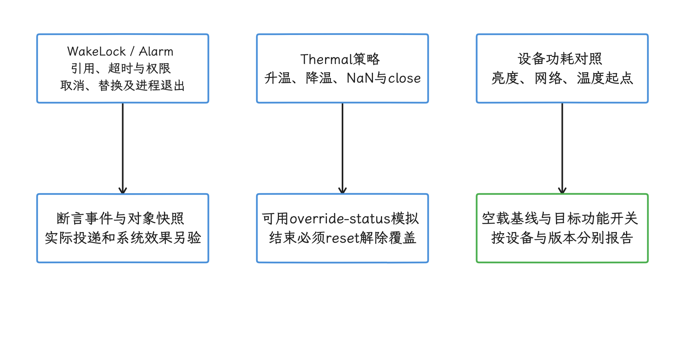

图：先验收采集与策略状态机，再在固定条件设备上核对实际系统效果。 状态覆盖不等于真实温升或精确功耗；模拟热状态不能证明传感器路径。

## 参考资料

### Android 17 / `android-17.0.0_r1` 源码

- [`PowerManager.java`](https://android.googlesource.com/platform/frameworks/base/+/refs/tags/android-17.0.0_r1/core/java/android/os/PowerManager.java)：WakeLock 引用计数、timeout、`isHeld()` 与 Thermal 公共 API 实现。
- [`PowerManagerService.java`](https://android.googlesource.com/platform/frameworks/base/+/refs/tags/android-17.0.0_r1/services/core/java/com/android/server/power/PowerManagerService.java)：SystemServer 的 WakeLock 管理。
- [`ThermalManagerService.java`](https://android.googlesource.com/platform/frameworks/base/+/refs/tags/android-17.0.0_r1/services/core/java/com/android/server/power/thermal/ThermalManagerService.java)：状态/headroom listener 注册、初始回调与调试命令。
- [`AlarmManager.java`](https://android.googlesource.com/platform/frameworks/base/+/refs/tags/android-17.0.0_r1/apex/jobscheduler/framework/java/android/app/AlarmManager.java)：精确 Alarm、listener 生命周期与版本注释。
- [`AlarmManagerService.java`](https://android.googlesource.com/platform/frameworks/base/+/refs/tags/android-17.0.0_r1/apex/jobscheduler/service/java/com/android/server/alarm/AlarmManagerService.java)：Alarm 调度、权限和投递服务端实现。
- [`DeviceIdleController.java`](https://android.googlesource.com/platform/frameworks/base/+/android-17.0.0_r1/apex/jobscheduler/service/java/com/android/server/DeviceIdleController.java)：深度 Doze 与轻度 idle 的独立状态推进及充电、屏幕条件。
- [Android 12 `AlarmManagerService.java`](https://android.googlesource.com/platform/frameworks/base/+/refs/tags/android-12.0.0_r1/apex/jobscheduler/service/java/com/android/server/alarm/AlarmManagerService.java)：Android 12 精确 Alarm 的服务端权限检查。
- [Android 13 `AlarmManagerService.java`](https://android.googlesource.com/platform/frameworks/base/+/refs/tags/android-13.0.0_r1/apex/jobscheduler/service/java/com/android/server/alarm/AlarmManagerService.java)：Android 13 精确 Alarm 的服务端权限检查。
- [Android 14 `AlarmManagerService.java`](https://android.googlesource.com/platform/frameworks/base/+/refs/tags/android-14.0.0_r1/apex/jobscheduler/service/java/com/android/server/alarm/AlarmManagerService.java)：`OnAlarmListener` 精确 Alarm 的权限豁免起点。
- [`BatteryManager.java`](https://android.googlesource.com/platform/frameworks/base/+/refs/tags/android-17.0.0_r1/core/java/android/os/BatteryManager.java)：电流、容量、能量属性的单位和不支持返回值。
- [`BatteryStatsImpl.java`](https://android.googlesource.com/platform/frameworks/base/+/refs/tags/android-17.0.0_r1/services/core/java/com/android/server/power/stats/BatteryStatsImpl.java)：系统电池统计的计时器与计数器实现。

### Kernel `android17-6.18-2026-06_r6`

- [`drivers/base/power/wakeup.c`](https://android.googlesource.com/kernel/common/+/refs/tags/android17-6.18-2026-06_r6/drivers/base/power/wakeup.c)：wakeup source 与系统 suspend 约束。
- [`kernel/power/wakelock.c`](https://android.googlesource.com/kernel/common/+/refs/tags/android17-6.18-2026-06_r6/kernel/power/wakelock.c)：内核 wakelock 兼容接口。
- [`drivers/thermal/thermal_core.c`](https://android.googlesource.com/kernel/common/+/refs/tags/android17-6.18-2026-06_r6/drivers/thermal/thermal_core.c)：thermal zone、governor 和 cooling device 核心框架。

App 层 WakeLock 经 PowerManagerService 聚合为电源约束；Java 对象、服务端 token 与内核 wakeup source 没有按 tag 一一对应的通用关系，同名也不是同一对象的证明。Thermal 公共状态也经过传感器、Thermal HAL 和系统服务聚合；内核 thermal zone 只是链路中的一层。

<!-- gracker-diagram: ch17-10-31-system-layers -->
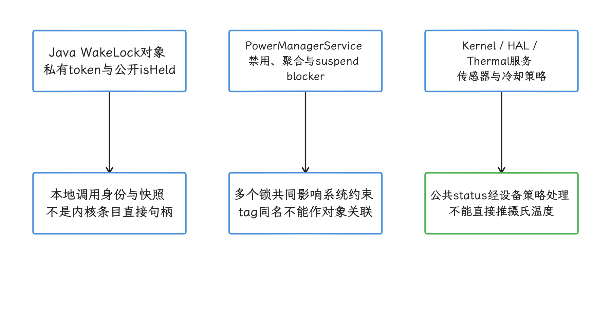

图：应用请求经服务端策略聚合后影响电源约束；温控同样跨越内核、HAL 与服务层。 Java tag 不与内核同名项一一对应，公共热状态也不是某个 thermal zone 原始温度。

### 官方文档

- [PowerManager API reference](https://developer.android.com/reference/android/os/PowerManager)
- [PowerManager.OnThermalHeadroomChangedListener API reference](https://developer.android.com/reference/android/os/PowerManager.OnThermalHeadroomChangedListener)
- [Schedule alarms](https://developer.android.com/develop/background-work/services/alarms)
- [Thermal mitigation](https://source.android.com/docs/core/power/thermal-mitigation)
- [BatteryManager API reference](https://developer.android.com/reference/android/os/BatteryManager)
- [Profile battery usage with Batterystats and Battery Historian](https://developer.android.com/topic/performance/power/setup-battery-historian)
- [Android vitals](https://developer.android.com/topic/performance/vitals)
- [Excessive partial wake locks](https://developer.android.com/google/play/vitals/excessive-wakelock)
- [Raising the bar on battery performance: Excessive partial wake locks metric is now out of beta](https://developer.android.com/blog/posts/raising-the-bar-on-battery-performance-excessive-partial-wake-locks-metric-is-now-out-of-beta)
- [Stuck partial wake locks](https://developer.android.com/google/play/vitals/stuck-wakelock)
- [Excessive wakeups](https://developer.android.com/google/play/vitals/wakeup)
- [Excessive background Wi-Fi scans](https://developer.android.com/google/play/vitals/bg-wifi)
- [Excessive background mobile network usage](https://developer.android.com/google/play/vitals/bg-network-usage)
- [TrafficStats API reference](https://developer.android.com/reference/android/net/TrafficStats)
- [SystemClock API reference](https://developer.android.com/reference/android/os/SystemClock)
- [Power Profiler](https://developer.android.com/studio/profile/power-profiler)
- [Macrobenchmark PowerMetric](https://developer.android.com/reference/kotlin/androidx/benchmark/macro/PowerMetric)
- [Wi-Fi scanning overview](https://developer.android.com/develop/connectivity/wifi/wifi-scan)
- [Find BLE devices](https://developer.android.com/develop/connectivity/bluetooth/ble/find-ble-devices)
- [ScanCallback API](https://developer.android.com/reference/android/bluetooth/le/ScanCallback)：结果、批次与扫描失败回调。
