# 混合栈与跨平台 APM (WebView / Flutter)

混合栈指同一 App 页面或业务流程同时经过 Android Native、WebView 与 Flutter。给这样的 App 做 APM（Application Performance Monitoring，应用性能监控），我们要同时面对三套运行时，每套运行时的事件都有各自的含义。

三边各知道一部分事情：Android 宿主掌握 Activity、Window、主线程、网络和 native crash（C/C++ 等原生层崩溃）；WebView 掌握网页导航、绘制与 JavaScript 事件；Flutter engine 提供 UI 构帧阶段（通常包含 Dart build/layout/paint）、raster（栅格化阶段）与异常线索。把这些事件关联到同一条会话时间线上是可行的；一旦压成一个“首屏耗时”，诊断信息就没了。

> 源码基线：Android 17 / API 37 / AOSP `android-17.0.0_r1`；Flutter 实现固定到 `3.47.0` tag（官方 SDK 归档的 `release_date` 为 2026-08-12 UTC，framework ref `4cf2416`）。2026-10-26 查得 stable 已为 `3.47.8`（归档时间 2026-10-23 UTC）；下文机制仍按固定 tag 解释，不把动态 API 文档的最新版与该 tag 混为一体。

只记 Android 版本还不够：WebView provider 是实际提供 WebView 内核、可独立于系统更新的软件包，所以要记录它的 Chromium 版本；具体 App 的 Flutter 行为，由 APK 携带的 engine revision（引擎源码版本） 决定。WebView provider 与 Flutter engine 是两条独立的版本轴，排查线上数据时两个都要带上。

<!-- gracker-diagram: ch17-11-01-runtime-evidence -->
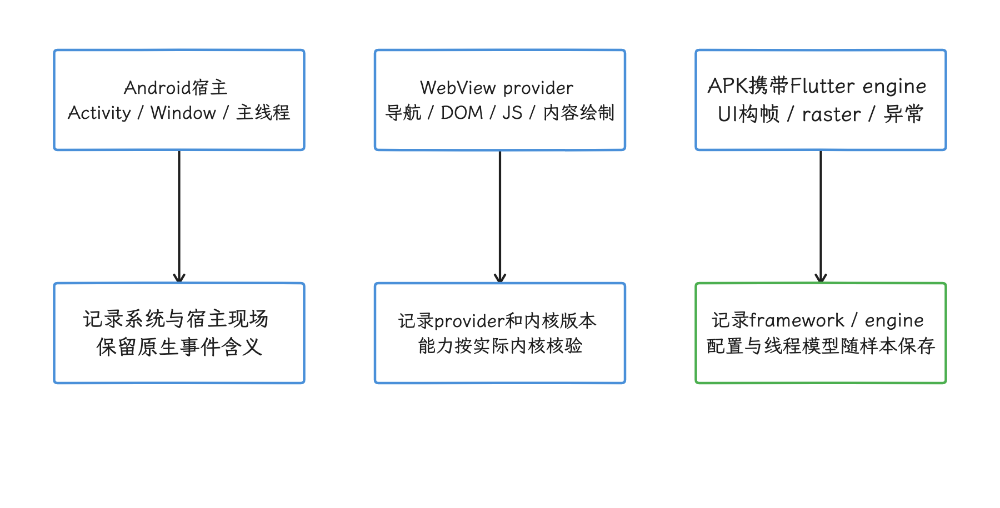

图：Native、WebView 与 Flutter 各自记录事件含义，并以容器会话关联。 Android 版本、provider 与 APK engine revision 是独立版本轴，单个首屏值不能解释全部阶段。

## 1. WebView 加载：用事件时间线计算端到端耗时

### 1.1 一次加载的阶段划分

排查 WebView 首屏慢，我们手上通常只有一堆零散的回调，先把一次加载拆成阶段：Native 创建一次 `session_id`，每次 main-frame（顶层页面，不含 iframe）导航再分配一个 `navigation_id`。一条加载时间线可以包含：

| 阶段 | Native 事件 | Web 事件 | 结论边界 |
| --- | --- | --- | --- |
| 容器创建 | Activity/Fragment 进入、WebView 构造、attach | 无 | 宿主准备成本 |
| 导航请求 | `loadUrl()`、用户点击、重定向策略 | Navigation Timing | 请求发起和页面 time origin |
| main-frame 状态 | `onPageStarted()`、<code>on<wbr>Page<wbr>Commit<wbr>Visible()</code>、<code>on<wbr>Page<wbr>Finished()</code> | <code>DOMContent<wbr>Loaded</code>、`loadEventEnd` | 文档生命周期；不直接证明内容有效 |
| 内容出现 | Window 首帧、visual-state callback | FCP、LCP candidate | 页面开始绘制和主要内容候选 |
| 业务可用 | Bridge ready、首个可用交互 | 业务 `app_ready` | 产品定义的可操作状态 |

<!-- gracker-diagram: ch17-11-02-load-stages -->
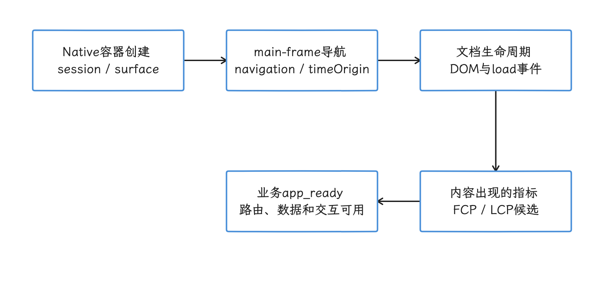

图：把容器、导航、文档状态、内容绘制与业务可用依序关联。 这些观察区间可能重叠，图中顺序不表示可把各段耗时直接相加。

表里的 Web 事件用到两个基础概念：Navigation Timing 是浏览器记录顶层文档导航、网络和文档事件时刻的标准性能条目，DOM（Document Object Model） 则是浏览器用节点树表示的当前文档结构。这段里最容易高估的是 `onPageFinished()`——它只表示 main frame 加载完成，官方 API 明确说明下一帧未必已经包含当时的 DOM；内容是否真的可用，要看后面的绘制类信号。

绘制侧我们主要看两个指标：FCP（First Contentful Paint）记录首个文本、图片等内容开始绘制的时刻，LCP（Largest Contentful Paint）跟踪加载期间最大的内容元素候选。业务 `app_ready` 则由产品定义，表示数据、路由和关键交互已经可用。文档生命周期、内容绘制和业务可用是三类不同的问题，我们要分开回答。

TTI（Time to Interactive）想估计页面何时进入可稳定交互状态，但浏览器没有对应的 Performance Entry（标准化的性能记录对象），Lighthouse 10 也已把它移除——它对偶发网络请求和 Long Task（长时间占用网页主线程的任务） 过于敏感。所以线上 WebView 用明确的业务 `app_ready`，再按 provider 支持情况补充 LCP、Long Tasks 或 INP（Interaction to Next Paint，衡量用户交互到下一次绘制的响应延迟）；`loadEventEnd` 推不出一个叫 TTI 的值。

<!-- gracker-diagram: ch17-11-03-three-readiness -->
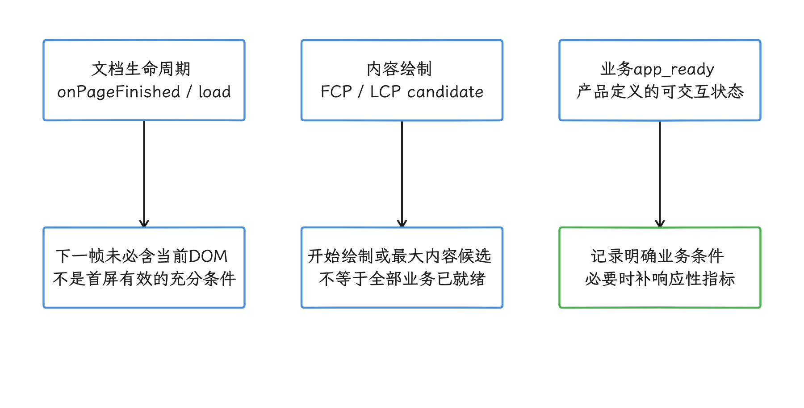

图：三类信号分别回答文档状态、内容出现与产品可操作性。 onPageFinished 与 loadEventEnd 均不能证明像素已显示，也推不出标准化 TTI 条目。

SPA（Single Page Application，单页应用）还会带来一类特殊情况：same-document navigation（不创建新文档的页面内导航） 在页面内完成，因此不会自动产生新的 Navigation Timing，也不会重置常规 document 级 LCP。H5 指 WebView 中运行的网页业务，它的路由层需要自己发出 `route_id`、route start 和 route ready。一次 document load 的 LCP 只属于这一次加载，后续每个 soft navigation（不重新加载顶层文档的软导航） 要单独计算。

Chrome 151 文档已公布 `soft-navigation` 与 `interaction-contentful-paint` 两类性能条目；目标 WebView provider 若实际暴露相应能力，可以补充这套浏览器软导航证据。它保留原文档时间轴：软导航耗时需减去相应 soft-navigation 的 `startTime`；绘制候选主要按 `interactionId` 关联，不把条目里可能属于前一个导航的 `navigationId` 直接当归属。浏览器 ID 与 SDK 的 `navigation_id` 也是两个命名空间。下面的简化脚本只收 document 加载指标，未接入这两个新 API；SPA 仍须保留业务 route start/ready。

<!-- gracker-diagram: ch17-11-04-navigation-scopes -->
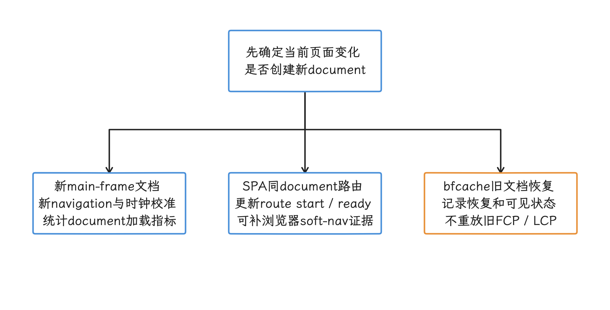

图：新文档加载、同文档路由和 bfcache 恢复分别建立指标边界。 软导航条目需 provider 实际支持；interactionId 与 SDK navigation_id 分属不同命名空间。

### 1.2 `performance.now()` 与 `elapsedRealtime` 需要校准

这一节解决时间戳对不上的问题。Web 指标的 `startTime` 和 `performance.now()` 都相对于当前页面的 `performance.timeOrigin`，也就是该文档高精度时间轴的起点；Native 事件通常用 `SystemClock.elapsedRealtime()`。要是把 Native 发起 `evaluateJavascript()` 的时刻直接配给脚本里返回的 `performance.now()`，中间的 UI 排队、renderer（执行网页代码的渲染进程）调度和回传延迟就全被忽略了。

校准要靠多次往返采样，具体做法是：

1. Native 在调用脚本前记录 `t0`，同时捕获当前导航 ID；脚本返回网页上下文的导航 ID、`performance.now()` 和 `timeOrigin`。
2. 回调到达 Native 时记录 `t1`；只接受 Native 导航仍一致、网页回传 ID 匹配且数值有限的样本，保存 `timeOrigin`。
3. 用 `t0 + (t1 - t0) / 2` 估计执行时刻。half RTT 只是“本次往返区间半宽”：同一文档、时钟速率稳定且忽略计时器量化时才可作传输误差参考，不能宣称是全部校准误差的保守上界。
4. 同一文档内选 RTT 较小的有效样本估计 `nativeElapsed ≈ jsTime + offset`；更小 RTT 有助于减小排队影响，但不证明两方向延迟对称，量化、暂停及漂移仍另记未知边界。
5. 每次 main-frame 导航重新校准；进程从长时间后台恢复后再做一次，检查漂移。

下面的 Kotlin 结构展示一个校准样本，它必须在 WebView 所在线程调用，回调也回到该线程。

```kotlin
data class WebClockSample(
    val navigationId: String,
    val timeOriginMs: Double,
    val offsetMs: Double,
    val uncertaintyMs: Double,
    val roundTripMs: Double,
    val uncertaintyScope: String = "transport_half_rtt_only"
)

@MainThread
fun sampleWebClock(
    webView: WebView,
    navigationId: String,
    currentNavigationId: () -> String?,
    onSample: (WebClockSample?) -> Unit
) {
    if (currentNavigationId() != navigationId) {
        onSample(null)
        return
    }
    val sentNs = SystemClock.elapsedRealtimeNanos()
    val script = """
        (() => {
          const c = window.__APM_CONTEXT__;
          return {
            navigationId: c ? c.navigationId : null,
            nowMs: performance.now(),
            timeOriginMs: performance.timeOrigin
          };
        })()
    """.trimIndent()
    webView.evaluateJavascript(script) { encodedResult ->
        val receivedNs = SystemClock.elapsedRealtimeNanos()
        val result = try {
            encodedResult?.let { JSONObject(it) }
        } catch (_: JSONException) {
            null
        }
        val jsNowMs = result?.optDouble("nowMs") ?: Double.NaN
        val timeOriginMs = result?.optDouble("timeOriginMs") ?: Double.NaN
        if (currentNavigationId() != navigationId ||
            result?.optString("navigationId") != navigationId ||
            !jsNowMs.isFinite() || jsNowMs < 0 ||
            !timeOriginMs.isFinite() || timeOriginMs <= 0 ||
            receivedNs < sentNs
        ) {
            onSample(null)
            return@evaluateJavascript
        }
        val roundTripMs = (receivedNs - sentNs) / 1_000_000.0
        val midpointNs = sentNs + (receivedNs - sentNs) / 2
        onSample(
            WebClockSample(
                navigationId = navigationId,
                timeOriginMs = timeOriginMs,
                offsetMs = midpointNs / 1_000_000.0 - jsNowMs,
                uncertaintyMs = roundTripMs / 2.0,
                roundTripMs = roundTripMs
            )
        )
    }
}
```

校准之后，我们就能映射事件时间：`native_elapsed_ms = offset_ms + web_entry.startTime`。端到端 FCP 按“映射后的 FCP 时刻减去容器开始时刻”来算；各阶段时长可能重叠，直接相加会把重叠部分重复计入。wall clock（可对应日历日期的系统时间）只用于跨设备日志关联，且要额外记录时钟偏移——用户改时间或网络校时都会让它跳变。

<!-- gracker-diagram: ch17-11-05-clock-calibration -->
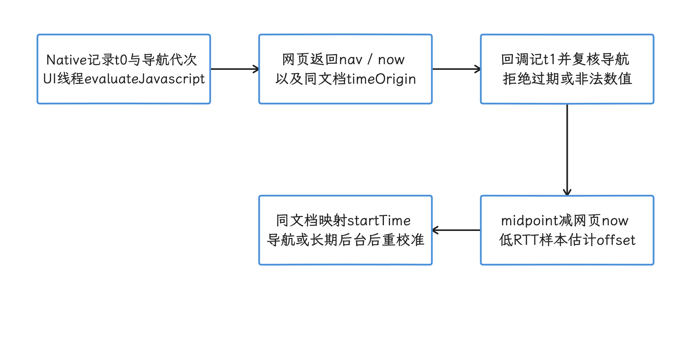

图：用 t0、t1 和网页来源时间估算 offset，前后核对同一导航及 timeOrigin。 half RTT 只描述本次往返半宽，量化、暂停、漂移和不对称延迟仍需保留不确定性。

### 1.3 PerformanceObserver 上报要兼容 provider 差异

采集用 `PerformanceObserver`。本段假设受控 HTTPS 文档在开始阶段已注入 `AndroidApm`、origin allowlist 与只含短期 session/navigation、低基数 route key 的 `__APM_CONTEXT__`；校准脚本也核对这里的 navigationId。要把结果解释为 document 加载指标，还须从文档开始跟踪首次可见性。晚装时即使 `buffered` 能取到旧条目，也补不回已经丢失的可见性历史，此时只按候选/缺失报告；本示例不是完整的 Web Vitals SDK。

```javascript
(() => {
  const source = window.__APM_CONTEXT__;
  const sink = window.AndroidApm;
  if (!source || !sink || typeof sink.postMessage !== 'function' ||
      window.__APM_DOCUMENT_METRICS_INSTALLED__) return;
  const context = Object.freeze({
    sessionId: source.sessionId,
    navigationId: source.navigationId,
    routeKey: source.routeKey
  });
  if (Object.values(context).some((v) => typeof v !== 'string' || v.length > 128)) return;
  window.__APM_DOCUMENT_METRICS_INSTALLED__ = true;

  const emit = (metric, valueMs, extra = {}) => {
    if (valueMs != null && (!Number.isFinite(valueMs) || valueMs < 0)) return;
    const event = Object.assign({}, context, {metric}, extra);
    if (valueMs != null) event.valueMs = Math.round(valueMs);
    try { sink.postMessage(JSON.stringify(event)); } catch (_) { /* drop */ }
  };
  const canObserve = (type) => {
    if (typeof PerformanceObserver === 'undefined') return false;
    const supported = PerformanceObserver.supportedEntryTypes;
    return !Array.isArray(supported) || supported.includes(type);
  };
  let ended = false;
  let paintObserver = null;
  let fcpReported = false;
  let lcpObserver = null;
  let latestLcp = null;
  let lcpStopped = false;
  const updateLcp = (entries) => {
    for (const entry of entries) {
      if (Number.isFinite(entry.startTime) && entry.startTime >= 0) latestLcp = entry;
    }
  };
  const flushLcp = (reason) => {
    if (lcpStopped) return;
    if (lcpObserver) {
      try { updateLcp(lcpObserver.takeRecords()); } catch (_) { /* unavailable */ }
      lcpObserver.disconnect();
    }
    lcpStopped = true;
    emit('lcp', latestLcp ? latestLcp.startTime : null, {
      status: latestLcp ? 'observed' : 'not_observed',
      finalizationReason: reason
    });
  };
  const onInput = (event) => {
    if (event.isTrusted) flushLcp('first_input_observed');
  };
  const finish = (reason) => {
    if (ended) return;
    flushLcp(reason);
    ended = true;
    if (paintObserver) paintObserver.disconnect();
    document.removeEventListener('visibilitychange', onVisibility);
    window.removeEventListener('pagehide', onPageHide);
    window.removeEventListener('pointerdown', onInput, true);
    window.removeEventListener('keydown', onInput, true);
  };
  const onVisibility = () => {
    if (document.visibilityState === 'hidden') finish('visibility_hidden');
  };
  const onPageHide = () => finish('pagehide');

  if (document.visibilityState !== 'visible') {
    lcpStopped = true;
    ended = true;
    emit('document_metrics', null, {status: 'not_observed', reason: 'initially_hidden'});
  } else {
    if (canObserve('paint')) {
      try {
        paintObserver = new PerformanceObserver((list) => {
          if (ended || fcpReported) return;
          const fcp = list.getEntries().find((e) => e.name === 'first-contentful-paint');
          if (fcp) {
            fcpReported = true;
            emit('fcp', fcp.startTime);
            paintObserver.disconnect();
          }
        });
        paintObserver.observe({type: 'paint', buffered: true});
      } catch (_) { emit('fcp', null, {status: 'unsupported'}); }
    } else emit('fcp', null, {status: 'unsupported'});

    if (canObserve('largest-contentful-paint')) {
      try {
        lcpObserver = new PerformanceObserver((list) => {
          if (!ended && !lcpStopped) updateLcp(list.getEntries());
        });
        lcpObserver.observe({type: 'largest-contentful-paint', buffered: true});
      } catch (_) {
        lcpStopped = true;
        emit('lcp', null, {status: 'unsupported'});
      }
    } else {
      lcpStopped = true;
      emit('lcp', null, {status: 'unsupported'});
    }
    document.addEventListener('visibilitychange', onVisibility);
    window.addEventListener('pagehide', onPageHide);
    window.addEventListener('pointerdown', onInput, true);
    window.addEventListener('keydown', onInput, true);
  }
  emit('bridge_ready', performance.now());
})();
```

LCP observer 给出候选序列。示例在可信 pointer/keyboard 输入、页面隐藏或 pagehide 时先 `takeRecords()`，再上报最后一个有效候选，避免队列里尚未派发的候选丢失；没有候选记 `not_observed`，不填0。`finalizationReason` 表示本采集器触发报告的原因，不声称掌握全部浏览器内部结束条件。页面持续可见且无输入时，超时快照只能叫 `lcp_candidate`。

<!-- gracker-diagram: ch17-11-06-observer-drain -->
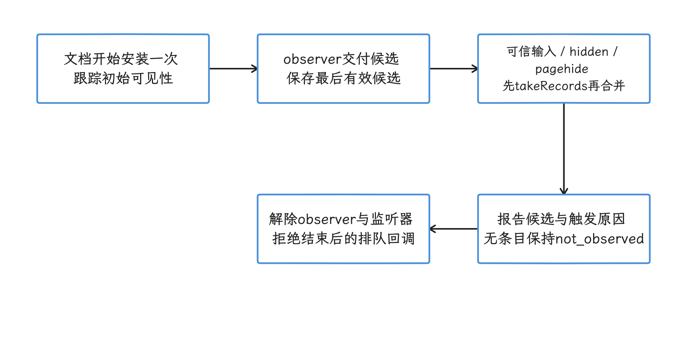

图：首次可信输入或生命周期结束时先排空 observer 队列，再报告最后有效候选。 该简化采集器需要文档开始时的可见性历史，晚安装与超时快照都须保留候选边界。

监听器与观察器在文档结束时解除；同一个 document 不重复安装，避免 SPA 或 bfcache 恢复后再次用 buffered 重放旧 FCP/LCP。bfcache 返回是旧文档恢复，需单独记录恢复/业务 ready 与可见状态，不能把旧 document LCP 当成新的加载。合法骨架、轮播和业务内容替换也需要自己的语义，不能仅按最大元素候选判定页面已经可用。

每条样本同时记录 WebView provider 包名、`versionName`、Chromium 主版本、AndroidX WebKit 版本和 `supportedEntryTypes`（当前 provider 支持的性能条目类型）。某项能力缺失时写 `unsupported`，回退到 FCP、业务 ready、DOM 与像素信号；缺失值保持缺失，填成 0 就凭空造出了数据。

<!-- gracker-diagram: ch17-11-07-capability-fallback -->
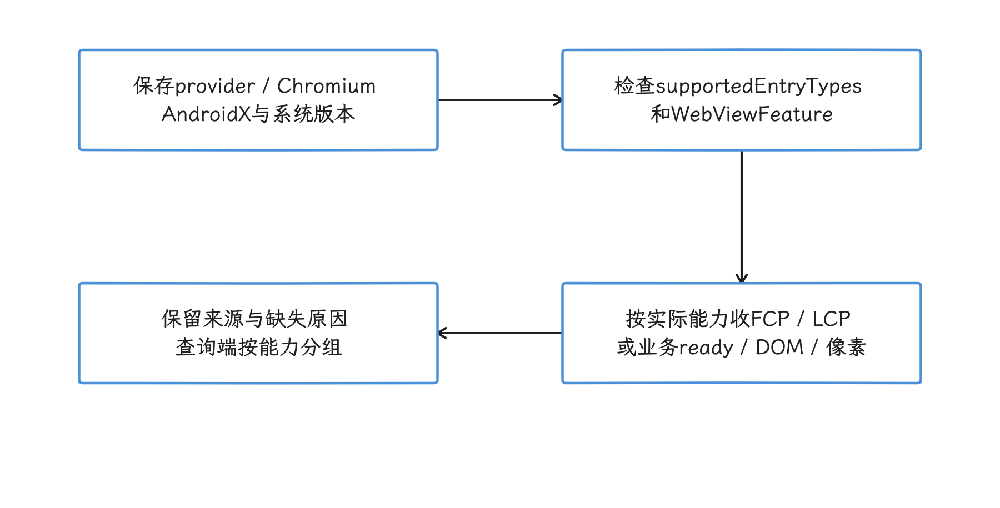

图：随样本记录 provider 和支持条目，按能力选择浏览器指标与业务信号。 unsupported、not_observed 与 inconclusive 含义不同，缺失值不填0。

## 2. H5 白屏：多信号判定与三态像素结论

用户报白屏时，单个信号很容易判错，白屏检测至少需要三类信号放在一起看：

| 信号 | 优点 | 容易误判的场景 |
| --- | --- | --- |
| <span style="white-space:nowrap">生命周期</span> | <code>on<wbr>Page<wbr>Commit<wbr>Visible()</code>、visual-state callback、<code>on<wbr>Page<wbr>Finished()</code> 成本低 | 页面只画了背景，资源还未到达 |
| DOM / 业务 | 可见节点面积、文本/图片、`app_ready` | canvas/WebGL 的程序绘制内容、video、跨域 iframe 与仅用于占位的骨架屏 |
| 像素 | 目标 Window 根 Surface 中可复制的区域内容 | 合法白页、主题、同窗口遮罩/骨架；独立 Surface、IME 或其他 Window 不属于这份根 Surface 拷贝 |

<!-- gracker-diagram: ch17-11-08-blank-three-signals -->
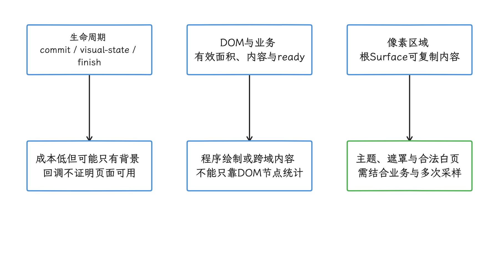

图：把生命周期、DOM/业务与受控区域像素一起解释，避免单个信号直接判白屏。 背景、骨架、canvas、video 与跨域 iframe 都可能使某类信号不足。

生命周期信号成本最低，也最容易误读：`onPageCommitVisible()` 的官方语义是旧导航内容不会再被绘制，下一次 draw 可能只显示 WebView 背景，也可能显示新页面的一部分；单看它，我们确定不了首屏是否有效。

`postVisualStateCallback()` 承诺调用时的 DOM 更新可反映在回调完成后的下一次 draw 中，不能证明已经显示。`postOnAnimation` 是帧回调，通常早于该帧 draw，因此“在里面立刻 PixelCopy”不能证明新像素已提交。API 29+ 且硬件渲染时可结合 `registerFrameCommitCallback()`，等帧已提交 swap chain 再复制；这仍不证明面板已经呈现。API 26—28 至少观察真实 draw，并把后续 PixelCopy 视作未严格绑定特定帧的快照。visual state 覆盖普通元素、图片、CSS animation、WebGL 和 canvas，video tag 不在其保证范围内。

<!-- gracker-diagram: ch17-11-09-draw-commit-copy -->
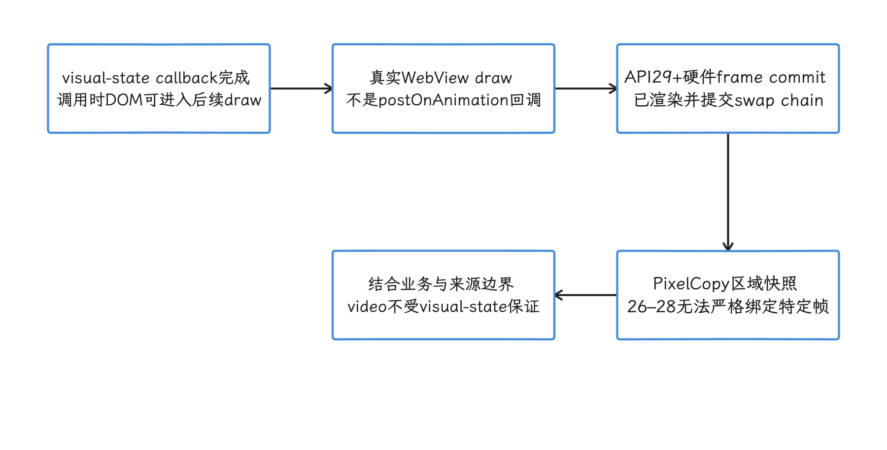

图：先满足真实绘制前提，再把 PixelCopy 作为受边界约束的像素快照。 postOnAnimation 在绘制前；frame commit 也只到 swap chain 提交，均不等于面板呈现。

### 2.1 低分辨率 PixelCopy 与三态结果

像素信号用 PixelCopy。Android 8 / API 26 起可复制 Window 指定 Rect 到较小 Bitmap；固定 r1 实际取 `ViewRootImpl.mSurface`，复制该 Surface 的缓冲区内容，并按目标 Bitmap 尺寸缩放。它不把独立 SurfaceView、其他 Window 或硬件合成层一并合成进来。Window 须已有 backing surface，至少观察一次 draw；WebView 也应 attached、可见、尺寸有效，并且采样时仍属于当前导航与活动页面。

<!-- gracker-diagram: ch17-11-10-root-surface-scope -->
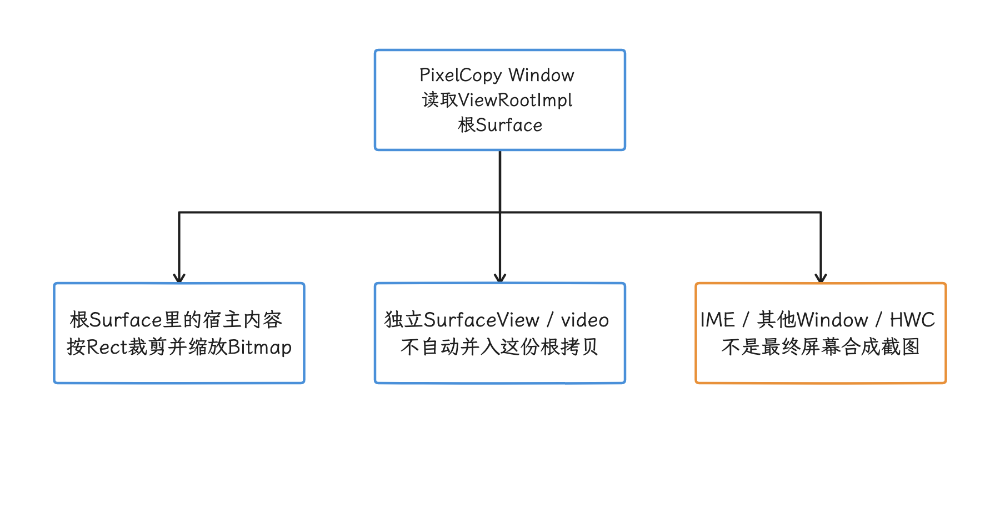

图：Window 形式的 PixelCopy 固定从 ViewRootImpl 的根 Surface 复制受控区域。 独立 SurfaceView、IME、其他 Window 与硬件合成结果不能从这份快照反推。

Kotlin 示例把有效区域的分类结果和 `Inconclusive` 分开。`Classified.blankCandidate` 只代表所采区域的空白候选；PixelCopy error、导航过期、页面不活动、空区域或无效分类分数均不可判定。有效像素本身也不足以确认业务白屏，还要结合 DOM、业务状态、主题和多次采样。

```kotlin
sealed interface PixelSample {
    data class Classified(
        val blankCandidate: Boolean,
        val blankScore: Double
    ) : PixelSample

    data class Inconclusive(
        val reason: String,
        val copyResult: Int? = null
    ) : PixelSample
}

@MainThread
@RequiresApi(26)
fun sampleWebViewPixels(
    activity: Activity,
    webView: WebView,
    navigationId: String,
    isSampleCurrent: (String) -> Boolean,
    workerHandler: Handler,
    onResult: (PixelSample) -> Unit
) {
    // isSampleCurrent is a thread-safe, nonblocking navigation/visibility gate.
    // Keep workerHandler alive until every pending copy has completed.
    fun deliver(sample: PixelSample) {
        onResult(
            if (isSampleCurrent(navigationId)) sample
            else PixelSample.Inconclusive("stale_or_inactive_sample")
        )
    }
    if (!webView.isAttachedToWindow || !webView.isShown ||
        activity.isFinishing || activity.isDestroyed ||
        webView.width <= 0 || webView.height <= 0 ||
        !isSampleCurrent(navigationId)
    ) {
        workerHandler.post {
            deliver(PixelSample.Inconclusive("view_not_ready"))
        }
        return
    }

    val location = IntArray(2)
    webView.getLocationInWindow(location)
    val source = Rect(
        location[0], location[1],
        location[0] + webView.width,
        location[1] + minOf(webView.height, 720)
    )
    val decor = activity.window.decorView
    if (!source.intersect(0, 0, decor.width, decor.height) || source.isEmpty) {
        workerHandler.post {
            deliver(PixelSample.Inconclusive("empty_window_rect"))
        }
        return
    }

    val sampleWidth = 160
    val sampleHeight = (
        source.height().toDouble() * sampleWidth / source.width()
    ).roundToInt().coerceIn(1, 320)
    val bitmap = Bitmap.createBitmap(sampleWidth, sampleHeight, Bitmap.Config.ARGB_8888)
    try {
        PixelCopy.request(activity.window, source, bitmap, { copyResult ->
            val sample = try {
                when {
                    !isSampleCurrent(navigationId) ->
                        PixelSample.Inconclusive("stale_or_inactive_sample")
                    copyResult != PixelCopy.SUCCESS ->
                        PixelSample.Inconclusive("pixel_copy_failed", copyResult)
                    else -> {
                        val classified = WhiteScreenDetector.classify(bitmap)
                        if (classified is PixelSample.Classified &&
                            (!classified.blankScore.isFinite() ||
                             classified.blankScore !in 0.0..1.0)
                        ) PixelSample.Inconclusive("invalid_classifier_score")
                        else classified
                    }
                }
            } catch (_: RuntimeException) {
                PixelSample.Inconclusive("classifier_failed")
            } finally {
                bitmap.recycle()
            }
            deliver(sample)
        }, workerHandler)
    } catch (_: IllegalArgumentException) {
        bitmap.recycle()
        workerHandler.post {
            deliver(PixelSample.Inconclusive("window_surface_not_ready"))
        }
    }
}
```

几何信息在主线程读取，结果在 worker Handler 交付；`isSampleCurrent` 必须线程安全、非阻塞，同时校验导航代次、可见状态和容器生命周期。调用方在所有 PixelCopy 请求完成前必须保持这个 Handler/Looper 存活，限制每个容器的在途采样数。分类器运行时异常与 PixelCopy 参数异常都会回收 Bitmap；不能把排队未完成的请求当成已经清理。示例最多取顶端720个窗口像素，Bitmap 宽160、高最多320，这只是受控区域样本。API34新 Request/Result 形式不改变 API26回调形式仍可用的事实。

区域分类可组合近背景色比例、颜色熵、边缘/有效色块与主题基线。Bitmap 只在设备内分析并释放，截图不上传；已知 Native toolbar、骨架和同窗口遮罩要排除。示例仅适用于事先验证的轴对齐区域，父级裁剪、变换或覆盖关系不清楚时应不可判定；依赖独立 SurfaceView/video 的页面也需单独证据，不能把根 Surface 拷贝里缺少的内容判成白屏。

<!-- gracker-diagram: ch17-11-11-pixel-lifecycle -->
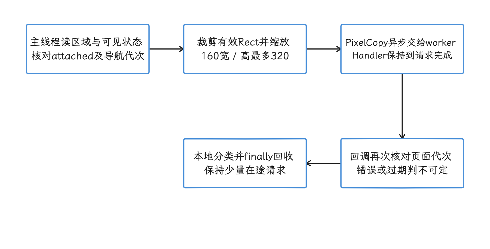

图：采样前后核对页面代次，限制区域与在途请求，并保证 Bitmap 生命周期完整。 160像素宽、顶端720窗口像素只是示例预算；复杂变换和独立 Surface 需另行验证。

### 2.2 从“疑似”到“确认”

白屏判定建议用一个状态机管理，只在预先定义的状态和转换条件之间推进：

- `loading`：main-frame 导航已开始；
- `visual_committed`：旧内容已经退出，等待下一次 draw；
- `suspected_blank`：业务 ready 超时，且 DOM 或首次像素信号为空；
- `confirmed_blank`：间隔采样仍为空，并排除 renderer（执行网页代码并绘制内容的渲染进程） gone、网络错误、容器隐藏和合法空状态；
- `inconclusive`：PixelCopy 失败、页面在后台、尺寸无效或各项信号相互冲突。

<!-- gracker-diagram: ch17-11-12-blank-state -->
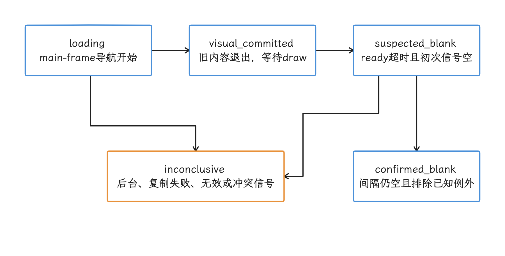

图：loading、视觉提交、疑似与确认按预定条件推进，证据不足转入不可判定。 后台 heartbeat 超时和 PixelCopy 无数据不能单独确认白屏；确认仍按业务定义。

还要记住后台这个前提：页面进入后台后，JS timer、renderer 和 App 进程都可能被节流或冻结，此时 heartbeat（网页定期发送的存活信号）超时与 PixelCopy 无数据只能记成不可判定。线上按关键超时点采样一到两次，不按帧截图；白屏检测自己的 CPU、Bitmap 字节和执行时长，也要进入 APM 自监控。

## 3. WebView renderer：退出是直接证据，无响应是状态信号

WebView 从 Android 8 起可能把网页代码执行与绘制放进独立的 sandboxed renderer process（受权限隔离的渲染进程）。这里的关键事实是：renderer 退出时，App 进程未必跟着退出。所以只接 Java/Kotlin crash handler（异常处理回调） 的 App，我们会漏掉一整类黑屏、白屏和页面重载；本节要接住的，就是 renderer 退出与无响应这两类事件。

### 3.1 API 26+：处理 `onRenderProcessGone()`

`WebViewClient.onRenderProcessGone()` 是 renderer 已退出的直接证据：

- `didCrash()` 为 `true` 表示 renderer crash，为 `false` 通常表示系统终止了 renderer；
- `rendererPriorityAtExit()` 记录退出时的绑定优先级，也就是系统当时保护该 renderer 的相对级别；至于进程为什么被杀，这个字段给不出答案；
- 一个 renderer 可以服务同一 App 的多个 WebView，每个受影响 WebView 都会收到回调；
- 回调只负责参数中的 WebView，其他实例是否受影响，交给它们各自的回调；
- 该 WebView 已不可用，必须移出视图树、销毁并清除 Activity、Fragment、adapter 和缓存中的引用；
- 完成旧实例清理并决定后续界面后返回 `true`，表示 App 已处理这次退出。返回 `false` 会让 renderer crash 导致 App crash，或让系统结束 App。

客户端保留退出处理的关键顺序。采集器的运行时异常单独计数，不能妨碍清理；`onDeadWebView` 由容器清除 Activity、adapter、缓存等全部强引用，并决定错误页或重建。它须有界且不抛异常；清理失败时不能假装返回 true。`finally` 保证尝试 destroy，不意味着所有容器引用已经自动消失。

```kotlin
class ApmWebViewClient(
    private val navigationIdOf: (WebView) -> String?,
    private val reportExit: (RendererExitSample) -> Unit,
    private val onDeadWebView: (WebView) -> Unit
) : WebViewClient() {
    private val reportFailures = AtomicLong()

    override fun onRenderProcessGone(
        view: WebView,
        detail: RenderProcessGoneDetail
    ): Boolean {
        try {
            reportExit(
                RendererExitSample(
                    navigationId = navigationIdOf(view),
                    didCrash = detail.didCrash(),
                    rendererPriorityAtExit = detail.rendererPriorityAtExit(),
                    observedElapsedMs = SystemClock.elapsedRealtime()
                )
            )
        } catch (_: RuntimeException) {
            reportFailures.incrementAndGet()
        }
        // Container cleanup must be bounded/non-throwing and clear every strong reference.
        try {
            (view.parent as? ViewGroup)?.removeView(view)
            onDeadWebView(view)
        } finally {
            view.destroy()
        }
        return true
    }
}
```

注意这段代码没有自动重放 POST、表单和支付导航——恢复策略必须按业务幂等性决定：幂等操作重复执行不会增加业务副作用，把支付或表单提交默认当作幂等操作通常并不稳妥，无条件 reload 可能造成重复提交。样本还要记录 provider 版本、前后台状态、进程内存压力、容器是否仍可见，以及退出前最近一次导航和 Bridge 活动。

<!-- gracker-diagram: ch17-11-13-renderer-cleanup -->
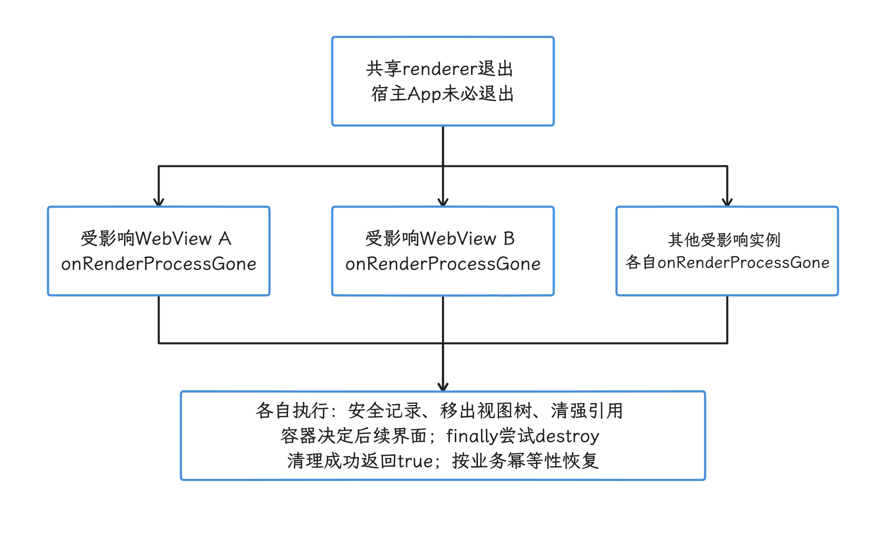

图：每个受影响 WebView 单独记录退出、移出树、清除强引用并尝试销毁。 一个 renderer 可服务多个 WebView；采集失败不能阻止清理，重建需遵守业务幂等性。

### 3.2 API 29+：unresponsive 回调可能重复

退出之外，renderer 卡住是另一类事件。`WebViewRenderProcessClient.onRenderProcessUnresponsive()` 表示 renderer 在合理时间内没有处理输入或导航，常见诱因是长时间 JavaScript 任务。只要无响应持续，回调就可能重复到达，连续两次最短间隔 5 秒；恢复时 `onRenderProcessResponsive()` 回调一次。注册同一 client 的多个 WebView，也可能因同一个 renderer 事件分别收到通知。

这类回调适合形成一段状态区间：

```text
renderer_unresponsive_start
renderer_unresponsive_repeat
renderer_responsive
```

所以 APM 里我们对 repeat 做计数，避免每 5 秒生成一条独立故障。`renderer` 参数在 single-process（WebView 未使用独立 renderer 进程）模式下可以为 `null`。还有一个容易犯的错：收到 unresponsive 就默认调用 `terminate()`——它会直接结束关联的 renderer，可能影响其他 WebView，还要求所有受影响实例都正确处理随后到达的 `onRenderProcessGone()`。

<!-- gracker-diagram: ch17-11-14-renderer-interval -->
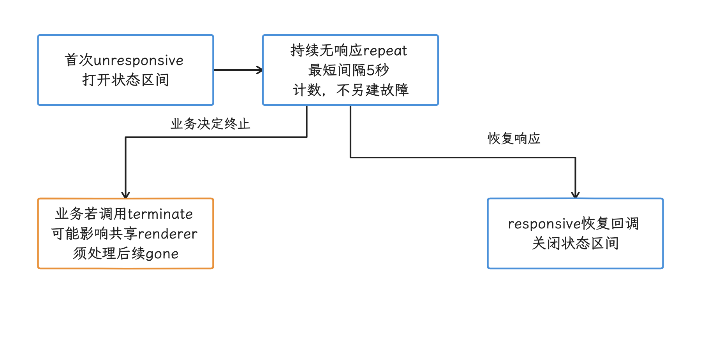

图：把连续无响应回调聚成一个状态区间，重复计数并以 responsive 结束。 重复回调最短间隔5秒，实际间隔可更长；terminate 可能影响共享 renderer 的全部实例。

用 AndroidX WebKit 的兼容接口前，先拿相应 `WebViewFeature` 检查 provider 能力：它能让某些功能在较低 Android API 上由新 provider 提供，所以“API level 不够”和“当前 provider 不支持”是两种不同的结论。

### 3.3 组合信号与 `suspected` 标记

API 26—28 没有平台 `WebViewRenderProcessClient`，provider 又不支持兼容接口时，剩下的只有组合信号：业务 ready 超时、Bridge heartbeat、DOM 状态和像素采样。它们都证明不了 renderer 已卡死：

- 后台页面的 timer、renderer 与 App 进程都可能被节流或冻结；
- main frame 完成时，异步数据和子资源可能还在路上；
- 长任务会延迟 heartbeat，但它也可能是业务允许的计算；
- 网络失败、页面跳转和容器销毁都可能让心跳消失。

所以我们的样本要明确写 `signal_strength=direct|state|suspected` 和 `signal_source`，三档依次是直接回调、状态变化信号和间接怀疑。只有 `onRenderProcessGone()` 能把 renderer 退出写成直接事件，超时推断到 suspected 为止，冒充 crash 会把归因带偏。

<!-- gracker-diagram: ch17-11-15-signal-strength -->
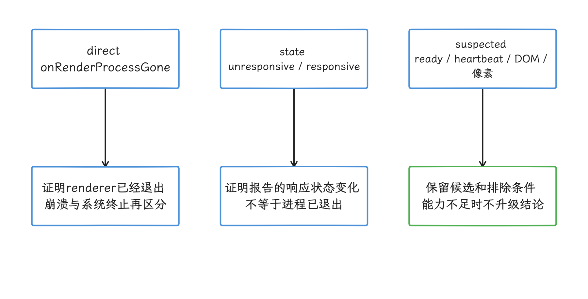

图：退出回调、无响应状态与组合超时分别保留信号来源及强度。 后台节流、合法空页与队列拥塞都可能造成间接超时，不能改写成 renderer crash。

## 4. JSBridge：先保证来源可信，再测排队和序列化

JSBridge 是网页 JavaScript 与 Android 代码之间的通信接口，它的安全风险和性能问题经常一起出现：一个允许任意 frame 调用的高频接口，既可能被不可信 iframe 触发，也会让宿主承担消息解析、排队和线程切换的成本。

### 4.1 带 origin 规则的 Web message listener

当前 AndroidX WebKit 里我们首选 `WebViewCompat.addWebMessageListener()`：它按 `allowedOriginRules` 注入对象，回调还能拿到 `sourceOrigin` 与 `isMainFrame`。使用前先检查 `WebViewFeature.WEB_MESSAGE_LISTENER`；规则要写完整的 scheme、host 和必要的 port，别用 `*`。

下面按 AndroidX WebKit `1.18.0` 的接口签名核验，受控 HTTPS 主 frame 才能入队。先检查 `message.type`：ArrayBuffer 不能调用字符串 `data` getter，否则会抛异常。字符串长度是 UTF-16 单元数，随后还要检查真实 UTF-8 字节数是否超过64 KiB。worker 须由调用方提供有界队列，满队列拒绝和 worker 解析异常都会增加 drop count；解析、schema 与导航校验继续放在 worker。

```kotlin
@UiThread
fun installApmMessageListener(
    webView: WebView,
    worker: Executor,
    dropCount: AtomicLong,
    enqueue: (
        payload: String,
        sourceOrigin: Uri,
        receivedElapsedNs: Long,
        workerStartElapsedNs: Long
    ) -> Unit
): Boolean {
    if (!WebViewFeature.isFeatureSupported(WebViewFeature.WEB_MESSAGE_LISTENER)) {
        return false
    }
    val trustedOrigin = Uri.parse("https://m.example.com")
    WebViewCompat.addWebMessageListener(
        webView, "AndroidApm", setOf(trustedOrigin.toString()),
        object : WebViewCompat.WebMessageListener {
            override fun onPostMessage(
                view: WebView,
                message: WebMessageCompat,
                sourceOrigin: Uri,
                isMainFrame: Boolean,
                replyProxy: JavaScriptReplyProxy
            ) {
                val receivedNs = SystemClock.elapsedRealtimeNanos()
                if (!isMainFrame || sourceOrigin != trustedOrigin ||
                    message.type != WebMessageCompat.TYPE_STRING
                ) {
                    dropCount.incrementAndGet()
                    return
                }
                val payload = message.data ?: return
                // Cheap UTF-16 cap first, then the actual bounded UTF-8 byte count.
                if (payload.length > 64 * 1024 ||
                    payload.toByteArray(Charsets.UTF_8).size > 64 * 1024
                ) {
                    dropCount.incrementAndGet()
                    return
                }
                try {
                    worker.execute {
                        try {
                            enqueue(payload, sourceOrigin, receivedNs,
                                SystemClock.elapsedRealtimeNanos())
                        } catch (_: RuntimeException) {
                            dropCount.incrementAndGet()
                        }
                    }
                } catch (_: RejectedExecutionException) {
                    dropCount.incrementAndGet()
                }
            }
        }
    )
    return true
}
```

这里 allowlist 是第一道来源约束，回调里的 main-frame 与精确 origin 检查是第二道，重复校验的意义在于降低单点配置错误的风险。生产实现还要验证消息 schema（允许的字段、类型和大小规则），验证事件名、session 与 navigation 是否仍有效，并限制 worker queue 容量：队列满时丢掉低价值性能样本、累计 drop count（被丢弃的样本数），让队列保持有界。Native 主动向页面发送 Web message 时，同样要指定精确 `targetOrigin`。 容器负责一次安装与卸载生命周期；`dropCount` 是有限计数，不把被丢弃的载荷保存成日志。入口大小检查不能消除消息在检查前已经发生的跨进程序列化与分配成本，发送侧也必须限频限量。

<!-- gracker-diagram: ch17-11-16-bridge-gates -->
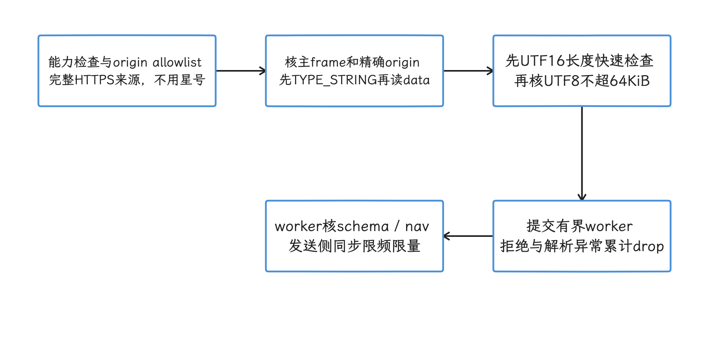

图：Bridge 入口按精确来源、主 frame、消息类型和真实大小过滤，再交有界 worker。 同源 XSS 仍需业务授权；入口检查不能消除此前已发生的序列化与内存成本。

也要清楚 origin 校验的极限：它拦不住受信任站点自身的 XSS（Cross-Site Scripting，跨站脚本）漏洞调用 Bridge。对敏感 Native 操作，“来自允许域名”只是第一道门，还要再验证消息 schema、业务状态与权限，才谈得上完整授权。

### 4.2 `addJavascriptInterface()` 的使用限制

旧 provider 只能使用 `addJavascriptInterface()` 时，需要接受以下约束：

- 对象会注入页面的所有 frame，包括嵌入式子页面 iframe；
- App 没有可靠办法从接口调用中识别调用 frame 的 origin，`WebView.getUrl()` 也回答不了这个问题；
- JavaScript 调 Java 是同步的，JavaScript 会等方法返回；
- 被注解的 Java 方法运行在 WebView 的私有后台线程，不在主线程；
- `removeJavascriptInterface()` 的变化要到下一次页面 reload 才反映到 JavaScript。

所以该接口只用于 App 完全控制的文档，不加载第三方 iframe，不让不可信导航复用同一 WebView。暴露的方法只复制小载荷并入有界队列，不同步等待主线程、网络或磁盘。需要切到主线程的工作应异步完成，再由独立消息返回结果。

Native 调 JavaScript 这边同样有线程纪律：`evaluateJavascript()` 必须在 WebView 的 UI 线程调用，结果回调也回到 UI 线程。它虽然是异步 API，但调用之前的 UI 排队、renderer 执行、结果序列化和回调派发，每一环都可能慢。

<!-- gracker-diagram: ch17-11-17-legacy-bridge-thread -->
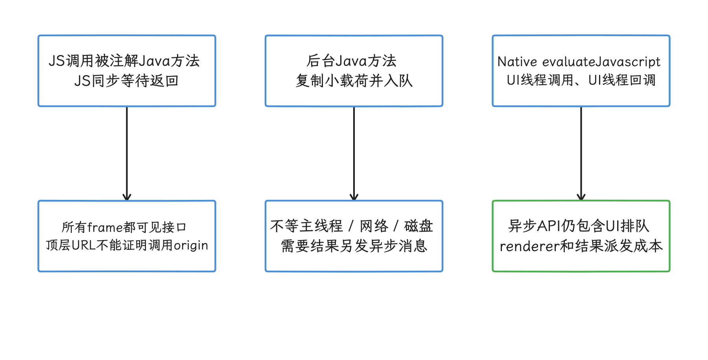

图：旧 JSInterface 的 Java 方法在私有后台线程执行，JS 同步等待它返回。 接口注入所有 frame 且无法可靠辨认调用来源，受控文档也应只复制小载荷并异步处理。

### 4.3 Bridge 调用的阶段拆解

我们要让一次 Bridge 调用经得起事后解释，建议为抽样的调用记录：

- `direction`：`js_to_native` 或 `native_to_js`；
- `method_key`：低基数方法标识，不存业务参数；
- `payload_bytes` 与 `result_bytes`：按 UTF-8 或二进制实际字节计算；
- `source_origin_key`、`is_main_frame`、provider 版本；
- `receive_elapsed_ns`、`worker_start_elapsed_ns`、`finish_elapsed_ns`；
- queue wait（进入队列到开始执行的等待时间）、解析、业务处理、结果编码和端到端耗时；
- queue depth（采样时的排队任务数）、drop count、是否超时或取消。

高频埋点按批发送，动画与滚动期间提高丢弃优先级。有一类内容从一开始就不进 APM：base64（把二进制数据编码成文本、同时会增加体积） 图片，以及完整 HTML、token、URL query 和用户输入。监控代码自己的 CPU、内存分配、queue wait 与主线程占用也要抽样上报，否则 Bridge APM 可能变成新的卡顿来源。 这里的receive/worker/finish只能拆Native接收后的成本；JS发出到结果回传的完整跨运行时耗时，还需要网页来源时刻和同文档时钟校准，不能凭Native三个时间戳反推。

<!-- gracker-diagram: ch17-11-18-bridge-timing -->
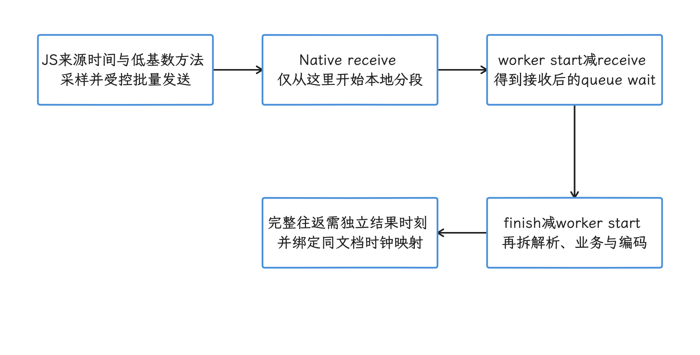

图：Native 的 receive、worker start 与 finish 可拆排队和本地处理，完整往返另需来源时间。 未校准的 JS 时间不能直接减 Native 时间，三个 Native 戳也不能反推全部跨运行时成本。

## 5. Flutter APM：版本决定线程归属，`FrameTiming` 决定诊断语义

进入 Flutter 部分，我们先把三层分清：Flutter framework 是 App 直接使用的 Dart UI 框架，engine 负责 Dart 运行时、调度与渲染，embedder 把 engine 接入 Android 生命周期、线程和 Surface。三者的版本与配置会改变 APM 看到的线程关系，没有一个能到处套用的固定模型；APK 携带的 framework/engine revision、embedder 配置与运行时 trace，比 Android API level 更有判别力。

### 5.1 merged platform/UI thread 的版本演进

| Flutter 范围 | Android 主线行为 | APM 处理 |
| --- | --- | --- |
| 3.27.0（对应 engine `83bacfc`） | Android 命令行解析器只在 enable-merged 开关存在时合并，常规默认仍分离；已提供 manifest opt-in | 核对实际 task runner，不从 `Settings` 成员初始值推导最终默认 |
| 3.29—3.35 | UI 与 Platform 线程默认合并；manifest key <code>Disable<wbr>Merged<wbr>Platform<wbr>UIThread</code> 仍可退出该模式 | 记录 engine revision 和该 key；不能把默认值当成每个 APK 的实际配置 |
| 3.38—3.41 | 默认合并；`FlutterLoader` 发现旧 opt-out key 为 `true` 时抛出异常 | 升级前移除旧 key，按合并模型解释主线 engine |
| 3.44—3.47.0 | 默认合并；旧 key 移入 <code>Flutter<wbr>Engine<wbr>Flags.<wbr>DISABLED_<wbr>FLAGS</code>，`FlutterLoader` 发现该 metadata key 存在即拒绝，并非静默忽略 | 升级前删除旧 key，设成 false 也不能代替删除；Android Native 同样拒绝禁用合并 |

<!-- gracker-diagram: ch17-11-19-flutter-version-model -->
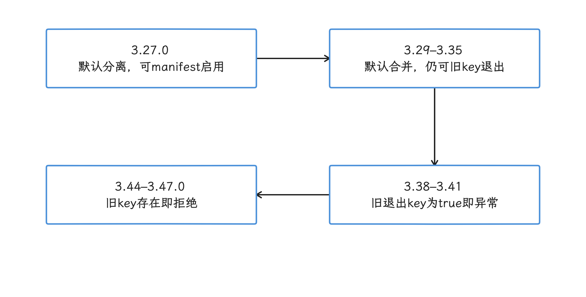

图：分别按固定 tag 核对默认线程关系与旧 opt-out 配置的处理。 3.44—3.47 旧 metadata key 只要存在就被拒绝，写 false 也不能代替删除。

task runner 是 engine 向某类线程角色投递工作的执行队列。合并之后，Dart framework 的 build/layout/paint 与 Android Platform、插件回调共享宿主主线程，Raster（把图层数据转成 GPU 可绘制内容）和 IO runner 仍是独立角色。于是线程之间出现新的挤压关系：耗时的 MethodChannel handler（平台通道消息处理器）会挤占 Dart UI 工作，长 Dart build 也会推迟 platform callback。这条因果只对合并模型成立；旧版或定制 engine 中，两类任务可能在不同 OS 线程。 维护者issue在2025-05-20更新中说明3.32stable已默认合并，这描述当时状态，不能单凭它定位首次默认版本；本表另外核对3.29tag的解析器与Android task runner创建。

<!-- gracker-diagram: ch17-11-21-merged-contention -->
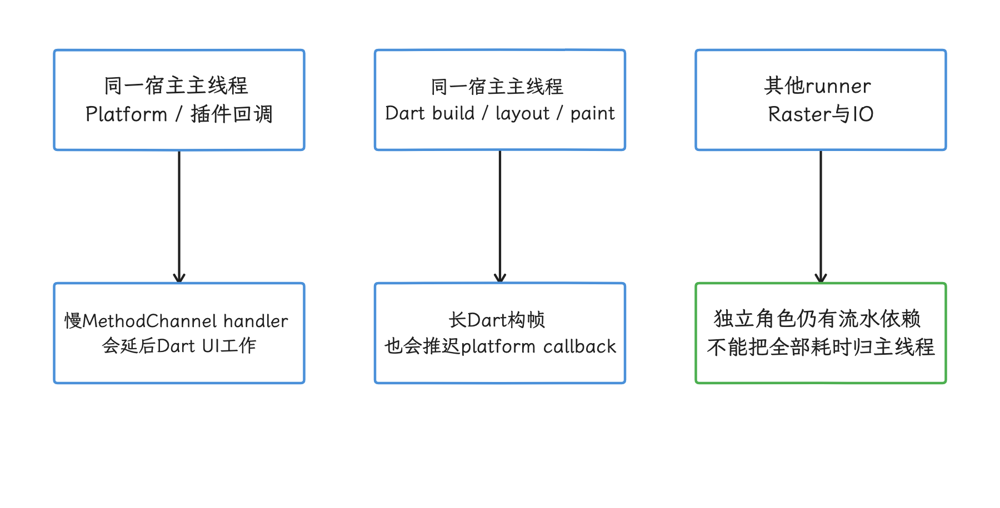

图：合并模型中 Android Platform、插件与 Dart UI 构帧共享主线程，形成双向排队。 Raster 和 IO 仍是独立 runner；旧模型或定制 engine 不能直接套用该竞争关系。

这里的默认值来自完整初始化链：3.27 的 `Settings` 成员虽初始为 true，Android 的命令行解析又按 enable 开关重设；3.29 则按“没有 disable 开关”得出 true。3.44/3.47 的 Java flag 表和 Native `SettingsFromCommandLine(..., true)` 共同限制旧退出方式。只搜索 `FlutterLoader` 某个字符串是否消失，或只读一个 C++ 成员初值，均会判断错。

<!-- gracker-diagram: ch17-11-20-flutter-init-chain -->
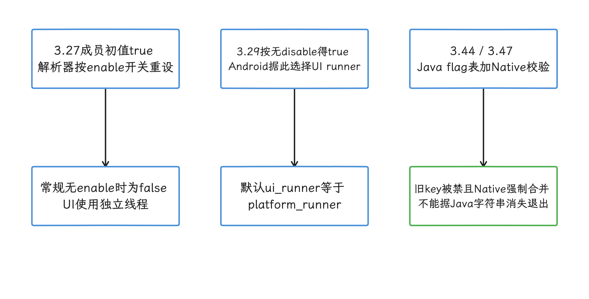

图：成员初值、命令行解析、Java flag 校验与 task runner 创建共同决定实际模型。 单处默认值与字符串搜索不足以推断最终线程；定制 engine 仍需现场 trace。

### 5.2 Flutter 与 Android Choreographer 的关系

vsync 是显示系统按刷新周期发出的垂直同步信号，Flutter 接的也是它。Flutter 3.47.0 的 Android `VsyncWaiter` 从平台信号取得帧时序：可用时走 `impeller::android::Choreographer` 封装的 NDK（Native Development Kit，Android 原生代码工具与 API） Choreographer 路径，回退实现用 Java `Choreographer.postFrameCallback()`，再经 `FlutterJNI.onVsync()` 交给 engine；engine 据此调度 Dart frame 与 raster。

“使用同一个 vsync 源”和“走完整 Android View 绘制阶段”是两回事。FlutterView 完成宿主接入后，纯 Flutter 内容的 build、layer tree（待合成的图层树）与 raster 都在 engine 内部。所以我们拿 Android 的 JankStats、FrameMetrics 或主线程 message 看纯 Flutter 页面时，看到的首先是宿主侧的帧和线程症状，区分不出 Dart build 慢、raster 慢，还是 pipeline latency（从帧开始到最终完成的管线延迟）过高。这三个维度要靠 `FrameTiming`；需要逐帧关联线程时，再采 Perfetto 系统 trace。

<!-- gracker-diagram: ch17-11-22-flutter-vsync -->
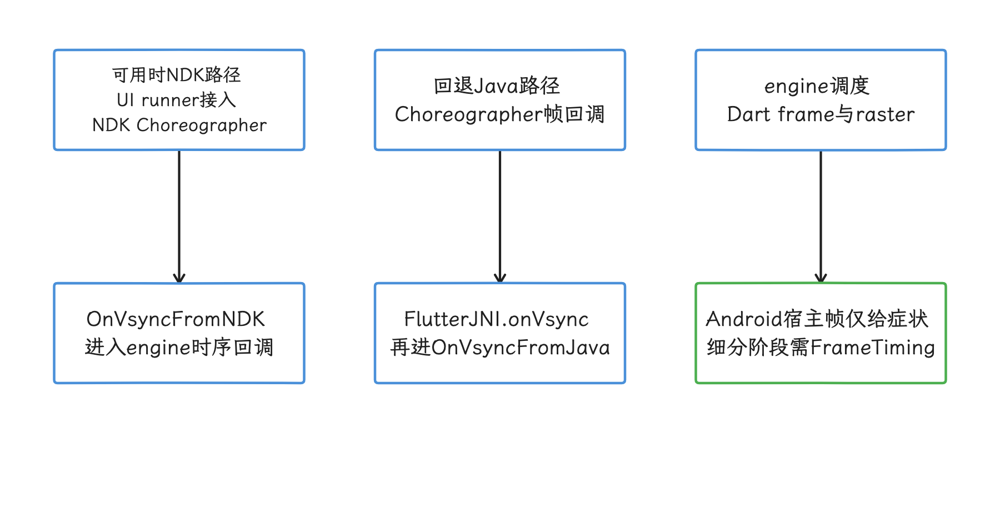

图：平台 vsync 经可用的 NDK 路径或 Java 回退进入 engine，再驱动 Flutter 构帧与 raster。 共享 vsync 来源不表示纯 Flutter 内容走完整 Android View 绘制阶段。

### 5.3 `FrameTiming` 同时看 build、raster 与 total span

`SchedulerBinding.addTimingsCallback()` 是适合线上采样的入口：

- `buildDuration` 是 `buildStart` 到 `buildFinish` 的 UI 构帧区间，通常含 framework 的 build/layout/paint，并非只测某次 Widget.build；
- `rasterDuration` 是 raster 阶段耗时；
- `totalSpan` 从 vsync start 延伸到 raster finish，用于观察端到端 pipeline latency；
- 回调列表按帧时间升序排列；
- release 约每 1 秒批量交付，debug/profile 约每 100 ms；首帧立即交付；
- 同一 callback 添加两次会执行两次，停止采集时要用同一实例移除。

排查帧问题时，先把 build/raster 超过预算记为超预算样本，再与目标设备的实际呈现证据关联。`totalSpan` 只覆盖 vsync start 到 raster finish 的 engine 区间，不能直接代表输入到面板可见延迟，也不证明 GPU、SurfaceFlinger 或显示已经完成。流水并行时，build/raster各自不超预算，totalSpan仍可能超过一个刷新周期。60Hz周期约16.67ms，120Hz约8.33ms；固定16ms并非精确统一阈值，可变刷新率还要记录当帧模式或可观测vsync间隔及其不确定性。

<!-- gracker-diagram: ch17-11-23-frame-phases -->
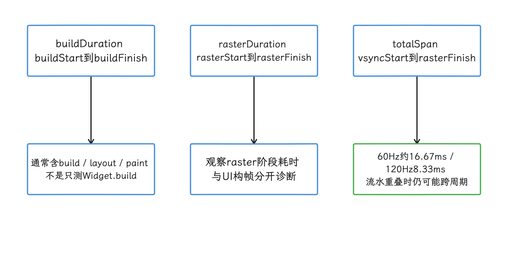

图：build、raster 与 totalSpan 分别描述 engine 内的不同区间，并按实际刷新周期比较。 totalSpan 结束于 raster finish，不证明 GPU、SurfaceFlinger 或面板完成，也不是输入延迟。

下面的 reporter 保留 callback 引用，直接把 Map 交给 StandardMethodCodec（Flutter platform channel 的标准结构化编码器），并提供采样入口，省掉先 `jsonEncode()` 再让 MethodChannel 编码第二次的环节。

```dart
import 'dart:async';
import 'dart:ui';

import 'package:flutter/scheduler.dart';
import 'package:flutter/services.dart';

class FlutterFrameReporter {
  FlutterFrameReporter({
    required this.sessionId,
    required this.engineId,
    required this.shouldKeep,
    MethodChannel? channel,
    this.maxFramesPerBatch = 60,
  }) : _channel = channel ?? const MethodChannel('apm/flutter_frame') {
    if (maxFramesPerBatch <= 0 || maxFramesPerBatch > 120) {
      throw ArgumentError.value(maxFramesPerBatch, 'maxFramesPerBatch');
    }
  }

  final String sessionId;
  final String engineId;
  final bool Function(FrameTiming timing) shouldKeep;
  final int maxFramesPerBatch;
  final MethodChannel _channel;
  TimingsCallback? _callback;
  bool _inFlight = false;
  int _droppedFrames = 0;
  int get droppedFrames => _droppedFrames;

  void start() {
    if (_callback != null) return;
    _callback = (List<FrameTiming> timings) {
      if (_inFlight) {
        _droppedFrames += timings.length;
        return;
      }
      final frames = <Map<String, Object>>[];
      for (final timing in timings) {
        if (frames.length >= maxFramesPerBatch) {
          _droppedFrames++;
          continue;
        }
        bool keep;
        try { keep = shouldKeep(timing); } catch (_) {
          _droppedFrames++;
          continue;
        }
        if (!keep) continue;
        frames.add(<String, Object>{
          'frameNumber': timing.frameNumber,
          'buildUs': timing.buildDuration.inMicroseconds,
          'rasterUs': timing.rasterDuration.inMicroseconds,
          'totalSpanUs': timing.totalSpan.inMicroseconds,
          'rawVsyncStartUs': timing.timestampInMicroseconds(FramePhase.vsyncStart),
          'rawBuildStartUs': timing.timestampInMicroseconds(FramePhase.buildStart),
          'rawRasterFinishUs': timing.timestampInMicroseconds(FramePhase.rasterFinish),
        });
      }
      if (frames.isNotEmpty) unawaited(_send(frames));
    };
    SchedulerBinding.instance.addTimingsCallback(_callback!);
  }

  void stop() {
    final callback = _callback;
    if (callback == null) return;
    SchedulerBinding.instance.removeTimingsCallback(callback);
    _callback = null;
  }

  Future<void> _send(List<Map<String, Object>> frames) async {
    _inFlight = true;
    try {
      await _channel.invokeMethod<void>('frameTimings', <String, Object>{
        'sessionId': sessionId,
        'engineId': engineId,
        'droppedFrames': _droppedFrames,
        'frames': frames,
      });
    } on PlatformException {
      _droppedFrames += frames.length;
    } on MissingPluginException {
      _droppedFrames += frames.length;
    } catch (_) {
      _droppedFrames += frames.length;
    } finally {
      _inFlight = false;
    }
  }
}
```

reporter 保留同一 callback 实例来移除注册；每个实例最多一批通道调用在途，新回调遇到背压直接丢弃并计数。每批默认最多60帧，配置通过运行时检查限制在1—120；`shouldKeep` 可优先选异常帧，普通抽样跳过与队列/发送丢弃分开。发送错误（包括 MissingPluginException）与采样器异常不逃逸到业务回调；stop 不取消已发送的一批，也不承诺对端已经处理。多 engine 场景还需在 Native 汇总预算。这里直接传结构化 Map，避免先 JSON 编码再交给 MethodChannel 重复编码。

<!-- gracker-diagram: ch17-11-24-reporter-backpressure -->
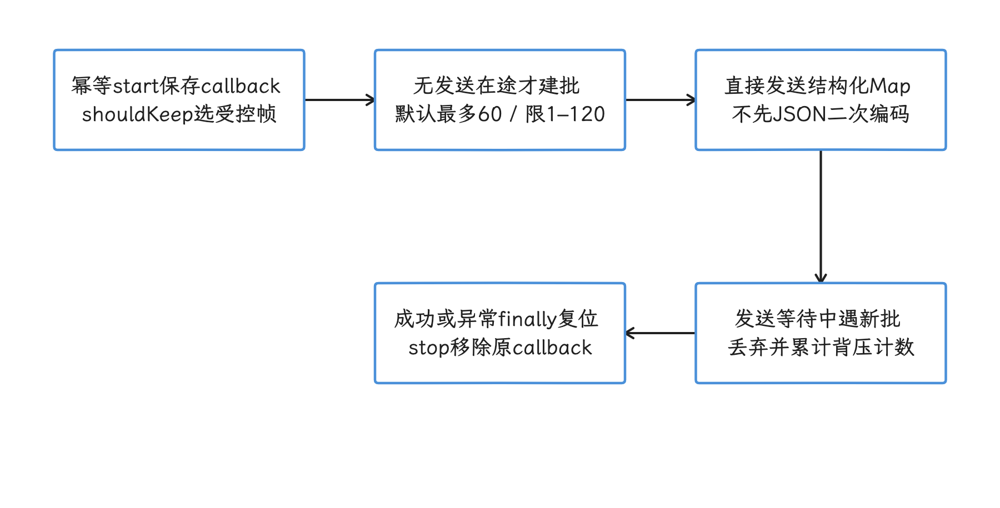

图：reporter 保留回调身份，每实例最多一批在途，结构化 Map 直接交 MethodChannel。 stop 只解除注册，不取消已发送批次；多 engine 还需 Native 统一预算。

### 5.4 raw timestamp（未经跨运行时时钟映射的原始时间戳） 与 Native 接收时间的时钟差异

`FrameTiming.timestampInMicroseconds()` 返回的是 raw timestamp，即未经跨运行时时钟映射的原始时间戳。同一组 `FrameTiming` 共用同一 epoch，也就是同一条时间轴的参考起点，做差值与排序没问题；这个 epoch 与 Dart `DateTime`、Android `elapsedRealtime` 之间的关系，官方没有给出承诺。除以 1000 后直接写入 `elapsed_realtime_ms`，得到的是伪精确时间。

Native 收到 `frameTimings` 时记录：

- `batch_receive_elapsed_ns`；
- `delivery_mode=batched`；
- release 约 1 秒、debug/profile 约 100 ms 的交付窗口；
- MethodChannel queue wait；
- 每帧原始 phase timestamp 与时长。

接收时间只说明“这一批最迟此时已经到达”，离每帧真实的发生时刻还有距离：约1秒/100ms只是通常的批量交付节奏，并非最坏时延上限；暂停、冻结、线程拥塞及通道排队可使记录更早。所以误差没有对称的 `±1000 ms` 可写，“至少 1000 ms”这样的下界也给不出；按秒聚合时，用 raw 相对顺序和 duration 就够了。要和 Native ANR、Binder 调用或 SurfaceFlinger 合成帧精确对上，应在同一次测试里检查 Perfetto 的 engine、Choreographer、gfx（图形） 和 sched（线程调度） 轨迹。

<!-- gracker-diagram: ch17-11-25-batched-clock -->


图：按帧 raw 时间排序和做差，Native 另记批次接收时间及通道等待。 约1秒或100ms是通常交付节奏，不能写成最坏延迟或对称校准误差。

### 5.5 Dart 异常的“是否已处理”语义

`FlutterError.onError` 接收 Flutter framework 捕获的异常。我们的监控 handler 要先安全地复制结构化信息，再调用已有 handler；没有已有 handler 时，调用 `FlutterError.presentError`。上报代码自身不许抛异常，否则可能把原异常掩盖掉。

isolate 是 Dart 拥有独立内存和事件循环的执行单元。`PlatformDispatcher.instance.onError` 处理 root isolate（应用入口所在 isolate）的未捕获错误，返回 `true` 表示调用方已经处理。仅凭“写入了队列”就把返回值改成 `true` 并不合适，APM 要保留应用原有 handler 的返回语义。child isolate（应用额外创建的 isolate）不经过这个回调，需要通过 isolate error listener 或应用已有的转发机制接入。

<!-- gracker-diagram: ch17-11-26-dart-error-boundaries -->
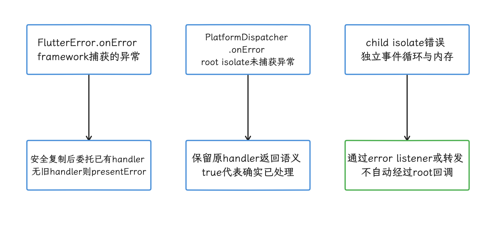

图：framework 已捕获错误、root 未捕获错误和 child isolate 错误分别接入并保留原处理语义。 写入监控队列不代表已处理；采集异常不能掩盖原始错误。

事件类型至少区分：

- framework-caught error：可能被 ErrorWidget（构建失败时的替代界面）、Zone（Dart 的异步执行与错误边界）或业务恢复，还算不上 crash；
- root-isolate unhandled error：保留 handler 的 handled 结果；
- child-isolate error：记录 isolate 与转发来源；
- Android/NDK engine 或 plugin crash：进入 Native crash 管道；
- engine detach、surface 丢失和 OOM（Out of Memory，内存耗尽）：不冒充 Dart exception。

样本同时保留 Flutter framework 版本、engine revision、线程模型、renderer backend（实际使用的渲染后端）、GPU、route 与 `engine_id`——同一进程可以创建多个 engine，只有 `session_id` 时区分不开它们。

<!-- gracker-diagram: ch17-11-27-failure-taxonomy -->
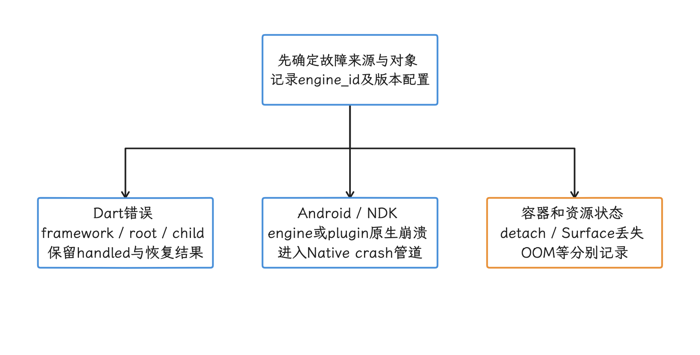

图：异常按实际来源归入 Dart、Native crash 或容器/engine 状态管道，并保留 engine 身份。 framework-caught 不自动成为 crash，detach、surface 丢失和 OOM 也不能冒充 Dart exception。

## 6. Session Timeline：共享关联键，保留各运行时语义

统一时间线把 FCP、Flutter UI 构帧和 Android first draw 各自放在正确位置，保留事件与观察时刻。这里的 `surface_id` 是 SDK 的逻辑容器标识（Window/WebView/FlutterView 实例），不是 Native Surface 句柄或 SurfaceFlinger Layer ID；如需同系统帧关联，还要现场对应真实对象与代次。Native 容器生成根 ID：

- `session_id`：一次业务页面访问或流程；
- `surface_id`：Activity Window、WebView 或 FlutterView 实例；
- `navigation_id`：每次 WebView main-frame navigation；
- `route_id`：H5 soft navigation 或 Flutter route；
- `engine_id`：FlutterEngine 实例；
- `parent_span_id` / `span_id`：span 是一次有起止或明确事件边界的追踪单元，这两个字段保存容器、导航、网络和渲染事件的父子关系。

<!-- gracker-diagram: ch17-11-28-identity-scopes -->
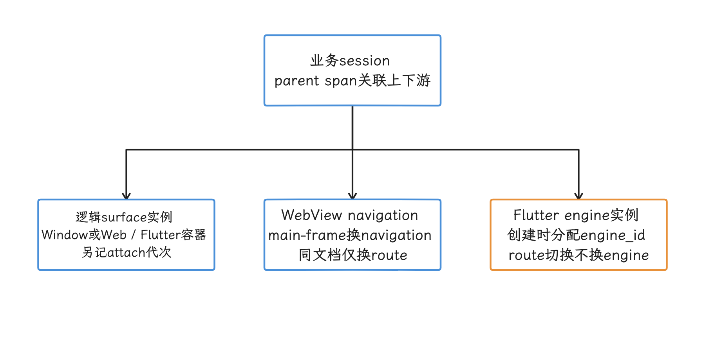

图：根会话关联逻辑容器，导航、路由、engine 与 span 各自保留生命周期身份。 surface_id 是 SDK 容器 ID，不是 Native Surface 或 SurfaceFlinger Layer ID。

### 6.1 事件 schema

schema 是所有运行时共同遵守的字段名称、类型和含义约定，它统一关联方式，同时保留来源时间和信号强度这些差异：

| 字段 | 说明 |
| --- | --- |
| `runtime` | `native`、`webview`、`flutter` |
| `event_name` | 如 <code>container_<wbr>create</code>、`fcp`、`renderer_gone`、`flutter_frame` |
| <code>observed_<wbr>elapsed_<wbr>ns</code> | Native 观察或接收事件的单调时钟 |
| `source_time` / `source_clock` | Web `performance.now`、Flutter raw phase 等原始时间 |
| `uncertainty` | 往返校准误差、批次交付窗口或 `unknown` |
| `value` / `unit` | 指标数值和 `ns`、`us`、`ms`、`bytes`、`count` |
| `signal_strength` | `direct`、`state`、`suspected` |
| `runtime_version` | Android 17、WebView provider、Flutter engine 等版本轴 |
| `sampling` | 采样率、保留原因、drop count（因限流或队列满而丢弃的数量） |
| `route_key` | 脱敏后的低基数页面标识 |

我们把事件时间与观察时间分开存，查询端才不会把 MethodChannel 收包时刻当作 Flutter 单帧发生时刻，或把 `onPageFinished()` 当作像素已经显示。缺失字段使用 `unsupported`、`not_observed` 或 `inconclusive`，不使用 0。

<!-- gracker-diagram: ch17-11-29-schema-clocks -->
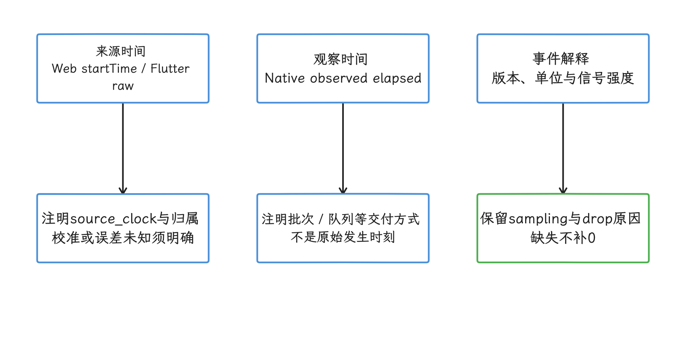

图：统一关联字段和单位，同时保存来源时钟、观察时刻、误差与信号强度。 接收时刻不替代事件发生时刻；unsupported、not_observed、inconclusive 保持不同状态。

### 6.2 会话 ID 在复用与进程重启下的维护

WebView 返回历史页时，旧 document 可能还在；bfcache、same-document route 与 main-frame navigation 的指标统计方式各不相同。FlutterView 可以 detach 后再 attach，同一个 FlutterEngine 还可能服务新的页面。ID 建议按下面的规则维护：

- 新业务访问生成新 `session_id`；
- WebView 每次 main-frame navigation 生成新 `navigation_id`，SPA route 只换 `route_id`；
- FlutterEngine 创建时生成 `engine_id`，route 变化不更换 engine；
- surface detach/attach 生成新的 surface generation，也就是同一 surface 每次重新接入宿主后的代次编号；
- App 进程重启后不续用旧的单调时钟会话；服务端可用业务 trace 做弱关联，两段记录是否连续要另行确认；
- 页面进入后台时关闭像素判断窗口，恢复后重新校准 Web 时钟与可见状态。

<!-- gracker-diagram: ch17-11-30-reuse-generations -->
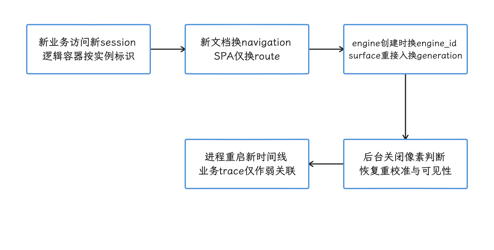

图：业务访问、文档导航、路由、engine 与 surface generation 按各自触发条件更新。 进程重启不能续用旧单调会话；后台关闭像素判断，恢复后复核时钟和可见状态。

这样拼出来的一条查询结果，可以按因果顺序展示：容器创建、WebView 导航、FCP/LCP、业务 ready、白屏判定、Bridge 高耗时、Flutter 慢帧、网络与异常；每个 runtime 仍用自己的指标定义。

### 6.3 上线前验证采集器本身

混合栈 APM 至少做四组回归：

1. WebView：受控重定向、SPA、跨域 iframe、合法纯白页、canvas/video、renderer crash 与后台冻结；
2. Flutter：build 慢、raster 慢、pipeline latency、多个 engine、旧/新线程模型和异常恢复；
3. 时钟：冷启动、长时间后台、系统时间跳变、provider/engine 更新与高负载队列；
4. 开销：主线程时间、worker queue、Bitmap 峰值、MethodChannel bytes、CPU、drop count 和上传量。

<!-- gracker-diagram: ch17-11-31-collector-validation -->
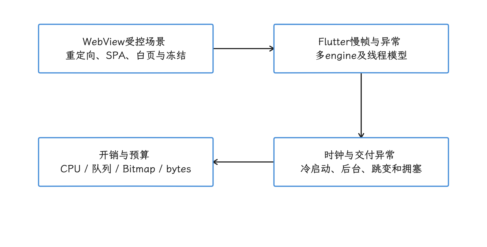

图：按页面行为、Flutter 阶段、时钟异常与采集开销验收，再在目标设备检查实际结果。 主机替身和源码契约验证不代替真实 WebView provider、Flutter engine、GPU 与显示验收。

最后是隐私和采样预算：白屏截图不上传，Bridge 参数默认不采集，URL 去掉 query（`?` 后的查询参数）、fragment（`#` 后的页内标识）与用户标识，异常栈按现有隐私策略脱敏。采样器达到 CPU、内存或队列预算时，优先丢正常帧和重复状态，保住 renderer gone、确认白屏与异常摘要。

<!-- gracker-diagram: ch17-11-32-privacy-budget -->
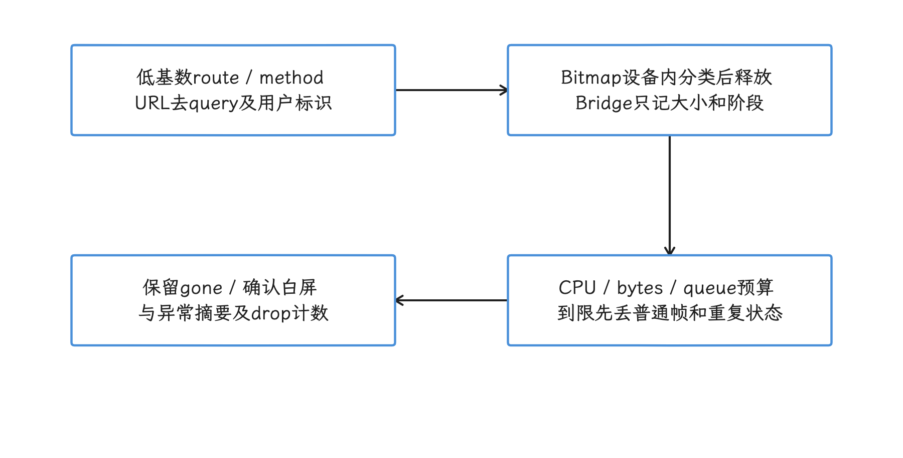

图：采集前去除敏感载荷，按 CPU、内存、队列和上传预算保留有用摘要。 像素仅本地分析，Bridge 参数默认不采集，截图与完整 URL 用户信息不进入上报。

## 参考资料

### Android 17 / WebView

- [AOSP `WebView.java`（android-17.0.0_r1）](https://android.googlesource.com/platform/frameworks/base/+/android-17.0.0_r1/core/java/android/webkit/WebView.java)
- [AOSP `WebViewClient.java`（android-17.0.0_r1）](https://android.googlesource.com/platform/frameworks/base/+/android-17.0.0_r1/core/java/android/webkit/WebViewClient.java)
- [AOSP `WebViewRenderProcessClient.java`（android-17.0.0_r1）](https://android.googlesource.com/platform/frameworks/base/+/android-17.0.0_r1/core/java/android/webkit/WebViewRenderProcessClient.java)
- [AOSP `PixelCopy.java`（android-17.0.0_r1）](https://android.googlesource.com/platform/frameworks/base/+/android-17.0.0_r1/graphics/java/android/view/PixelCopy.java)
- [Android WebView API reference](https://developer.android.com/reference/android/webkit/WebView)
- [WebViewClient API reference](https://developer.android.com/reference/android/webkit/WebViewClient)
- [WebViewRenderProcessClient API reference](https://developer.android.com/reference/android/webkit/WebViewRenderProcessClient)
- [PixelCopy API reference](https://developer.android.com/reference/android/view/PixelCopy)
- [ViewTreeObserver API](https://developer.android.com/reference/android/view/ViewTreeObserver)：硬件帧提交回调。
- [WebMessageCompat API](https://developer.android.com/reference/androidx/webkit/WebMessageCompat)：消息类型与访问器约束。
- [AndroidX WebKit `WebViewCompat`](https://developer.android.com/reference/androidx/webkit/WebViewCompat)
- [WebView Native Bridge 指南](https://developer.android.com/develop/ui/views/layout/webapps/native-api-access-jsbridge)
- [WebView Native Bridge 安全风险](https://developer.android.com/privacy-and-security/risks/insecure-webview-native-bridges)
- [Handle WebView termination](https://developer.android.com/develop/ui/views/layout/webapps/handle-termination)

### Web Performance

- [Paint Timing](https://www.w3.org/TR/paint-timing/)
- [Largest Contentful Paint](https://www.w3.org/TR/largest-contentful-paint/)
- [Navigation Timing Level 2](https://www.w3.org/TR/navigation-timing-2/)
- [High Resolution Time Level 3](https://www.w3.org/TR/hr-time-3/)
- [Lighthouse 10 移除 TTI](https://developer.chrome.com/docs/lighthouse/performance/interactive)
- [Chrome Soft Navigations](https://developer.chrome.com/docs/web-platform/soft-navigations)：Chrome151的新条目、interactionId配对与时间轴。
- [Performance Timeline](https://www.w3.org/TR/performance-timeline/)：观察器队列与takeRecords。

### Flutter

- [Flutter SDK archive](https://docs.flutter.dev/install/archive)
- [官方 macOS 归档元数据](https://storage.googleapis.com/flutter_infra_release/releases/releases_macos.json)：stable与精确tag的release_date、framework ref和Dart版本。
- [Flutter3.47 FlutterEngineFlags](https://github.com/flutter/flutter/blob/3.47.0/engine/src/flutter/shell/platform/android/io/flutter/embedding/engine/FlutterEngineFlags.java)：旧key列入disabled表。
- [Flutter3.44 FlutterEngineFlags](https://github.com/flutter/flutter/blob/3.44.0/engine/src/flutter/shell/platform/android/io/flutter/embedding/engine/FlutterEngineFlags.java)：同一迁移边界。
- [Flutter3.27 engine.version](https://github.com/flutter/flutter/blob/3.27.0/bin/internal/engine.version) 与 [固定engine解析器](https://flutter.googlesource.com/mirrors/engine/+/83bacfc52569459a4a654727cad2546820cb0d6a/shell/common/switches.cc)：Android opt-in默认。
- [Flutter3.29解析器](https://github.com/flutter/flutter/blob/3.29.0/engine/src/flutter/shell/common/switches.cc) 与 [Flutter3.47 Android入口](https://github.com/flutter/flutter/blob/3.47.0/engine/src/flutter/shell/platform/android/flutter_main.cc)：最终线程模式检查。
- [Flutter 3.47.0 stable tag](https://github.com/flutter/flutter/releases/tag/3.47.0)
- [Flutter architectural overview](https://docs.flutter.dev/resources/architectural-overview)
- [Flutter 3.32 release notes](https://docs.flutter.dev/release/release-notes/release-notes-3.32.0)
- [Flutter 3.38 release notes](https://docs.flutter.dev/release/release-notes/release-notes-3.38.0)
- [Flutter merged platform/UI thread tracking issue](https://github.com/flutter/flutter/issues/150525)
- [Flutter 3.29.0 `FlutterLoader.java`：默认合并与旧 opt-out](https://github.com/flutter/flutter/blob/3.29.0/engine/src/flutter/shell/platform/android/io/flutter/embedding/engine/loader/FlutterLoader.java)
- [Flutter 3.35.0 `FlutterLoader.java`：旧 opt-out 仍可用](https://github.com/flutter/flutter/blob/3.35.0/engine/src/flutter/shell/platform/android/io/flutter/embedding/engine/loader/FlutterLoader.java)
- [Flutter 3.38.0 `FlutterLoader.java`：拒绝 Android 旧 opt-out](https://github.com/flutter/flutter/blob/3.38.0/engine/src/flutter/shell/platform/android/io/flutter/embedding/engine/loader/FlutterLoader.java)
- [Flutter 3.41.0 `FlutterLoader.java`：仍拒绝 Android 旧 opt-out](https://github.com/flutter/flutter/blob/3.41.0/engine/src/flutter/shell/platform/android/io/flutter/embedding/engine/loader/FlutterLoader.java)
- [Flutter 3.44.0 `FlutterLoader.java`：旧 opt-out key 已移除](https://github.com/flutter/flutter/blob/3.44.0/engine/src/flutter/shell/platform/android/io/flutter/embedding/engine/loader/FlutterLoader.java)
- [Flutter 3.47.0 `FlutterLoader.java`：当前主线线程配置](https://github.com/flutter/flutter/blob/3.47.0/engine/src/flutter/shell/platform/android/io/flutter/embedding/engine/loader/FlutterLoader.java)
- [FrameTiming API](https://api.flutter.dev/flutter/dart-ui/FrameTiming-class.html)
- [`timestampInMicroseconds()` API](https://api.flutter.dev/flutter/dart-ui/FrameTiming/timestampInMicroseconds.html)
- [`SchedulerBinding.addTimingsCallback()` API](https://api.flutter.dev/flutter/scheduler/SchedulerBinding/addTimingsCallback.html)
- [`PlatformDispatcher.onReportTimings` API](https://api.flutter.dev/flutter/dart-ui/PlatformDispatcher/onReportTimings.html)
- [`PlatformDispatcher.onError` API](https://api.flutter.dev/flutter/dart-ui/PlatformDispatcher/onError.html)
- [`FlutterError.onError` API](https://api.flutter.dev/flutter/foundation/FlutterError/onError.html)
- [Flutter 3.47.0 `vsync_waiter_android.cc`](https://github.com/flutter/flutter/blob/3.47.0/engine/src/flutter/shell/platform/android/vsync_waiter_android.cc)
- [Flutter 3.47.0 `VsyncWaiter.java`](https://github.com/flutter/flutter/blob/3.47.0/engine/src/flutter/shell/platform/android/io/flutter/view/VsyncWaiter.java)
- [Flutter 3.44.8 `vsync_waiter_android.cc`](https://github.com/flutter/flutter/blob/3.44.8/engine/src/flutter/shell/platform/android/vsync_waiter_android.cc)
- [Flutter 3.44.8 `VsyncWaiter.java`](https://github.com/flutter/flutter/blob/3.44.8/engine/src/flutter/shell/platform/android/io/flutter/view/VsyncWaiter.java)
- [Flutter 渲染管线](../../part2-performance/ch13-rendering-pipelines/07-flutter-rendering-pipeline.md)
- [WebView 渲染管线](../../part2-performance/ch13-rendering-pipelines/09-webview-rendering.md)
