# 千万级 DAU（Daily Active Users，日活跃用户数） 的 APM 端侧架构

DAU 到千万级之后，APM SDK（应用性能监控软件开发包） 在单台设备上的职责没有变化，但极小比例的缺陷也会落在大量用户头上。SDK 的压力峰值往往与宿主故障同时出现：卡顿会增加慢帧事件，网络失败会积压待传批次，内存异常可能触发更高采样率或更重的诊断采集，进程退出又要求保住故障前的少量上下文。端侧架构要按这个峰值设计，平稳期的平均流量只能作参考。

> 源码基线：Android 17 / API 37 / AOSP `android-17.0.0_r1`；内核 `android17-6.18-2026-06_r6`。

Android 8—17 的应用都能采用以下队列、分片和上传模型；`ApplicationExitInfo`、`ProfilingManager` 等能力再按 API level 分支。

“千万级 DAU”改变的是发布风险：一个只在 0.1% 设备出现的采集器回归，也会覆盖大量用户；重试一旦缺少随机错峰，就会在同一时刻形成请求峰值；目标范围过宽的远程指令会迅速消耗系统预算和用户流量。端侧因此要同时控制三样东西：单进程开销、跨进程一致性，以及一次配置或版本发布能影响的设备范围。

<!-- gracker-diagram: ch17-12-01-peak-budgets -->
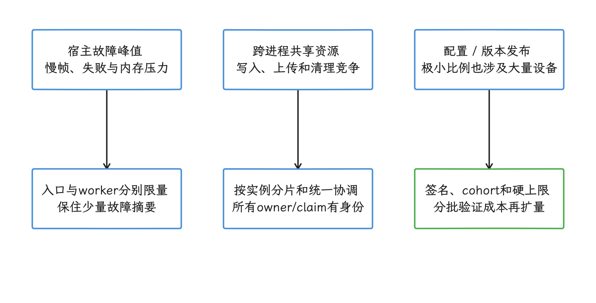

图：故障期会同时增加事件、排队和重采集需求，因此分别限制进程、进程协作和发布人群。 以下预算与策略由 SDK 设计并实测，DAU 数量不能直接给出单机耗时上限。

## 1. 端侧引擎的职责与不可破坏约束

我们先划清端和云的分工：端侧负责采集、准入、短期存储、受控上传和远程配置执行，聚合、长期检索、因果分析和告警留给服务端。设备上可以承担低成本过滤与摘要，复杂分析要放到业务线程之外。

一个可维护的 SDK 至少包含以下层：

| 层 | 主要职责 | 必须限制的风险 |
| --- | --- | --- |
| 采集 API | 读取已有事实，填最小事件 | 主线程分配、锁等待、字符串处理 |
| 准入与缓冲 | 有界队列、优先级、丢弃计数 | 无界增长、低价值事件挤掉故障事件 |
| 编码 | schema 校验、批量序列化、压缩 | 大对象、GC、压缩 CPU 峰值 |
| 本地 spool | 分片、提交、恢复、配额 | 尾部损坏、磁盘满、跨进程并发写 |
| 上传调度 | 幂等、约束、退避、删除确认 | 后台唤醒、重试风暴、误删未确认文件 |
| 指令控制 | 验签、能力检查、TTL、预算 | 越权采集、过期指令、重样本失控 |
| 自我保护 | 成本计数、断路器、分批发布开关 | 监控逻辑递归、服务端失联时无法降级 |

这张表里有三个词后文会一直用到：schema 约定事件的字段、类型和兼容规则；spool 指尚未上传、暂存在 App 私有目录中的分片文件；TTL（Time To Live） 限定一条指令允许存活的时间。

全链条共享三条硬约束：

1. 业务线程不等待编码、文件、压缩、加密和网络。
2. 所有内存、文件、重试和重样本都有上限。
3. 高优先级故障证据有独立容量，普通指标再多也挤不进去。

<!-- gracker-diagram: ch17-12-02-worker-boundary -->
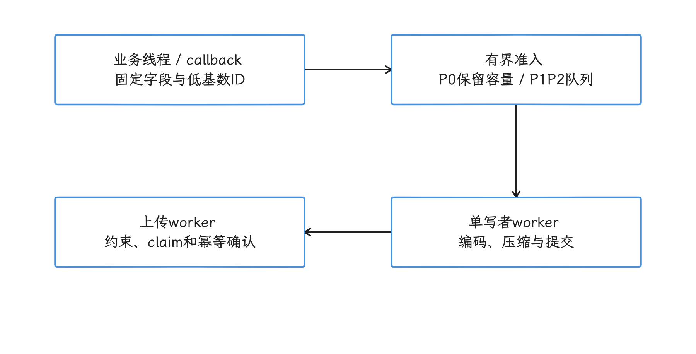

图：业务入口只做最小事件和有界准入，编码、同步和网络交给受控 worker。 非挂起不等于 wait-free，也不保证固定纳秒上限；所有分配、队列和工作区均需预算。

“业务线程不等待”指的是不在编码、文件这类慢操作上阻塞；至于每次调用的耗时，对象分配、CAS（Compare-And-Set，并发代码常用的原子比较后更新） 竞争、缺页（访问尚未驻留内存的页面）和线程调度都可能带来少量高延迟调用。所以我们要在目标低端机上实测入口 P50/P95/P99.9——分别对应 50%、95% 和 99.9% 的样本不高于该耗时——并给主线程路径配上自动降级。

## 2. 线程模型

线程模型围绕两件事展开：事件如何无阻塞地进入 SDK，以及写入如何保持单写者。我们先看入口。

### 2.1 `trySend()` 的非挂起契约

`kotlinx.coroutines` 的 `Channel.trySend()` 是非挂起发送：它立刻尝试把元素放进 Channel，不等待可用容量，也不抛“队列已满”异常。作为对照，默认 `BufferOverflow.SUSPEND` 策略下普通 `send()` 遇到有界 buffer 满会挂起等待；`trySend()` 在相同场景或 Channel 已关闭时直接返回失败。第 1 节的第一条硬约束就是业务线程不等待，这个契约放在普通 APM 事件入口上正合适。

拿到“立即返回”这个性质，还要把它和 lock-free 分开：lock-free 指系统整体总有线程能前进，wait-free 更进一步，要求每个操作在有限步骤内完成。这两条进度保证，连同固定的纳秒上限，Channel 文档都没有承诺；我们手里拿到的契约，只有“非挂起、失败可观测”一条。

如果项目选择自研 MPSC（Multi-Producer, Single-Consumer，多生产者单消费者）RingBuffer（首尾相接、循环复用槽位的缓冲区），就要用每个 slot（队列槽位） 的 sequence（代次序号） 证明发布顺序，并处理槽位值循环后被误认成旧状态的 ABA 问题。这样的实现要通过并发测试、长时间 soak test（持续压力测试） 和线性化检查才算数；直接把一个循环数组叫作无锁队列，是过不了这几关的。

下面的示例只展示准入语义。事件使用预先分配的 `sceneId`，避免在入口处理 URL、路由名和动态标签。

```kotlin
import android.os.SystemClock
import kotlinx.coroutines.channels.Channel

private const val APM_QUEUE_CAPACITY = 4096

enum class Admission {
    ACCEPTED,
    FULL,
    CLOSED
}

class ApmIngress(
    private val queue: Channel<ApmEvent> =
        Channel(capacity = APM_QUEUE_CAPACITY),
    private val selfMetrics: ApmSelfMetrics,
    private val clock: () -> Long = {
        SystemClock.elapsedRealtimeNanos()
    }
) {
    fun recordFrameJank(
        sceneId: Int,
        frameCostNs: Long
    ): Admission {
        val result = queue.trySend(
            ApmEvent.FrameJank(
                sceneId = sceneId,
                frameCostNs = frameCostNs,
                observedElapsedNs = clock()
            )
        )

        return when {
            result.isSuccess -> Admission.ACCEPTED
            result.isClosed -> {
                selfMetrics.incrementClosed(EventKind.FRAME_JANK)
                Admission.CLOSED
            }
            else -> {
                selfMetrics.incrementDropped(
                    EventKind.FRAME_JANK,
                    DropReason.QUEUE_FULL
                )
                Admission.FULL
            }
        }
    }
}
```

`capacity = 4096` 限制的只是 buffer 里驻留的元素个数。事件在 `trySend()` 之前就已经创建，队列里的对象还可能引用大字符串或 `ByteArray`，所以 SDK 总内存并不严格等于 4096 乘某个固定值。生产实现要给每种 event 限制最大编码长度，优先使用整数 ID 和固定字段，并把队列节点、事件对象、临时编码 buffer、压缩工作区一起纳入内存预算。

失败计数同样在 hot path（调用频繁、对耗时敏感的路径） 上：计数器要预先创建、按固定枚举索引，失败分支里只做自增；拼 key、建 Map entry、打印日志都超出 hot path 的预算。若 queue 已关闭，说明 SDK 生命周期或 worker 出错；这个状态要与“容量已满”分开统计。

Channel 被取消时，buffer 中尚未消费的 event 也会丢失。若使用 `onUndeliveredElement` 补计数，回调可能在触发取消或丢弃的调用上下文中同步执行，所以要保持无阻塞、零异常。

还有一条契约要记在 `trySend()` 失败的场景上：容量已满或 Channel 已关闭时，元素从未进入 Channel，官方明确此时不会调用这个回调，失败分支要自行计数；event 里也不要携带必须靠该回调释放的复杂资源。

<!-- gracker-diagram: ch17-12-04-memory-budget -->
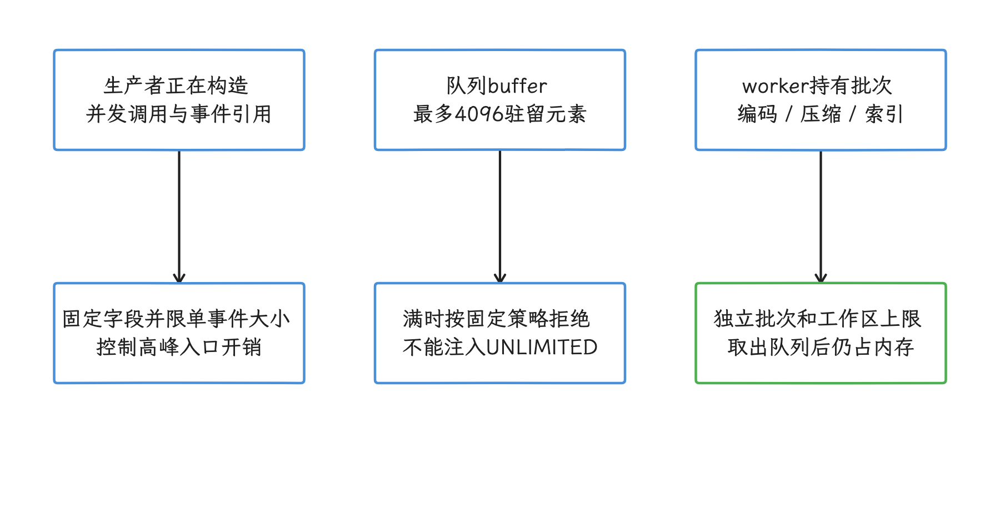

图：驻留 buffer、并发构造对象、在途批次和编码工作区分别计入内存。 4096 是 buffer 元素数上限，不是总事件数、对象字节数或持久化承诺。

<!-- gracker-diagram: ch17-12-03-channel-admission -->
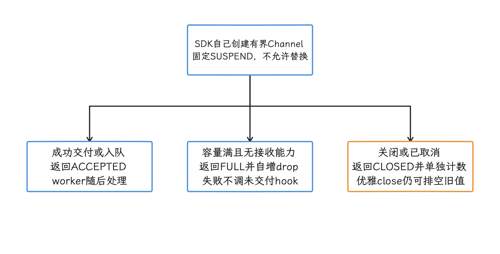

图：固定4096容量与 SUSPEND 后，trySend 的成功、满和关闭分别统计。 ACCEPTED 只表示交付或入队；自定义丢弃策略可能成功同时丢样，且不代表持久化。

### 2.2 三级优先级准入

单个 FIFO（First In, First Out，先进先出） 队列满载时，普通帧样本可能先占满所有 slot，随后到达的 crash breadcrumb（崩溃前留下的少量事件线索）就无处可放。更稳妥的准入模型把事件分成三级：

| 级别 | 例子 | 队列满时的策略 |
| --- | --- | --- |
| P0 故障证据 | crash/ANR 摘要、renderer gone、存储损坏 | 独立保留槽或直接写预分配故障区 |
| P1 异常样本 | 确认白屏、严重慢帧、超时网络 | 丢弃同类旧样本或限频保留 |
| P2 普通样本 | 正常帧、正常网络、Debug/Info | 按采样率丢弃 |

P0 的容量同样要有上限：常见做法是很小的独立 ring，每类只保留最近 N 条，或覆盖最旧 breadcrumb。覆盖发生时把 dropped/overwritten count（丢弃数和覆盖数）记下来，服务端才能识别样本不完整。

<!-- gracker-diagram: ch17-12-05-priority-reserves -->
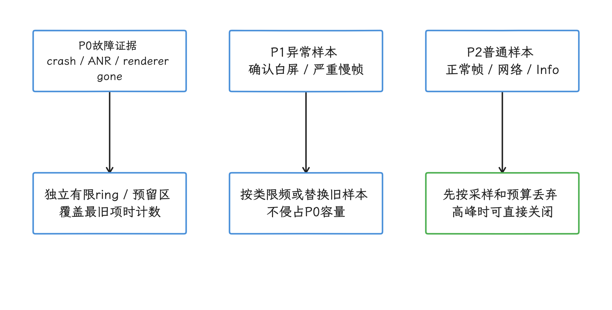

图：P0 使用小而独立的故障容量，P1 留异常样本，P2 先抽样和丢弃。 保留容量同样有上限，覆盖与丢弃都须计数；普通事件入口不能替代 fatal signal 安全路径。

### 2.3 单写者简化文件一致性

多个业务线程可以并发投递，而编码、分片、游标提交和文件轮转尽量由一个 spool writer（待上传文件的单写入线程）串行执行。active 分片仍在写入，sealed 分片已提交并停止修改，上传 worker 只读 sealed 文件。这样我们能把“记录发布”“文件提交”“上传删除”拆成清晰的状态：

```text
IN_MEMORY -> ACTIVE -> SEALED -> UPLOADING -> ACKED -> DELETED
                         \-> EXPIRED / CORRUPT
```

状态迁移写入小型索引，或者干脆由文件名加一次原子 rename 表达。`ACKED` 表示服务端已确认完整接收，收到确认前就停在 `UPLOADING`。App 被杀后，下一次启动修复 `ACTIVE`，继续上传 `SEALED`，并把中断的 `UPLOADING` 恢复成可重试状态。

<!-- gracker-diagram: ch17-12-06-spool-states -->
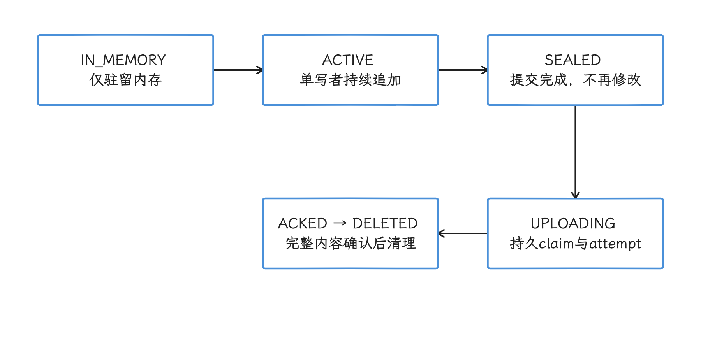

图：单写者修改 ACTIVE，上传器仅 claim 已提交 SEALED，完整确认后才删除。 状态索引和名称原子切换不自动等于掉电持久性，中断上传需按持久归属恢复。

## 3. 多进程与进程退出

进程一多，“谁来写、谁来传”就成了要单独回答的问题。Android App 可以声明多个进程，WebView、远程 service 或业务组件都可能运行在不同进程。每个进程启动时都应生成新的 `process_instance_id`，并记录 process name、PID（操作系统分配的进程号）、进程启动的 elapsed time 与 App 版本；PID 在重启后会复用，持久标识要交给 `process_instance_id`。

我们推荐每个进程使用自己的 active queue、worker 和 spool 目录：

```text
files/apm/spool/<process-name-hash>/<process-instance-id>/
```

上传协调者固定在主进程或专用诊断进程，负责扫描其他进程的 sealed 文件；其他进程只做 seal 和轻量 IPC（Inter-Process Communication，进程间通信） 通知，通知丢失时由下次扫描补上。需要从多个进程安全地提交 WorkManager 请求时，显式接入 `androidx.work.multiprocess.RemoteWorkManager`，每个进程各自初始化一套未验证调度器的做法要避开。

同一个 mmap（memory-mapped file） active file 也只能有一个写进程：Java/Kotlin 的进程内锁只覆盖本进程，文件锁只提供互斥，记录何时算完整提交要靠 record commit protocol（记录何时算完整提交的协议） 自己约定。Mars xLog 的接入文档同样是这个要求：多进程各用独立日志文件。

<!-- gracker-diagram: ch17-12-07-process-isolation -->
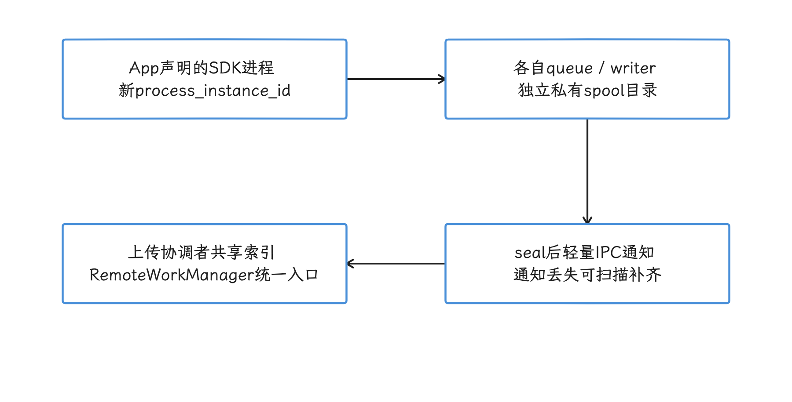

图：每个 SDK 进程实例拥有独立队列与 active 分片，协调者扫描 sealed 文件并统一调度。 PID 会重用；WebView 隔离 renderer 不自动运行宿主 SDK，文件锁也不提供记录提交协议。

### 3.1 crash handler 的最小职责

Java 未捕获异常、native signal、OOM（Out of Memory，内存耗尽） 和系统结束进程，这几种场景下能安全执行的操作各不相同：

- Java uncaught handler 仍在故障进程内，锁、堆和线程状态可能已损坏；
- native fatal signal handler 里只能调用 async-signal-safe（POSIX 明确允许在信号处理器中调用） 函数，也就是那个极小的函数集合；Java、malloc、常规日志和复杂文件 API 都不安全；
- OOM 后再创建大 event、压缩或 dump heap 很容易触发二次失败；
- LMK（Low Memory Killer，系统因内存压力终止进程）、force-stop、设备掉电与 `SIGKILL` 没有应用清理回调。

因此 crash 前的 breadcrumb 要持续写入预分配区域。handler 只追加固定大小、无敏感正文的最小头，或设置预留的 crash marker（表示进程异常终止的固定标记），然后交还默认终止链。不要在 handler 中等待 Channel drain（排空队列）、执行全量 `MappedByteBuffer.force()`、上传网络或遍历所有线程。

<!-- gracker-diagram: ch17-12-08-crash-minimum -->
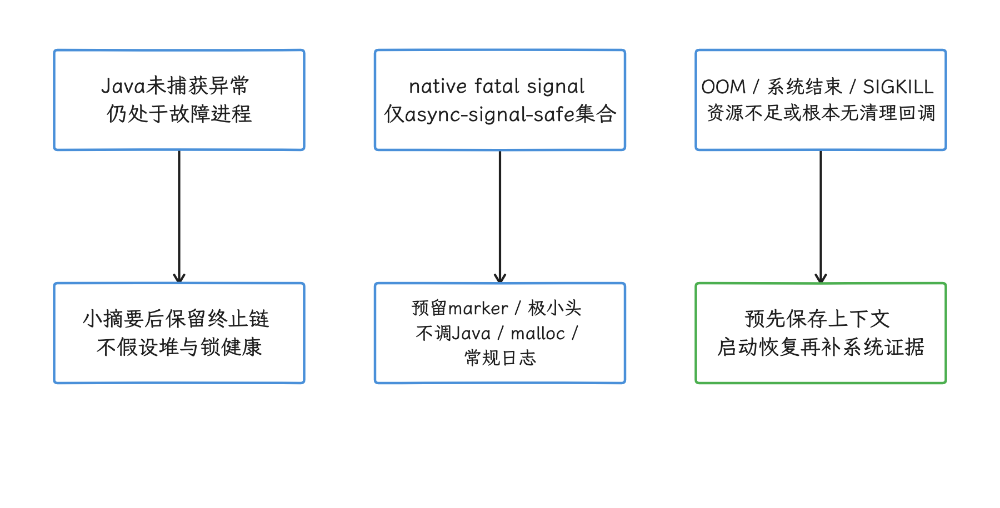

图：故障前持续保留少量 breadcrumb，故障处理只做环境允许的最小动作。 Java、native signal、OOM 与 SIGKILL 能力不同，handler 不等待队列、同步大映射或网络。

### 3.2 下次启动补系统退出原因

API 30 起可以通过 `ActivityManager.getHistoricalProcessExitReasons()` 读取 `ApplicationExitInfo`。它能补充 reason、status、importance、timestamp，以及某些 ANR/native crash 的 trace stream（系统保存的诊断数据流）。

RSS 是进程当时驻留在物理内存中的页面总量，PSS 会按共享比例分摊共享页面；两者都取自系统最近一次采样，不是死亡瞬间的精确值。trace 也可能因系统循环缓冲被后续记录覆盖而返回 `null`。

SDK 要把系统退出记录与本地 `process_instance_id`、wall clock（可对应日历日期的系统时间） 时间窗口和上次已提交 breadcrumb 关联，并对已消费的 exit record 做幂等标记，让重复扫描不会重复上报同一条记录。这份证据要等重启后才拿得到，进程内 crash handler 仍是第一现场。

<!-- gracker-diagram: ch17-12-09-exit-evidence -->
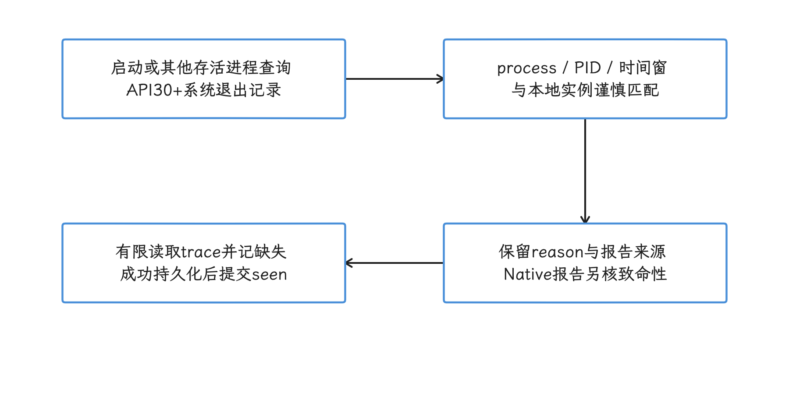

图：把系统记录与本地实例谨慎匹配，有限读取并持久化摘要后再标记已消费。 NativeTombstoneManager 可合成 Native 报告，reason 本身不能证明死亡；trace 也可能缺失或截断。

## 4. `mmap` 的收益与代价

### 4.1 缺页、脏页与回写

事件落盘这一层，Mars、Logan 这些日志库共同的选择是 `mmap`：它把文件页面映射到进程虚拟地址空间，代码可以像访问内存一样读写它。

已经驻留内存的热页可以省掉逐条 `write()` syscall（进入内核执行系统调用），但首次访问仍可能触发 page fault（缺页处理），修改过的 dirty page（脏页） 也要由内核写回存储。Android 17 对应的内核是 Linux 6.18，这些页面仍走 file cache（文件页缓存）和 writeback（异步回写）路径；存储拥塞、内存回收和显式同步都可能产生延迟。

Java `MappedByteBuffer.force()` 会把 read/write mapping 的修改强制写到本地存储设备：调用成功，即代表数据已提交到本地设备，我们由此拿到一条明确的持久化边界。它也可能执行同步 I/O，所以要放在 spool worker 上按批调用；`FileChannel.force()` 不保证替代 mapped buffer 自己的 `force()`。

要先定义允许丢失的窗口：

| 数据 | 同步策略 | 进程 crash 后的承诺 |
| --- | --- | --- |
| 普通性能样本 | 按字节或时间批量 `force()` | 允许丢最近一个未提交窗口 |
| 关键 breadcrumb | 小分片、更短提交周期 | 尽量保留最近上下文，仍不承诺设备掉电零丢失 |
| sealed 上传分片 | 完成 header/index 后同步并原子 rename | 上传器只读取已提交文件 |

`force()` 之前，脏页何时写入由实现和内核决定；进程 crash 后内核仍在运行，这一点并不构成 Java API 的持久性契约。需要承诺的记录，必须有显式提交点。

<!-- gracker-diagram: ch17-12-10-mmap-cache -->
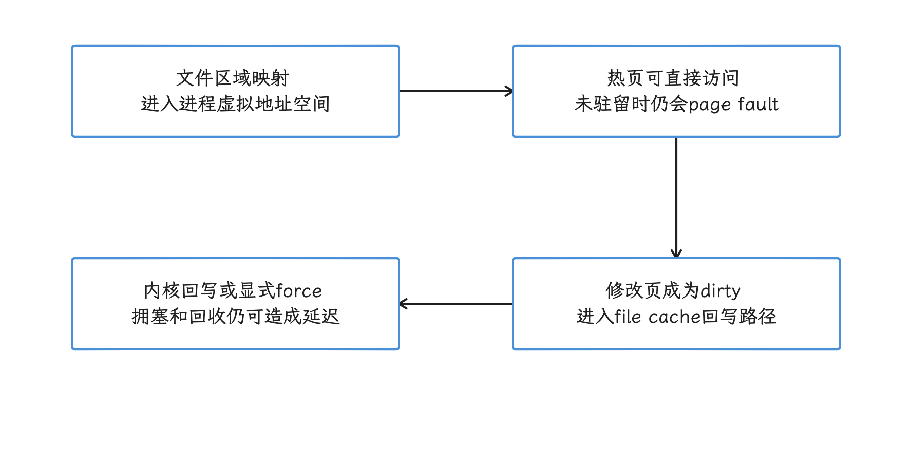

图：mmap 把文件页映射进进程，热页访问、缺页与脏页回写具有不同成本。 省掉逐条 write syscall 不等于零 I/O 或固定低延迟；目标 kernel/build 仍须记录。

<!-- gracker-diagram: ch17-12-11-durable-rename -->
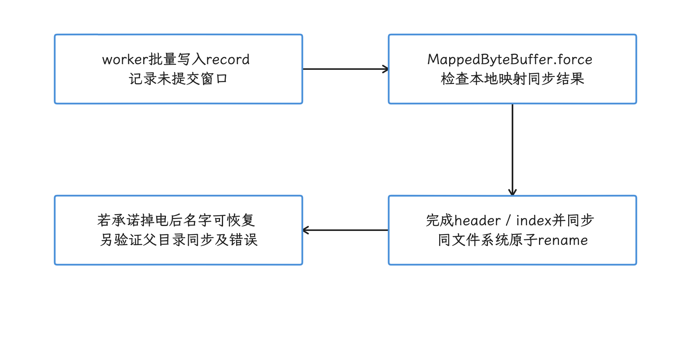

图：先定义允许丢失窗口，再分别完成映射数据同步、封口与名称提交。 MappedByteBuffer.force 与 FileChannel.force 作用不同，rename 的原子性不能代替父目录同步。

### 4.2 可恢复分片的文件格式

一个可恢复分片至少包含两类结构：superblock 是记录格式版本和已提交位置的元数据头，record 是单条事件的完整记录。

```text
superblock A/B:
  magic, format_version, generation, committed_offset, checksum

record:
  length, type, flags, sequence, elapsed_ns, payload, checksum
```

先看字段含义：`magic` 是识别文件格式的固定值，`generation` 是 superblock 的更新代次，`committed_offset` 指向最后一个确认提交的位置，checksum 用于检查内容是否损坏。

单写者先写完整 record 与 checksum，再更新下一代 superblock；A/B 两份 superblock 通过 generation 和 checksum 选择较新的有效副本。启动扫描只接受长度合法、类型已知、payload（事件载荷） 未越界且 checksum 正确的 record，遇到尾部半条记录就停在前一个有效 offset。CRC（Cyclic Redundancy Check，循环冗余校验）能发现随机损坏；至于数据是否来自可信写入方，要交给 AEAD 这类带认证的机制。

跨 crash 的 4 字节游标更新并不是一个 transaction（要么全部成功、要么全部撤销的事务）：文件系统、设备写入粒度和回写顺序都可能影响结果，所以恢复器必须能接受“数据写了但游标没写”“游标较新但尾部校验失败”这类组合。

<!-- gracker-diagram: ch17-12-12-ab-commit -->
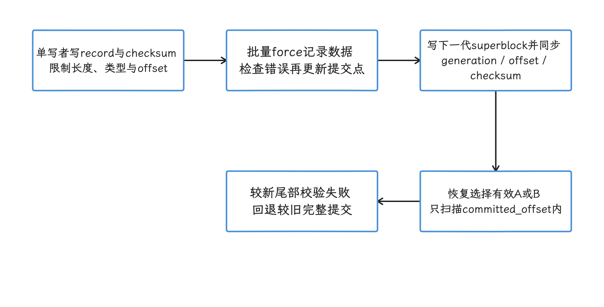

图：记录数据先同步，再提交下一代 A/B 元数据，恢复只接受校验完整的已提交前缀。 checksum 正确不代表可信来源；提交点之外的完整字节也不自动成为已提交记录。

### 4.3 预分配、磁盘满与 `SIGBUS`

`ftruncate()` 可以把文件的逻辑长度扩到指定值，但文件系统可能只创建 sparse region（尚未分配所有物理块的稀疏区），每个映射页未必都有 backing block。后续写 `MAP_SHARED`（修改会回到文件的共享映射）页面时，若空间耗尽，native 进程就可能收到 `SIGBUS`，即访问映射对象失败时触发的总线错误信号。

Mars 的 `mmap_util.cc` 会把新映射文件写零以实际分配 backing store，Mars README 也警告错误的 cache path 或文件准备可能导致 `SIGBUS`；Logan 的 C 实现同样先检查并填充固定长度文件，映射失败则退回普通内存 buffer。

生产实现上，我们要做这几件事：

- 在 worker 上检查可用空间并完整预分配小而固定的 active file；
- active mapping 存续期间禁止另一个线程/进程 truncate（截短）、替换或删除底层文件；
- 捕获 Java I/O/force 失败，native mapping 失败时回退到有大小上限的 heap buffer（Java 堆缓冲） 或普通追加写；
- 对 ENOSPC（设备无剩余空间）、只读文件系统、权限、checksum 失败分别计数；
- 清理器只删除 sealed/expired 文件，跳过当前正在写入的 active generation（正在写入的文件代次）；
- 轮转前关闭旧 writer，再把分片标记为 sealed。

<!-- gracker-diagram: ch17-12-13-preallocation-failures -->
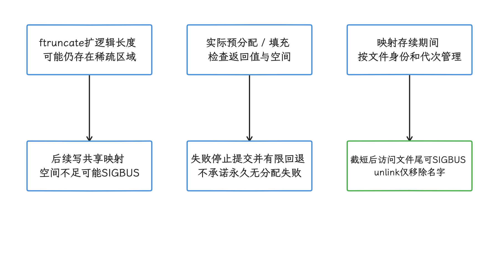

图：在 worker 上准备有限文件，初始失败受控回退，活跃映射禁止截短和路径复用。 预分配也会失败；已建立映射后的 SIGBUS 不能统一靠 Java catch 恢复，unlink 与 truncate 不同。

纯 Java 还要注意 mapping 生命周期：关闭创建 mapping 的 `FileChannel` 并不会让 `MappedByteBuffer` 立即失效，公开 API 也没有可依赖的同步 unmap（立即解除映射） 操作。

可控的做法是长期复用一块很小的 active journal（按提交顺序追加的日志区），在 worker 上把已提交 block 复制成普通 sealed 文件后再复用 journal；若采用每分片 mapping，就限制同时存在的 mapping 数量，所有引用释放前不复用、不截断底层文件。

<!-- gracker-diagram: ch17-12-14-mapping-lifetime -->
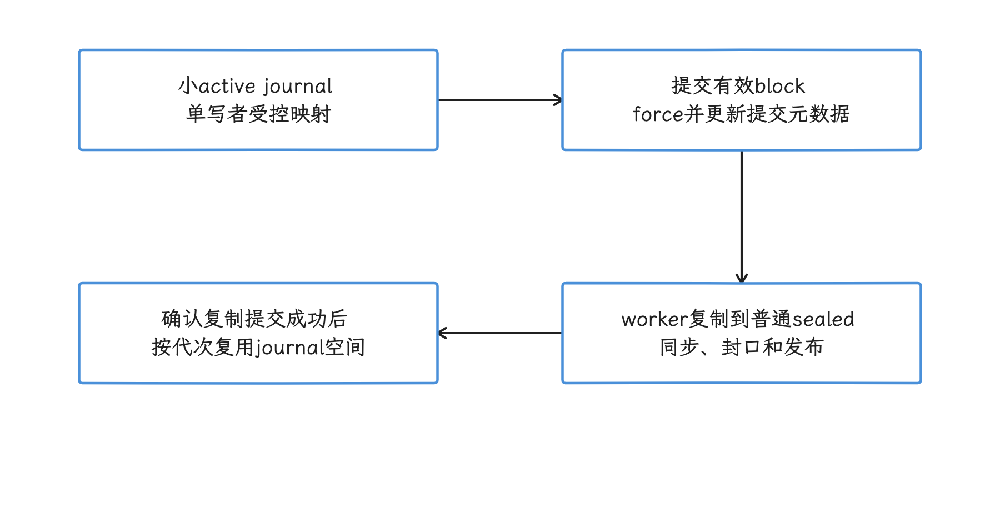

图：长期小 journal 可在 worker 复制已提交块为普通 sealed 文件，再受控复用。 关闭 FileChannel 不使已有 mapping 立即失效；纯 Java 不依赖同步 unmap 或提前截短复用。

`mmap` 本身只是缓冲与访问方式。crash-safe（进程异常终止后仍可判定并恢复有效记录）这个性质，要靠文件格式和恢复逻辑自己实现。Mars、Logan 的源码适合学习预分配、fallback（主路径失败后的受限备用方案） 和恢复思路；只复制一个 `mmap()` 调用，是学不到这些的。

## 5. 编码与文件 envelope 的选型

选编码格式之前，我们先看数据形状：APM event 通常字段稳定、数值多、批量频繁，事件内容集中在 payload（实际事件或附件字节）上。二进制协议常能减少字段名重复和临时字符串，但“二进制一定更快”这句话，要放到真实 payload 上验证过才成立。

| 方案 | 适用位置 | 优点 | 需要付出的成本 |
| --- | --- | --- | --- |
| JSON | 本地 debug、人工导出、小流量兼容接口 | 可读、工具普遍 | UTF-8 字符串与对象分配，字段名重复 |
| Protobuf Lite | 默认事件 schema 与网络批次 | 小 runtime、未知字段兼容、跨语言成熟 | 生成代码、schema 演进、对象构造 |
| FlatBuffers | 读取路径很热、希望直接访问 buffer | 不必 unpack 到第二份对象图 | builder 与随机访问模式不同，buffer 生命周期和 schema 约束更强 |
| 自定义定长记录 | 极少数超高频固定事件 | 可精确控制 slot 与文件格式 | 兼容、工具、安全审计全部自建 |

runtime 在这里指随 App 一起运行的协议支持库。Protobuf Lite 适合资源受限设备，但 schema 规则照样要执行：线上 field number 不改、不复用，删除字段后标记 `reserved`，enum 保留对 unknown value（新值未被旧客户端识别）的处理，批次大小设上限。

Lite runtime 没有 full runtime 那种能在运行时读取消息结构、按字段动态访问的 descriptor/reflection（运行时读取消息结构并按字段动态访问） 能力，服务端工具要按“端侧没有完整描述信息”来设计。

<!-- gracker-diagram: ch17-12-16-schema-evolution -->
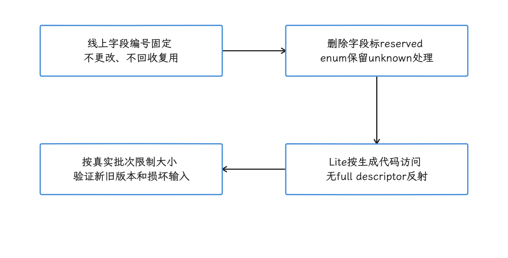

图：字段编号稳定且删除后 reserved，旧客户端保留未知值处理与批次上限。 Lite 不提供 full runtime 的 descriptor/reflection，不能据 schema 兼容忽略损坏输入限制。

FlatBuffers 的“直接访问”指读取时无需先 unpack（展开） 成第二份对象表示；写入侧照样有成本，遍历快慢也要看具体访问模式。APM 多数场景是“写一次、服务端读一次”，值不值得引入，由写入成本、APK 体积、服务端生态和 schema 维护共同决定。

<!-- gracker-diagram: ch17-12-15-codec-selection -->
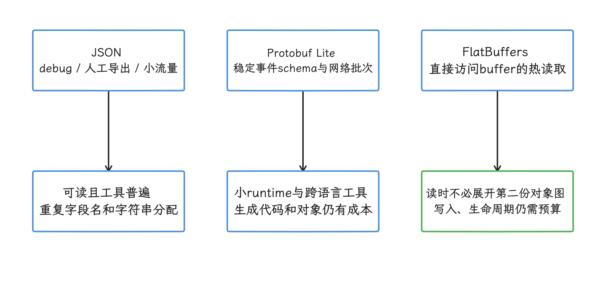

图：JSON、Protobuf Lite 与 FlatBuffers 分别按可读性、事件批次与访问模式取舍。 二进制和直接访问不自动更快，定长格式也需自建兼容、工具与校验。

一个常见的存储结构是外层 block envelope 加内部 event；envelope 包住一批事件，描述编码和安全参数：

```text
block envelope:
  format_version
  codec
  compression
  encryption_key_id
  nonce
  uncompressed_length
  ciphertext_length
  sequence_range
  authenticated_ciphertext
```

内部可以是多个 length-delimited Protobuf event，也就是每条消息先写长度，再写对应字节。流程是先压缩，再用 AEAD（Authenticated Encryption with Associated Data，带关联数据认证的加密）加密；`key_id` 指明使用哪把密钥，便于轮换。nonce 是同一密钥下每次加密必须唯一的输入。文件恢复要用的非敏感长度和版本字段，也一并纳入 authenticated data（参与认证但不加密的关联数据），防止这些字段被悄悄修改。

选型 benchmark 使用 App 的真实字段分布，在低端 32/64 位设备和当前主力设备分别跑 1000、10000 条事件，记录：

- 编码/解码 wall time 与 thread CPU time；
- payload 与压缩后字节数；
- Java/native 分配量和 GC（Garbage Collection） 次数；
- 峰值工作区与大对象数量；
- 版本兼容、损坏输入和超大字段的行为。

测试结果按事件类型保存；只有三个整数的 microbenchmark（针对极小代码路径的微型基准测试），推不出包含 stack trace、URL 或 header 的真实批次。

<!-- gracker-diagram: ch17-12-17-block-envelope -->
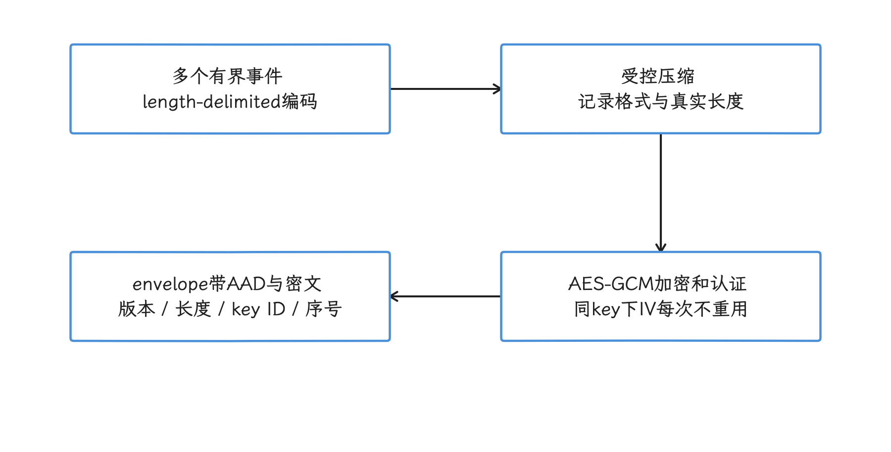

图：把有界事件批次压缩后用 AES-GCM 加密，规范化头字段作为 AAD。 同 key 下 IV 不重用，跨重启不从0重置；重传复用原密文，密钥建立另有协议。

<!-- gracker-diagram: ch17-12-18-decode-budget -->
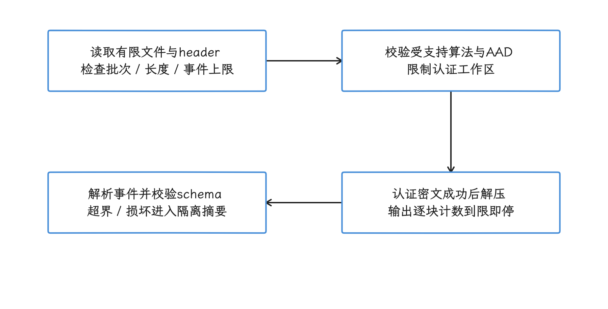

图：先限制格式、字段和工作区，认证成功后再解压并按真实输出持续计数。 未认证的长度字段不能直接用于大数组分配，认证成功也不免除资源上限。

<!-- gracker-diagram: ch17-12-19-codec-benchmark -->
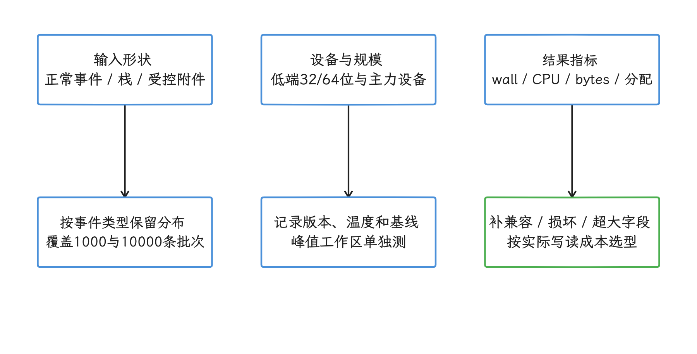

图：用真实字段分布分设备测编解码时间、字节与分配，并测兼容和异常输入。 只有三个整数的 microbenchmark 不能代表含调用栈、URL 或附件的真实批次。

## 6. 动态指令的能力与验签

当我们需要追线上少数设备的问题时，远程指令的价值是让这些设备从低成本指标切换到重取证，也就是 trace、heap dump 等成本较高的诊断采集。App 权限不会因远程指令增加；命令到达时内存、磁盘、网络和系统预算是否满足，也要客户端自己再查一遍。

### 6.1 Android 8—17 可用的采集能力

| 能力 | 普通发布 App | 版本与限制 |
| --- | --- | --- |
| `android.os.Trace` marker | 可写本进程 section/counter | 只有 trace session 正在采集时才形成可分析材料 |
| Perfetto SDK in-process | 可由 App 自己启停并写 `.pftrace` | 只含 App 自定义 data source，不含 sched/ftrace 等系统事件 |
| `ProfilingManager` app-driven | 普通 App 可请求受控 system trace、Java heap dump、heap profile、stack sample | API 35+；平台脱敏、限流并把结果放入 App 私有目录 |
| `ProfilingManager` system-triggered | App 登记 trigger，系统决定是否采集 | API 36、36.1、API 37 能力不同；Android 17 增加冷启动、OOM 等 trigger |
| `Debug.dumpHprofData()` | 可 dump 自身进程，可能触发 GC，可能失败 | API 3+；高内存/停顿/敏感数据风险，不适合静默大范围开启 |
| 自有日志回捞 | 只能回捞 SDK 自己持久化且获准采集的日志 | 普通 App 无权读取全设备 logcat |
| system Perfetto / 其他进程 Hprof | 普通 App 不具备 | 需要 adb、测试环境或系统/特权能力 |

我们先把表里的几个词展开。Trace marker 是写进 trace 时间线的区间或计数标记，只有采集会话开启时才会进入结果。Perfetto 的 data source 是向 trace 提供某类事件的数据生产者；in-process mode 下服务和 App 自定义 data source 都在当前进程内，所以看不到 sched/ftrace（内核调度等系统事件）。Hprof 是 Java heap dump 的文件格式，包含进程内对象及引用关系；至于全设备 logcat，普通发布 App 拿不到 `READ_LOGS` 特权。

重取证优先复用 [15.7 ProfilingManager](../ch15-other-tools/07-profiling-manager.md) 已定义的两类流程：app-driven（App 主动请求）和 system-triggered（App 登记条件、系统决定是否采集）。系统会限流，请求也未必被满足，所以客户端要另设更低的本地预算。Perfetto SDK 的 system mode 适合 adb/lab 场景；in-process mode 无需特权，覆盖范围就是上面说的进程内事件。

Android 17 的 OOM system trigger 还有一个容易遗漏的前提：App 安装了自定义 uncaught exception handler 时，处理结束后必须继续调用系统默认 handler，这类 OOM 触发采集才能由平台完成。远程指令在执行前应把该接入条件也算入 capability（平台能力） 检查。

<!-- gracker-diagram: ch17-12-20-capability-layers -->
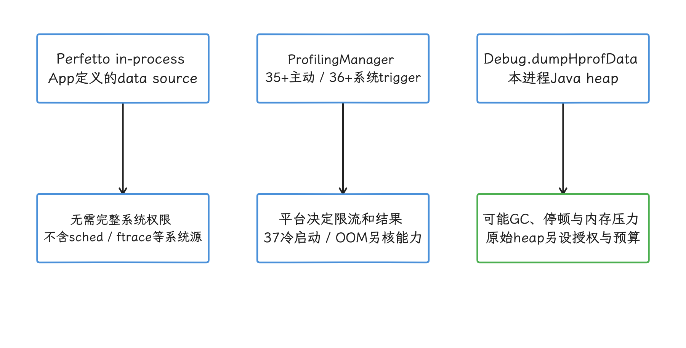

图：按系统版本、SDK模式与授权选择端内 trace、受控 ProfilingManager 或自身 heap dump。 普通 App 没有任意完整系统采集或其他进程 heap 权限；OOM trigger 仍需保留系统默认异常链。

Java heap dump 可能包含 token（访问凭据）、会话、地址、订单和密钥材料。普通用户设备上，只放行有明确数据用途、可审计授权和严格人群范围的方案；端侧类计数或摘要能回答的问题，就让原始 heap 留在端侧。内部 build 与用户支持场景也要设置文件上限、加密、访问审计和短保留期。

### 6.2 指令字段与验签顺序

一个可执行指令至少包含：

- `command_id`、`schema_version`、`generation`；
- `issued_at`、`expires_at`、`max_duration_ms`；
- app version、Android version、设备/实验 cohort 与随机采样条件；
- `required_capability`、`required_consent`（用户授权）；
- 单设备触发次数、CPU、内存、文件和上传字节预算；
- `key_id`、规范化 payload 的数字签名；
- server kill switch 与客户端不可放宽的 hard limit。

我们先约定字段里的几个词。cohort 是符合某组版本、设备或实验条件的目标设备集合；规范化 payload 要求字段顺序和字节编码都有唯一结果，验签才稳定。`key_id` 指明验证签名所用的公钥版本；server kill switch 是服务端紧急停用开关，hard limit 则是写在客户端、远端配置无权放宽的成本上限。

TLS 保护网络传输，应用层数字签名继续保护配置经过 CDN、代理或存储后的完整性。端侧内置公钥并支持 key rotation（逐步切换到新公钥）；generation 倒退造成的 rollback（回滚攻击）要直接拒绝。

验签、schema、generation、TTL、cohort、consent、capability 和预算全部通过后，指令才能持久化为 `VERIFIED`。未知字段可能改变安全含义时采用 fail-closed，也就是拒绝执行，等客户端理解该字段后再放行。

wall clock 可能被用户修改。客户端在获取配置时同时记录 server time、wall time 和 `elapsedRealtime`（设备开机后单调递增的时间），本次进程内就用它算剩余 TTL；跨重启仍以签名的 `expires_at` 和保守的最大存活期双重限制。

服务端 kill switch 依赖网络，端侧 hard limit 仍然要自己兜底。

<!-- gracker-diagram: ch17-12-21-command-validation -->
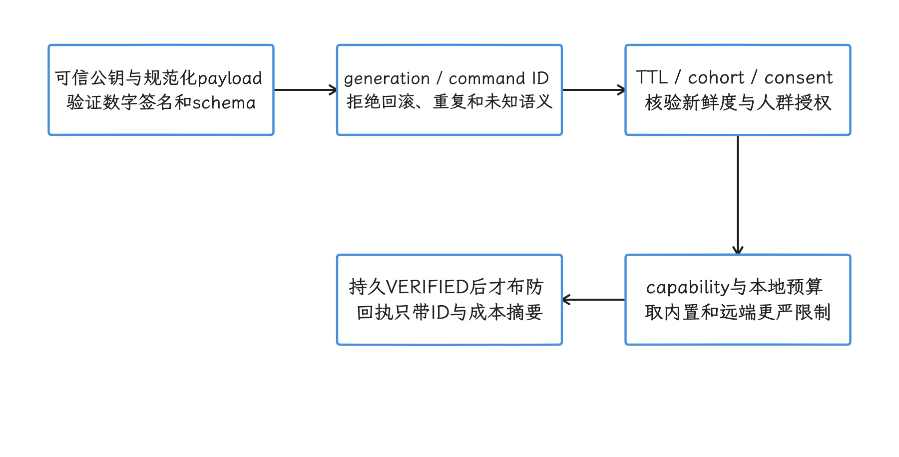

图：指令通过签名、版本、新鲜度、人群、授权、能力与预算核验，远端不能放宽本地硬上限。 TLS 与数字签名各有职责；网络失联时本地预算和拒绝规则仍需独立工作。

“特定 UserID”类指令要把原始账号挡在配置和 APM 文件之外。服务端应生成短期、仅限当前 App 使用的 App scoped（只能在当前 App 范围使用） opaque cohort token（不携带可读账号信息的目标令牌）；也可在获得相应授权的支持流程中使用一次性 case ID。指令回执只带 command/case ID、结果码和预算消耗。

<!-- gracker-diagram: ch17-12-22-ttl-clock -->
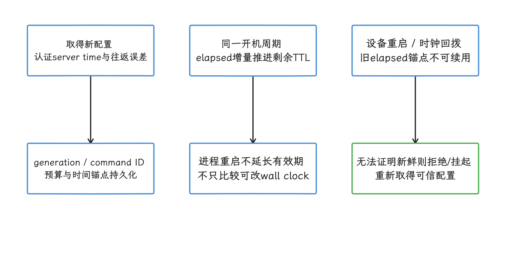

图：用认证 server time 与 elapsed 锚点推进 TTL，进程重启不重置到期和已用预算。 签名 expires_at 不证明现在的时间；无法确认 boot 或可信时间时先挂起重取证并重新获取配置。

### 6.3 指令的执行状态机

落到执行侧，指令按以下状态运行：

```text
RECEIVED -> VERIFIED -> ARMED -> RUNNING -> SEALED -> UPLOAD_PENDING
                 \-> REJECTED / EXPIRED / BUDGET_EXHAUSTED
```

进入 `RUNNING` 前持久化触发次数与预算预留，防止进程在写计数前被杀而反复执行。启动恢复时清理半成品，归还能够安全归还的预算，并产生一条固定大小的 command result。

crash loop 是 App 启动后很快再次崩溃并反复重启的循环；重取证请求在这种循环里要受触发次数约束，避免每次启动都跑一遍。

<!-- gracker-diagram: ch17-12-23-command-states -->
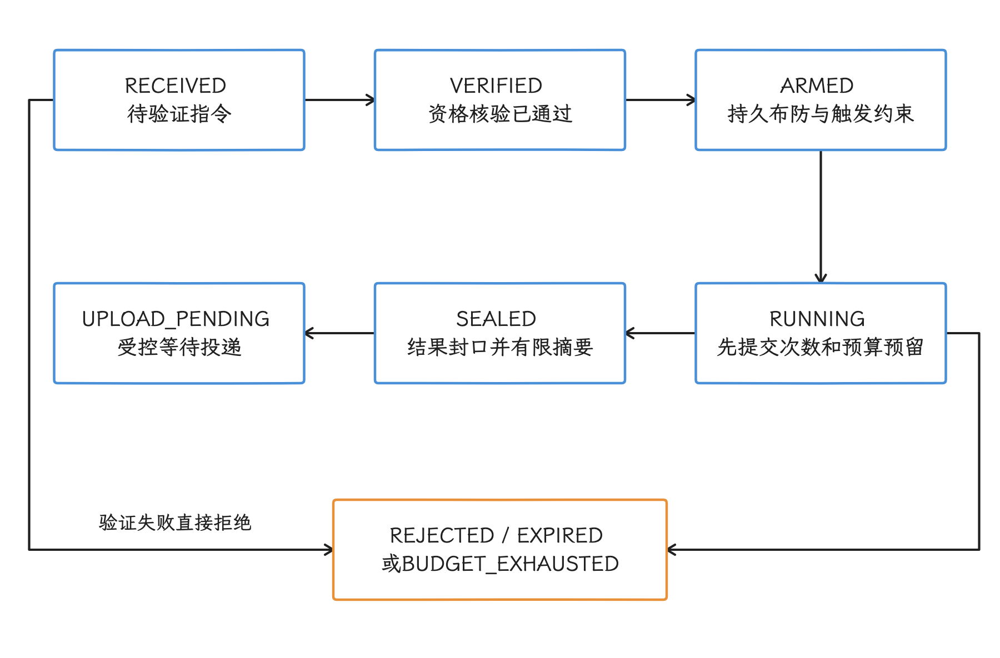

图：指令先验证再布防，进入 RUNNING 前持久预留预算，异常恢复不反复执行。 拒绝可发生在验证阶段，过期或预算耗尽可中止后续阶段；回收只归还能安全归还的预算。

## 7. 网络投递的两条路径

采集侧写好 sealed 分片之后，剩下的是怎么把它们送出去。APM 上传分两层：

1. App 仍在前台且已有合适网络时，上传器直接发送 sealed 小批次。这条 opportunistic fast path 只在现有进程和网络条件都合适时使用，是进程内快路径；
2. 需要跨进程退出、重启或系统调度继续的任务交给 WorkManager。

WorkManager 是持久、可延迟后台任务的推荐 API：工作状态会被持久化，进程退出或设备重启后仍可由系统重新调度。它支持网络、电量、充电和存储约束，执行时刻则听系统调度。普通 worker 通常有约 10 分钟执行窗口；大 trace/Hprof 应切块和续传，每次都在窗口内收尾。

long-running worker 是借助 foreground service（带用户可见通知的前台服务）继续运行的长任务。Android 16 起这类 worker 也消耗 JobScheduler quota（系统分配给 App 后台 job 的运行额度）；在 Android 17 上，把 APM 上传伪装成用户可见前台工作来绕过限制，这条路已经走不通。

我们推荐为上传使用 unique work：同一个唯一名称只保留一条受策略控制的工作链，避免多个 worker 重复上传同一批数据。输入只放 batch ID（批次唯一标识）；实际事件和附件字节留在 spool 文件里，容量有限的 WorkManager Data 不承载大 payload。worker 从 spool 索引取得文件，执行以下幂等流程：

```text
select SEALED
  -> mark UPLOADING with attempt_id
  -> upload chunks with content hash
  -> server commits batch_id idempotently
  -> mark ACKED
  -> delete file and index entry
```

这里的幂等指：同一 `batch_id` 即使因超时被提交多次，服务端也只确认一个批次。content hash 是内容摘要，用来检查分块重传后字节是否一致；鉴权和数字签名要另走各自的机制。

<!-- gracker-diagram: ch17-12-25-ack-before-delete -->
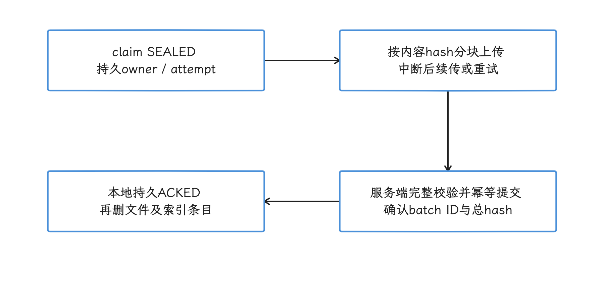

图：上传可重复发送，服务端按 batch ID 与完整 hash 幂等提交，本地持久 ACKED 后再清理。 content hash 不是鉴权或签名；任意 HTTP 响应与块级接收都不能代替完整提交确认。

重试策略区分响应：

- 网络断开、timeout（超时）、408、429 和多数 5xx：指数退避加 full jitter（随机抖动）；指数退避逐次增大等待上限，full jitter 则在 `0` 到该上限之间重新随机取一个等待时间；
- 429/503 带 `Retry-After` 响应头：至少等待服务端指定的时间，并叠加本地随机偏移；
- 认证或 key 失效：刷新一次凭据，仍失败则停止该批次；
- schema/4xx 永久错误：隔离批次并上报摘要，不无限重试；
- 文件 hash 不一致：停止上传，进入 `CORRUPT`，保住唯一证据。

固定“每 15 分钟整点上传”在千万级设备上会变成同一时刻的请求洪峰。每台设备应在允许窗口内选一个随机偏移，并在一段配置周期内保持稳定，免得进程重启后又回到整点。服务端返回的动态窗口同样要带 jitter。

Crash/ANR 先传小摘要，等 unmetered（非按流量计费网络）、battery-not-low（电量不低）、storage-not-low（可用存储不低） 等约束满足后再传大附件。

压缩、加密和网络在 worker 中执行。已压缩的 Perfetto/归档文件先检测格式，避免重复压缩浪费 CPU。传输使用 TLS；本地敏感文件若做应用层加密，密钥由 Android Keystore 管理并支持轮换。Keystore 让密钥材料不必以普通文件形式交给 App，具体是否由安全硬件保护取决于设备和密钥配置；服务端按 `key_id` 选择对应密钥解密。

<!-- gracker-diagram: ch17-12-24-upload-two-paths -->
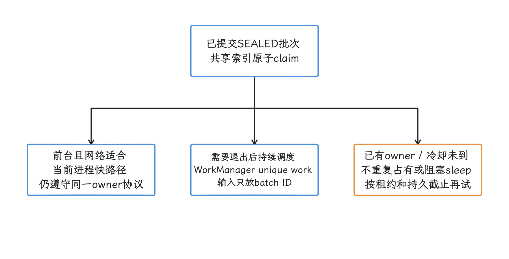

图：前台上传与持久 worker 共用同一索引的原子 claim，按 owner/attempt 协调。 unique work 合并的是调度入口，不能替另一条快路径或其他进程提供文件互斥。

<!-- gracker-diagram: ch17-12-26-retry-cooldown -->
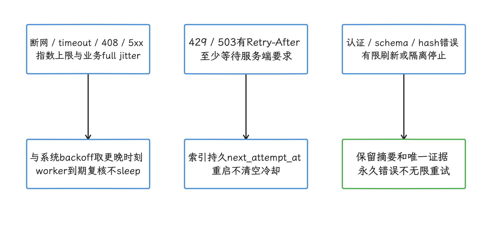

图：按暂时失败、服务端冷却、认证与永久错误分流，并持久保存最早重试时间。 WorkManager 仅提供线性/指数 backoff，调度不精确不等于已实现 full jitter 或 Retry-After。

<!-- gracker-diagram: ch17-12-27-key-envelopes -->
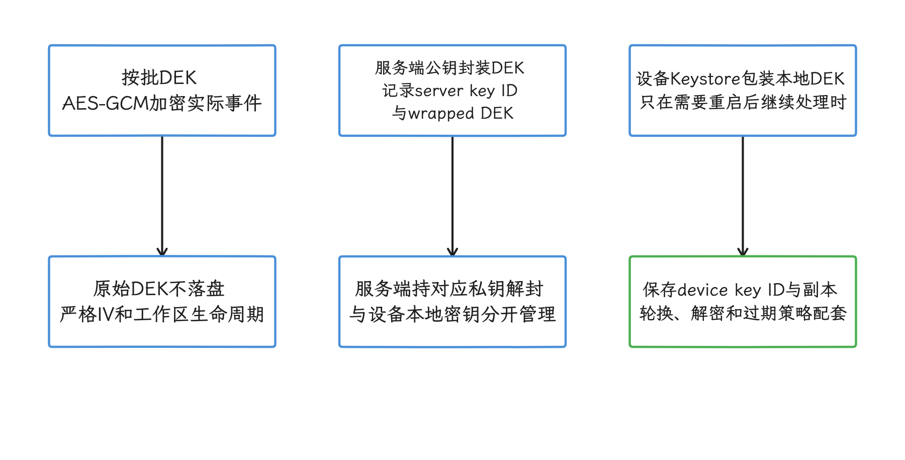

图：按批数据密钥加密内容，服务端公钥封装给服务端，设备 Keystore 另保护本地副本。 key_id 只标识密钥，不能把不可导出设备密钥交给服务端；临时 DEK 仍可能出现在进程内存。

## 8. 断路器与自我保护

采集链路里的每个模块都可能出问题，SDK 需要一层自保。断路器就是这样的自保状态机：某类操作持续超预算或失败时，暂时拒绝对应的低优先级工作，冷却后再放少量请求探测是否恢复。

阈值必须来自设备实验和发布数据，下表只演示规则形态：

| 信号 | 示例判定 | 动作 |
| --- | --- | --- |
| queue 拥塞 | 连续多个窗口占用接近容量上限且 drop 上升 | 关闭 P2，降低 P1 采样，保留 P0 槽 |
| writer 长尾 | force/write P99 超预算 | 增大普通提交窗口，暂停压缩，限制 active 文件的在用字节数 |
| SDK 内存 | queue、buffer 和文件索引合计超预算 | 释放工作区，停止重采样，不申请 Hprof |
| 存储不足 | 预分配/force 失败或 storage-not-low 不满足 | 停止新大文件，按优先级过期 sealed 批次 |
| 上传失败 | 429/5xx/timeout 持续 | 打开网络断路器，延长带 jitter 的冷却 |
| 模块故障 | writer/codec 连续捕获可恢复异常 | 禁用该模块，切到最小 breadcrumb 路径 |
| 上次异常退出 | `ApplicationExitInfo` 显示 OOM/资源异常且 SDK 队列或内存峰值异常 | 下次启动使用更低本地配置，不自动执行重指令 |

Android 14 / API 34 起不会再向 App 发送 `TRIM_MEMORY_RUNNING_MODERATE/LOW/CRITICAL`，这些常量又在 API 35 标记 deprecated，所以不能再只靠旧 low-memory callback。SDK 应以自己的已知字节预算、Runtime heap headroom、固定窗口内的队列最大占用、文件配额和系统可用空间为主；`TRIM_MEMORY_UI_HIDDEN` 等仍有效的 callback 只作为附加信号。

Runtime heap headroom 指 Java heap 当前占用距离运行时上限还剩多少空间；队列峰值则是固定测量窗口内出现过的最大占用。我们要盯的这两个量都来自 SDK 可观测数据，与系统还能提供多少内存是两回事。

断路器至少有 `CLOSED`、`OPEN`、`HALF_OPEN`：

- `CLOSED` 是正常放行状态；
- `OPEN` 使用持久的冷却截止时间，拒绝对应低优先级工作；
- 冷却后 `HALF_OPEN` 只放少量探测请求；
- 探测成功且成本恢复后才回到 `CLOSED`；
- 连续失败增加冷却，但设置最大值，避免永久失去诊断能力。

自保规则由 SDK 内置上限与已验签配置共同计算：远端最多把规则继续收紧，硬上限永远以客户端内置值为准。服务端失联、DNS（域名解析） 故障或 App 离线时，本地规则照常工作。

<!-- gracker-diagram: ch17-12-28-circuit-breaker -->
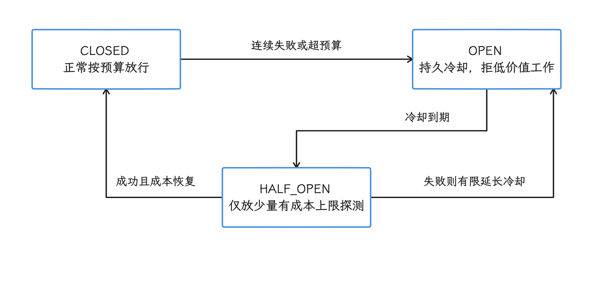

图：持续超成本或失败后熔断，冷却到期只放少量探测，成功后恢复。 冷却有上限且跨重启保存；服务端失联不解除本地硬限制，P0保留容量仍有限。

## 9. APM 监控 APM 的指标口径

“SDK CPU 占比 1%”这句话，要在分子、分母和覆盖线程都写清楚之后才有意义：分子可以是全部 SDK 线程消耗的 CPU 时间，分母可以是同一窗口的进程 CPU 时间。少写任何一项，两个“1%”就没法比较。我们建议随批次上传以下自监控窗口：

| 指标 | 可行测法 | 不能声称的内容 |
| --- | --- | --- |
| `ingress_wall_ns` | 抽样测入口 `elapsedRealtimeNanos` 差值；`ns` 表示纳秒 | 未抽样调用的精确分位数 |
| `worker_cpu_ns` | worker 任务前后读取 `Debug.threadCpuTimeNanos()`，得到当前线程消耗的 CPU 时间 | 整个 SDK 的 CPU，除非覆盖所有 SDK 线程 |
| `codec_input/output_bytes` | codec（编码/压缩模块）自己的输入输出计数 | 文件系统实际物理写放大 |
| `mapped_dirty_bytes` | writer 已修改范围的逻辑计数 | 已持久化字节，除非 force 成功 |
| `force_wall_ns` / failure | force 周期与结果 | 设备内部 FTL（Flash Translation Layer，闪存逻辑地址到物理页的映射层）的完整写入行为 |
| `queue_high_watermark` | 固定窗口内的最大队列占用 | 未记录时刻的瞬时峰值 |
| `drop_count{kind,reason}` | 固定枚举计数器 | 缺失样本的内容分布 |
| `upload_attempt/wire_bytes` | SDK 请求次数与 socket 实际发送的 payload 字节数 | 同一 UID（Android 为应用分配的系统用户标识）下其他网络流量 |
| `repair/corrupt/expired_count` | 启动修复、损坏批次和过期批次的状态计数 | 用户无故障 |
| `command_budget_used` | 每个 command 的 CPU/bytes/count | 未获授权的用户画像 |

公开 API 里找不到低开销又精确的“某个 Java SDK 分配字节数”。可以按已知 event/buffer 大小估算，或在内部/profileable build 中用 allocation profiler（对象分配分析器）校准；估算字段要标记 `estimated` 和版本。

profileable build 是清单允许性能分析工具附加、但区别于 debuggable 的构建。进程级 ART 统计把宿主 App 和其他库都算在内，直接当作 APM 自身开销会高估。

自监控计数器走独立的固定结构；每次 drop 若再投递成一条普通 event，queue 一满就会递归放大。每个窗口只生成一份摘要；摘要也发送失败时覆盖旧摘要并保留累计计数。

<!-- gracker-diagram: ch17-12-29-self-metrics -->
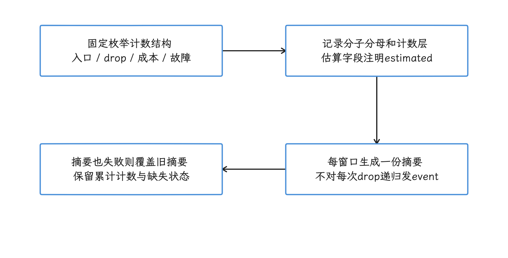

图：入口、worker、文件与请求体分别计量，固定计数器按窗口生成有限摘要。 线程CPU不自动覆盖全部SDK，逻辑脏页不等于持久化，payload字节也不等于全部线上流量。

发布策略从 0.01%/内部设备开始，按 Android 版本、RAM 档位（设备物理内存分组）、ABI（如 `arm64-v8a`）、厂商和 App 进程分别统计成本分布。

入口耗时、ANR/crash、OOM、耗电、流量、storage repair（存储启动修复） 都稳定，且目标样本中成功产出有效数据的比例没有下降后，才扩大发布比例。

<!-- gracker-diagram: ch17-12-32-rollout -->
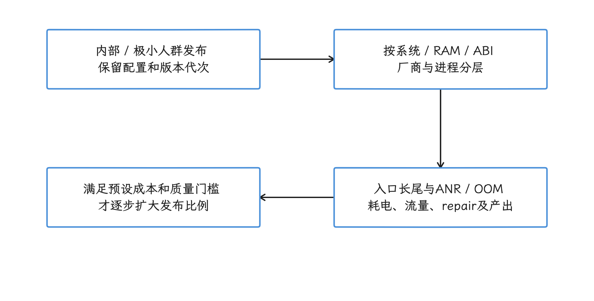

图：从内部和极小比例分层发布，成本与有效证据产出同时稳定后扩量。 示例比例与门槛由业务实验决定，平均流量正常不能替代故障峰值和低端设备验收。

## 10. App 私有存储、备份与隐私

Scoped storage（分区存储）限制的是 shared/external storage，即多个 App 或用户可见的共享/外部存储空间。`filesDir`、`cacheDir` 和 `noBackupFilesDir` 是 App 私有内部目录，读写免存储权限；APM 的内部 spool 本来就住在这里，我们不需要为了“兼容 scoped storage”把它搬到公共目录。

目录按“能否被系统清理”和“能否进入备份”选择：

| 数据 | 位置 | 处理原则 |
| --- | --- | --- |
| 可丢普通批次 | `cacheDir/apm/` | 系统可在低空间时删除；读取前接受文件消失 |
| 未上传故障摘要/可靠 spool | `noBackupFilesDir/apm/` 或已排除备份的 `filesDir` | SDK 自己做配额、过期与删除 |
| `ProfilingManager` 结果 | 平台的 `files/profiling/` | 登记路径、限制大小、排除 cloud backup/device transfer |
| 临时 Hprof/trace | 专用私有目录 | 与普通日志分开权限、配额、上传和保留 |
| 用户导出诊断包 | 私有源文件 + FileProvider/SAF | 用户明确触发，授予短期 URI 权限 |

FileProvider 通过 `content://` URI（统一资源标识符） 临时分享 App 私有文件；SAF（Storage Access Framework，存储访问框架）让用户通过系统选择器决定导出位置。两者都只授予本次操作需要的读写权限，并在使用结束后撤销或让权限自然失效。

`cacheDir` 可能在上传前被系统删除，crash 摘要要交给更可靠的目录。`noBackupFilesDir` 只解决一件事：避开 Auto Backup（Android 的应用数据自动备份）；卸载、清数据、文件系统故障仍可能让文件丢失。内部存储的隔离之外，服务端访问控制和敏感文件的应用层加密仍然必要。

采集层执行数据最小化：

- URL 只保留模板化 path key，例如把 `/users/123/orders/456` 规整为 `/users/{id}/orders/{id}`；不保留 `?` 后的 query、`#` 后的 fragment 和用户输入；
- HTTP header 采用允许列表，`Authorization`、`Cookie` 和 token 一律不进 event；
- stack trace 做路径与动态值清理，并限制帧数和字节；
- 设备与账号使用短期、仅限当前 App 的随机标识；
- heap dump、trace 和日志正文分别设置授权、访问人群与保留期；
- 上传确认、过期、撤回授权和 command 结束都触发可审计删除。

多进程清理器只删除已不属于任何活跃 `process_instance_id` 的 sealed/expired 文件；owner 指创建并仍可能使用该文件的进程实例。判断不了 owner 是否仍活跃时，删除动作就延迟到下一次冷启动修复，避免另一个进程正在使用 mapping 时文件被 truncate 或删除。

<!-- gracker-diagram: ch17-12-30-storage-backup -->
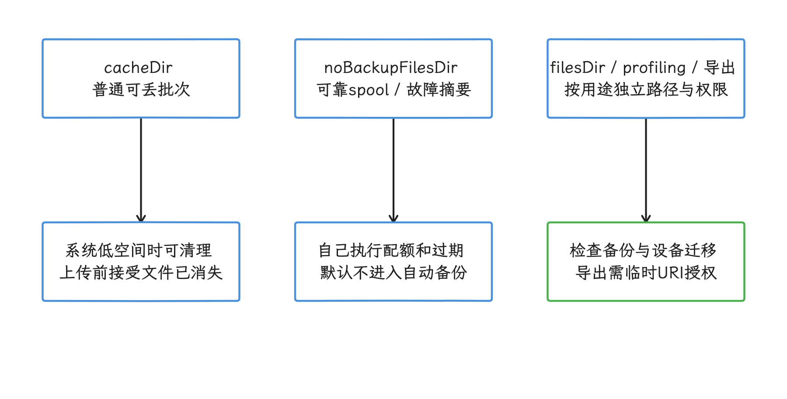

图：普通可丢批次、可靠故障摘要与平台 profiling 文件按清理和备份属性分开存放。 noBackupFilesDir 不防卸载清数据；filesDir 与 profiling 还须验证 cloud 和设备迁移排除规则。

<!-- gracker-diagram: ch17-12-31-privacy-cleanup -->
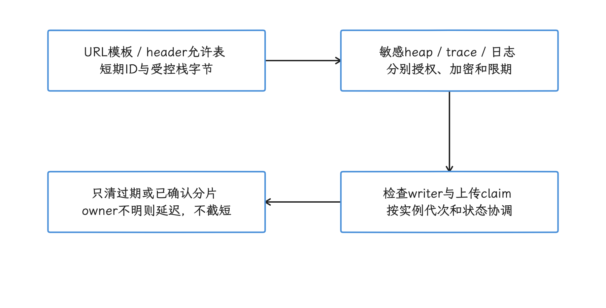

图：采集先清洗身份与载荷，清理器再按 active writer 和上传 claim 判断可删除分片。 创建进程存活不妨碍清理可删 sealed，但 PID、年龄或冷启动也不能证明 owner 已释放。

## 11. 完整架构与排查入口

最后我们把优先级准入、单写者 spool、重启恢复、持久上传和远程指令放到同一张图里。单写者指只有一个 writer 修改 active 文件，其他线程只向有界队列提交事件。

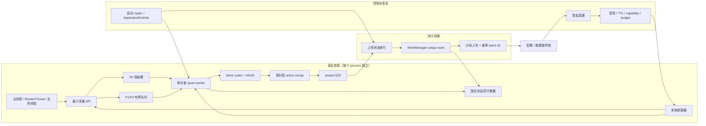

从图上看，业务线程到文件、网络之间没有直连边，副作用都要经过队列和 writer。P0 走保留容量，仍受硬上限；P1/P2 可按成本丢弃。active mmap 只有单写者，上传只读 sealed 文件；断路器读固定计数器，与普通事件队列分开。

具体采集与诊断入口分别见：

- [17.2 Matrix、btrace 与 Tracing SDK](02-matrix-btrace-tracing-sdk.md)
- [15.7 ProfilingManager](../ch15-other-tools/07-profiling-manager.md)
- [17.8 网络 APM 底层捕获原理](08-network-apm-internals.md)
- [17.9 崩溃与 ANR 捕获机制](09-crash-anr-internals.md)
- [17.10 耗电与发热监控 (Battery & Thermal)](10-battery-thermal-apm.md)
- [17.11 混合栈与跨平台 APM (WebView / Flutter)](11-hybrid-apm.md)

<!-- gracker-diagram: ch17-12-33-architecture -->
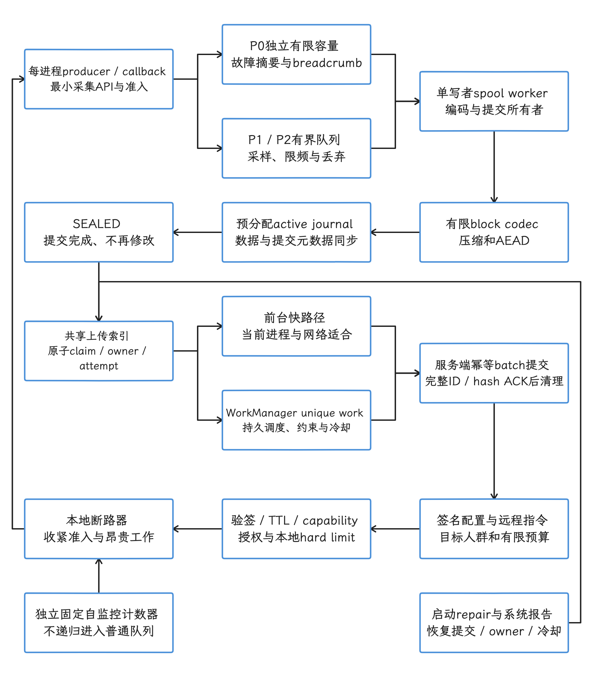

图：各进程有限准入与单写者提交，上传共用 claim，签名控制和启动修复贯穿全链路。 总图为 SDK 设计模型；fatal signal 的预留 marker 不走普通队列，掉电持久性与真实成本须另验。

## 参考资料

### Android 17 / Linux 6.18

- [AOSP `ApplicationExitInfo.java`（android-17.0.0_r1）](https://android.googlesource.com/platform/frameworks/base/+/android-17.0.0_r1/core/java/android/app/ApplicationExitInfo.java)
- [AOSP `Debug.java`（android-17.0.0_r1）](https://android.googlesource.com/platform/frameworks/base/+/android-17.0.0_r1/core/java/android/os/Debug.java)
- [AOSP `ProfilingManager.java`（android-17.0.0_r1）](https://android.googlesource.com/platform/packages/modules/Profiling/+/android-17.0.0_r1/framework/java/android/os/ProfilingManager.java)
- [ProfilingTrigger API reference](https://developer.android.com/reference/android/os/ProfilingTrigger)
- [libcore `MappedByteBuffer.java`（android-17.0.0_r1）](https://android.googlesource.com/platform/libcore/+/android-17.0.0_r1/ojluni/src/main/java/java/nio/MappedByteBuffer.java)
- [Linux `mm/mmap.c`（android17-6.18-2026-06_r6）](https://android.googlesource.com/kernel/common/+/refs/tags/android17-6.18-2026-06_r6/mm/mmap.c)
- [Linux `mm/filemap.c`（android17-6.18-2026-06_r6）](https://android.googlesource.com/kernel/common/+/refs/tags/android17-6.18-2026-06_r6/mm/filemap.c)
- [Linux `mm/page-writeback.c`（android17-6.18-2026-06_r6）](https://android.googlesource.com/kernel/common/+/refs/tags/android17-6.18-2026-06_r6/mm/page-writeback.c)
- [MappedByteBuffer API reference](https://developer.android.com/reference/java/nio/MappedByteBuffer)
- [FileChannel API reference](https://developer.android.com/reference/java/nio/channels/FileChannel)
- [ApplicationExitInfo API reference](https://developer.android.com/reference/android/app/ApplicationExitInfo)
- [ComponentCallbacks2 / memory trim API](https://developer.android.com/reference/android/content/ComponentCallbacks2)
- [App-specific storage](https://developer.android.com/training/data-storage/app-specific)
- [Android background task scheduling](https://developer.android.com/develop/background-work/background-tasks/persistent)
- [WorkManager work constraints](https://developer.android.com/develop/background-work/background-tasks/persistent/getting-started/define-work)
- [Long-running WorkManager 与 Android 16+ job quota](https://developer.android.com/develop/background-work/background-tasks/persistent/how-to/long-running)
- [RemoteWorkManager 多进程 API](https://developer.android.com/reference/androidx/work/multiprocess/RemoteWorkManager)
- [Manifest.permission.READ_LOGS](https://developer.android.com/reference/android/Manifest.permission#READ_LOGS)

### 协议、Trace 与开源实现

- [Perfetto Tracing SDK：in-process 与 system mode](https://perfetto.dev/docs/instrumentation/tracing-sdk)
- [`Channel.trySend()` contract](https://kotlinlang.org/api/kotlinx.coroutines/kotlinx-coroutines-core/kotlinx.coroutines.channels/-send-channel/try-send.html)
- [`Channel` capacity 与 overflow](https://kotlinlang.org/api/kotlinx.coroutines/kotlinx-coroutines-core/kotlinx.coroutines.channels/-channel/)
- [Protocol Buffers Java generated code / Lite runtime](https://protobuf.dev/reference/java/java-generated/)
- [Protocol Buffers proto3 schema evolution](https://protobuf.dev/programming-guides/proto3/)
- [FlatBuffers documentation](https://flatbuffers.dev/)
- [Mars xLog `appender.cc`](https://github.com/Tencent/mars/blob/6aa5b567afada93936252bac2f271c4b43eccd1f/mars/xlog/src/appender.cc)
- [Mars `mmap_util.cc`](https://github.com/Tencent/mars/blob/6aa5b567afada93936252bac2f271c4b43eccd1f/mars/comm/mmap_util.cc)
- [Mars Android README：多进程文件与 SIGBUS 提示](https://github.com/Tencent/mars/tree/6aa5b567afada93936252bac2f271c4b43eccd1f#android)
- [Logan `mmap_util.c`](https://github.com/Meituan-Dianping/Logan/blob/4c1ebca8395723075e3108bea1a6833420485398/Logan/Clogan/mmap_util.c)
- [Logan `clogan_core.c`](https://github.com/Meituan-Dianping/Logan/blob/4c1ebca8395723075e3108bea1a6833420485398/Logan/Clogan/clogan_core.c)
