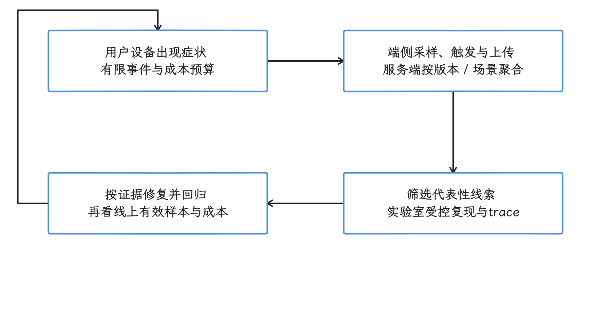
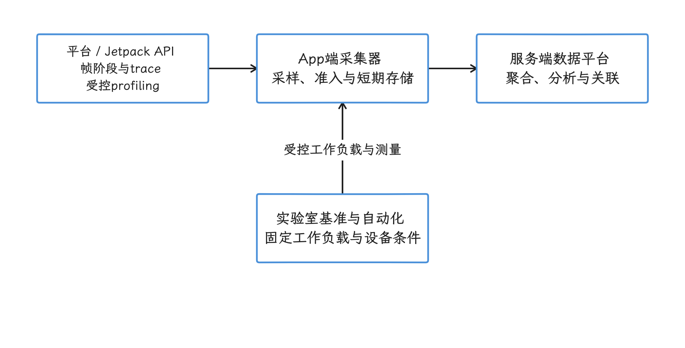
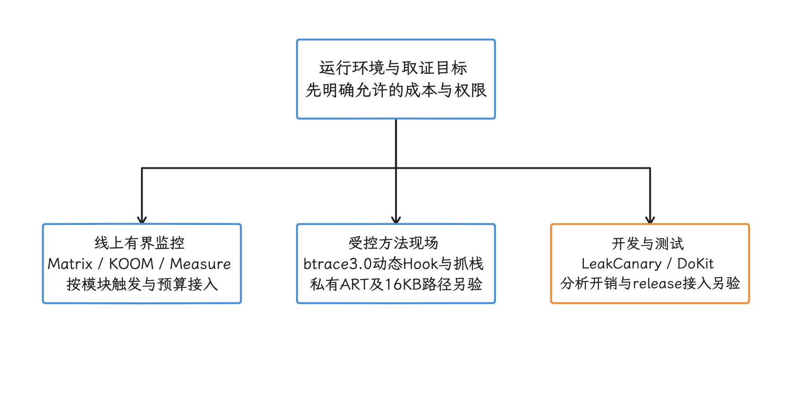
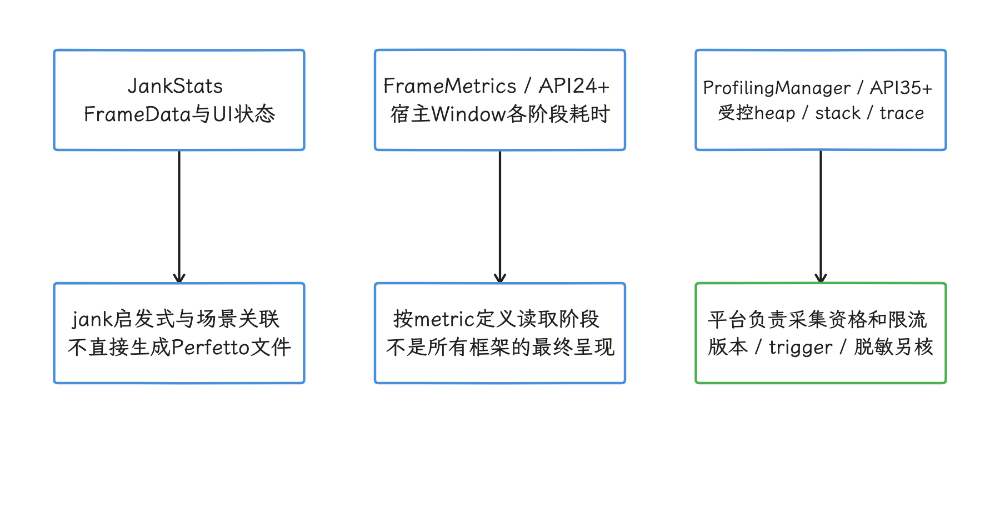
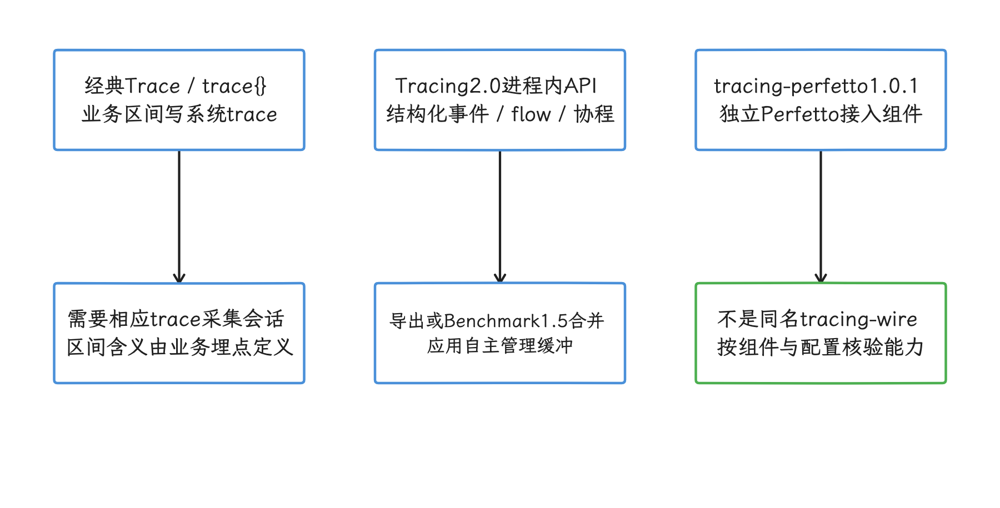
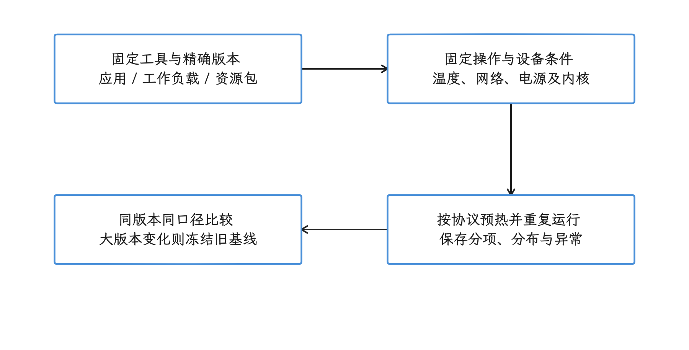
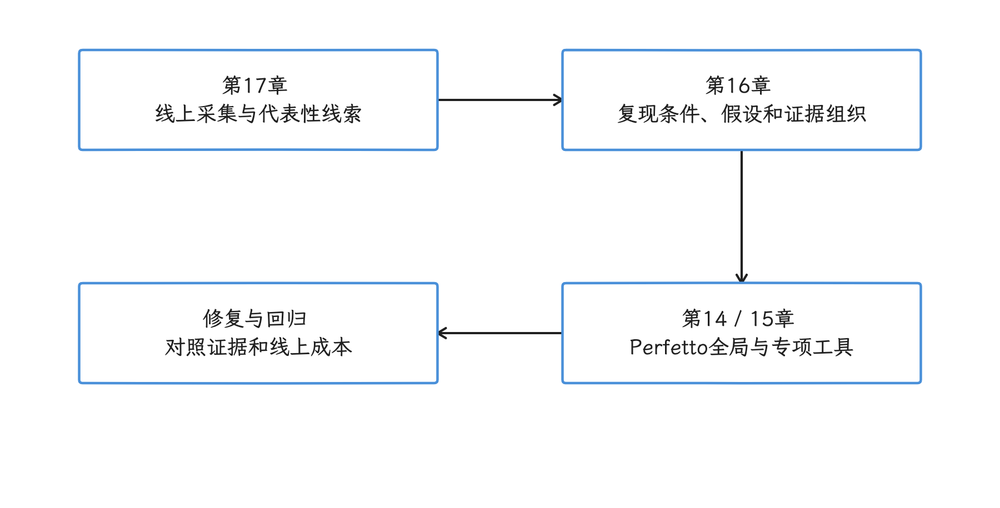
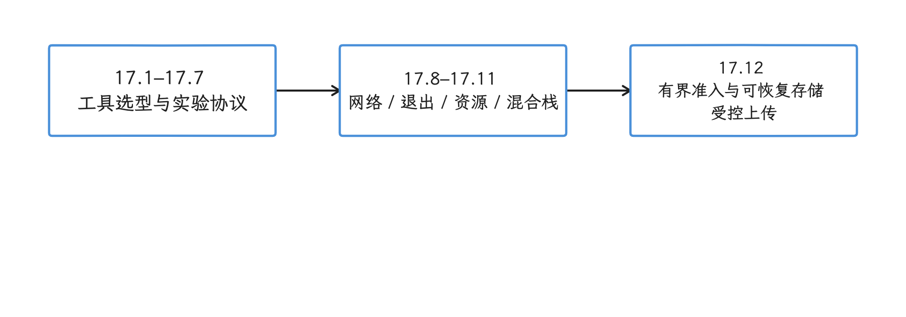

# 第 17 章：APM 工具与性能监控生态

第 14 章介绍线下 trace（按时间排列的性能事件记录）分析，第 15 章覆盖 Android Studio Profiler、CPU 采样工具 simpleperf、系统状态查询命令 dumpsys 等单项工具，第 16 章说明证据组织与判断方法。第 17 章围绕 APM 选型与采集机制，同时说明配套的开发验证、实验室回归和设备基线测试。

应用上线后仍会出现卡顿、启动慢、ANR（Application Not Responding，应用无响应）、内存泄漏和 OOM（Out of Memory，内存耗尽），但通常无法通过 `adb`（Android Debug Bridge）直连用户设备采集 trace。APM（Application Performance Monitoring，应用性能监控）通过采样率、触发条件、数据量和上传时机限制额外的 CPU、I/O（输入/输出）与网络开销，用于发现、聚合和定位这些问题。

<!-- gracker-diagram: ch17-00-01-online-lab-loop -->

图：线上 APM 在预算内发现问题，代表性线索进入实验室复现、修复与回归。 用户设备上的指标与线下 trace 各有覆盖和成本，聚合相关性仍需现场证据支撑。

## 全景分类

这里按职责分成四组：客户端采集器、平台/Jetpack API、数据平台，以及实验室基准与自动化。它们不是四层固定调用栈：Jetpack 仍运行在应用中，System 组也不意味着拥有系统特权。版本与用途按2026-10-26核对，具体固定源码、制品和实验限制见相应小节；维护活跃、仓库有提交或发布了新版本，都不能单独证明兼容 Android17、当前 AGP 或所有 ABI。

<!-- gracker-diagram: ch17-00-02-roles -->

图：平台 API、端侧采集器、服务端与实验室分别承担事实读取、有限采集、分析和受控测量。 这是职责与证据关系，Jetpack 仍在应用中运行，实验室工具也不因此获得系统特权。

### App 层：客户端 APM 框架

表中的“线上”指生产环境中的用户设备，“线下”指开发、测试或实验室环境。

| 工具 / 来源 | 主要机制 | 用途与边界 |
|---|---|---|
| Matrix / 腾讯微信 | 卡顿、启动、I/O、内存；另有构建期 APK 检查 | 运行时插件与构建插件分别接入；固定版本验证 AGP 和平台私有接口 |
| KOOM / 快手 | Java OOM、Native 与线程泄漏诊断 | 线上有界触发；堆快照、线程和 ELF 路径各有 API/ABI 限制 |
| btrace / RheaTrace / 字节跳动 | 3.0运行时动态Hook与同步抓栈；2.0编译期全量插桩另论 | 受控诊断；固定基线仍有 Android17 ART 私有接口和16KB制品问题，详见17.2 |
| LeakCanary / Square | 对象保留与引用链分析 | 开发/测试为主，保留不自动等于泄漏，Hprof 与分析成本另控 |
| DoKit / 滴滴 | 网络、UI 与性能调试工具箱 | 线下调试为主；release 需核对依赖、构建插件与运行时注册 |
| Measure / 开源 | 崩溃、ANR、trace 与会话关联 | SDK、构建上传插件、后端与隐私策略共同验收，详见17.4 |
| BlockCanary | 历史主线程卡顿采样 | 按固定旧实现学习原理，不直接当作 Android17 已验收方案 |
| ArgusAPM / 360 | 历史 UI、网络、内存与 ANR 采集 | 固定历史实现参考，不能把旧 target 或可构建当作现代行为证明 |
| AndroidGodEye | 历史 CPU、内存、网络、电量与 FPS 采集 | 以开发期和历史原理参考为主，逐项核验私有接口与指标含义 |
| Collie | 历史 FPS、卡顿、流量、内存与启动采集 | 旧采集路径与统计分母见17.5，不替代系统证据 |
| Rabbit | 历史测速、慢函数、网络与卡顿采集 | 以固定实现作原理参考，不默认兼容现代后台与隐私约束 |

<!-- gracker-diagram: ch17-00-03-app-scope -->

图：先确定常驻监控、受控取证或开发测试，再选择工具和具体版本。 固定旧实现仅作原理参考；项目维护信号不能代替 API、ABI、构建链和成本验收。

### Framework 层：Google 官方 SDK（软件开发工具包）

| 工具 | 当前坐标 / 能力 | 输出与边界 |
|---|---|---|
| JankStats | <code>androidx.metrics:<wbr>metrics-performance</code> `1.0.0` | 帧数据、jank启发式与UI状态；不是根因判断或Perfetto文件 |
| FrameMetrics | 平台 `FrameMetrics` 与 Window listener，API24+ | 宿主Window帧阶段耗时；AndroidX aggregator可聚合，不代替纯Flutter的FrameTiming |
| Tracing SDK | 当前稳定 `2.0.5`；本章固定研究 `2.0.0`；旧Perfetto三组件 `1.0.1`另属一组 | 经典系统section与2.0进程内事件分别采集；API21–22兼容线为`1.3.0`，固定2.0.0 Android变体API23+ |
| Microbenchmark | 当前稳定 Benchmark `1.5.0`，API24+ | 局部代码计时与按配置读取的分配指标；固定历史示例`1.4.1`的规则另见17.6 |
| Macrobenchmark | 当前稳定 Benchmark `1.5.0`，API24+ | 从外部驱动用户场景，启动/帧等指标按各自定义确定终点，不自动等于所有操作到面板可见 |
| Baseline Profiles | 关键路径的 ART 编译引导；与 Play Cloud Profiles 互补 | AOT收益需设备测量；Profile生成、安装与收益验证是不同步骤 |
| ProfilingManager | API35+ app-driven；API36/36.1/37逐步扩展系统trigger | 受控heap/stack/system trace，结果、限流和脱敏由平台决定；并非任意全系统采集权 |

<!-- gracker-diagram: ch17-00-04-official-signals -->

图：JankStats、FrameMetrics 与 ProfilingManager 输出不同类型的性能证据。 jank 启发式不独立证明根因，宿主 Window 也不能替代 Flutter engine 的 FrameTiming。

Tracing2.0 的新接口写应用进程控制的缓冲区，需要明确导出，或用支持的 Benchmark1.5 线合并到测试结果；当前稳定版为1.5.0，另有1.6.0-alpha01预发布。不能因为抓到了系统trace，就假定里面已经包含这份进程内数据。低频且希望进入系统trace的事件仍可使用 `Trace.beginSection` 或经典 `androidx.tracing.trace {}`。本章17.2分析固定2.0.0制品，当前稳定2.0.5的信息单独保留。

<!-- gracker-diagram: ch17-00-05-trace-buffers -->

图：经典 section、Tracing2.0 进程内事件与旧 Perfetto 组件分别选择采集和导出路径。 当前稳定2.0.5与固定分析2.0.0分开；抓到系统trace不自动证明已包含进程内缓冲。

### 平台层：商业/服务端 APM

| 工具 | 来源 | 定位 | 状态 |
|------|------|------|------|
| Firebase Performance | Google | 自动采集启动、页面渲染和网络数据，并支持自定义 trace | 托管服务 |
| Sentry | 开源 | 崩溃、性能 tracing 与分布式 trace（关联客户端请求和服务端调用） | 开源 SDK + 托管/自建平台 |
| APMPlus | 字节/火山引擎 | 移动 APM 平台 | 商业平台 |
| Bugly | 腾讯 | 崩溃 + ANR 上报 | 商业平台 |
| CAT | 美团开源 | 分布式监控（偏服务端） | 服务端方案；移动端仅作关联参考 |
| PerfDog | 腾讯 WeTest | 实验室设备帧、CPU、内存等采集；GPU/功耗能力按机型和模式核对 | 商业测试工具，不作为线上用户设备通用SDK |

托管服务的可用功能、计费、数据存储和处理地区、隐私条款会变化，选型时应以部署区域的官方说明和合同为准。

### System 层：Benchmark 与自动化

Benchmark（基准测试）用固定的一组操作（工作负载）比较设备或版本。分数只有在工具、测试项目、资源包、运行轮次，以及设备温度和降频状态一致时才可比较。

| 工具 | 定位 | 状态 | 使用边界 |
|------|------|------|----------|
| Geekbench 7 | CPU 单核/多核 + GPU Compute（通用 GPU 计算） | 当前版本 | Android 12+、至少 4 GB 内存；旧版本分数应保留为独立基线 |
| AnTuTu（安兔兔） | CPU / GPU / 内存 / UX综合工作负载 | 当前Android标准版 `12.0.3`（2026-10-23） | 记录应用和3D资源包；V12新建基线，未有官方兼容声明前不与V11/V10混合 |
| 3DMark | GPU + 游戏性能 | 当前维护 | 固定 Steel Nomad Light、Solar Bay、Wild Life 等具体测试及其版本；压力测试与单次跑分分开记录 |
| PCMark | 生产力、日常使用与存储测试 | Android 3.1.4113（核验时） | 固定 Work 3.0 或 Storage 2.0；不同工作负载版本的分数不能直接比较 |
| Speedometer 3.1 | 浏览器Web应用工作负载的响应性 | 本章固定版本 | 固定浏览器/目标WebView内核、测试框架与设备状态；能运行不代表各种内核结果可直接互换 |
| CPDT | 跨平台存储读写测试 | 本章固定2.4.0实现样本 | 固定块大小、线程、缓存/缓冲与读写模式，再结合温度和文件系统复核 |
| SoloPi | 自动化操作与设备端采样 | 固定源码验证节点、补丁与采样路径 | 适合专项复现；目标API/权限/指标需实测，不能替代系统trace |

Vellamo、AndroBench、A1 SD Bench、Emmagee 在本章作为历史实现或旧报告入口。它们的工作负载、存储权限与采集路径不能直接代表现代 UFS 或真实应用负载；Emmagee 对现代权限、后台与进程模型也要逐项核查。旧数据冻结在原工具/版本字段，新设备库使用明确版本的新基线；“改用新工具”不意味着旧分数可以换算后拼接。

<!-- gracker-diagram: ch17-00-06-benchmark-baseline -->

图：工具、测试项目、资源包和设备状态一起固定，重复运行后比较同口径结果。 新大版本建立新基线，旧分数不做无依据换算；设备分数不能替代具体 App 场景测量。

## 与其他章节的关系

- **第 14 章（Perfetto）**：Perfetto 是线下 trace 分析工具。btrace3.0把Hook点同步抓栈写成可导入Perfetto的数据，2.0编译期插桩数据按对应旧工具链解释；`Trace.beginSection` / `androidx.tracing.trace {}` 把 slice 写入系统 trace 缓冲区，Tracing 2.0 还提供应用进程控制的记录方式。JankStats 不生成 Perfetto trace 文件，它通过 `OnFrameListener` / `FrameData` 输出帧级 jank（异常卡顿帧）和 UI state（当时的界面状态），适合与 Perfetto、FrameTimeline（系统记录的帧时间线）和 Tracing SDK 一起定位原因。
- **第 15 章（其他分析工具）**：15.10 统一说明第三方性能库、APM 可观测性（通过指标、日志和 trace 了解运行状态）选型与 Hook（拦截或替换调用）基础设施；第 17 章分别展开具体工具。
- **第 16 章（方法论）**：16.3 和 16.1 说明线上监控，以及问题交接、负责人、修复和回归检查流程；第 17 章说明各工具的能力与边界。

<!-- gracker-diagram: ch17-00-07-chapter-evidence -->

图：APM 聚合线索经受控复现进入系统 trace 与专项工具，再用方法论组织结论和回归。 btrace3.0提供 Hook 现场的栈候选，JankStats提供帧状态，二者都不自动解释唯一根因。

## 内容索引

- [17.1 APM 全景、Firebase 与商业平台选型](01-apm-landscape-firebase-commercial.md)
- [17.2 Matrix、btrace 与 Tracing SDK](02-matrix-btrace-tracing-sdk.md)
- [17.3 KOOM 与 LeakCanary 内存诊断](03-koom-leakcanary-memory-diagnostics.md)
- [17.4 DoKit 调试工具与 Measure APM 平台](04-dokit-measure-dev-tools.md)
- [17.5 历史开源 APM：BlockCanary、ArgusAPM、AndroidGodEye、Collie 与 Rabbit](05-open-source-apm-history.md)
- [17.6 Jetpack Benchmark：Microbenchmark、Macrobenchmark 与测量协议](06-jetpack-benchmark-baseline-profiles.md)
- [17.7 实验室测试工具与设备 Benchmark](07-lab-tools-device-benchmarks.md)
- [17.8 网络 APM 底层捕获原理](08-network-apm-internals.md)
- [17.9 崩溃与 ANR 捕获机制](09-crash-anr-internals.md)
- [17.10 耗电与发热监控 (Battery & Thermal)](10-battery-thermal-apm.md)
- [17.11 混合栈与跨平台 APM (WebView / Flutter)](11-hybrid-apm.md)
- [17.12 千万级 DAU 的 APM 端侧架构](12-apm-client-architecture.md)

## 阅读建议

选型先确定需要回答的问题和可用证据。17.1—17.7说明工具与实验方法；17.8—17.11沿网络、退出、资源与混合栈解释采集机制；17.12把这些入口接到有界队列、可恢复spool与受控上传。

- 初次搭建线上 APM：先读 17.1，再按当前问题选择 2—3 个工具。
- 已在使用某个工具：直接进入对应条目核对实现与边界。
- 需要选型：结合 15.10 的基础设施边界和各工具的详细分析。
- 关注回归与实验室测试：17.6 负责 Jetpack Benchmark 测量协议，17.7 负责操作复现、设备 Benchmark 与性能档位分组。

<!-- gracker-diagram: ch17-00-08-reading-map -->

图：按工具选型、机制定位与端侧集成三个层次阅读，避免重复接入功能重叠的 SDK。 章节路径是本书的组织方式，具体接入仍按固定版本、能力与开销验收。