# AOSP（Android Open Source Project，Android 开源平台） 性能优化与 Android 版本变更

AOSP 的性能改动会改变多个 App 共用的执行路径，收益可能覆盖整台设备，回归也可能让原本正常的兼容性、稳定性、功耗或安全行为退步。本文我们先讨论怎样界定、验证和交付一项 AOSP 性能改动，再梳理 Android 12—17 的版本变化与 Android 17 应用适配；ART（Android Runtime，Android 运行时）、Binder（Android 的进程间通信机制）、图形和内核的具体机制由各专项正文承载。

> 源码基线：AOSP `android-17.0.0_r1`；内核 `android17-6.18-2026-06_r6`。

动手之前，我们要先确定问题属于应用、framework（Java/Kotlin 平台层）、runtime（执行模型的软件运行时）、native 服务还是内核，再固定源码标签和设备实现。版本追踪用于识别责任层变化，Android 17 适配则落到具体 API、flag 和行为验证。

## 从现象到源码层级和责任模块

排查走到最前面，有两个问题要先解决：现象该归应用还是归平台，改动面落在哪一层。我们先看一个判断标准，再套五层模型定位改动面，然后用三类证据约束结论，最后过一遍验证、交付和设备选样。

### 先判断问题是否属于平台

拿到一个用户现象，我们第一件事是判断它落在哪一层：线索指向公共路径，或者 App 在公开接口和文档约定之内确实避不开这个问题时，才值得优先修改平台。下面的表把常见现象的两类判断依据并排放在一起。

| 现象 | 更像应用问题的证据 | 更像平台问题的证据 |
| --- | --- | --- |
| <span style="white-space:nowrap">冷启动慢</span> | 主线程业务初始化、同步 I/O、依赖注入占主导 | 多个应用共同等待 system service、ART 或存储公共路径 |
| <span style="white-space:nowrap">掉帧</span> | View 遍历、图片解码、每帧分配集中在单个应用 | 同机多应用出现相同合成、调度或驱动等待 |
| <span style="white-space:nowrap">Binder 延迟</span> | 调用次数过多、事务过大、服务端业务锁 | 多个调用方同时遇到线程池、driver 或公共服务拥塞 |
| <span style="white-space:nowrap">内存压力</span> | 单个进程缓存、泄漏或对象峰值异常 | reclaim、LMKD、freezer 或产品参数使整机工作集反复失效 |
| <span style="white-space:nowrap">后台任务延迟</span> | 约束、配额或生命周期使用错误 | 平台 controller、时钟或状态传播出现回归 |

表里的几个术语先交代一下：system service 指运行在系统进程、向 App 或其他系统组件提供能力的服务，reclaim 是内核回收内存页，freezer（系统冻结进程的机制） 会暂时冻结适合的后台进程，LMKD（Low Memory Killer Daemon） 则在内存压力下选择要终止的进程。platform controller 是判断后台任务何时满足运行条件（依赖何时算就绪）的控制模块。

一次 trace（按时间记录线程、进程和系统事件的运行轨迹）只是一个快照，判断还要看问题会不会跟着平台变量移动：先找同版本、同设备上的对照 App，再比较不同版本、不同设备，并用 compatibility change（单独启停行为变化的开关）逐项启停行为。问题只有跟着这些变量稳定移动，我们才有足够依据继续往 framework、ART（Android Runtime）、native service（原生系统服务）或 kernel（内核）里查。

<!-- gracker-diagram: ch18-01-01-platform-triage -->
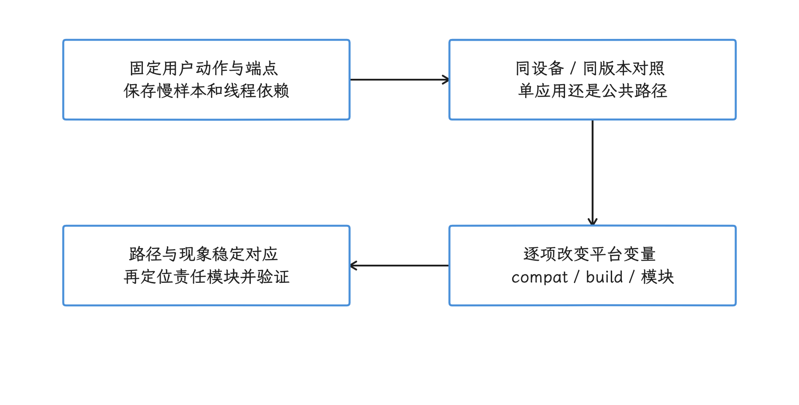

图：先复现用户动作，再用同机应用与平台变量对照判断公共路径是否可疑。 同一时间变慢只是候选线索，单次 trace 或跨设备差异不能独立证明平台根因。

### 用五层模型定位改动面

判断归到平台之后，我们要按一个稳定的顺序往下读。平台性能路径可以分成五层，每一层帮我们确认成本和对外行为落在哪里；这五层是纯技术分层，团队的组织架构是另一回事。

1. **应用与公开 API**：调用频率、参数规模、`targetSdkVersion`（App 声明适配到的 API 级别） 和公开行为约定。
2. **Framework 与 system service**：Java/Kotlin 状态机、Binder 服务、锁和生命周期。
3. **Native service 与运行时**：ART、SurfaceFlinger（显示合成服务）、media、netd（网络管理服务）、libbinder 等原生进程或库。
4. **Kernel 与驱动**：调度、内存、Binder driver（Binder 的内核驱动）、文件系统、block I/O（面向存储块设备的读写） 和设备驱动。
5. **硬件与产品策略**：SoC（System on Chip，片上系统）、固件、Power/Thermal HAL（电源与温控的硬件抽象层）、显示和厂商配置。

一次等待还可能跨越多层。同步 Binder 的调用方等待回复时可能显示为 `Sleeping`，但单凭线程状态还不能确认它等的是 Binder，更不能确认根因在调用方。结合事务关联和调用栈确定同步等待后，再追目标线程的 runnable delay（已可运行但仍等 CPU）、服务端锁、TEE（可信执行环境）、块设备或驱动。保留调用方、目标进程、内核等待和硬件状态，把成本落实到具体依赖，再决定修改哪层。

<!-- gracker-diagram: ch18-01-02-layers -->
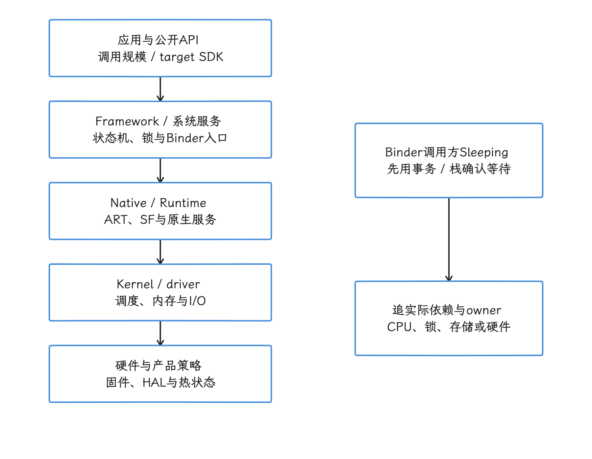

图：五层模型定位成本和行为边界，同步等待继续追到真正执行者与资源。 Sleeping 不是 Binder 专有状态；分层是排查坐标，不是每次调用的固定串行栈。

### 三类证据共同约束结论

往下查时，我们手上会同时积累三类材料：公开接口与行为约定、固定版本源码、设备运行证据。它们各回答一类问题，平台结论要同时经得起这三方面的对照。

#### 公开接口与行为约定

第一类材料是公开约定。release notes（版本说明）、behavior changes（行为变更文档）、SDK 文档和 source.android.com 说明外部可以依赖什么，这些约定同时划出兼容性和迁移的范围；目标设备上的实际启用状态，则要靠后面两类证据来补齐。

#### 固定版本源码

第二类材料是固定版本源码，用于核查实现、gate（路径启用条件）、默认值和失败路径。本文分析固定到 `android-17.0.0_r1` 与 `android17-6.18-2026-06_r6`；tag 是可复查快照，main 是持续变化分支。设备结论还须对应其实际 build、内核 revision、最终配置与运行状态；不能因本文固定了 tag，就认定所有受测设备运行同一实现。

#### 设备运行证据

第三类材料来自设备本身。最终产品还会受到 aconfig、DeviceConfig、Mainline（可独立更新的系统模块）模块、vendor（设备或芯片厂商）配置、kernel config、boot 参数和硬件能力的影响；aconfig 与 DeviceConfig 都能承载平台功能开关，只是生效阶段和更新方式不同。所以做设备结论时，我们至少要拿到 build fingerprint（唯一标识系统构建的一组属性）、target SDK、ART/APEX（系统模块容器）版本、kernel release 和相关功能状态，再用 trace、dump（状态或内存转储）与实验结果说明这次受测的工作负载实际走到了哪条路径。

反过来也一样：源码里有某个函数、内核配置项默认 `y`，或系统版本号满足要求，都还证明不了目标设备真的启用了该功能，产品配置、模块版本或运行时开关都可能改变最终状态。

<!-- gracker-diagram: ch18-01-03-evidence -->
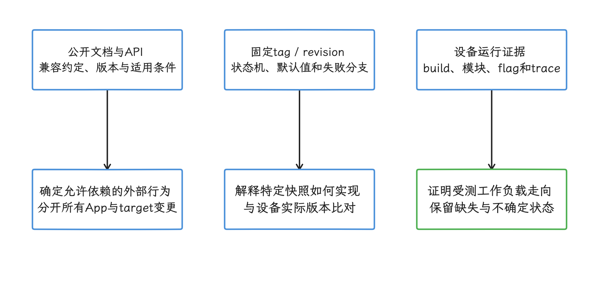

图：公开约定、固定源码与设备现场分别回答可依赖行为、实现和实际启用路径。 源码存在、默认值或系统版本满足条件，都不独立证明目标设备走到该路径。

### 把版本与交付路径拆开

层级和证据都固定之后，还剩一个容易漏掉的维度：交付路径。Android 大版本之外还有好几条版本轴，同一项优化走哪条路径交付，决定它能覆盖哪些设备、以及怎么回滚。我们按交付对象把这条轴拆开：

| 交付对象 | 常见载体 | 需要额外记录 |
| --- | --- | --- |
| Framework / system image | 整机 OTA | build ID、产品 overlay、target SDK 行为 |
| Mainline 模块 | APEX/APK 系统更新 | 模块版本、激活状态、回滚记录 |
| GKI / vendor kernel | 内核镜像与模块随相应分区更新或 OTA 交付 | 实际 revision、最终 `.config`、模块与启动参数；核对设备分区布局 |
| Vendor service / HAL | vendor 分区或厂商 OTA | 接口版本、SoC/固件、产品配置 |
| 应用编译输入 | APK/AAB、DM、Profile | 安装来源、compiler filter、产物位置 |

表里的载体也有几个术语要交代：OTA（Over-the-Air）指设备通过网络接收的系统更新，product overlay 是产品对平台资源或配置的覆盖；`boot` 通常承载内核，`vendor_boot` 承载 vendor ramdisk、DTB 等启动数据，模块还可能位于 `system_dlkm`/`vendor_dlkm`；具体依设备布局，最终 `.config` 记录实际构建进内核的选项；APK 是 App 安装包，AAB 是供应用商店生成设备适配 APK 的 Android App Bundle；DM（Dex Metadata）和 Profile 为 ART 提供安装或编译输入，compiler filter 决定只做验证，还是采用不同强度的 AOT（Ahead-of-Time，运行前编译）。

再看版本轴本身：Android 17 的官方兼容矩阵包含多条受支持的 GKI 分支，光看大版本推不出设备内核版本；ART 又能作为 Mainline 模块独立更新，版本要单独读取。target SDK 37 只开启文档明确绑定 target 的行为，影响所有 Android 17 App 的变化还要查另一份行为变更清单。所以跨版本实验应把 OS、target、Mainline、kernel 和产品配置当作独立变量记录。

<!-- gracker-diagram: ch18-01-04-delivery -->
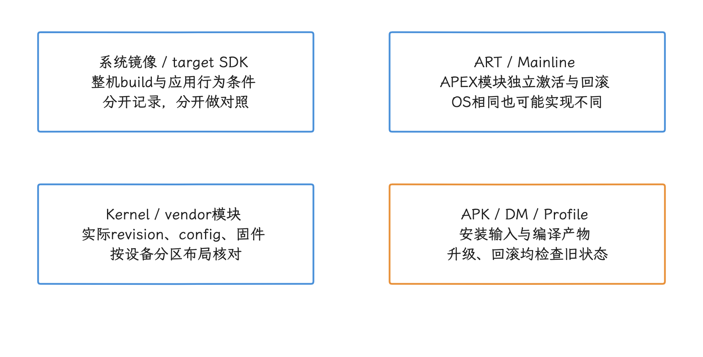

图：OS、target、ART/Mainline、kernel 与产品配置分别记录，交付和回滚也逐项核对。 Android 17 不推出唯一内核；vendor_boot、内核镜像和可加载模块的分区职责不同。

### 一轮平台优化怎样完成验证与交付

下面我们按一轮平台优化的推进顺序，把验证与交付拆成六步，从定义用户动作一直走到回滚路径。

#### 1. 定义用户动作和完成边界

我们用可重复的动作描述问题，例如“点击图标到首个可交互页面”“触摸事件到对应帧的 present feedback（显示栈呈现反馈）”“提交安装会话到包可启动”，并把起点和终点写进指标定义。若测触摸到发光，还需外部光学测量；present feedback 不等于面板像素已经完成响应。CPU 利用率、函数耗时或 trace slice（轨迹中的时间区间）只作阶段证据，不能替代所定义的端到端边界。

#### 2. 保存可复现实验环境

实验环境要能复现。源码位置用 revision（commit 或 tag）固定下来，本地改动写进 local diff（尚未进入该版本的本地改动）清单，再加上产品 target（AOSP 编译所选的设备目标）、build variant（`user`、`userdebug` 或 `eng`）、设备与内核、页大小、刷新率、编译状态、温度、电源条件、测试脚本和数据集。还要留意：`userdebug` 保留更多调试能力，root 取得超级用户权限，关闭 verity 会停用系统分区完整性校验；这些操作以及额外日志、trace 配置都可能改变结果，必须显式标注。

#### 3. 用统计确认问题，用 trace 解释问题

统计先看多轮样本的 P50、P90/P95 和离散程度——P50、P90、P95 分别表示 50%、90%、95% 的样本不高于该数值。解释慢样本时，我们再上工具：Perfetto（系统级 trace 工具）、simpleperf（CPU 性能分析工具）、`dumpsys`（导出系统服务状态的命令）或模块专用统计。单次 trace 能帮我们判断慢样本由哪条路径造成，总体收益还是要靠统计说话。

#### 4. 一次只改变一个主要变量

平台、kernel、vendor、配置和 App 同时变化时，结果归因就乱了。能用 compat change、feature flag（功能开关，是否可在运行时修改取决于实现）、build flag（构建时开关） 或小补丁在同一设备上做 A/B 对照时，优先做改动前后成对比较的实验；实在隔离不了变量，报告就要相应降低结论强度。

#### 5. 同时检查副作用

平台改动除目标指标外，还要检查：

- 稳定性：crash、ANR（Application Not Responding，应用无响应）、watchdog（系统看门狗无响应判定）、kernel panic（内核遇到无法继续运行的致命错误）；
- 资源：CPU、内存、I/O、功耗和热状态；
- 正确性：时序、状态机、数据一致性和错误回退；
- 兼容性：旧 target、旧模块、vendor 实现和测试工具；
- 安全：权限、SELinux（Android 的强制访问控制机制）、签名、隔离和缓解机制没有被削弱。

#### 6. 把回滚路径作为实现的一部分

可配置优化要定义默认值、分批发布的设备分组、状态观测方式和回滚后的清理动作。涉及持久产物、profile、缓存或文件格式时，还要验证新旧版本交替后不会误用旧状态。

<!-- gracker-diagram: ch18-01-05-platform-validation -->
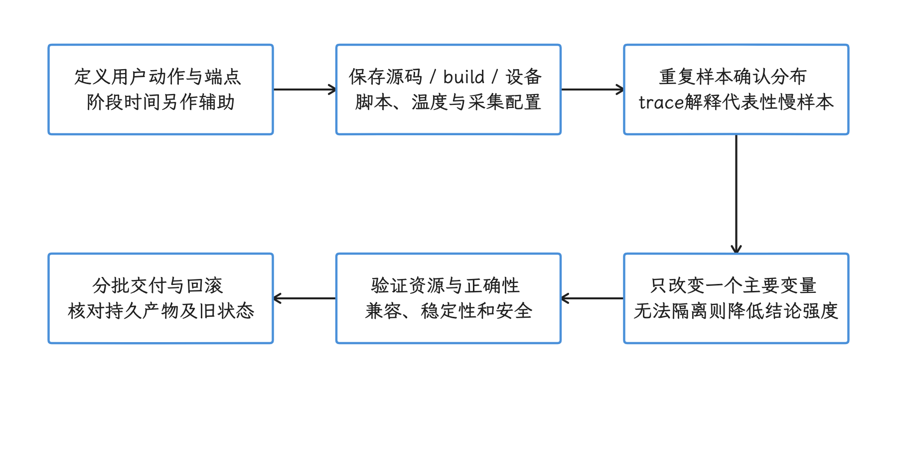

图：定义用户端点、保存环境、统计与取证、隔离变量、回归副作用并验证回滚。 present feedback 是显示栈反馈，触摸到发光需光学测量；示意步骤不表示固定时长。

### 常见的平台优化模式

落到具体改法，平台侧的优化大多可以归进四个模式：删除不必要的工作、把工作移出关键路径、增加并发但保留依赖、用反馈信号代替固定策略。逐个看它们的前提和代价。

#### 删除不必要的工作

先消除重复扫描、重复序列化、无用唤醒、过早初始化和失效产物。删除工作通常比把同一工作换线程更容易拿到稳定收益；删之前，要确认这些步骤没有承担正确性或安全职责。

#### 把工作移出关键路径

预加载、异步初始化、后台 dexopt（对 DEX 做验证或编译优化）和延迟服务启动，都是把 CPU、I/O 或内存成本挪到别的时间点。验收时要同时看原关键路径和接住成本的那个阶段，别让启动时间变短、首个交互或后台功耗却变差。

#### 增加并发但保留依赖

把 driver probe（驱动探测）、SystemServer 服务初始化或批量处理并行化，可以缩短串行阶段；代价是依赖关系必须表达得非常准确。表达错了，成本就会变成锁等待、I/O 竞争、偶发状态错误，或者 defer storm（依赖未就绪导致大量驱动反复推迟探测）。所以并发方案要有明确的 ready 条件、超时、降级和取消语义。

#### 用反馈信号代替固定策略

另一类思路是用反馈信号代替固定策略：ADPF（Android Dynamic Performance Framework）让应用向系统提示性能需求，PSI（Pressure Stall Information）统计 CPU、内存或 I/O 压力造成的停顿，thermal（温度与热节流状态）和 headroom（距离温度或资源上限的余量）提供热状态与余量读数，profile-guided optimization（根据真实执行热点指导编译优化）则把真实热点用于指导编译。这些反馈信号可能延迟、缺失，也会受产品实现影响，所以控制逻辑要有静态回退、滞回和频率限制；滞回指进入和退出某状态使用不同阈值，能避免读数在阈值附近反复切换。

<!-- gracker-diagram: ch18-01-06-optimization-patterns -->
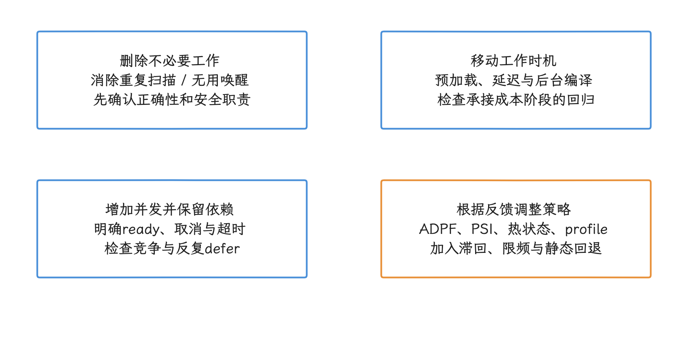

图：删工作、移时机、增并发和反馈控制分别改变不同成本。 移出关键路径仍会消耗资源；并发依赖、信号滞后与回退必须单独验证。

### 设备样本按瓶颈维度选择

“高端、中端、低端”这类标签描述性能并不稳定，选样本时我们直接按瓶颈维度覆盖：

| 维度 | 记录项 | 容易暴露的问题 |
| --- | --- | --- |
| CPU | 拓扑、频率、调度、thermal | runnable delay、锁竞争、编译 |
| 内存 | RAM、zRAM/swap、压力策略 | reclaim、GC、LMK、后台重启 |
| 存储 | 文件系统、介质、cache 状态 | major fault、数据库和资源加载 |
| 图形 | GPU、驱动、分辨率、刷新率 | RenderThread、fence、合成 deadline |
| 系统 | build、模块、kernel、target | feature gate、兼容行为和厂商差异 |

表里的记录项展开说：zRAM 是用内存中的压缩块充当交换空间，swap 是把暂时不用的内存页换出；reclaim 是回收可释放内存页，GC（Garbage Collection，对象垃圾回收）是运行时回收不再使用的对象，LMK 是内存不足时终止进程。major fault 表示缺页时还需要从存储读取数据。图形一侧，RenderThread 是 App 侧执行部分硬件加速渲染工作的线程，fence 用于表示图形任务何时完成，合成 deadline 是一帧必须赶上的显示提交时限。至于某条系统路径是否启用，由 feature gate（决定代码路径是否启用的条件或开关）控制。

Android Go 能代表一类低资源配置，覆盖不了所有低性能或特殊瓶颈设备；高刷新率或高分辨率设备也可能更容易暴露图形预算问题。

<!-- gracker-diagram: ch18-01-07-device-sampling -->
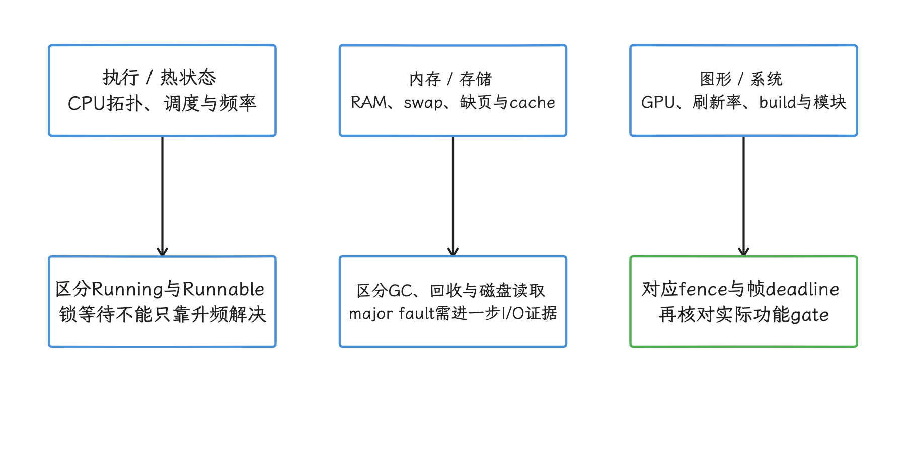

图：设备样本按 CPU、内存、存储、图形和系统配置覆盖，而非只贴高低端标签。 同一机型在温度、刷新率、存储状态和模块版本变化后也可能暴露不同瓶颈。

### 审查清单

- [ ] 问题能跨应用或随平台变量稳定复现。
- [ ] 公开接口与行为约定、固定 tag 源码和设备运行证据没有互相替代。
- [ ] 平台、target、Mainline、kernel 和 vendor 版本分别记录。
- [ ] 指标包含用户动作、起止边界、样本数和分位数。
- [ ] trace 解释等待对象，统计证明总体变化。
- [ ] 实验只改变一个主要变量，或明确说明隔离不了的混杂项。
- [ ] 稳定性、资源、正确性、兼容性与安全回归已覆盖。
- [ ] feature 状态可观察，分批发布和回滚不会遗留不兼容产物。

### 后续专题的分工

- 后文继续展开 Android 12～17 的版本、target SDK 变化与 Android 17 / API 37 应用适配。
- 18.2：固定源码、编译模块、Cuttlefish（AOSP 虚拟设备）/真机验证和实验记录。
- 18.3：Android 17 GKI 6.18 的调度、存储、AutoFDO（利用采样 profile 指导编译优化）与 MGLRU（Multi-Gen LRU，多代内存页回收算法）。
- 16.2、16.3、16.5：因果分析、指标、测试和源码阅读的通用方法。


## 版本演进与行为迁移

定位好层级之后，我们把版本差异按模块和用户可见行为记录下来，避免把发布说明直接当成设备结论。

### 为什么版本号必须进入性能结论

同一个 APK 在两个系统版本上可能进入不同的调度、进程管理和运行时路径；`targetSdkVersion` 表示 App 声明适配到的 API 级别，又会单独开启一部分兼容性变更。所以光写“Android 17 上发生”并不够，性能记录至少要包含设备系统版本、`targetSdkVersion`、Mainline 版本和内核版本。

平台上限为 Android 17 / API 37 / `android-17.0.0_r1`。Android 17 对应的新 GKI 分支是 6.18，内核核对版本为 `android17-6.18-2026-06_r6`。官方兼容矩阵还列出多条较早的内核分支，其中 `android13-5.10` 与 `android12-5.10` 从 Android 17 QPR1（Quarterly Platform Release 1，季度平台更新）起不再受支持。看到 Android 17，我们还是要读一下设备实际运行的内核版本，别默认它就是 6.18。

下面的“适用范围”分为两类：

- **所有 App**：只要运行在该系统版本上就受影响，通常与 `targetSdkVersion` 无关。
- **目标版本变更**：只有 App 将 `targetSdkVersion` 提升到对应 API 后才启用。

<!-- gracker-diagram: ch18-01-08-version-axes -->
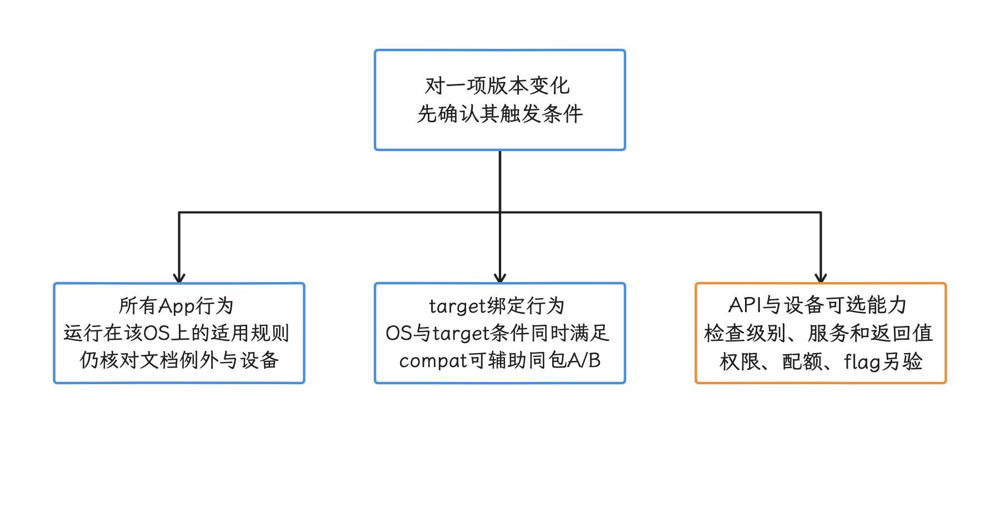

图：系统规则、target 行为与 API/设备能力沿不同条件生效。 提升 target 不等于更换 OS；compileSdk 可编译也不证明运行时存在对应能力。

| 版本 | 性能排查时优先关注 | 适用范围 |
| --- | --- | --- |
| Android 12 / API 31 | 后台前台服务、精确闹钟、通知跳板 | 多数为 target 31 |
| Android 13 / API 33 | 通知权限、文本断字、FrameTimeline | 权限受 target 影响，渲染 API 为能力项 |
| Android 14 / API 34 | 缓存进程资源、前台服务类型、JobScheduler ANR | 同时包含所有 App 与 target 34 |
| Android 15 / API 35 | ProfilingManager、启动信息、ADPF 会话扩展、16 KB 页 | API 能力与 target 35 行为并存 |
| Android 16 / API 36 | 触发式 Profiling、作业诊断、CPU/GPU headroom、大屏适配 | API 能力与 target 36 行为并存 |
| Android 17 / API 37 | 无锁 MessageQueue、分代 CMC、新 ProfilingTrigger、App 内存限制 | 同时包含所有 App 与 target 37 |

### Android 12（API 31）：后台执行边界收窄

Android 12 的性能相关变化集中在后台执行的可达性上，我们先看前台服务的启动限制。

#### 后台启动前台服务

运行在 Android 12 及以上且 target 31 的 App，从后台启动前台服务时会受到限制，未命中官方豁免条件时 `startForegroundService()` 会抛出 `ForegroundServiceStartNotAllowedException`。它改变的是后台采集、上传和周期维护任务的可达性，仅用“变慢”来描述会漏掉这层变化。

迁移方案要按任务语义选择：

- 可延迟、受约束的持久工作交给 WorkManager。
- 必须尽快执行且符合配额条件的短任务可以评估 expedited work。
- 用户明确发起的大文件传输应评估相应系统版本提供的用户发起数据传输机制。
- 需要持续感知的设备类场景还要评估 Companion Device Manager 等专用 API。

expedited work 是 WorkManager 中希望尽快执行、但会消耗系统配额的加急任务。持续导航、媒体播放、通话这些场景各有前台服务类型和运行条件，前台服务运行时要以持续通知表明正在执行用户可感知的工作，WorkManager 替代不了所有 foreground service（前台服务）。

#### 精确闹钟

Android 12 上 target 31 及以上应用使用受保护的精确闹钟路径，应声明 `SCHEDULE_EXACT_ALARM` 并检查特殊访问授权或平台豁免。到 API 33 及以上，符合用途的闹钟/日历类应用还可按政策使用 `USE_EXACT_ALARM`。Android 14 起 `OnAlarmListener` 重载无需前一权限，但依赖活跃组件生命周期，不能代替进程退出后仍须交付的 `PendingIntent` 路径。周期遥测优先评估非精确闹钟或 WorkManager；精确触发只服务确有需要的用户可见功能。

Android 14 对大多数新安装且 target 33 及以上、未命中豁免的应用，不再预授予 `SCHEDULE_EXACT_ALARM`；已有授权的系统升级与备份恢复也有不同结果。排查延迟时记录系统/target、所用重载、安装与恢复路径、授权及豁免状态。

#### 通知跳板

对 target 31 的 App，通过通知启动 BroadcastReceiver（广播接收器） 或 Service、再由中间组件转启 Activity（界面组件） 的跳板路径已经失效；通知点击应直接使用指向 Activity（界面） 的 `PendingIntent`，也就是交给系统稍后代表 App 执行的封装操作。迁移后冷启动链路会少一个中间组件，收益大小取决于原有实现，事先预设一个固定时延并不可靠。

#### Stretch Overscroll 与性能提示

Android 12 为所有 App 引入 stretch overscroll（滚动到边界后拉伸内容的过度滚动效果）。自行处理边缘效果的自定义滚动容器，要检查重复拉伸、额外绘制和触摸反馈是否一致。

`PerformanceHintManager` 也在 API 31 提供公开入口，App 可用线程组、目标工作时长和实际工作时长向系统表达持续负载。它属于 ADPF（Android Dynamic Performance Framework，应用与系统协同提示性能需求） 的 CPU 性能提示路径，与 Game Mode 是两套 API：Game Mode 描述游戏偏好的性能或省电模式，替代不了每帧工作时长反馈。

<!-- gracker-diagram: ch18-01-09-android12 -->
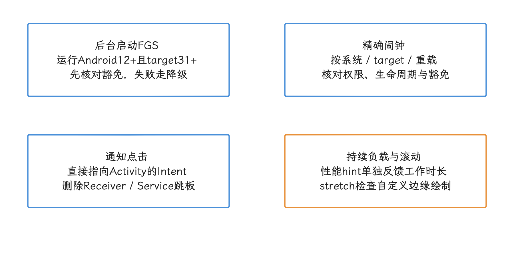

图：后台服务、精确闹钟与通知跳板先核对执行资格，ADPF 则单独提供负载提示。 前台服务和 WorkManager 不互相覆盖全部用途；ADPF 也不直接命令频率。

### Android 13（API 33）：权限与帧标识能力扩展

Android 13 的变化一头连着通知权限，一头连着帧标识能力，两边都会改变我们做性能测量和卡顿排查的方式。

#### 运行时通知权限

Android 13 引入 `POST_NOTIFICATIONS` 运行时权限。通知是前台服务可见性和后台任务反馈的一部分，用户即使拒绝了权限，前台服务的通知义务也依然存在。我们做性能测试时要覆盖首次授权、拒绝、升级安装和重新授权，避免把通知流程差异计入启动或任务耗时。

#### ART Mainline（可独立更新的 ART 系统模块） 更新

ART 可以作为 Mainline 模块通过 Google Play 系统更新变化，设备的 Android 大版本相同，ART 构建也未必相同。所以我们比较启动、编译或 GC 时要记录 ART 模块版本；一次设备观测只说明那一台设备的情况，据此写全平台结论就越界了。

#### 文本断字与 FrameTimeline（描述一帧预期与实际显示时序）

Android 13 优化了断字实现，官方文档给出的上限描述是“最多约 200%”。开发者可按排版质量与成本选择 `fullFast` 或 `normalFast` 两种快速断字频率。这个百分比来自平台说明，换一段文本、字体或语言就未必复现；正文排版性能还是要在目标语料上量。

Android 13 为 Choreographer（UI 帧回调协调类）和 NDK `ASurfaceControl` 增加公开帧时间线能力：应用可读取多个候选呈现时间及对应 deadline，再把选择传给 SurfaceFlinger。Vsync ID 用于关联相应应用帧与显示流水线记录，不是跨进程、跨显示器通用的唯一端到端帧号。Perfetto 的系统 FrameTimeline 早在 Android 12 已出现；API 33 的扩展不能写成整个机制首次出现。按进程、Surface/Layer 和 token 的作用域对齐记录，避免仅凭时间戳邻近猜对应。

<!-- gracker-diagram: ch18-01-10-android13 -->
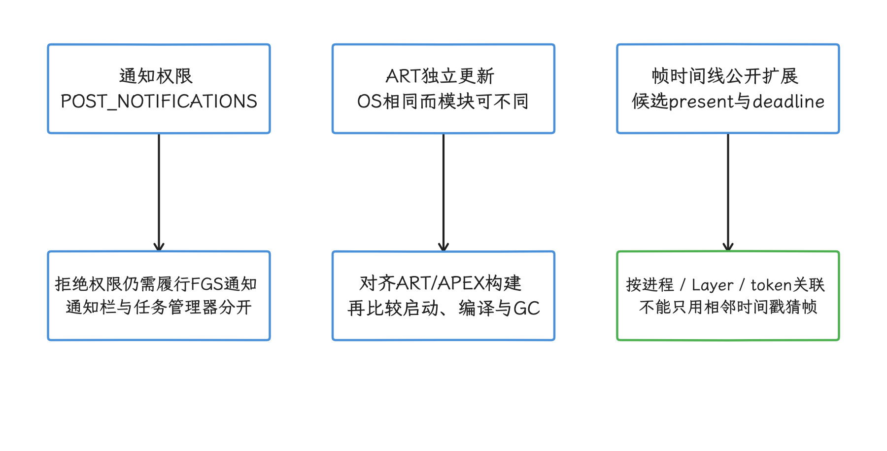

图：通知权限、ART 模块与公开帧时间线能力分别影响可见性、运行时和测量。 系统 FrameTimeline 早于 API 33；Vsync token 需要进程与目标 Surface/Layer 作用域。

### Android 14（API 34）：缓存进程和前台服务约束

到了 Android 14，约束收紧到缓存进程和前台服务两个方向；排查后台任务延迟时，要先把这两个因素排除。

#### 缓存进程的资源限制

Android 14 对所有 App 加强缓存进程管理。进程进入 cached 状态后，系统会在较短时间内限制其后台工作，动态注册的广播也可能等进程离开 cached 状态后再投递。因此缓存进程里的线程、网络循环或定时器，都算不上可靠的执行机制。

cached、frozen、killed 是三个不同状态：cached 表示进程当前没有活跃组件、可在内存压力下被终止，frozen 表示系统暂停其线程执行，killed 表示进程已经结束。线程暂时拿不到 CPU 时间时，我们还判定不了进程已经 frozen，要结合 ActivityManager 状态、freezer 信息和进程存活与否一起判断。

#### 前台服务类型

target 34 的 App 必须为前台服务声明符合用途的类型及对应权限。漏掉类型会在 `startForeground()` 时触发 `MissingForegroundServiceTypeException`，不满足运行时前置条件则可能触发 `SecurityException`。

Android 14 新增 `shortService` 等类型。`shortService` 的运行窗口约为 3 分钟，超时后系统调用 `Service.onTimeout()`，服务未及时停止会触发 ANR。它适合短而不可延后的用户可感知工作，不适合无限续期的后台循环。

#### JobScheduler 回调超时

target 34 的 App 若在 `JobService.onStartJob()` 或 `onStopJob()` 里阻塞主线程，系统会按 ANR 处理。Android 14 对所有 App 还会把多次 JobScheduler ANR 计入 restricted standby bucket（严格限制后台作业、闹钟和网络的待机分组）的判断。所以回调要快速返回，耗时工作转移到合适的执行器，并正确处理停止信号。

#### 非线性字体缩放

Android 14 支持最高 200% 的字体缩放，并采用非线性曲线：较小文字获得较大相对放大，原本较大的字号增长较缓，以免标题过大。不能用统一 `fontScale` 乘数还原所有 sp 到 px 的转换；使用平台转换 API，并在最大字体下检查布局、测量次数、截断和滚动范围，先定位排版与布局再归因绘制。

<!-- gracker-diagram: ch18-01-11-android14 -->
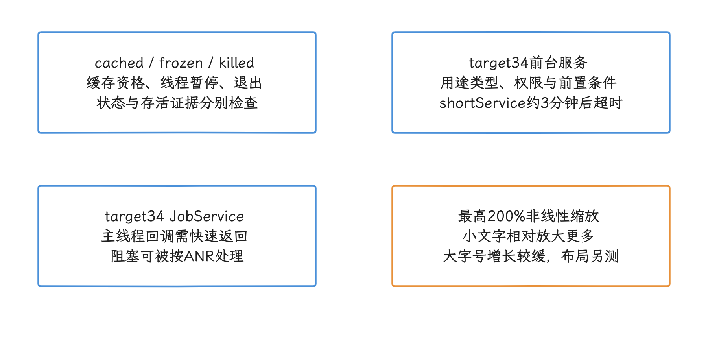

图：缓存进程、前台服务、Job 回调和字体布局分别按各自规则验证。 cached、frozen、killed 不能互换；非线性字体缩放也不是统一字号乘数。

### Android 15（API 35）：进程内 Profiling 与 16 KB 页支持

Android 15 交到我们手里的东西有两件：进程内 Profiling 把取数入口搬进了应用，16 KB 页支持则改变了运行环境本身。

#### ProfilingManager

`ProfilingManager` 在 API 35 加入公开 SDK，`requestProfiling()` 可主动请求 Java heap dump、Native heap profile、stack sampling 或 system trace。Native heap profile 面向原生堆分配采样，不等同于 Java 对象堆快照。只注册结果 listener 不会开始采集，结果还受速率、设备与服务状态约束；独立产物也不会自动并入另一场 Perfetto 会话。

它适合在用户同意、产品采样策略也允许的场景里取现场数据。系统仍会做速率限制，也可能拒绝请求，所以调用方要把“请求成功提交”“收到结果”“超时或失败”记成三种不同的状态。

#### ApplicationStartInfo

`ApplicationStartInfo` 在 API 35 提供进程启动原因、启动类型、时间点和启动状态等结构化信息，能减少只靠日志拼接启动阶段的歧义。时间点是否存在与启动路径有关，读取方要检查返回数据，别假设每个阶段都有值。

#### ADPF（Android Dynamic Performance Framework，应用与系统协同调整性能） 会话扩展

API 35 为 `PerformanceHintManager.Session` 增加了 `setPreferPowerEfficiency()` 和基于 `WorkDuration`（一轮工作的起止时间及 CPU/GPU 耗时）的 `reportActualWorkDuration()`：前者表达功耗优先偏好，后者能报告更丰富的工作时长信息。两者都是提示，设备是否支持、系统怎么响应、频点怎么变，由实现和当前热状态决定。

<!-- gracker-diagram: ch18-01-12-android15 -->
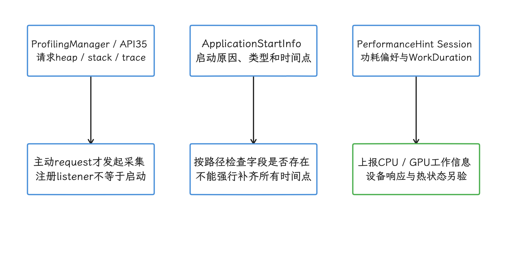

图：主动 profiling、结构化启动数据和 ADPF 会话提供不同观测或控制信号。 Native heap profile 不是 Java 堆快照；hint、启动字段和产物交付都需按契约处理。

#### 前台服务时间配额

target 35 的 App 在后台运行 `dataSync` 和 `mediaProcessing` 前台服务时，每种类型共享 24 小时内 6 小时的总配额，用户把 App 带到前台会重置计时器。配额耗尽后，系统调用 `Service.onTimeout(int, int)`，服务只有很短的停止窗口。

这 6 小时按同一类型的全部服务累计，逐个 Service 实例分别计算会得到错误的结果。迁移时需要盘点并发服务、重启路径和用户回到前台的状态转换。

<!-- gracker-diagram: ch18-01-13-fgs-budget -->
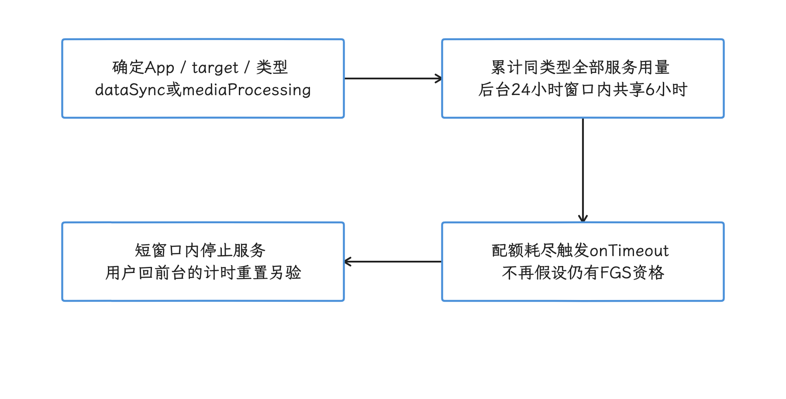

图：target 35 的后台 dataSync 与 mediaProcessing 分别共享 24 小时内 6 小时配额。 同类型多个服务不是各领 6 小时；用户回到前台可重置计时，超时需及时停止。

#### 16 KB 页面大小

Android 15 开始支持 16 KB 页大小的 arm64（64 位 ARM 架构） 设备，但它在 Android 15 还没有成为所有设备的默认配置。含原生代码的 APK 要检查 ELF（Executable and Linkable Format，原生可执行文件与共享库格式）段对齐、打包对齐、预编译依赖和运行期页大小假设。

页大小变化会影响页表、缺页、映射粒度和小对象驻留开销，方向取决于工作负载。系统版本说明不了设备页大小，我们要通过运行期 API 或系统信息识别，再在 4 KB 与 16 KB 环境分别测量。

### Android 16（API 36）：触发式 Profiling 与诊断 API

Android 16 的主题是补全诊断信息：触发式 Profiling、启动组件、帧标识和作业约束都变得可查。

#### 触发式 Profiling

`ProfilingManager.addProfilingTriggers()` 在 API 36 加入，App 可用它登记由系统事件触发的采集规则：API 36 的公开触发类型包括 ANR 和 `APP_FULLY_DRAWN`（冷启动后调用 `reportFullyDrawn()`）；36.1 这个 Android 16 的 minor SDK（小版本 API）又增加了请求运行中 trace、用户强制停止、从最近任务划掉和任务管理器停止等触发类型。

触发式采集适合补充低复现率的现场问题，不过它仍受系统速率限制和设备条件约束，事件发生时未必每次都有产物。

#### 启动、帧与作业诊断

`ApplicationStartInfo.getStartComponent()` 在 API 36 加入，用于标识触发进程启动的组件类型。启动性能数据我们按 Activity、Service、BroadcastReceiver、ContentProvider（数据提供组件） 等入口分组，避免把不同启动原因混进同一组分位数。

`FrameMetrics.FRAME_TIMELINE_VSYNC_ID` 也在 API 36 提供，返回当前帧 timeline 的 Vsync ID，用来关联 HWUI（Android 的硬件加速 UI 渲染管线）、SurfaceFlinger（系统图形合成服务） 和 Perfetto（Android 系统性能追踪工具） 里的帧记录。设备或窗口条件不支持时，分析工具要保留缺失值。

`JobScheduler.getPendingJobReasons()` 返回一个作业当前可能存在的多个等待原因，`getPendingJobReasonsHistory()` 返回近期的约束变化。约束包括 App 显式要求的网络、电量条件，也包括系统隐式施加的配额或待机限制。后台任务“没运行”时，我们先读约束历史，再查配额、网络、电量和待机状态，比只看一次当前状态更可靠。

#### SystemHealthManager headroom

Android 16 在 `SystemHealthManager` 提供 CPU 和 GPU headroom API，headroom 是指定时间窗口内还能使用多少处理能力的估计值。返回值适合让画质、工作量或并发度逐步调整，但既当不了固定频率预算，也顶替不了 Thermal API（系统温度与热节流接口）。

调用方应读取 CPU/GPU 各自的最小查询间隔；API 不支持可抛 `UnsupportedOperationException`，暂时无有效样本可返回 `NaN`，两者与真实的零余量分别处理。合法 headroom 在 0～100，0 表示没有更多资源可授予。对连续读数平滑并设滞回和静态回退，避免根据一个读数反复切换重负载档位。

<!-- gracker-diagram: ch18-01-14-android16-diagnostics -->
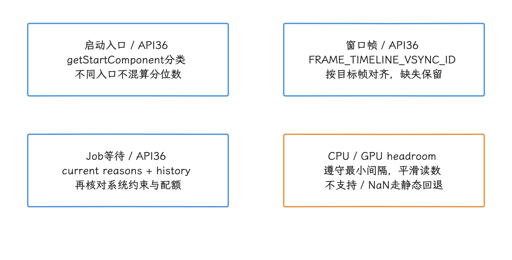

图：启动组件、窗口帧 ID、Job 原因和 headroom 分别补充诊断上下文。 headroom 为估计值；不支持、NaN 与真实零余量分别处理，查询频率受限制。

#### 大屏自适应

target 36 的 App 在 smallest width（最小宽度）达到 600dp 的显示上，系统会忽略一部分方向、宽高比和可调整性限制；dp 是按屏幕密度换算的布局单位。迁移重点是窗口 resize（尺寸变化）、配置变化、状态恢复和多窗口布局。尺寸变化是否重建 Activity 取决于清单和配置处理，写成“每次 resize 都必然重建”就错了。

target 36 还可以用 `PROPERTY_COMPAT_ALLOW_RESTRICTED_RESIZABILITY` 暂时退出该行为，但 target 37 会忽略这项临时退出配置，所以 Android 16 的迁移别停留在兼容模式上。

#### 预测性返回、定期任务与 edge-to-edge

target 36 的 App 运行在 Android 16 及以上时，系统默认启用 back-to-home（返回桌面）、cross-task（跨任务）、cross-activity（跨 Activity） 的预测性返回动画，旧的 `onBackPressed()` 不再收到调用，`KEYCODE_BACK` 也不再分发。AndroidX 返回分发器、平台返回回调和页面状态恢复都要一并测试；清单里的 `android:enableOnBackInvokedCallback="false"` 只适合作为临时退出手段。

`ScheduledThreadPoolExecutor.scheduleAtFixedRate()` 也有 target 36 行为变化。进程离开有效生命周期而错过多个周期后，恢复时最多立即执行一个遗漏任务。依赖“恢复后补跑全部周期”的统计或维护逻辑需要改成显式计算缺口。

对运行在 Android 16 且 target 36 的 App，系统不再接受 `windowOptOutEdgeToEdgeEnforcement` 退出配置。edge-to-edge 表示内容可以绘制到状态栏和导航栏所在区域，页面要正确处理 system bar（系统栏）、display cutout（刘海或挖孔区域） 和 IME 提供的 insets（需要避让的边缘距离）。布局区域变化会影响测量、绘制和滚动范围，基准测试必须用迁移后的最终布局。

<!-- gracker-diagram: ch18-01-15-android16-ui -->
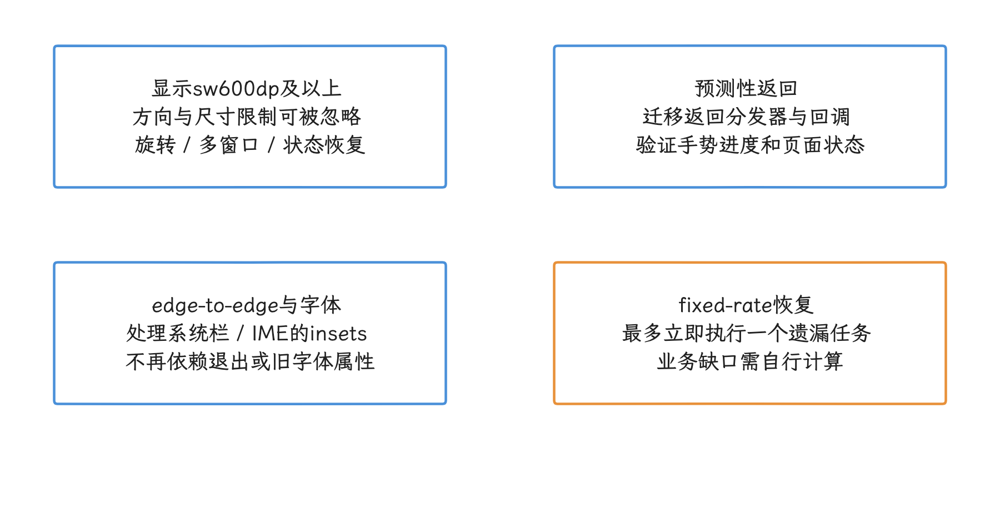

图：target 36 迁移同时覆盖大屏、返回、insets、文字和遗漏周期。 大屏门槛按显示最小宽度；resize 不必然重建，定期任务也不自动补跑所有遗漏周期。

### Android 17（API 37）：消息队列、GC 与现场诊断

Android 17 的变化深入平台内部：消息队列换了实现，ART 加了分代回收，现场诊断的触发类型也扩了一圈。

#### target 37 的无锁 MessageQueue

运行在 Android 17 且 target 37 的 App 使用新的 lock-free（无锁）`MessageQueue` 实现。lock-free 指消息入队不再依赖一把全局锁：并发竞争时系统整体仍有线程能前进，每次操作的耗时并不因此固定。官方目标是减少锁竞争和漏帧；公开 API 语义保持兼容，依赖反射读取私有字段或方法的代码会先暴露问题。

兼容层仍保留 `mMessages` 字段，但新实现下该字段始终为 `null`，已经反映不了队列是否为空。Espresso、Robolectric 和自研空闲判断等测试依赖需要升级，具体版本基线在后文「兼容性风险与测试方式」给出。我们可以在 debuggable（允许调试器附加的） 构建上用兼容性开关 `USE_NEW_MESSAGEQUEUE` 提前测试；测试范围要覆盖 Handler 密集场景、测试框架空闲判断和依赖反射的 SDK，也别漏掉 IdleHandler（消息队列空闲时的回调）和同步屏障（暂时只放行异步消息的队列标记）这两处细节。

#### ART 分代 Concurrent Mark-Compact

Android 17 发布的 ART Concurrent Mark-Compact（并发标记压缩，下文简称 CMC）支持分代 GC。年轻代对象通常存活时间短，平台可以用更频繁、成本较低的 young collection（只覆盖年轻代的回收） 处理这部分对象，再按条件执行覆盖更大范围堆的 full collection（覆盖更大范围堆的回收）。

这项变化与 `userfaultfd`（Linux 用户态缺页处理机制）是两回事：CMC 使用 userfaultfd 的演进早于 Android 17，Android 17 新增的是按对象代际选择回收范围的策略。

我们分析分代 CMC 时，要区分 young/full collection、暂停阶段、并发标记时间、年轻对象进入老年代的晋升量，以及回收后仍驻留内存的集合。

这项 ART 改进还可以通过 Google Play system update 下发到 Android 12 及以上设备，系统版本低于 Android 17 并不说明设备上没有它。实验要同时记录 OS 版本、ART Mainline 模块版本和实际功能状态。

分代回收并不保证每个 App 都降低暂停时间：对象存活率高、跨代引用多或堆压力大时，收益会变化。结论要来自目标设备、目标 ART 构建和稳定负载。

#### API 37 的 ProfilingTrigger

Android 17 扩充系统触发式 Profiling，新增的 `ProfilingTrigger` 覆盖冷启动、OOM（Out of Memory，内存耗尽）、异常 CPU 占用、平台识别的异常行为和未来版本兼容问题，各触发类型对应的产物在后文「ProfilingManager」一节列出。

冷启动 trigger 会尽早开始采集，但开始前仍可能有延迟，不能保证覆盖进程创建和最早的启动事件。采集持续到 `reportFullyDrawn()`，未调用时默认 5 秒停止；discard buffer 满后丢新事件，保留的是采集开始后已捕获的较早事件。未上报业务就绪时只能靠超时收尾。

OOM 触发要求自定义 `Thread.UncaughtExceptionHandler` 调用默认异常处理器。若异常链被截断，系统触发就走不完，App 只能另行调用 `requestProfiling()` 请求 heap dump。

#### App 内存限制

Android 17 对所有 App 引入按设备总 RAM 设定的保守内存限制，具体是否实施因设备而异。命中限制后，`ApplicationExitInfo` 的 reason 为 `REASON_OTHER`，description 包含 `MemoryLimiter:AnonSwap`（AnonSwap 是该限制器的匿名内存与 swap 计量口径）。只按 reason 聚合会把它和其他 `REASON_OTHER` 混在一起，排查时要认准这个标记；查看状态、复现限制和抓取 heap dump 的具体命令见后文「运行在 Android 17 时还要检查的项目」。

#### Android 17 的 NPU 与 NNAPI 边界

Android 17 要求 target 37 的 App 在直接访问 NPU（Neural Processing Unit，神经网络处理器）时声明 `FEATURE_NEURAL_PROCESSING_UNIT`。它约束的是设备能力声明与访问范围；模型会不会因此自动提速，还要另行验证。

NNAPI（Neural Networks API）的 NDK App 接口从 Android 15 起已废弃，NN HAL（神经网络硬件抽象层）仍供系统和设备实现使用，NN HAL 1.3 也早于 Android 17。`android-17.0.0_r1` 里继续存在相关代码，说明的只是兼容实现还在源码树内；把旧接口写成 Android 17 新增能力就错了。

对端侧推理做版本比较时，至少固定模型、delegate（把算子交给特定加速后端的适配层）、runtime、驱动、量化方案、热状态和功耗窗口。编译缓存是否命中、burst execution（复用执行上下文以减少重复准备开销）是否可用，都要从目标实现和 trace 证据判断，通用的微秒级收益数字不要写。

<!-- gracker-diagram: ch18-01-16-npu-boundary -->
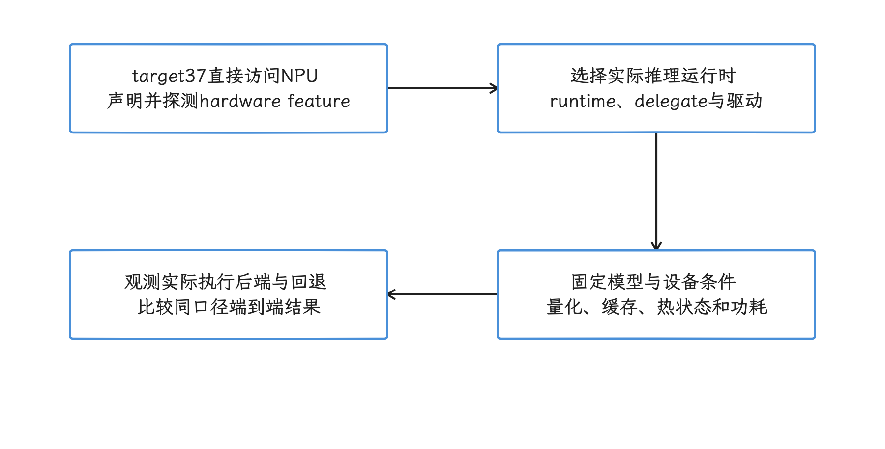

图：NPU feature 声明与 NNAPI NDK 的废弃状态分别核对，推理性能回到固定后端测量。 NN HAL 源码仍在不表示 Android 17 新增该接口；能力声明也不保证模型被 NPU 加速。

### 新增性能 API 的演进脉络

| API | <span style="white-space:nowrap">加入版本</span> | 用途 | 使用边界 |
| --- | --- | --- | --- |
| <code>Performance<wbr>Hint<wbr>Manager</code> | <span style="white-space:nowrap">API 31</span> | 线程组工作时长提示 | 提示不等于频点命令 |
| FrameTimeline / Vsync ID 能力 | <span style="white-space:nowrap">API 33 起扩展</span> | 跨渲染阶段关联帧 | 以设备和具体 API 可用性为准 |
| <code>Profiling<wbr>Manager.<wbr>request<wbr>Profiling()</code> | <span style="white-space:nowrap">API 35</span> | App 主动请求 profile | 有速率限制，注册监听器不会发起采集 |
| <code>Application<wbr>Start<wbr>Info</code> | <span style="white-space:nowrap">API 35</span> | 结构化启动信息 | 时间点和字段可能缺失 |
| <code>Session.<wbr>set<wbr>Prefer<wbr>Power<wbr>Efficiency()</code> | <span style="white-space:nowrap">API 35</span> | 表达功耗优先偏好 | 由系统决定响应 |
| <code>Profiling<wbr>Manager.<wbr>add<wbr>Profiling<wbr>Triggers()</code> | <span style="white-space:nowrap">API 36</span> | 注册系统事件采集 | 触发类型跨 36、36.1、37 扩展 |
| <code>FRAME_<wbr>TIMELINE_<wbr>VSYNC_<wbr>ID</code> | <span style="white-space:nowrap">API 36</span> | 关联窗口帧与系统帧 | 缺失时保留 unknown（未知）值 |
| CPU/GPU headroom | <span style="white-space:nowrap">API 36</span> | 估计资源余量 | 设备可选，限制查询频率 |
| Android 17 新 ProfilingTrigger | <span style="white-space:nowrap">API 37</span> | 冷启动、OOM、异常 CPU 等现场数据 | 受事件条件和速率限制 |

API 级别检查只解决符号可用性。设备能力、服务是否存在、权限、配额和厂商实现仍要单独探测。

<!-- gracker-diagram: ch18-01-17-api-gates -->
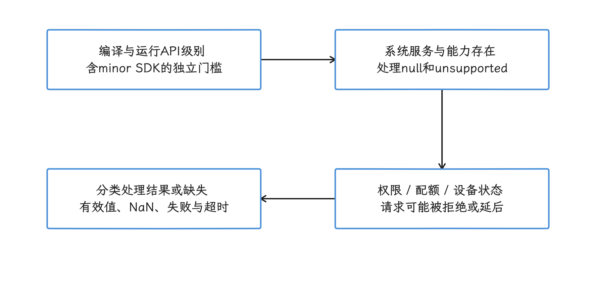

图：按 API 级别、服务/能力、权限配额和返回状态依次检查。 能够编译或通过 SDK_INT 判断，都不保证设备支持、请求被接受或一定得到产物。

### Deprecated API 与替代路径

#### 返回手势

`Activity.onBackPressed()` 从 API 33 起废弃，时间点早于 Android 16。应用层优先用 AndroidX `OnBackPressedDispatcher` 管理回调和生命周期，平台侧可按需求接入 `OnBackInvokedDispatcher`。预测性返回还要求界面状态在手势进行过程中可预览，只替换方法名完不成迁移。

#### WebView 强制深色

Android 13 起，`WebSettings.setForceDark()` 对 target 33 App 的行为发生变化，进入废弃路径。网页内容应通过 CSS 的 `prefers-color-scheme`（页面声明偏好的明暗主题）和 WebView 的算法深色策略配合。切换主题时要测量页面重排与重绘，避免在滚动中反复改动设置。

#### NNAPI NDK

NNAPI NDK 从 Android 15 起废弃。新推理方案应评估目标运行时及其 delegate，并把模型兼容性、驱动覆盖和回退路径纳入测试；HAL 继续存在，App 也不该再新增对废弃 NDK API 的依赖。

#### edge-to-edge 与 elegant text

`windowOptOutEdgeToEdgeEnforcement` 在 target 36 且运行 Android 16 时已经失效，替代路径是完整处理窗口 insets。`elegantTextHeight` 也在 target 36 时被忽略；受影响文字系统需要重新验证字形高度、基线、行距和裁切。

废弃标记表示该接口不再推荐继续依赖；是否仍有效、已成 no-op 或抛错，要逐项查目标版本契约。迁移顺序由 target 行为、调用频率、故障风险和替代方案成熟度决定，不能从“尚能编译”推断仍保留旧行为。

### targetSdkVersion 升级检查表

#### target 31

- 枚举所有后台启动前台服务的入口及豁免条件。
- 检查精确闹钟授权和非精确调度的容忍窗口。
- 删除通知跳板。

#### target 33

- 覆盖通知授权的完整状态转换。
- 清理对 `onBackPressed()` 和旧深色策略的新增依赖。
- 记录 ART 主线模块版本，避免只按 OS 大版本聚合。

#### target 34

- 为每个前台服务声明精确类型、权限和运行时前置条件。
- 保证 JobService 回调快速返回。
- 在 cached 状态验证后台工作不会依赖进程持续获得 CPU。

#### target 35

- 统计 `dataSync`、`mediaProcessing` 的 24 小时累计用量。
- 实现并测试超时停止路径。
- 在 4 KB 与 16 KB 页设备验证所有原生依赖。

#### target 36

- 在显示配置最小宽度至少 600dp 的设备上覆盖 resize、旋转、多窗口和状态恢复；当前窗口宽度不单独决定该平台门槛。
- 迁移预测性返回，覆盖 back-to-home、跨任务和跨 Activity。
- 删除对 edge-to-edge 退出属性和 `elegantTextHeight` 的依赖。
- 检查 fixed-rate 定期任务是否依赖恢复后连续补跑。
- 使用新的作业等待原因历史定位后台任务。
- 把 headroom 作为可选信号，保留 Thermal API 和静态档位回退。

#### target 37

- 提前启用 `USE_NEW_MESSAGEQUEUE` 兼容性变更，升级测试依赖。
- 搜索对 `MessageQueue` 私有成员和 `static final` 修改的反射/JNI 代码。
- 测试冷启动、OOM、异常 CPU 与内存限制的采集和退出信息解析。
- 直接访问 NPU 的 App 声明对应硬件 feature（能力声明），并处理设备不支持。

每次升级都应分开比较“系统版本变化”和“target 变化”。我们可以在同一 Android 17 设备上用兼容性框架逐项开关行为，再用两个 target 构建复测，减少变量混杂。

<!-- gracker-diagram: ch18-01-18-target-migration -->
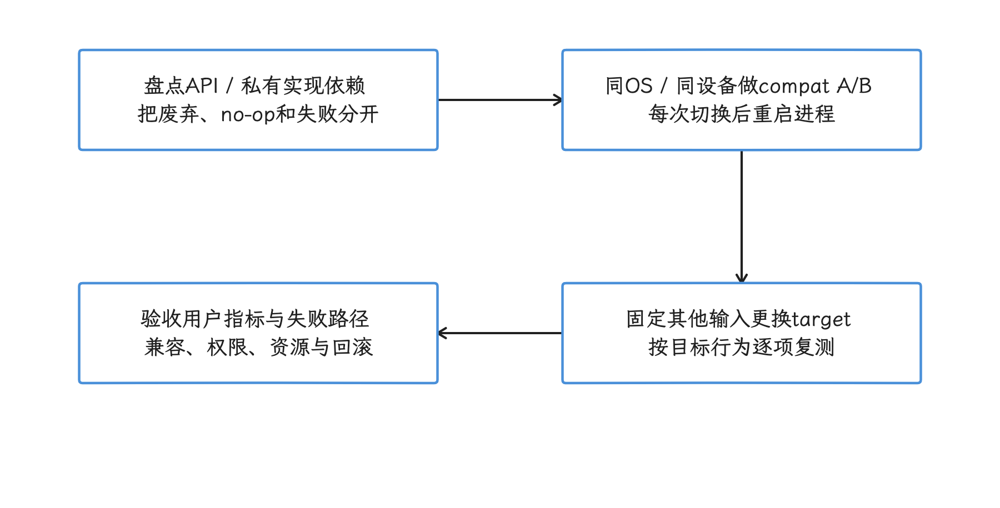

图：先盘点调用与目标行为，再做同设备 compat 对照和不同 target 构建复测。 compat 只辅助可控制的变更；升级测试还要覆盖所有 App 行为与模块/设备差异。

### Perfetto 与平台数据如何配合

版本变化在 Perfetto 中的可见程度不同：

- 无锁 MessageQueue 的效果要从主线程调度、Handler 消息处理和帧 deadline（必须完成本帧工作的时限）观察，trace 里没有一个字段能直接证明“无锁已启用”，兼容性检查仍要做。
- FrameTimeline Vsync ID 可以关联应用帧、HWUI 和 SurfaceFlinger。
- GC 要区分 young/full collection 及暂停、并发阶段，只有总 GC 次数很难解释分代策略。
- CPU/GPU headroom 是 App 可查询的信号，频率、调度和热事件仍需系统 trace 辅助。
- ProfilingManager 生成独立的 profile 产物，别假设它会自动出现在当前 Perfetto 会话里。
- 前台服务配额、权限拒绝和 JobScheduler 等待原因要结合 `dumpsys`、API 返回和系统日志，trace 只覆盖其中一部分。

一次跨版本实验固定 APK、数据集、操作、温度与电源条件，记录实际 OS build fingerprint、target、ART/Mainline、页大小和内核构建。本文内核分析快照是 `android17-6.18-2026-06_r6`，设备若运行另一 revision，应记录并比对差异；不能要求所有 6.18 设备都与该标签一致。

<!-- gracker-diagram: ch18-01-19-trace-evidence -->
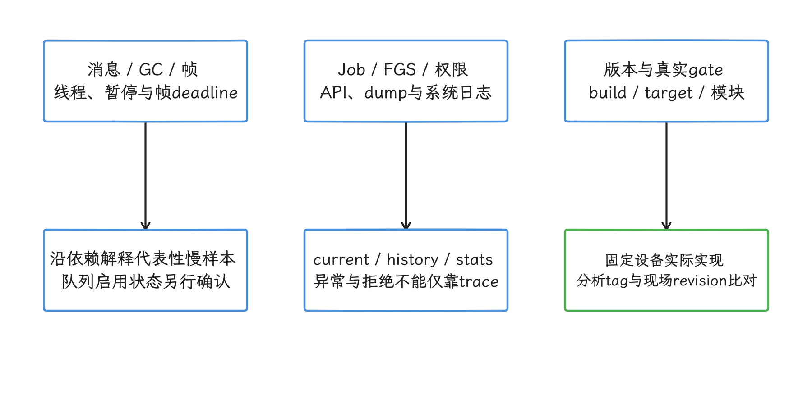

图：队列、GC、帧、Job 与权限分别匹配其可观测证据，再对齐实验版本轴。 没有对应 slice 不等于功能未启用；独立 profiling 产物也不自动加入当前会话。


## Android 17 行为、开关与适配验证

我们把 Android 17 的变化放到 API 级别、AOSP tag、feature flag（平台功能开关） 和 OEM 实现四个层面核对。

### 四组变化按触发条件区分

`target SDK` 是应用通过 `targetSdkVersion` 声明的目标行为级别，它决定一部分兼容开关；设备运行的系统版本则决定平台实现与可用 API。两者是独立维度，性能文章却很容易把 target SDK 行为、所有应用行为、公开 API 和系统实现改动写成同一种“Android 17 强制变化”，迁移时我们要按触发条件分开判断。

| 类别 | 触发条件 | 涉及项目 |
|:---|:---|:---|
| <span style="white-space:nowrap">target SDK</span><br><span style="white-space:nowrap">行为</span> | Android 17 上运行且 <code>target<wbr>Sdk<wbr>Version >= 37</code> | 新 <code>Message<wbr>Queue</code>、<code>static final</code> 写保护、ECH、CT、原生动态加载、局域网权限、大屏约束 |
| <span style="white-space:nowrap">Android 17</span><br><span style="white-space:nowrap">平台行为</span> | 运行在 Android 17；文档未声明 target SDK 门槛 | 部分设备的 app memory limits、后台音频基础限制、特定配置变化不再重建 Activity |
| <span style="white-space:nowrap">API 与</span><br><span style="white-space:nowrap">运行时能力</span> | API 37 或 Android 17 的系统组件提供能力 | <code>Profiling<wbr>Trigger</code>、<code>Job<wbr>Scheduler.<wbr>get<wbr>Pending<wbr>Job<wbr>Reason<wbr>Stats()</code>、ART 分代 CMC |
| <span style="white-space:nowrap">延续性</span><br><span style="white-space:nowrap">兼容要求</span> | 早于 Android 17 已出现，升级时仍需满足 | 16KB 页面大小 |

这四类变化的验证方法也不同：行为开关要做兼容性 A/B，也就是在同一应用上分别启用和关闭开关；公开 API 要检查返回值范围；ART 与图形实现要读 trace；16KB 要检查每个 ELF（Executable and Linkable Format，原生可执行文件和共享库格式） 及其打包对齐。

### DeliQueue：重写的是消息入队争用

#### 旧队列为何会阻塞主线程

旧 `MessageQueue` 用同一个对象 monitor（Java 对象监视器锁）保护按 `when` 排序的单链表：后台线程通过 `Handler.post()` 或 `sendMessage()` 入队，Looper 线程通过 `next()` 取消息，两边竞争同一把锁。业务回调执行期间并不持有这个 monitor，把整段 `doFrame()` 或布局时间算成队列持锁时间，会误判卡顿来源。

旧实现遇到高并发投递时可能出现优先级反转：较低优先级线程在队列维护代码中持锁，主线程等待 monitor。此时我们沿 Perfetto 的 `android.monitor_contention` 事件回到 waiter 与 owner 的调用栈，确认 owner 是否位于 `MessageQueue.enqueueMessage()` 附近；只看主线程处于 Sleeping 状态，说明不了是消息队列锁。

<!-- gracker-diagram: ch18-01-20-legacy-queue -->
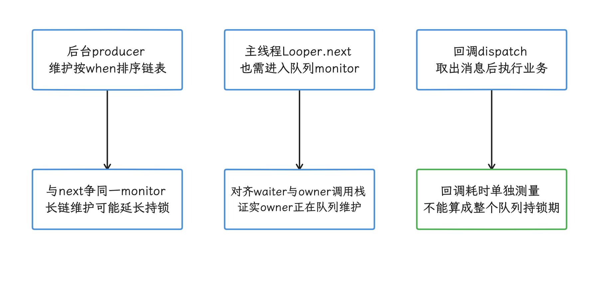

图：旧队列的入队与取出共享 monitor，持锁线程可让主线程等待。 业务回调执行期间不持有这把队列锁，Sleeping 也不独立证明 monitor contention。

#### Android 17 的启用边界

Android 17 对 target SDK 37 及以上应用启用新的 lock-free `MessageQueue`，这里的 lock-free 指消息入队不再依赖一把全局锁。`android-17.0.0_r1` 把兼容实现和并发实现放在同一个文件：

`frameworks/base/core/java/android/os/CombinedMessageQueue/MessageQueue.java`

该文件中的 compat change ID（兼容性变更编号）为 `USE_NEW_MESSAGEQUEUE = 421623328L`。应用侧的选择条件来自 `CompatChanges.isChangeEnabled(USE_NEW_MESSAGEQUEUE)`；平台还保留 feature flag 和系统进程选择逻辑，所以从应用 target SDK 推不出所有系统进程的队列模式。

官方把这套设计称为 DeliQueue。下图只表达职责分离：producer 指投递消息的线程，consumer 指取出消息的 Looper 线程；图中出现的名称在 r1 里未必有同名 Java 类。

具体数据流见下图；图中另标出 Looper 自投递的直接写入路径。

后台 producer 通过 CAS（compare-and-set，比较并交换）把消息压入 Treiber stack——一种用 CAS 更新栈顶的无锁链栈。Looper 端把栈中的一批节点 drain 到有序集合，再按投递时间和序号选择消息；Looper 线程给自己的队列投递时，另有直接写入有序集合的快速路径。同步屏障是队列中的特殊标记，可让异步消息越过暂时被拦住的普通消息，因此仍会影响两类消息的选择。

#### 博客概念模型与 r1 源码组织的差异

Android Developers Blog 用 “Treiber stack + single-threaded min-heap” 解释算法，并讨论 tombstone（逻辑删除标记）、把退出状态编码进原生层引用计数的方案，以及无分支比较器。这个概念模型有助于理解并发写入和有序读取的分工。

`android-17.0.0_r1` 的 Java 源码组织与早期说明不同：

- `StackNode`、`MessageNode`、`StateNode`、`QuittingNode` 是 `MessageQueue.java` 的嵌套类。
- `VarHandle` 是 Java 提供的底层变量访问句柄，源码用 `sState` 对 `mStateValue` 做原子读写。跨线程入队的成功 CAS 将节点发布到并发栈；失败者重读后重试。同一 `when` 的顺序另由预先分配的 `insertSeq` 决定，不能把 CAS 完成先后直接当成交付 FIFO。
- Looper 线程自身入队时直接调用 `insertIntoPriorityQueue()`；其他线程走并发栈。
- drain 后的普通消息与异步消息分别存入两个 `ConcurrentSkipListSet<Message>`：`mPriorityQueue` 和 `mAsyncPriorityQueue`。该类型是基于 skip list（跳表）的并发有序集合。
- 同一 `when` 下用 `insertSeq` 保持顺序；`sendMessageAtFrontOfQueue()` 使用递减序号维持队首投递语义。
- 移除路径会以原子标记完成逻辑删除，Looper 随后跳过或清理已移除节点。

所以，这里的“MessageStack / MessageHeap”只表示写入栈和有序读取端的职责。r1 没有 `MessageStack.java`、`MessageHeap.java`、`CombinedDeliMessageQueue/` 或 `LegacyMessageQueue/` 这些路径。源码定位应以 `CombinedMessageQueue/MessageQueue.java` 为准。

“lock-free MessageQueue”说的只是消息入队的共享关键路径，并不涵盖整个文件：IdleHandler、文件描述符监听、drain 完成通知等辅助状态仍可用 `synchronized` 或 `ReentrantLock`。这套设计保证的是系统在竞争下能持续推进，保证不了每个线程都在固定次数内完成操作。

<!-- gracker-diagram: ch18-01-21-new-queue -->
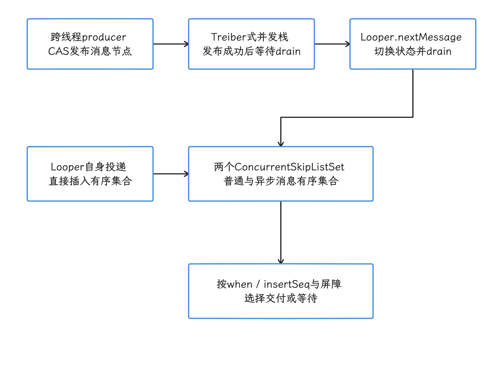

图：跨线程先 CAS 发布，Looper 批量转入两个有序集合，自投递可走直接写入路径。 r1 使用跳表集合；博客 min-heap 是概念模型。发布不等于立即交付，辅助状态仍可能加锁。

#### drain 发生在什么位置

Looper 进入并发实现的 `nextMessage()` 后，会把栈状态切到 active，取得旧栈顶并调用 `drainStack(oldTop)`。随后 Looper 从普通、异步两个集合取最早项，结合同步屏障和当前时间决定交付、等待或再次循环。

drain 是批量转移点，也是看 trace 时的分界线：producer 的 CAS 完成只代表消息已发布到并发栈，消息要按 `when` 进入可交付顺序，还得等 Looper 完成 drain。高频 producer 仍可能增加 Looper 的整理工作，所以 lock contention 下降了，队列积压未必跟着消失。

#### 兼容性风险与测试方式

公共 `Handler`、`Looper`、`Message` 用法无需迁移。风险集中在私有实现依赖：

- 反射读取 `MessageQueue.mMessages` 或遍历旧链表。
- 自制 idle 检测、测试框架或监控 SDK 假定队头保存在 `mMessages`。
- 通过 JNI 或 hidden API（未公开的平台接口）操作队列内部状态。

为维持二进制兼容，Android 17 仍保留 `mMessages` 字段，并发实现启用时该字段恒为 `null`。字段存在归存在，旧链表此时已经不在工作了。

官方给出的测试库基线是 Espresso 3.7.0 及以上、Robolectric 4.17 及以上。Robolectric 测试还要从 `@LooperMode(LEGACY)` 迁到 `@LooperMode(PAUSED)`；自研空闲判断改用公开同步机制，或在 instrumentation 测试中通过 `Instrumentation.acquireLooperManager()` 使用 `TestLooperManager`。该类始于 API 26；API 36 新增 `poll()`、`peekWhen()` 和 `isBlockedOnSyncBarrier()` 等能力，不是 Android 16 才出现整类。

以下命令用于在可调试应用上做同包 A/B。

```bash
adb shell am compat enable USE_NEW_MESSAGEQUEUE com.example.app
adb shell am force-stop com.example.app

adb shell am compat disable USE_NEW_MESSAGEQUEUE com.example.app
adb shell am force-stop com.example.app
```

每次切换后都重新启动进程，并保持机型、构建、场景、trace 配置和热状态一致。compat disable 适合定位问题，发布 target SDK 37 的版本时别依赖它。

#### 公开性能数据该怎样使用

官方博客公开了三组数据：

| 证据 | 官方结果 | 解释边界 |
|:---|:---|:---|
| `busy queue synthetic benchmark`（繁忙队列合成压测） | 多线程插入最高快 5,000 倍 | 压力测试上限，不代表端到端页面性能 |
| internal beta Perfetto traces | App 主线程 lock contention 时间下降 15% | 只衡量锁等待 |
| 同批测试设备体验指标 | App missed frames 下降 4%；System UI / Launcher 下降 7.7%；启动到首帧 P95 下降 9.1% | 官方未公开完整设备、脚本和原始 trace |

我们做业务验收时同时看三类指标：`android.monitor_contention` 中队列 monitor 等待、消息排队时间、帧或启动端到端指标。若锁等待下降而消息排队时间上升，瓶颈已经转移到 producer 数量、Looper 回调成本或 drain 压力。

<!-- gracker-diagram: ch18-01-22-queue-acceptance -->
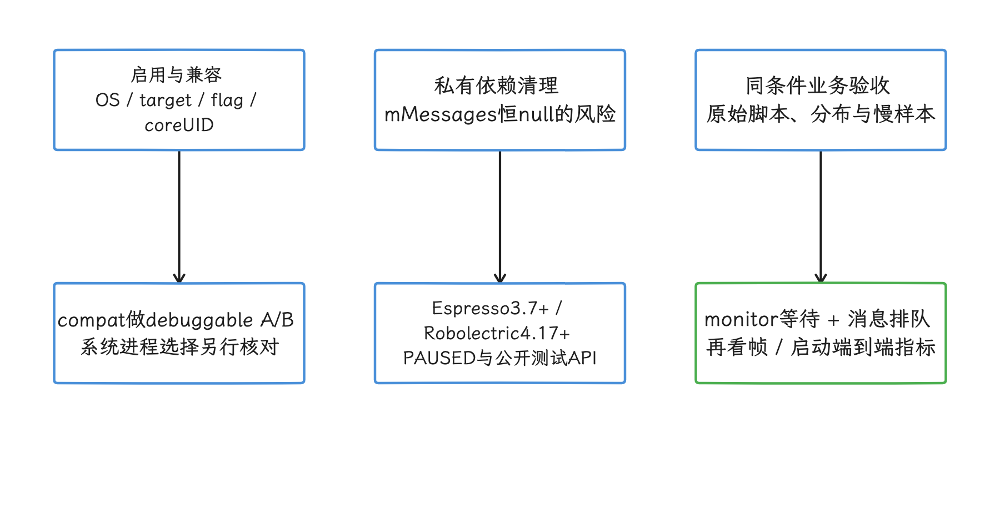

图：确认实际队列模式、迁移私有依赖，再分别比较锁等待、排队与端到端表现。 官方合成压测和内部测试百分比不能直接作为业务收益，lock-free 也不是单次操作时延上限。

分析 `system_server` 的消息流时，官方博客给出了 `mq` track-event category，也就是名为 `mq` 的 trace 采集类别。下面是可嵌入 Perfetto 配置的最小片段。

```textproto
data_sources {
  config {
    name: "track_event"
    track_event_config {
      enabled_categories: "mq"
    }
  }
}
```

该 category 用于观察消息投递与交付流。普通应用是否出现同等细节取决于进程、构建类型和 trace 权限；没有 `mq` slice，未必说明 DeliQueue 未启用。

### ART 分代 CMC：Android 17 新增的是 CMC 分代路径

ART 在 Android 10 已有分代 Concurrent Copying（CC，并发复制）回收器，Android 17 的变化是 Concurrent Mark-Compact（CMC，并发标记-压缩）加入分代能力。把这两件事写成“Android 17 才有分代 GC”就错了。

官方对收益的表述是：更频繁、成本更低的年轻代回收可减轻 GC 对应用的干扰，并改善最大 RSS（resident set size，进程驻留内存）；适用于所有应用的暂停时间或内存百分比，官方没有给出。列表、图片和解析场景都应在自己的分配速率与对象存活分布下测量。

#### r1 的 young、mid、old 模型

`art/runtime/gc/collector/mark_compact.cc` 把上次 GC 后的新分配视为 young：

1. 对象存活一次 GC 后进入 mid。
2. 下一次 young GC 同时标记 young 与 mid，并通过 card table 处理 old 到年轻区域的引用。card table 是按固定内存片记录跨代引用的表，可避免每次都扫描整个 old 区域。
3. 存活的 mid 对象压缩后晋升 old，存活的 young 对象压缩后进入 mid。
4. full GC 处理全堆，并重置或更新分代边界。

“young GC 完全忽略 old”这个说法在这里不成立：old 区域通常不做整区追踪和压缩，但 old-to-young 引用仍要靠 aged/dirty cards 与根处理保证可达性。

`YoungMarkCompact` 也没有单独的 `young_mark_compact.cc`。它的构造与 `RunPhases()` 实现在 `mark_compact.cc`，内部复用主 `MarkCompact` collector，并在本轮设置 `young_gen_`。

<!-- gracker-diagram: ch18-01-23-gc-generations -->
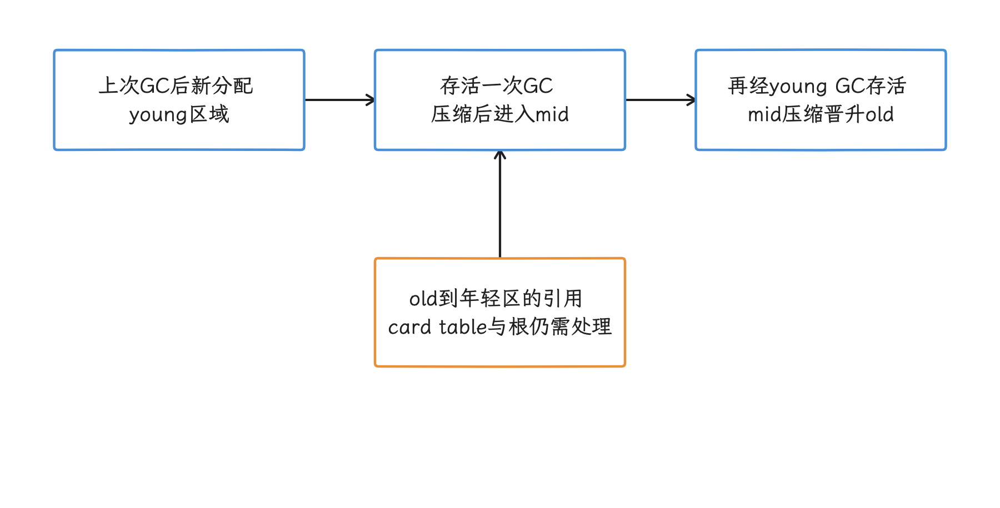

图：r1 中新对象先进入 young，连续两轮存活后经 mid 晋升 old，young GC 同时处理 young 与 mid。 图为分代关系；full GC 覆盖更大范围，young GC 仍需根和 old-to-young 引用，不是完全忽略 old。

#### Generational CMC 的启用门槛

下面是合并 `runtime.cc` 与 `mark_compact.cc` 判断关系的可编译示意；参数使用简化名称，不是逐行源码摘录。

```cpp
// Schematic: combines runtime.cc and mark_compact.cc, not a source excerpt.
bool shouldUseGenerationalGC(bool useUffd, bool generationalCmcFlag,
                             bool propertyEnabled) {
    if (useUffd && !generationalCmcFlag) return false;
    return propertyEnabled; // Android property default: true
}

bool useGenerationalGC(bool bakerReadBarrier, bool useUffd,
                       bool gcOptionEnabled, bool generationalCmcFlag,
                       bool propertyEnabled) {
    return (bakerReadBarrier || useUffd)
        && gcOptionEnabled
        && shouldUseGenerationalGC(useUffd, generationalCmcFlag,
                                   propertyEnabled);
}
```

顶层是三项 AND：Baker read barrier 或 userfaultfd 路径、GC 选项、`ShouldUseGenerationalGC()` 的结果。userfaultfd 为真时还要求 `use_generational_cmc` flag；`persist.device_config.runtime_native_boot.use_generational_gc` 默认 true。属性未设置不表示关闭，返回 true 也不能单独证明最终选择了 CMC，仍须核对 collector 与设备事件。

<!-- gracker-diagram: ch18-01-24-gc-gates -->
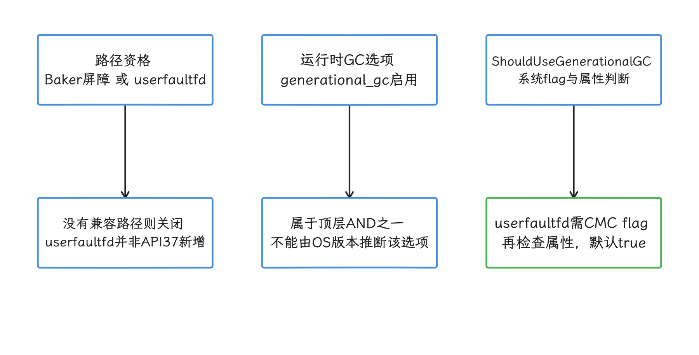

图：Baker 或 userfaultfd、GC 选项和 ShouldUseGenerationalGC 三项共同决定分代资格。 userfaultfd 路径还需 CMC flag 与默认 true 的属性；资格为真不能独立证明进程选中了 CMC。

应用这边别去修改 ART 的 device-config，也别假定所有 Android 17 设备用同一个 collector：OEM 配置、ART Mainline 和运行时选项都可能改变选择，而且 Android 17 的 ART 改进还能通过 Google Play 系统更新覆盖到 Android 12 及以上版本。

验证时我们以目标进程的 GC 事件、暂停分布、分配速率和 RSS 为依据。对同一测试负载，对比 young/full collection 次数、GC CPU 时间、mutator stall（应用线程因 GC 停顿的时间）与峰值 RSS，比只查一个属性更可靠。需要展开回收器与暂停分析时，参阅 [4.2 ART Heap、GC 与后台维护调度](../../part1-fundamentals/ch04-memory/02-art-heap-gc-maintenance.md)。

### ProfilingManager：系统事件提供采集时机

Android 17 为 `ProfilingManager` 增加多种系统 trigger，也就是由特定系统事件启动的采集条件。应用仍需注册全局结果监听器并添加 trigger；每次事件是否产出数据要看系统，采集还受系统与应用设置的限频约束。

#### API 37 主要 trigger 与产物

| trigger | 触发条件 | API 37 定义的产物或边界 |
|:---|:---|:---|
| <code>TRIGGER_<wbr>TYPE_<wbr>COLD_<wbr>START</code> | <code>Application<wbr>Start<wbr>Info.<wbr>START_<wbr>TYPE_<wbr>COLD</code> | 新启动 system trace + stack sampling；采集可能延迟开始，至 <code>report<wbr>Fully<wbr>Drawn()</code> 或默认 5 秒超时 |
| <code>TRIGGER_<wbr>TYPE_<wbr>OOM</code> | 未捕获 <code>Out<wbr>Of<wbr>Memory<wbr>Error</code> | Java heap dump（堆转储）；自定义 uncaught handler（未捕获异常处理器）必须继续调用默认 handler |
| <code>TRIGGER_<wbr>TYPE_<wbr>KILL_<wbr>EXCESSIVE_<wbr>CPU_<wbr>USAGE</code> | 进程因过量 CPU 被杀，exit reason 为 <code>REASON_<wbr>EXCESSIVE_<wbr>RESOURCE_<wbr>USAGE</code> | 正在运行的 system trace 快照 |
| <code>TRIGGER_<wbr>TYPE_<wbr>ANOMALY</code> | 系统识别到资源或性能异常 | 产物随 anomaly 类型变化，<code>Profiling<wbr>Result.<wbr>get<wbr>Tag()</code> 提供类型信息 |
| <code>TRIGGER_<wbr>TYPE_<wbr>APP_<wbr>COMPAT</code> | 系统识别到未来版本将不支持的行为 | 产物随问题变化，tag 提供兼容问题信息 |

`TRIGGER_TYPE_ANOMALY` 注册在 shared UID 场景时，部分异常可能不给产物；shared UID 指多个 package 共用同一个 Linux 用户 ID。OOM trigger 若被自定义 uncaught handler 截断，也不会完成预期 heap dump。接入阶段必须测试这些失败分支。

下面的代码置于应用初始化方法，示意先注册全局 listener，再添加 trigger。`profilingExecutor` 由进程统一持有，负责有限、非阻塞的回调调度；成功/失败处理函数由应用实现，重型解析和上传进入有界后台工作。注册冷启动规则不保证补采本次启动早段，也不能假设进程初始化之前已完成注册。

```java
if (Build.VERSION.SDK_INT >= 37) {
    ProfilingManager profiling = getSystemService(ProfilingManager.class);
    if (profiling != null) {
        profiling.registerForAllProfilingResults(
                profilingExecutor,
                result -> {
                    if (result.getErrorCode() == ProfilingResult.ERROR_NONE) {
                        handleProfilingResult(result);
                    } else {
                        handleProfilingFailure(result);
                    }
                });

        ProfilingTrigger coldStart =
                new ProfilingTrigger.Builder(ProfilingTrigger.TRIGGER_TYPE_COLD_START)
                        .setRateLimitingPeriodHours(24)
                        .build();
        profiling.addProfilingTriggers(List.of(coldStart));
    }
}
```

`setRateLimitingPeriodHours(24)` 表达应用的最短采集间隔，系统仍可能更严格或无产物。规则按进程注册，结果交给全局 listener；回调仅在 `ERROR_NONE` 时读取文件路径，并根据 trigger/tag 分型，失败与超时另记状态。不要把空路径当成功，也不要因注册成功就宣称每次事件都有产物。

把 trigger 当作线上证据入口，不要把它写成常驻采样器。产物可能包含堆对象、调用栈和业务标识，上传与保留策略要遵守隐私、权限和数据最小化要求。完整使用方式参阅 [15.7 ProfilingManager](../../part3-tools/ch15-other-tools/07-profiling-manager.md)。

<!-- gracker-diagram: ch18-01-25-profiling-trigger -->
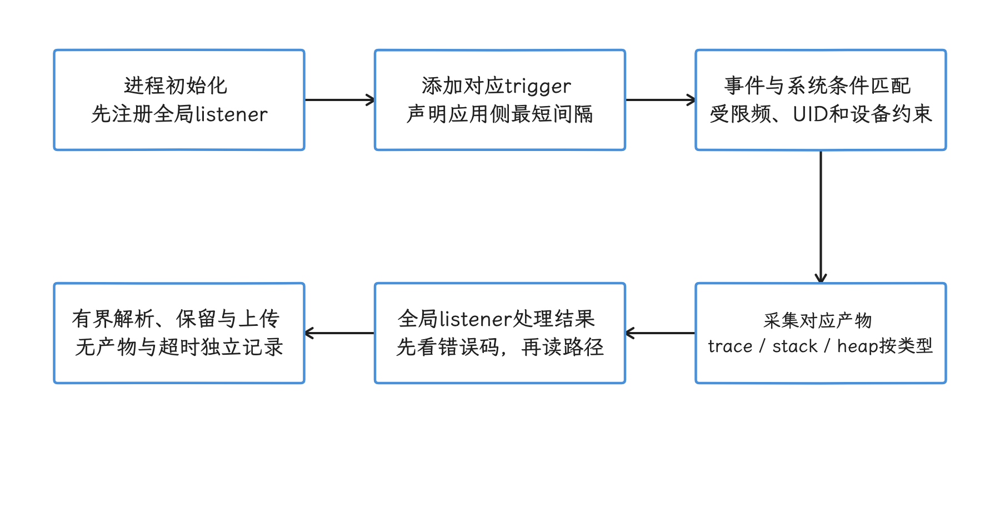

图：先注册结果 listener，再添加进程 trigger；系统事件经过限频和条件判断后才可能采集交付。 冷启动采集可能晚于进程启动；discard 只保留已捕获早段，OOM 自定义处理链还须转交默认 handler。

### JobScheduler pending reason 统计

API 36 已能查到当前 pending reasons（任务暂时执行不了的原因）与有限历史。API 37 新增：

`Map<Integer, Duration> JobScheduler.getPendingJobReasonStats(int jobId)`

返回值把 `PENDING_JOB_REASON_*` 映射到该 job 在当前记录生命周期内，因该原因 pending 的累计时长。多个原因可能同时成立，各项 `Duration` 之和常会超过总等待时间。

这些统计不跨重启持久化；job 成功完成或取消时也会清空。传入的 ID 若不是当前 pending job，API 会抛出 `IllegalArgumentException`。诊断顺序我们按“当前 reasons → history → stats”推进：

- current reasons 回答此刻卡在哪里。
- history 回答约束在何时变化。
- stats 比较各原因累计阻塞时长；若要算占比，另取同口径 wall time（实际流逝的等待时间）。原因可重叠，各项占比不必合计 100%，把 Duration 相加也算不出 wall time。

WorkManager 场景还要建立 `WorkSpec` 与系统 job ID 的映射；`WorkSpec` 是 WorkManager 保存的一条内部任务记录。否则，拿错 job ID 会把调度问题变成数据对齐问题。后台调度机制参阅 [5.3 后台执行、任务调度与 App Hibernation](../../part1-fundamentals/ch05-cpu-power/03-background-jobs-hibernation.md)。

<!-- gracker-diagram: ch18-01-26-job-reasons -->
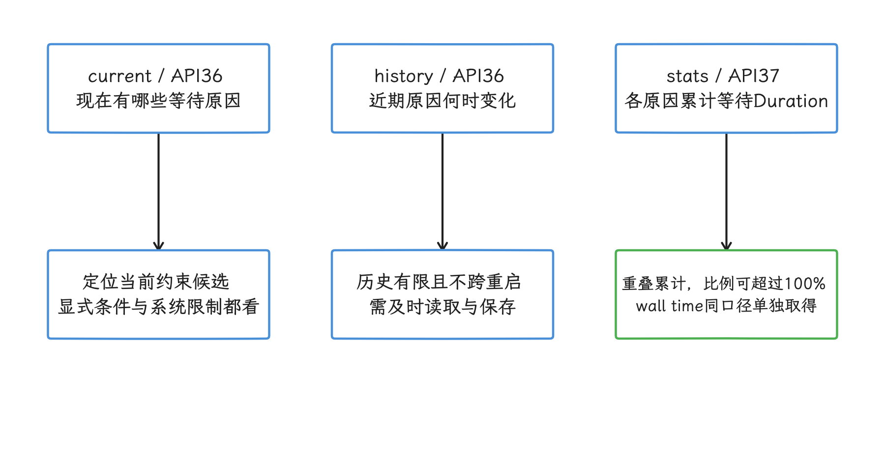

图：按正确 job ID 和 namespace 查询 current、history 与 stats，三者解释不同时间范围。 多个原因可同时成立，累计 Duration 相加可超过 wall time；成功、取消或重启会清理统计。

### target SDK 37 适配项

#### `static final` 字段不可修改

Android 17 上运行且 target SDK 37 及以上的应用，对 `static final` 字段的写入会被拦下：

- Java reflection 写入会抛出 `IllegalAccessException`。
- JNI（Java Native Interface，Java/Kotlin 与原生代码的调用接口）`SetStatic<Type>Field()` 写入会导致应用崩溃。

影响面常在测试注入、旧序列化框架、热修复和 native 测试工具，`setAccessible(true)` 绕不过该限制。将可变测试值放进构造参数、接口、配置对象或专用的测试替换点，常量继续保持常量。发布前同时扫描 Java/Kotlin 反射与 JNI，因为两条失败路径不同。

这项约束允许 ART 更积极地依赖常量语义做优化，但某段业务代码是否因此获得可测加速，还要单独测量。迁移目标是移除未受规范保证的写入行为。

<!-- gracker-diagram: ch18-01-27-static-final -->
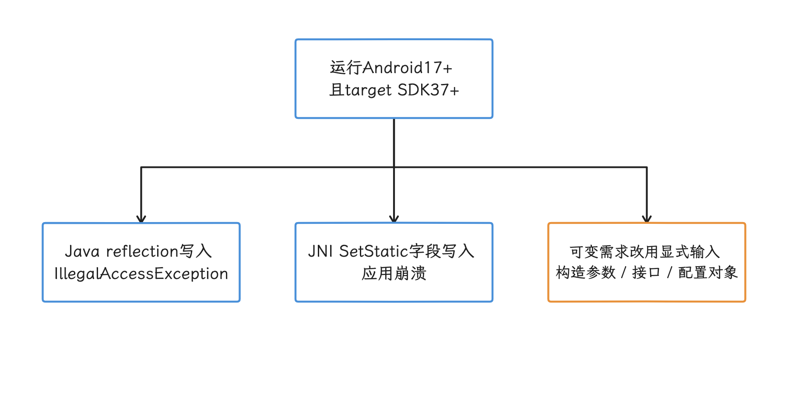

图：Android 17 上 target 37 及以上对 static final 的反射与 JNI 写入有不同失败结果。 setAccessible 不能恢复写入资格；移除未受保证写入不等于承诺业务代码固定提速。

#### 大屏方向、尺寸与 Activity 配置变化

target SDK 37 应用运行在 smallest width（配置中的最小可用宽度） 至少 600dp 的大屏上时，平台会忽略固定方向、不可调整大小和宽高比限制，包括相关 manifest 属性与 `setRequestedOrientation()` 的值。

以 `android:appCategory` 识别的游戏、较小屏幕以及用户在设备设置中的显式选择属于文档列出的例外。

适配重点是窗口尺寸变化后的正确性与帧稳定性：

- 用 `WindowMetrics`（当前窗口可用范围）和自适应布局决定内容结构，避免用物理屏幕尺寸或启动方向固化布局。
- 保存编辑、滚动、播放等 UI 状态，覆盖旋转、折叠、多窗口和桌面自由窗口。
- 检查相机预览、Surface、地图和 `AndroidView` 等嵌入组件在尺寸连续变化时的重建成本。
- 用 Perfetto 观察配置变化附近的 lifecycle、`performTraversals`（View 的一轮测量、布局与绘制遍历）、buffer queue（图形生产者与消费者之间的缓冲队列） 和 missed frame。

大屏约束由 target SDK 37 触发，下面的 Activity 重建优化则是另一类 Android 17 平台默认规则。官方运行时配置指南没有为它声明 target SDK 门槛：keyboard、keyboardHidden、navigation、touchscreen、colorMode，以及进出 desk UI mode 时，系统默认不再销毁重建 Activity，而是保留实例并调用 `onConfigurationChanged()`。

`android-17.0.0_r1` 的 `attrs_manifest.xml` 允许 `android:recreateOnConfigChanges` 使用 touchscreen、keyboard、keyboardHidden、navigation、colorMode，以及 Android 8 已有的 mcc、mnc（移动国家码与移动网络码）；仅写入 `android:configChanges` 不能恢复重建；同一标志若同时出现在两属性中，`configChanges` 的自行处理语义优先，仍不会重建。

该属性没有 `uiMode` 取值，因此进出 desk UI mode（桌面停靠模式）时要由应用更新资源和组件。下面的示例只为确有重建依赖的五类 Android 17 事件恢复旧行为。

```xml
<activity
    android:name=".ReaderActivity"
    android:recreateOnConfigChanges="keyboard|keyboardHidden|navigation|colorMode|touchscreen" />
```

这五类事件发生且没有在 `configChanges` 声明自行处理时，该属性恢复完整的 stop、destroy、recreate 周期。没有重建依赖时，应在 `onConfigurationChanged()` 中更新非 Compose 状态与嵌入组件；Compose 中读取 `LocalConfiguration.current` 的部分会重组，`AndroidView`、`AndroidFragment` 等嵌入对象仍需应用自行刷新。

<!-- gracker-diagram: ch18-01-28-configuration -->
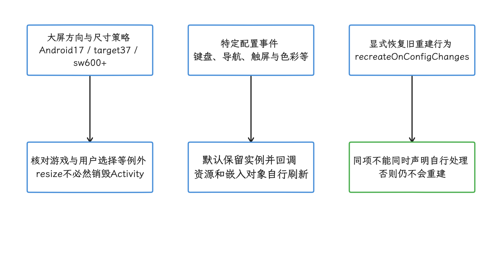

图：大屏策略看 target 与显示 sw；特定配置事件默认保留实例，恢复重建还须检查两属性冲突。 r1 recreateOnConfigChanges 不接受 uiMode；两属性同时声明同项时 configChanges 优先。

#### Network Security Configuration、ECH 与 CT

Android 17 尚未删除 manifest 的 `usesCleartextTraffic`；当前官方清单文档说明它将对 target 38 及以上忽略。Android 7.0/API 24 起优先用 Network Security Configuration 按域名配置明文例外，并在 manifest 指向该 XML。仍支持更早系统时还需为旧系统设置合适的 `usesCleartextTraffic` 值；不是一律设 true，取决于产品是否允许明文。升级验证同时固定 OS、target 与实际网络库是否遵循该策略。

Android 17 为 target 37 及以上应用默认启用 ECH 配置模式。ECH 加密 ClientHello 的敏感字段（包括真实 SNI），但只有接入 ECH 的网络库才遵循该配置；有可用 ECH 配置时尝试真实 ECH，没有配置时发送 GREASE 占位扩展。不能把任何协商失败都概括成自动退回 GREASE，失败与重试细节由协议、库和服务端共同决定。

Network Security Configuration 新增 `<domainEncryption>`，可在 `<base-config>` 或 `<domain-config>` 中按全局或域名设置 `enabled`、`disabled` 等模式。

下面的配置为 `example.com` 显式选择 `enabled` 模式。

```xml
<network-security-config>
    <domain-config>
        <domain includeSubdomains="true">example.com</domain>
        <domainEncryption mode="enabled" />
    </domain-config>
</network-security-config>
```

`enabled` 表示有 ECH 配置时使用 ECH，无配置时允许 GREASE；因此该模式本身不承诺每次连接都加密真实 SNI。平台、客户端库、DNS HTTPS 记录和服务端部署都影响实际结果。有配置后的服务端拒绝、重试或失败应按网络库与 TLS 日志排查，不能从该 XML 独自推出统一回退方式或固定时延收益。

target SDK 37 应用还会默认启用 Certificate Transparency（CT，证书透明度）。网络栈按 Network Security Configuration 执行 CT 时，证书链或 SCT（Signed Certificate Timestamp，证书已记入日志的签名凭据）不满足策略会使 TLS 连接失败。

若某个 `domain-config` 使用用户证书库或内嵌证书作为 trust anchor（验证证书链的信任根），CT 默认会关闭；需要时可用 `<certificateTransparency enabled="true"/>` 再显式开启。

CT 校验通常用证书或握手携带的 SCT 完成，“每次连接都会访问 CT log”这个概括过头了。升级前应覆盖生产域名、备用域名、CDN 切换、证书轮换以及自定义 trust anchor。

<!-- gracker-diagram: ch18-01-29-ech-ct -->
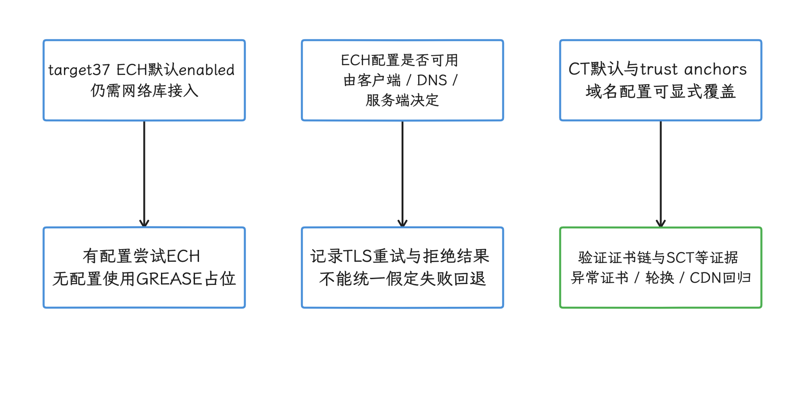

图：ECH 按网络库与配置选择真实握手或 GREASE，CT 按信任与策略验证证书。 GREASE 不加密真实 SNI；CT 不要求每次连接访问日志服务，自定义信任根和显式设置需单独测试。

#### 局域网访问权限

target SDK 37 应用在 Android 17 上访问局域网时，需要声明并在运行时申请 `ACCESS_LOCAL_NETWORK`。该权限属于 `NEARBY_DEVICES` 权限组；用户已授予组内其他权限时，系统不会再次弹出授权框。设备发现、投屏、智能家居、调试桥接和本地 HTTP 服务都要覆盖“未授权、拒绝、之后授权”三条路径。

Google Cast Output Switcher 和带 `DiscoveryRequest.FLAG_SHOW_PICKER` 的 `NsdManager` 可由系统完成发现与选择；这里的 picker 是只把用户选中的设备交给应用的系统选择器，对应场景无需直接获得整个局域网访问权。迁移时按产品能力在 picker 和运行时权限之间选；权限状态要单独判断，别拿连接超时来推。

缺少权限时，TCP 常表现为超时，UDP 通常返回 `EPERM`（operation not permitted）；native 网络栈可用 `android_getnetworkblockedreason()` 区分 Local Network Protection 拦截。性能测试若包含局域网服务，必须记录授权状态，避免把权限拒绝误判为 DNS、TCP 或服务端性能问题。

<!-- gracker-diagram: ch18-01-30-local-network -->
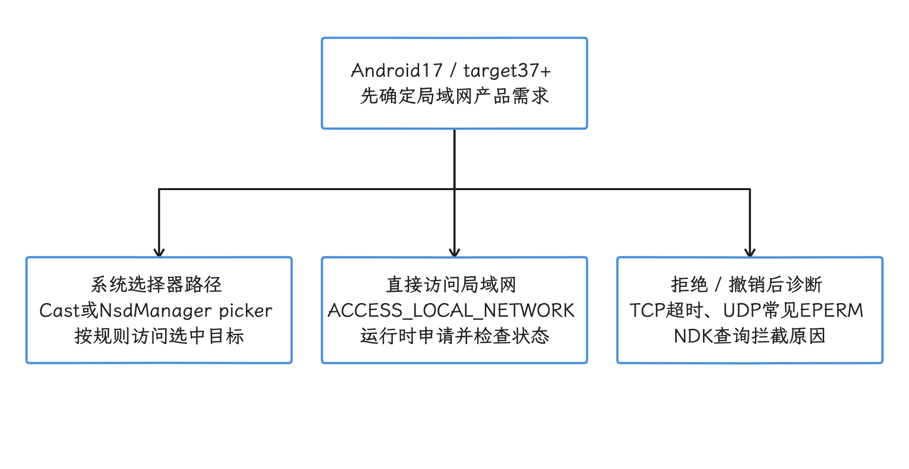

图：先选择系统代办发现与连接或直接局域网访问，再验证授权和实际错误。 picker 只放行其规则允许的选中目标；TCP 超时或 UDP EPERM 需结合拦截原因，不能当网络性能结论。

#### 16KB 页面是延续性发布要求

Android 15 起 AOSP 支持 16KB page-size 设备，这项能力早于 target SDK 37，但 Android 17 迁移仍要检查。Google Play 的现行要求覆盖面向 Android 15（API 35）及以上版本的 64 位设备；自 2027 年 2 月 1 日起，应用更新若不支持 16KB 页面大小，Google Play 会拒绝其发布。

纯 Java/Kotlin 应用通常已兼容。只要 APK/AAB 直接或经 SDK 带有 `.so`，就要同时检查：

- APK/AAB 内未压缩 `.so` 的 ZIP 对齐。
- 每个 ELF（Executable and Linkable Format，`.so` 使用的二进制格式） `LOAD` segment（装载段）的对齐。
- 所有预编译 SDK 的 native 库版本。
- `mmap()`（内存映射）、共享内存与自制 allocator（内存分配器）是否假定页大小固定为 4096 字节。
- 运行时页大小是否用 `getpagesize()` 或 `sysconf(_SC_PAGESIZE)` 获取。

AGP 8.5.1 及以上配合 NDK r28 及以上，并使用兼容 16KB 的预编译依赖时，官方工具默认处理 16KB ZIP 和 ELF 对齐。NDK r27 及以下可按官方指南为自有库显式加入 `-Wl,-z,max-page-size=16384` 与 `-Wl,-z,common-page-size=16384`；旧版 `libc++_shared.so` 和第三方预编译库仍需逐个核验。

以下命令用于检查 bundle 配置、APK 对齐和 ELF program headers。

```bash
bundletool dump config --bundle app-release.aab
zipalign -c -P 16 -v 4 app-release.apk
llvm-readelf -lW lib/arm64-v8a/libexample.so
adb shell getconf PAGE_SIZE
```

bundle 配置应显示 `PAGE_ALIGNMENT_16K`，`zipalign` 应通过，`readelf` 中每个 `LOAD` segment 的 Align 不得低于 `2**14`，设备命令应返回 `16384`。工具通过后还要在 16KB emulator 或设备上覆盖启动、动态加载、数据库、媒体与 mmap 场景。

Android 17 还能把 16KB backcompat（兼容模式）设为 `fatal`，让不兼容二进制立即终止；这个模式只适合测试，发布层面的兼容工作它替不了。原理和排查步骤参阅 [4.5 16 KB Page Size 与 Android 性能](../../part1-fundamentals/ch04-memory/05-16kb-page-size.md)。

<!-- gracker-diagram: ch18-01-31-page16 -->
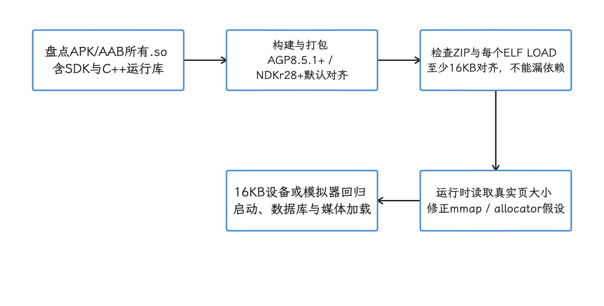

图：对全部直接和间接 native 依赖检查 ZIP 对齐、ELF LOAD 对齐和运行期页大小假设。 AGP/NDK 默认支持不修复旧预编译库；通过工具检查后仍需真实 16 KB 环境回归。

### 运行在 Android 17 时还要检查的项目

#### App memory limits

Android 17 在部分设备上按总 RAM 对应用施加保守的内存上限，面向所有应用。受影响进程的 `ApplicationExitInfo.getReason()` 为 `REASON_OTHER`，description 包含 `MemoryLimiter:AnonSwap` 及附加信息。`TRIGGER_TYPE_ANOMALY` 可在触发限制时请求 heap dump，但交付仍受 trigger 规则约束。

`adb shell am memory-limiter status` 用于查看当前设备是否启用及可见/不可见进程上限。`ignore` 与 `manual` 子命令分别用于按 UID（App 的系统用户标识）忽略限制、给指定 PID（进程号） 施加测试限制，适合复现测试，写成生产规避手段就跑偏了。该退出原因和 LMKD（low-memory killer daemon，系统低内存杀进程服务） 的低内存 kill 应分开统计。

<!-- gracker-diagram: ch18-01-32-memory-limiter -->
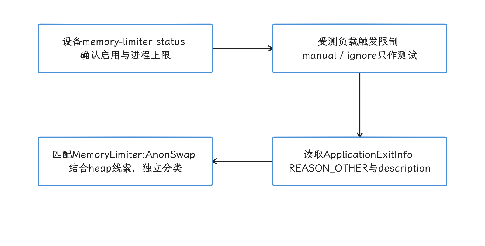

图：先读取设备限制状态，再用退出 reason 与原始 description 标记识别具体限制。 限制只在部分设备实施；REASON_OTHER 不专属于此机制，不能与 LMKD 的低内存退出混算。

#### 后台音频

所有运行在 Android 17 的应用，后台播放、audio focus 和音量修改需要可见 Activity，或运行非 `SHORT_SERVICE` 类型的前台服务。无效状态下，播放与音量 API 会静默失效，audio focus 返回 `AUDIOFOCUS_REQUEST_FAILED`。

target SDK 37 应用在后台还有一层要求：foreground service（前台服务，运行时以持续通知表明正在执行用户可感知工作） 需具备 while-in-use（WIU）能力——系统根据应用可见状态、明确用户交互或受信任的系统委托，判定该前台服务可以继续使用“仅在使用期间”开放的能力。持有 exact alarm 权限且操作 `USAGE_ALARM` stream 时，文档提供了对应豁免。媒体应用应覆盖通知、蓝牙控制、车机、定时闹钟、进程冻结恢复和用户主动续播。

<!-- gracker-diagram: ch18-01-33-background-audio -->
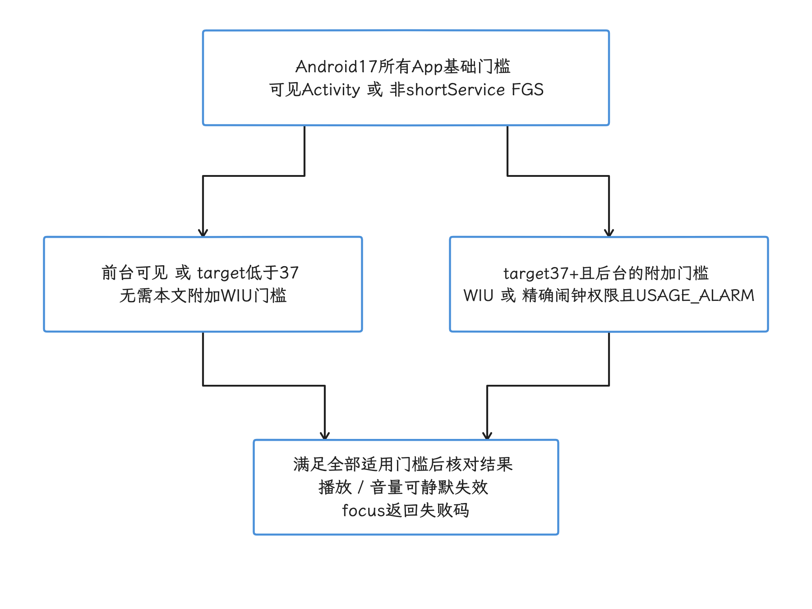

图：Android 17 的音频基础资格先看可见 Activity 或非 shortService FGS，target37 后台再看 WIU。 精确闹钟加 USAGE_ALARM 只豁免附加 WIU 要求；播放静默失败和 focus 返回失败码分别观测。

#### 原生动态代码加载

target SDK 37 后，Android 14 对 DEX/JAR 的 Safer Dynamic Code Loading 保护扩展到 native library。经 `System.load()` 加载的 native 文件必须为只读，否则抛出 `UnsatisfiedLinkError`。

优先避免下载并执行 native code。确需动态加载时，在私有目录创建独立文件，检查写入/关闭错误、验证可信签名或已认证的期望 hash，并在 `System.load()` 前设为只读。hash 若与文件一起来自不可信来源，不能证明身份。替换使用独立版本与受控名称切换，不覆盖正在加载/执行的文件；还要防止并发写句柄和路径替换。只读属性满足加载检查，不保证文件今后无法被同 UID 改写。

<!-- gracker-diagram: ch18-01-34-native-load -->
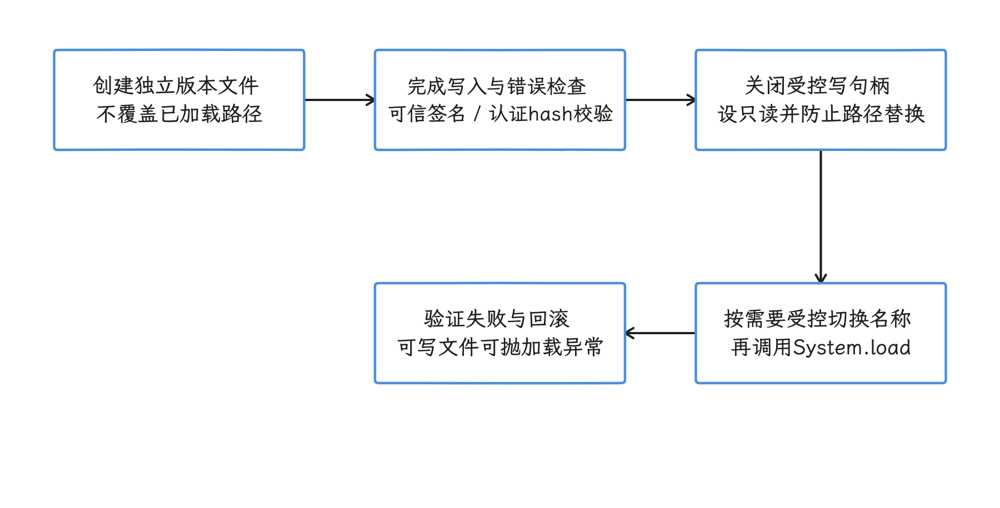

图：动态 native 文件在私有目录独立写入并校验可信来源，关闭写路径、只读后再加载。 只读满足平台检查而非不可篡改保证；不可信 hash 不证明身份，同 UID 与并发路径仍需控制。

### Choreographer Buffer Stuffing Recovery

这项机制早于 API 37 的迁移范围，但它仍存在于 `android-17.0.0_r1`，分析 Android 17 图形 trace 时容易和 DeliQueue 的效果混淆。buffer stuffing 指图形 buffer 的生产速度持续高于消费速度，把 buffer queue 塞满。

`frameworks/base/core/java/android/view/Choreographer.java` 中：

- `onWaitForBufferRelease(durationNanos)` 在等待超过上一帧间隔一半时设置 stuffed 状态。
- `updateBufferStuffingState()` 可能选择 `DELAY_FRAME`，主动等下一次 vsync（垂直同步信号）给 buffer queue 回落机会。
- recovery 中可选择 `OFFSET`，把动画计算时间戳减去一个 frame interval，即按前一个垂直同步周期的时刻计算。
- 多次 recovery 与累计阈值由不同 feature flag 控制；r1 的 `MAX_BUFFER_STUFFING_DELAY_NS` 为 100ms，按追加前的累计值决定是否再延迟一帧，最后一次追加可能跨过阈值，并非精确总延迟上限。
- trace 中可出现 `Buffer stuffing recovery`、`buffer stuffed` 和记录负偏移量的事件。

`onWaitForBufferRelease()` 是隐藏接口，应用别把它当自定义调度 API。看到 recovery slice（trace 中带持续时间的事件片段）时，应继续查看 `dequeueBuffer` 等待、SurfaceFlinger、GPU completion、buffer 数量与主线程产出速率。recovery 是缓解 buffer stuffing 的时序策略，也可能主动延迟一帧；根因是否消失，要从这些证据另行确认。

DeliQueue 处理 Java 消息投递争用，Buffer Stuffing Recovery 处理图形 buffer queue 堵塞后的帧时序；两者都可能改善 missed frames，但要看的数据和要修的对象各不相同。

<!-- gracker-diagram: ch18-01-35-stuffing -->
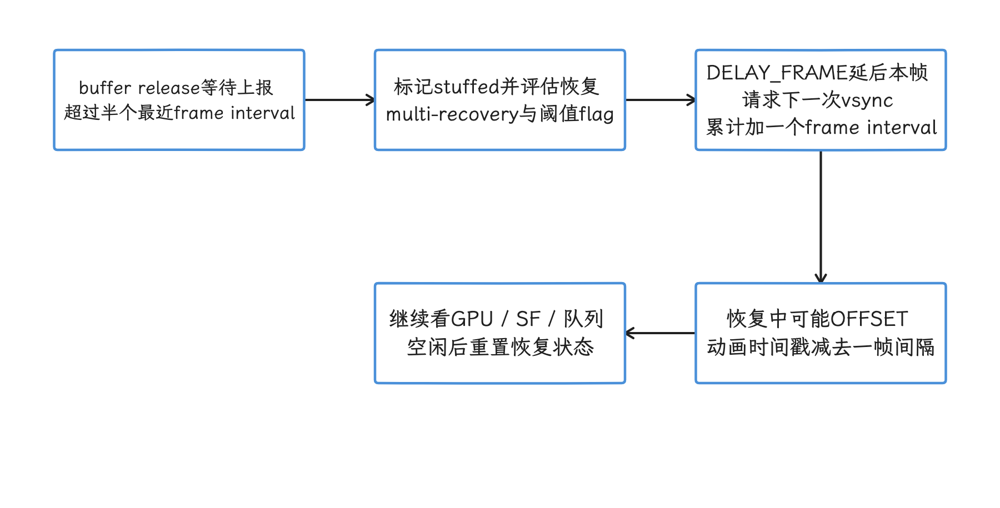

图：超过半个最近帧间隔的释放等待可触发恢复，随后可能延迟当前帧并减一帧动画时间。 100ms 是追加前的累计阈值，最后一次可跨过；恢复缓解积压，不证明 GPU/合成根因已消失。

### 迁移检查清单

#### 提升 target SDK 前

- [ ] 搜索 `MessageQueue` 私有字段、hidden API、JNI 与自制 idle 检测。
- [ ] 升级到 Espresso 3.7.0+、Robolectric 4.17+，移除 `@LooperMode(LEGACY)`。
- [ ] 搜索反射和 JNI 对 `static final` 的写入。
- [ ] 盘点 HTTP 域名、ECH/CT 兼容、证书、CDN 切换与自定义 trust anchor。
- [ ] 盘点局域网发现和连接入口，覆盖 `ACCESS_LOCAL_NETWORK` 的授权状态。
- [ ] 检查动态 native library 的来源、写权限与加载流程。
- [ ] 在 sw600dp、折叠、多窗口、桌面窗口和方向变化中验证 UI 状态。
- [ ] 审核所有直接和间接 native 依赖的 16KB 对齐。

#### Android 17 运行验证

- [ ] 用 compat change 对新旧 MessageQueue 做同包 A/B，记录 monitor contention、排队时间和端到端指标。
- [ ] 以进程 GC 事件确认 collector 和 young/full 分布，不用单一 device-config 值替代 trace。
- [ ] 验证 Profiling trigger 的成功、限频、无产物、shared UID 和自定义 OOM handler 分支。
- [ ] 用 JobScheduler current reasons、history、stats 定位长期 pending 约束。
- [ ] 检查 `ApplicationExitInfo` 中的 `MemoryLimiter:AnonSwap`。
- [ ] 覆盖后台音频在可见、FGS、闹钟、冻结恢复和用户续播状态下的结果。
- [ ] 在 16KB 系统上运行包含 mmap、数据库、媒体和动态加载的回归。

#### 性能验收

- [ ] 固定设备、系统 build、应用 build、场景、热状态与 Perfetto 配置。
- [ ] 报告 P50/P95/P99、样本数和波动，不把官方内部百分比当成业务目标。
- [ ] 将 Java 消息争用、GC、Activity 重建、buffer stuffing 和网络握手放到各自证据轨道。
- [ ] 回归正确性、功耗、峰值 RSS 与崩溃，避免只看平均帧时间。

系统与内核的分工参阅 [18.3 Android 17 Kernel 6.18 与 ARM64 安全开销](03-android17-kernel-arm64-security.md)，其中内核版本固定为 `android17-6.18-2026-06_r6`。这是 18.3 为复现实验固定的快照标签，后续发布序列已有更新；API 行为由 kernel tag 单独推导不出来。

<!-- gracker-diagram: ch18-01-36-final-acceptance -->
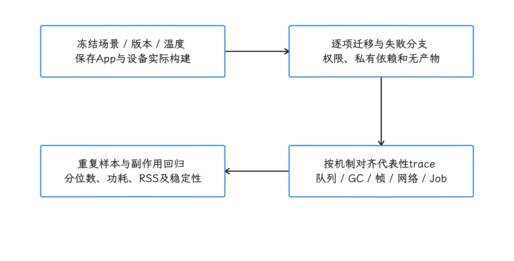

图：迁移先覆盖契约与失败分支，再分别对齐队列、GC、图形、网络和调度证据。 固定分析快照与设备现场分开；官方收益百分比、单一开关或平均帧时间不能替代本场景验收。


## 常见误区

### “只升级 compileSdk，不改 target，不会影响性能”

`compileSdk` 决定编译时平台 API/资源可见范围；只有在最终 APK、依赖和其他输入可比时，才讨论它是否单独改变运行结果。即使 target 不变，新系统的所有 App 变更仍可能生效，例如 Android 14 cached 进程管理和 Android 17 部分设备内存限制。

### “升 target 后的回归都是平台优化失败”

target 会启用一组兼容性行为。任务不再执行、服务启动异常或测试框架判断不出主线程空闲，可能都来自行为边界变化，应按兼容性开关逐项定位。

### “新性能 API 在低版本不能调用，所以没有集成价值”

可以用 API 级别、能力探测和回退实现渐进接入。价值取决于新数据是否改善诊断或控制决策，不取决于覆盖全部历史设备。

### “NN HAL 代码仍在 AOSP，说明 NNAPI 是 Android 17 新加速点”

源码存在表示平台仍维护兼容路径。NNAPI NDK 已在 Android 15 废弃，NN HAL 版本也有独立历史。性能收益必须回到当前 runtime、delegate、驱动和模型测量。

### “Android 17 的分代 GC 等于打开 userfaultfd”

userfaultfd 是 Concurrent Mark-Compact 的一条实现路径，分代是对象代际和回收范围策略。两者处在不同维度。

## 小结

回到整条链路：我们做 AOSP 性能改动，要从公共路径证据出发，把平台、Mainline、kernel、vendor 与 target SDK 分成独立变量，用统计确认收益，用 trace 和源码解释原因。Android 12—17 的行为变化既包含面向所有应用的系统规则，也包含 target 触发的兼容变化和设备可选能力；迁移与性能回归只有把这些触发条件分别记录、分别验证，才能归因到正确的责任层。


## 参考资料

- [TestLooperManager：类和新增方法版本](https://developer.android.com/reference/android/os/TestLooperManager)
- [Android 14 非线性字体缩放](https://developer.android.com/about/versions/14/features)
- [精确闹钟权限与重载](https://developer.android.com/develop/background-work/services/alarms/schedule)
- [SystemHealthManager headroom 契约](https://developer.android.com/reference/android/os/health/SystemHealthManager)
- [应用清单 usesCleartextTraffic](https://developer.android.com/guide/topics/manifest/application-element)
- [Boot partitions](https://source.android.com/docs/core/architecture/bootloader/partitions)
- [Android app performance overview](https://developer.android.com/topic/performance/overview)
- [Android 17 behavior changes](https://developer.android.com/about/versions/17/behavior-changes-17)
- [Mainline modules](https://source.android.com/docs/core/ota/modular-system)
- [Android 17 发布：分代 CMC 与 ART 回迁范围](https://developer.android.com/blog/posts/android-17-is-here)
- [Configure ART](https://source.android.com/docs/core/runtime/configure)
- [Android common kernels](https://source.android.com/docs/core/architecture/kernel/android-common)
- [`android-17.0.0_r1` SystemServer](https://android.googlesource.com/platform/frameworks/base/+/refs/tags/android-17.0.0_r1/services/java/com/android/server/SystemServer.java)
- [`android-17.0.0_r1` ProcessState](https://android.googlesource.com/platform/frameworks/native/+/refs/tags/android-17.0.0_r1/libs/binder/ProcessState.cpp)
- [`android-17.0.0_r1` ART Mark-Compact](https://android.googlesource.com/platform/art/+/refs/tags/android-17.0.0_r1/runtime/gc/collector/mark_compact.cc)
- [`android17-6.18-2026-06_r6` kernel](https://android.googlesource.com/kernel/common/+/refs/tags/android17-6.18-2026-06_r6/)

### Android Developers

- [Android 12：目标版本行为变化](https://developer.android.com/about/versions/12/behavior-changes-12)
- [Android 12：所有 App 行为变化](https://developer.android.com/about/versions/12/behavior-changes-all)
- [Android 13：功能与 API](https://developer.android.com/about/versions/13/features)
- [Android 14：所有 App 行为变化](https://developer.android.com/about/versions/14/behavior-changes-all)
- [Android 14：目标版本行为变化](https://developer.android.com/about/versions/14/behavior-changes-14)
- [Android 14：前台服务类型](https://developer.android.com/about/versions/14/changes/fgs-types-required)
- [Android 15：目标版本行为变化](https://developer.android.com/about/versions/15/behavior-changes-15)
- [Android 16：功能与 API](https://developer.android.com/about/versions/16/features)
- [Android 16：目标版本行为变化](https://developer.android.com/about/versions/16/behavior-changes-16)
- [Android 17 Release Notes](https://developer.android.com/about/versions/17/release-notes)
- [Android 17：目标版本行为变化](https://developer.android.com/about/versions/17/behavior-changes-17)
- [Android 17：所有 App 行为变化](https://developer.android.com/about/versions/17/behavior-changes-all)
- [Android 17 MessageQueue 迁移指南](https://developer.android.com/about/versions/17/changes/messagequeue)
- [ProfilingManager API](https://developer.android.com/reference/android/os/ProfilingManager)
- [ProfilingTrigger API](https://developer.android.com/reference/android/os/ProfilingTrigger)
- [ApplicationStartInfo API](https://developer.android.com/reference/android/app/ApplicationStartInfo)
- [FrameMetrics API](https://developer.android.com/reference/android/view/FrameMetrics)
- [PerformanceHintManager.Session API](https://developer.android.com/reference/android/os/PerformanceHintManager.Session)

#### AOSP 与平台文档

- [`android-17.0.0_r1` ProfilingManager.java](https://android.googlesource.com/platform/packages/modules/Profiling/+/refs/tags/android-17.0.0_r1/framework/java/android/os/ProfilingManager.java)
- [16 KB page size](https://source.android.com/docs/core/architecture/16kb-page-size/16kb)
- [NNAPI 驱动与废弃状态](https://source.android.com/docs/core/interaction/neural-networks)
- [android17-6.18 release builds](https://source.android.com/docs/core/architecture/kernel/gki-android17-6_18-release-builds)

- [Android 17：target SDK 37 行为变更](https://developer.android.com/about/versions/17/behavior-changes-17)
- [Android 17：影响所有应用的行为变更](https://developer.android.com/about/versions/17/behavior-changes-all)
- [MessageQueue behavior change guidance](https://developer.android.com/about/versions/17/changes/messagequeue)
- [Under the hood: Android 17's lock-free MessageQueue](https://android-developers.googleblog.com/2026/02/under-hood-android-17s-lock-free.html)
- [Android 17 Features and APIs](https://developer.android.com/about/versions/17/features)
- [ProfilingTrigger API reference](https://developer.android.com/reference/android/os/ProfilingTrigger)
- [JobScheduler API reference](https://developer.android.com/reference/android/app/job/JobScheduler)
- [Handle configuration changes](https://developer.android.com/guide/topics/resources/runtime-changes)
- [Restrictions on orientation and resizability are ignored](https://developer.android.com/about/versions/17/changes/ff-restrictions-ignored)
- [Network Security Configuration](https://developer.android.com/privacy-and-security/security-config)
- [Local network permission](https://developer.android.com/privacy-and-security/local-network-permission)
- [Background audio hardening](https://developer.android.com/about/versions/17/changes/bg-audio)
- [Support 16KB page sizes](https://developer.android.com/guide/practices/page-sizes)
- [AOSP r1：CombinedMessageQueue/MessageQueue.java](https://android.googlesource.com/platform/frameworks/base/+/refs/tags/android-17.0.0_r1/core/java/android/os/CombinedMessageQueue/MessageQueue.java)
- [AOSP r1：attrs_manifest.xml](https://android.googlesource.com/platform/frameworks/base/+/refs/tags/android-17.0.0_r1/core/res/res/values/attrs_manifest.xml)
- [AOSP r1：ART runtime.cc](https://android.googlesource.com/platform/art/+/refs/tags/android-17.0.0_r1/runtime/runtime.cc)
- [AOSP r1：ART mark_compact.cc](https://android.googlesource.com/platform/art/+/refs/tags/android-17.0.0_r1/runtime/gc/collector/mark_compact.cc)
- [AOSP r1：ProfilingTrigger.java](https://android.googlesource.com/platform/packages/modules/Profiling/+/refs/tags/android-17.0.0_r1/framework/java/android/os/ProfilingTrigger.java)
- [AOSP r1：JobScheduler.java](https://android.googlesource.com/platform/frameworks/base/+/refs/tags/android-17.0.0_r1/apex/jobscheduler/framework/java/android/app/job/JobScheduler.java)
- [AOSP r1：Choreographer.java](https://android.googlesource.com/platform/frameworks/base/+/refs/tags/android-17.0.0_r1/core/java/android/view/Choreographer.java)
