# AOSP 源码编译与调试环境

读源码能推出一条路径“可能怎样运行”，构建、启动和测量才能说明目标版本“当前怎样运行”。Framework（Android 系统框架层） 调试依赖的正是这样一套完整过程：固定源码版本，修改最小代码面，编译所属模块，把产物同步到匹配的设备镜像，再用测试、日志和 trace（性能轨迹） 验证。

> 源码基线：AOSP `android-17.0.0_r1`，Android 17 / API 37；内核 `android17-6.18-2026-06_r6`。

平台和内核分属两套独立的源码树与构建系统，两个 tag（固定源码快照的标签）也各自只在自己那套树里有效；平台仓库里的预编译 kernel 对应哪个 Android Common Kernel 提交，要在内核侧单独确认。

<!-- gracker-diagram: ch18-02-01-build-observe-loop -->
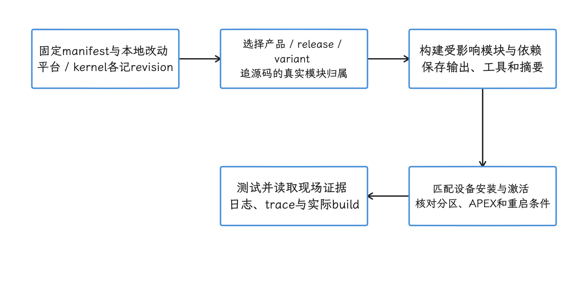

图：固定平台与内核各自的版本，按模块构建、安装激活，再观察目标路径。 源码推导、磁盘产物和进程实际执行是不同证据，不能用编译成功替代运行验证。

## 构建主机：先满足官方基线

我们先看官方对构建主机的要求：64 位 x86 Linux 主机、glibc 2.17 或以上、至少 400 GB 可用磁盘和至少 64 GB 内存。这里的 glibc 指 GNU C Library，是 Linux 的基础 C 运行库。

400 GB 里约 250 GB 是 checkout（检出的完整源码工作区），约 150 GB 是构建产物。做多 target、多工作树或内核构建时还要预留更多空间；这里的 target 指产品、发布配置与构建变体的组合。

官方给过两组构建时间样例：72 核、64 GB 内存的 Google 主机完成全量构建约 40 分钟，6 核、64 GB 主机约 6 小时。两组数字放在一起，用来说明硬件差距；任何一个具体 target 的耗时，还要看磁盘 I/O（输入输出）、内存带宽、远程文件系统、目标产品和当次依赖图。

软件方面还有几条约束：

- 官方的 Android 11 及以上依赖安装命令以 Ubuntu 18.04 或更新版本为基线；其他满足 glibc 条件的 64 位 Linux 发行版也可以，软件包要自行对应。
- AOSP 从 2021 年 6 月 22 日起不再支持 macOS 平台构建。
- 最新 release checkout 已携带 OpenJDK、Make 和 Python 3 预编译版本，直接使用即可。
- Cuttlefish 还依赖 KVM（Kernel-based Virtual Machine，Linux 内核虚拟机）。云主机和虚拟机要先确认嵌套虚拟化可用，并检查 `/dev/kvm` 权限。

下面的命令用于在 Ubuntu 18.04 及以上安装官方列出的基础依赖：

```bash
sudo apt-get update
sudo apt-get install git-core gnupg flex bison build-essential \
  zip curl zlib1g-dev libc6-dev-i386 x11proto-core-dev \
  libx11-dev lib32z1-dev libgl1-mesa-dev libxml2-utils \
  xsltproc unzip fontconfig repo
```

安装完成后运行 `repo version`，确认 Repo launcher（负责初始化源码工作区并下载完整 Repo 工具的启动脚本）可以工作。官方当前要求 Repo 2.4 或以上；团队环境里最好记录各主机的实际版本，避免差异过大的 launcher 混用。

<!-- gracker-diagram: ch18-02-02-host-baseline -->
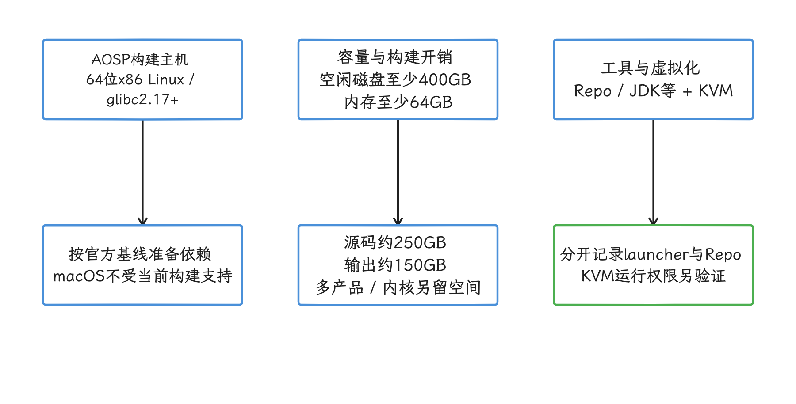

图：AOSP 编译先满足 x86_64 Linux、磁盘与内存基线，Cuttlefish 再检查 KVM 和主机包。 官方耗时样例不是本机承诺；ARM64 运行匹配预编译虚拟镜像不等于支持本地完整平台构建。

## 固定 Android 17 源码

官方面向日常构建和贡献工作推荐 `android-latest-release`。它是供 Repo 使用的 manifest branch（清单分支），指向最新的公开 release branch；截至 2026-08-14，这个分支是 `android17-release`。指向会随时间移动：跟进最新代码时用它合适，复现固定版本的结论要用下面的固定 tag。

下面的命令创建固定在 `android-17.0.0_r1` 的平台 checkout：

```bash
repo init --partial-clone --no-use-superproject \
  -u https://android.googlesource.com/platform/manifest \
  -b android-17.0.0_r1
repo sync -c -j8
```

manifest 是一份 XML 清单，描述各个 Git 项目、存放位置和 revision（项目版本）。`--partial-clone` 减少初始对象下载，`-c` 只同步当前 manifest 分支。`-j8` 来自官方示例，并发数可以按网络、文件系统和服务器响应调整，“CPU 核数的数倍”只是经验参考。

要让构建可复现，我们还需要一份解析到具体 revision 的 manifest。下面的命令把每个项目解析到具体提交：

```bash
repo manifest -r -o pinned-manifest.xml
git -C build describe --tags --always
```

`pinned-manifest.xml` 应与实验记录一起归档。即便有它，本地的 cherry-pick（把选定提交应用到当前分支）、未提交修改或后来单独切换的项目仍可能漏掉，所以还要保存 `repo status` 和补丁集标识。

<!-- gracker-diagram: ch18-02-03-pin-checkout -->
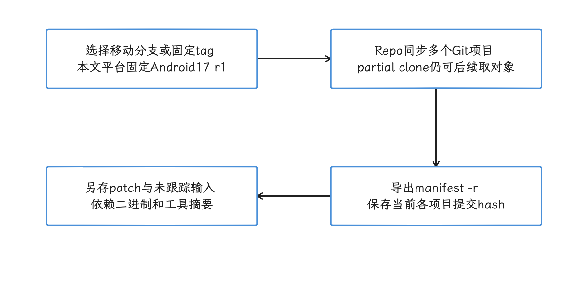

图：移动 manifest 服务日常跟进，固定 tag 与 revision-locked manifest 用于复现具体项目状态。 manifest -r 不打包未提交或未跟踪输入；状态列表也不能还原补丁和外部二进制。

## Soong、Kati 与 Ninja 的职责

AOSP 平台用 Soong 做构建：Soong 读取 `Android.bp`，Kati 处理仍留存的 `Android.mk`，两者生成构建图，Ninja 负责执行图里的具体命令。日常入口是构建环境提供的 `m`，直接调用 Ninja 的场合很少。

三层的故障表现不同：

- `Android.bp` 属性、模块名或可见性错误发生在 Soong 解析阶段。
- 遗留 `Android.mk` 的转换问题会出现在 Kati 阶段。
- 编译器、链接器和命令执行的失败由 Ninja 报出具体 action——失败的那一步构建命令。

改完构建描述，我们可以先跑一次结构校验：

```bash
m nothing
```

这个目标只解析并验证构建结构，产物留到真正构建时生成。通过之后仍要编译受影响的模块：类型检查、链接和生成代码的错误，要到对应 action 真正执行时才会暴露。

平台构建文档把 `Android.bp` 描述为语法接近 Bazel BUILD 文件。平台的常规构建入口仍是 Soong；Android Common Kernel 走的是 Kleaf（基于 Bazel 的 Android 内核构建规则）。在平台树里看到 Bazel 文件时，构建命令仍按平台这一套来用。

<!-- gracker-diagram: ch18-02-04-build-roles -->
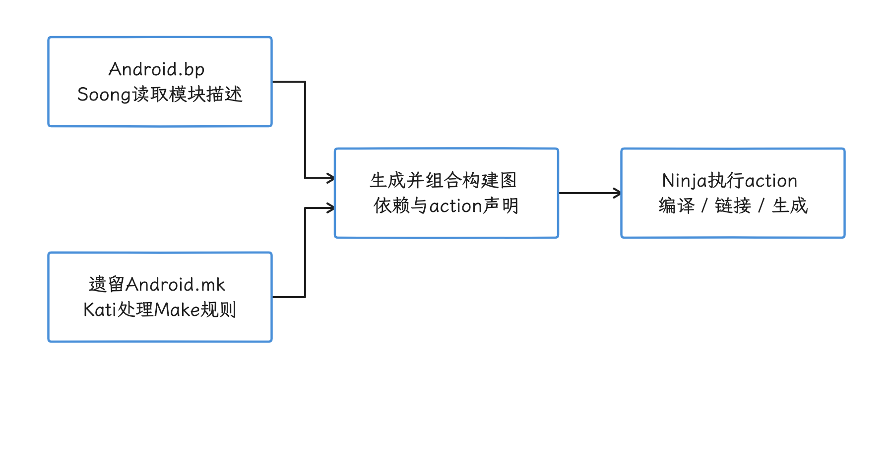

图：Soong 与 Kati 负责各自规则，平台入口组合依赖图，再由 Ninja 执行具体 action。 m nothing 只验证结构，不替代编译和链接；Android 17 的生成产物应写构建输出目录。

## lunch 的三段式 target

lunch 的 target 由三段组成：

```text
product_name-release_config-build_variant
```

- `product_name` 选择产品，例如 `aosp_cf_x86_64_only_phone`。
- `release_config` 选择 feature launch flag（构建时功能开关）的发布配置，例如 `aosp_current`。
- `build_variant` 选择 `user`、`userdebug` 或 `eng`。

我们先在当前 shell 里加载构建环境，再用官方文档给出的 Cuttlefish target 做一次完整构建：

```bash
source build/envsetup.sh
lunch aosp_cf_x86_64_only_phone-aosp_current-userdebug
m
```

`envsetup.sh` 会把 `lunch`、`m` 等命令加载到当前 shell，所以每个新 shell 都要重新执行一次。`m` 在未指定 `-j` 时会自行选择并发度；先采用默认值，等主机上有了实测数据再调 `-jN`。

固定 tag 里有哪些产品和 release config，以 checkout 内的定义为准；从其他分支直接抄 `trunk_staging` target，可能拼出在这里并不存在的组合。拿不准时，跑一次无参数 `lunch` 查看常用 target，再核对输出里的 `TARGET_PRODUCT`、`TARGET_BUILD_VARIANT`、`BUILD_ID` 和 `OUT_DIR`。

### 三种 build variant 怎么选

| Variant | 主要用途 | 性能数据边界 |
| --- | --- | --- |
| `user` | 生产配置、发布基线 | 最接近量产安全和调试配置，但缺少 root 调试能力 |
| `userdebug` | 平台开发、功耗与性能调试 | 可使用 adb root 等能力，仍与 `user` 存在配置差异 |
| `eng` | 日常功能开发、快速实验 | 调试检查和工具更多，不适合作为发布性能基线 |

改 Framework 时，我们通常在 `userdebug` 上完成定位和功能验证；要报告绝对性能数字，再换到匹配的 `user` 或量产构建复测。报告里要写清 `userdebug` 和 `user` 之间的差异，这一步省不得，“足够接近”替代不了差异本身。

<!-- gracker-diagram: ch18-02-05-lunch-and-variant -->
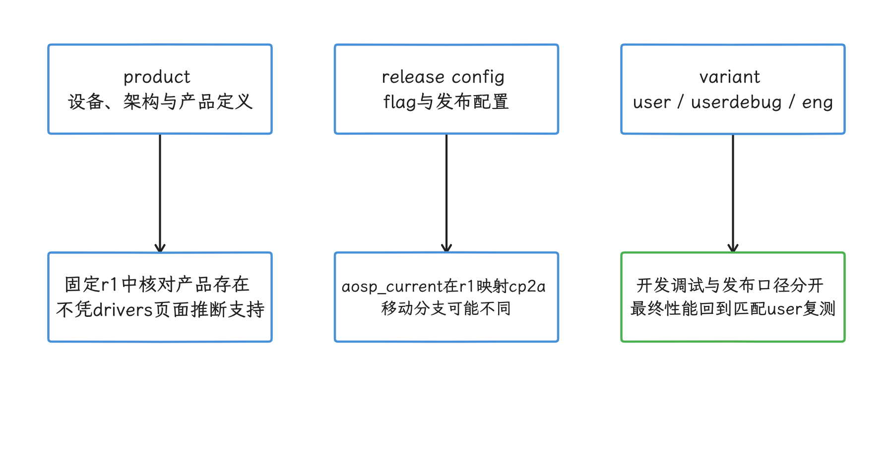

图：显式选择 product、release 与 variant，并核对最终配置变量和输出目录。 r1 的 aosp_current 别名为 cp2a；无参数菜单已移除，退出码为零也不能单独证明配置成功。

## 模块编译与产物归属

`m` 会构建当前 lunch target。小改动可以编译模块名：

```bash
m services
m surfaceflinger
```

模块名来自 `Android.bp` 的 `name`，和文件路径是两回事。同一个 Java 文件可能进入开机时加载的 boot jar（开机时加载的 Framework Java 包）、可独立更新的 APEX（系统组件包），或同时进入多个变体。改之前我们先看同目录的 `Android.bp` 和依赖，确认文件属于哪个模块、装进哪个分区。

常见源码位置包括：

- `frameworks/base/core/java/android/view/`：Choreographer、ViewRootImpl 等 Framework 类。
- `frameworks/base/services/core/java/com/android/server/`：承载主要 Framework 服务的 `system_server` 实现。
- `frameworks/native/services/surfaceflinger/`：系统显示合成服务 SurfaceFlinger。
- `frameworks/native/libs/renderengine/`：SurfaceFlinger 使用的渲染后端 RenderEngine。
- `packages/modules/`：Mainline（可独立更新的系统模块） 模块源码，产物可能位于 APEX（可独立更新的系统组件包） 或 APK。

增量构建的耗时取决于改动触发的依赖图：Java API 变化、`Android.bp` 变化、生成代码、APEX、bootclasspath（运行时启动类路径）都可能扩大构建范围，耗时随改动浮动。

<!-- gracker-diagram: ch18-02-06-module-ownership -->
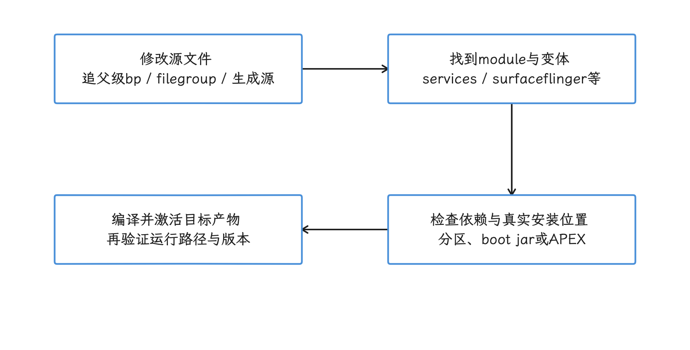

图：沿源码输入追到 module、安装分区和激活方式，再决定增量构建范围。 目录名不是模块名；API、生成输入和 bootclasspath 变化可扩大依赖图，同步成功不证明已执行新代码。

## 用 Cuttlefish 验证 Framework

Cuttlefish 是 AOSP 的标准虚拟设备。验证纯 AOSP 的 Framework 行为、系统服务、CTS（Compatibility Test Suite，兼容性测试套件）和自定义测试，我们都可以先在它上面做。

它与真机的差异集中在 HAL 和依赖具体硬件的部分：GPU 合成、热控制、SoC（System on a Chip，片上系统）调度、相机和功耗，这些结论仍然要以真机为准。

### 主机包与设备镜像的配对

启动 Cuttlefish 之前，先确认 KVM 就绪：

```bash
test -e /dev/kvm
ls -l /dev/kvm
```

两条命令分别检查设备节点是否存在、当前用户是否具有权限。x86_64 主机还可以看 CPU 的 `vmx` 或 `svm` 硬件虚拟化标志；ARM64 主机直接以 `/dev/kvm` 为准。

ARM64 Linux 主机可以运行匹配架构的 Cuttlefish 预编译镜像；平台源码构建文档对编译主机的要求仍是 x86_64。在这类主机上，“运行预编译虚拟设备”和“本地编译完整 AOSP”要分开记录。

用 Android CI（持续集成系统）产物时，`cvd-host_package.tar.gz` 和设备 image 必须来自同一个 build，也就是同一次 CI 构建记录。主机包、镜像和分支混搭会引入协议或配置层面的兼容性问题；判断一个组合是否受支持，依据是三者同源，“能启动”只说明问题还没暴露，支撑不了这个组合。

解压 host package 后，在该目录启动 Cuttlefish，再用包内的 ADB（Android Debug Bridge，主机与设备通信工具） 检查设备。两个命令的主体如下，`HOME` 的处理放在代码块后说明：

```bash
./bin/launch_cvd --daemon
./bin/adb devices
```

官方当前示例是 `HOME=$PWD ./bin/launch_cvd --daemon`：只为这一条命令临时指定运行目录，用户 shell 里的 `HOME` 保持原样。具体版本仍以同 build 的启动说明为准。

Cuttlefish 启动后会自动向 ADB 注册设备，手工连接 `0.0.0.0:6520` 通常可以省略；`0.0.0.0` 表示监听地址，作为客户端目标时要填实际地址。多实例环境下，TCP 端口会随实例号变化。

默认启动会打开 WebRTC（浏览器实时音视频与控制协议）界面，用浏览器访问 `https://localhost:8443` 就能看到设备。跨主机访问时，还要配置防火墙、TLS 加密连接，以及 WebRTC 使用的 TCP/UDP 端口；本地开发端口只暴露给可信网络。

<!-- gracker-diagram: ch18-02-07-kvm-host -->
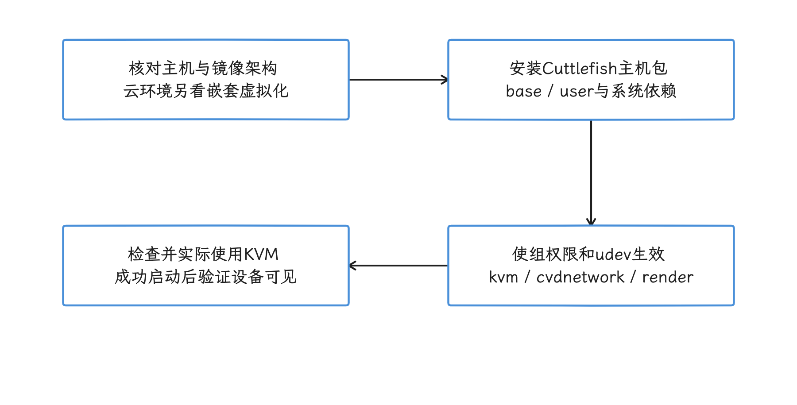

图：Cuttlefish 先准备主机 Debian 包、组与 udev，再验证 KVM 运行能力。 节点、权限位和 CPU 特征只是前置检查；完整运行能力仍须通过实际启动验证。

<!-- gracker-diagram: ch18-02-08-pair-launch -->
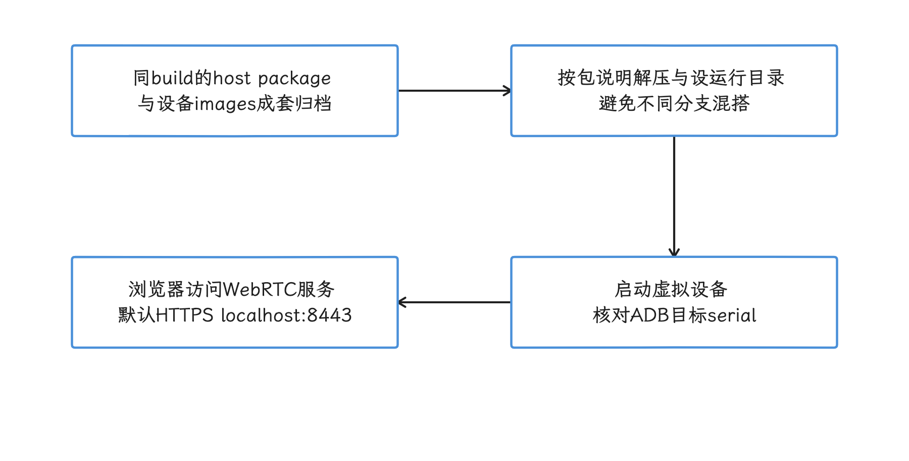

图：从同一 CI build 取匹配架构的 host package 和 images，按运行目录说明启动，再核对 ADB 与 WebRTC。 同 build 只保证这组产物的来源配对，不替代 KVM、主机依赖和网络验证；启动服务不自动打开浏览器。

### 编译、同步、重启

下面的命令展示 system 分区内模块的常见同步流程：

```bash
m services
adb root
adb remount
adb sync system
adb shell stop
adb shell start
```

`adb sync` 的参数是分区名，`system`、`system_ext`、`product`、`vendor` 等都可以；`framework` 这类模块名要换成它所在的分区再同步。改动落在 APEX、vendor 或其他分区时，同步对应分区即可；涉及 boot image、内核、APEX 激活或早期启动代码时，完整的 `adb reboot` 更稳妥。

`stop` / `start` 会重启 Zygote 和依赖它的 Java 进程，设备界面会暂时消失——Zygote 负责孵化 App 的 Java 进程。这一步之后，bootloader、`init`（用户空间首个进程）和 early-boot 路径仍停在上次开机的状态；研究系统启动时延，必须执行完整重启。

Native（C/C++）服务可以单独重启，前提是先确认 `init` 配置和依赖。SurfaceFlinger 崩溃或退出后通常由 `init` 拉起；这类操作会中断显示，还可能让当前测试状态失效，自动化脚本要等服务重新注册后再开始采样。

<!-- gracker-diagram: ch18-02-09-sync-activation -->
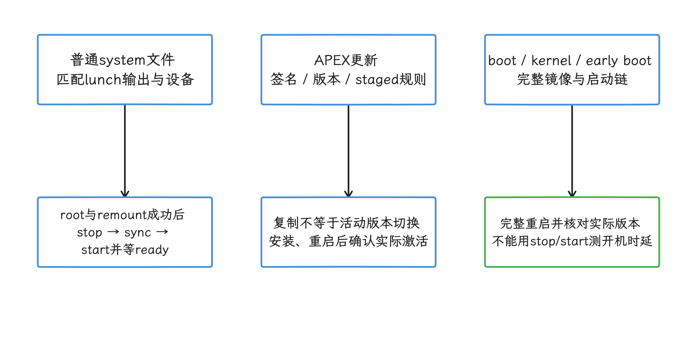

图：构建成功后选择正确分区或 APEX 安装路径，再按组件条件重启并等待就绪。 stop/start 还涉及 native 服务；SurfaceFlinger 的 onrestart 可联动 zygote，不能代替完整开机。

### 把测试纳入调试循环

源码改完，我们至少要过三层验证：

1. 编译所属模块和相关测试。
2. 运行定向 `atest` 或模块测试。
3. 在干净 Cuttlefish 实例复现目标路径，并留存 trace、日志和 build 信息。

下面的命令用测试模块名执行定向验证：

```bash
atest FrameworksServicesTests
```

`atest` 是 AOSP 的定向测试入口，会按测试配置构建、安装并执行。模块名要从目标目录的 `Android.bp` 或 `TEST_MAPPING`（声明目录相关测试的文件）确认；跑通了大型聚合测试，改动附近的单元测试仍然要补上。

<!-- gracker-diagram: ch18-02-10-test-loop -->
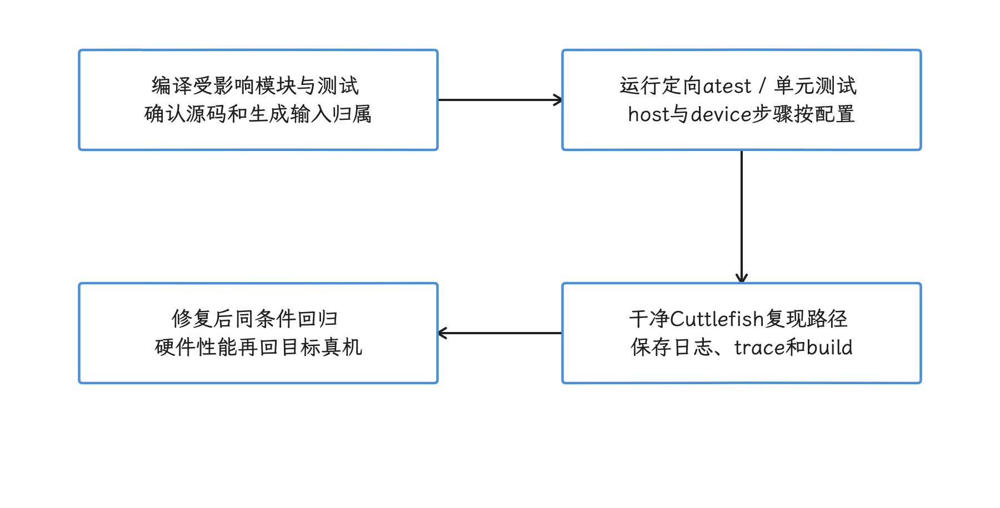

图：构建相关模块与测试，通过 atest 按 host/device 配置执行，再在干净实例保留现场证据。 测试模块从当前定义与 TEST_MAPPING 确认；大型测试通过不覆盖所有改动附近的分支与性能场景。

## 调试信息：优先低扰动证据

### 日志与 Trace

在高频路径上加 Log 会改变锁竞争、调度和 I/O；Choreographer、Binder（Android 进程间调用机制）、SurfaceFlinger 这些路径尤其敏感。我们通常用临时日志确认控制流，进入测量阶段就把它移除，或改成受控的 trace 点。

动态日志级别的前提，是目标代码确实读取了这个属性，且属性策略允许：`setprop log.tag.Choreographer VERBOSE` 只影响遵循 log tag 属性的调用，其余 Choreographer 诊断是否打开，要看对应代码是否读取它。日志时间戳还要先与 Perfetto（Android 系统性能追踪工具） 的时钟域对齐，再做关联分析。

<!-- gracker-diagram: ch18-02-11-logging-gates -->
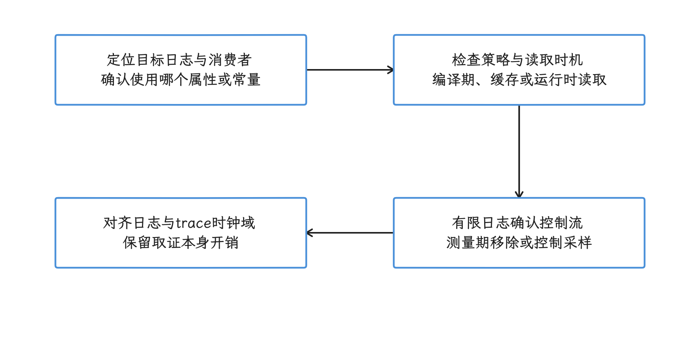

图：日志是否启用取决于消费者、编译常量、属性读取时机和访问策略。 setprop 不自动打开所有同名类的诊断；新增日志或抓栈也会改变被测调度与成本。

### System properties

系统属性是全系统共享的键值配置，调试时想拿它当开关，就要受命名、类型、稳定性、所属分区、`property_contexts` 和 SELinux 规则控制。`property_contexts` 负责把属性名映射到安全上下文与数据类型；SELinux 是 Android 的强制访问控制机制。

可写的 `persist.debug.*` 属性也在这些规则管控之下，shell 侧新建之前，先确认规则允许；`persist` 前缀只用在确有跨重启需求、且系统属性是合适载体的场合。

平台新增属性时，流程包括：

1. 明确 owner（属性所属分区）、读写进程与跨分区稳定性。
2. 在 sepolicy（SELinux 策略源码）定义属性类型和访问规则。
3. 在 `property_contexts` 绑定名称、上下文与数据类型。
4. 优先用 `.sysprop` 描述文件和 `sysprop_library` 构建模块生成 Java、C++、Rust 类型安全 API。
5. 补充 API 文件、单元测试和拒绝访问测试。

低层 `android.os.SystemProperties` 仍可用，官方建议在可行时改用 Sysprop API。读一个现有属性之前，先找到它的定义和消费者；`getprop` 里有值，只说明属性当前存在，目标代码是否会在运行时重新读取，要看代码本身。

<!-- gracker-diagram: ch18-02-12-sysprop-contract -->
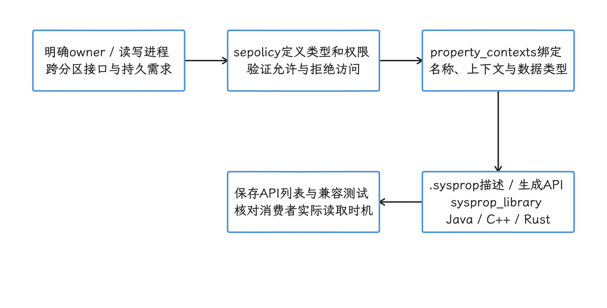

图：先定 owner、读写者与稳定性，再配置 sepolicy、property_contexts 和生成 API。 persist 不是可绕过策略的前缀；有值不证明消费者重新读取，SystemProperties 也不是普通 App 公开 SDK。

### dumpsys

下面这些命令取得系统服务的当前快照：

```bash
adb shell dumpsys -l
adb shell dumpsys activity processes
adb shell dumpsys meminfo com.android.systemui
adb shell dumpsys gfxinfo com.android.systemui framestats
adb shell dumpsys SurfaceFlinger
```

`dumpsys` 通过 Binder 调用服务的 dump 接口，执行本身有开销；输出通常是某一时刻的状态或有限历史，适合作为连续 trace 的补充。分析卡顿时，我们可以先用 Perfetto 定位时间段，再用 `dumpsys` 拿到进程、内存、显示 Layer 或服务配置的细节。

<!-- gracker-diagram: ch18-02-13-dump-trace -->
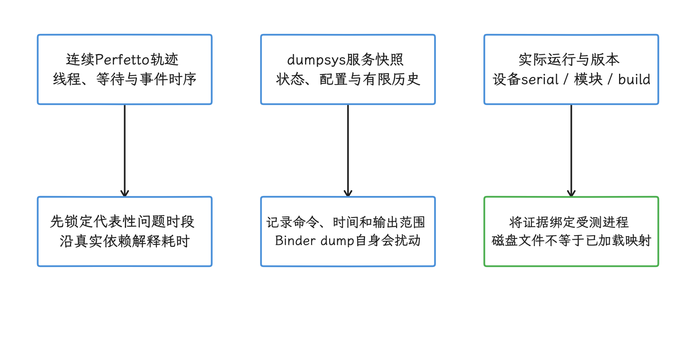

图：先用连续 trace 确定目标时段，再用服务 dump 补进程、内存、Layer 和配置细节。 dump 有自身开销且通常是快照或有限历史；取样时间不同不能直接拼成同一瞬间的全局状态。

## adb root、remount 与 OverlayFS

`adb root` 和 `adb remount` 面向 `userdebug`、`eng` 或明确支持调试的构建，量产 `user` 构建通常不提供同等能力。关闭 dm-verity（块级文件系统完整性校验）会降低设备保护，只用于隔离的开发设备。首次 remount 可能需要先关闭 verity 并重启：

```bash
adb root
adb disable-verity
adb reboot
adb wait-for-device
adb root
adb remount
```

动态分区和只读文件系统的修改通常经 OverlayFS 落盘：只读下层保持原样，修改写进可写上层；重刷、清理 overlay 或切换镜像后，这些修改就消失了。

单文件 push 的风险高于分区同步：类路径里可能还留着 dexpreopt（构建期 DEX 预编译）产物、架构变体、映射表或关联 APEX。稳妥的做法是先确认 Soong 的安装路径，用对应分区的 `adb sync`，再按组件的激活条件执行重启。

<!-- gracker-diagram: ch18-02-14-overlay -->
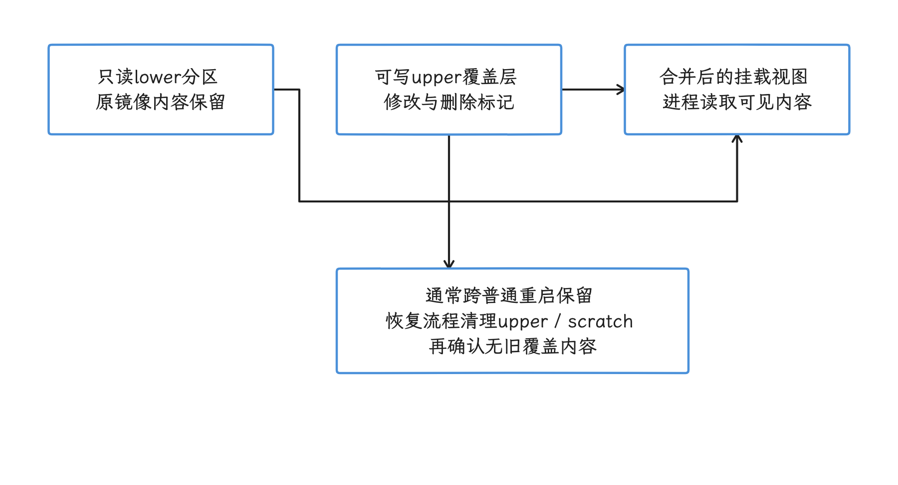

图：OverlayFS 将只读 lower 与可写 upper 合并，开发修改可能跨重启继续遮住原分区内容。 remount 是否走 overlay 由设备决定；换镜像不等于自动清理，enable-verity 等恢复流程需核对结果。

## Pixel 真机：先核对四个条件

SoC 调度、热、GPU、相机和功耗的量产结论只能来自真机。把自编译 AOSP 刷入 Pixel 前，需要同时确认：

1. 当前平台 tag 中存在目标产品和 lunch 配置。
2. driver binaries（设备专用闭源支持文件）与设备、平台 build 匹配。
3. bootloader 和 radio 固件满足该系统镜像要求。
4. 设备允许 OEM unlocking（解锁引导加载程序），且已备份全部数据。

官方的说明是：AOSP 可以直接运行在 Cuttlefish 上，物理硬件则需要设备专用闭源库。driver binaries 以自解压脚本提供，接受许可证后把文件和 Make 配置安装到 `vendor/`。驱动页面出现某个 Pixel 型号，只说明 Google 提供过相应二进制；当前 tag 里是否存在对应的产品配置，还要单独检查。

解锁和全量刷写的官方命令如下：

```bash
adb reboot bootloader
fastboot flashing unlock
fastboot flashall -w
```

`fastboot flashing unlock` 和 `fastboot flashall -w` 都会涉及数据清除；前者由设备端再次确认，后者的 `-w` 会清除 `/data` 分区。刷写前记下 factory image（官方出厂镜像），并准备官方恢复路径；平台调试设备上，个人数据和生产凭据一律提前清掉。

<!-- gracker-diagram: ch18-02-15-physical-gates -->
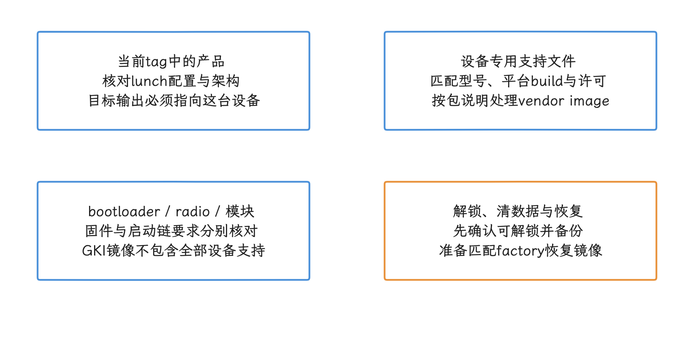

图：产品配置、专用二进制、固件启动链和解锁恢复条件都满足后，才按匹配输出刷写真机。 drivers 页面有型号不证明 r1 存在产品；vendor image 与历史自解压包也不是同一种交付形式。

## Android 17 内核必须单独构建

AOSP 平台树里主要是预编译 kernel binary；完整的 kernel 源码、工具链和构建规则在独立的 kernel checkout 里。Android 17 的 GKI（Generic Kernel Image，通用内核镜像）新分支是 `android17-6.18`，对应的 release tag 为 `android17-6.18-2026-06_r6`。

Android 13 起的现代 Android Common Kernel 使用 Bazel/Kleaf，`build.sh` 在 Android 14 及以上不再受支持。典型的 GKI arm64 distribution target 是：

```bash
tools/bazel run //common:kernel_aarch64_dist
```

这条命令运行 Kleaf 的标准 distribution target，产出一组可分发的内核产物。我们要复现 r6，还要确认 common 仓库的精确 tag、manifest revision、Kleaf 配置和输出摘要。

单个 GKI Image 只是内核镜像：设备的 vendor modules（厂商内核模块）、DTBO 设备树覆盖镜像和 `vendor_boot` 分区都在它之外。签名与 KMI（Kernel Module Interface，内核模块接口）的兼容性处理同样要单独完成。

Cuttlefish 可以用 `cvd create` 指定 kernel 和 initramfs（启动早期的内存文件系统）产物，适合验证 Android Common Kernel 与平台的组合。物理设备还要加上厂商模块和设备启动链——GKI Image 只是完整方案的一部分。

<!-- gracker-diagram: ch18-02-16-kernel-build -->
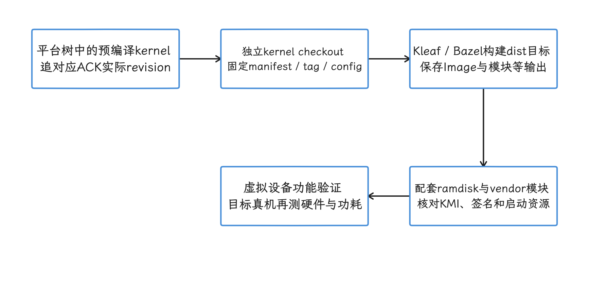

图：平台可使用预编译 kernel；修改内核时进入独立源码、工具链和 Kleaf 构建，再配套启动资源验证。 本文 r6 是固定快照，不是唯一 release；Image 不包含 vendor modules、DTBO、签名和完整启动链。

## 性能实验的构建记录

每次实验，我们至少保存这些字段：

| 类别 | 字段 |
| --- | --- |
| 平台源码 | manifest、tag、local diff、build ID |
| 构建配置 | product、release config、variant、关键 aconfig（平台功能开关配置）与 build flags |
| 运行设备 | serial、build fingerprint、页大小、SELinux/verity 状态 |
| 运行时 | ART/Mainline 模块版本、是否 remount、是否有额外日志 |
| 内核 | `uname -a`、GKI tag、vendor modules、启动参数 |
| 测试 | 用例 revision、数据集、轮次、温度与电源条件 |

`userdebug`、Cuttlefish、remount、附加 Log、关闭 verity 都会改变环境。把这些信息留在报告里，其他人才能判断结果适合功能验证、方向判断，还是量产性能结论。

<!-- gracker-diagram: ch18-02-17-experiment-record -->
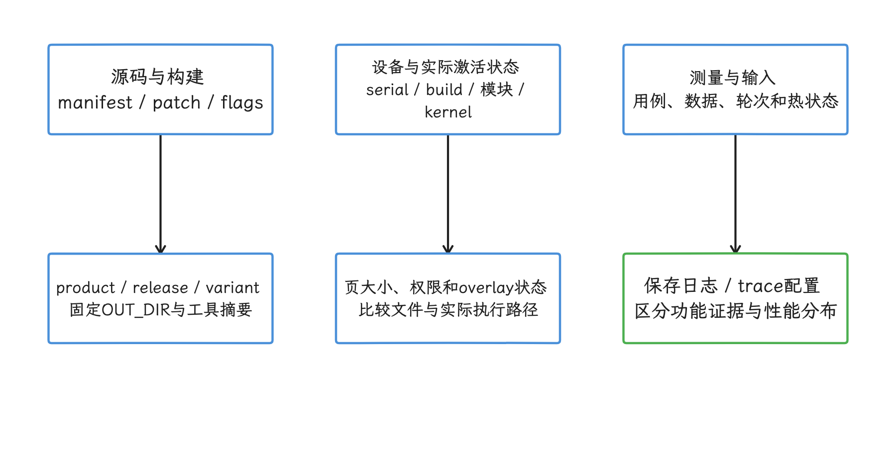

图：把源码、构建选项、设备状态、模块与内核、测试输入一起归档，才能复核结论适用范围。 userdebug、overlay、额外日志和关闭 verity 都改变环境，功能验证不能直接冒充量产绝对性能。

## 常见故障判断

### `lunch` 找不到 target

先检查命令是否来自当前 shell 的 `envsetup.sh`，再核对三段式的 product、release config 和 variant。旧文章里的两段式 target 或其他分支的 `trunk_staging`，要对照当前 tag 里实际存在的组合改过再用。

### `m` 没有重编修改文件

检查文件是否属于预期的 Soong module，生成源码是否来自另一输入，当前 `OUT_DIR` 是否对应同一 target，以及设备上是否仍运行旧分区或旧 APEX——修改路径与安装模块没有一一对应关系。

### 同步后行为没有变化

用 `adb shell` 检查设备端文件哈希和 build fingerprint，确认同步分区正确。APEX、boot jar、native service 和 early-boot 代码需要不同的激活方式，`stop` / `start` 只覆盖其中一部分。

### Cuttlefish 结果和真机不同

先确认差异落在 HAL、kernel、GPU、thermal（热管理）、Power HAL 还是 vendor service。纯 Framework 状态机适合在 Cuttlefish 上复现；硬件相关的性能问题，我们要回到目标设备上看。

<!-- gracker-diagram: ch18-02-18-troubleshooting -->
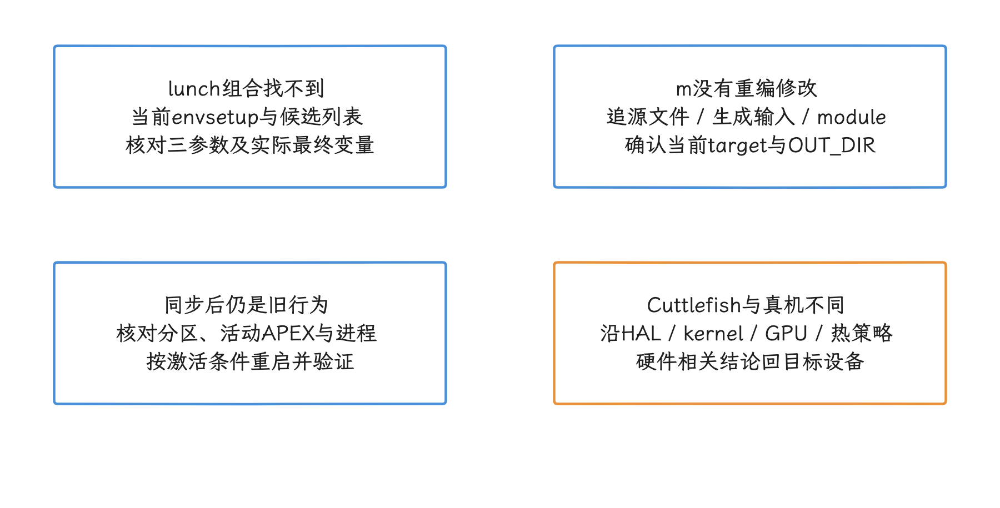

图：配置找不到、文件没重编、同步无变化和虚实设备差异分别回到对应证据。 先定位故障环节再更改构建或重启策略，不能靠清全量输出或反复刷机替代归因。

## 参考资料

- [AOSP 构建主机要求](https://source.android.com/docs/setup/start/requirements)
- [下载 Android 源码](https://source.android.com/docs/setup/download)
- [AOSP FAQ：android-latest-release](https://source.android.com/docs/setup/about/faqs)
- [AOSP 构建系统概览](https://source.android.com/docs/setup/build)
- [构建 Android](https://source.android.com/docs/setup/build/building)
- [Fastboot 与刷写](https://source.android.com/docs/setup/test/running)
- [Cuttlefish 入门](https://source.android.com/docs/devices/cuttlefish/get-started)
- [Cuttlefish WebRTC](https://source.android.com/docs/devices/cuttlefish/webrtc)
- [`android-17.0.0_r1` adb man page](https://android.googlesource.com/platform/packages/modules/adb/+/android-17.0.0_r1/docs/user/adb.1.md)
- [添加系统属性](https://source.android.com/docs/core/architecture/configuration/add-system-properties)
- [Sysprop API](https://source.android.com/docs/core/architecture/configuration/sysprops-apis)
- [构建 Android kernel](https://source.android.com/docs/setup/build/building-kernels)
- [android17-6.18 GKI release builds](https://source.android.com/docs/core/architecture/kernel/gki-android17-6_18-release-builds)
- [Pixel driver binaries](https://developers.google.com/android/drivers)
