# Android 17 Kernel 6.18 与 ARM64 安全开销

Android 17 GKI 6.18 改变调度、内存、BPF 和驱动基础，ARM64 安全缓解机制又会影响间接分支、系统调用和上下文切换。我们做性能比较时，先把内核配置和缓解状态固定住，前后的数字才有可比性。

> 源码基线：平台 Android 17 / API 37 / `android-17.0.0_r1`；内核 `android17-6.18-2026-06_r6`，对应 Linux 6.18.21。设备可能使用其他内核分支。

## GKI 6.18 调度、内存与观测变化

GKI（Generic Kernel Image，通用内核镜像）把通用内核与板级 vendor modules 分开，vendor modules 是设备厂商提供的内核模块；KMI（Kernel Module Interface，内核模块接口）约束两者之间的二进制接口。这一节我们按调度、存储、页面回收和构建期优化四块，把 6.18 里会影响性能判断的变化过一遍，每块附上核实入口。

### 平台与内核的版本基线

本文选择 `android17-6.18-2026-06_r6` 作为固定源码与 profile 核对快照，官方 release 表中仍有后续构建。README 的 Pixel 8 初步数据与其中的 profile 标识分别保存，不能把外部博客、后续 tag 或设备自定义构建的数字统统记成 r6 实测结果。比较后续构建时，重新确认实现、最终配置、profile 与 release artifact，而不只比较功能名字。

`android15-6.6` 与 `android16-6.12` 只用于解释 EEVDF、sched_ext 和 AutoFDO 的演进脉络，不作为 r6 的实现结论。平台行为同样要分层次看：Android 17 的 generational CMC 与 lock-free `MessageQueue` 位于 ART 和 `frameworks/base`，属于用户态改动，与 Linux 6.18 的调度或存储改动是两回事。

设备真正采用 `android17-6.18-2026-06_r6` release build，还需要相容的 vendor modules、产品配置和启动参数。所以源码 tag 里存在某个功能，只说明代码在仓库里；设备有没有启用它，要按后面各节给出的入口逐项核实。


### 6.18 功能核查表

先把这张表当过滤器：不同来源的性能数据带着不同的机制、启用条件和测试设置，直接汇成一项「Android 17 总收益」会互相污染，逐项确认之后再引用。

| 主题 | `android17-6.18-2026-06_r6` 或平台证据 | 结论边界 |
|---|---|---|
| EEVDF | `kernel/sched/fair.c` 与 `Documentation/scheduler/sched-eevdf.rst` | fair class 的选取模型；不能直接承诺 UI 延迟下降 |
| sched_ext | GKI 配置含 `CONFIG_SCHED_CLASS_EXT=y` | BPF scheduler 加载并运行后才会接管相应任务 |
| F2FS checkpoint merge | `checkpoint_merge` 挂载选项与 checkpoint kthread | 需要设备使用 F2FS 且挂载时启用 |
| dm-verity multi-buffer hashing | r6 的 `dm-verity-target.c` 没有 `verity_hash_mb()` 或 `crypto_shash_finup_mb()` | 外部补丁数据不能记为 r6 收益 |
| io_uring | 6.18 源码含完整实现 | 内核能力不等于 Android 公共 API，也不等于框架采用 |
| AutoFDO | GKI 配置含 `CONFIG_AUTOFDO_CLANG=y`，tag 内含 `kernel.afdo` | README 数据是 Pixel 8 preliminary benchmark |
| MGLRU | GKI 配置含 `CONFIG_LRU_GEN=y` 与 `CONFIG_LRU_GEN_ENABLED=y` | 页回收策略；不能直接换算为 lmkd kill 降幅 |

设备侧的测试记录至少要写全 platform build、kernel release、GKI tag 或 build ID、`vendor_boot` 镜像版本、挂载参数、CPU 拓扑、温度、benchmark 输入和样本统计——CPU 拓扑指核心、集群及其容量关系。这些信息缺一块，结论就退化为单台设备上的排查线索。

### 调度器变化：EEVDF fair scheduler + sched_ext 可扩展框架

#### EEVDF：fair scheduler 的 lag / deadline 模型

EEVDF 的全称是 Earliest Eligible Virtual Deadline First，做法是在符合条件的任务里挑虚拟截止时间最早的那个。Linux 从 6.6 开始向 EEVDF 过渡，r6 的 `kernel/sched/fair.c` 保留 `entity_eligible()`、`pick_eevdf()` 和 virtual deadline 相关路径；因此 EEVDF 进入内核的版本应写作 6.6，而不是 6.12。

这套模型里，同优先级的 runnable entity 按权重分享 CPU，runnable entity 指已经可运行、正在等待 CPU 的调度对象。调度器用 lag 记录它相对公平份额是欠了还是超额：lag 大于等于零时具备 eligibility，再从 eligible 集合中选 virtual deadline 更早的对象。每个任务请求的 slice 是一次希望拿到的运行时间片；slice 要得短，就有机会拿到更早的 deadline，延迟敏感的任务也就更有机会先被选上。

<!-- gracker-diagram: ch18-03-02-eevdf -->
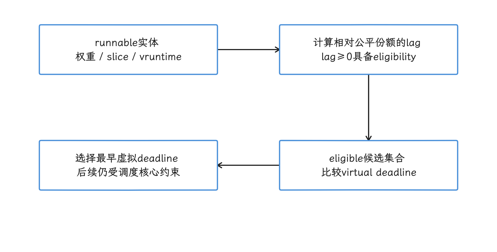

图：EEVDF 先看 lag 是否具备资格，再从 eligible 集合中选择虚拟截止时间最早的实体。 图示表达选取原则；nice、uclamp、CPU 放置和热约束仍影响结果，UI 语义不直接参与这一步。

还要知道这套模型看不到「UI 线程」或 `doFrame` 这类语义，短任务也未必总能排到后台任务前面。我们手上的旋钮是：`nice` 影响 fair class 权重，`uclamp` 约束调度决策使用的利用率信号，不是 CPU 用量配额或公平权重，cpuset 与 CPU affinity 限定任务可运行的 CPU。

最终结果还叠加 thermal 热约束、CPU frequency selection、RT/DL 实时调度类和厂商扩展。所以评估 EEVDF 时，我们测的是从唤醒到真正运行的时间、runnable 队列等待、slice 长度与 preemption（抢占）；总 CPU time 一项看不出这些细节。

#### sched_ext：用 BPF 实现可扩展调度器

sched_ext 在 Linux 6.12 进入上游 mainline，思路是让一组 BPF 程序实现调度策略；BPF 是在内核受控环境中运行的可验证程序，`struct_ops` 让这些程序提供一组内核回调。

6.18 的核心实现和文档分布如下：

- `kernel/sched/ext.c` 负责 scheduler class、BPF 可调用的内核函数（kfunc）、启停与错误回退；
- `include/linux/sched/ext.h` 定义 `sched_ext_entity`、DSQ 标志和任务状态；
- `tools/sched_ext/` 提供示例调度器和状态工具；
- `Documentation/scheduler/sched-ext.rst` 描述启用条件、DSQ 与故障回退。

BPF scheduler 通过 `struct sched_ext_ops` 提供 `select_cpu()`、`enqueue()`、`dispatch()` 等可选回调，必填字段是合法的 `ops.name`。加载时若未设 `SCX_OPS_SWITCH_PARTIAL`，普通、batch、idle 与 SCHED_EXT 任务可进入 sched_ext；设了该标志则只接管显式 SCHED_EXT 策略任务，RT/DL 等其他类不因此全部转入。`select_cpu()` 的 CPU 选择仍受 cpumask 与调度核心约束；回调也可直接向本地 DSQ 插入任务并跳过 enqueue，不能把所有任务画成必经同一组回调。

<!-- gracker-diagram: ch18-03-03-scx-scope -->
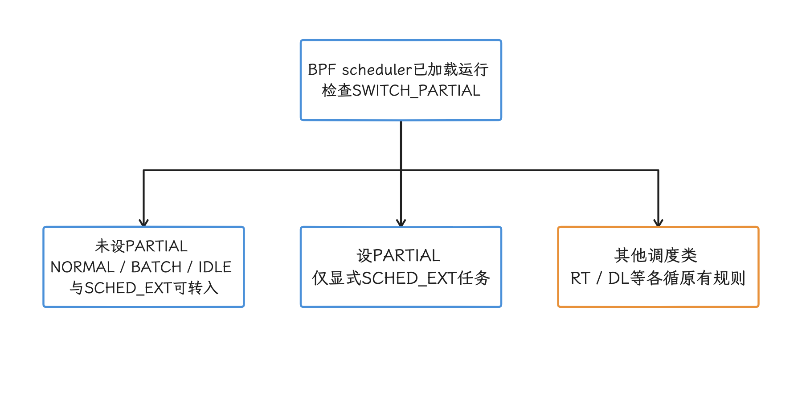

图：sched_ext 的全量或部分接管模式决定哪些任务进入 EXT 调度类。 回调按需实现且 ops.name 必填；RT/DL 不随这些普通任务一起转入。

任务先进入 dispatch queue（DSQ，待分派队列），简称 DSQ。6.18 提供全局 FIFO（先进先出） 队列 `SCX_DSQ_GLOBAL` 和每 CPU 的 `SCX_DSQ_LOCAL`，BPF scheduler 也可以创建自定义 DSQ；CPU 取任务时先查本地 DSQ，再查全局 DSQ，然后调用 `ops.dispatch()`。自定义 DSQ 可按 FIFO 或 `dsq_vtime` 虚拟时间排序。

6.18 的插入接口为 `scx_bpf_dsq_insert()` 与 `scx_bpf_dsq_insert_vtime()`；6.12 示例中的旧名 `scx_bpf_dispatch()` / `scx_bpf_dispatch_vtime()` 只适合阅读旧分支，移植时按目标 tag 编译，不要从函数名猜版本。

<!-- gracker-diagram: ch18-03-04-scx-dsq -->
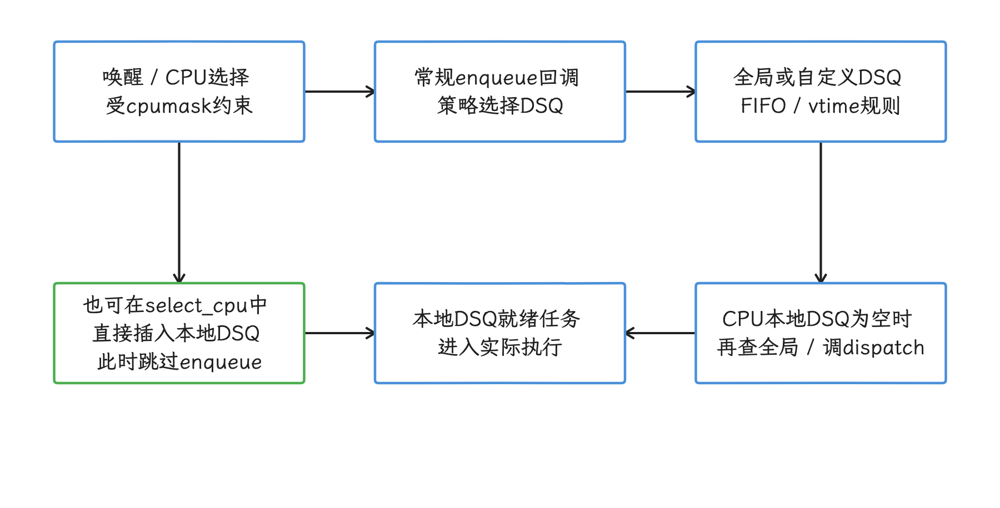

图：sched_ext 用 DSQ 组织待运行任务，CPU 优先消费本地队列。 这是一组允许路径；不是每个任务必经全部回调，自定义队列是否使用由 BPF 策略决定。

BPF scheduler 退出、runnable task stall、内部错误或 `SysRq-S` 可终止该调度器，把原由 sched_ext 管理的任务退回 fair class；其他调度类不是先全部被接管再回退。`sched_ext_dump` 提供错误/主动 dump 的诊断，`SysRq-D` 仅触发 dump，不终止调度器。

GKI 开启了 `CONFIG_SCHED_CLASS_EXT=y`，但文档写明：**BPF scheduler 加载并运行后，sched_ext 才会使用**。也就是说，看到配置项或 `kernel/sched/ext.c`，只说明框架编进去了；设备是否真被自定义调度器接管，用下面的命令确认，量产设备可能因权限或裁剪读不到这些节点。

```bash
adb shell 'for scx_node in state root/ops enable_seq; do
  scx_path=/sys/kernel/sched_ext/$scx_node
  printf "%s: " "$scx_node"
  if test -r "$scx_path"; then cat "$scx_path"; else echo unavailable; fi
done'
```

`state` 表示当前启停状态，`root/ops` 是当前调度器名称，`enable_seq` 大于零只说明本次开机后加载过调度器，不证明它现在仍运行，也不证明目标线程已切入。目标任务可再核对 `/proc/<pid>/sched` 的 ext 状态。以上读取不是原子快照，动态切换时要结合加载序号和采集时刻复查；unavailable 只表示当前无法读到，不能直接推成框架未编入。


### 存储栈三项核查

存储这块我们分三层看：F2FS 是面向闪存设计的文件系统，dm-verity 在块设备层校验数据完整性，io_uring 是 Linux 异步 I/O 接口。三个子系统都在 6.18 tag 里；但某项上游补丁从「上游存在」到「r6 合入」，再到设备与应用真正走到那条路径，每一步都要单独核实。

#### F2FS checkpoint merge：先确认挂载选项

`fsync()` 按文件与文件系统契约请求数据/必要元数据同步，checkpoint 则保存文件系统的可恢复一致状态；F2FS 的一次 fsync 不必触发完整 checkpoint。启用 checkpoint merge 后，符合条件的并发 CP_SYNC 请求可交给 checkpoint kthread 合并处理，减少重复工作并避免完全受调用进程所在 cgroup 的低 I/O/CPU 份额拖延；它不绕过存储写入、系统总资源约束或持久化错误。

r6 的 super.c 解析 `checkpoint_merge`/`nocheckpoint_merge`，默认选项设置 `MERGE_CHECKPOINT`；实际线程是否启动还看可写挂载和 checkpoint 状态。`f2fs_issue_checkpoint()` 对未启用 merge、原因不是 CP_SYNC 或当前为卸载锁持有者的请求直接同步处理；线程不存在时也有同步回退。只有进入合并分支的请求才入 `issue_list`，增加 queued_ckpt、唤醒线程并等待完成，调用方并不是提交后立即返回。

<!-- gracker-diagram: ch18-03-06-f2fs-merge -->
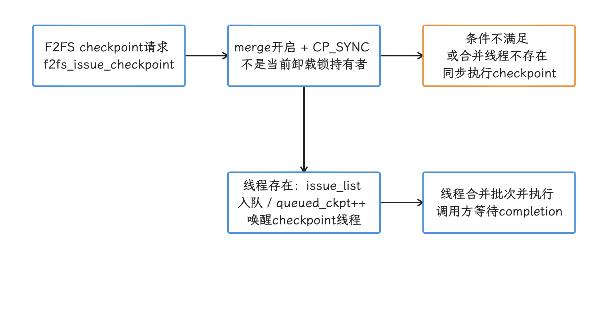

图：只有满足合并条件的 CP_SYNC 请求才入 checkpoint 队列，并由线程完成后唤醒调用方。 一次 fsync 不必产生完整 checkpoint；合并线程不是提交即返回，也不免除存储持久化成本。

先从 `/proc/mounts` 或 mountinfo 确认目标 data 路径实际使用的文件系统及挂载选项。SQLite WAL 的 commit 是否执行同步取决于 synchronous、事务与 VFS：FULL 通常每次提交同步 WAL，NORMAL 可将主要同步放在 checkpoint 等边界，不能把每次 WAL commit 都等同 fsync。SQLite checkpoint 与 F2FS filesystem checkpoint 也不是同一个动作。即使捕获 fsync，还须经过 `f2fs_do_sync_file()` 的条件判断才能谈文件系统 checkpoint merge。

<!-- gracker-diagram: ch18-03-07-wal -->
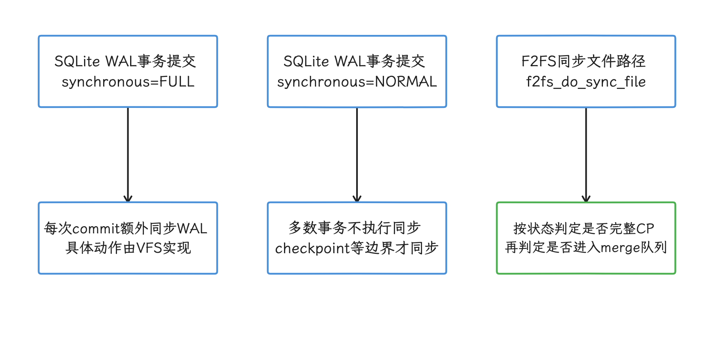

图：SQLite FULL 与 NORMAL 的 WAL 同步策略不同，文件系统再判断是否需要自己的 checkpoint。 SQLite checkpoint 与 F2FS checkpoint 是两个动作；commit、VFS sync、fsync 和 merge 不可直接画成一条必经链。

#### io_uring 在应用层的可用性

6.18 r6 的 `io_uring/` 包含 multishot、registered buffers、ring setup 和 zero-copy 相关路径：multishot 让一次提交产生多次完成结果，registered buffers 预先登记 I/O 内存，zero-copy 着力减少数据复制。每项能力都有自己的 opcode（操作码）、flag、内存注册和 fallback 条件；以 `IORING_SETUP_NO_MMAP` 为例，它描述 ring 内存的建立方式，应用数据是否 zero-copy 要看别的条件。

AOSP 的 `external/liburing` 提供 native（原生） 静态库构建规则，这只说明平台把库准备好了；SQLite、Cronet、OkHttp 或 Java I/O 是否默认使用 io_uring，要另行确认。普通应用这条路上还排着 syscall 可用性、seccomp（系统调用过滤）、SELinux、NDK API 与设备内核配置这些关卡。没有调用栈或 syscall 级别的记录，我们就不把 io_uring 计入应用收益。


#### dm-verity multi-buffer hashing：r6 未合入

逐行核对 r6 的 `drivers/md/dm-verity-target.c`，当前实现是 `verity_hash()` 配合 `crypto_shash_finup()` 等单请求接口，该文件没有 `verity_hash_mb()`，也没有调用补丁路径使用的 `crypto_shash_finup_mb()`。

2025 年发布到邮件列表的 v8 补丁曾报告 ARM64 与 x86_64 cold-cache dm-verity read 吞吐约提升 35%——cold cache 指数据尚未进入内存缓存，作者同时说明指标波动较大。这组数字属于补丁环境的结果：引用时连补丁一起注明，它进不了 `android17-6.18-2026-06_r6` 的收益表，也撑不起「Android 17 安装、冷启动或 OTA 固定提升」这类说法。


#### 存储路径如何测

三项机制我们分开测：

- F2FS：`f2fs_sync_file_enter/exit`、checkpoint 数量、checkpoint 时长、块写入量与挂载参数；
- dm-verity：cold/warm cache 分开，记录当前 hash driver、数据块大小、CPU time 与块设备吞吐；评估 multi-buffer 补丁必须使用明确包含补丁的自定义内核；
- io_uring：确认 `io_uring_setup`、`io_uring_enter`、opcode 和 fallback，再比较每次业务操作的提交数与延迟。

采集用 Perfetto，可以拿到 `block_rq_issue` / `block_rq_complete` 和 F2FS tracepoints。dm-verity 没有一条所有 Android 设备通用的「dm-verity track（时间轴轨道）」，我们把 block I/O、CPU sampling（定期抽样 CPU 调用栈） 和 `verity_*` 调用栈放到同一业务区间里一起看。

### AutoFDO Profile-Guided Optimization 的内核应用

AutoFDO 用执行样本指导 Clang 的内联、分支权重与布局，成本与收益发生在所构建代码中。r6 gki_defconfig 设置 `CONFIG_AUTOFDO_CLANG=y`，BUILD.bazel 的 aarch64 kernel 目标将 `clang_autofdo_profile` 指向 tag 内的 kernel.afdo；README 又标明 profile 对应 Linux 6.18.21、SHA 与采集 build ID。配置、构建规则、profile 三者都要绑定；这些源码证据仍不能替代目标设备所运行 release artifact 的构建记录。

r6 README 中 Pixel 8 的 boot、cold launch 与 Binder 数据都标为初步结果，Binder 项还采用多轮最佳值，引用时守住这个范围，跨 SoC（System on Chip，系统级芯片） 或跨产品先不外推。设备侧要做的是把 release artifact、build config、kernel build ID 与 Profile 对齐，再做只改变 Profile 的 A/B。

<!-- gracker-diagram: ch18-03-10-autofdo -->
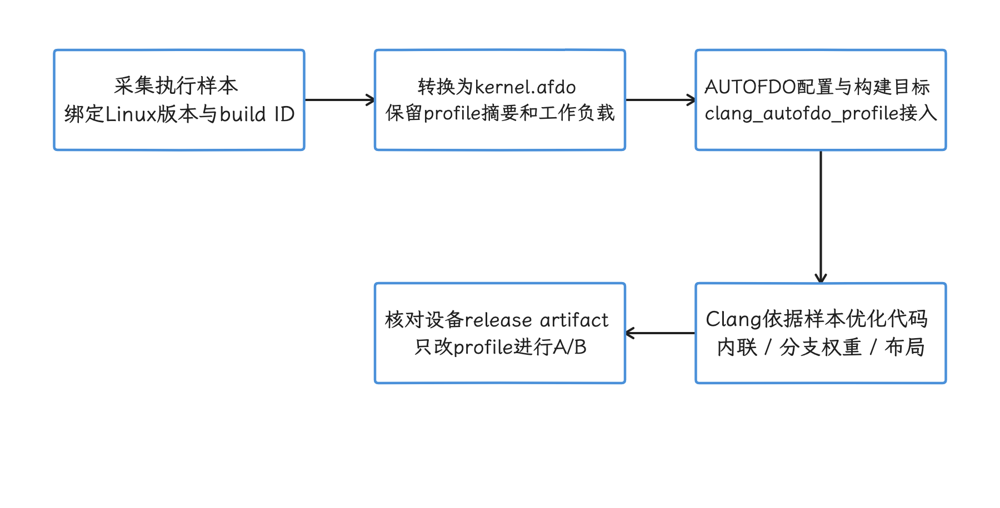

图：将配置、BUILD.bazel 的 profile 绑定、采集版本和实际内核产物对应，再做单因素 A/B。 README 标记 preliminary，Binder 采用多轮最佳值；源码内有 profile 仍不证明某设备 release 使用它。

Profile 的采集、ETM/ETE/TRBE 数据转换、`vmlinux` 构建接入、质量控制和完整 A/B 方法统一由 [18.4 AutoFDO 反馈导向优化与 Android 验证](04-autofdo-feedback-directed-optimization.md) 展开，本节只看它在 GKI 6.18 功能集合中的启用状态和核查范围。记账时也要分层：ART AOT、Baseline Profile、generational CMC 和 DeliQueue 属于用户态或 Framework，Kernel 6.18 的账上不该有它们。

### MGLRU 与页面回收优化

MGLRU 即 Multi-Gen LRU，按多个代际管理「最近最少使用」页面的回收。r6 的 `gki_defconfig` 同时设置 `CONFIG_LRU_GEN=y` 与 `CONFIG_LRU_GEN_ENABLED=y`，GKI 默认配置已经选了它；具体设备仍可能经产品配置或运行时开关走出差异。

#### generation 表示访问时间窗口

MGLRU 按 memcg（内存资源组）与 NUMA node 组织页面代际，aging 结合页表访问位等信号将近期访问页纳入较新 generation，reclaim 从较老代际挑选候选。文档里的 min_gen_nr～max_gen_nr histogram 是实验性 `/sys/kernel/debug/lru_gen` 工作集估计接口，反映不同访问时间窗口的匿名/文件页数量；它不等于稳定 sysfs 主开关，也不是 ART 对象代际或进程重要性队列。

generation 表达 recency（最近访问窗口），不是每秒访问次数。refault 指回收后再次访问，swappiness 调整匿名页与文件页的回收倾向；访问渠道、swap 与工作负载仍影响结果。`min_ttl_ms` 保护近期工作集时，若内存无法容纳该集合还可能触发内核 OOM，不能把保护窗口理解成必然减少所有进程退出。

<!-- gracker-diagram: ch18-03-11-mglru -->
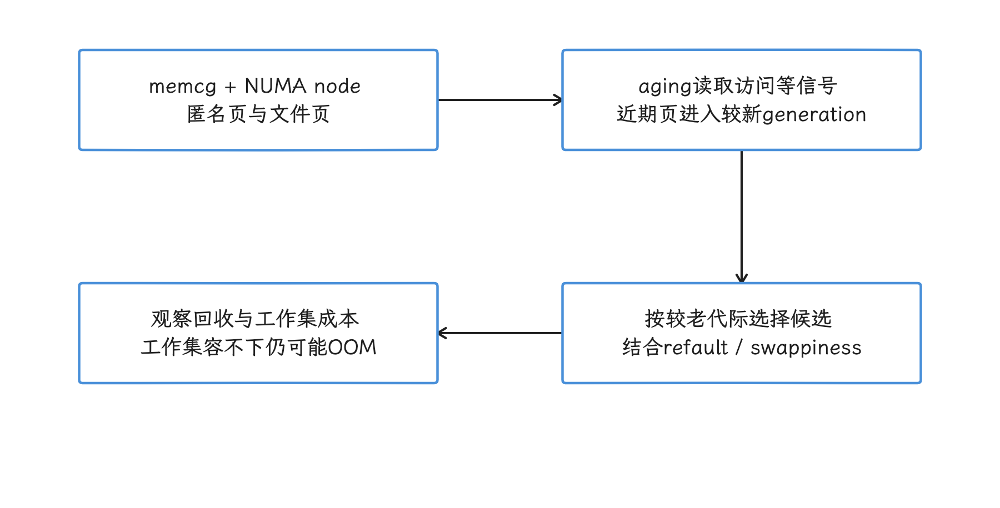

图：MGLRU 按 memcg 与 NUMA node 管理近期访问窗口，aging 与 reclaim 共同改变页面回收。 generation 不是访问频率、ART 对象代际或进程优先级；min_ttl_ms 保护工作集时也可能触发内核 OOM。

运行时 stable ABI（用户态可读取的稳定接口） 位于 `/sys/kernel/mm/lru_gen/`，读主开关用下面的命令；权限不足时，回到内核配置和厂商诊断产物核查。

```bash
adb shell 'if test -r /sys/kernel/mm/lru_gen/enabled; then
  cat /sys/kernel/mm/lru_gen/enabled
else
  echo "lru_gen status unavailable" >&2
  exit 1
fi'
```

读出来是一个 bitmask（位掩码）：`0x0001` 表示主功能开启，其余位控制批量清除页表 accessed bit 的能力，设备支不支持这些位还要看 MMU（内存管理单元） 特性。

#### 对 lmkd 的影响路径

固定 r1 的 lmkd 根据 PSI、内存水位、thrashing/refault 和 oom_score_adj 等信号选择退出候选，未直接读取 MGLRU generation。MGLRU 是页面回收机制，lmkd 是用户态进程回收策略；两者通过内存压力等中间量相互影响，还须与内核 OOM killer 及其他退出原因分开统计。

MGLRU 改变的是内核 reclaim 的页面选择和成本，这一层的变化再经 PSI stall、refault、swap 与可用内存这些中间量，才可能传到 `lmkd` 看到的压力上。所以「MGLRU 开启后 kill 次数必然下降」在源码里找不到支撑：有些负载可能减少 refault 和 `kswapd` CPU，另一些负载在 swap、file cache 或 reclaim 参数的作用下走向别的结果。对照实验应同时记录：

- `/proc/pressure/memory` 的 `some` / `full` stall，分别表示部分任务和所有非空闲任务受阻；
- `mm_vmscan_*` 事件、后台回收线程 `kswapd` 的 CPU time 与任务自行回收页面的 direct reclaim；
- major/minor fault、workingset refault、swap in/out；major fault 需要存储 I/O，minor fault 不需要；
- lmkd kill reason、被杀进程的 `oom_score_adj` 与进程状态；
- 相同业务脚本下的帧、启动与进程留存结果。

<!-- gracker-diagram: ch18-03-12-lmkd -->
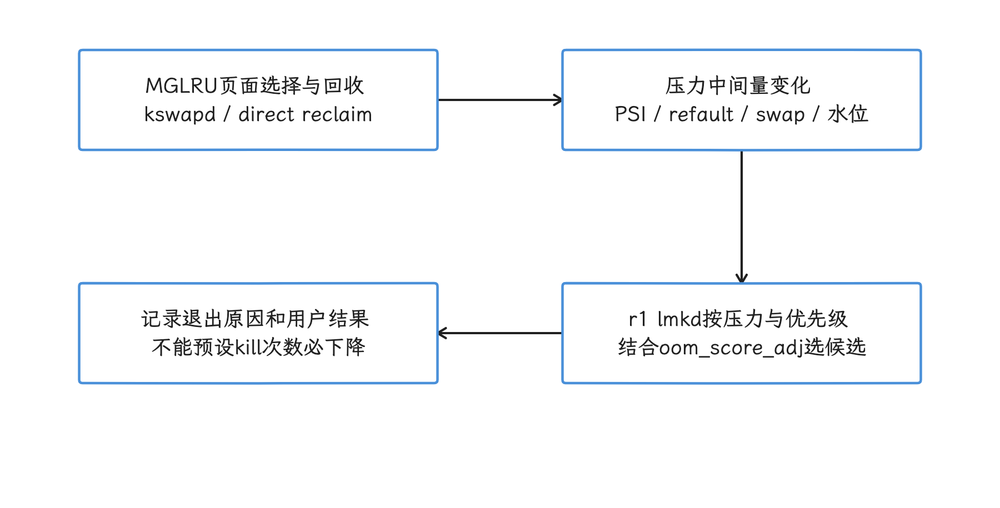

图：MGLRU 先改变页面回收，再通过 PSI、refault、swap 和可用内存等信号影响 lmkd 决策。 固定 r1 lmkd 未直接读取 generation；lmkd 退出、内核 OOM 和其他退出原因分开统计。

### 在 Perfetto 中的可观测性

Perfetto 展示运行结果，单看一条 track 回答不了「EEVDF、MGLRU 或 AutoFDO 带来了多少收益」；我们把机制状态、trace 和 A/B 构建关联起来再下判断。

| 主题 | 采集项 | 能回答的问题 |
|---|---|---|
| EEVDF | `sched_waking`、`sched_switch`、线程优先级、CPU frequency、uclamp | 线程何时 runnable、等待多久、在哪个 CPU 运行 |
| sched_ext | sched tracks、`sched_ext_dump`、sysfs 状态、BPF scheduler 自有 trace | 自定义调度器是否启用、是否报错回退 |
| F2FS | `f2fs_sync_file_enter/exit`、checkpoint 事件、block request | 同步写与 checkpoint 分别耗时多久 |
| dm-verity | block request、CPU sampling、`verity_*` 栈 | r6 当前 cold read 卡在 I/O 或 hashing 的比例 |
| MGLRU | `mm_vmscan_*`、PSI、page fault、swap、lmkd 事件 | reclaim stall、refault 与 kill 如何变化 |

这张表也有看不到的东西：`sched_switch` 只反映谁获得了 CPU，`pick_eevdf()` 的全部候选和 virtual deadline 它还原不了；`sched_ext_dump` 服务于错误或主动 dump，不是每次 BPF 调度决定的流水记录。要细看策略，就为目标 BPF scheduler 添加自己的 trace events。


#### A/B 设计

直接比较 Android 16 与 Android 17，会同时改变 framework、ART、kernel、vendor、驱动和配置，差异归不到单个机制头上。可复现的对照我们按以下顺序搭：

1. 固定设备、固件、散热条件、业务输入和 kernel source；
2. 只改变一个配置、profile 或运行时开关；
3. 预热后交错执行多轮，避免一组测试总处于更冷或更热的阶段；
4. 报告中位数、尾延迟、离散程度、频率驻留与温度；
5. 把「没有检出差异」和「证明零开销」分开表述。


### 版本演进：把平台版本和 GKI 分支分开

| 维度 | 锚点 | 结论 |
|---|---|---|
| Android 15 相关 GKI | `android15-6.6` | fair scheduler 已有 EEVDF 路径；AutoFDO 后续投放到该 LTS（长期维护）分支 |
| Android 16 相关 GKI | `android16-6.12` | sched_ext 进入 mainline 后可在该分支使用；早期 6.12 示例可能使用 `scx_bpf_dispatch*()` 命名 |
| 本文 Android 17 内核锚点 | `android17-6.18-2026-06_r6`，Linux 6.18.21 | 使用 `scx_bpf_dsq_insert*()`；GKI 配置开启 sched_ext、AutoFDO 与 MGLRU；tag 含 6.18.21 AFDO profile |
| Android 17 平台 | `android-17.0.0_r1` / API 37 | 只作为实验控制变量；平台运行时变化见 18.1 |

F2FS checkpoint merge、MGLRU 与 io_uring 都有跨分支历史；dm-verity multi-buffer hashing 还停在 r6 之外的补丁层面，这个 tag 的功能集合里没有它。

### 常见问题与误区

**「设备报告 6.18，所以正文里的全部机制都已启用。」**

kernel release 只能定位代码基线；最终配置、挂载参数、BPF scheduler、CPU 能力、boot 参数和用户态采用，要逐项查过才算数。

**「EEVDF 会自动把 UI 线程排在后台任务前面。」**

EEVDF 手里只有 lag、slice 与 virtual deadline，Android 的 UI 语义它并不知道；UI 结果由调度属性、CPU 放置、频率、热状态和 runnable 竞争共同决定。

**「`CONFIG_SCHED_CLASS_EXT=y` 表示 OEM scheduler 正在运行。」**

该配置只代表框架编入内核；当前是否在运行，看 `/sys/kernel/sched_ext/state`、`root/ops` 与 `enable_seq` 给出的加载记录。

**「MGLRU 开启后 lmkd 会按 generation 杀进程。」**

lmkd 仍按 Android 的压力与进程优先级策略决策；MGLRU 在页面回收这一层，要影响 kill 条件只能经 reclaim、PSI、refault 和可用内存这几条间接路径。

## ARM64 缓解机制、开销与验证

内核基线定了，我们再看安全这一侧：ARM64 每项缓解是否生效、代价多大，要按 CPU 能力、内核配置和实际启用状态逐项测量，配置、硬件能力和运行时策略共同决定安全机制是否生效。关掉安全机制测出的数字，代表不了量产配置。

> MTE 的应用实践见 [§4.9](../../part1-fundamentals/ch04-memory/09-android17-memory-tagging-extension-mte.md)，Rust 系统组件的范围见 [§18.7](07-rust-system-services-performance.md)。

### 1. 先确认三个条件

这一节先回答一个问题：看到源码里的配置项，怎么判断它在某台设备上真的生效。Kconfig 是 Linux 内核描述配置选项、依赖关系和默认值的系统，`default y` 的含义有限——依赖满足且没有其他配置覆盖时默认取 `y`，仅此而已。设备结论需要同时满足三个条件：

1. **构建条件**：最终 `.config` 含有所需选项，编译器和链接器也支持相应插桩。
2. **硬件与固件条件**：CPU 实现架构特性，或固件提供内核所需的漏洞缓解调用。
3. **运行时条件**：内核没有通过启动参数关闭功能；用户态机制还需要二进制或进程显式启用。


GKI 的基准配置 `gki_defconfig` 明确设置了 `CONFIG_RANDOMIZE_BASE=y`、`CONFIG_SHADOW_CALL_STACK=y`（SCS） 和 `CONFIG_CFI=y`，同时关闭了 `CONFIG_RANDOMIZE_MODULE_REGION_FULL`。PAC、BTI、MTE 与 GCS 在 `arch/arm64/Kconfig` 中是 `default y`，仍受工具链、硬件和运行时条件约束。

下面这张表用来定排查入口；脱离设备和负载的固定性能百分比，这里给不了。

| 机制 | 保护对象 | Android 17 / 6.18 源码入口 | 生效条件 |
|---|---|---|---|
| KASLR | 内核与模块地址布局 | <code>CONFIG_<wbr>RANDOMIZE_<wbr>BASE</code>、<code>pi/<wbr>kaslr_<wbr>early.<wbr>c</code>、<code>kaslr.<wbr>c</code> | 构建开启、启动阶段获得熵、未传入 <code>nokaslr</code> |
| KPTI | EL0 与内核地址空间隔离 | <code>CONFIG_<wbr>UNMAP_<wbr>KERNEL_<wbr>AT_<wbr>EL0</code>、异常入口代码 | 构建开启，CPU 运行时判定需要或通过 <code>kpti=<wbr>1</code> 强制 |
| Spectre v1 | 越界推测访问 | <code>array_<wbr>index_<wbr>nospec()</code>、架构屏障 | 易受影响的代码点完成局部修复 |
| Spectre v2 | 间接分支预测注入 | <code>proton-<wbr>pack.<wbr>c</code>、CPU capability 与固件接口 | 取决于 CPU 型号、固件和运行时选择 |
| Spectre-BHB | 分支历史注入 | <code>CONFIG_<wbr>MITIGATE_<wbr>SPECTRE_<wbr>BRANCH_<wbr>HISTORY</code> | CPU 需要缓解，内核选择分支序列或固件调用 |
| PAC | 返回地址或用户指针认证 | <code>CONFIG_<wbr>ARM64_<wbr>PTR_<wbr>AUTH*<wbr></code> | 构建、硬件、二进制策略共同满足 |
| BTI | 计算分支合法落点 | <code>CONFIG_<wbr>ARM64_<wbr>BTI*<wbr></code> | 构建与硬件支持，目标代码带 BTI 属性 |
| SCS | 内核返回地址 | <code>CONFIG_<wbr>SHADOW_<wbr>CALL_<wbr>STACK</code> | 工具链与动态 SCS 配置；启动时按 PAC/BTI 能力选择 |
| KCFI | 内核间接调用目标类型 | <code>CONFIG_<wbr>CFI</code> | 编译器支持 <code>-<wbr>fsanitize=<wbr>kcfi</code> |
| MTE | 用户态内存访问标签 | <code>CONFIG_<wbr>ARM64_<wbr>MTE</code> | 构建、硬件、映射属性与进程模式共同满足 |
| GCS | 用户态返回地址栈 | <code>CONFIG_<wbr>ARM64_<wbr>GCS</code>、GCS 用户 ABI | 构建、硬件和线程级 <code>prctl()</code> 启用 |

表里两个词先说明：EL0 是非特权用户态执行所在的最低异常级；CPU capability 是内核根据特性寄存器、CPU 型号和勘误表得到的能力标志，与产品宣传中的架构名称是两回事。

这几组机制保护的层面不同：BTI 约束间接分支的落点，Spectre v2 缓解处理分支预测器状态，两者互相替代不了；SCS 保护内核返回地址，KCFI 检查内核间接调用的静态类型，GCS 是内核向用户态提供的受保护返回地址栈 ABI（Application Binary Interface）。这里的 ABI 指内核与用户程序约定的寄存器、系统调用和数据结构接口。

### 2. KASLR：启动阶段的地址随机化

KASLR（Kernel Address Space Layout Randomization）在启用并获得有效随机种子后，启动时改变内核及模块的基地址，让攻击者更难预先知道内核对象的位置；ARM64 上由 `CONFIG_RANDOMIZE_BASE` 控制。

`arch/arm64/Kconfig` 规定 bootloader 可通过设备树 `/chosen/kaslr-seed` 传入随机 u64；经 UEFI stub 启动时可由 EFI_RNG_PROTOCOL 提供熵。r6 的 `arch/arm64/kernel/pi/kaslr_early.c` 读取并清除设备树种子，未取得有效种子时还可尝试 CPU RNDR，再计算内核镜像偏移。`kaslr.c` 检查并报告启用状态；模块区域的随机范围则看独立配置与分配路径，不能把两者都归为 kaslr.c 计算。

`CONFIG_RELOCATABLE` 让 AArch64 内核保留运行时重定位所需的信息；重定位是按实际加载基址修正代码或数据中的地址引用，发生在启动阶段。这部分成本要在同一构建、同一设备上实测，从镜像体积推不出固定毫秒数；KASLR 也不会因为地址变化就给每次间接调用附加一项固定成本。

模块区域还有一项容易写错的配置：

- `CONFIG_RANDOMIZE_MODULE_REGION_FULL=y` 会在覆盖核心内核的 2 GiB 窗口内随机化模块区域，并可能让模块到核心内核的调用经过 module PLT（Procedure Linkage Table） veneer——位于模块 PLT 中的跳转桩，用来跨越 AArch64 直接分支指令的距离限制。
- 6.18 GKI 的 `gki_defconfig` 明确写着 `# CONFIG_RANDOMIZE_MODULE_REGION_FULL is not set`；模块区域仍会在较小范围内随机化，模块地址并没有因此固定。

<!-- gracker-diagram: ch18-03-16-kaslr -->
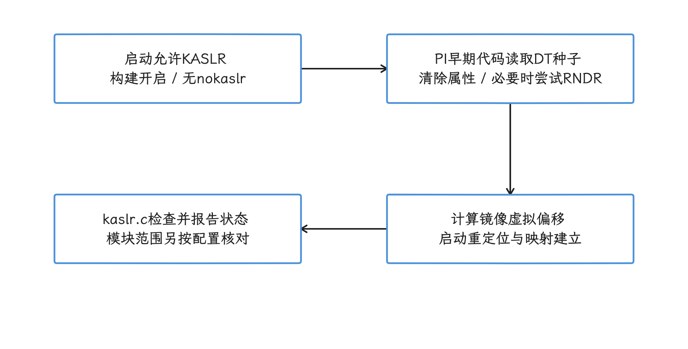

图：内核镜像偏移由早期种子计算，后续状态检查和模块随机区域各有独立入口。 r6 关闭 full module region 不等于模块地址固定；kallsyms 全零也可能只是指针暴露受限。

量产设备常用 `kptr_restrict` 限制内核指针暴露，`/proc/kallsyms` 可能把地址显示为全零——看到全零就断言 KASLR 失效，会误判。工程构建可结合最终配置、启动日志和多次冷启动后的符号地址检查；量产结论以厂商构建产物与启动链配置为依据。

### 3. KPTI：是否执行页表切换由 CPU 判定

KPTI（Kernel Page Table Isolation）用于隔离用户态与内核态页表。`CONFIG_UNMAP_KERNEL_AT_EL0` 的帮助文本描述了 ARM64 实现：CPU 在 EL0 运行时取消大部分内核映射；发生系统调用、中断或异常后，CPU 经 exception vector table（异常向量表） 找到入口，再由 trampoline page（仅保留入口所需映射的跳板页）恢复内核映射。

Android 17 的内核仍把该选项设为 `default y`。运行时策略比 Kconfig 值更具体，6.18 的启动参数文档对 `kpti=` 的定义是：

- 默认只在需要缓解的核心上启用；
- `kpti=0` 强制关闭；
- `kpti=1` 强制开启。

默认策略按 CPU capability、MIDR 型号/修订、架构特性与勘误选择，不能仅按产品名或上市年份列一张必定启停表。异构 SoC 还涉及系统能力合并与内核策略，不能把文档中的“需要缓解的核心”机械理解成每个核心独立采用完全不同的页表方案。用实际配置、启动日志、漏洞状态与能力匹配共同确认。

KPTI 的开销热点在用户态与内核态的往返路径上：系统调用、缺页异常和中断密集的负载优先测；纯用户态计算的数字，放到 Binder、网络或存储负载上会失真。TLB（Translation Lookaside Buffer） 缓存虚拟地址到物理地址的转换，ASID（Address Space Identifier） 用于区分不同地址空间的缓存项；页表切换对 TLB 的影响取决于 ASID、CPU 特性和内核实现，别按「每次都完整刷新 TLB」来推。

<!-- gracker-diagram: ch18-03-17-kpti -->
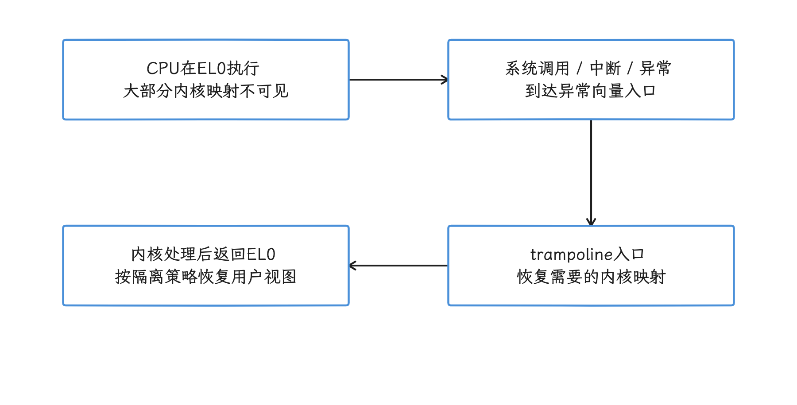

图：KPTI 生效时，用户态只保留入口所需内核映射，异常入口再恢复内核映射。 这是启用路径示意；CPU capability 和启动策略决定采用，ASID 与 TLB 行为不能简化为每次完整刷新。

### 4. ARM64 投机执行漏洞缓解

#### 4.1 Spectre v1：局部代码修复

Spectre v1 属于 bounds-check bypass（边界检查绕过）：CPU 可能在边界判断完成前推测执行后续访问。通用 `array_index_nospec()` 会调用架构提供的 mask 实现，6.18 ARM64 的 `array_index_mask_nospec()` 用比较结果生成全零或全一掩码，使越界索引失去可用值，并在返回前执行 `CSDB`，限制后续指令提前使用推测得到的数据。

<!-- gracker-diagram: ch18-03-18-spectre-v1 -->
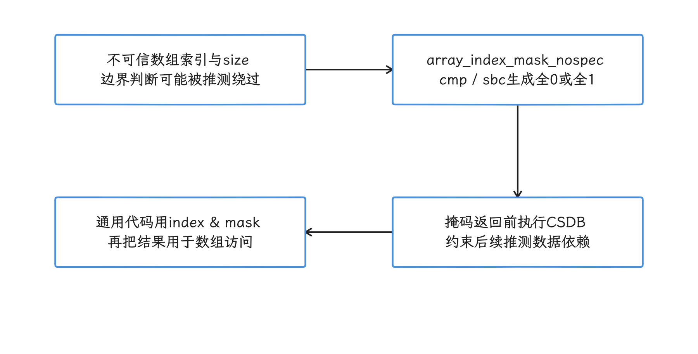

图：array_index_nospec 经架构掩码与 CSDB 限制越界推测索引的继续使用。 这是局部代码修复；SSBS 处理推测存储绕过，不能当作这条路径的通用替代。

`SSBS`（Speculative Store Bypass Safe）管的是 Spectre v4 相关的推测存储绕过，与这条数组索引修复路径是两码事。局部修复分布在各子系统中，开销跟着命中这些路径的次数走；如果性能回退集中在一个驱动或系统调用，我们就去检查该路径生成的指令和采样结果，把整机差异笼统归到 Spectre v1，定位就停在这里了。

#### 4.2 Spectre v2：CPU、固件和运行时代码选择

ARM64 的主实现位于 `arch/arm64/kernel/proton-pack.c`：内核先识别 CPU 是否受影响，再选择架构提供的硬件行为、固件调用、CPU 专用回调或内核指令序列。ARM64 alternatives 是其中一项启动期代码选择机制，内核启动时按 CPU 能力改写预留的指令片段；它参与部分异常入口和 BHB 缓解路径，代表不了 Spectre v2 处理方式的全貌。

Retpoline 是 x86 中常见的返回跳板软件方案，套到 Android ARM64 的 Spectre v2 主路径上会张冠李戴；`CONFIG_ARM64_BTI_KERNEL` 也不承担「替换 Retpoline」的职责——BTI 检查计算分支能否到达目标位置，Spectre v2 缓解约束的是推测执行利用分支预测状态的方式。

#### 4.3 Spectre-BHB 与 Speculative Store Bypass

BHB（Branch History Buffer）保存近期分支历史，攻击者可能借此影响后续推测路径；`CONFIG_MITIGATE_SPECTRE_BRANCH_HISTORY` 在 6.18 中为 `default y`，Kconfig 对处理方式的描述是：从用户态进入异常时，用一段分支序列或固件调用覆盖分支历史。`SB` 是 Speculation Barrier 指令，但具体 CPU 还可能使用 `ClearBHB`、分支循环、固件调用或硬件保证，实现形态别预先写死成「入口插入一条 `SB`」。

Speculative Store Bypass 走另一套控制：`ssbd=` 是 SSBD（Speculative Store Bypass Disable）的启动参数，支持 `force-on`、`force-off` 和 `kernel`；`kernel` 表示内核持续使用缓解，并允许用户线程通过 `prctl()` 按需请求。`prctl()` 是调整进程或线程行为的系统调用，核查时与 Spectre v1、v2、BHB 分头进行。


设备上的只读状态节点，比按 CPU 名称推断可靠得多；工程机可读取以下信息建立证据链。

```bash
adb shell 'cat /proc/cmdline'
adb shell 'if test -r /proc/bootconfig; then cat /proc/bootconfig; fi'
adb shell 'vuln_seen=0
for vuln_file in /sys/devices/system/cpu/vulnerabilities/*; do
  test -e "$vuln_file" || continue
  vuln_seen=1
  printf "%s: " "${vuln_file##*/}"
  cat "$vuln_file"
done
if test "$vuln_seen" = 0; then echo "vulnerability status unavailable" >&2; fi'
```

`/proc/cmdline` 与漏洞节点是内核报告的状态证据，不是全量固件或启动链证明；支持 bootconfig 的设备还可能从 `/proc/bootconfig` 接收附加参数。缺少或无权读取某节点时保留 unavailable，并按实际构建和厂商实现补证。报告某漏洞为 mitigated 不表示其他控制流/内存安全机制也已启用。

### 5. PAC、BTI、SCS 与 KCFI：四条控制流防线

#### 5.1 PAC：指针认证码

PAC（Pointer Authentication Code）把密钥、指针值及上下文计算成认证码，用于检测指针被替换或破坏；ARM64 用户态 PAC 支持由 `CONFIG_ARM64_PTR_AUTH` 控制。Linux 文档列出五个密钥：APIA、APIB 用于指令地址，APDA、APDB 用于数据地址，APGA 用于通用认证码。

内核在 `exec()` 时为进程初始化密钥，同一进程内的线程共享，`fork()` 后子进程继承；文档没有规定密钥必须由 `RNDR` 或 `RNDRRS` 指令直接生成，固定的进程创建耗时也就推导不出来。`CONFIG_ARM64_PTR_AUTH_KERNEL` 的范围更窄，只让编译器为内核函数返回地址加入保护，想当然写成「所有内核函数指针都会被 PAC 签名」就超出了它的实际范围；间接函数指针调用的前向保护，应查看 KCFI 与 BTI。

用户态通过 `HWCAP_PACA` 和 `HWCAP_PACG` 获知相应能力，HWCAP 是内核通过 ELF 辅助向量交给进程的硬件能力位。二进制是否使用 PAC，取决于生成的指令与运行库策略，硬件支持本身并不会给已有代码自动加入函数序言与尾声；ELF note 是二进制中的构建属性记录，可作静态侧的依据，反汇编中的 `PAC*`/`AUT*` 指令才能直接说明目标代码包含认证序列。


#### 5.2 BTI：限制间接分支入口

`CONFIG_ARM64_BTI` 允许内核为用户态提供 BTI 支持，`CONFIG_ARM64_BTI_KERNEL` 让内核及其模块带有 BTI 标记并在硬件支持时执行检查，后者依赖 PAC 内核配置和编译器的 `-mbranch-protection` 能力。BTI（Branch Target Identification）把合法目标缩小到带相应 landing pad 的位置：landing pad 是编译器放在允许入口处的兼容指令，常见形式为 `BTI`，CPU 可拒绝间接分支跳入其他位置。BTI 与 PAC 配合保护控制流，覆盖面仍取决于全部参与链接和加载的代码是否带兼容属性，内核模块也必须满足同一要求。

#### 5.3 Shadow Call Stack

SCS 为返回地址维护独立 shadow stack，提供后向控制流保护。r6 GKI 不仅设 `CONFIG_SHADOW_CALL_STACK=y`，还设 `CONFIG_UNWIND_PATCH_PAC_INTO_SCS=y`：早期 map_kernel 根据内核配置和 CPU PAC/BTI 支持决定是否启用动态 SCS；满足相应 PAC 或 BTI 条件时不改写，否则可把 PACIASP/AUTIASP 改为影子栈 push/pop。不能把配置表中的 PAC、BTI、SCS 简单当作同一条返回路径上始终叠加的三份成本。该内核路径与用户态 GCS ABI 仍分开。

<!-- gracker-diagram: ch18-03-22-dynamic-scs -->
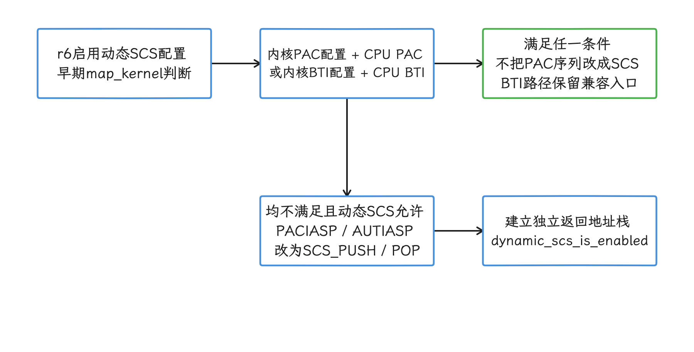

图：r6 早期启动按内核配置与 CPU PAC/BTI 支持，选择保留指令还是动态改写为 SCS。 不能把 PAC、BTI、SCS 配置项当作同一返回路径始终叠加三份成本；该路径不等于用户态 GCS。

#### 5.4 KCFI

6.18 的 `CONFIG_CFI` 使用 KCFI（Kernel Control-Flow Integrity），编译器在间接函数调用处加入类型检查，只允许目标落到静态类型匹配的函数。这里的前向保护指调用者到间接调用目标的边，SCS 和 PAC return-address protection 则处理函数返回路径。

<!-- gracker-diagram: ch18-03-21-bti-kcfi -->
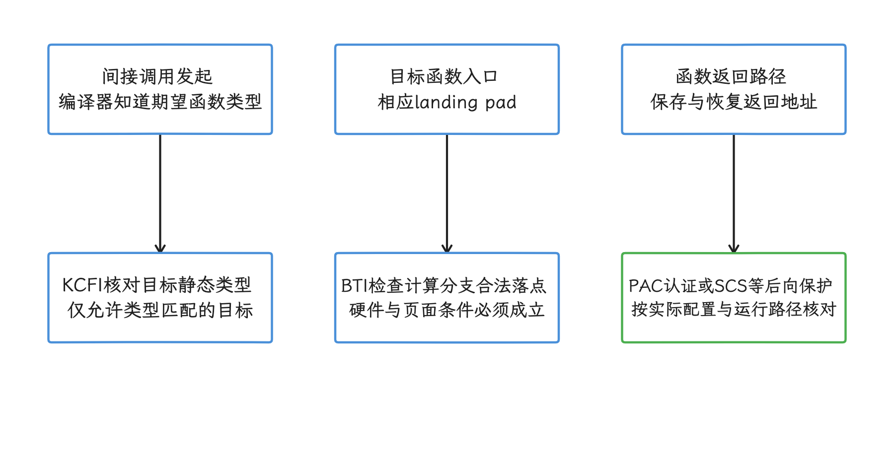

图：KCFI 检查间接调用的静态类型，BTI 约束硬件允许的计算分支落点。 返回路径的 PAC/SCS 与前向保护分开；覆盖还取决于构建、CPU、全部链接模块和加载映射。

检查本地 ELF 是否声明 AArch64 branch protection（PAC/BTI 分支保护），用 NDK 中对应版本的 `llvm-readelf`；下面的命令观察 GNU property 和 note，回答的是静态声明问题，运行时硬件是否执行检查还要另找依据。

```bash
llvm-readelf -n libexample.so
llvm-objdump -d libexample.so |
  grep -E '(^|[[:space:]])(bti|paci[ab]sp|auti[ab]sp|reta[ab])([[:space:]]|$)'
```

ELF note 描述构建属性，反汇编仅抽查若干 BTI/PAC/认证返回形式；没匹配这些例子不证明全部代码没有保护，旧工具还可能把指令显示成兼容 HINT。完整覆盖要看参与链接的静态/共享库、加载映射、AArch64 进程 HWCAP 和运行时页属性；声明、指令存在与硬件实际执行检查分别取证。


### 6. MTE 标签粒度与内存开销

MTE 对每 16 字节 allocation granule 保存 4 位 allocation tag，指针携带 logical tag，访问时比较匹配关系。同步 fault 可给出故障地址与精确指令，异步 SIGSEGV 可汇报此前一次或多次错误且 si_addr 为 0，不能据异步崩溃现场反推唯一出错指令。asymmetric 模式读同步、写异步；最终模式还取决于请求集合、CPU 能力与每 CPU 的偏好。

<!-- gracker-diagram: ch18-03-24-mte-tags -->
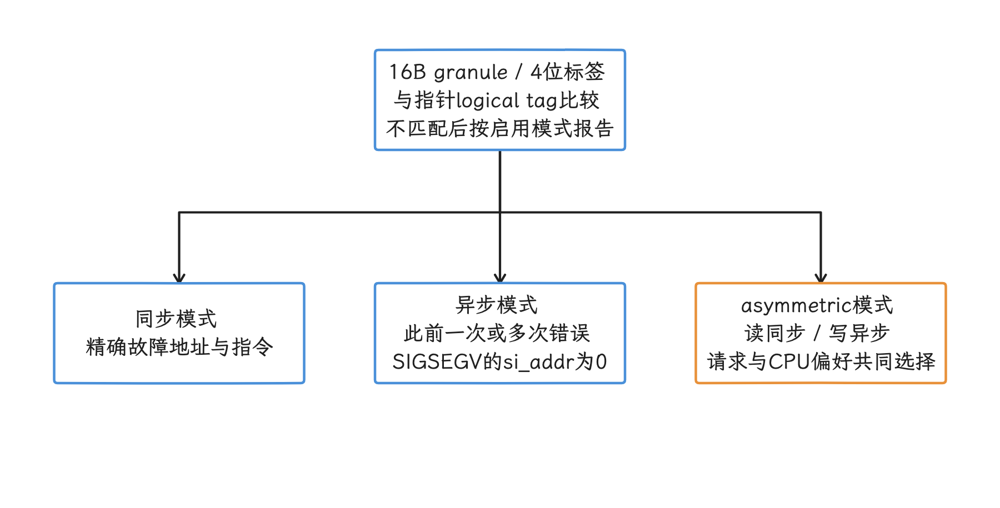

图：MTE 比较指针 logical tag 与每 16 字节 granule 的 4 位 allocation tag，报告模式决定定位精度。 硬件、映射和线程模式共同生效；异步信号可合并此前错误，不能从崩溃现场推出唯一故障指令。

内核支持由 `CONFIG_ARM64_MTE` 控制，硬件与内核同时支持时通过 `HWCAP2_MTE` 告知用户空间。带标签的页只能来自使用 `PROT_MTE` 的匿名映射或 RAM-backed 文件映射，例如 tmpfs 或 `memfd`——RAM-backed 表示内容由内存页支撑，不是普通持久化文件。线程还要通过 `PR_SET_TAGGED_ADDR_CTRL` 设置 tagged-address ABI（允许地址高位携带标签的约定） 与 fault mode（标签错误的报告模式），前者允许地址高位携带标签，后者决定标签错误怎么报告。Android 应用通常由 `android:memtagMode`、runtime（运行时） 和 Scudo 分配器完成进程级原生堆配置，不要求业务代码逐个调用 `mmap()`。

那 4 位标签是架构标签存储格式，换算不出「PSS（Proportional Set Size） 固定增加 3% 或 5%」这样的结论；标签存储、分配器元数据、页提交、工作集和故障模式对 CPU 与内存指标的影响各不相同。评估 MTE 时我们至少分别记录：

- 进程 PSS、RSS（Resident Set Size）、匿名页和 swap；
- 分配速率、释放速率与 Scudo 路径；
- 同步 fault 的定位收益和用户可见延迟；
- 异步 fault 的发现延迟与崩溃归因；
- 同一业务脚本下的 CPU time、帧时间和功耗。

PSS 按页共享关系分摊驻留页，RSS 统计驻留集合；Swap/SwapPss 则分别反映换出页与其比例分摊口径，匿名页之外还需留意 tmpfs/shmem 等可交换页。这些指标口径不同，应同时查看；Scudo 是 Android 使用的强化型原生堆分配器，分配与释放策略也会影响 MTE 的观测结果。


[§4.9](../../part1-fundamentals/ch04-memory/09-android17-memory-tagging-extension-mte.md) 讨论 MTE 的进程配置，[§20.11](../../part5-app/ch20-stability/11-mte-gwp-asan-native-memory-safety.md) 讨论崩溃检测与治理；本节只限定内核能力与性能测量的范围。

### 7. GCS：Android 17 内核提供用户态 ABI

GCS（Guarded Control Stack）为用户态线程维护一份受硬件保护的返回地址栈；`CONFIG_ARM64_GCS` 位于 ARMv9.4 架构特性菜单，6.18 Kconfig 将其设为 `default y`。这个配置让内核在硬件存在时提供 GCS 用户 ABI，Linux 内核函数并不会自动改用 GCS。

AArch64 用户态用 AT_HWCAP 的 `HWCAP_GCS` 探测支持，再按线程通过 `PR_SET_SHADOW_STACK_STATUS` 启用。新线程继承创建者配置，exec 会关闭；应由运行库/加载器在合适的早期时点接入，普通函数里突然开启后通常无法沿未建立 GCS 记录的旧调用栈正常返回。GCS 控制保护错误可报 SIGSEGV/SEGV_CPERR，普通内存访问 fault 仍按相应内存异常处理；smaps 的 ss 标志只说明映射具有 shadow-stack 属性，不独立证明每个目标线程当前已开启检查。

所以这里拆成三件独立的事：`CONFIG_ARM64_GCS=y`、CPU 支持 GCS、Android runtime 或 native 程序启用 GCS。进程侧的记录拿不到时，GCS 开销先别计入应用，每次调用的固定周期数也给不出来。

<!-- gracker-diagram: ch18-03-26-gcs -->
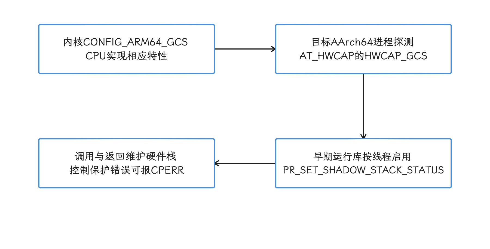

图：GCS 从 CPU 和内核 ABI 到线程启用，再建立受保护返回地址记录。 应在运行库或加载器的合适早期时点接入；新线程继承而 exec 关闭，smaps 的 ss 不能独立证明线程开启。

### 8. 设备核查方法

#### 8.1 核对构建与启动状态

工程构建可尝试读取压缩内核配置；量产设备往往不暴露 `/proc/config.gz`，此时改读构建生成的 `.config` 或厂商发布的内核构建产物（kernel build artifact）。

```bash
adb shell 'if test -r /proc/config.gz; then
  zcat /proc/config.gz |
    grep -E "^(# )?CONFIG_(RANDOMIZE_BASE|RANDOMIZE_MODULE_REGION_FULL|UNMAP_KERNEL_AT_EL0|MITIGATE_SPECTRE_BRANCH_HISTORY|ARM64_PTR_AUTH(_KERNEL)?|ARM64_BTI(_KERNEL)?|ARM64_MTE|ARM64_GCS|SHADOW_CALL_STACK|UNWIND_PATCH_PAC_INTO_SCS|CFI)(=| is not set)"
else
  echo "kernel config unavailable" >&2
  exit 1
fi'
adb shell 'cat /proc/cmdline'
adb shell 'grep -E "paca|pacg|bti|mte|gcs" /proc/cpuinfo'
```

这些只读命令分别读取编译配置、启动命令行和内核公布的 CPU feature。压缩配置不可用时不能当作选项全关；`# CONFIG_… is not set` 与没有输出也要区分。用户态实际能力还应以目标架构进程的 ELF auxiliary vector 为准，PAC/BTI/MTE/GCS 的线程与映射状态需继续核实，不能从 cpuinfo 一步推出执行覆盖。


#### 8.2 为工作负载建立归因

归因按路径选指标。下表中的 PMU（Performance Monitoring Unit） 事件指 CPU 硬件计数器记录的周期、分支、缓存或 TLB 等事件，事件名称和可用范围由 SoC 决定。

| 怀疑对象 | 适合的负载 | 需要记录 |
|---|---|---|
| KASLR | 冷启动与内核阶段启动 | 同一镜像的启动阶段时间点、重定位日志、样本分布 |
| KPTI | 高频短系统调用、Binder、网络、存储 | 系统调用率、内核/用户 CPU time、调度与 TLB 相关 PMU 事件 |
| Spectre v2/BHB | 频繁进出内核、间接分支密集路径 | CPU 型号、漏洞状态、固件版本、分支预测相关 PMU 事件 |
| PAC/BTI/SCS/KCFI | native 与内核控制流密集负载 | 指令数、cycles、branch miss、文本大小、调用栈分布 |
| MTE | native 分配与访存密集负载 | fault mode、分配器指标、PSS/RSS、CPU time、功耗 |
| GCS | 明确启用 GCS 的 native 进程 | 线程状态、`smaps`、调用密度、fault 记录 |

`simpleperf` 适合核对指令、周期和分支事件，Perfetto 适合把调度、Binder、缺页、I/O 与业务阶段放到同一时间轴；PMU 事件名称随 SoC 和内核权限变化，采集前先跑 `simpleperf list`，只使用设备公布的事件。确认设备支持哪些事件后，再对一个可重复的 native workload（原生测试负载） 采样：

```bash
adb shell simpleperf list
adb shell simpleperf stat \
  -e task-clock,cycles,instructions,branches,branch-misses \
  -- /data/local/tmp/security_bench
```

拿输出可以算 IPC（instructions per cycle，每周期指令数，此处不是进程间通信）；IPC 用可比较的 instructions/cycles 计数，branch-miss 比例用 branch-misses/branches，分母为零或事件不可用时保留 unknown。每次业务操作的 cycles 还需准确操作数；PMU 复用时核对计数缩放和运行时间覆盖。单次采样撑不起归因，预热、固定业务输入、记录温度与频率状态都要做。


#### 8.3 A/B 测试的安全边界

关闭缓解只适用于隔离实验室中的可丢弃工程镜像，测试设备不得承载账号、密钥、个人数据或生产网络访问；每个实验只改一个因素，并保留完整的 boot image、内核配置、启动参数和固件版本。

6.18 文档中与 ARM64 相关的参数如下：

| 参数 | 6.18 定义 | 审计提示 |
|---|---|---|
| `nokaslr` | 关闭内核与模块 base offset ASLR | 独立于 `mitigations=off` |
| `kpti=0` / `kpti=1` | 强制关闭或开启页表隔离 | 默认值是“在需要缓解的核心上开启” |
| `nospectre_v2` | 关闭 ARM64 Spectre v2 缓解 | 会暴露数据泄漏风险 |
| `nospectre_bhb` | 关闭 ARM64 Spectre-BHB 缓解 | 会暴露数据泄漏风险 |
| `ssbd=force-off` | 关闭 Speculative Store Bypass 缓解 | 与 Spectre v1/v2 分开 |
| `arm64.nopauth` | 关闭 Pointer Authentication 支持 | 影响内核公布与使用该能力 |
| `arm64.nomte` | 关闭 MTE 支持 | 影响内核公布与使用该能力 |
| `mitigations=off` | 关闭一组可选 CPU 漏洞缓解 | 不会自动关闭 KASLR |

`nospectre_v1` 在该文档中只标记为 x86 与 PowerPC 参数，ARM64 测试方案里没有这一项；旧写法 `nopti` 也顶替不了 ARM64 文档明确给出的 `kpti=0`。每组测试应执行多轮并交错顺序，报告中给出分位数、离散程度和热状态；若差异小于样本噪声，应记录为「当前负载未检出差异」，避免把微基准结果外推到整机体验。

#### 8.4 应用侧可见的补丁状态

AndroidX Security 发布说明显示，`androidx.security:security-state:1.1.0` 提供 `SecurityPatchState`，可查询 System、System Modules（Mainline）和 Kernel 的安全补丁状态；`androidx.security:security-state-provider:1.0.0` 提供 `UpdateInfoService`，让 OEM OTA 客户端、Google Play System Update 等更新提供方发布 ASPL（Available Security Patch Level，可用安全补丁级别）。

这组 API 适合回答设备当前补丁状态、是否存在可安装的安全更新，以及某个 CVE 是否已由厂商补充补丁记录（vendor supplemental patch records）覆盖；`areCvesPatched()` 会把这类补充记录纳入判断。它接替不了本节前面的 `.config`、启动参数、CPU capability、漏洞状态节点和负载测试：Security State 给出的是软件补丁合规性与可用更新状态，KPTI、BTI、MTE、GCS 等机制在当前内核路径或进程里的启用细节和运行成本，都在它的回答范围之外。


### 9. 应用与系统性能优化边界

内核缓解策略通常轮不到应用开发者改，拿关闭安全机制换分数更不可取；性能工作从可控路径入手：

- 用 Perfetto 统计 Binder transaction（一次 Binder 驱动事务）、系统调用、I/O 和调度等待，确认时间花在哪个阶段；
- 批量 Binder 请求前先检查接口语义、错误处理和延迟预算，避免只为减少调用次数扩大单次事务；
- 共享内存适合大块数据传输，但同步、生命周期、权限和一致性成本需要计入；
- native 热点根据 profile 结果决定内联、数据布局或间接调用调整，为躲避 KCFI/BTI 而破坏类型安全这条路别走；
- NDK 库启用 branch protection 时，要核查全部静态库、共享库和装载路径的兼容性；
- MTE 的同步模式适合需要精确故障地址的验证阶段，生产策略要结合崩溃治理、性能和设备覆盖率。

Android NDK 的 Native APIs 文档没有把 `io_uring` 列为 Android 原生 API；直接调用它，面对的是 Linux kernel UAPI，即内核与用户空间之间的底层接口。某个 GKI 构建即使含有实现，SELinux 强制访问控制、seccomp 系统调用过滤器、系统调用可用性和 Android API 兼容范围仍可能限制普通应用；目标设备、应用沙箱和兼容范围都经过验证后，才能把它作为特定场景方案。


### 10. 核查清单

- [ ] 平台结论锚定 `android-17.0.0_r1`，内核结论锚定 `android17-6.18-2026-06_r6`
- [ ] 使用最终 `.config`，没有把 Kconfig 的 `default y` 写成设备启用证明
- [ ] 同时记录 CPU 型号、固件版本、启动参数和漏洞状态节点
- [ ] 没有把 BTI 写成 Spectre v2 或 Retpoline 的替代机制
- [ ] 没有把 SSBS 写成 Spectre v1 的通用屏障
- [ ] PAC kernel 的范围限定为返回地址保护
- [ ] SCS、KCFI、PAC、BTI 与 GCS 的保护对象分开说明
- [ ] MTE 标签位数没有直接换算成固定 PSS 增量
- [ ] 性能数字来自当前设备、当前镜像和可复现测试负载
- [ ] 关闭缓解的对照实验只在隔离工程设备上执行

### 11. ARM64 核查入口

- [ARM64 Kconfig：KPTI、BHB、PAC、BTI、MTE、GCS 与 KASLR](https://android.googlesource.com/kernel/common/+/refs/tags/android17-6.18-2026-06_r6/arch/arm64/Kconfig)
- [Android 17 GKI `gki_defconfig`](https://android.googlesource.com/kernel/common/+/refs/tags/android17-6.18-2026-06_r6/arch/arm64/configs/gki_defconfig)
- [通用 arch Kconfig：Shadow Call Stack 与 KCFI](https://android.googlesource.com/kernel/common/+/refs/tags/android17-6.18-2026-06_r6/arch/Kconfig)
- [r6 KASLR 早期种子与镜像偏移](https://android.googlesource.com/kernel/common/+/refs/tags/android17-6.18-2026-06_r6/arch/arm64/kernel/pi/kaslr_early.c)
- [ARM64 KASLR 状态检查](https://android.googlesource.com/kernel/common/+/refs/tags/android17-6.18-2026-06_r6/arch/arm64/kernel/kaslr.c)
- [ARM64 Spectre 与 SSBD 运行时实现](https://android.googlesource.com/kernel/common/+/refs/tags/android17-6.18-2026-06_r6/arch/arm64/kernel/proton-pack.c)
- [通用 `array_index_nospec()`](https://android.googlesource.com/kernel/common/+/refs/tags/android17-6.18-2026-06_r6/include/linux/nospec.h)
- [ARM64 `array_index_mask_nospec()` 与 `CSDB`](https://android.googlesource.com/kernel/common/+/refs/tags/android17-6.18-2026-06_r6/arch/arm64/include/asm/barrier.h)
- [ARM64 异常入口实现](https://android.googlesource.com/kernel/common/+/refs/tags/android17-6.18-2026-06_r6/arch/arm64/kernel/entry.S)
- [Linux 6.18 启动参数](https://android.googlesource.com/kernel/common/+/refs/tags/android17-6.18-2026-06_r6/Documentation/admin-guide/kernel-parameters.txt)
- [ARM64 Pointer Authentication 用户 ABI](https://android.googlesource.com/kernel/common/+/refs/tags/android17-6.18-2026-06_r6/Documentation/arch/arm64/pointer-authentication.rst)
- [ARM64 Memory Tagging Extension 用户 ABI](https://android.googlesource.com/kernel/common/+/refs/tags/android17-6.18-2026-06_r6/Documentation/arch/arm64/memory-tagging-extension.rst)
- [ARM64 Guarded Control Stack 用户 ABI](https://android.googlesource.com/kernel/common/+/refs/tags/android17-6.18-2026-06_r6/Documentation/arch/arm64/gcs.rst)
- [Android MTE 进程配置](https://source.android.com/docs/security/test/memory-safety/arm-mte)
- [Android NDK Native APIs](https://developer.android.com/ndk/guides/stable_apis)

## 小结

GKI 6.18 的调度、存储、页面回收和构建优化，要分别确认配置与运行状态，源码中存在某个机制，离设备采用它还隔着验证；ARM64 安全特性又受最终 `.config`、CPU/固件能力、启动参数和进程启用方式共同约束。性能对照必须保持这些条件一致，以目标工作负载的调度、I/O、PMU、内存与安全状态判断成本；关闭缓解的工程镜像替代不了量产结论。

## 参考资料

- [Android 17 GKI 6.18 release builds：r6 tag 与 SHA](https://source.android.com/docs/core/architecture/kernel/gki-android17-6_18-release-builds)
- [`android15-6.6` 分支](https://android.googlesource.com/kernel/common/+/refs/heads/android15-6.6)
- [`android16-6.12` 分支](https://android.googlesource.com/kernel/common/+/refs/heads/android16-6.12)
- [`android17-6.18-2026-06_r6` 源码根目录](https://android.googlesource.com/kernel/common/+/refs/tags/android17-6.18-2026-06_r6)
- [r6 `Makefile`：Linux 6.18.21](https://android.googlesource.com/kernel/common/+/refs/tags/android17-6.18-2026-06_r6/Makefile)
- [r6 GKI `gki_defconfig`](https://android.googlesource.com/kernel/common/+/refs/tags/android17-6.18-2026-06_r6/arch/arm64/configs/gki_defconfig)
- [r6 动态 SCS 启用决策](https://android.googlesource.com/kernel/common/+/refs/tags/android17-6.18-2026-06_r6/arch/arm64/kernel/pi/map_kernel.c)
- [r6 PAC 到 SCS 指令改写](https://android.googlesource.com/kernel/common/+/refs/tags/android17-6.18-2026-06_r6/arch/arm64/kernel/pi/patch-scs.c)
- [SQLite synchronous 与 WAL 同步](https://www.sqlite.org/pragma.html#pragma_synchronous)
- [EEVDF 内核文档](https://android.googlesource.com/kernel/common/+/refs/tags/android17-6.18-2026-06_r6/Documentation/scheduler/sched-eevdf.rst)
- [r6 fair scheduler 源码](https://android.googlesource.com/kernel/common/+/refs/tags/android17-6.18-2026-06_r6/kernel/sched/fair.c)
- [sched_ext 内核文档](https://android.googlesource.com/kernel/common/+/refs/tags/android17-6.18-2026-06_r6/Documentation/scheduler/sched-ext.rst)
- [r6 sched_ext 源码](https://android.googlesource.com/kernel/common/+/refs/tags/android17-6.18-2026-06_r6/kernel/sched/ext.c)
- [F2FS 内核文档：`checkpoint_merge`](https://android.googlesource.com/kernel/common/+/refs/tags/android17-6.18-2026-06_r6/Documentation/filesystems/f2fs.rst)
- [r6 F2FS `fsync()` 判定路径](https://android.googlesource.com/kernel/common/+/refs/tags/android17-6.18-2026-06_r6/fs/f2fs/file.c)
- [r6 F2FS checkpoint 实现](https://android.googlesource.com/kernel/common/+/refs/tags/android17-6.18-2026-06_r6/fs/f2fs/checkpoint.c)
- [r6 io_uring 源码目录](https://android.googlesource.com/kernel/common/+/refs/tags/android17-6.18-2026-06_r6/io_uring/)
- [dm-verity r6 实现](https://android.googlesource.com/kernel/common/+/refs/tags/android17-6.18-2026-06_r6/drivers/md/dm-verity-target.c)
- [dm-verity multi-buffer hashing v8 patch 与测试口径（未合入 r6）](https://lists.infradead.org/pipermail/linux-arm-kernel/2025-February/1000047.html)
- [MGLRU 内核文档](https://android.googlesource.com/kernel/common/+/refs/tags/android17-6.18-2026-06_r6/Documentation/admin-guide/mm/multigen_lru.rst)
- [Android lmkd：内存压力信号与回收策略](https://source.android.com/docs/core/perf/lmkd)
- [AOSP `lmkd.cpp` Android 17 tag](https://android.googlesource.com/platform/system/memory/lmkd/+/refs/tags/android-17.0.0_r1/lmkd.cpp)
- [r6 AutoFDO profile README](https://android.googlesource.com/kernel/common/+show/refs/tags/android17-6.18-2026-06_r6/gki/aarch64/afdo/README.md)
- [Android Developers Blog：Kernel AutoFDO 投放与采集流程](https://android-developers.googleblog.com/2026/03/BoostingAndroid%20PerformanceIntroducingAutoFDO.html)
- [AOSP `external/liburing` Android 17 `Android.bp`](https://android.googlesource.com/platform/external/liburing/+/refs/tags/android-17.0.0_r1/Android.bp)
- [AndroidX Security release notes：Security-State 1.1.0 与 Security-State-Provider 1.0.0](https://developer.android.com/jetpack/androidx/releases/security)
- [AndroidX 新增 Security State，支持可编程的系统安全状态查询](https://juejin.cn/post/7687807835842248710)
